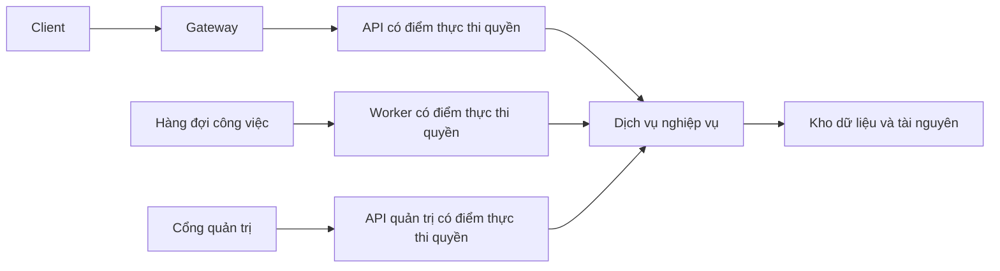

# Authorization boundary

## 1. Ranh giới phân quyền là gì?

**Authorization boundary** là ranh giới tại đó hệ thống phải quyết định và thực thi việc một chủ thể có được thực hiện một hành động trên một tài nguyên trong ngữ cảnh cụ thể hay không.

Ví dụ, một người dùng đăng nhập vào hệ thống hỗ trợ khách hàng và được phép đọc phiếu của tenant A. Khi họ yêu cầu phiếu thuộc tenant B, ứng dụng phải ngăn truy cập dù request có phiên đăng nhập hợp lệ và đi qua cùng một gateway.

Một ranh giới phân quyền hữu ích cần xác định được bốn thành phần:

```text
Chủ thể nào
  → muốn thực hiện hành động gì
  → trên tài nguyên nào
  → trong phạm vi và ngữ cảnh nào
```

Nơi kiểm tra quyền có thể là API, dịch vụ nghiệp vụ, worker xử lý job hoặc thành phần phát hành quyền truy cập tệp. Không nên mặc định đó chỉ là một lớp kiểm tra vai trò ở đầu request HTTP.

## 2. Phân biệt ranh giới phân quyền với các ranh giới khác

Một hệ thống có thể đồng thời có ranh giới mạng, ranh giới xác thực, ranh giới tenant và ranh giới dữ liệu. Chúng hỗ trợ nhau nhưng không thay thế cho nhau.

| Ranh giới | Điều nó giúp xác định | Điều chưa được giải quyết chỉ bằng ranh giới đó |
| --- | --- | --- |
| Mạng | Request có thể kết nối tới dịch vụ nào | Người dùng được đọc bản ghi nào |
| Xác thực | Danh tính hoặc thông tin xác thực có hợp lệ theo hợp đồng không | Hành động yêu cầu có được phép không |
| Tenant | Dữ liệu và quyền thuộc phạm vi tổ chức nào | Quyền chi tiết giữa người dùng trong cùng tenant |
| Ứng dụng hoặc API | Bên gọi được sử dụng chức năng tổng quát nào | Quyền trên từng đối tượng và từng trường |
| Tài nguyên | Chủ thể có quyền với đối tượng cụ thể nào | Quyền cho mọi hành động hoặc mọi thuộc tính của đối tượng |

“Đang ở mạng nội bộ”, “đã qua gateway” và “token hợp lệ” đều chưa đủ để kết luận được phép đọc một tài nguyên cụ thể.

Tương tự, việc một ID khó đoán không tạo ra quyền. Nếu người gọi biết hoặc lấy được ID của phiếu khác, hệ thống vẫn phải kiểm tra quyền trên phiếu đó. Định danh và quyền truy cập là hai khái niệm riêng.

## 3. Xác định ranh giới theo tài nguyên và hành động

Một hành động cần được đặt tên theo nghiệp vụ thay vì chỉ dựa vào HTTP method. Cùng là `POST`, request có thể tạo phiếu, phân công người xử lý hoặc xuất toàn bộ dữ liệu; mức quyền cần thiết khác nhau.

Ví dụ cho hệ thống hỗ trợ:

| Hành động | Tài nguyên hoặc phạm vi | Điều kiện minh họa |
| --- | --- | --- |
| `ticket.read` | Một phiếu cụ thể | Thuộc tenant được phép và nằm trong phạm vi đọc |
| `ticket.update` | Nội dung có thể chỉnh sửa | Được sửa phiếu ở trạng thái hiện tại |
| `ticket.assign` | Người xử lý của phiếu | Có quyền phân công và người nhận thuộc phạm vi phù hợp |
| `ticket.export` | Tập phiếu | Có quyền xuất và từng dữ liệu xuất nằm trong phạm vi cho phép |
| `ticket.attachment.read` | Một tệp đính kèm | Có quyền với tệp và quan hệ với phiếu theo chính sách |
| `ticket.internal_note.read` | Ghi chú nội bộ | Có quyền xem phần nội bộ, không chỉ quyền đọc phiếu chung |

Quyền đọc một phiếu không tự bao gồm quyền xem ghi chú nội bộ. Quyền cập nhật nội dung không tự bao gồm quyền đổi tenant, owner hoặc danh sách người được truy cập.

Các trường ảnh hưởng tới quyền cần có hành động hoặc kiểm tra riêng. Nếu API cho phép gán mọi trường từ JSON vào đối tượng lưu trữ, người gọi có thể thay đổi chính điều kiện mà hệ thống dùng để đánh giá quyền.

## 4. Xây dựng ngữ cảnh đáng tin cậy trước khi đánh giá

Một yêu cầu phân quyền có thể gồm subject, action, resource và context. Chất lượng quyết định phụ thuộc vào việc các giá trị này đến từ đâu.

| Dữ liệu đầu vào | Nguồn nên được kiểm tra |
| --- | --- |
| Danh tính chủ thể | Phiên, token hoặc cơ chế xác thực đã được xác minh |
| Quyền gọi của workload | Danh tính dịch vụ và phạm vi tích hợp được cấp |
| Tenant được chọn | Cấu hình hoặc ngữ cảnh danh tính có thẩm quyền, cùng kiểm tra quyền tham gia |
| Tenant, owner, trạng thái của tài nguyên | Dữ liệu phía server từ nguồn có thẩm quyền |
| Vai trò, nhóm, quan hệ | Nguồn quyền đã xác định và yêu cầu độ mới phù hợp |
| Hành động | Ánh xạ phía server từ chức năng thực sự được gọi |

Nếu URL chứa `/tenants/A/tickets/123`, giá trị A là lựa chọn do người gọi đưa vào, không phải bằng chứng họ được truy cập tenant A. Hệ thống cần xác minh lựa chọn đó với phạm vi đã được cấp, rồi bảo đảm tài nguyên 123 cũng thuộc đúng tenant.

Tương tự, không tin `owner_id`, `role` hoặc `department` trong body làm thuộc tính hiện tại của chủ thể hay tài nguyên. Những trường do người gọi đề nghị thay đổi phải được phân biệt với dữ liệu được dùng để quyết định quyền.

### Token không phải quyết định cho mọi tài nguyên

API cần kiểm tra loại thông tin xác thực, bên phát hành, bên nhận, thời hạn và các điều kiện khác theo hợp đồng sử dụng của nó. Một token phù hợp với ứng dụng khác không tự có hiệu lực cho API đang gọi; thông tin phục vụ đăng nhập cũng không tự trở thành quyền gọi mọi API.

Ngay cả khi token đã được xác minh và có scope hoặc vai trò thích hợp, dịch vụ vẫn có thể cần kiểm tra tenant, owner, trạng thái tài nguyên và quan hệ hiện tại. Các claim thường không biểu đạt toàn bộ dữ liệu cần cho quyết định mức đối tượng.

## 5. Đặt điểm thực thi trên mọi đường tới tài nguyên

Một kiến trúc có thể có nhiều đường truy cập:



Sơ đồ không yêu cầu mọi lớp lặp lại cùng một kiểm tra. Nó thể hiện rằng mỗi đường được phép tới hành động bảo vệ phải có nơi chịu trách nhiệm thực thi quyền phù hợp.

Gateway có thể kiểm tra danh tính và quyền gọi một nhóm endpoint. Dịch vụ nghiệp vụ có dữ liệu để kiểm tra quyền trên phiếu cụ thể. Storage có thể có thêm giới hạn tenant hoặc quyền workload để giảm phạm vi truy cập. Các lớp này bảo vệ những trách nhiệm khác nhau.

Nếu chỉ kiểm tra tại controller nhưng một job nền gọi thẳng hàm nghiệp vụ có khả năng đọc mọi tenant, cần xác định quyền riêng của job đó. Không được coi “không đi qua HTTP” là lý do để bỏ mô hình quyền.

Tương tự, API quản trị, endpoint cũ, luồng tải tệp và công cụ hỗ trợ không nên trở thành đường đi vòng quanh kiểm tra chỉ vì không xuất hiện trên giao diện chính.

## 6. Gateway và header danh tính

Một gateway có thể xác thực người dùng rồi truyền ngữ cảnh xuống dịch vụ. Cách này chỉ đáng tin khi dịch vụ có thể xác minh nguồn truyền ngữ cảnh và người gọi bên ngoài không thể tự giả mạo cùng dữ liệu.

Ví dụ, một header `X-User-Role: admin` không tự có thẩm quyền chỉ vì tên của nó giống header nội bộ. Điểm tiếp nhận cần xử lý các giá trị do client gửi vào, và đường gọi giữa các thành phần phải có cơ chế xác thực, bảo vệ phù hợp.

Nếu dịch vụ có một endpoint có thể được gọi trực tiếp, nó không được mặc định mọi request đều đã đi qua gateway. Cần kiểm soát đường truy cập hoặc thực hiện xác minh thích hợp tại chính dịch vụ theo kiến trúc đã chọn.

Xác thực workload gọi vào cũng không đủ để gán mọi quyền người dùng. Dịch vụ nhận cần phân biệt ai là bên gọi kỹ thuật, ai là người được đại diện và phạm vi ủy quyền nào đã được xác minh.

## 7. Ngăn quyền dịch vụ bị dùng thay cho quyền người gọi

Một dịch vụ hỗ trợ có thể có tài khoản kỹ thuật đọc nhiều phiếu để thực hiện chức năng. Nếu nó nhận một `ticket_id` bất kỳ từ người dùng rồi đọc bằng quyền kỹ thuật đó và trả kết quả, người dùng có thể nhận dữ liệu ngoài phạm vi của mình.

Đây là một dạng rủi ro khi thành phần có quyền rộng bị sử dụng như bên thực hiện thay mà không giữ giới hạn của người yêu cầu.

Để tránh, hệ thống cần xác định rõ hành động thuộc loại nào:

- Hành động thay người dùng: quyền hiệu lực phải phản ánh chủ thể, sự ủy quyền và phạm vi tài nguyên liên quan.
- Hành động tự chủ của dịch vụ: cần quyền workload cụ thể cho nhiệm vụ và nguồn yêu cầu đáng tin cậy.
- Hành động quản trị: cần quyền quản trị được cấp rõ, với phạm vi và audit phù hợp.

Không chuyển mọi request thành “hành động hệ thống” để thuận tiện. Quyền kỹ thuật dùng để truy cập storage không tự thay thế quyền nghiệp vụ đối với dữ liệu trả ra.

Nếu dịch vụ B nhận ngữ cảnh do dịch vụ A chuyển tiếp, B cần biết A có được phép đại diện và đưa ra những thông tin nào. Không mặc định mọi claim do một dịch vụ nội bộ gửi đều có cùng thẩm quyền.

## 8. Kiểm tra và sử dụng tài nguyên trong trạng thái nhất quán

Một mẫu xử lý ở mức ý tưởng:

```text
readTicket(request):
    subject = authenticateRequest(request)
    tenant = resolveAndValidateSelectedTenant(subject, request.tenantId)
    ticket = loadTicketWithinTenant(tenant, request.ticketId)

    decision = authorize(subject, "ticket.read", ticket)
    requirePermit(decision)

    return projectFieldsAllowedByDecision(ticket, decision)
```

Hàm tải theo tenant giảm nguy cơ lấy nhầm dữ liệu ngoài namespace. Kiểm tra quyền sau đó vẫn cần thiết cho các giới hạn trong cùng tenant. Không coi một bước là thay thế toàn bộ bước còn lại.

Với hành động thay đổi trạng thái, cần xử lý khoảng trống giữa lúc kiểm tra và lúc ghi. Nếu phiếu được chuyển đơn vị hoặc quyền của người xử lý thay đổi trong khoảng đó, quyết định cũ có thể không còn phù hợp.

Một thiết kế có thể dùng giao dịch, khóa hoặc kiểm tra phiên bản tài nguyên để bảo đảm cập nhật dựa trên trạng thái đã được cho phép. Khi phát hiện xung đột, phải tải và đánh giá lại các điều kiện liên quan, không chỉ tự động thử lại thao tác ghi bằng quyết định cũ.

Độ mới của quyền chủ thể cũng cần chính sách riêng, nhất là khi quyền đến từ hệ thống ngoài giao dịch dữ liệu. Một cơ chế khóa bản ghi tài nguyên không tự làm dữ liệu nhóm từ IAM trở nên mới nhất.

## 9. Danh sách, tìm kiếm và export cũng có ranh giới quyền

Kiểm tra một endpoint đọc từng phiếu chưa bảo vệ toàn bộ dữ liệu nếu endpoint danh sách trả mọi phiếu trước khi lọc ở trình duyệt.

Kết quả truy vấn cần được giới hạn theo phạm vi chủ thể được phép xem. Việc lấy trang dữ liệu rộng rồi loại bỏ một số dòng sau đó có thể làm sai phân trang, tổng số và các chỉ số tổng hợp. Các dữ liệu phụ như số lượng, gợi ý tìm kiếm và tên tài nguyên cũng có thể tiết lộ điều người gọi không được biết.

| Đường truy cập | Giới hạn cần áp dụng |
| --- | --- |
| Danh sách phiếu | Tenant, phạm vi tài nguyên và trường được xem |
| Tìm kiếm toàn văn | Kết quả, đoạn trích và metadata theo cùng giới hạn |
| Thống kê hoặc tổng số | Tập dữ liệu mà phép tổng hợp thực sự sử dụng |
| Batch API | Quyền đối với từng phần tử hoặc hợp đồng quyền của cả batch |
| Export | Quyền khởi tạo, phạm vi dữ liệu và quyền nhận kết quả |
| Tệp kết quả | Người được tải, thời hạn và cơ chế chia sẻ |

Không dùng một quyền `ticket.read` trên một phiếu làm căn cứ xuất toàn bộ tenant. Quyền xuất có thể cần điều kiện riêng về lượng dữ liệu và nội dung được phép xuất.

Nếu export chạy lâu, cần xác định thời điểm đánh giá quyền: lúc tạo job, lúc thực thi, lúc cung cấp kết quả hoặc kết hợp các mốc. Quyền có thể thay đổi trong lúc chờ; cách xử lý phải là hợp đồng có chủ đích, không phải hệ quả ngẫu nhiên của cache.

## 10. Worker, lịch chạy và công việc bất đồng bộ

Một message không tự là bằng chứng phân quyền. Consumer cần biết ai được gửi công việc, nội dung có bị giả mạo không và hành động sẽ được thực hiện dưới danh tính nào.

Công việc thay người dùng nên giữ tham chiếu tới chủ thể và phạm vi yêu cầu theo cách được bảo vệ. Không chỉ chép một danh sách vai trò vào message rồi coi nó đúng mãi, bất kể thời gian thực thi.

Công việc hệ thống như đồng bộ tài khoản hoặc rà soát quyền cần danh tính workload và quyền cụ thể. Nếu nó phục vụ nhiều tenant, từng lần xử lý vẫn cần giới hạn rõ để tránh một tham số sai làm đọc hoặc ghi nhầm tenant.

Retry không được mở rộng quyền. Một lần thử bị từ chối không nên tự chuyển sang tài khoản có quyền cao hơn chỉ để hoàn thành job. Cơ chế idempotency cũng khác với phân quyền: ngăn thực thi trùng không chứng minh hành động ban đầu được phép.

Khi job sinh kết quả lưu trong object storage, cần tiếp tục bảo vệ đường nhận kết quả. Quyền khởi tạo job và quyền tải tệp không nên bị gộp thành việc bất kỳ ai biết URL cũng có thể truy cập vô hạn.

## 11. Cache và quyền truy cập được ủy nhiệm qua URL

Cache có thể làm mất ranh giới quyền nếu kết quả của người dùng A được trả cho người dùng B. Khóa và phạm vi cache phải phản ánh những yếu tố quyết định nội dung: tenant, tài nguyên, phép chiếu trường và phạm vi quyền liên quan.

Không phải mọi cache đều cần chứa trực tiếp user ID. Ví dụ, nội dung thực sự công khai hoặc nội dung chung cho một tập quyền có thể dùng thiết kế khác. Điều cần chứng minh là các request dùng chung cache có cùng quyền nhận nội dung đó.

Thay đổi quyền, owner hoặc độ nhạy tài nguyên cần được xem xét trong cơ chế làm mới và vô hiệu hóa cache. TTL đơn thuần tạo một khoảng trễ, không bảo đảm quyền bị thu hồi có hiệu lực tức thì.

Một URL tải tệp có chữ ký hoặc một capability tương tự có thể mang quyền giới hạn theo thiết kế. Khi phát hành, cần ràng buộc đúng tài nguyên, thao tác, thời hạn và các điều kiện mà cơ chế hỗ trợ. URL có thể bị chuyển tiếp; biết ID khó đoán và cầm một URL đang cấp quyền là hai mô hình khác nhau.

Không ghi nguyên URL có thông tin cấp quyền vào log hoặc gửi nó tới bên không cần nhận. Nếu cần thu hồi trước hạn, phải xác định cơ chế hỗ trợ thực tế; không mặc định xóa quyền trên bản ghi ứng dụng sẽ vô hiệu hóa mọi URL đã phát hành.

## 12. Hành vi mặc định, lỗi và ngoại lệ quản trị

Khi không có quyết định cho phép hợp lệ, một hành động được bảo vệ không nên tự diễn ra. Cần phân biệt từ chối theo chính sách với lỗi không thể đánh giá, dù cả hai có thể dẫn tới không thực hiện hành động.

Nếu hệ thống có tài nguyên công khai, quyền của chủ thể ẩn danh cũng phải được mô tả rõ. “Không tìm thấy cấu hình quyền” không nên bị diễn giải ngầm thành “công khai”.

Ngoại lệ quản trị cần được định nghĩa bằng quyền và phạm vi cụ thể, chẳng hạn quản trị một tenant hoặc một tập chức năng. Một cờ `isAdmin` toàn cục dễ che mất ranh giới giữa quản trị ứng dụng, quản trị tenant và quản trị nền tảng.

Truy cập khẩn cấp nếu được thiết kế cần có điều kiện kích hoạt, phạm vi, thời hạn và dấu vết sử dụng. Nó không phải nhánh mặc định được bật khi policy service lỗi.

Đối với phản hồi lỗi, hệ thống nên tránh tiết lộ tài nguyên ngoài phạm vi thông qua nội dung hoặc metadata không cần thiết. Lựa chọn mã phản hồi và mức giải thích cần nhất quán theo hợp đồng API, đồng thời giữ đủ thông tin chi tiết trong kênh vận hành được phân quyền.

## 13. Kiểm chứng ranh giới bằng các tình huống cụ thể

Một sơ đồ kiến trúc đẹp chưa chứng minh mọi đường truy cập đều được kiểm soát. Cần kiểm tra cả tình huống được phép lẫn bị từ chối.

| Tình huống | Câu hỏi cần trả lời |
| --- | --- |
| Đổi ID sang tài nguyên khác trong cùng tenant | Có kiểm tra quyền mức đối tượng không? |
| Đổi tenant trong URL hoặc body | Có xác minh phạm vi chủ thể và tenant thực của tài nguyên không? |
| Gọi API trực tiếp, bỏ qua giao diện | Điểm thực thi phía server có còn hoạt động không? |
| Gọi đường nội bộ bằng workload khác | Có xác minh bên gọi và phạm vi ủy quyền không? |
| Sửa owner, role hoặc trường phân quyền | Có kiểm tra hành động thay đổi quyền riêng không? |
| Thu hồi quyền trong khi job chờ | Thời điểm và cách đánh giá lại đã được xác định chưa? |
| Đọc từ cache hoặc tải tệp export | Giới hạn dữ liệu có được giữ tới điểm nhận kết quả không? |
| Policy hoặc nguồn thuộc tính lỗi | Hệ thống có tránh cho phép ngoài ý muốn không? |

Quan sát nên ghi được loại hành động, quyết định, mã lý do, phiên bản chính sách và ID tương quan thích hợp. Không ghi nguyên token hoặc hồ sơ để chứng minh đã kiểm tra quyền; chính hệ thống log cũng phải có ranh giới truy cập riêng.

Một authorization boundary được thiết kế tốt giữ cùng giới hạn từ lúc xác định chủ thể tới lúc dữ liệu được trả hoặc hành động được thực hiện. Mỗi đường HTTP, job nền, cache, export và tải tệp đều cần có trách nhiệm phân quyền rõ ràng cho đúng chủ thể, hành động và tài nguyên.
