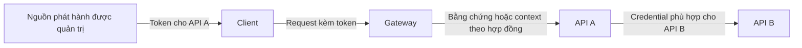

# Token trust boundary

## 1. Ranh giới tin cậy của token là gì?

**Token trust boundary** là ranh giới tại đó một thành phần phải quyết định có chấp nhận token làm bằng chứng cho một mục đích cụ thể hay không. Quyết định này dựa trên nguồn phát hành được tin, loại token, bên nhận, thời hạn, các ràng buộc sử dụng và chính sách của thành phần đang nhận.

Token đi qua mạng nội bộ, có dạng JWT hoặc có chữ ký hợp lệ chưa có nghĩa nó được dùng ở mọi nơi. Một token hợp lệ cho API học tập có thể hoàn toàn không phù hợp với API tài chính. Một ID token dùng trong quá trình xác thực client không tự trở thành access token cho một API.

Tại mỗi ranh giới, cần phân biệt ba câu hỏi:

1. Token này có được kiểm chứng đúng với hợp đồng của điểm nhận không?
2. Token cho biết điều gì về chủ thể, client hoặc sự ủy quyền?
3. Những thông tin đó có đủ để cho phép hành động trên tài nguyên đang được yêu cầu không?

Một request chỉ được chấp nhận khi đáp ứng đầy đủ những điều kiện liên quan. Kiểm chứng token và authorization là các phần có quan hệ nhưng không thể thay thế cho nhau.

## 2. Token vẫn là dữ liệu đầu vào cho đến khi được kiểm chứng

Trước khi kiểm chứng, nội dung token là dữ liệu do request mang tới. Việc decode hoặc parse chỉ cho thấy các byte có thể được đọc theo một định dạng, không chứng minh thông tin bên trong đáng tin.

Ví dụ, một payload đọc được có thể tự khai issuer, subject, tenant và scope. Điểm nhận chưa được dùng những giá trị đó để cấp quyền chỉ vì chúng có tên quen thuộc.

```text
Token nhận từ request
    -> kiểm tra định dạng và giới hạn đầu vào
    -> kiểm chứng theo cấu hình tin cậy của điểm nhận
    -> tạo ngữ cảnh danh tính đã được kiểm chứng
    -> đánh giá quyền trên hành động và tài nguyên
    -> thực thi hoặc từ chối
```

Một số giá trị chưa được kiểm chứng có thể được đọc để chọn trong một tập cấu hình đã cho phép, nhưng không được tự tạo ra cấu hình tin cậy mới. Ví dụ, một issuer được tự khai không phải lý do để tải khóa từ bất kỳ địa chỉ nào token đề xuất rồi coi kết quả là đáng tin.

Ứng dụng cũng không nên đánh dấu một object là “authenticated” chỉ vì thư viện đã giải mã payload. Cần hiểu đúng hàm đang dùng đã thực hiện kiểm chứng nào và còn điều kiện nào thuộc trách nhiệm của ứng dụng.

## 3. Phân biệt loại token và mục đích sử dụng

| Loại bằng chứng hoặc token | Vai trò điển hình | Giới hạn cần giữ |
|---|---|---|
| Access token | Cho phép gọi resource server trong phạm vi được cấp | Resource server phải kiểm chứng và đánh giá quyền theo hợp đồng |
| ID token | Mang thông tin về sự kiện xác thực trong tích hợp danh tính phù hợp | Không nhận làm credential gọi API chỉ vì có chữ ký hợp lệ |
| Refresh token | Dùng tại thành phần cấp token theo luồng được hỗ trợ | Không gửi như access token tới các API nghiệp vụ |
| Session cookie | Liên kết request với phiên của một ứng dụng | Có phạm vi và cơ chế bảo vệ phiên riêng |
| Assertion hoặc token phục vụ trao đổi | Là đầu vào cho một luồng trao đổi được định nghĩa | Không tự có hiệu lực trực tiếp ở mọi dịch vụ cuối |

JWT là một định dạng, không phải một quyết định authorization. Một hệ thống có thể dùng JWT cho nhiều loại token khác nhau; cấu hình điểm nhận phải ngăn việc dùng token sai loại hoặc sai mục đích.

Opaque token không được suy diễn bằng cách tự đọc một vài ký tự hoặc đoán nội dung. Nếu hợp đồng yêu cầu tra cứu hoặc introspection, điểm nhận phải thực hiện cơ chế đó với dịch vụ được tin cậy.

Cookie phiên cũng không mặc nhiên là một JWT hay một token có thể chuyển sang ứng dụng khác. Đường truyền cookie, phạm vi ứng dụng và những biện pháp bảo vệ request dựa trên phiên là các phần của hợp đồng riêng.

## 4. Những ranh giới thường gặp trong kiến trúc IAM

Một đường đi minh họa:



Sơ đồ không yêu cầu gateway phải chuyển tiếp nguyên token hoặc API A phải gọi một luồng trao đổi cụ thể. Nó nhấn mạnh rằng mỗi cạnh cần một hợp đồng về bằng chứng và quyền được chuyển đi.

| Ranh giới | Câu hỏi bắt buộc |
|---|---|
| Issuer đến client | Token được cấp cho client, bên nhận và phạm vi nào? |
| Client đến gateway | Gateway có kiểm chứng token đúng loại và đúng API đích không? |
| Gateway đến backend | Backend dựa trên token hay một context đã được bảo vệ như thế nào? |
| API A đến API B | A dùng danh tính của nó hay hành động thay người dùng, và B chấp nhận bằng chứng gì? |
| Đối tác đến hệ thống nội bộ | Nguồn ngoài được tin về những điều gì và trong phạm vi nào? |
| Giữa các tenant | Token và tài nguyên có thuộc cùng ngữ cảnh được cho phép không? |

Mạng riêng hoặc một dịch vụ nằm sau gateway không xóa bỏ các câu hỏi đó. Một request có thể đến từ một đường khác, một workload bị lỗi hoặc một thành phần đã bị chiếm quyền.

## 5. Hợp đồng kiểm chứng tại một điểm nhận

Điểm nhận nên có cấu hình rõ ràng về những token nó chấp nhận. Hợp đồng có thể bao gồm:

- Loại credential và profile hoặc giao thức áp dụng.
- Những issuer hoặc nguồn kiểm chứng được quản trị.
- Bên nhận được mong đợi, thường được thể hiện bằng audience trong hợp đồng tương ứng.
- Khóa, thuật toán hoặc endpoint kiểm tra trạng thái được cho phép.
- Các điều kiện thời gian, độ lệch đồng hồ và giới hạn độ cũ cần thiết.
- Ngữ nghĩa của subject, tenant, scope, actor hoặc client khi có.
- Các ràng buộc người trình token nếu loại token yêu cầu.
- Hành vi khi thiếu dữ liệu, chưa có khóa hoặc dịch vụ kiểm chứng bị lỗi.

Những trường phải có và cách kiểm tra phụ thuộc loại token và hợp đồng đang sử dụng. Không áp dụng một bộ field tùy ý cho mọi định dạng, nhưng cũng không bỏ kiểm tra bắt buộc của một profile chỉ vì thư viện cho phép parse token đó.

### 5.1. Nguồn phát hành và bên nhận

Issuer trả lời token xuất phát từ nguồn nào trong ngữ cảnh được kiểm chứng. Audience giới hạn điểm nhận mà token được cấp để sử dụng theo hợp đồng.

Nếu API B chỉ chấp nhận token dành cho `finance-api`, token có audience `learning-api` không phù hợp dù cùng issuer phát hành và chữ ký vẫn đúng.

Một hệ thống hỗ trợ nhiều issuer cần mapping cụ thể giữa issuer, khóa hoặc endpoint kiểm chứng, loại token và các ràng buộc được chấp nhận. Không dùng một danh sách khóa chung rồi bỏ qua nguồn phát hành và mục đích của từng khóa.

### 5.2. Thời hạn và đồng hồ

Kiểm tra các điều kiện thời gian được quy định, chẳng hạn token đã hết hạn hoặc chưa được phép sử dụng. Độ lệch đồng hồ, nếu được hỗ trợ, phải có giới hạn và được hiểu như một khoảng chấp nhận có chủ đích.

Không kéo dài khoảng lệch vô hạn để giải quyết lỗi đồng bộ thời gian. Nếu có yêu cầu giới hạn tuổi token hoặc thời gian từ lần xác thực gần nhất, cần kiểm tra những điều kiện đó theo hợp đồng, không suy ra chỉ từ việc token chưa hết hạn.

Token chưa hết hạn cũng không tự chứng minh tài khoản vẫn hoạt động hoặc quyền hiện tại chưa thay đổi. Đây là vấn đề về trạng thái và độ mới cần thiết kế riêng.

### 5.3. Thuật toán, khóa và metadata

Header của token không được tự quyết định một thuật toán bất kỳ mà điểm nhận phải chấp nhận. Tập thuật toán và cách dùng khóa phải được cấu hình phù hợp với loại token, issuer và thư viện sử dụng.

Một giá trị như key ID chỉ là thông tin giúp tìm khóa trong tập được tin cậy theo thiết kế. Nó không tự tạo ra sự tin cậy cho một khóa mới.

Không tự tải và tin khóa từ một URL tùy ý nằm trong token. Nếu hệ thống dùng metadata hoặc endpoint phân phối khóa, nguồn đó cần được thiết lập và bảo vệ qua quy trình cấu hình tin cậy, với cách xử lý cập nhật và lỗi rõ ràng.

## 6. Ví dụ: token hợp lệ vẫn chưa đủ quyền

Payload sau chỉ minh họa nội dung claim. Nó không phải một token hoàn chỉnh có thể được dùng để xác thực:

```json
{
  "iss": "https://id.example.invalid/workforce",
  "sub": "subject-example-42",
  "aud": "learning-api",
  "scope": "course:read",
  "tenant_id": "tenant-a"
}
```

Ví dụ đã lược bỏ những field khác để tập trung vào ranh giới quyền; một token thực tế vẫn phải đáp ứng đầy đủ điều kiện của profile và điểm nhận. `tenant_id` và cách đặt scope ở đây là hợp đồng minh họa của hệ thống.

Sau khi kiểm chứng đầy đủ, API học tập vẫn phải xét tài nguyên:

| Request | Kết quả cần đánh giá |
|---|---|
| Đọc khóa học được phép trong tenant A | Có thể cho phép nếu các điều kiện nghiệp vụ còn lại được đáp ứng |
| Chấm điểm khóa học | Scope đọc không tự cấp quyền chấm điểm |
| Đọc hồ sơ thuộc tenant B | Không cho phép chỉ vì subject đã đăng nhập |
| Gọi API tài chính | Sai audience theo hợp đồng minh họa |
| Đọc khóa học riêng mà chủ thể chưa được phân công | Có thể bị từ chối dù scope đọc hợp lệ |

Scope cần được phân tích theo ngữ nghĩa hợp đồng, không kiểm tra kiểu tìm chuỗi con tùy tiện. Tương tự, một role không tự biểu diễn mọi quan hệ giữa chủ thể và tài nguyên.

Tenant hoặc owner của tài nguyên cần được xác định từ dữ liệu đáng tin cậy. Một trường `tenant_id` do client gửi trong body hoặc header không được tự thay thế ranh giới tenant đã được kiểm chứng và quan hệ của tài nguyên thực tế.

## 7. Bearer token, người trình token và chủ thể

Với bearer token, bên có được token có thể sử dụng nó trong các điều kiện mà hệ thống chấp nhận. Token có chữ ký không tự chứng minh người đang gửi request chính là người ban đầu nhận token.

Cần phân biệt:

- **Subject:** chủ thể mà token mô tả theo ngữ nghĩa của nó.
- **Client hoặc actor:** ứng dụng hay dịch vụ tham gia luồng, nếu thông tin đó có trong hợp đồng.
- **Bên trình token hiện tại:** thành phần đang gửi request.
- **Resource server:** bên nhận và thực thi quyền trên tài nguyên.

Các vai trò có thể khác nhau. Một dịch vụ có thể gọi API thay người dùng hoặc gọi bằng quyền riêng của chính dịch vụ.

Nếu dùng cơ chế token ràng buộc với người trình, điểm nhận còn phải kiểm chứng bằng chứng ràng buộc theo cơ chế đó. Chỉ thấy một claim mô tả khóa hoặc một header tự khai không đủ chứng minh ràng buộc đã được đáp ứng.

Tương tự, xác thực kết nối giữa hai dịch vụ không tự chứng minh bearer token của người dùng đã được ràng buộc với kết nối đó. Những điều kiện này phải được triển khai theo hợp đồng phù hợp, không ghép ngẫu nhiên từ các field có vẻ liên quan.

Bảo vệ chống sử dụng lại cũng phụ thuộc loại credential và cơ chế được áp dụng. Không thêm một claim tự đặt rồi mặc định mọi replay đã bị ngăn chặn.

## 8. Chuyển token hoặc danh tính giữa các dịch vụ

Giả sử API A nhận token dành cho chính nó và cần gọi API B. Có những lựa chọn khác nhau, mỗi lựa chọn có ý nghĩa quyền khác nhau:

| Cách gọi B | Ý nghĩa cần xác định | Rủi ro nếu triển khai sai |
|---|---|---|
| A dùng credential workload của A | B cấp quyền cho dịch vụ A | Mất ngữ cảnh người dùng nếu nghiệp vụ cần xét người dùng |
| A chuyển một token vốn được cấp hợp lệ cho B | B kiểm chứng theo hợp đồng của B | Chuyển tiếp không đúng mục đích hoặc làm token lộ thêm nơi |
| A dùng luồng ủy quyền hoặc trao đổi được hỗ trợ | B nhận bằng chứng về chủ thể và actor theo hợp đồng | Mở rộng quyền hoặc làm sai nguồn gốc nếu policy cấp token không giới hạn |
| A gửi context nội bộ đã được bảo vệ | B tin context theo một quan hệ riêng đã thiết lập | Header giả, sai audience hoặc bỏ qua kiểm chứng context |

Không tự chuyển token audience A sang B rồi tắt kiểm tra audience để luồng hoạt động.

Một luồng trao đổi token cũng không tự bảo đảm quyền luôn hẹp hơn. Policy cấp token mới cần giới hạn nguồn, actor được phép, bên nhận, phạm vi và điều kiện ủy quyền. Không sao chép mọi role từ đầu vào sang token mới theo mặc định.

Nếu A có quyền gọi B rộng hơn người dùng, A phải tránh thực hiện một yêu cầu mà người dùng không được phép chỉ vì A giữ credential mạnh. Cần giữ đúng quan hệ giữa yêu cầu nghiệp vụ, người khởi tạo và quyền của dịch vụ trung gian.

Audit nên phân biệt được người khởi tạo và workload thực thi khi cần, nhưng không dùng nhu cầu truy vết để phát tán token hoặc toàn bộ hồ sơ qua mọi dịch vụ.

## 9. Gateway và context nội bộ là một hợp đồng tin cậy khác

Gateway có thể kiểm chứng token rồi gửi context danh tính tới backend. Nếu backend tin các header như `X-User-Id` hoặc `X-Roles`, hệ thống phải chứng minh các giá trị đó đến từ thành phần được phép và gắn với đúng request.

Những điểm cần thiết kế gồm:

- Loại bỏ hoặc ghi đè các header danh tính từ nguồn bên ngoài trước khi tạo context đáng tin.
- Ngăn đường gọi trực tiếp có thể bỏ qua gateway nhưng vẫn gửi được header được backend tin.
- Xác thực thành phần trung gian và bảo vệ tính toàn vẹn của đường truyền phù hợp.
- Xác định backend nào được nhận context, thời hạn và cách chống dùng sai ngữ cảnh.
- Giữ authorization nghiệp vụ tại nơi có đủ dữ liệu để thực thi.

Một header trên mạng nội bộ vẫn có thể là dữ liệu chưa đáng tin nếu không có những bảo đảm tương ứng. Việc proxy thêm header không tự tạo ra nguồn danh tính có thẩm quyền.

Nếu context nội bộ được đóng gói thành một token mới, nó cần hợp đồng kiểm chứng riêng như các token khác. Việc đổi định dạng không làm mất yêu cầu về issuer, bên nhận, thời gian và thẩm quyền cấp thông tin.

## 10. Khóa kiểm chứng cũng xác định phạm vi tin cậy

Trong mô hình chữ ký bất đối xứng, bên giữ khóa công khai phù hợp có thể kiểm chứng chữ ký mà không cần giữ private key dùng để ký. Việc phân phối khóa kiểm chứng vẫn phải bảo đảm nguồn và mục đích của khóa.

Với cơ chế xác thực thông điệp dùng bí mật đối xứng, những bên giữ cùng bí mật có khả năng tạo mã xác thực theo cơ chế đó. Chia sẻ một bí mật cho nhiều dịch vụ có thể mở rộng tập bên có khả năng tạo bằng chứng mà các bên khác chấp nhận.

Vì vậy, lựa chọn cách ký hoặc xác thực token không chỉ là quyết định hiệu năng. Nó còn ảnh hưởng bên nào có quyền phát hành hoặc giả lập một bằng chứng hợp lệ trong phạm vi hệ thống.

Các khóa cần có chủ sở hữu, phạm vi, mục đích, vòng đời và quy trình khi bị lộ. Không dùng một khóa chung cho mọi môi trường hoặc mọi loại token chỉ để đơn giản cấu hình.

Khi xoay khóa, điểm nhận cần có cách cập nhật tập khóa được tin mà vẫn giữ các giới hạn xác minh. Nếu không tìm được khóa hợp lệ, không chuyển sang đọc payload mà bỏ qua kiểm chứng. Kết quả lỗi cần được xử lý theo hợp đồng mà không cấp quyền ngoài dự kiến.

## 11. Trạng thái hiện tại, thu hồi và cache

Một token có thể phản ánh snapshot tại thời điểm phát hành. Sau đó, tài khoản bị khóa, role bị gỡ hoặc quan hệ với tài nguyên thay đổi.

Kiến trúc cần quyết định điểm nào phải biết trạng thái mới nhất và khoảng trễ chấp nhận được. Các cơ chế có thể bao gồm thời hạn credential, kiểm tra trạng thái, thu hồi theo thiết kế, tra cứu quyền cục bộ và phân phối thay đổi policy.

Nếu dùng introspection, kết quả cho biết những điều mà hợp đồng endpoint xác nhận. Một kết quả đang active không tự cấp mọi quyền trên tài nguyên. Resource server vẫn cần kiểm tra bên nhận, phạm vi và authorization tương ứng.

Cache kết quả kiểm chứng hoặc quyết định quyền cần gắn với đúng credential hay chủ thể, issuer, bên nhận, tài nguyên, hành động và những điều kiện quyết định liên quan. Không cache một kết quả “allowed” rồi dùng cho mọi request của người dùng.

Thời gian cache cũng không được vô tình vượt thời hạn credential hoặc giới hạn độ mới đã đặt. Cache cũ có thể làm chậm tác động của thu hồi; giới hạn đó phải được biết và đo được.

Khi một phụ thuộc kiểm chứng lỗi, một phương án tiếp tục dùng dữ liệu cục bộ chỉ phù hợp nếu đã được thiết kế với phạm vi và thời hạn rõ ràng. Không biến tình trạng không thể kiểm chứng thành sự cho phép mới.

## 12. Bảo vệ token trong suốt đường đi

Một token được cấp đúng và kiểm chứng đúng vẫn có thể bị lộ trong quá trình sử dụng. Cần giảm nơi token xuất hiện và giới hạn những thành phần có thể đọc nó.

Không đưa token vào URL hoặc query string vì chúng dễ xuất hiện trong lịch sử, proxy log hoặc các bản ghi khác ngoài dự kiến. Cơ chế truyền credential phải theo hợp đồng phù hợp và dùng kênh được bảo vệ.

Chữ ký không làm claim bí mật. Với các định dạng có payload đọc được, bên cầm token có thể nhìn thấy nội dung dù không sửa được một cách hợp lệ. Giảm dữ liệu nhạy cảm trước khi phát hành thay vì coi chữ ký là cơ chế che dữ liệu.

Không log toàn bộ Authorization header, token, refresh token hoặc cookie. Không gửi chúng trong alert, crash report hay payload telemetry theo mặc định. Việc che trên giao diện không đủ nếu giá trị gốc đã được lưu vào kho log.

Nếu cần tương quan request, dùng mã nội bộ được thiết kế cho mục đích đó và giới hạn truy cập. Một fingerprint token cũng có thể tạo khả năng liên kết hoạt động; nó cần được quản trị, không mặc định là dữ liệu vô hại.

Tại client, vị trí lưu và cách dùng credential phải phù hợp với loại ứng dụng và mô hình đe dọa của nó. Không mở rộng quyền của token chỉ vì client có cơ chế lưu trữ hạn chế; giải pháp cần bắt đầu từ luồng và phạm vi credential đúng.

## 13. Luồng xử lý và bằng chứng vận hành

Pseudocode dưới đây mô tả sự phân chia trách nhiệm, không phải mã thay thế thư viện kiểm chứng token:

```text
contract = trustedConfigurationForThisEndpoint()
credential = readCredentialUsingExpectedTransport(request)

validatedIdentity = verifyCredential(credential, contract)
if verificationDidNotSucceed:
    stopWithoutGrantingAccess()

resource = loadResourceInTrustedContext(request.resourceId)
decision = authorize(
    validatedIdentity,
    requestedAction,
    resource,
    currentPolicyAndRequiredState
)

if decisionDoesNotPermit:
    stopWithoutPerformingAction()

performAuthorizedAction()
recordMinimalDecisionEvidence()
```

Các hàm đại diện cho những cơ chế phải được triển khai đúng theo stack và giao thức. Đặc biệt, `verifyCredential` không chỉ decode token hoặc kiểm tra một chữ ký mà bỏ những điều kiện khác của hợp đồng.

Thông tin vận hành có thể phân nhóm lỗi định dạng, nguồn không được tin, sai bên nhận, hết hạn, sai loại token, thiếu ràng buộc hoặc không đủ quyền. Chi tiết cần thiết nằm trong log được phân quyền; phản hồi ra ngoài không cần tiết lộ mọi cấu hình nội bộ.

Tách lỗi credential khỏi lỗi phụ thuộc và quyết định authorization để điều tra đúng nguyên nhân. Không để metric thành công chỉ vì parser hoạt động hoặc vì gateway trả được phản hồi.

## 14. Những tình huống cần kiểm chứng

| Tình huống | Ranh giới cần bảo toàn |
|---|---|
| Payload đọc được nhưng chưa kiểm chứng | Không tạo danh tính đáng tin hoặc cấp quyền |
| Chữ ký đúng nhưng issuer không được điểm nhận chấp nhận | Không coi khóa hợp lệ ở nơi khác là nguồn được tin ở đây |
| Token dành cho API A được gửi tới API B | B giữ đúng hợp đồng bên nhận |
| ID token hoặc refresh token được gửi tới API nghiệp vụ | Không nhận làm access token chỉ vì định dạng tương tự |
| Token hết hạn hoặc chưa được phép sử dụng | Điều kiện thời gian và sai lệch đồng hồ được thực thi đúng |
| Thuật toán hoặc khóa không thuộc cấu hình được phép | Không tự mở rộng tập kiểm chứng theo token đầu vào |
| Token chứa đường dẫn khóa hoặc metadata chưa được tin | Không tải và tin nguồn tùy ý |
| Hai issuer dùng cùng subject | Không nối nhầm danh tính |
| Request tự khai tenant khác | Không vượt ranh giới tenant và quan hệ tài nguyên |
| Token có scope đọc nhưng request yêu cầu ghi | Authorization giữ đúng hành động được phép |
| Người dùng có scope nhưng không có quan hệ với đối tượng | Không bỏ kiểm tra quyền cấp tài nguyên |
| Header danh tính được gửi thẳng tới backend | Không nhận context giả hoặc đi vòng gateway |
| A gọi B bằng quyền workload thay cho người dùng | Không để quyền mạnh của A vượt quyền yêu cầu nghiệp vụ |
| Tài khoản bị vô hiệu hóa khi token còn hiệu lực | Giới hạn thu hồi và độ mới được thể hiện đúng thiết kế |
| Cache hoặc dịch vụ kiểm chứng lỗi | Không chuyển lỗi kiểm chứng thành quyền truy cập mới |
| Bật log, trace và alert | Không phát tán token hoặc credential |

Token trust boundary giúp biến một thông điệp mang danh tính thành bằng chứng chỉ có hiệu lực trong ngữ cảnh được xác định. Tại mỗi điểm nhận, hệ thống phải biết tin ai, tin điều gì, cho mục đích nào và trong bao lâu, sau đó vẫn đánh giá quyền trên hành động và tài nguyên thực tế trước khi thực thi.
