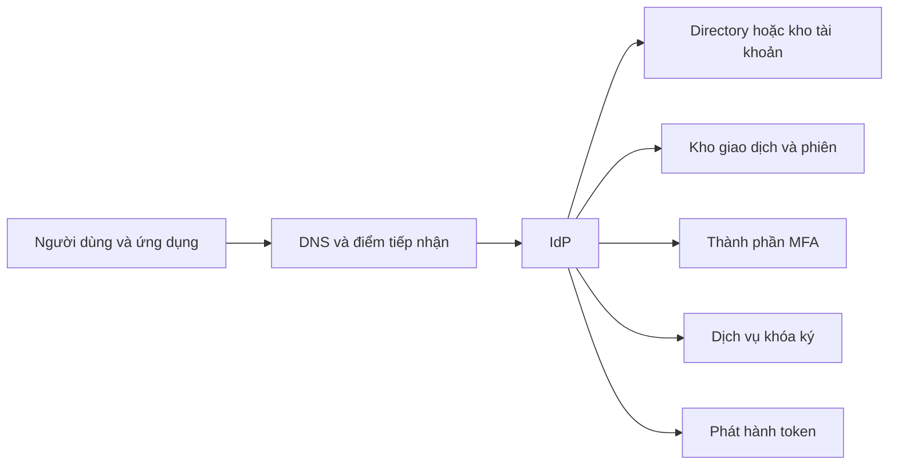

# Availability của IdP

## 1. IdP khả dụng có nghĩa là gì?

**Identity Provider — IdP** là thành phần cung cấp khả năng xác thực và thông tin danh tính cho các ứng dụng theo kiến trúc liên kết đã chọn. Khi IdP gặp sự cố, người dùng có thể không đăng nhập được, ứng dụng không đổi được mã lấy token hoặc phiên không thể được gia hạn.

**Availability của IdP** là khả năng hoàn tất những chức năng danh tính cần thiết trong giới hạn thời gian và điều kiện đã xác định. Một endpoint trả HTTP thành công chưa đủ chứng minh hành trình đăng nhập đang hoạt động.

Ví dụ, trang đăng nhập vẫn tải được nhưng directory không phản hồi. Hoặc người dùng hoàn thành MFA nhưng dịch vụ token không cấp được kết quả. Từ góc nhìn ứng dụng, cả hai đều có thể là sự cố đăng nhập dù health check cơ bản vẫn báo xanh.

Do đó, cần hỏi cụ thể: chức năng nào đang được đo, ai sử dụng nó, ở vùng nào và giao dịch phải hoàn tất trong bao lâu?

## 2. Tách các khả năng thay vì một nhãn “IdP up”

Các chức năng của IdP có phụ thuộc và tác động khác nhau:

| Chức năng | Tác động khi không khả dụng | Điểm cần theo dõi |
| --- | --- | --- |
| Bắt đầu đăng nhập | Người dùng không vào được luồng xác thực | Endpoint, định tuyến, cấu hình client và giao dịch |
| Xác minh danh tính | Không kiểm tra được thông tin xác thực | Directory, kho tài khoản, bộ xác minh |
| MFA hoặc step-up | Không hoàn tất mức bảo đảm yêu cầu | Adapter, nhà cung cấp, trạng thái challenge |
| Phát hành token | Ứng dụng không nhận được thông tin cần để tiếp tục | Dịch vụ token, khóa ký, kho giao dịch |
| Gia hạn | Phiên ứng dụng có thể ngừng khi cần token mới | Refresh flow và trạng thái liên quan |
| Metadata và khóa xác minh | Thành phần mới hoặc thiếu cache không khởi tạo được niềm tin | Điểm phân phối metadata và public key |
| Kiểm tra trạng thái trực tuyến | API phụ thuộc kiểm tra này có thể không quyết định được truy cập | Endpoint, cache và chính sách độ mới |
| Đăng xuất hoặc thu hồi | Không hoàn tất thay đổi trạng thái truy cập | Kho phiên, kênh thông báo và các bên nhận |
| Quản trị và cấp phát tài khoản | Thay đổi tài khoản hoặc quyền bị chậm | Control plane, hàng đợi, đồng bộ |

Không phải mọi IdP triển khai tất cả chức năng trong bảng. Bảng giúp xác định các hợp đồng riêng thay vì gộp mọi thành phần vào một chỉ số sẵn sàng chung.

Một giao diện quản trị lỗi không nhất thiết làm token đã phát hành mất hiệu lực. Ngược lại, dịch vụ ký token lỗi có thể chặn đăng nhập mới trong khi quản trị vẫn hoạt động. Phân tách này giúp khoanh vùng tác động thực tế.

## 3. Phụ thuộc của một hành trình xác thực

Một đường xử lý minh họa có thể gồm:



Đây là sơ đồ trách nhiệm, không yêu cầu từng nút phải là dịch vụ riêng. Điều cần chú ý là thêm bản sao tiến trình IdP không tự làm các dependency dùng chung có khả năng phục vụ cao hơn.

Nếu mọi instance cùng dùng một database duy nhất không có phương án phục hồi thích hợp, database vẫn có thể làm gián đoạn toàn bộ luồng. Tương tự, một kho phiên, hệ thống DNS, chứng thư hết hiệu lực hoặc dịch vụ MFA dùng chung có thể gây tác động vượt ra ngoài từng instance.

Các phụ thuộc không phải lúc nào cũng tham gia mọi giao dịch. Một luồng có bằng chứng MFA còn phù hợp có thể không phát hành challenge mới; một API xác minh token tại chỗ có thể không gọi IdP cho mỗi request. Cần lập bản đồ theo từng đường thực thi thay vì coi mọi request có cùng chuỗi dependency.

## 4. Đăng nhập mới khác với truy cập bằng phiên hiện hữu

IdP không khả dụng không đồng nghĩa mọi request nghiệp vụ lập tức thất bại. Tác động phụ thuộc cách ứng dụng duy trì phiên và xác minh quyền.

| Tình trạng | Điều có thể xảy ra | Giới hạn phải giữ |
| --- | --- | --- |
| Đăng nhập mới cần IdP | Người dùng không bắt đầu hoặc hoàn tất được giao dịch | Không tự bỏ xác thực để cho vào ứng dụng |
| Phiên ứng dụng vẫn hợp lệ | Ứng dụng có thể tiếp tục phục vụ theo thiết kế phiên | Vẫn kiểm tra thời hạn và các điều kiện của phiên |
| Token tự chứa được xác minh tại API | API có thể dùng khóa xác minh đã có nếu còn phù hợp | Vẫn kiểm tra chữ ký, bên phát hành, bên nhận, thời hạn và chính sách liên quan |
| API cần trạng thái trực tuyến | Request có thể thất bại khi không truy vấn được trạng thái | Xử lý theo hợp đồng độ mới và lỗi đã xác định |
| Cần refresh hoặc step-up mới | Giao dịch có thể bị chặn khi tới mốc đó | Không kéo dài hiệu lực hoặc hạ mức bảo đảm tùy ý |

Một token kiểm tra được chữ ký chưa chắc đáp ứng mọi chính sách hiện tại, nhất là khi cần biết quyền đã thu hồi hoặc trạng thái tài khoản mới nhất. Khả năng tiếp tục phục vụ và yêu cầu thu hồi quyền phải được thiết kế cùng nhau.

Không chấp nhận token đã hết hạn chỉ vì IdP đang lỗi. Không coi việc không gọi được IdP là lý do để bỏ kiểm tra bên nhận hoặc mức bảo đảm xác thực.

## 5. Định nghĩa SLI và SLO theo giao dịch

**SLI** là phép đo mức phục vụ thực tế. **SLO** là mục tiêu đã thống nhất cho một phạm vi và cửa sổ đo cụ thể.

Với một luồng cấp token, một SLI kỹ thuật có thể được định nghĩa như sau:

```text
Tỷ lệ xử lý hợp lệ trong thời hạn
  = số giao dịch thuộc phạm vi được xử lý đúng hợp đồng trong thời hạn
    / tổng số giao dịch thuộc phạm vi quan sát
```

Cần định nghĩa trước giao dịch nào thuộc mẫu số và kết quả nào được tính là đúng hợp đồng. Ví dụ, phản hồi từ chối đúng vì thông tin xác thực không hợp lệ có thể là một kết quả kỹ thuật được xử lý bình thường, nhưng không phải một lần đăng nhập thành công của người dùng.

Vì vậy, nên tách các góc nhìn:

- Khả năng xử lý kỹ thuật của endpoint hoặc luồng.
- Khả năng đăng nhập thành công của các giao dịch đáp ứng điều kiện hợp lệ đã xác định.
- Độ trễ hoàn tất và tỷ lệ timeout.
- Tỷ lệ kết quả từ chối dự kiến so với lỗi phụ thuộc hoặc lỗi hệ thống.

Không thay mọi lỗi hệ thống bằng một phản hồi từ chối rồi coi đó là cách cải thiện availability. Phân loại phải phản ánh nguyên nhân và tính đúng của hành vi, không chỉ mã HTTP.

### Ví dụ ngân sách lỗi theo request

Giả sử một SLO minh họa yêu cầu 99,9% của 100.000 giao dịch đủ điều kiện được xử lý đúng trong thời hạn. Ngân sách giao dịch không đạt là:

```text
100.000 × (1 − 0,999) = 100 giao dịch
```

Đây là ngân sách dựa trên số giao dịch, không tự tương đương một số phút downtime. Một sự cố ngắn vào giờ cao điểm có thể tiêu thụ nhiều ngân sách request hơn một sự cố dài khi ít lưu lượng.

Mức SLO thực tế cần dựa vào tác động và khả năng kiến trúc; con số trong ví dụ không phải mục tiêu chung cho mọi IdP.

## 6. Đo từ bên ngoài và từ từng dependency

Health check tiến trình cho biết một phần trạng thái. Để biết luồng có hoạt động, cần quan sát thêm từ góc nhìn của ứng dụng hoặc một giao dịch kiểm tra có kiểm soát.

Một phép kiểm tra tổng hợp có thể dùng tài khoản kiểm thử riêng, quyền tối thiểu và các dữ liệu cần thiết đã được quản lý để chạy qua những bước xác thực phù hợp. Nó không nên dùng tài khoản quản trị hay tài khoản của nhân viên thật để kiểm tra định kỳ.

Cần biết phép kiểm tra bao phủ những gì. Một probe chỉ mở trang đăng nhập không chứng minh directory, MFA và cấp token đều hoạt động. Ngược lại, một phép kiểm tra tự động không đi qua mọi tương tác của người dùng cũng không thể đại diện hoàn toàn cho trải nghiệm thực tế.

Kết hợp các nguồn sau giúp đối chiếu:

| Nguồn quan sát | Giá trị cung cấp |
| --- | --- |
| Giao dịch tổng hợp | Phát hiện lỗi của một đường đăng nhập xác định từ bên ngoài |
| Telemetry ứng dụng | Thấy callback lỗi, đổi token lỗi và tác động tới phiên |
| Metric IdP | Lưu lượng, độ trễ, lỗi và hàng đợi theo luồng |
| Metric dependency | Directory, database, MFA, kho phiên, dịch vụ khóa |
| Log và trace có giới hạn | Nối các bước để xác định vị trí lỗi |

Mọi dữ liệu quan sát phải tránh ghi mật khẩu, token, cookie phiên hoặc mã OTP. Correlation ID và mã kết quả được kiểm soát thường hữu ích hơn việc ghi nguyên request để điều tra availability.

## 7. Tính sẵn sàng của instance và tính đúng của trạng thái

Nhiều instance giúp giảm tác động của lỗi một tiến trình và hỗ trợ chia tải. Tuy nhiên, luồng IAM còn có trạng thái cần được chia sẻ hoặc định tuyến đúng:

- Giao dịch đăng nhập đang diễn ra và dữ liệu đối chiếu callback.
- Challenge MFA và kết quả đã sử dụng.
- Authorization code hoặc giá trị dùng một lần theo cơ chế triển khai.
- Phiên, refresh token và trạng thái thu hồi liên quan.
- Cấu hình client, chính sách và phiên bản khóa.

Nếu request bắt đầu tại instance A nhưng callback đến B, B cần đủ dữ liệu hợp lệ để tiếp tục. Phụ thuộc vào trạng thái chỉ nằm trong bộ nhớ A có thể làm đăng nhập hỏng khi A mất.

Sticky session có thể hỗ trợ một số thiết kế nhưng không thay thế khả năng phục hồi trạng thái khi instance gắn với phiên ngừng hoạt động. Cần kiểm tra cả đường mất instance giữa giao dịch.

Đồng bộ trạng thái cũng phải giữ các bất biến bảo mật. Một giá trị chỉ được dùng một lần không nên trở thành dùng được nhiều lần do hai instance hoặc hai vùng cùng xử lý mà thiếu phối hợp thích hợp. Tăng số bản sao nhưng làm yếu kiểm tra replay không phải cải thiện availability đúng nghĩa.

## 8. Multi-region, RTO và RPO

Triển khai nhiều vùng có thể giảm tác động của sự cố một vùng, nhưng làm phức tạp việc quản lý trạng thái, khóa và cấu hình. Không nên coi active-active là lựa chọn tự động tốt hơn cho mọi luồng.

| Mô hình | Điểm thuận lợi | Điều cần thiết kế |
| --- | --- | --- |
| Nhiều instance trong một phạm vi lỗi | Thay thế tiến trình và chia tải | Dependency dùng chung và mất toàn phạm vi |
| Vùng chính và vùng dự phòng | Luồng chuyển đổi tương đối rõ | Năng lực vùng dự phòng, dữ liệu và thời gian chuyển |
| Nhiều vùng cùng phục vụ | Phân phối lưu lượng và giảm phụ thuộc một vùng | Tính nhất quán, định tuyến giao dịch, trạng thái dùng một lần và quyền truy cập khóa |

**RTO** mô tả mục tiêu thời gian phục hồi chức năng trong phạm vi đã xác định. **RPO** mô tả mục tiêu về khoảng dữ liệu có thể không được khôi phục tại một mốc phục hồi. Cần đặt chúng theo loại trạng thái, không chỉ một con số cho toàn hệ thống.

Ví dụ, mất vài thay đổi cấu hình ít quan trọng và làm sống lại một quyền vừa bị thu hồi có hậu quả khác nhau. Dữ liệu phục hồi liên quan tài khoản bị khóa, token bị thu hồi hoặc quyền quản trị cần được đối soát theo chính sách an toàn của hệ thống.

Kế hoạch failover phải giữ đúng issuer, cấu hình client, endpoint được phép và các kiểm tra giao thức mà ứng dụng sử dụng. Không đổi sang một IdP bất kỳ còn sống nếu ứng dụng chưa có quan hệ tin cậy được thiết lập phù hợp.

Nếu có ràng buộc vị trí dữ liệu, vùng dự phòng cũng phải phù hợp với phạm vi đã phê duyệt. Failover không chỉ là đổi địa chỉ mạng; nó có thể đổi nơi xử lý hồ sơ, phiên và log.

## 9. Khóa ký và việc xác minh khi IdP không phản hồi

Ứng dụng xác minh token tự chứa cần có khóa xác minh phù hợp từ nguồn tin cậy. Cache khóa đã biết có thể giảm phụ thuộc vào việc tải khóa cho mỗi request, nhưng cơ chế sử dụng cache cần giữ đúng thời hạn và chính sách tin cậy.

Khi nhận token dùng khóa chưa biết, ứng dụng không được bỏ kiểm tra chữ ký để duy trì phục vụ. Việc cập nhật khóa phải theo nguồn đã cấu hình và được kiểm soát; không để dữ liệu tùy ý trong token quyết định địa chỉ tải khóa.

Nên tránh để mọi request có định danh khóa lạ đều kích hoạt một lần tải riêng không giới hạn. Cơ chế gộp yêu cầu cập nhật, giới hạn tần suất và cache phù hợp giúp bảo vệ đường phân phối khóa khỏi tải không cần thiết, đồng thời vẫn phải xử lý rotation hợp lệ.

Với rotation theo kế hoạch, thời điểm công bố khóa mới, bắt đầu ký và giữ khóa xác minh cũ cần tương thích với vòng đời token và cách cache của các bên nhận. Giữ khóa cũ bao lâu là quyết định có phạm vi, không phải giữ vô hạn.

Sự cố lộ khóa khác với rotation thông thường: kế hoạch xử lý có thể cần thay đổi niềm tin và token chịu tác động. Không dùng mục tiêu availability để tiếp tục tin một khóa đã bị loại bỏ theo chính sách sự cố.

## 10. Timeout, retry và kiểm soát quá tải

Khi IdP chậm, client có thể retry, tạo thêm tải lên thành phần đang quá tải. Nếu nhiều ứng dụng retry cùng lúc, sự cố có thể kéo dài dù nguyên nhân ban đầu đã giảm.

Một thiết kế cần phối hợp:

- Timeout theo ngân sách thời gian của giao dịch.
- Số lần thử giới hạn và khoảng chờ phù hợp, tránh đồng loạt thử lại cùng nhịp.
- Nhận biết lỗi nào có thể thử lại theo hợp đồng của thao tác.
- Giới hạn đồng thời, connection pool và hàng đợi.
- Bảo vệ các chức năng quan trọng khỏi bị một loại lưu lượng chiếm hết tài nguyên.

Không tự động retry mọi lỗi xác thực. Thông tin xác thực sai hoặc từ chối theo chính sách thường cần xử lý khác với lỗi kết nối tạm thời. Retry cũng không được bỏ qua giới hạn chống lạm dụng.

Một thao tác có trạng thái dùng một lần hoặc có kết quả đã được thực hiện nhưng response bị mất cần cách xử lý riêng. Client không thể mặc định mọi lần thử lại đều là một thao tác mới an toàn. Cần tôn trọng ngữ nghĩa giao thức và cơ chế chống lặp của triển khai.

Circuit breaker có thể ngăn tiếp tục dồn tải vào dependency đang lỗi. Nó không tạo ra một kết quả xác thực hợp lệ; khi mạch mở, luồng cần trả kết quả hoặc sử dụng phương án đã được thiết kế với giới hạn rõ ràng.

## 11. Suy giảm có kiểm soát và các giới hạn không được bỏ qua

Một số chức năng có thể tiếp tục bằng trạng thái còn hợp lệ theo chính sách. Ví dụ, ứng dụng vẫn phục vụ phiên hiện hữu; API vẫn kiểm tra token hợp lệ với khóa đã biết; thay đổi quản trị ít khẩn cấp được xếp hàng để xử lý sau.

Các hành vi đó khác với tự mở quyền khi dependency không sẵn sàng.

| Phương án có thể được thiết kế | Giới hạn cần giữ |
| --- | --- |
| Tiếp tục phiên hiện hữu | Không tự kéo dài thời hạn hoặc bỏ yêu cầu kiểm tra bắt buộc |
| Tái sử dụng bằng chứng MFA còn phù hợp | Chỉ trong điều kiện chính sách đã định, không tắt MFA âm thầm |
| Dùng chính sách hoặc dữ liệu cache | Giữ giới hạn độ mới và phạm vi hành động được phép |
| Xếp hàng công việc cấp phát | Theo dõi tiến độ, đối soát và không báo hoàn tất trước thực tế |
| Truy cập khẩn cấp được phê duyệt | Danh tính, quyền, thời hạn và audit rõ ràng |

Không tạo một đường “đăng nhập dự phòng” yếu hơn mà bất kỳ ai cũng có thể kích hoạt khi IdP lỗi. Một tài khoản khẩn cấp nếu có cần được quản lý như quyền đặc biệt, với kiểm soát và phương án kiểm chứng riêng.

Luồng khôi phục tài khoản và reset phương thức xác thực cũng cần được đưa vào mô hình sự cố. Chúng không nên trở thành cách tự động hạ yêu cầu xác minh khi thành phần MFA gặp vấn đề.

## 12. Diễn tập phục hồi theo hành trình thực tế

Khả năng phục hồi cần được kiểm chứng bằng những tình huống có phạm vi và điều kiện an toàn phù hợp. Chỉ khởi động lại tiến trình thành công chưa chứng minh giao dịch IAM được phục hồi đúng.

| Tình huống kiểm chứng | Điều cần quan sát |
| --- | --- |
| Mất một instance giữa đăng nhập | Callback có tiếp tục đúng hoặc kết thúc rõ ràng không? |
| Directory chậm hoặc lỗi | Timeout có giới hạn, có phân loại nguyên nhân và tránh retry quá mức không? |
| MFA không phát hành challenge | Có giữ yêu cầu bảo đảm và thể hiện tác động tới người dùng không? |
| Dịch vụ khóa không sẵn sàng | Cấp token mới và xác minh token hiện hữu bị ảnh hưởng khác nhau ra sao? |
| Chuyển sang vùng dự phòng | Cấu hình client, trạng thái và dữ liệu quyền có nhất quán phù hợp không? |
| Khôi phục snapshot | Có tránh tái tạo quyền hoặc tài khoản đã bị vô hiệu hóa không? |
| Tải đăng nhập tăng đột biến | Hàng đợi, pool và dependency có được bảo vệ không? |
| Mất đường quan sát | Có phân biệt thiếu telemetry với IdP khỏe không? |

Sau diễn tập cần ghi nhận thời gian phát hiện, thời gian phục hồi chức năng, giao dịch chịu tác động và các bất biến bảo mật đã được kiểm tra. Kết quả là bằng chứng cho phạm vi đã thử, không phải bảo đảm mọi tình huống tương lai đều được bao phủ.

## 13. Những nhầm lẫn thường gặp

| Nhầm lẫn | Cách hiểu phù hợp hơn |
| --- | --- |
| Có nhiều instance là đã có HA | Dependency, trạng thái và phạm vi lỗi vẫn cần được thiết kế |
| Health endpoint xanh nghĩa là đăng nhập hoạt động | Cần kiểm tra đường xác thực và phát hành kết quả thực tế |
| IdP lỗi thì mọi token cũ phải bị bỏ qua | Tác động phụ thuộc cách xác minh và trạng thái còn hợp lệ |
| IdP lỗi thì được chấp nhận token hết hạn | Sự cố không tự thay đổi hợp đồng xác thực |
| Retry càng nhiều càng dễ phục hồi | Retry có thể khuếch đại tải và làm sai ngữ nghĩa thao tác |
| Khôi phục database là xong | Cần đối soát phiên, khóa, cấu hình và các thay đổi quyền liên quan |

Availability của IdP cần được đánh giá ở mức chức năng mà người dùng và ứng dụng thực sự sử dụng. Một thiết kế tốt làm rõ tác động theo từng luồng, giảm phụ thuộc không cần thiết và phục hồi có kiểm chứng, đồng thời giữ nguyên những điều kiện xác thực và phân quyền mà luồng đó yêu cầu.
