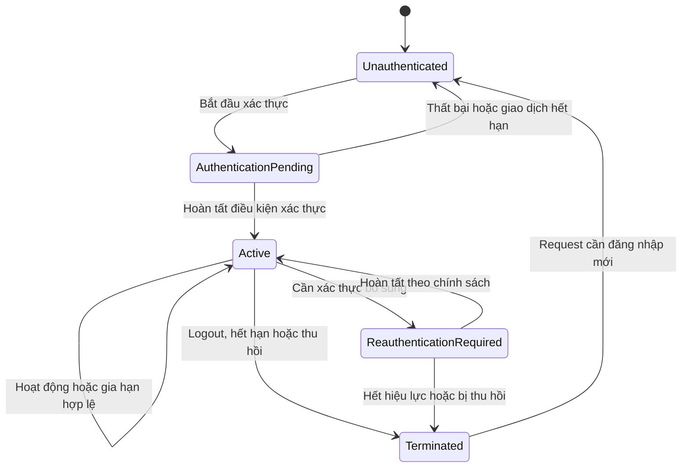

# Session test

## 1. Kiểm thử phiên cần chứng minh điều gì?

**Session test** là kiểm thử các điều kiện tạo, sử dụng, thay đổi và kết thúc phiên xác thực. Mục tiêu không chỉ là thấy người dùng đăng nhập được, mà còn chứng minh hệ thống không tiếp tục cấp quyền bằng một trạng thái phiên không còn hợp lệ.

Ví dụ, giao diện thông báo đăng xuất thành công và chuyển về trang chủ. Nếu một request khác vẫn dùng được cookie cũ để đọc dữ liệu được bảo vệ, việc chuyển trang chưa chứng minh phiên đã bị vô hiệu hóa.

Một bộ kiểm thử phiên cần bao phủ cả hai chiều:

- Phiên hợp lệ cho phép đúng chủ thể tiếp tục sử dụng chức năng được cấp.
- Phiên hết hạn, bị thu hồi, bị thay thế hoặc không hợp lệ không còn cấp quyền ngoài chính sách.

Nội dung bài tập trung vào thiết kế kiểm thử IAM. Các mã trạng thái, API và thời hạn cụ thể phải lấy từ hợp đồng của ứng dụng đang kiểm thử, không áp dụng một bộ giá trị mặc định cho mọi hệ thống.

## 2. Phân biệt các trạng thái thường bị gọi chung là session

Một ứng dụng SSO có thể đồng thời có nhiều trạng thái:

| Trạng thái | Nơi quản lý minh họa | Câu hỏi kiểm thử |
| --- | --- | --- |
| Phiên ứng dụng | Backend hoặc cơ chế phiên của ứng dụng | Request nghiệp vụ có được nhận là đã đăng nhập không? |
| Phiên IdP | Nhà cung cấp danh tính | Người dùng có thể đăng nhập SSO mà không xác minh lại không? |
| Access token | Bên phát hành và API nhận token | API còn chấp nhận token theo hợp đồng không? |
| Refresh token | Thành phần quản lý luồng gia hạn | Client còn có thể nhận token mới không? |
| Giao dịch xác thực đang chờ | Thành phần điều phối đăng nhập | Callback, MFA và các bước tiếp theo có còn đúng giao dịch không? |

Đăng xuất ứng dụng không tự chứng minh phiên IdP đã kết thúc. Thu hồi refresh token cũng không tự chứng minh mọi access token đã phát hành lập tức mất hiệu lực. Kiểm thử phải chỉ ra trạng thái nào được thay đổi và đường truy cập nào bị ảnh hưởng.

Nếu không tách các lớp, người kiểm thử có thể kết luận sai khi sau logout ứng dụng, trình duyệt được SSO đăng nhập lại ngay bằng phiên IdP vẫn còn hợp lệ. Hành vi đó có đúng yêu cầu hay không phụ thuộc loại logout mà sản phẩm cam kết.

## 3. Viết hợp đồng vòng đời trước khi viết test

Những câu hỏi sau cần có câu trả lời rõ:

| Chủ đề | Nội dung cần xác định |
| --- | --- |
| Tạo phiên | Phiên được tạo sau bước nào và gắn với chủ thể nào? |
| Đổi mức bảo đảm | MFA hoặc tái xác thực làm thay đổi trạng thái nào? |
| Idle timeout | Hoạt động nào làm mới mốc hoạt động cuối? |
| Absolute timeout | Thời hạn tối đa tính từ mốc nào, có được gia hạn không? |
| Gia hạn | Phiên và token được thay đổi theo quy tắc nào? |
| Logout | Đăng xuất một thiết bị, một ứng dụng hay toàn bộ phạm vi nào? |
| Thu hồi | Những thay đổi tài khoản hoặc quyền nào làm phiên không còn hợp lệ? |
| Đồng thời | Nhiều phiên và nhiều request cùng lúc được xử lý ra sao? |
| Lỗi phụ thuộc | Mất kho phiên hoặc IdP thì hệ thống phản hồi thế nào? |

Các điều kiện này là cơ sở xác định kết quả mong đợi. Một test chỉ mô tả “sau 15 phút phải logout” còn thiếu thông tin nếu chưa biết có polling nền hoặc refresh trong khoảng đó và những hoạt động này có được tính là hoạt động của phiên hay không.

Một vòng đời giản lược:



Sơ đồ là mô hình kiểm thử, không yêu cầu sản phẩm có đúng những tên trạng thái này. Các bước như xác thực bổ sung có thể được triển khai theo nhiều cách, nhưng phải giữ giới hạn truy cập cho tới khi điều kiện yêu cầu được đáp ứng.

## 4. Chuẩn bị dữ liệu và môi trường kiểm thử

Dùng tài khoản tổng hợp với vai trò và tenant rõ ràng. Nên có ít nhất hai chủ thể khác nhau để phát hiện nhầm phiên và hai phạm vi tài nguyên khác nhau để kiểm tra ranh giới quyền.

Các client kiểm thử cần có cookie jar hoặc browser context tách biệt. Hai tab trong cùng profile trình duyệt thường dùng chung cookie phù hợp; chúng không tự đại diện cho hai người dùng độc lập. Ngược lại, hai browser context riêng có thể mô phỏng hai thiết bị hoặc hai phiên độc lập theo mục tiêu test.

Chuẩn bị cách quan sát kết quả mà không ghi bí mật vào báo cáo:

- Một endpoint được bảo vệ trả về danh tính hoặc dữ liệu tổng hợp đủ để đối chiếu.
- Các mốc audit hoặc kết quả truy vấn trạng thái được cấp quyền trong môi trường kiểm thử.
- Đồng hồ có thể kiểm soát nếu kiến trúc hỗ trợ, để kiểm tra timeout ổn định.
- ID tương quan cho từng kịch bản, thay vì in nguyên cookie hay token.

Không dùng tài khoản quản trị hoặc dữ liệu thật chỉ vì thuận tiện. Nếu cần mô phỏng thời gian, cơ chế điều khiển đồng hồ nên thuộc hạ tầng test có phạm vi rõ; không tạo một endpoint công khai cho phép đổi thời gian xác thực trong sản xuất.

## 5. Kiểm thử tạo phiên và gắn đúng danh tính

Một kịch bản thành công cơ bản cần xác nhận:

1. Trước đăng nhập, client không đọc được tài nguyên yêu cầu xác thực.
2. Sau khi hoàn tất các bước xác thực bắt buộc, client nhận trạng thái phiên phù hợp.
3. Request được bảo vệ nhận đúng chủ thể và tenant.
4. Phiên của client khác không bị thay đổi theo.
5. Các quyền nhận được tương ứng chính sách, không phải mọi quyền chỉ vì đã đăng nhập.

Kiểm thử đường thất bại cần xác nhận phiên xác thực đầy đủ không được tạo khi sai thông tin xác thực, giao dịch bị hủy hoặc MFA chưa hoàn tất.

Một trạng thái tạm thời sau bước mật khẩu không được dùng như phiên đã đạt mức bảo đảm đầy đủ nếu chính sách còn yêu cầu MFA. Có thể vẫn có chức năng được phép ở mức bảo đảm thấp hơn, nhưng tập chức năng đó phải được xác định rõ và kiểm thử riêng.

### Session fixation và thay đổi định danh phiên

Với thiết kế dùng ID phiên phía server, cần kiểm tra ngữ cảnh trước đăng nhập không bị giữ nguyên như một định danh có thể dùng để chiếm phiên sau xác thực. Khi hệ thống thay ID phiên theo chính sách, phải xác nhận ID cũ không tiếp tục truy cập được tài nguyên dưới danh tính mới.

Kịch bản kiểm thử sử dụng một giá trị phiên trước xác thực trong môi trường được phép, hoàn tất đăng nhập, rồi thử lại giá trị trước đó trên endpoint bảo vệ. Chỉ kiểm tra cookie mới khác cookie cũ chưa đủ nếu backend vẫn chấp nhận cả hai.

Sau step-up hoặc thay đổi đặc quyền, cách thay định danh hay ràng buộc ngữ cảnh phải phù hợp với cơ chế phiên đang dùng. Không áp dụng một thao tác xoay ID duy nhất cho mọi kiến trúc, nhưng luôn kiểm tra trạng thái cũ không tự mang thêm quyền ngoài thiết kế.

## 6. Cookie và lưu trữ phía client

Nếu ứng dụng dùng cookie phiên, kiểm thử cả thuộc tính phát hành và hành vi trình duyệt.

| Yếu tố | Điều cần kiểm tra |
| --- | --- |
| `Secure` | Cookie nhạy cảm được giới hạn phù hợp với đường truyền bảo mật |
| `HttpOnly` | Cookie cần được bảo vệ khỏi đọc trực tiếp bởi script có cấu hình tương ứng |
| `SameSite` | Giá trị phù hợp với luồng ứng dụng, kể cả SSO qua các site |
| `Domain` và `Path` | Phạm vi gửi cookie không rộng hơn thiết kế và không gây nhầm cookie |
| `Max-Age` hoặc `Expires` | Thời gian lưu phía trình duyệt phù hợp với chính sách |
| Xóa cookie | Thuộc tính dùng khi xóa khớp phạm vi cookie cần loại bỏ |

Thời hạn lưu cookie không thay thế thời hạn phiên phía server. Nếu trình duyệt vẫn giữ cookie cũ, backend vẫn phải từ chối khi phiên đã hết hiệu lực. Ngược lại, xóa cookie ở một client không tự thu hồi giá trị đã bị sao chép.

`HttpOnly` không ngăn mọi tác động của script độc hại: script trong ngữ cảnh ứng dụng vẫn có thể thực hiện một số request mà trình duyệt đính kèm cookie. Kiểm thử phiên cần phối hợp với kiểm soát script và bảo vệ thao tác, không coi một cờ cookie là bảo đảm đầy đủ.

`SameSite` cũng không thay thế toàn bộ thiết kế chống giả mạo request. Cần kiểm tra các thao tác thay đổi trạng thái như logout, đổi thông tin hoặc quản lý phiên theo cơ chế bảo vệ đã chọn, đồng thời bảo đảm SSO hợp lệ không bị cấu hình cookie làm gián đoạn.

Với ứng dụng lưu token theo cơ chế khác, kiểm thử nơi lưu, phạm vi truy cập và đường xóa tương ứng. Không đánh dấu test cookie là đã bao phủ toàn bộ vòng đời token.

## 7. Idle timeout và absolute timeout

**Idle timeout** giới hạn thời gian không có hoạt động được chính sách công nhận. **Absolute timeout** giới hạn tổng thời gian của phiên theo mốc đã xác định, dù vẫn có hoạt động.

Một cấu hình giả định dùng idle timeout 15 phút và absolute timeout 8 giờ. Nếu quy tắc hết hạn là `elapsed >= timeout`, có thể lập các tình huống:

| Tình huống | Kết quả mong đợi theo giả định |
| --- | --- |
| Request bảo vệ ngay trước 15 phút không hoạt động | Còn hiệu lực nếu mọi điều kiện khác vẫn đạt |
| Request ở mốc đạt 15 phút không hoạt động | Không tiếp tục dùng phiên cũ |
| Hoạt động được công nhận ở phút 14 | Mốc idle được cập nhật theo chính sách |
| Không có hoạt động mới sau phút 14 tới phút 29 | Đạt lại ngưỡng idle và hết hiệu lực |
| Liên tục hoạt động nhưng đạt 8 giờ từ mốc tạo | Bị giới hạn bởi absolute timeout theo hợp đồng |

Các giá trị chỉ dùng minh họa, không phải khuyến nghị thời hạn chung. Cần kiểm tra trước, đúng và sau ranh giới để tránh lỗi so sánh hoặc sai đơn vị thời gian.

Polling nền, tải tài nguyên tĩnh, refresh token và tín hiệu từ trình duyệt có được cập nhật idle hay không phải được quy định rõ. Nếu mọi polling đều kéo dài phiên, một trang mở nhưng không có người dùng tương tác có thể không bao giờ đạt idle timeout như mong muốn.

Nên dùng đồng hồ kiểm soát được hoặc một cơ chế chờ phù hợp trong test tích hợp. Không thay đổi giờ máy dùng chung một cách tùy tiện. Với hệ thống phân tán, kiểm tra cả ảnh hưởng của sai lệch đồng hồ trong giới hạn mà thiết kế cho phép.

## 8. Logout và thu hồi: kiểm tra bằng trạng thái cũ

Một kịch bản logout ứng dụng nên giữ một bản tham chiếu tới thông tin phiên trước logout trong bộ nhớ test được bảo vệ, rồi xác nhận đường truy cập với trạng thái đó đã thay đổi theo hợp đồng.

```text
clientA = tạo client có cookie jar riêng
đăng nhập clientA bằng tài khoản kiểm thử
oldSession = giữ tham chiếu phiên trong bộ nhớ test

gọi endpoint được bảo vệ bằng clientA
xác nhận đúng chủ thể và quyền

thực hiện logout hợp lệ
gọi lại endpoint bằng trạng thái oldSession
xác nhận không còn truy cập bằng phiên đã kết thúc
```

Đây là mã giả mô tả ý tưởng, không phải API có sẵn trong repository. Báo cáo test không cần in giá trị `oldSession`.

Với logout toàn bộ thiết bị hoặc phạm vi SSO, bổ sung các client và ứng dụng liên quan. Nếu cơ chế thu hồi truyền bất đồng bộ, cần có thời hạn hội tụ đã thống nhất và kiểm tra tới thời hạn đó; không đánh giá bằng một khoảng chờ tùy ý rồi kết luận thành công.

Một ma trận kết quả có thể tách:

| Hành động | Phiên ứng dụng | Phiên IdP | Refresh token | Access token đã cấp |
| --- | --- | --- | --- | --- |
| Logout ứng dụng | Theo cam kết của ứng dụng | Có thể vẫn còn | Theo luồng quản lý token | Theo cơ chế xác minh và thu hồi |
| Logout SSO | Kiểm tra các bên tham gia | Phải thay đổi theo cam kết | Theo phạm vi logout | Không mặc định mọi token lập tức bị từ chối |
| Thu hồi phiên cụ thể | Chỉ phiên được chọn theo chính sách | Tùy quan hệ phiên | Kiểm tra token liên quan | Kiểm tra hành vi đã thiết kế |

Không điền tất cả ô bằng “đã thu hồi” chỉ vì một endpoint trả thành công. Mỗi trạng thái cần bằng chứng phù hợp.

## 9. Thay đổi tài khoản, mật khẩu và quyền

Các sự kiện vòng đời có thể ảnh hưởng tới phiên hiện hữu:

- Khóa hoặc vô hiệu hóa tài khoản.
- Thay đổi mật khẩu hoặc phương thức xác thực.
- Gỡ vai trò, đổi nhóm hoặc chuyển tenant.
- Thu hồi quyền đặc biệt hoặc phiên quản trị tạm thời.
- Thay đổi rủi ro dẫn tới yêu cầu xác thực lại.

Không phải mọi hệ thống chấm dứt mọi phiên theo cùng một cách cho mọi sự kiện. Test cần lấy kết quả mong đợi từ chính sách cụ thể, bao gồm độ trễ có thể chấp nhận và trạng thái cần làm mới.

Ví dụ, sau khi gỡ quyền xuất dữ liệu, người dùng vẫn có thể giữ phiên đăng nhập nhưng không còn thực hiện `export`. Nếu test chỉ kiểm tra người dùng có bị logout hay không, nó có thể bỏ sót việc quyền cũ vẫn tồn tại trong cache hoặc claim.

Với tài khoản bị vô hiệu hóa, kiểm tra các đường đăng nhập mới, phiên hiện hữu, gia hạn và job thay người dùng theo phạm vi chính sách. Không chỉ thử lại màn hình đăng nhập.

## 10. Phiên đồng thời và request cạnh tranh

Một số lỗi chỉ xuất hiện khi có nhiều thao tác cùng lúc:

| Tình huống | Điều cần kiểm tra |
| --- | --- |
| Hai thiết bị đăng nhập cùng tài khoản | Có đúng giới hạn và cách quản lý từng phiên không? |
| Thu hồi phiên A | Phiên B có được giữ hoặc thu hồi đúng phạm vi không? |
| Hai request gia hạn đồng thời | Có tuân thủ cơ chế xoay và chống tái sử dụng đã thiết kế không? |
| Logout đồng thời với request nghiệp vụ | Có giới hạn rõ cho request đang chạy và request mới không? |
| Mất một instance giữa giao dịch | Instance khác có xử lý đúng trạng thái dùng chung không? |
| Đăng nhập tài khoản B sau A trong cùng client | Có còn dữ liệu hoặc quyền của A bị dùng nhầm không? |

Với refresh token có rotation, hai request hợp lệ gần nhau từ cùng client có thể tạo một tình huống cạnh tranh. Test phải kiểm tra theo cơ chế xử lý đồng thời thực tế, không mặc định mọi request lặp đều là tấn công hoặc mọi lần thử đều phải thành công.

Quan trọng là giá trị đã bị vô hiệu hóa không trở thành một đường tạo phiên hoặc token mới ngoài chính sách. Nếu triển khai có khoảng dung sai hoặc đối soát riêng, cần ghi rõ phạm vi và kiểm thử các giới hạn đó.

Với request đang chạy khi logout xảy ra, yêu cầu sản phẩm cần xác định điểm nào được xem là đã được chấp nhận và mức dừng xử lý nào khả thi. Không suy ra rằng một thao tác đã hoàn tất trước khi thu hồi phải tự được hoàn tác.

## 11. Browser history, cache và các đường dữ liệu phụ

Sau logout, nút Back có thể hiển thị một bản trang đã được lưu. Cần phân biệt hai vấn đề: request mới còn được backend cho phép hay không, và dữ liệu cũ có còn hiển thị ngoài mong muốn hay không.

Kiểm tra các chính sách cache của response nhạy cảm theo thiết kế, trạng thái lưu phía client và việc xóa dữ liệu ứng dụng liên quan khi đổi tài khoản. Một backend từ chối đúng không tự xóa các bản dữ liệu mà client đã tải trước đó.

Các đường cần xem xét gồm tải tệp, link export, kết nối dài, API nền và job đang chờ. Chúng có thể có thời hạn hoặc thông tin cấp quyền riêng; logout phiên chính không tự chứng minh mọi đường đó đã mất hiệu lực.

Không dùng việc giao diện đã ẩn tên người dùng làm tiêu chí duy nhất. Cần thực hiện request hoặc kiểm tra trạng thái có ý nghĩa với từng đường truy cập thực tế.

## 12. Lỗi phụ thuộc và an toàn của kết quả test

Khi kho phiên, IdP hoặc nguồn trạng thái không phản hồi, kiểm tra ứng dụng xử lý theo phương án đã thiết kế. Lỗi đọc phiên không được tự tạo ra một principal mặc định có quyền.

Nếu hệ thống cho phép tiếp tục bằng trạng thái cache còn hợp lệ, phải kiểm tra phạm vi, tuổi dữ liệu và các hành động được áp dụng. Không coi việc “trang vẫn mở” là bằng chứng chính sách suy giảm đang được thực thi đúng.

Mỗi test nên ghi đủ điều kiện ban đầu, hành động, kết quả mong đợi, kết quả thực tế và bằng chứng đã lọc dữ liệu. Tránh chụp token, cookie, mã khôi phục hoặc thông tin tài khoản thật vào artifact.

Một lần chạy thành công với cookie jar mới không chứng minh đường dùng lại trạng thái cũ đã an toàn. Bộ kiểm thử tốt chủ động sử dụng các trạng thái từng hợp lệ rồi đã bị thay đổi, kiểm tra giới hạn thời gian và đối chiếu các lớp phiên/token riêng biệt.

Session test có giá trị khi chứng minh được phiên hợp lệ phục vụ đúng chủ thể, còn phiên không còn hiệu lực không tiếp tục tạo quyền ngoài hợp đồng. Sự chuyển trang, thông báo logout và một mã HTTP chỉ là dấu hiệu; bằng chứng chính nằm ở hành vi truy cập của từng trạng thái được kiểm thử.
