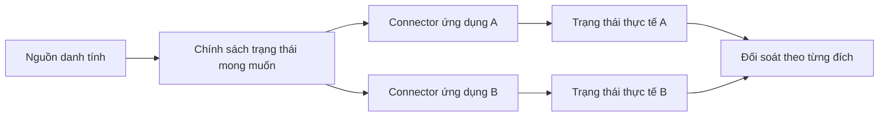

# Provisioning test

## 1. Provisioning test cần chứng minh điều gì?

**Provisioning** là quá trình tạo và duy trì tài khoản, thuộc tính, nhóm hoặc quyền tại các hệ thống đích theo nguồn và chính sách có thẩm quyền. **Provisioning test** kiểm tra rằng thay đổi mong muốn ở nguồn được chuyển thành trạng thái đúng tại đích, trong phạm vi và thời gian đã xác định.

Ví dụ, một nhân viên mới cần được tạo tài khoản trong ứng dụng công việc với nhóm cơ bản. Khi họ chuyển đơn vị, quyền cũ phải được xử lý đúng và quyền mới được cấp theo chính sách. Khi tài khoản nguồn bị vô hiệu hóa, hệ thống đích phải thay đổi trạng thái truy cập theo hợp đồng vòng đời.

Một response thành công từ connector chưa đủ chứng minh provisioning hoàn tất. Request có thể mới được tiếp nhận vào hàng đợi; tài khoản đã được tạo nhưng thiếu nhóm; hoặc trạng thái quản trị đã đổi nhưng đường truy cập vẫn sử dụng quyền cũ.

Do đó, kết quả cần được kiểm tra ở ba mức:

```text
Trạng thái mong muốn từ nguồn
  → trạng thái thực tế tại hệ thống đích
  → hành vi truy cập chịu tác động theo hợp đồng
```

## 2. Phân biệt provisioning với đăng nhập và phân quyền

Provisioning, xác thực và đánh giá quyền liên quan nhưng không đồng nhất.

| Chức năng | Nội dung kiểm tra chính |
| --- | --- |
| Provisioning | Tài khoản, thuộc tính và quyền được tạo hoặc cập nhật đúng ở đích |
| Xác thực | Người dùng hoặc workload chứng minh danh tính theo cơ chế áp dụng |
| Phân quyền | Chủ thể được thực hiện hành động nào với tài nguyên cụ thể |
| Quản lý phiên và token | Trạng thái truy cập hiện hữu tiếp tục hoặc chấm dứt theo chính sách |

Một người dùng có thể xác thực SSO thành công nhưng bị ứng dụng từ chối vì tài khoản chưa được cấp phát. Ngược lại, một tài khoản đích tồn tại không có nghĩa người dùng phải được cấp mọi quyền nghiệp vụ.

Khi kiểm thử deprovisioning, không mặc định thao tác vô hiệu hóa tài khoản sẽ lập tức kết thúc mọi phiên hoặc token tại mọi ứng dụng. Cần xác định những lớp trạng thái nào phải thay đổi, bằng cơ chế nào và trong thời hạn nào.

## 3. Xác định nguồn chuẩn và quyền sở hữu dữ liệu

Trước khi tạo test, làm rõ nguồn nào quyết định từng trường và hệ thống provisioning được phép thay đổi những gì.

| Thành phần | Câu hỏi cần trả lời |
| --- | --- |
| Nguồn danh tính | Hệ thống nào quyết định người dùng tồn tại và đang hoạt động? |
| Khóa liên kết | Tài khoản nguồn được nối với tài khoản đích bằng giá trị ổn định nào? |
| Mapping thuộc tính | Trường nào được chuyển, biến đổi, bỏ trống hoặc giữ nguyên? |
| Quyền và nhóm | Quyền nào do provisioning quản lý, quyền nào thuộc nguồn khác? |
| Tenant và đích | Tài khoản phải nằm trong tổ chức, namespace và ứng dụng nào? |
| Thu hồi | Vô hiệu hóa, gỡ quyền, xóa hay hành động khác được áp dụng trong trường hợp nào? |
| Độ trễ | Khi nào thay đổi phải hiện diện và khi nào hành vi truy cập phải đổi? |

Email hoặc username có thể thay đổi, nên không mặc định chúng là khóa liên kết bất biến. Nếu email được đổi hoặc cấp lại, quá trình đồng bộ không được tự ghép hai người khác nhau thành một tài khoản chỉ vì cùng giá trị hiển thị.

Khóa liên kết cần có namespace phù hợp, chẳng hạn nguồn danh tính và tenant. Hai nguồn có cùng một mã cục bộ không tự đại diện cho cùng chủ thể.

Một thuộc tính ở đích có thể được người dùng hoặc ứng dụng quản lý riêng. Test cần xác nhận provisioning không ghi đè phần ngoài quyền sở hữu của nó khi hợp đồng yêu cầu giữ lại.

## 4. Chuẩn bị fixture và hệ thống đích kiểm thử

Sử dụng tài khoản, tenant, nhóm và dữ liệu tổng hợp trong phạm vi kiểm thử được cấp. Connector có thể tạo tác động thật, vì vậy fixture cần có định danh và cơ chế dọn phù hợp để không nhầm với dữ liệu đang sử dụng.

Một tập fixture có thể gồm:

| Fixture | Mục đích |
| --- | --- |
| Chủ thể mới chưa có tài khoản đích | Kiểm tra create |
| Chủ thể đã có liên kết hợp lệ | Kiểm tra update và chạy lại |
| Hai chủ thể có tên hiển thị giống nhau | Kiểm tra tránh ghép nhầm |
| Hai tenant có mã cục bộ giống nhau nếu schema cho phép | Kiểm tra namespace và routing |
| Chủ thể có quyền được provisioning quản lý | Kiểm tra thêm và gỡ quyền |
| Tài khoản có thuộc tính ngoài quyền quản lý connector | Kiểm tra bảo toàn dữ liệu |
| Tài khoản đã vô hiệu hóa hoặc từng được cấp phát | Kiểm tra vòng đời và tái kích hoạt theo chính sách |

Tài khoản kỹ thuật của connector cần có đúng quyền mà môi trường vận hành dự kiến sử dụng. Nếu test luôn dùng tài khoản quản trị toàn cục, nó có thể bỏ qua vấn đề thiếu quyền hoặc che mất lỗi cô lập tenant.

Phân biệt kiểm thử mapping bằng mock với kiểm thử tích hợp tại đích. Mock trả thành công chỉ chứng minh mã xử lý một response giả định, chưa chứng minh API đích thực sự tạo đúng tài khoản hay hỗ trợ đúng trường.

## 5. Kiểm thử tạo tài khoản và mapping thuộc tính

Một kịch bản create nên kiểm tra từ sự kiện nguồn tới đối tượng đích:

1. Nguồn có chủ thể và trạng thái mong muốn đã xác định.
2. Chính sách chọn đúng hệ thống đích và tenant.
3. Connector tạo hoặc xác định đúng tài khoản tương ứng.
4. Thuộc tính và quyền ban đầu khớp mapping được phê duyệt.
5. Liên kết nguồn–đích được lưu để phục vụ cập nhật sau này.
6. Chạy lại cùng yêu cầu không tạo thêm tài khoản ngoài ý muốn.

Các trường hợp mapping cần tách riêng:

| Dữ liệu | Điều cần xác nhận |
| --- | --- |
| Chuỗi Unicode và dấu tiếng Việt | Không mất hoặc biến đổi ký tự ngoài hợp đồng |
| Email hoặc tên đăng nhập đổi | Cập nhật đúng tài khoản đã liên kết |
| Giá trị rỗng, thiếu trường hoặc `null` | Phân biệt giữ nguyên, xóa giá trị và lỗi theo hợp đồng |
| Nhóm hoặc quyền nhiều giá trị | Tập kết quả không thiếu, không thừa và không lặp ngoài ý nghĩa |
| Trường đích không hỗ trợ | Xử lý lỗi hoặc giới hạn rõ, không báo đồng bộ đầy đủ giả |
| Dữ liệu không hợp lệ | Không tạo tài khoản nửa đúng mà không có trạng thái đối soát |

Không nên chỉ so sánh JSON request với JSON response. Hệ thống đích có thể chuẩn hóa hoặc xử lý bất đồng bộ. Cần đọc lại trạng thái theo API hoặc cơ chế kiểm chứng có thẩm quyền tại đích, rồi so sánh theo ngữ nghĩa đã định nghĩa.

## 6. Kiểm thử cập nhật quyền và thay đổi vị trí công việc

Một thay đổi đơn vị có thể vừa thêm quyền mới vừa gỡ quyền cũ. Chỉ kiểm tra nhóm mới đã xuất hiện sẽ bỏ sót quyền tích lũy.

Ví dụ, chủ thể chuyển từ nhóm nghiệp vụ A sang B. Chính sách xác định quyền do provisioning quản lý phải trở thành tập `desiredManagedEntitlements`.

Nếu `managedScope` là tập quyền mà connector được phép quản lý, có thể đối chiếu:

```text
actualEntitlements ∩ managedScope
    = desiredManagedEntitlements
```

Phép so sánh này giúp kiểm tra cả quyền thiếu và quyền thừa trong phạm vi quản lý. Các quyền ngoài `managedScope` cần được giữ hoặc xử lý theo hợp đồng riêng; không tự xóa mọi quyền khác để làm tập đích trùng với tập nguồn.

Kiểm tra thêm các trường hợp:

- Gỡ người dùng khỏi một nhóm nhưng giữ các nhóm không liên quan.
- Quyền trực tiếp và quyền nhận gián tiếp qua nhóm được xử lý đúng mô hình.
- Tên nhóm giống nhau ở hai tenant không dẫn tới cấp sai nhóm.
- Một mapping hoặc cấu hình sai không được cấp quyền đặc biệt ngoài danh sách cho phép.
- Thu hồi một quyền ở nguồn có hiệu lực ở đích trong thời hạn đã cam kết.

Khi hệ thống đích có tầng policy hoặc cache quyền, kiểm tra hành vi truy cập chịu tác động, không chỉ danh sách nhóm trong giao diện quản trị.

## 7. Kiểm thử vô hiệu hóa, thu hồi và xóa

Deprovisioning có thể gồm nhiều hành động, với ý nghĩa khác nhau:

| Hành động | Ý nghĩa cần kiểm chứng |
| --- | --- |
| Vô hiệu hóa tài khoản | Đường truy cập bị hạn chế theo chính sách của ứng dụng |
| Gỡ nhóm hoặc entitlement | Quyền cụ thể không còn được cấp theo mô hình áp dụng |
| Thu hồi phiên hoặc token liên quan | Trạng thái truy cập hiện hữu thay đổi theo hợp đồng |
| Xóa tài khoản | Đối tượng được xử lý theo vòng đời và các ràng buộc đã xác định |
| Tách liên kết nguồn–đích | Không làm các lần đồng bộ sau gán nhầm tài khoản |

Không coi “đã gỡ khỏi một nhóm” là tương đương “không còn quyền truy cập”. Tài khoản có thể còn quyền trực tiếp hoặc quyền từ nhóm khác.

Một kịch bản nên có trạng thái trước, sự kiện kết thúc vòng đời và kết quả theo từng đích. Đối chiếu cả đăng nhập mới, hành động được bảo vệ và khả năng gia hạn hoặc sử dụng phiên cũ nếu chính sách yêu cầu.

Việc xóa cần được kiểm thử bằng dữ liệu tổng hợp phù hợp và đúng phạm vi. Không xóa tài khoản đang dùng chỉ để xác nhận connector hoạt động. Những dữ liệu còn cần giữ theo vòng đời hệ thống cũng phải có kết quả mong đợi rõ, thay vì giả định mọi bản ghi liên quan đều biến mất.

Nếu chủ thể được tái kích hoạt hoặc quay lại tổ chức, test cần kiểm tra cách liên kết tài khoản và cấp quyền mới. Không mặc định khôi phục mọi quyền cũ là hành vi đúng; quyền phải được tính theo trạng thái và chính sách hiện tại.

## 8. Idempotency, retry và response bị mất

Một connector có thể gửi request create, đích đã tạo tài khoản nhưng response không quay về. Nếu retry tạo thêm một tài khoản, trạng thái cuối không còn đúng dù mỗi request riêng lẻ đều có thể được xử lý hợp lệ.

Các tình huống cần kiểm tra:

| Tình huống | Kết quả cần xác nhận |
| --- | --- |
| Cùng sự kiện được gửi lại | Không tạo tài khoản hoặc quyền trùng ngoài ý muốn |
| Đích xử lý xong nhưng response mất | Có cách đối soát và tìm đúng đối tượng đã tạo |
| Connector dừng sau khi ghi đích, trước khi lưu liên kết | Sau khởi động lại vẫn không ghép nhầm hoặc nhân đôi |
| Hai worker xử lý cùng chủ thể | Liên kết và đối tượng đích giữ các bất biến duy nhất |
| Retry sau lỗi tạm thời | Chỉ thử lại theo phạm vi và số lần đã thiết kế |

Idempotency là thuộc tính của toàn bộ quy trình có trạng thái, không chỉ việc gửi lại cùng body. Cần xác định khóa hoặc cơ chế đối soát ổn định và giới hạn của khả năng chống trùng mà đích hỗ trợ.

Không mặc định mọi lỗi đều có thể retry. Dữ liệu không hợp lệ, thiếu quyền connector và đích không tồn tại cần được phân loại khác lỗi kết nối tạm thời. Một vòng retry vô hạn có thể che lỗi cấu hình và gây quá tải.

Với rate limit hoặc lỗi phụ thuộc, kiểm tra khoảng chờ, giới hạn lần thử và khả năng tiếp tục sau khi đích phục hồi. Trong khi còn chờ, trạng thái job không được bị ghi thành đã áp dụng thành công.

## 9. Sự kiện sai thứ tự và vòng đời có phiên bản

Một pipeline bất đồng bộ có thể nhận cập nhật cũ sau cập nhật mới. Ví dụ, sự kiện đổi đơn vị được giao lại sau khi tài khoản đã bị vô hiệu hóa. Nếu xử lý như trạng thái mới nhất, sự kiện cũ có thể khôi phục quyền không còn phù hợp.

Một test theo trình tự có thể gồm:

```text
Nguồn tạo chủ thể ở phiên bản v1
Nguồn cập nhật quyền ở phiên bản v2
Nguồn vô hiệu hóa ở phiên bản v3

Hệ thống xử lý v1, v3 rồi nhận lại v2

Kỳ vọng: trạng thái cuối vẫn tuân theo v3,
không bị v2 kích hoạt lại tài khoản hoặc cấp lại quyền cũ.
```

Các ký hiệu phiên bản chỉ minh họa. Triển khai cần có cơ chế xác định thứ tự hoặc đối soát trạng thái có thẩm quyền theo từng đối tượng và namespace. Không chỉ tin thời gian do một message tùy ý khai báo là đủ để xác định sự kiện mới nhất.

Kiểm tra cả trường hợp xóa rồi tạo lại một tài khoản có tên giống cũ. Định danh hoặc thế hệ đối tượng cần tránh để một sự kiện cũ tác động nhầm vào tài khoản mới.

Nếu hệ thống giữ trạng thái ghi nhớ đối tượng đã kết thúc vòng đời, việc giữ đó cần phù hợp với chính sách dữ liệu. Mục tiêu kỹ thuật là ngăn replay làm sống lại quyền, không phải giữ vô hạn mọi hồ sơ đã xóa.

## 10. Nhiều đích, lỗi từng phần và reconciliation

Một chủ thể có thể cần được cấp phát tới nhiều ứng dụng. Thành công ở đích A không chứng minh đích B đã hoàn tất.



Kiểm thử lỗi từng phần cần xác nhận trạng thái theo từng đích, khả năng retry đúng nơi lỗi và cách báo cáo tổng thể. Nếu sản phẩm có cơ chế bù hoặc rollback, cần kiểm tra đúng điều kiện; không mặc định mọi quy trình provisioning có giao dịch nguyên tử xuyên nhiều ứng dụng.

**Reconciliation** là đối chiếu trạng thái thực tế với trạng thái mong muốn trong phạm vi được quản lý. Test nên tạo sai lệch có kiểm soát, như thiếu một nhóm do connector quản lý, rồi xác nhận hệ thống phát hiện và xử lý theo chính sách.

Cần phân biệt nguồn thay đổi hợp lệ ngoài provisioning với sai lệch phải sửa. Nếu quản trị viên ở đích quản lý một trường riêng, reconciliation không nên ghi đè nó chỉ vì không có trong nguồn.

Đối soát phải phát hiện cả quyền thừa, không chỉ tài khoản hoặc quyền thiếu. Các truy vấn liệt kê phân trang, lọc theo tenant và tài khoản đích không còn liên kết cũng cần được đưa vào phạm vi kiểm thử.

## 11. Kiểm thử thời gian hội tụ bằng các mốc rõ ràng

Provisioning thường không hoàn tất ngay khi nguồn thay đổi. Cần xác định thời hạn cho từng mức kết quả:

| Mốc | Ý nghĩa |
| --- | --- |
| `t_source` | Thay đổi nguồn có hiệu lực theo hợp đồng |
| `t_accepted` | Pipeline đã tiếp nhận công việc |
| `t_target` | Trạng thái đích được xác nhận đã áp dụng |
| `t_access` | Hành vi truy cập đã phản ánh thay đổi khi cần kiểm chứng |

Nếu mục tiêu là hội tụ từ nguồn tới đích, khoảng đo có thể là `t_target - t_source`, không chỉ thời gian HTTP của connector. Nếu yêu cầu thu hồi truy cập có thời hạn riêng, cần kiểm tra `t_access` theo mốc mà chính sách đã quy định.

Test nên chờ một điều kiện có ý nghĩa trong một thời hạn giới hạn, thay vì ngủ một khoảng cố định rồi coi mọi trạng thái là hoàn tất. Khi hết thời hạn, báo rõ công việc đang chờ, lỗi connector hay đích chưa phản ánh dữ liệu.

Không tự kéo dài timeout test chỉ để che việc hệ thống không đạt cam kết. Ngược lại, thời hạn quá ngắn so với hợp đồng cũng tạo lỗi giả và làm giảm giá trị của bộ kiểm thử.

## 12. Phân tầng test và ghi bằng chứng an toàn

Có thể phân tầng theo trách nhiệm:

| Lớp | Nội dung phù hợp |
| --- | --- |
| Đơn vị | Mapping, chọn đích, tính tập quyền mong muốn, phân loại lỗi |
| Contract hoặc tích hợp connector | Request/response, quyền tài khoản kỹ thuật, giới hạn API đích |
| Tích hợp có trạng thái | Liên kết nguồn–đích, retry, thứ tự sự kiện và đối soát |
| Đầu cuối | Vòng đời từ nguồn tới hành vi truy cập tại ứng dụng đích |

Một báo cáo nên ghi fixture chủ thể, nguồn, tenant, đích, loại thay đổi, phiên bản chính sách, trạng thái mong muốn, trạng thái thực tế và các mốc thời gian cần thiết. ID tương quan giúp nối sự kiện mà không phải ghi nguyên dữ liệu tài khoản.

Không đưa mật khẩu tạm, khóa connector, token API, bí mật workload hoặc toàn bộ hồ sơ vào log và artifact test. Khi provisioning danh tính workload có phát hành thông tin xác thực, kiểm tra việc phân phối và quản lý bí mật bằng cơ chế có kiểm soát riêng, không in bí mật để chứng minh đã tạo.

Sau khi chạy trong môi trường test, các tài nguyên tổng hợp cần được xử lý theo cơ chế cleanup có phạm vi và xác minh phù hợp. Một bộ test để lại tài khoản hoạt động hoặc quyền đặc biệt ngoài ý muốn cũng tạo sai lệch cần được quản lý.

## 13. Các kết luận dễ sai

| Kết luận | Vì sao chưa đủ? |
| --- | --- |
| Connector trả thành công nên tài khoản đã sẵn sàng | Request có thể mới được tiếp nhận hoặc trạng thái còn thiếu |
| Tài khoản tồn tại nên mapping đúng | Có thể sai thuộc tính, tenant, liên kết hoặc quyền |
| Nhóm mới xuất hiện nên chuyển đơn vị đã hoàn tất | Quyền cũ có thể vẫn còn |
| Chạy lại không báo lỗi nên đã idempotent | Có thể đã tạo đối tượng trùng hoặc liên kết sai |
| Vô hiệu hóa tài khoản là mọi phiên lập tức hết hiệu lực | Cần kiểm tra cơ chế và phạm vi thu hồi thực tế |
| Đồng bộ tạo tài khoản hoạt động nên deprovisioning cũng đúng | Đường thu hồi, xóa và sự kiện sai thứ tự có rủi ro riêng |
| Mock đích trả thành công là đã chứng minh tích hợp | Chưa kiểm tra hành vi thật của hệ thống đích |

Provisioning test có giá trị khi đối chiếu được trạng thái mong muốn với trạng thái thực tế theo từng chủ thể, tenant và đích, rồi xác nhận tác động truy cập liên quan. Các tình huống retry, lỗi từng phần và kết thúc vòng đời cần được kiểm tra cùng với đường tạo tài khoản thành công.
