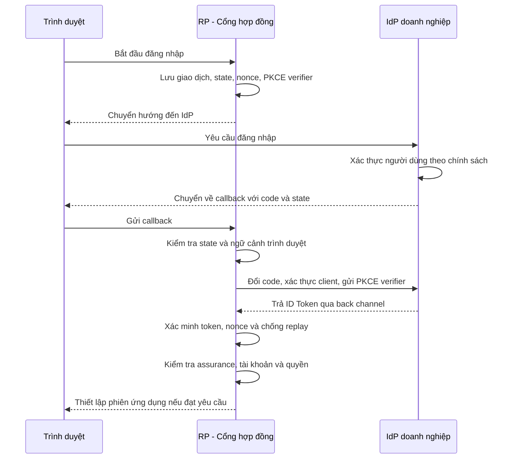

# Federation Assurance Level

## 1. FAL bảo đảm điều gì trong liên kết danh tính?

Federation Assurance Level (FAL) là mức bảo đảm của một giao dịch liên kết danh tính. Nó mô tả những điều kiện bảo vệ khi một Identity Provider (IdP) chuyển kết quả xác thực và thông tin chủ thể đến một Relying Party (RP), để RP thiết lập phiên cho đúng người dùng.

Ví dụ, nhân viên đăng nhập tại IdP của doanh nghiệp rồi mở cổng quản lý hợp đồng. Cổng hợp đồng không trực tiếp kiểm tra mật khẩu tại IdP; nó tiếp nhận một assertion và quyết định có thể tin kết quả được chuyển đến hay không. Assertion có thể là ID Token của OpenID Connect (OIDC) hoặc SAML Assertion.

Câu hỏi cốt lõi là: “RP có đang nhận đúng kết quả, từ đúng bên phát hành, cho đúng ứng dụng và đúng giao dịch của người dùng không?”. Việc người dùng đã đăng nhập thành công tại IdP chỉ là một phần của chuỗi này.

Bài học dùng NIST SP 800-63C-4, thuộc Revision 4, làm mốc. Một IdP có thể phục vụ các giao dịch ở nhiều FAL; không nên coi FAL là thuộc tính cố định chỉ cần gắn một lần cho tên sản phẩm SSO. Xem [Federation Assurance Level của NIST](https://pages.nist.gov/800-63-4/sp800-63c/fal/).

## 2. Đặt FAL bên cạnh IAL, AAL và phân quyền

| Chiều đánh giá | Câu hỏi chính | Sai sót cần tránh |
| --- | --- | --- |
| IAL — Identity Assurance Level | Danh tính ngoài đời đã được kiểm chứng đến đâu? | Coi một tài khoản tự khai là đã được kiểm chứng danh tính |
| AAL — Authentication Assurance Level | Chủ thể đã chứng minh quyền kiểm soát authenticator như thế nào? | Coi việc có tên người dùng là đủ để tin phiên xác thực |
| FAL — Federation Assurance Level | Kết quả được truyền và tiếp nhận trong giao dịch federation như thế nào? | Chấp nhận assertion hợp lệ ở sai giao dịch hoặc sai ứng dụng |
| Phân quyền | Chủ thể có được thực hiện hành động trên tài nguyên này không? | Coi đăng nhập SSO thành công là được cấp mọi quyền |

MFA tại IdP không tự sửa lỗi RP bỏ qua audience hoặc không liên kết phản hồi với giao dịch đã khởi tạo. Tương tự, một giao dịch federation được bảo vệ tốt không tự chứng minh người dùng có quyền phê duyệt hợp đồng.

Trong IAM doanh nghiệp, các chiều này cùng tham gia quyết định truy cập nhưng phải được đánh giá riêng. Việc áp dụng mức nào phụ thuộc nghiệp vụ, nhóm người dùng và rủi ro; các tổ hợp vẫn phải đáp ứng ràng buộc của chuẩn và chính sách áp dụng.

## 3. Vì sao chữ ký hợp lệ chưa đủ?

Giả sử một ID Token được ký đúng bởi IdP đáng tin cậy. RP vẫn có thể tạo phiên sai nếu không kiểm tra ngữ cảnh.

| Tình huống | Vì sao chữ ký chưa giải quyết được | Điều cần kiểm soát |
| --- | --- | --- |
| Assertion dành cho ứng dụng khác | Nội dung nguyên vẹn nhưng sai bên nhận | Audience và cấu hình RP |
| Assertion bị gửi lại lần thứ hai | Chữ ký không thay đổi khi dữ liệu bị sao chép | Replay protection |
| Phản hồi của giao dịch khác bị đưa vào phiên hiện tại | Assertion có thể thật nhưng bị gắn sai ngữ cảnh | Tương quan request, response và phiên trình duyệt |
| Token được ký bởi IdP ngoài danh sách chấp nhận | Có thể xác minh bằng một khóa nhưng nguồn không được tin cậy | Issuer và trust configuration |
| Người dùng đã nghỉ việc | Assertion không thay thế vòng đời quyền | Trạng thái tài khoản và chính sách cấp quyền |

Assertion injection là việc kẻ tấn công khiến RP xử lý assertion hoặc tham chiếu assertion được đưa vào sai ngữ cảnh. Nó có thể liên quan đến dữ liệu bị đánh cắp hoặc được tạo để phục vụ tấn công. Vì vậy, bảo vệ phải bao gồm cả giao thức, trạng thái giao dịch và cách RP tiếp nhận phản hồi. NIST mô tả vấn đề tại [Protection From Assertion Injection Attacks](https://pages.nist.gov/800-63-4/sp800-63c/Federation/#protection-from-assertion-injection-attacks).

## 4. Ba mức FAL theo Revision 4

Các mức có tính kế thừa: FAL cao hơn đáp ứng yêu cầu của mức thấp hơn, trừ những điểm được quy định chặt hơn hoặc thay thế.

| Mức | Đặc điểm cần nhớ |
| --- | --- |
| FAL1 | Assertion có chữ ký được kiểm tra; audience bị giới hạn; từng RP phải ngăn chấp nhận lại cùng assertion. Chống injection được khuyến nghị. |
| FAL2 | Bổ sung chống injection bắt buộc, giao dịch do RP khởi tạo, một audience RP và thỏa thuận tin cậy được thiết lập trước. |
| FAL3 | Kế thừa FAL2 và yêu cầu RP kiểm chứng quyền kiểm soát authenticator bổ sung qua holder-of-key assertion hoặc bound authenticator. |

Bảng là bản định hướng, không phải toàn bộ điều kiện đạt chuẩn. Ví dụ, FAL2 còn có yêu cầu đối với federated identifier; FAL3 có yêu cầu riêng về thiết lập định danh và khóa. Phải đối chiếu [toàn bộ yêu cầu FAL1, FAL2 và FAL3](https://pages.nist.gov/800-63-4/sp800-63c/fal/) trước khi công bố mức của một triển khai.

### FAL1 vẫn có các yêu cầu bảo vệ

Không nên diễn giải FAL1 thành “chấp nhận mọi JWT có chữ ký”. RP vẫn cần biết khóa thuộc issuer nào, assertion có dành cho mình không và assertion đã được sử dụng chưa.

Ví dụ, một RP bỏ qua audience không thể lấy lý do “chỉ cần mức cơ bản” để hợp thức hóa lỗi đó. Các yêu cầu nền tảng vẫn phải được đáp ứng.

### FAL2 gắn phản hồi với giao dịch được RP khởi tạo

Một thiết kế hướng đến FAL2 phải kiểm soát đường đi từ lúc RP bắt đầu đăng nhập đến lúc tạo phiên. RP không chỉ nhận một assertion rồi tìm người dùng tương ứng.

Trong cổng hợp đồng, backend có thể lưu bản ghi giao dịch gồm issuer dự kiến, client identifier, trạng thái chống CSRF, nonce và thời điểm hết hạn. Khi callback đến, backend đối chiếu phản hồi với bản ghi này. Một callback không gắn với giao dịch hợp lệ phải bị từ chối.

Thỏa thuận tin cậy cũng cần chỉ rõ các bên được tham gia, thuộc tính được chia sẻ và mức bảo đảm chấp nhận. Không dùng email hoặc mã nhân viên dạng rõ làm federated identifier ở FAL2; định danh này cần tuân thủ yêu cầu riêng của chuẩn. Thuộc tính email được chia sẻ cho một mục đích hợp lệ là vấn đề khác với việc dùng email làm định danh federation.

### FAL3 thêm bằng chứng tại RP

Có hai hướng cần phân biệt:

- **Holder-of-key assertion:** assertion xác định một authenticator; RP kiểm chứng chủ thể kiểm soát authenticator đó.
- **Bound authenticator:** authenticator đã được gắn với tài khoản tại RP; RP kiểm chứng nó khi xử lý giao dịch FAL3.

Cả hai có yêu cầu chống phishing và ràng buộc chủ thể theo chuẩn. Chỉ thêm một trường khóa công khai hoặc một claim `fal=3` vào token không tạo ra bằng chứng kiểm soát khóa. Quy trình gắn authenticator ban đầu và khôi phục cũng là phần quan trọng của cơ sở tin cậy.

Các cơ chế này được trình bày trong [Holder-of-Key Assertions và Bound Authenticators](https://pages.nist.gov/800-63-4/sp800-63c/Federation/#holder-of-key-assertions). MFA đã thực hiện tại IdP không thay thế việc kiểm chứng bổ sung mà RP phải thực hiện cho FAL3.

## 5. Không trộn định nghĩa của Revision 3 và Revision 4

Tài liệu cũ thường tóm tắt FAL2 là assertion được ký và mã hóa cho RP; FAL3 bổ sung holder-of-key. Đây là cách trình bày trong [NIST SP 800-63C thuộc Revision 3](https://pages.nist.gov/800-63-3/sp800-63c.html#sec4).

Revision 4 tổ chức yêu cầu FAL theo tập kiểm soát rộng hơn, đặc biệt về injection, audience, thỏa thuận tin cậy và cách trình bày assertion. Vì thế, không dùng công thức “bật JWE là đạt FAL2” để đánh giá một triển khai theo Revision 4.

Cần phân biệt ba mục đích:

- Chữ ký giúp kiểm tra nguồn và tính toàn vẹn.
- Mã hóa bảo vệ tính bí mật của nội dung.
- Tương quan giao dịch, chống replay và kiểm chứng authenticator giải quyết những rủi ro khác.

Một assertion được mã hóa vẫn có thể bị xử lý sai ngữ cảnh. Ngược lại, việc mô tả FAL theo Revision 4 không cho phép bỏ qua yêu cầu bảo vệ dữ liệu nhạy cảm của giao thức, trust agreement hoặc quy định áp dụng.

## 6. Ví dụ luồng OIDC có kiểm soát giao dịch

Giả sử cổng hợp đồng là một web backend, hoạt động như confidential client, dùng OIDC Authorization Code Flow với PKCE. Luồng dưới đây minh họa cách tổ chức kiểm soát; tự nó chưa phải bằng chứng toàn bộ hệ thống đạt FAL2.



Trong ví dụ:

- `state` liên kết callback với giao dịch và ngữ cảnh phía RP, hỗ trợ chống CSRF.
- `nonce` được RP gửi trong yêu cầu và kiểm tra lại trong ID Token, liên kết assertion với yêu cầu tương ứng.
- PKCE ràng buộc việc đổi authorization code với giá trị verifier của giao dịch.
- Client authentication xác thực confidential client tại token endpoint.
- Việc kiểm tra issuer và token endpoint dự kiến giúp tránh dùng phản hồi với sai IdP.

Các giá trị ngẫu nhiên phải khó đoán, có thời hạn và được gắn với đúng giao dịch. Không nhận giá trị bất kỳ do callback cung cấp rồi coi đó là trạng thái mà RP đã tạo.

PKCE, nonce và state có những quan hệ hỗ trợ theo từng giao thức, nhưng không nên gộp chúng thành một cờ “bảo mật đã bật”. Những cơ chế trên được bàn trong [RFC 9700 — OAuth 2.0 Security Best Current Practice](https://www.rfc-editor.org/rfc/rfc9700.html).

## 7. RP kiểm tra gì khi nhận ID Token?

Một cấu hình OIDC cần xử lý tối thiểu các nhóm điều kiện phù hợp với flow và chính sách:

1. **Nguồn phát hành:** `iss` khớp chính xác issuer đã cấu hình.
2. **Khóa và thuật toán:** chỉ dùng khóa gắn với issuer tin cậy và thuật toán được cho phép; không để token tự chỉ định một nguồn khóa tùy ý.
3. **Bên nhận:** `aud` hợp lệ đối với client; nếu áp dụng FAL2 trở lên, assertion phải hướng đến một RP theo yêu cầu NIST.
4. **Thời gian:** token chưa hết hạn; xử lý thời điểm phát hành, sai lệch đồng hồ và độ mới theo chính sách.
5. **Tương quan:** nonce và thông tin phản hồi khớp giao dịch đang xử lý.
6. **Chống sử dụng lại:** cơ chế của giao thức và kho trạng thái ngăn cùng kết quả được chấp nhận lại.
7. **Chủ thể:** xác định tài khoản từ issuer và subject đã xác minh.

OIDC còn có các điều kiện phụ thuộc flow và claim, chẳng hạn xử lý `azp`, `auth_time` và `acr`. Phải dùng thư viện giao thức phù hợp và cấu hình đúng; danh sách trên không thay thế đặc tả [OIDC Core — ID Token Validation](https://openid.net/specs/openid-connect-core-1_0.html#IDTokenValidation).

Không dùng ID Token như access token để gọi API chỉ vì nó cũng là JWT. Hai loại token có mục đích và bên nhận khác nhau. Cũng không mặc định mọi access token đều chứa đủ thông tin để chứng minh mức FAL của lần đăng nhập ban đầu.

## 8. Lưu ngữ cảnh giao dịch thay vì chỉ đọc một claim

Một bản ghi nội bộ có thể có dạng sau:

```json
{
  "transactionId": "login-tx-4f29",
  "expectedIssuer": "https://idp.example.org",
  "clientId": "contracts-portal",
  "framework": "NIST-SP-800-63C-4",
  "requiredFal": 2,
  "federationProfile": "enterprise-oidc-profile-v3",
  "status": "PENDING",
  "createdAt": "2026-11-26T03:00:00Z",
  "expiresAt": "2026-11-26T03:05:00Z"
}
```

Đây là schema ứng dụng minh họa, không phải bộ claim chuẩn của OIDC. `requiredFal` là yêu cầu của RP; nó không tự chứng minh kết quả đã đạt mức đó. Thời hạn năm phút chỉ là lựa chọn minh họa.

Các bí mật và giá trị tương quan như PKCE verifier, nonce, state phải được lưu, bảo vệ và ràng buộc với ngữ cảnh theo thiết kế cụ thể. Không cần đưa chúng vào log hoặc trả toàn bộ bản ghi cho trình duyệt.

Một thuật toán khái niệm:

```text
completeFederation(callback, browserContext):
    tx = transactionStore.lookup(callback.state)

    require tx exists and tx.status == PENDING
    require tx not expired
    require tx is bound to browserContext

    profile = trustedProfiles.lookup(tx.federationProfile)
    require profile is active
    require profile.issuer == tx.expectedIssuer

    tokens = oidcClient.exchangeCode(
        callback.code,
        tx.pkceVerifier,
        profile.clientAuthentication
    )

    identity = oidcValidator.validate(
        tokens.idToken,
        expectedIssuer = tx.expectedIssuer,
        expectedClient = tx.clientId,
        expectedNonce = tx.nonce
    )

    assurance = federationPolicy.evaluateVerifiedTransaction(
        profile, tx, identity, additionalSubscriberProof
    )

    require assurance satisfies tx.requiredFal
    require transactionStore.consumeOnce(tx.id)
    require replayProtection.acceptOnce(identity.assertionReference)

    account = accountStore.resolve(identity.issuer, identity.subject)
    require account is active

    return sessionService.establish(account, assurance)
```

Các thao tác `evaluateVerifiedTransaction` và `replayProtection` đại diện cho kiểm soát đã được thiết kế, không phải hàm có thể đoán FAL chỉ từ vài claim. `additionalSubscriberProof` cần được kiểm chứng theo cơ chế phù hợp khi yêu cầu FAL3.

`assertionReference` là tham chiếu chống replay nội bộ phù hợp giao thức; không hàm ý mọi ID Token đều bắt buộc có claim `jti`. Tương quan nonce và trạng thái chỉ dùng một lần có thể tham gia cơ chế này.

Mã giả cũng lược bỏ xử lý lỗi và đồng thời. Khi triển khai nhiều instance, việc đánh dấu đã sử dụng phải có tính nguyên tử và hiệu lực trên toàn cụm. Một cache riêng ở từng process có thể cho phép cùng dữ liệu được chấp nhận tại hai instance.

## 9. Áp dụng cùng nguyên tắc với SAML

SAML dùng định dạng và binding khác OIDC, nhưng RP vẫn phải kiểm tra nguồn, bên nhận, thời gian hiệu lực, chữ ký, tương quan giao dịch và chống replay.

Ví dụ, trong một luồng do SP/RP khởi tạo, ứng dụng cần đối chiếu phản hồi với request đã phát hành; một phản hồi có chữ ký nhưng không thuộc request đang chờ không được tự động gắn vào phiên hiện tại. Các trường như audience, recipient, destination hoặc thông tin tương quan phải được xử lý đúng theo profile và binding áp dụng.

Cần bảo đảm đối tượng mà ứng dụng sử dụng chính là đối tượng đã được thư viện xác minh chữ ký. Việc một phần XML có chữ ký hợp lệ không có nghĩa mọi dữ liệu khác trong thông điệp đều đáng tin.

Đối với yêu cầu FAL2 theo Revision 4, cần thiết kế hành trình do RP khởi tạo. Không giữ một endpoint chấp nhận assertion không gắn với giao dịch RP rồi coi các kiểm tra chữ ký riêng lẻ là đã đủ.

## 10. Chọn FAL theo rủi ro và khả năng vận hành

Một ứng dụng có thể tách yêu cầu giữa xem thông tin thông thường và thực hiện tác vụ nhạy cảm. Ví dụ minh họa: cổng nội bộ đặt yêu cầu federation theo profile đã phê duyệt cho đăng nhập, còn khu vực quản trị yêu cầu một giao dịch mạnh hơn cùng quyền đặc biệt.

Khi cân nhắc FAL3, cần phân tích thêm rủi ro IdP bị xâm phạm và khả năng sử dụng authenticator bổ sung tại RP. Cơ chế này giảm những rủi ro cụ thể trong chuỗi tin cậy; nó không làm hệ thống miễn nhiễm với việc RP, thiết bị người dùng hoặc quy trình cấp quyền bị xâm phạm.

Một dịch vụ không đủ khả năng đáp ứng mức được yêu cầu cần có hành vi rõ ràng: từ chối tác vụ hoặc chuyển sang quy trình ngoại lệ đã được chấp thuận. Không âm thầm hạ yêu cầu chỉ để hoàn tất đăng nhập.

## 11. Vòng đời phiên, khóa và quyền truy cập

FAL mô tả giao dịch federation đã thực hiện, không thay thế chính sách quản lý phiên sau đó.

Trong cổng hợp đồng, một phiên tạo từ giao dịch đạt yêu cầu vẫn cần thời gian hết hạn, chính sách xác thực lại và kiểm tra quyền hiện hành. Người dùng bị đình chỉ hoặc bị thu hồi hợp đồng không được tiếp tục có quyền chỉ vì phiên cũ từng đăng nhập thành công.

Về vận hành, cần chuẩn bị cho các tình huống như xoay khóa IdP, thu hồi khóa bị lộ, lỗi truy cập metadata, mất kho tương quan giao dịch hoặc authenticator bị mất. Không khắc phục sự cố bằng cách bỏ xác minh chữ ký hay chấp nhận issuer chưa được cấu hình.

Đối với FAL3 dùng bound authenticator, thêm, thay thế và khôi phục authenticator ảnh hưởng trực tiếp đến cơ sở tin cậy. Nếu quy trình khôi phục cho phép gắn khóa của kẻ tấn công, phần kiểm chứng khóa sau đó có thể hoạt động đúng nhưng bảo vệ nhầm người.

## 12. Bằng chứng vận hành và dữ liệu tối thiểu

Nhật ký nên giúp điều tra được giao dịch nào đã bị từ chối và vì sao, chẳng hạn issuer không được chấp nhận, audience sai, nonce không khớp, giao dịch đã dùng hoặc thiếu bằng chứng FAL3.

Nên lưu mã giao dịch, profile áp dụng, kết quả kiểm tra và tham chiếu chủ thể phù hợp thay vì toàn bộ token. Assertion có thể chứa dữ liệu cá nhân hoặc được dùng trong tấn công nếu bị lộ; authorization code, PKCE verifier và token không nên xuất hiện nguyên vẹn trong log thông thường.

Những bằng chứng hữu ích cho việc đánh giá triển khai gồm cấu hình trust, chính sách khóa, cách liên kết giao dịch, cơ chế chống replay và cách xử lý yêu cầu assurance không đạt. Một ảnh chụp màn hình “SSO thành công” không chứng minh các điều kiện đó.

## 13. Tình huống tự kiểm tra

Một nhân viên đăng nhập bằng MFA tại IdP. Sau đó, cổng hợp đồng nhận ID Token có chữ ký hợp lệ nhưng `aud` chỉ chứa client identifier của cổng nhân sự.

Cổng hợp đồng phải từ chối. Xác thực người dùng tại IdP không làm token trở thành assertion dành cho mọi RP. Việc cho phép vì “cùng IdP doanh nghiệp” sẽ phá vỡ ranh giới bên nhận.

Trong tình huống thứ hai, audience đúng nhưng nonce thuộc một giao dịch khác. Cổng cũng phải từ chối vì assertion chưa được gắn đúng với giao dịch đang hoàn tất.

Trong tình huống thứ ba, giao dịch đáp ứng mức federation yêu cầu nhưng người dùng không có quyền đọc hợp đồng của tenant hiện tại. Ứng dụng phải từ chối ở bước phân quyền. FAL cung cấp cơ sở tin cậy cho việc tiếp nhận danh tính; RBAC, ABAC, tenant và vòng đời quyền vẫn quyết định tài nguyên nào được sử dụng.
