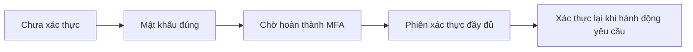

# OWASP Authentication Cheat Sheet

## 1. Vai trò trong thiết kế và bảo đảm IAM

[OWASP Authentication Cheat Sheet](https://cheatsheetseries.owasp.org/cheatsheets/Authentication_Cheat_Sheet.html) là tài liệu hướng dẫn thực hành để xây dựng chức năng xác thực an toàn. Các chủ đề của tài liệu đi từ mật khẩu, chống tấn công đăng nhập đến xác thực lại, giám sát và giao thức liên kết danh tính.

Trong chương Standards và assurance, giá trị quan trọng của tài liệu là giúp chuyển một tuyên bố như “đăng nhập an toàn” thành các quyết định và bằng chứng có thể xem xét. Chỉ ghi tên tài liệu vào hồ sơ thiết kế chưa chứng minh một hệ thống đã đáp ứng các khuyến nghị liên quan.

Bài học dùng cheat sheet làm điểm xuất phát để phân tích một cổng quản trị nhân sự giả định, gọi là **Atlas**. Các tình huống, mã kiểm soát và cấu hình Atlas dưới đây là ví dụ học tập, không phải danh sách yêu cầu nguyên văn hoặc chứng nhận của OWASP.

Sau bài này, người học có thể:

- Chọn nội dung hướng dẫn phù hợp với từng luồng xác thực.
- Xác định nơi thực thi và người chịu trách nhiệm cho kiểm soát.
- Thiết kế kiểm thử có đối chứng và lưu bằng chứng đủ để đánh giá.
- Nhận ra đường vòng qua khôi phục tài khoản, phiên hoặc đăng nhập liên kết.

## 2. Bắt đầu từ các đường vào tài khoản

Atlas phục vụ nhân viên của nhiều doanh nghiệp. Một doanh nghiệp dùng tài khoản cục bộ; doanh nghiệp khác đăng nhập qua IdP bằng OIDC. Quản trị viên có thể cấp quyền, thay đổi email và đăng ký phương thức MFA mới.

Nhóm phát triển cần kiểm kê cả những luồng ít xuất hiện trên màn hình đăng nhập:

| Luồng của Atlas | Câu hỏi cần trả lời | Bằng chứng cần có trong ví dụ |
|---|---|---|
| Đăng nhập bằng mật khẩu | Ai đang kiểm tra bí mật và giới hạn thử sai? | Kiểm thử endpoint thực tế và cấu hình có hiệu lực |
| Hoàn thành MFA | Phiên chờ MFA có thể gọi API nghiệp vụ không? | Request trực tiếp tới API trước và sau MFA |
| Quên mật khẩu | Token khôi phục có thể dùng lại hoặc dùng cho tài khoản khác không? | Kết quả kiểm thử vòng đời token |
| Thay yếu tố MFA | Một người chỉ giữ cookie phiên có thể thay yếu tố không? | Ca kiểm thử thay yếu tố thiếu xác thực lại |
| Đăng nhập OIDC | Ứng dụng đã xác minh kết quả của IdP như thế nào? | Kiểm thử token và giao dịch đăng nhập sai ràng buộc |
| Logout và kết thúc phiên | Phiên cũ còn được chấp nhận tại node khác không? | Ca sử dụng lại phiên theo chính sách kết thúc phiên |
| Khôi phục qua hỗ trợ | Nhân viên hỗ trợ dựa vào bằng chứng nào để khôi phục? | Quy trình, phân quyền và hồ sơ một ca diễn tập |

Điểm khởi đầu này tránh một thiếu sót thường gặp: làm rất kỹ form đăng nhập nhưng để một API cũ hoặc quy trình hỗ trợ trở thành đường vào dễ hơn.

Với SSO, trách nhiệm phải chia rõ. IdP có thể sở hữu xác thực ban đầu và chính sách MFA; Atlas vẫn sở hữu việc chấp nhận kết quả liên kết, phiên ứng dụng và quyền truy cập dữ liệu. Với tài khoản cục bộ, Atlas còn chịu trách nhiệm lưu và xác minh mật khẩu.

Tài khoản người dùng, tài khoản quản trị và danh tính workload cũng cần được phân biệt. Không mặc định chính sách dành cho người nhập mật khẩu có thể áp dụng nguyên xi cho tiến trình tự động hoặc tài khoản dịch vụ.

## 3. Mật khẩu: chính sách có thể sử dụng được

### 3.1. Hiểu đúng các ngưỡng độ dài

Hướng dẫn mật khẩu hiện hành được OWASP liên kết tới NIST SP 800-63B-4. Theo NIST, mật khẩu dùng làm yếu tố duy nhất có tối thiểu 15 ký tự; mật khẩu chỉ dùng trong quy trình MFA có thể ngắn hơn nhưng tối thiểu 8. Giới hạn tối đa nên cho phép ít nhất 64 ký tự. Đây không phải quy tắc “cứ bật một tùy chọn MFA là mọi mật khẩu đều được hạ xuống 8”. [NIST SP 800-63B-4, mục 3.1.1.2](https://pages.nist.gov/800-63-4/sp800-63b.html#passwordver).

Với Atlas, giả sử nhóm chọn tối thiểu 15 ký tự cho mọi tài khoản cục bộ để chính sách nhất quán. Đây là quyết định của ví dụ. Nếu một nhóm muốn áp dụng ngưỡng khác nhau, họ phải kiểm tra cả đường đăng nhập dự phòng và tình huống MFA bị gỡ hoặc chưa đăng ký.

### 3.2. Không biến quy tắc hình thức thành thước đo duy nhất

NIST không yêu cầu trộn bắt buộc chữ hoa, chữ thường, số và ký hiệu; thay vào đó cần kiểm tra mật khẩu phổ biến hoặc đã bị lộ, cho phép trình quản lý mật khẩu và không ép đổi định kỳ tùy ý. Có bằng chứng lộ bí mật thì phải xử lý thay đổi tương ứng. Nếu chấp nhận Unicode, cần xử lý nhất quán và đếm độ dài theo code point. [NIST SP 800-63B-4, mục 3.1.1.2](https://pages.nist.gov/800-63-4/sp800-63b.html#passwordver).

Những ca kiểm thử Atlas nên tự thiết kế:

1. Gửi một passphrase dài hợp lệ qua cả UI lẫn API; kết quả không bị khác nhau do giới hạn form.
2. Tạo hai chuỗi giống phần đầu nhưng khác phần cuối vượt vị trí giới hạn cũ; xác nhận hệ thống không âm thầm bỏ phần cuối.
3. Kiểm tra dán mật khẩu từ trình quản lý mật khẩu và chức năng tự điền.
4. Kiểm tra dữ liệu Unicode qua đăng ký, đổi mật khẩu và đăng nhập để phát hiện khác biệt xử lý giữa các luồng.
5. Dùng một giá trị thử nghiệm có trong blocklist nội bộ; xác nhận người dùng được hướng dẫn chọn giá trị khác mà bí mật không xuất hiện trong log.

Nếu có bước chuẩn hóa đầu vào, hãy định nghĩa rõ và kiểm thử nhất quán. Không để một luồng tự cắt khoảng trắng trong khi luồng khác dùng nguyên chuỗi mà không có chủ đích.

### 3.3. Lưu trữ và xác minh

Mật khẩu cần được bảo vệ bằng hàm băm chuyên dụng có salt, không lưu rõ hoặc chỉ dùng một lượt SHA-256. OWASP Password Storage Cheat Sheet ưu tiên Argon2id; lựa chọn thuật toán và tham số cần xét khả năng triển khai, hiệu năng và ràng buộc của môi trường. Dùng hàm xác minh của thư viện thay vì tự băm rồi so sánh chuỗi. [OWASP Password Storage Cheat Sheet](https://cheatsheetseries.owasp.org/cheatsheets/Password_Storage_Cheat_Sheet.html).

Trong hồ sơ Atlas, bằng chứng nên mô tả thuật toán, tham số đang có hiệu lực và cách nâng cấp bản ghi cũ. Một ảnh chụp cấu hình mặc định của framework không đủ nếu kho dữ liệu thực tế vẫn chứa bản ghi theo cách lưu cũ.

Đối với hệ thống legacy dùng bcrypt, phải chú ý giới hạn đầu vào theo byte của triển khai và tránh cắt bí mật âm thầm. Không tự chế bước tiền xử lý để vượt giới hạn mà thiếu thiết kế được xem xét. [OWASP Password Storage Cheat Sheet — giới hạn đầu vào bcrypt](https://cheatsheetseries.owasp.org/cheatsheets/Password_Storage_Cheat_Sheet.html#input-limits-of-bcrypt).

## 4. Phản hồi đăng nhập và khả năng dò tài khoản

Authentication Cheat Sheet khuyến nghị phản hồi lỗi tổng quát để hạn chế lộ việc tài khoản có tồn tại, bị khóa hay sai mật khẩu. Không chỉ nội dung hiển thị, khác biệt về HTTP response và thời gian xử lý cũng có thể tiết lộ thông tin. [OWASP Authentication Cheat Sheet — Authentication and Error Messages](https://cheatsheetseries.owasp.org/cheatsheets/Authentication_Cheat_Sheet.html#authentication-and-error-messages).

Với Atlas, phản hồi bên ngoài có thể là:

```json
{
  "code": "SIGN_IN_FAILED",
  "message": "Không thể đăng nhập bằng thông tin đã cung cấp.",
  "requestId": "req-example-73"
}
```

Đây là schema minh họa do ứng dụng thiết kế. Nội bộ vẫn cần phân biệt lý do để vận hành, nhưng không đưa toàn bộ lý do vào API công khai.

Để kiểm chứng, tạo ba nhóm request thất bại: tài khoản không tồn tại, tài khoản tồn tại nhưng sai mật khẩu và tài khoản đang bị vô hiệu hóa. Đối chiếu body, status, redirect, header, cookie và phân bố thời gian trong điều kiện thử tương đương.

Không dùng tiêu chí “mọi request phải mất đúng 200 mili giây”. Hạ tầng có nhiễu; điều cần điều tra là khác biệt có hệ thống có thể khai thác. Mặt khác, việc gọi một hàm băm giả ở nhánh không tìm thấy tài khoản không tự chứng minh toàn bộ endpoint đã hết rò rỉ thời gian.

Thông báo lỗi cụ thể vẫn có chỗ dùng sau khi đã xác minh người dùng và trong kênh hỗ trợ được kiểm soát. Nhóm thiết kế cần ghi rõ ai được xem thông tin nào thay vì áp dụng một câu thông báo duy nhất cho mọi ngữ cảnh.

## 5. Chống thử sai và tấn công tự động

Một hệ thống phải đối diện nhiều kiểu thử đăng nhập: thử nhiều mật khẩu cho một tài khoản, thử một mật khẩu trên nhiều tài khoản hoặc sử dụng các cặp thông tin đã bị lộ ở nơi khác. Chính sách chỉ chặn một IP dễ bỏ sót tấn công phân tán và có thể ảnh hưởng nhiều người dùng cùng NAT.

OWASP Credential Stuffing Prevention Cheat Sheet nhấn mạnh MFA, phòng thủ nhiều lớp và đo hiệu quả của từng lớp. Tín hiệu như thiết bị, IP và hành vi có thể hỗ trợ quyết định, nhưng không nên xem một dấu hiệu đơn lẻ là bằng chứng chắc chắn về danh tính. [OWASP Credential Stuffing Prevention Cheat Sheet](https://cheatsheetseries.owasp.org/cheatsheets/Credential_Stuffing_Prevention_Cheat_Sheet.html).

Với Atlas, một thiết kế minh họa có thể kết hợp:

- Hạn chế thử sai theo tài khoản trong phạm vi tenant được hệ thống xác định đáng tin cậy.
- Giới hạn lưu lượng theo nguồn và quan sát trên nhiều tài khoản.
- Tăng mức thử thách khi có tín hiệu rủi ro.
- Kiểm tra hiện tượng tấn công khiến hàng loạt người dùng bị khóa.
- Bảo vệ đồng thời endpoint mật khẩu, MFA và yêu cầu khôi phục.

Các ngưỡng phải được hiệu chỉnh bằng tải thực tế và nguy cơ chấp nhận được. Những thông số như số lần sai, cửa sổ quan sát, thời gian trì hoãn và điều kiện gỡ khóa phải có chủ sở hữu và phiên bản cấu hình.

Ca kiểm thử quan trọng của Atlas là giữ nguyên một tài khoản nhưng thay nguồn request, rồi giữ nguyên nguồn nhưng đổi nhiều tài khoản. Chạy qua hai node để xem bộ đếm có nhất quán. Dùng tài khoản đối chứng để đo ảnh hưởng tới người dùng hợp lệ.

CAPTCHA có thể làm tăng chi phí tự động hóa, nhưng không nên được dùng làm bằng chứng duy nhất rằng credential stuffing đã được giải quyết. Cũng cần kiểm tra khả năng tiếp cận và lộ trình hỗ trợ khi người dùng không thể hoàn thành thử thách.

## 6. MFA phải được bảo vệ trong toàn bộ vòng đời

### 6.1. Trạng thái chờ MFA không phải phiên đầy đủ

Giả sử Atlas yêu cầu mật khẩu rồi đến yếu tố thứ hai. Sau khi mật khẩu đúng, server chỉ cấp một ngữ cảnh tạm đủ để hoàn thành thử thách; ngữ cảnh đó không được mang quyền nghiệp vụ của phiên đăng nhập hoàn chỉnh.



Đây là mô hình của ví dụ, không áp đặt mật khẩu là bước bắt buộc với passkey hoặc mọi kiến trúc SSO.

Kiểm thử bằng cách dừng ở bước chờ MFA rồi gọi thẳng API cấp quyền, tải hồ sơ hoặc tạo phiên khác. Nếu API chỉ kiểm tra “đã tìm thấy user ID” thì UI có yêu cầu MFA cũng không ngăn được đường vòng này.

### 6.2. Đăng ký, thay thế và khôi phục yếu tố

OWASP phân tích việc mất, khôi phục và thay yếu tố như các đường có thể dẫn tới chiếm tài khoản. Khi thay yếu tố, nên yêu cầu xác thực lại bằng yếu tố đã đăng ký, không chỉ dựa vào phiên đang mở, và thông báo qua kênh phù hợp. [OWASP Multifactor Authentication Cheat Sheet — Changing MFA Factors](https://cheatsheetseries.owasp.org/cheatsheets/Multifactor_Authentication_Cheat_Sheet.html#changing-mfa-factors).

Với Atlas, cần có các ca sau:

- Cookie phiên bị sao chép không đủ để thay phương thức xác thực.
- Thử thách đăng ký yếu tố của tài khoản A không thể hoàn tất cho B.
- Một recovery code đã dùng không thể khôi phục lần nữa.
- Yếu tố đã gỡ không tiếp tục hoàn thành thử thách còn treo trái với chính sách.
- Đường hỗ trợ không vô hiệu hóa MFA chỉ dựa trên thông tin hồ sơ dễ biết.

MFA cũng có nhiều mức chống chịu. Password cộng một câu hỏi kiến thức không nên được coi là hai yếu tố độc lập. OTP nhập tay vẫn có thể bị chuyển tiếp qua phishing; passkey/FIDO2 có cơ chế chống phishing khác với OTP. Cần chọn phương thức phù hợp với rủi ro và kiểm tra cả đường fallback. [OWASP Multifactor Authentication Cheat Sheet](https://cheatsheetseries.owasp.org/cheatsheets/Multifactor_Authentication_Cheat_Sheet.html).

Không suy ra mức assurance chính thức chỉ từ một cờ `mfa=true`. Đánh giá phải dựa vào phương thức đã thực hiện và toàn bộ luồng có thể dẫn đến cùng tài khoản.

## 7. Khôi phục tài khoản là một đường xác thực

Trong luồng quên mật khẩu, OWASP khuyến nghị phản hồi nhất quán, token ngẫu nhiên đủ mạnh, lưu an toàn, có hạn dùng và dùng một lần. Chỉ một yêu cầu khôi phục chưa được xác minh không được tự làm thay đổi tài khoản. [OWASP Forgot Password Cheat Sheet](https://cheatsheetseries.owasp.org/cheatsheets/Forgot_Password_Cheat_Sheet.html).

Ví dụ: Atlas gửi một liên kết khôi phục tới email đã đăng ký. Token phải được ràng buộc với tài khoản và mục đích khôi phục cụ thể, không phải là một bằng chứng dùng cho mọi hành động nhạy cảm.

Ma trận kiểm thử được thiết kế cho ví dụ:

| Ca | Dữ liệu thử | Kết quả cần quan sát |
|---|---|---|
| Khôi phục bình thường | Token hợp lệ của A | A đặt mật khẩu mới theo quy trình |
| Dùng sai tài khoản | Token A, yêu cầu nhắm B | B không bị đổi mật khẩu |
| Phát lại | Token đã dùng thành công | Không đổi mật khẩu thêm lần nữa |
| Hết hạn | Token ngoài khoảng chấp nhận | Yêu cầu bị từ chối |
| Đồng thời | Hai lần sử dụng cùng token | Không có hai lần tiêu thụ thành công |
| Spam yêu cầu | Gửi nhiều yêu cầu cho A | Có kiểm soát lạm dụng, không làm A mất quyền truy cập chỉ vì yêu cầu chưa xác minh |
| Sai đường liên kết | Đầu vào cố thay host liên kết | Liên kết không bị gửi tới miền do người yêu cầu tùy chọn |

Kiểm tra cả việc gửi thông báo sau thay đổi và chính sách xử lý phiên đang tồn tại. Không tự đăng nhập người dùng chỉ vì họ đã đặt mật khẩu mới nếu thiết kế yêu cầu quay lại luồng đăng nhập thông thường. [OWASP Forgot Password Cheat Sheet — User Resets Password](https://cheatsheetseries.owasp.org/cheatsheets/Forgot_Password_Cheat_Sheet.html#user-resets-password).

Đối với tài khoản SSO, phải xác định Atlas có thực sự sở hữu mật khẩu hay không. Nếu mật khẩu thuộc IdP, nút khôi phục của Atlas không được vô tình tạo một mật khẩu cục bộ trở thành đường vào bỏ qua chính sách của doanh nghiệp.

## 8. Phiên, xác thực lại và hành động nhạy cảm

### 8.1. Giữ liên tục ranh giới xác thực

Đăng nhập thành công chuyển việc chứng minh danh tính ban đầu thành một phiên dùng cho các request sau. Vì thế, thiết kế cookie và vòng đời phiên là một phần của bảo vệ xác thực, không chỉ là chi tiết giao diện.

Với phiên cookie, cần cấu hình `Secure`, `HttpOnly` và chính sách `SameSite` phù hợp luồng ứng dụng; tái tạo định danh phiên khi chuyển trạng thái đặc quyền, đồng thời quản lý hết hạn và kết thúc phiên phía server. `SameSite` không thay thế toàn bộ thiết kế chống CSRF. [OWASP Session Management Cheat Sheet](https://cheatsheetseries.owasp.org/cheatsheets/Session_Management_Cheat_Sheet.html).

Với Atlas có đăng nhập liên kết, cần thử callback SSO thực tế trước khi chọn cookie policy. Một cấu hình chặt trên giấy nhưng làm luồng callback không hoạt động có thể khiến nhóm vận hành mở một ngoại lệ thiếu kiểm soát.

Các ca nên bao gồm sử dụng lại định danh phiên trước đăng nhập, sau logout, sau nâng quyền và trên node khác. Nếu session store hoặc cache có độ trễ, kỳ vọng phải được mô tả bằng hợp đồng hiệu lực rõ ràng.

### 8.2. Xác thực lại không đồng nghĩa cấp thêm quyền

Trong Atlas, thay email khôi phục, thay MFA và cấp đặc quyền là ba hành động cần đánh giá độ mới và phương thức xác thực. Có thể yêu cầu người dùng chứng minh lại bằng authenticator đã gắn với tài khoản thay vì chỉ tin cookie phiên cũ.

Nhưng chứng minh lại danh tính không tự cấp quyền quản trị. Server vẫn phải kiểm tra người đó có quyền thực hiện hành động trên tài nguyên và tenant mục tiêu hay không.

Một ca kiểm thử hữu ích là dùng tài khoản nhân viên đã xác thực rất mới để gọi API chỉ dành cho quản trị viên. Nếu request được chấp nhận chỉ vì “MFA vừa thành công”, hệ thống đã nhầm assurance với authorization.

## 9. SSO không loại bỏ trách nhiệm xác minh

OIDC là lớp danh tính trên OAuth 2.0. Ứng dụng sử dụng kết quả xác thực phải kiểm tra ID Token theo giao thức, gồm các ràng buộc issuer, audience, chữ ký, thời hạn và nonce khi áp dụng. Cặp `iss` và `sub` cung cấp ngữ cảnh định danh; email không phải khóa định danh ổn định để tự động ghép mọi tài khoản. [OpenID Connect Core 1.0 — ID Token Validation](https://openid.net/specs/openid-connect-core-1_0.html#IDTokenValidation), [Claim Stability and Uniqueness](https://openid.net/specs/openid-connect-core-1_0.html#ClaimStability).

Trong Atlas, nhóm cần xác định từng tenant được phép tin IdP nào và ánh xạ danh tính ngoài vào tài khoản nội bộ ra sao. Không lấy issuer hoặc tenant do client tùy chọn làm căn cứ duy nhất để cấp quyền.

Các tình huống đánh giá:

1. ID Token của client khác được gửi tới Atlas.
2. Token từ một IdP không nằm trong cấu hình tin cậy của tenant.
3. Hai IdP cấp cùng giá trị `sub` nhưng thuộc hai danh tính khác nhau.
4. Một email giống tài khoản hiện có được dùng để yêu cầu liên kết.
5. Danh tính đã gỡ liên kết được dùng lại để đăng nhập.

Ứng dụng nên có quy trình liên kết danh tính có chủ đích: xác minh tài khoản hiện tại và danh tính sắp thêm, gắn giao dịch với đúng phiên, rồi lưu quan hệ. Chi tiết bảo vệ callback phải theo thư viện và giao thức được sử dụng, không tự ghép luồng từ các đoạn mã rời rạc.

Nếu dùng SAML hoặc chứng chỉ client, cần bộ kiểm chứng riêng cho cơ chế ấy. Việc một phương thức đạt kiểm thử không chứng minh phương thức dự phòng cũng đạt.

## 10. Từ khuyến nghị đến hồ sơ assurance

### 10.1. Mỗi kết luận cần nguồn, phạm vi và bằng chứng

Một bản ghi kiểm soát của Atlas có thể được tổ chức như sau:

```yaml
control:
  id: ATLAS-AUTH-07
  objective: Ngăn chiếm tài khoản bằng cách thay yếu tố MFA từ phiên bị đánh cắp
  source:
    document: OWASP Multifactor Authentication Cheat Sheet
    section: Changing MFA Factors
  scope:
    - local-account-mfa-change
    - tenant-admin-mfa-change
  owner: identity-platform-team
  implementation:
    component: factor-management-api
    policyVersion: atlas-auth-policy-v3
  evidence:
    - test: cookie-only-factor-replacement-is-denied
    - test: bound-factor-reauthentication-allows-valid-change
    - observation: factor-change-notification-is-delivered
  conclusion: pending-review
```

Các mã và tên test là ví dụ. Trường `pending-review` nhắc rằng có triển khai hoặc có tên test chưa phải đã được đánh giá. Khi kết luận, cần liên kết tới kết quả chạy thật và phiên bản đang được xem xét.

Đối với kiểm soát do IdP thực hiện, bằng chứng có thể là policy export, cấu hình tenant và ca đăng nhập thực tế. Ứng dụng vẫn cần bằng chứng rằng nó không có đường cục bộ bỏ qua chính sách đó.

Nếu có ngoại lệ, ghi rõ rủi ro, phạm vi, người chấp nhận, biện pháp thay thế và thời điểm xem lại. Một dòng “legacy nên bỏ qua” không giúp người đánh giá hiểu hệ quả.

### 10.2. Log phục vụ phát hiện và điều tra

OWASP Logging Cheat Sheet hướng dẫn lựa chọn sự kiện theo mục đích an ninh và vận hành, bảo vệ dữ liệu ghi nhận, và tránh biến log thành nơi lộ bí mật. Với xác thực, cần liên hệ được sự kiện, chủ thể, kết quả và ngữ cảnh phù hợp. [OWASP Logging Cheat Sheet](https://cheatsheetseries.owasp.org/cheatsheets/Logging_Cheat_Sheet.html).

Ví dụ sự kiện Atlas:

```json
{
  "event": "authentication.factor_change.denied",
  "accountRef": "internal-account-reference",
  "tenantRef": "tenant-test-4",
  "reason": "REAUTHENTICATION_REQUIRED",
  "policyVersion": "atlas-auth-policy-v3",
  "requestId": "req-example-73"
}
```

Mã lý do nội bộ giúp điều tra nhưng không bắt buộc phải xuất hiện trong response công khai. Không ghi mật khẩu, OTP, recovery code, session cookie hoặc token đầy đủ. Quyền đọc và thời hạn giữ log cũng cần phù hợp với mục đích sử dụng và mức nhạy cảm.

Hãy kiểm tra cảnh báo bằng diễn tập có kiểm soát. Có bản ghi trong hệ thống log chưa đủ để chứng minh đội vận hành nhận biết, xử lý và khôi phục được khi xảy ra sự cố.

## 11. Bài thực hành tổng hợp

Với Atlas, hãy chọn hai đường xác thực chính và một đường khôi phục để thực hiện bài tập:

1. Vẽ các trạng thái từ chưa xác thực tới phiên đầy đủ và liệt kê API được phép ở từng trạng thái.
2. Chọn kiểm soát phù hợp từ Authentication Cheat Sheet và các tài liệu chuyên đề mà nó liên kết.
3. Ghi rõ phần IdP chịu trách nhiệm và phần ứng dụng phải thực thi.
4. Với mỗi kiểm soát, viết một ca bị từ chối và một ca hợp lệ được chấp nhận.
5. Thêm ca đường vòng: API cũ, callback khác, node khác hoặc hỗ trợ khôi phục.
6. Thu thập kết quả theo cùng phiên bản cấu hình, che bí mật và mô tả giới hạn kiểm chứng.
7. Ghi nhận lỗi hoặc ngoại lệ còn lại với người chịu trách nhiệm xử lý.

Ví dụ kết luận có thể kiểm chứng: “Trong bản triển khai được thử, endpoint thay MFA từ chối phiên thiếu xác thực lại; luồng hợp lệ vẫn thành công và có thông báo. Chưa kiểm chứng quy trình thay MFA qua hỗ trợ”. Kết luận này hữu ích hơn một nhãn “đã tuân thủ OWASP” không nêu phạm vi.

Khi áp dụng lại bài học, đọc phiên bản trực tuyến của nguồn và ghi thời điểm đối chiếu. Các ngưỡng, phương thức và ràng buộc cần được quản lý như quyết định thiết kế có phiên bản, để thay đổi trong thư viện hoặc chính sách không làm bằng chứng cũ bị hiểu thành bảo đảm cho hệ thống mới.
