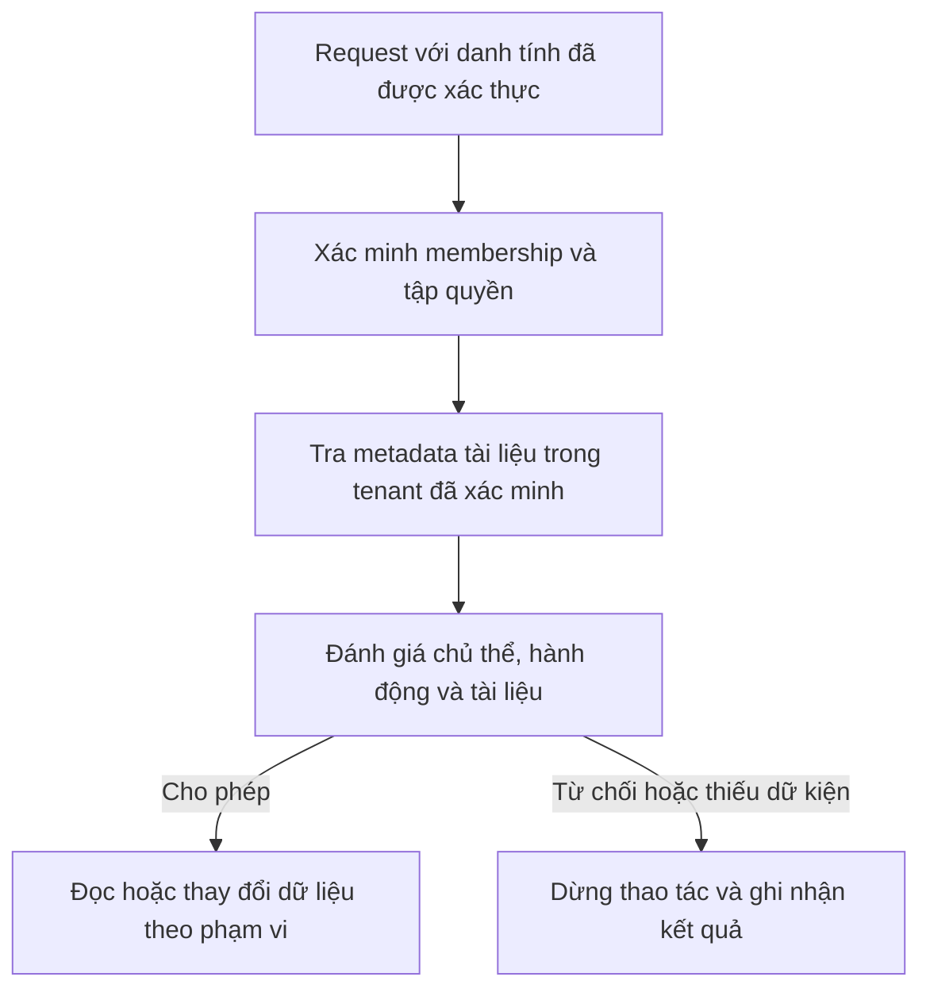

# OWASP Authorization Cheat Sheet

Một người đã đăng nhập có thể vẫn không được đọc hồ sơ của đồng nghiệp, sửa tài liệu của nhóm khác hoặc cấp quyền quản trị. Authentication giúp xác định chủ thể đang truy cập; authorization quyết định chủ thể ấy được thực hiện **hành động nào trên tài nguyên nào trong điều kiện nào**. Một phiên đăng nhập hợp lệ không thay thế quyết định cấp quyền.

[OWASP Authorization Cheat Sheet](https://cheatsheetseries.owasp.org/cheatsheets/Authorization_Cheat_Sheet.html) tập hợp hướng dẫn triển khai phân quyền ứng dụng. Các nhóm khuyến nghị chính gồm: đặc quyền tối thiểu; mặc định từ chối; kiểm tra mọi request; lựa chọn và cấu hình công cụ cẩn thận; sử dụng thuộc tính, quan hệ khi vai trò chưa đủ; bảo vệ đối tượng dù biết ID; kiểm soát cả tài nguyên tĩnh; kiểm tra tại nơi đáng tin; xử lý lỗi an toàn; ghi log và kiểm thử.

Phần dưới vận dụng những nguyên tắc đó vào **một cổng tài liệu nhiều tổ chức giả định**. Chính sách, tên quyền, mã Java và dữ liệu minh họa được xây dựng cho bài học; chúng không phải mã hay mô hình nghiệp vụ do OWASP quy định.

## 1. Bắt đầu từ hành động và tài nguyên

Giả sử cổng tài liệu phục vụ hai tổ chức `tenant-a` và `tenant-b`. Mỗi tài liệu có một chủ sở hữu và trạng thái `DRAFT`, `SUBMITTED` hoặc `APPROVED`. Hệ thống cần ba hành động:

| Hành động | Ý nghĩa trong ví dụ |
|---|---|
| `READ` | Đọc một tài liệu cụ thể |
| `EDIT` | Sửa nội dung bản nháp |
| `APPROVE` | Phê duyệt tài liệu đã được gửi duyệt |

Đội sản phẩm thống nhất chính sách:

- Chủ thể phải đang hoạt động và có tư cách thành viên hợp lệ trong tổ chức đang thao tác.
- Mọi hành động trong bài chỉ áp dụng cho tài liệu cùng tổ chức; chưa có chia sẻ xuyên tổ chức.
- Đọc cần quyền `READ_DOCUMENT` và phải là chủ tài liệu hoặc có thêm `READ_ANY_DOCUMENT`.
- Sửa cần quyền `EDIT_DOCUMENT`, là chủ tài liệu và tài liệu đang ở `DRAFT`.
- Phê duyệt cần quyền `APPROVE_DOCUMENT`, tài liệu ở `SUBMITTED` và người duyệt khác chủ tài liệu.
- Trường hợp không có quy tắc cho phép tương ứng bị từ chối.

Đây là cách cụ thể hóa yêu cầu thay vì chỉ viết “user được đọc, admin được làm tất cả”. Tên vai trò có thể dùng để cấp các tập quyền, nhưng quyết định cuối vẫn phải xét tài liệu và hành động. Trong ví dụ này, quản trị viên tài khoản không tự có quyền đọc tài liệu nghiệp vụ của mọi tổ chức.

Tách `READ_DOCUMENT` khỏi `READ_ANY_DOCUMENT` cũng giúp biểu đạt rõ quyền rộng hơn. Nếu một nhân viên cần đọc thêm tài liệu của phòng mình, đội thiết kế có thể bổ sung điều kiện quan hệ phòng ban; không cần lập tức cấp khả năng đọc toàn bộ tổ chức.

## 2. Từ RBAC đến điều kiện theo thuộc tính và quan hệ

Vai trò có thể trả lời “nhân viên này thuộc nhóm công việc nào?”. Với tài liệu cụ thể, hệ thống còn cần những dữ kiện khác:

| Dữ kiện | Nguồn sử dụng trong thiết kế minh họa | Tác động đến quyết định |
|---|---|---|
| Tài khoản còn hoạt động | Dịch vụ danh tính hoặc hồ sơ tài khoản đáng tin | Tài khoản bị khóa không tiếp tục thao tác |
| Tư cách thành viên tổ chức | Kho membership phía máy chủ | Không chọn tùy ý tổ chức chỉ bằng header |
| Tập quyền trong tổ chức | Cơ chế cấp quyền đã được máy chủ kiểm chứng | Vai trò ở tổ chức A không tự áp dụng cho B |
| Chủ tài liệu | Metadata từ kho tài liệu | Xác định quyền sửa và điều kiện không tự duyệt |
| Trạng thái tài liệu | Dữ liệu nghiệp vụ hiện hành | Bản đã gửi duyệt không còn được sửa như bản nháp |

Một cách đọc chính sách là kết hợp quyền chức năng với thuộc tính và quan hệ. Ví dụ, `APPROVE_DOCUMENT` là quyền chức năng; `tenantId` và trạng thái là thuộc tính; quan hệ “người yêu cầu là chủ tài liệu” hoặc “khác chủ tài liệu” tác động đến kết quả.

Không nên đổi tên một hàm thành `abacCheck` rồi xem vấn đề đã được giải quyết. Điểm quan trọng là dữ kiện thực sự tham gia vào quyết định, nguồn của chúng đáng tin và điều kiện được áp dụng nhất quán. Một chính sách ngắn nhưng chỉ xét `role == ADMIN` vẫn không thể hiện được các yêu cầu của cổng tài liệu này.

## 3. Thiết lập ngữ cảnh đáng tin trước khi đánh giá

Trong ứng dụng nhiều tổ chức, một tenant ID do trình duyệt gửi chỉ nên là giá trị chọn ngữ cảnh; máy chủ phải xác minh chủ thể được thao tác trong tenant đó. Query có tham số giúp chống injection nhưng không tự bảo đảm cách ly tenant. Những điểm này được giải thích trong [OWASP Multi-Tenant Application Security Cheat Sheet](https://cheatsheetseries.owasp.org/cheatsheets/Multi_Tenant_Security_Cheat_Sheet.html).

Trong ví dụ, request có thể chứa:

```http
GET /tenants/tenant-a/documents/doc-731
X-Tenant-ID: tenant-b
```

Nếu route và header mâu thuẫn, ứng dụng cần xử lý theo một hợp đồng rõ ràng; không để mỗi lớp chọn một giá trị khác nhau. Luồng thiết kế có thể dùng tenant trên route làm lựa chọn ban đầu, xác minh membership phía máy chủ, rồi tạo một ngữ cảnh bất biến cho phần xử lý còn lại.



Ngữ cảnh dùng cho đánh giá không lấy `ownerId`, trạng thái tài liệu hoặc quyền quản trị từ request body. Trình duyệt có thể gửi nội dung muốn sửa, nhưng metadata quyết định ai sở hữu tài liệu phải đến từ hệ thống quản lý tài liệu. Nếu người dùng được phép chuyển quyền sở hữu, đó là một hành động riêng với chính sách riêng.

## 4. Một chính sách Java tách biệt với thao tác dữ liệu

Đoạn mã sau minh họa chính sách bằng Java 17 trở lên. Nó chỉ trả về quyết định, không đọc cơ sở dữ liệu, không cập nhật tài liệu và không thay thế kiểm tra danh tính hay membership ở bước trước.

```java
import java.util.Set;

public final class DocumentPolicy {
    public enum Action { READ, EDIT, APPROVE }
    public enum State { DRAFT, SUBMITTED, APPROVED }
    public enum Decision { ALLOW, DENY }

    public enum Permission {
        READ_DOCUMENT,
        READ_ANY_DOCUMENT,
        EDIT_DOCUMENT,
        APPROVE_DOCUMENT
    }

    public record Subject(
            String id,
            String tenantId,
            boolean active,
            Set<Permission> permissions) {
        public Subject {
            permissions = permissions == null
                    ? Set.of()
                    : Set.copyOf(permissions);
        }
    }

    public record Document(
            String id,
            String tenantId,
            String ownerId,
            State state) {}

    public Decision decide(Subject subject, Action action, Document document) {
        if (subject == null || action == null || document == null) {
            return Decision.DENY;
        }

        if (!subject.active()
                || !present(subject.id())
                || !present(subject.tenantId())
                || !present(document.id())
                || !present(document.tenantId())
                || !present(document.ownerId())
                || document.state() == null) {
            return Decision.DENY;
        }

        if (!subject.tenantId().equals(document.tenantId())) {
            return Decision.DENY;
        }

        boolean owner = subject.id().equals(document.ownerId());
        Set<Permission> permissions = subject.permissions();

        boolean allowed = switch (action) {
            case READ -> permissions.contains(Permission.READ_DOCUMENT)
                    && (owner || permissions.contains(Permission.READ_ANY_DOCUMENT));
            case EDIT -> permissions.contains(Permission.EDIT_DOCUMENT)
                    && owner
                    && document.state() == State.DRAFT;
            case APPROVE -> permissions.contains(Permission.APPROVE_DOCUMENT)
                    && !owner
                    && document.state() == State.SUBMITTED;
        };

        return allowed ? Decision.ALLOW : Decision.DENY;
    }

    private static boolean present(String value) {
        return value != null && !value.isBlank();
    }
}
```

`Subject` phải do phía máy chủ dựng từ danh tính, membership và quyền đã được kiểm chứng. Cho phép client gửi JSON rồi tự tạo `Subject` sẽ phá vỡ giả định của ví dụ. Sao chép tập quyền thành tập bất biến giúp tránh việc mã khác thay đổi tập ấy sau khi ngữ cảnh đã được tạo; nó không làm một nguồn quyền không đáng tin trở thành đáng tin.

Mỗi nhánh `switch` có điều kiện cho phép rõ ràng. Hành động không nhận diện từ API phải bị từ chối ở bước chuyển đổi đầu vào; không chuyển nhầm về `READ` để tiếp tục. Khi thêm một hành động như `DELETE`, đội phát triển phải xác định chính sách tương ứng thay vì cho phép theo một nhánh mặc định rộng.

Mã chỉ biểu diễn một phần của luồng thực tế. Đặc biệt, `active == true` không có nghĩa membership đang hợp lệ nếu tầng tạo ngữ cảnh không kiểm tra điều đó. Lỗi đọc kho quyền cũng không được biến thành một `Subject` có mọi quyền để “giữ dịch vụ hoạt động”.

## 5. Cưỡng chế quyết định ở mọi đường thực hiện

Trong thiết kế cổng tài liệu, lớp nghiệp vụ dùng chung cần bảo đảm chỉ thực hiện tác vụ sau kết quả `ALLOW`. Một luồng khái niệm là:

```text
editDocument(authenticatedIdentity, selectedTenant, documentId, newContent):
    subject = loadVerifiedTenantSubject(authenticatedIdentity, selectedTenant)
    metadata = loadDocumentMetadata(subject.tenantId, documentId)
    decision = policy.decide(subject, EDIT, metadata)

    if decision != ALLOW:
        stop without changing the document

    update the authorized document with concurrency protection
```

Các tên hàm trong đoạn này là mô tả luồng, không phải API thư viện. Request qua giao diện web, ứng dụng di động hoặc API tích hợp đều phải đi qua ràng buộc nghiệp vụ tương đương. Nếu tác vụ chạy nền sử dụng một service account, phải xác định quyền của danh tính thực thi và phạm vi công việc được ủy quyền; không coi mọi tác vụ nội bộ là được phép.

Ví dụ, endpoint sửa tài liệu có thể an toàn nhưng endpoint “sao chép nội dung sang tài liệu mới” lại đọc được tài liệu nguồn của người khác. Lỗ hổng xuất hiện vì có một đường đọc khác. Khi lập danh sách đường truy cập, cần xem cả tìm kiếm, preview, lịch sử phiên bản, export và các tác vụ batch.

Ẩn nút trên giao diện chỉ hỗ trợ trải nghiệm. Người dùng có thể tự gửi request đến chức năng tương ứng. Tương tự, một lớp gateway nhận diện được người dùng chưa chắc có đủ dữ kiện để quyết định ai được sửa `doc-731`; lớp xử lý tài liệu vẫn cần thực hiện các điều kiện theo đối tượng.

## 6. ID của tài nguyên không phải bằng chứng quyền truy cập

IDOR xảy ra khi người gọi thay tham chiếu đối tượng và truy cập được dữ liệu ngoài quyền. UUID hoặc ID khó đoán có thể giảm khả năng dò tìm, nhưng vẫn cần kiểm tra quyền nếu ID bị biết qua một nguồn khác. Xem [OWASP Insecure Direct Object Reference Prevention Cheat Sheet](https://cheatsheetseries.owasp.org/cheatsheets/Insecure_Direct_Object_Reference_Prevention_Cheat_Sheet.html).

Trong cổng tài liệu, Linh sở hữu `doc-731`; Huy sở hữu `doc-904`. Hai người cùng tenant và cùng tập quyền chỉ được đọc tài liệu của mình. Nếu Huy đổi URL từ tài liệu của mình sang `doc-731`, hệ thống phải đánh giá lại với tài liệu của Linh. Việc Huy đã được phép gọi endpoint `/documents/{id}` không chứng minh Huy được đọc mọi giá trị `{id}`.

Một truy vấn metadata có phạm vi tenant trong thiết kế này có dạng:

```sql
SELECT id, tenant_id, owner_id, state, version
FROM documents
WHERE tenant_id = :verified_tenant_id
  AND id = :document_id;
```

Tham số tenant lấy từ ngữ cảnh đã được máy chủ xác minh. Sau truy vấn, chính sách vẫn phải xét quyền, chủ sở hữu và trạng thái. Điều kiện cùng tenant không tự cấp quyền đọc tài liệu của mọi thành viên trong tenant.

Đối với danh sách, đội phát triển cần thiết kế truy vấn hoặc cơ chế lọc được ủy quyền sao cho cả bản ghi trả về, số lượng tổng và phân trang đều phản ánh đúng phạm vi. Một API trả danh sách đúng nhưng `totalCount` tính trên mọi tổ chức vẫn có thể làm lộ thông tin ngoài mục tiêu của chức năng.

### Ngăn khoảng trống giữa kiểm tra và cập nhật

Giả sử Linh được phép sửa khi tài liệu còn `DRAFT`, nhưng ngay sau đó một request khác chuyển tài liệu sang `SUBMITTED`. Nếu câu lệnh cập nhật không xét trạng thái hoặc phiên bản, request cũ có thể sửa một bản đã gửi duyệt.

Với mô hình minh họa, có thể kết hợp giao dịch và kiểm soát phiên bản; câu lệnh cập nhật phải giữ các điều kiện quan trọng của quyết định:

```sql
UPDATE documents
SET content = :new_content,
    version = version + 1
WHERE tenant_id = :verified_tenant_id
  AND id = :document_id
  AND owner_id = :verified_subject_id
  AND state = 'DRAFT'
  AND version = :evaluated_version;
```

Đây là lớp bảo vệ bổ sung sau kiểm tra quyền, không phải thay thế toàn bộ chính sách. Nếu không cập nhật được bản ghi nào, ứng dụng phải xử lý xung đột hoặc việc điều kiện không còn phù hợp; không tự chạy lại một câu `UPDATE` bỏ các điều kiện để ép thành công.

## 7. Bao phủ file, dữ liệu xuất và cache

Trong ví dụ, tài liệu có thể được chuyển thành file PDF. API đọc metadata đã kiểm tra quyền, nhưng nếu PDF được đặt trong một thư mục công khai với URL cố định thì người biết URL vẫn có thể tải nội dung.

Một thiết kế phù hợp với chính sách của cổng là giữ file trong vùng lưu trữ riêng, ánh xạ file về tài liệu gốc và kiểm tra quyền tải trước khi trả dữ liệu. File dùng chung cho trang giới thiệu có thể công khai theo chủ đích; bản PDF của tài liệu nội bộ phải theo phân loại của tài liệu.

Đối với chức năng export, cần xác định quyền cho tập tài liệu được xuất và nơi nhận kết quả. Request tạo export có quyền không có nghĩa mọi người được đọc file kết quả. Nếu export chạy bất đồng bộ, đội thiết kế phải quy định thời điểm kiểm tra lại và cách xử lý khi quyền bị thu hồi trước khi file được tải.

Cache cũng có thể tạo một đường đọc khác. Hướng dẫn đa tenant của OWASP yêu cầu phân loại dữ liệu cache, đưa tenant vào key khi kết quả phụ thuộc tenant, đồng thời kiểm tra quyền trước khi trả dữ liệu được bảo vệ. Nguồn: [OWASP Multi-Tenant Application Security Cheat Sheet, phần Cache & Session Isolation](https://cheatsheetseries.owasp.org/cheatsheets/Multi_Tenant_Security_Cheat_Sheet.html).

Ví dụ, không nên dùng kết quả `ALLOW` của Linh cho Huy chỉ vì hai request cùng tài liệu. Một thiết kế cache quyết định phải xét những dữ kiện làm thay đổi kết quả, chẳng hạn chủ thể, tenant, hành động, tài nguyên và phiên bản chính sách hoặc quyền. Đội dự án phải xác định cơ chế hết hạn, vô hiệu hóa và kiểm tra lại thay vì đặt một TTL tùy ý rồi mặc định quyền bị thu hồi sẽ có hiệu lực ngay.

## 8. Từ chối an toàn và ghi nhận đủ bằng chứng

Trong cổng tài liệu, quyết định từ chối phải kết thúc thao tác trước khi cập nhật nội dung, tạo file xuất hoặc phát sự kiện thông báo thành công. Lỗi tải chính sách, thiếu metadata hay lỗi đánh giá cũng không được đi vào nhánh thực thi tác vụ được bảo vệ.

Thông báo cho người gọi có thể ngắn gọn và nhất quán. Chẳng hạn, nếu hệ thống chủ đích không tiết lộ tài liệu nằm ở tenant khác, phản hồi không nên kèm tên chủ sở hữu hoặc tên tổ chức thật. Thông tin phục vụ điều tra có thể được ghi riêng theo quyền đọc log của đội vận hành.

OWASP khuyến nghị ghi nhận lỗi phân quyền và các hành động nhạy cảm, nhưng tránh đưa trực tiếp access token, mật khẩu, session ID và dữ liệu nhạy cảm vào log. Xem [OWASP Logging Cheat Sheet](https://cheatsheetseries.owasp.org/cheatsheets/Logging_Cheat_Sheet.html). Một sự kiện minh họa là:

```json
{
  "event": "authorization_decision",
  "requestId": "req-28",
  "subjectRef": "user-huy",
  "tenantRef": "tenant-a",
  "resourceRef": "doc-731",
  "action": "EDIT",
  "decision": "DENY",
  "reasonCode": "OWNER_REQUIRED",
  "policyVersion": "document-policy-v3"
}
```

Đây là schema phục vụ ví dụ. Khi triển khai, mã tham chiếu chủ thể và tài nguyên cũng cần được phân loại, kiểm soát truy cập và lưu theo thời hạn phù hợp. Log phải đủ để giải thích một quyết định nhưng không trở thành bản sao nội dung tài liệu. Dữ liệu không đáng tin đưa vào sự kiện cần được xử lý đúng định dạng để không giả mạo thêm dòng log.

Nếu Huy liên tục thử nhiều tài liệu không thuộc quyền, đội vận hành có thể xem chuỗi sự kiện để phân biệt thao tác nhầm với hành vi dò tìm. Một kết quả `DENY` riêng lẻ không tự chứng minh tài khoản có ác ý; bối cảnh và chuỗi hành vi mới giúp quyết định bước xử lý tiếp theo.

## 9. Kiểm thử cả quyền ngang và quyền dọc

OWASP WSTG hướng dẫn kiểm tra khả năng truy cập chức năng hoặc dữ liệu bằng tài khoản cùng vai trò nhưng khác danh tính, bằng tài khoản vai trò khác, cũng như khi chưa đăng nhập hoặc đã đăng xuất. Nguồn: [WSTG v4.2 — Testing for Bypassing Authorization Schema](https://wstg.owasp.org/v4.2/4-Web_Application_Security_Testing/05-Authorization_Testing/02-Testing_for_Bypassing_Authorization_Schema/).

Từ chính sách của cổng tài liệu, có thể lập bộ tình huống sau. Đây là các trường hợp kiểm thử để người học thiết kế trong ứng dụng của mình, không phải kết quả chạy test của một dự án thật:

| Tình huống | Kết quả mong đợi |
|---|---|
| Linh có quyền đọc và đọc tài liệu mình trong cùng tenant | `ALLOW` |
| Huy chỉ có quyền đọc tài liệu mình nhưng đọc tài liệu Linh | `DENY` |
| Người có `READ_DOCUMENT` và `READ_ANY_DOCUMENT` đọc trong cùng tenant | `ALLOW` |
| Người có mọi quyền nêu trong ví dụ đọc tài liệu tenant khác | `DENY` |
| Linh có quyền sửa bản nháp của mình | `ALLOW` |
| Linh sửa tài liệu mình đã gửi duyệt | `DENY` |
| Người có quyền duyệt phê duyệt tài liệu mình | `DENY` |
| Người có quyền duyệt phê duyệt tài liệu người khác ở `SUBMITTED`, cùng tenant | `ALLOW` |
| Tài khoản đã bị khóa nhưng tập quyền cũ còn tồn tại | `DENY` |
| Thiếu metadata, hành động hoặc ngữ cảnh chủ thể | `DENY` |

Unit test của `DocumentPolicy` chỉ chứng minh hàm đánh giá đáp ứng các trường hợp được kiểm tra. Integration test còn phải chứng minh lớp nghiệp vụ thực sự gọi chính sách, dùng dữ kiện đáng tin và dừng tác vụ khi bị từ chối.

Ví dụ, một test sửa trái phép nên kiểm tra rằng nội dung và phiên bản tài liệu không đổi, không có sự kiện thành công và không có tác vụ xuất file được tạo. Chỉ nhìn response chứa chữ “denied” có thể bỏ sót việc dữ liệu đã bị cập nhật trước khi trả lỗi.

Khi thử quyền ngang, dùng hai tài khoản cùng tập quyền nhưng sở hữu hai tài liệu khác nhau. Khi thử quyền dọc, dùng tài khoản đọc để gọi chức năng phê duyệt. Khi thử ranh giới tenant, dùng cả một tài khoản có quyền rất rộng trong tenant A để truy cập tài liệu B; trường hợp này phát hiện lỗi “có quyền rộng là bỏ qua kiểm tra tổ chức”.

## 10. Giữ chính sách đúng khi hệ thống thay đổi

Một thay đổi nghiệp vụ có thể làm chính sách cũ không còn đủ. Chẳng hạn, sản phẩm thêm vai trò “người duyệt thay thế” hoặc cho phép chia sẻ một tài liệu sang tổ chức đối tác. Trước khi sửa mã, đội thiết kế cần nêu rõ tài nguyên nào được chia sẻ, hành động nào được phép, thời hạn và cách thu hồi.

Trong ví dụ hiện tại, mọi truy cập xuyên tenant đều bị từ chối. Không nên sửa thành `if shared then allow` ở một endpoint mà bỏ qua luồng download và export. Thay vào đó, mô tả quan hệ chia sẻ và áp dụng nó tại các đường sử dụng tài liệu tương ứng; các quyền không được chia sẻ vẫn giữ nguyên giới hạn.

Framework và thư viện chỉ giúp thực thi một phần thiết kế. Đội phát triển cần hiểu phạm vi bảo vệ của cấu hình route, method, tài nguyên tĩnh và các đường gọi nội bộ. Một cấu hình bảo vệ toàn bộ `/api/**` vẫn có thể chưa bao phủ file ở một host khác. Khi nâng cấp thành phần, các trường hợp kiểm thử phân quyền phải giúp phát hiện thay đổi hành vi ngoài dự kiến.

Việc thu hồi quyền cũng cần một hợp đồng rõ ràng. Nếu Huy rời nhóm phê duyệt lúc 09:00, hệ thống phải biết yêu cầu nào có thể còn sử dụng quyền cũ và trong bao lâu. Quyết định về session, token, cache và công việc đang chờ phải phù hợp với yêu cầu đó; không thể chỉ xóa một dòng vai trò rồi giả định mọi nơi đã cập nhật đồng thời.

## 11. Bài tập áp dụng

### Bài tập 1: thêm chức năng xóa tài liệu

Sản phẩm yêu cầu chủ tài liệu được xóa bản nháp, nhưng bản đã duyệt chỉ được lưu trữ theo quy trình riêng. Hãy bổ sung hành động và điều kiện cho phép, chỉ ra dữ kiện cần lấy từ máy chủ và ít nhất ba trường hợp phải từ chối.

**Gợi ý:** Xét riêng quyền chức năng, quan hệ chủ sở hữu, tenant và trạng thái. Đừng cho phép xóa chỉ vì endpoint sửa tài liệu hiện đã kiểm tra đăng nhập.

### Bài tập 2: file xuất bị lộ

API tạo file xuất kiểm tra đúng quyền nhưng URL tải file không yêu cầu bất kỳ quyết định truy cập nào. Một người khác nhận được URL qua lịch sử chat có thể tải file. Hãy xác định đường truy cập bị bỏ sót và cách ràng buộc quyền đọc kết quả xuất.

**Gợi ý:** File kết quả cũng là tài nguyên được bảo vệ. Đánh giá người tải, phạm vi dữ liệu trong file, thời điểm quyền thay đổi và cơ chế phục vụ file.

### Bài tập 3: cache quyết định quá rộng

Một cache lưu `doc-731:EDIT = ALLOW` sau request hợp lệ của Linh. Huy gửi request sửa cùng tài liệu và nhận lại kết quả cache ấy. Hãy giải thích vì sao lỗi xuất hiện dù hàm `DocumentPolicy` đã trả kết quả đúng trong unit test.

**Gợi ý:** Cache đã bỏ mất dữ kiện chủ thể và thay thế một quyết định cho request này bằng quyết định của request khác. Cần kiểm tra cả thiết kế key, dữ kiện chính sách, cơ chế thu hồi và vị trí thực thi quyết định.

Khi vận dụng OWASP Authorization Cheat Sheet, đầu ra hữu ích là một chính sách nghiệp vụ có thể giải thích, các điểm cưỡng chế bao phủ đường truy cập và bằng chứng cho cả trường hợp được phép lẫn bị từ chối. Tên vai trò, loại ID hay lựa chọn framework chỉ có ý nghĩa khi chúng phục vụ được những điều kiện cụ thể ấy.
