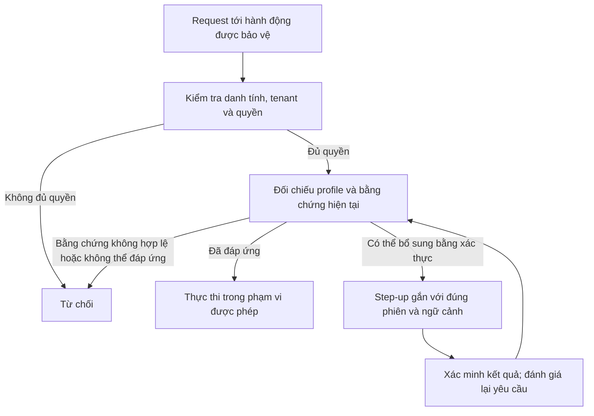

# Risk-based IAM assurance

## 1. Bảo đảm IAM dựa trên rủi ro là gì?

Risk-based IAM assurance là cách xác định mức tin cậy cần có đối với danh tính và quyền truy cập dựa trên hậu quả có thể xảy ra, sau đó lựa chọn kiểm soát và thu thập bằng chứng rằng các kiểm soát ấy hoạt động trong phạm vi đã cam kết.

Đây là một vòng quyết định có thể giải thích được:

```text
Hành động cần bảo vệ
    → Kịch bản sai danh tính hoặc sai quyền
    → Hậu quả và khả năng xảy ra
    → Yêu cầu bảo đảm và kiểm soát
    → Bằng chứng kiểm chứng
    → Rủi ro còn lại và quyết định chấp nhận
```

Một cổng nhân sự không nhất thiết yêu cầu cùng một quy trình khi người dùng đọc hướng dẫn công khai, xem hồ sơ cá nhân và cấp quyền quản trị toàn doanh nghiệp. Tuy nhiên, phân biệt rủi ro không có nghĩa là tùy tiện bỏ qua kiểm soát mỗi khi người dùng ở một vị trí quen thuộc.

Trong bài học, **bảo đảm** có nghĩa là mức tin cậy được hỗ trợ bằng bằng chứng và có giới hạn rõ ràng. Một nhãn “MFA đã bật”, một hợp đồng nhà cung cấp hoặc một lần kiểm thử thành công đều chưa đủ để bảo đảm toàn bộ vòng đời truy cập.

NIST SP 800-63-4 sử dụng cách tiếp cận dựa trên rủi ro để chọn và điều chỉnh các mức bảo đảm định danh số, đồng thời xét rủi ro do chính hệ thống danh tính tạo ra, chẳng hạn rào cản sử dụng và việc xử lý dữ liệu cá nhân. [NIST SP 800-63-4 — Digital Identity Risk Management](https://pages.nist.gov/800-63-4/sp800-63.html).

## 2. Phân biệt bốn câu hỏi thường bị gộp lại

### 2.1. Rủi ro, mức bảo đảm và quyết định truy cập

| Khái niệm | Câu hỏi chính | Ví dụ trong IAM |
|---|---|---|
| Đánh giá rủi ro | Điều gì có thể sai, gây hại thế nào và có khả năng đến đâu? | Kẻ chiếm phiên xuất hồ sơ của toàn doanh nghiệp |
| Yêu cầu bảo đảm | Cần tin cậy đến mức nào và dựa vào bằng chứng gì? | Danh tính gắn đúng nhân viên; xác thực phù hợp; phiên còn đủ mới |
| Quyết định truy cập | Request cụ thể có được thực hiện không? | Từ chối vì thiếu quyền trên tenant mục tiêu |
| Assurance case | Vì sao tin rằng thiết kế và vận hành đáp ứng yêu cầu? | Lập luận liên kết yêu cầu với kiểm thử, cấu hình và quan sát thực tế |

Risk score tại thời điểm truy cập chỉ là một đầu vào của quyết định. Điểm thấp không chứng minh người dùng đã được xác minh danh tính theo một quy trình cụ thể; điểm cao cũng không chỉ ra duy nhất một biện pháp cần áp dụng.

Tương tự, xác thực mạnh trả lời câu hỏi về bên đang sử dụng tài khoản. Nó không tự chứng minh tài khoản có quyền xem tài nguyên của tenant khác hoặc được phép phê duyệt yêu cầu của chính mình.

### 2.2. Các chiều bảo đảm trong định danh số

Trong cách phân chia của NIST, cần tách ba chức năng:

| Chiều | Nội dung cần tin cậy | Không thể thay thế bằng |
|---|---|---|
| Identity Assurance Level — IAL | Quy trình chứng minh và gắn danh tính với một người thật | Chỉ thêm một bước OTP vào đăng nhập |
| Authentication Assurance Level — AAL | Việc chứng minh quyền kiểm soát authenticator gắn với tài khoản | Chỉ biết địa chỉ IP hoặc thiết bị có vẻ quen |
| Federation Assurance Level — FAL | Việc chuyển giao kết quả danh tính/xác thực qua liên kết | Chỉ nhìn thấy IdP yêu cầu MFA |

IAL thuộc phạm vi identity proofing và enrollment. Nếu một dịch vụ không cần liên kết tài khoản với người thật, phải ghi rõ nhu cầu đó thay vì thu thập thêm giấy tờ chỉ để có cảm giác an toàn. [NIST SP 800-63A-4](https://pages.nist.gov/800-63-4/sp800-63a.html).

AAL2 yêu cầu hai yếu tố phân biệt và có lựa chọn chống phishing; AAL3 có yêu cầu chặt hơn, gồm authenticator chống phishing với khóa xác thực không thể xuất. Đây chỉ là một số đặc điểm, không phải toàn bộ điều kiện của từng mức. [NIST SP 800-63B-4 — Authentication Assurance Levels](https://pages.nist.gov/800-63-4/sp800-63b.html).

FAL xét sự bảo vệ giao dịch liên kết và assertion. Một IdP xác thực người dùng mạnh vẫn không bù được việc ứng dụng chấp nhận assertion sai đối tượng nhận hoặc không bảo vệ giao dịch tương ứng. [NIST SP 800-63C-4](https://pages.nist.gov/800-63-4/sp800-63c.html).

Không suy ra IAL, AAL và FAL phải cùng một con số. Cũng không gán một mức chuẩn chỉ từ tên sản phẩm, thuật toán hoặc một claim đơn lẻ. Khi tuyên bố đáp ứng mức nào, cần kiểm tra đầy đủ yêu cầu của đúng phiên bản tiêu chuẩn và đúng phạm vi.

## 3. Tình huống: cổng nhân sự đa tenant

Giả sử **Meridian** là cổng nhân sự phục vụ nhiều doanh nghiệp. Nhân viên đăng nhập để xem hồ sơ; quản trị viên doanh nghiệp có thể xuất dữ liệu và cấp vai trò. Một số doanh nghiệp dùng IdP riêng. Một dịch vụ nền đồng bộ trạng thái nhân viên từ hệ thống HR.

Các hành động cần được đánh giá riêng:

| Hành động | Sai sót danh tính hoặc quyền có thể xảy ra | Hậu quả cần phân tích |
|---|---|---|
| Xem hồ sơ cá nhân | Người khác sử dụng tài khoản hoặc sai ánh xạ chủ sở hữu | Lộ dữ liệu của một cá nhân |
| Xuất toàn bộ hồ sơ tenant | Phiên quản trị bị chiếm hoặc quyền cấp quá rộng | Lộ dữ liệu hàng loạt, khó thu hồi bản sao |
| Thêm authenticator mới | Người giữ phiên bị đánh cắp gắn khóa của mình | Duy trì quyền chiếm tài khoản sau khi mật khẩu được đổi |
| Cấp vai trò quản trị | Phê duyệt sai chủ thể hoặc không giới hạn phạm vi | Chiếm quyền quản lý dữ liệu và danh tính khác |
| Đồng bộ nhân viên bằng workload | Workload giả mạo hoặc quá quyền | Tạo, sửa hoặc khôi phục quyền truy cập trái phép |

Đánh giá theo hành động giúp phát hiện rằng “cùng một tài khoản quản trị” vẫn có nhiều ngữ cảnh khác nhau. Một phiên đủ để xem dashboard chưa chắc đủ cho xuất dữ liệu toàn tenant.

Với mỗi hành động, ghi rõ dữ liệu, số người có thể bị ảnh hưởng, khả năng đảo ngược và hệ thống phụ thuộc. Đừng chỉ dùng tên vai trò “admin” làm đại diện cho mọi hậu quả.

## 4. Xây dựng đánh giá rủi ro có căn cứ

### 4.1. Viết kịch bản thay cho nhãn chung chung

Một kịch bản có thể kiểm chứng được thường bao gồm tác nhân, đường tấn công, điểm yếu, hành động và hậu quả. Ví dụ:

> Kẻ tấn công lấy được cookie của quản trị viên Meridian. Phiên còn hiệu lực và endpoint xuất dữ liệu không yêu cầu xác thực lại. Kẻ tấn công xuất hồ sơ của toàn tenant trước khi phiên bị thu hồi.

Kịch bản này cụ thể hơn “rủi ro tài khoản bị hack”. Nó gợi ra các kiểm soát khác nhau: bảo vệ phiên, xác thực lại, giới hạn xuất dữ liệu, phát hiện bất thường và thu hồi.

NIST SP 800-30 mô tả rủi ro gắn với hậu quả bất lợi và khả năng xảy ra; đánh giá cần xét cả mối đe dọa, điểm yếu, điều kiện và độ bất định. Không có yêu cầu chung rằng mọi tổ chức phải dùng một phép nhân điểm duy nhất. [NIST SP 800-30 Revision 1, mục 2.3](https://nvlpubs.nist.gov/nistpubs/Legacy/SP/nistspecialpublication800-30r1.pdf).

### 4.2. Nêu giả định và độ bất định

Với Meridian, một hồ sơ rủi ro ban đầu có thể ghi:

```yaml
riskScenario:
  id: MER-ID-EXP-01
  action: export-tenant-employee-records
  threat: stolen-administrator-session
  weakness: no-operation-specific-reauthentication
  impact:
    confidentiality: high
    affectedPopulation: entire-target-tenant
    reversibility: exported-copies-cannot-be-reliably-recalled
  likelihood:
    assessment: plausible
    basis:
      - administrator-sessions-are-used-on-remote-endpoints
      - session-theft-is-included-in-the-threat-model
  uncertainty:
    - current-session-theft-detection-coverage-not-measured
  assessmentStatus: proposed
```

Đây là ví dụ định tính, không phải dữ liệu sự cố thật hoặc thang chấm điểm chuẩn. Từ `plausible` phải được giải thích trong phương pháp của tổ chức nếu dùng để ra quyết định chính thức.

Nếu nhóm sử dụng thang 1–5 để ưu tiên xử lý, hãy giải thích ý nghĩa từng mức. Không diễn giải một điểm thứ bậc thành xác suất phần trăm hoặc tổn thất kỳ vọng khi chưa có cơ sở định lượng.

### 4.3. Phân biệt rủi ro ban đầu và rủi ro còn lại

Đánh giá ban đầu mô tả tình huống trước tập kiểm soát đang đề xuất; đánh giá còn lại xét những gì các kiểm soát thực sự ngăn được và chưa ngăn được. Phải chỉ rõ mốc so sánh vì hệ thống đang vận hành thường đã có một số biện pháp bảo vệ.

Ví dụ, xác thực lại có thể giảm khả năng người chỉ giữ cookie cũ thực hiện xuất dữ liệu. Nó không ngăn được một quản trị viên hợp lệ cố ý lấy dữ liệu hoặc một endpoint khác thiếu kiểm tra quyền.

Các rủi ro ấy cần được phân tích bằng giới hạn quyền, phê duyệt, kiểm soát dữ liệu hoặc giám sát phù hợp. Không tuyên bố “đã có MFA nên rủi ro còn lại thấp” cho mọi kịch bản.

## 5. Chuyển rủi ro thành yêu cầu kiểm soát

### 5.1. Đặt một mức bảo vệ nền cho từng hành động

Nhóm Meridian có thể định nghĩa một profile nội bộ cho xuất dữ liệu toàn tenant:

- Tài khoản đã được gắn với đúng nhân viên và doanh nghiệp qua quy trình được phê duyệt.
- Có quyền xuất dữ liệu trong tenant đích tại thời điểm thực hiện.
- Xác thực bằng phương thức chống phishing được chính sách cho phép và còn đủ mới.
- Giao dịch liên kết, nếu có, được xác minh theo cấu hình tin cậy của tenant.
- Yêu cầu xuất và kết quả được liên kết với đúng phiên, đối tượng và phiên bản chính sách.
- Có giới hạn dữ liệu, theo dõi tác động và khả năng thu hồi quyền hoặc phiên khi cần.

Profile này không tự mang nhãn AAL3 hay một mức NIST khác. Nó là yêu cầu nghiệp vụ nội bộ; muốn ánh xạ sang chuẩn phải bổ sung đánh giá đầy đủ.

Một profile tốt mô tả thuộc tính cần đạt, không chỉ tên công nghệ. “Dùng passkey” vẫn cần làm rõ loại authenticator, cách đăng ký, xác minh người dùng, khôi phục, fallback và phương thức được chấp nhận trong giao dịch thực tế.

### 5.2. Chọn kiểm soát đúng đường tấn công

| Kịch bản của Meridian | Kiểm soát có thể được lựa chọn | Giới hạn cần ghi nhận |
|---|---|---|
| Cookie quản trị bị lấy | Xác thực lại phù hợp trước xuất dữ liệu; bảo vệ và thu hồi phiên | Không tự ngăn người dùng hợp lệ cố ý lạm dụng |
| Mật khẩu bị phishing | Phương thức xác thực chống phishing theo profile | Recovery hoặc yếu tố dự phòng có thể tạo đường vòng |
| Tài khoản bị gắn sai người ngay khi cấp | Kiểm chứng nguồn nhân sự và quy trình gắn danh tính | MFA sau đó chỉ xác thực người đang giữ tài khoản đã gắn sai |
| Assertion liên kết bị dùng sai ngữ cảnh | Kiểm chứng bên phát hành, đối tượng nhận và giao dịch | Không sửa được quyền ứng dụng đã cấp quá rộng |
| Vai trò quản trị tồn tại sau chuyển bộ phận | Thu hồi theo vòng đời và rà soát quyền | Thêm một bước OTP không làm quyền cũ tự biến mất |

Một kiểm soát có thể hữu ích cho nhiều kịch bản, nhưng hồ sơ cần chỉ rõ nó tác động vào đâu. Sự hiện diện của kiểm soát không phải là bằng chứng về hiệu quả.

## 6. Risk-based authentication trong quyết định thời gian thực

### 6.1. Tín hiệu bổ sung không thay mức nền một cách tùy tiện

Sau khi có profile, hệ thống có thể xét tín hiệu như độ mới của phiên, thiết bị, hành vi và dấu hiệu xâm nhập để yêu cầu thêm xác minh, giới hạn hành động hoặc từ chối.

NIST SP 800-63B-4 cho phép giám sát đặc điểm phiên như một biện pháp giảm rủi ro; khi phát hiện khả năng gian lận, có thể cần xác thực lại, kết thúc phiên hoặc thông báo cho bộ phận phù hợp. Việc thu thập các đặc điểm này cũng có tác động tới quyền riêng tư. [NIST SP 800-63B-4 — Session Monitoring](https://pages.nist.gov/800-63-4/sp800-63b.html#sessionmonitor).

Đối với Meridian, IP nội bộ có thể là một tín hiệu nhưng không được tự thay thế chứng minh cần thiết cho hành động xuất dữ liệu. Nguyên tắc không mặc nhiên tin cậy chỉ vì vị trí mạng phù hợp với cách tiếp cận zero trust. [NIST SP 800-207 — Zero Trust Architecture](https://csrc.nist.gov/pubs/sp/800/207/final).

### 6.2. Đánh giá chất lượng và nguồn tín hiệu

| Tín hiệu | Điều cần xác minh trước khi dùng | Nguy cơ nếu hiểu sai |
|---|---|---|
| Thiết bị được quản lý | Nguồn đánh giá, chữ ký hoặc kênh tin cậy, thời điểm cập nhật | Tin một header tự khai là bằng chứng thiết bị |
| Vị trí/IP | Độ chính xác, NAT, VPN và độ tin cậy nguồn | Chặn người đi công tác hoặc cho qua nguồn bị chiếm |
| Hành vi khác thường | Dữ liệu nền, thời gian quan sát, mức nhiễu | Coi người dùng mới là kẻ gian chỉ vì chưa có lịch sử |
| Phương thức xác thực | Sự kiện đã được xác minh và ánh xạ chính sách | Chấp nhận `mfa=true` do client gửi |
| Thời điểm xác thực | Đó là lúc xác thực người dùng hay chỉ lúc token được cấp lại? | Token mới nhưng người dùng chưa xác thực lại |
| Đánh giá rủi ro ngoài | Phiên bản, thời hạn, phạm vi và tình trạng dịch vụ | Tự cho phép khi nguồn tín hiệu không trả kết quả |

Đặt trạng thái thiếu dữ liệu là `unknown`, không tự chuyển thành `low`. Quy tắc xử lý `unknown` phụ thuộc hành động: với một chức năng ít nhạy cảm có thể cho phép trong phạm vi hạn chế; với thao tác đặc quyền có thể yêu cầu thêm bằng chứng hoặc từ chối tạm thời.

Chính sách cần tránh vòng lặp challenge vô tận. Nếu người dùng không thể hoàn thành bước nâng mức xác thực, hệ thống phải có lộ trình hỗ trợ có kiểm soát, thay vì một nút bỏ qua.

### 6.3. Step-up phải tạo ra bằng chứng phù hợp



Sơ đồ là ví dụ logic, không áp đặt thứ tự duy nhất cho mọi nền tảng. Điểm quan trọng là request chỉ đi tiếp khi kết quả được xác minh và quyền vẫn còn hiệu lực.

Một bước MFA mới không tự nâng IAL của tài khoản. Nếu vấn đề là gắn sai người hoặc thiếu kiểm chứng ban đầu, phải xử lý bằng quy trình đúng loại, thay vì lặp lại authenticator hiện tại.

## 7. Giữ bảo đảm xuyên suốt vòng đời

### 7.1. Cấp phát và thay đổi quyền

Meridian nhận sự kiện nhân sự từ hệ thống HR. Phải kiểm tra nguồn, định danh ổn định, quan hệ tenant và cách xử lý nhân viên chuyển vị trí. Email trùng hoặc một trường chức danh tự khai không nên tự tạo quyền quản trị.

Với đặc quyền, profile có thể bổ sung phê duyệt độc lập, cấp quyền trong thời gian giới hạn và ràng buộc phạm vi. Những cơ chế ấy giải quyết rủi ro sử dụng quyền, khác với việc xác minh ai đang đăng nhập.

Khi hợp đồng lao động kết thúc, việc ngăn tạo phiên mới chưa chắc làm phiên cũ mất hiệu lực ngay. Cần mô tả đường thu hồi từ nguồn nhân sự tới IdP, ứng dụng, cache và các token liên quan theo hợp đồng của hệ thống.

### 7.2. Khôi phục và thay authenticator

Nếu hỗ trợ viên có thể gỡ mọi yếu tố chỉ bằng một cuộc gọi và vài thuộc tính hồ sơ, bảo đảm của đường đăng nhập chính có thể bị vượt qua. Đánh giá phải bao gồm người phê duyệt, bằng chứng sử dụng, phạm vi thay đổi, thông báo và khả năng điều tra.

Trong ví dụ Meridian, quyền thực hiện hành động nhạy cảm sau khôi phục có thể được giới hạn cho tới khi hoàn thành điều kiện bổ sung được định nghĩa trong profile. Nếu chọn một khoảng chờ, phải giải thích nó giảm rủi ro nào và ảnh hưởng người dùng ra sao.

Không mặc định một khoảng chờ hoặc một email thông báo có thể thay thế mọi yêu cầu về bằng chứng danh tính.

### 7.3. Federation và danh tính workload

Với SSO, Meridian phải thống nhất cách diễn giải phương thức và độ mới xác thực với từng IdP. Một claim được ký vẫn cần ý nghĩa đã được thỏa thuận; không ánh xạ mọi chuỗi giống tên mức bảo đảm thành cùng một kết luận.

Đối với workload đồng bộ nhân viên, cần một profile riêng: chủ sở hữu, nguồn cấp danh tính, khóa hoặc bằng chứng workload, tài nguyên được phép, phạm vi tenant và cách thu hồi. Không lấy IAL dành cho chứng minh người thật để gán trực tiếp cho một pod hoặc tiến trình.

Phạm vi SP 800-63A-4 là định danh cá nhân; mô hình bảo đảm cho non-human identity cần được xác định theo đặc tính và mối đe dọa của hệ thống tương ứng. [NIST SP 800-63A-4 — Introduction](https://pages.nist.gov/800-63-4/sp800-63a.html).

## 8. Ví dụ profile chính sách có thể kiểm chứng

Một profile nội bộ của Meridian có thể thể hiện như sau:

```yaml
assuranceProfile:
  id: meridian-sensitive-export-v1
  operation: employee-records.export-all
  scope: target-tenant
  normativeLevelClaim: none
  prerequisites:
    accountBinding: approved-employee-record-binding
    accountState: active
    authorization: current-export-permission-on-target-tenant
  authentication:
    methodProfile: approved-phishing-resistant-with-user-verification
    maximumAgeSeconds: 300
    evidenceSource: verified-authentication-event
  session:
    requireActiveServerSideState: true
    rejectConfirmedCompromise: true
  runtimeRisk:
    unknownSignalAction: require-additional-verified-evidence-or-deny
    highRiskAction: deny-and-open-security-review
  execution:
    recheckPermissionBeforeExport: true
    bindJobToAuthorizedSubjectAndTenant: true
  evidence:
    recordPolicyVersion: true
    recordDecisionReason: true
    recordExportJobReference: true
```

Giá trị 300 giây là quyết định minh họa cho một thao tác cụ thể, không phải thời hạn chuẩn cho mọi phiên hoặc mọi AAL. `normativeLevelClaim: none` ghi rõ ví dụ chưa tuyên bố tuân thủ một mức tiêu chuẩn.

Giả sử nhân viên đã xác thực rất mới nhưng không có quyền xuất: kết quả là từ chối. Giả sử quản trị viên có quyền nhưng sự kiện xác thực quá cũ: có thể yêu cầu step-up. Giả sử cookie nằm trong phiên đã được xác định bị chiếm: profile chọn từ chối và xử lý an ninh, không chỉ yêu cầu nhập lại một mã.

Nếu công việc xuất chạy bất đồng bộ, kiểm tra ban đầu phải được nối với job và đối tượng dữ liệu. Cần định nghĩa điều gì xảy ra nếu quyền bị thu hồi trong lúc job chờ hoặc trước khi tải kết quả. Nếu không, một quyết định đúng ở API tạo job vẫn có thể dẫn tới sử dụng dữ liệu sai sau đó.

## 9. Xây dựng assurance case và bằng chứng

### 9.1. Liên kết tuyên bố với phép kiểm chứng

Một tuyên bố hữu ích của Meridian là:

> Trong phiên bản và phạm vi triển khai được đánh giá, chỉ chủ thể đang có quyền phù hợp, với bằng chứng xác thực đạt profile, mới có thể tạo và nhận kết quả xuất dữ liệu của tenant đích.

Tuyên bố cần được tách thành các phần:

| Phần cần chứng minh | Bằng chứng thiết kế hoặc cấu hình | Bằng chứng hành vi |
|---|---|---|
| Danh tính được gắn đúng tài khoản | Quy trình binding, nguồn nhân sự được tin cậy | Ca sai định danh và sai tenant bị từ chối |
| Phương thức và độ mới được xác minh | Mapping IdP, profile authenticator, cấu hình thời gian | Token mới từ phiên xác thực cũ không vượt kiểm tra độ mới |
| Quyền được kiểm tra đúng tài nguyên | Chính sách export theo tenant và hành động | User đủ MFA nhưng thiếu quyền vẫn bị từ chối |
| Job giữ đúng phạm vi | Hợp đồng job, owner và đối tượng dữ liệu | Không đổi tenant hoặc nhận kết quả của job khác |
| Thu hồi được thực thi | Đường truyền sự kiện và hợp đồng cache | Thu hồi trước tải kết quả tạo đúng hành vi đã công bố |
| Đường dự phòng không phá profile | Recovery và quy trình hỗ trợ | Phiên sau recovery không vượt điều kiện bổ sung |

Không chỉ thu thập ca bị từ chối. Mỗi kiểm soát cần một ca hợp lệ làm đối chứng, để tránh kết luận an toàn cho một dịch vụ thực ra đang chặn toàn bộ người dùng.

### 9.2. Ghi rõ giới hạn của bằng chứng

Một bài unit test cho bộ đánh giá chính sách không chứng minh mọi API đều gọi bộ đó. Cần kiểm thử tích hợp qua đường truy cập thực tế, gồm endpoint cũ, nhiều node và dịch vụ nền liên quan.

Một chứng cứ từ IdP cũng cần phạm vi: tenant nào, phương thức nào, policy version nào và khi nào được trích xuất. Một báo cáo tổng thể của nhà cung cấp không tự xác nhận cấu hình riêng của Meridian.

Bằng chứng nên có định danh phiên bản, môi trường, thời gian, điều kiện đầu vào và kết quả. Che bí mật và dữ liệu không cần thiết; quyền đọc kho bằng chứng cũng là một phần của bảo vệ hệ thống.

### 9.3. Chấp nhận rủi ro còn lại

Hồ sơ quyết định cần mô tả kịch bản, lựa chọn, bằng chứng, giới hạn, người chịu trách nhiệm và điều kiện xem lại. Đội IAM triển khai kiểm soát nhưng không nên tự nhận thay mọi chủ sở hữu nghiệp vụ về hậu quả còn lại.

Trong quy trình NIST SP 800-63-4, Digital Identity Acceptance Statement ghi lại kết quả đánh giá, mức ban đầu, điều chỉnh và các kiểm soát bổ sung hoặc bù đắp. Điều chỉnh cần có lý do và quản trị rõ ràng, không phải tự đổi nhãn mức bảo đảm. [NIST SP 800-63-4 — Tailoring và Digital Identity Acceptance Statement](https://pages.nist.gov/800-63-4/sp800-63.html).

Nếu Meridian chưa đo được hành vi thu hồi đa node, kết luận phải ghi phần đó chưa được kiểm chứng. Không được dùng một quyết định chấp nhận rủi ro để biến thông tin chưa biết thành bằng chứng đã đạt.

## 10. Vận hành, quyền riêng tư và khả năng tiếp cận

### 10.1. Đo cả bảo vệ và ảnh hưởng người dùng

Meridian có thể theo dõi:

- Tỷ lệ hoàn thành step-up của người dùng hợp lệ, chia theo phương thức và nhóm sử dụng.
- Số request bị từ chối do thiếu quyền, do thiếu bằng chứng và do tín hiệu chưa biết.
- Các trường hợp chiếm tài khoản được phát hiện hoặc xác minh sau điều tra.
- Độ trễ thu hồi quyền và phiên trên các thành phần liên quan.
- Số yêu cầu hỗ trợ hoặc recovery phát sinh do thay đổi chính sách.
- Số ngoại lệ quá hạn hoặc chưa có người chịu trách nhiệm.

Không coi số lần challenge tăng là bằng chứng trực tiếp rằng an toàn tăng. Phải xem các cuộc tấn công nào được ngăn, người dùng nào bị ảnh hưởng và đường bypass nào xuất hiện.

Không có sự cố được phát hiện cũng chưa chứng minh không có sự cố. Có thể khả năng quan sát chưa đủ. Các kết luận phải nêu độ bao phủ và độ bất định tương ứng.

### 10.2. Không thu thập mọi tín hiệu chỉ vì có thể

Vị trí, dấu vân tay thiết bị và hành vi có thể hỗ trợ phân tích nhưng cũng tạo dữ liệu nhạy cảm. Với mỗi tín hiệu, ghi mục đích, mức cần thiết, nguồn, thời hạn giữ và người được xem.

Trong Meridian, một người đổi thiết bị không nên bị coi chắc chắn là gian lận; cần có cách bổ sung bằng chứng phù hợp. Người không dùng được phương thức chính cần một lựa chọn đã được đánh giá, thay vì hạ yêu cầu trong một quy trình hỗ trợ không được kiểm soát.

Những lựa chọn đó cần kiểm tra với người dùng đại diện. Một cơ chế quá khó sử dụng có thể đẩy người dùng tới chia sẻ tài khoản, giữ phiên mở hoặc xin ngoại lệ lâu dài, làm thay đổi mô hình rủi ro ban đầu.

### 10.3. Điều kiện phải đánh giá lại

Ví dụ các sự kiện kích hoạt xem lại profile là: bổ sung hành động xuất mới, thay IdP, thay phương thức recovery, phát hiện kỹ thuật tấn công mới, tăng phạm vi dữ liệu hoặc thay đổi cách workload được cấp danh tính.

Mọi thay đổi không nhất thiết đòi làm lại toàn bộ hồ sơ, nhưng phải xác định những giả định, kiểm soát và bằng chứng nào còn hiệu lực. Giữ liên kết từ phiên bản chính sách tới kết quả kiểm thử giúp thực hiện việc này có căn cứ.

## 11. Bài thực hành

Chọn một hành động nhạy cảm trong hệ thống IAM quen thuộc và thực hiện:

1. Mô tả chủ thể, hành động, tài nguyên, tenant và đường truy cập.
2. Viết ít nhất hai kịch bản sai danh tính hoặc sai quyền với hậu quả cụ thể.
3. Phân biệt nhu cầu proofing, authentication, federation và authorization.
4. Đề xuất profile nội bộ và giải thích kiểm soát nào tác động vào kịch bản nào.
5. Định nghĩa hành vi khi bằng chứng thiếu, cũ, sai nguồn hoặc không thể xác minh.
6. Thiết kế ca hợp lệ, ca vượt quyền và ca đi qua recovery hoặc đường dự phòng.
7. Viết một tuyên bố assurance giới hạn theo phạm vi, kèm bằng chứng và phần chưa biết.
8. Ghi rủi ro còn lại, chủ sở hữu quyết định và điều kiện đánh giá lại.

Kết quả tốt không phải là gắn mức cao nhất cho mọi hành động. Kết quả cần chứng minh rằng yêu cầu phù hợp với hậu quả, kiểm soát giải quyết đúng đường gây hại và kết luận được hỗ trợ bằng bằng chứng còn hiệu lực.
