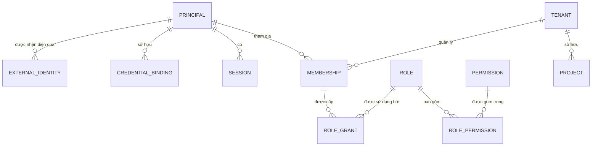

# Thiết kế identity model cho ứng dụng

## 1. Mục tiêu của bài thực hành

Identity model mô tả những chủ thể mà ứng dụng nhận biết, cách họ chứng minh danh tính, quan hệ của họ với tổ chức và cơ sở để cấp quyền. Đây không chỉ là một bảng `users` chứa email, mật khẩu và role.

Trong bài thực hành này, người học thiết kế mô hình cho ứng dụng giả định **WorkHub**, nơi nhiều doanh nghiệp quản lý dự án và tài liệu. Kết quả cần giúp trả lời được:

- Ai đang thực hiện hành động: con người hay workload?
- Định danh đăng nhập nào đã được liên kết với chủ thể nội bộ?
- Chủ thể đang hoạt động trong tenant nào và quan hệ đó còn hiệu lực không?
- Quyền đến từ đâu, áp dụng trên tài nguyên nào và bị thu hồi thế nào?
- Khi có sự cố, có thể giải thích quyết định truy cập bằng dữ liệu nào?

Đây là một phương án thiết kế cho tình huống học tập. Tên thực thể và trạng thái dưới đây là quy ước của bài, không phải schema bắt buộc của một giao thức IAM.

## 2. Bối cảnh WorkHub và yêu cầu nghiệp vụ

WorkHub phục vụ hai tenant A và B. Mỗi tenant sở hữu các dự án; mỗi dự án có tài liệu và báo cáo.

Linh là nhân viên ở A, đồng thời được mời làm cộng tác viên tại B. Minh quản lý thành viên của A. Một tác vụ tổng hợp báo cáo chạy tự động cho A.

Các yêu cầu ban đầu:

1. Linh có thể sửa tài liệu của dự án Alpha thuộc A, nhưng chỉ đọc tài liệu dự án Beta thuộc B.
2. Rời A không tự động chấm dứt quan hệ cộng tác hợp lệ tại B.
3. Người quản lý thành viên không mặc định được đọc mọi tài liệu.
4. Tác vụ tự động có danh tính riêng, không dùng tài khoản hay phiên của Linh.
5. Một email có thể thay đổi; ứng dụng không được vì thế làm mất lịch sử hoặc chuyển quyền sang nhầm người.
6. Mọi hành động cấp, thay đổi và thu hồi quyền đều có nguồn và người chịu trách nhiệm.
7. Đăng nhập thành công không tự tạo quyền truy cập mọi tenant.

Bài tập không yêu cầu tự xây thuật toán mật mã hoặc một IdP mới. Có thể dùng một hệ thống xác thực hiện có; trọng tâm là mô hình và ranh giới trách nhiệm của ứng dụng.

## 3. Tách các khái niệm trước khi thiết kế bảng

### Chủ thể, con người và tài khoản

**Principal** là chủ thể bảo mật mà ứng dụng đưa vào quyết định truy cập. Nó có định danh nội bộ ổn định và loại chủ thể, chẳng hạn `HUMAN` hoặc `SERVICE`.

Một human principal là hồ sơ chủ thể trong WorkHub, không tự chứng minh danh tính dân sự của một cá nhân. Nếu nghiệp vụ cần identity proofing, phải lưu nguồn và mức bảo đảm tương ứng thay vì suy ra từ việc tồn tại bản ghi.

**Account** là khía cạnh quản lý khả năng sử dụng hệ thống: đang hoạt động, bị đình chỉ hay đã ngừng sử dụng. Trong phương án này, trạng thái account được lưu ngay trên `Principal`; không tạo thêm một bảng một-một chỉ để lặp lại cùng dữ liệu.

### Định danh bên ngoài và credential

**External identity** ánh xạ một danh tính đã được xác minh từ IdP sang principal nội bộ. Ví dụ, danh tính OIDC được nhận biết bằng cặp issuer và subject trong miền xác thực của ứng dụng.

**Credential** là phương tiện hoặc dữ liệu phục vụ xác thực, như một khóa công khai, tham chiếu đến authenticator hoặc password hash khi ứng dụng thực sự sở hữu xác thực cục bộ. Nó không phải hồ sơ cá nhân và không phải quyền truy cập.

Nếu WorkHub dùng SSO, WorkHub không lưu mật khẩu của người dùng tại IdP. Cũng không dùng access token đang hoạt động làm khóa chính của tài khoản.

### Membership, role và permission

**Membership** là quan hệ của principal với một tenant. **Role** gom một số permission thành một nhiệm vụ; **role grant** là việc giao role cho một membership trong phạm vi cụ thể.

Một principal có thể có nhiều membership với trạng thái và quyền khác nhau. Vì vậy, `principal.role = ADMIN` là biểu diễn quá thô cho tình huống WorkHub.

**Session** là ngữ cảnh truy cập sau xác thực. Một principal có thể có nhiều phiên; kết thúc một phiên không đồng nghĩa xóa principal hoặc mọi membership.

## 4. Chọn định danh ổn định và quy tắc liên kết

WorkHub cấp `principalId` nội bộ, chẳng hạn một UUID. Email, họ tên, số điện thoại hoặc mã nhân sự là thuộc tính có nguồn và phạm vi, không dùng làm khóa chính cho mọi quan hệ.

Trong OIDC, `iss` và `sub` cùng nhau cung cấp định danh ổn định mà RP có thể dựa vào. Email và tên đăng nhập không có cùng bảo đảm về tính duy nhất hoặc bất biến. Điều này được quy định trong [OIDC Core — Claim Stability and Uniqueness](https://openid.net/specs/openid-connect-core-1_0.html#ClaimStability).

Phương án của bài có một authentication realm WorkHub phục vụ cả A và B:

```text
ExternalIdentity:
    realmId
    issuer
    externalSubject
    principalId

Unique key:
    (realmId, issuer, externalSubject)
```

Nếu triển khai có nhiều realm độc lập, không tự gộp chúng thành một miền tin cậy. Với pairwise subject identifier, cũng không mặc định cùng một người luôn có cùng `sub` ở mọi client.

Ví dụ, Linh đổi email công việc nhưng giữ nguyên danh tính SSO đã liên kết. WorkHub cập nhật thuộc tính liên hệ theo chính sách; `principalId`, membership và lịch sử quyết định vẫn giữ nguyên.

Ngược lại, một người mới nhận lại email cũ của Linh không được tự động nhận quyền của Linh. WorkHub phải nhận diện định danh bên ngoài và thực hiện quy trình cấp phát phù hợp.

Liên kết thêm một IdP với principal hiện có cần một hành trình có kiểm chứng quyền kiểm soát, thẩm quyền và audit. Không tự động merge hai principal chỉ vì `email` giống nhau, kể cả khi có claim `email_verified`.

## 5. Mô hình khái niệm đề xuất



Sơ đồ thể hiện quan hệ chính. Phạm vi dự án của `RoleGrant` được mô tả bằng dữ liệu và ràng buộc bên dưới; không thể hiện đầy đủ mọi khóa ngoại trong sơ đồ.

| Thực thể | Dữ liệu cốt lõi | Ranh giới cần giữ |
| --- | --- | --- |
| Principal | id, kind, accountState, createdAt | Định danh chủ thể và trạng thái sử dụng toàn ứng dụng |
| ExternalIdentity | realmId, issuer, externalSubject, principalId, state | Ánh xạ một định danh ngoài sang đúng principal |
| CredentialBinding | principalId, kind, publicKeyOrSecretRef, state, expiresAt | Quản lý phương tiện xác thực theo loại chủ thể |
| Tenant | id, state, policyRef | Ranh giới tổ chức và chính sách |
| Membership | id, principalId, tenantId, relationType, state, validUntil | Quan hệ có vòng đời riêng trong một tenant |
| RoleGrant | membershipId, tenantId, roleCode, scope, state, validUntil | Cấp quyền có phạm vi, nguồn và thời hạn |
| Session | id, principalId, authenticationSource, authenticatedAt, expiresAt, state | Ngữ cảnh xác thực, không phải nguồn quyền vĩnh viễn |
| Project | id, tenantId, state | Tài nguyên luôn thuộc tenant xác định |

`HumanProfile` có thể được tách riêng để lưu tên hiển thị hoặc thông tin liên hệ. Các khóa bí mật thực tế phải nằm trong cơ chế bảo vệ credential phù hợp; trường `publicKeyOrSecretRef` không có nghĩa được lưu password hay API secret dạng rõ.

`Role`, `Permission` và `RolePermission` dùng làm danh mục chính sách. Bài tập chọn role mẫu dùng chung, còn mỗi grant luôn gắn với membership của một tenant.

## 6. Các bất biến phải được bảo vệ

Một mô hình có tên bảng hợp lý vẫn có thể cấp sai quyền nếu thiếu ràng buộc. WorkHub cần giữ các bất biến:

1. Một external identity đang liên kết không đồng thời trỏ đến hai principal khác nhau trong cùng realm.
2. Membership luôn tham chiếu principal và tenant tồn tại.
3. Trong phương án này, mỗi cặp `principalId, tenantId` có một membership hiện hành; các lần thay đổi được lưu ở lịch sử.
4. Role grant không được trỏ đến membership của tenant khác với tenant của grant.
5. Grant có phạm vi PROJECT chỉ được trỏ đến project thuộc cùng tenant.
6. Principal bị đình chỉ không có quyền truy cập dù membership còn ACTIVE.
7. Membership hết hiệu lực không được nhận quyền từ các grant còn sót lại.
8. Loại credential và luồng xác thực phải phù hợp loại principal.
9. Một quyền đã hết hạn hoặc bị thu hồi không được khôi phục chỉ vì người dùng đăng nhập lại.

Có thể biểu diễn một phần ràng buộc bằng khóa ngoại ghép:

```text
Membership:
    primary key (id)
    unique (principalId, tenantId)
    unique (id, tenantId)

Project:
    primary key (id)
    unique (id, tenantId)

RoleGrant:
    foreign key (membershipId, tenantId)
        references Membership(id, tenantId)

    foreign key (projectId, tenantId)
        references Project(id, tenantId)

    scopeType = TENANT  -> projectId phải rỗng
    scopeType = PROJECT -> projectId phải có giá trị
```

Đây là đặc tả ràng buộc, chưa phải migration SQL hoàn chỉnh. Ngoài cơ sở dữ liệu, backend vẫn phải kiểm tra thẩm quyền cấp grant, thời hạn, role được phép dùng với scope và trạng thái hiện hành.

Một tenant identifier do client gửi chỉ là lựa chọn tenant, không phải bằng chứng quyền. Backend phải đối chiếu principal đã xác thực và quan hệ hiện hành. Nguyên tắc này được giải thích trong [OWASP Multi-Tenant Security Cheat Sheet](https://cheatsheetseries.owasp.org/cheatsheets/Multi_Tenant_Security_Cheat_Sheet.html#1-tenant-identification--context-management).

## 7. Thiết kế permission và phạm vi role

Bắt đầu từ hành động cụ thể, không bắt đầu bằng một role `ADMIN` có mọi khả năng.

Ví dụ danh mục của WorkHub:

| Role mẫu | Permission | Scope áp dụng |
| --- | --- | --- |
| TENANT_MEMBER_ADMIN | member.invite, member.disable | TENANT |
| PROJECT_EDITOR | document.read, document.write | PROJECT |
| PROJECT_READER | document.read | PROJECT |
| REPORT_WORKLOAD | report.read | PROJECT, chỉ cho SERVICE |

Trong bài tập, `member.invite` chỉ tạo lời mời theo quyền mặc định đã phê duyệt; nó không cho phép tự cấp PROJECT_EDITOR hay quyền quản trị. Việc giao và thay đổi role là một khả năng quản trị riêng, cần quy trình phê duyệt và giới hạn người nhận.

Dữ liệu minh họa:

```yaml
principals:
  - id: human-linh
    kind: HUMAN
    accountState: ACTIVE
  - id: human-minh
    kind: HUMAN
    accountState: ACTIVE
  - id: service-report-a
    kind: SERVICE
    accountState: ACTIVE

memberships:
  - id: membership-linh-a
    principalId: human-linh
    tenantId: tenant-a
    relationType: EMPLOYEE
    state: ACTIVE
  - id: membership-linh-b
    principalId: human-linh
    tenantId: tenant-b
    relationType: GUEST
    state: ACTIVE
  - id: membership-report-a
    principalId: service-report-a
    tenantId: tenant-a
    relationType: WORKLOAD
    state: ACTIVE

grants:
  - membershipId: membership-linh-a
    roleCode: PROJECT_EDITOR
    scope: PROJECT:alpha
  - membershipId: membership-linh-b
    roleCode: PROJECT_READER
    scope: PROJECT:beta
  - membershipId: membership-report-a
    roleCode: REPORT_WORKLOAD
    scope: PROJECT:alpha
```

YAML chỉ trình bày dữ liệu thiết kế; không chứa credential, token hay quyền của Minh. Minh cần membership và grant riêng khi triển khai các chức năng quản lý thành viên.

Role cung cấp tập hành động; tenant, project và trạng thái quan hệ giới hạn nơi thực hiện. Có thể bổ sung điều kiện ABAC như phân loại tài liệu hoặc yêu cầu xác thực đủ mới, nhưng phải xác định nguồn thuộc tính và cách thực thi.

Nguyên tắc mặc định từ chối và kiểm tra quyền trên từng request được trình bày trong [OWASP Authorization Cheat Sheet](https://cheatsheetseries.owasp.org/cheatsheets/Authorization_Cheat_Sheet.html#deny-by-default).

## 8. Từ đăng nhập đến ngữ cảnh tenant

Luồng cho Linh sử dụng SSO:

1. Thành phần giao thức xác minh phản hồi IdP theo cấu hình tin cậy.
2. WorkHub dùng realm, issuer và subject đã xác minh để tìm ExternalIdentity.
3. ExternalIdentity dẫn đến principal nội bộ; backend kiểm tra trạng thái account.
4. Backend tạo ngữ cảnh phiên với nguồn và thời điểm xác thực.
5. Khi Linh chọn tenant, backend kiểm tra membership và chính sách xác thực của tenant đó.
6. Mỗi thao tác tiếp tục kiểm tra permission trên tài nguyên cụ thể.

Không dùng claim `role=admin` từ một IdP bất kỳ để cấp quyền quản trị nội bộ. Nếu hỗ trợ ánh xạ group hoặc claim, cần cấu hình nguồn được chấp nhận, phạm vi tenant và những role được phép ánh xạ.

Có membership tại B cũng chưa đủ nếu B yêu cầu một nguồn xác thực mà phiên hiện tại không đáp ứng. Ví dụ, B chỉ cho phép tài khoản khách đăng nhập qua một kết nối IdP đã thỏa thuận. WorkHub phải kiểm tra điều kiện đó khi chọn tenant hoặc truy cập tài nguyên.

Với một external identity chưa từng biết, có thể cho phép tạo principal chờ hoàn tất đăng ký theo chính sách. Không tự động tạo membership ACTIVE hoặc grant nhạy cảm chỉ vì callback SSO thành công.

## 9. Quyết định truy cập phải sử dụng dữ liệu tin cậy

Mã giả kiểm tra quyền đọc hoặc sửa tài liệu:

```text
authorizeDocumentAction(authContext, selectedTenant, projectId, action, now):
    require authContext was produced by trusted authentication

    principal = principalStore.get(authContext.principalId)
    require principal.accountState == ACTIVE

    tenant = tenantStore.get(selectedTenant)
    require tenant.state == ACTIVE

    membership = membershipStore.get(principal.id, tenant.id)
    require membership.state == ACTIVE
    require membership.validUntil is absent or now < membership.validUntil

    require tenant.authenticationPolicy.accepts(
        principal.kind,
        authContext.authenticationSource,
        authContext.authenticationStrength,
        authContext.authenticatedAt
    )

    project = projectStore.getWithinTenant(projectId, tenant.id)
    require project exists and project.state == ACTIVE

    grants = grantStore.getEffectiveGrants(membership.id, now)
    require some grant:
        applies to project
        and role is allowed for principal.kind
        and role contains action

    return PERMIT
```

Nếu không tìm được điều kiện cho phép, kết quả là từ chối. Không có nhánh mặc định “đã đăng nhập thì được đọc”.

`selectedTenant` và `projectId` từ URL không đáng tin hơn dữ liệu trong request body. Repository phải tìm project trong tenant đã được kiểm chứng; không tải một project bất kỳ rồi bỏ quên bước đối chiếu tenant.

Các trường trong `authContext` phải được tạo từ thành phần xác thực tin cậy, không sao chép trực tiếp từ header do client tự đặt. Kiểm tra quyền cũng cần áp dụng cho API tải file, tìm kiếm, export và tác vụ nền, không chỉ trang giao diện.

Khi quyền được cache, khóa cache phải chứa đủ principal, tenant, resource hoặc phạm vi và phiên bản chính sách liên quan. Cần có cơ chế vô hiệu hóa cache khi membership hay grant thay đổi, tránh dùng quyền cũ sau thu hồi.

## 10. Vòng đời membership và quyền

Một membership có thể đi qua các trạng thái nội bộ:

```text
INVITED -> ACTIVE -> SUSPENDED
                 -> ENDED
INVITED -> EXPIRED
```

Lời mời cần được gắn với tenant, mục đích và thời hạn. Việc chứng minh kiểm soát địa chỉ nhận lời mời không tự cấp các quyền ngoài nội dung đã được phê duyệt.

Khi Linh rời A:

1. Nguồn có thẩm quyền kết thúc membership của Linh tại A.
2. WorkHub thu hồi các grant của membership này và vô hiệu hóa dữ liệu quyền đã cache.
3. Các phiên hoặc credential chỉ phục vụ A được chấm dứt theo thiết kế.
4. Request mới vào A bị từ chối dù một phiên toàn ứng dụng còn hoạt động.
5. Membership tại B được đánh giá riêng theo nguồn và chính sách của B.

Không dùng một sự kiện nghỉ việc tại A để tự động khóa principal toàn WorkHub nếu A không có thẩm quyền đó. Ngược lại, khi đội bảo mật có thẩm quyền đình chỉ principal vì bị chiếm tài khoản, việc chặn cần có hiệu lực trên mọi tenant.

Nếu Linh quay lại A, phải có quyết định tái cấp phát. Không tự khôi phục mọi role cũ chỉ vì email hoặc `principalId` vẫn còn.

Lịch sử sự kiện cần cho biết thay đổi đến từ đâu: nguồn nhân sự, quản trị viên tenant, quy trình mời hay hệ thống bảo mật. Một trường `active=true` duy nhất cho toàn bộ mô hình không biểu diễn đủ những khác biệt này.

## 11. Danh tính workload và trách nhiệm sở hữu

Tác vụ tổng hợp báo cáo dùng `service-report-a`, không mượn password hoặc refresh token của Linh.

Mô hình cần bổ sung dữ liệu cho service principal:

```text
ServiceProfile:
    principalId
    ownerTeamId
    accountableOwnerPrincipalId
    purpose
    expectedWorkload
    reviewAfter
```

Credential hoặc cơ chế workload identity có vòng đời riêng: cấp phát, hết hạn, xoay và thu hồi. Ưu tiên phương thức phù hợp môi trường thay vì mặc định một secret sống vô hạn; bài tập không buộc chọn một nhà cung cấp hay công nghệ cụ thể.

Quyền REPORT_WORKLOAD chỉ áp dụng cho báo cáo dự án Alpha tại A. Principal này không được mở phiên tương tác của người dùng, quản lý thành viên hoặc sửa tài liệu.

Khi chủ sở hữu cá nhân rời tổ chức, không để service principal trở thành danh tính vô chủ. Nhóm chịu trách nhiệm cần nhận lại ownership hoặc dừng workload theo quyết định được ghi nhận.

Nếu một tác vụ chạy thay mặt người dùng, cần biểu diễn cả danh tính dịch vụ và người ủy quyền cùng phạm vi ủy quyền. Không gắn một trường `userId` tùy ý vào request rồi coi đó là hành động hợp lệ của người dùng.

## 12. Nguồn thuộc tính, audit và quyền riêng tư

Mỗi thuộc tính ảnh hưởng quyết định truy cập cần có nguồn và thẩm quyền cập nhật. Ví dụ:

- Trạng thái principal toàn ứng dụng do thành phần quản lý account có thẩm quyền quyết định.
- Quan hệ nhân viên tại A do nguồn đã được A phê duyệt cung cấp.
- Quyền dự án do quy trình quản trị quyền của tenant quyết định.
- Email từ IdP là thuộc tính nhận được từ nguồn đó, không tự trở thành quyền sở hữu mọi tài nguyên có cùng email.

Khi hai nguồn mâu thuẫn, cần quy tắc ưu tiên và xử lý, không tùy tiện chọn bản ghi mới nhất. Nên lưu thời điểm hiệu lực và phiên bản để ngăn sự kiện cũ đến muộn làm sống lại membership đã kết thúc.

Một sự kiện audit minh họa:

```json
{
  "eventType": "ROLE_GRANT_REVOKED",
  "actorPrincipalId": "human-reviewer",
  "targetPrincipalId": "human-linh",
  "tenantId": "tenant-a",
  "membershipId": "membership-linh-a",
  "scope": "PROJECT:alpha",
  "reasonCode": "MEMBERSHIP_ENDED",
  "source": "approved-offboarding-workflow",
  "correlationId": "change-84b1"
}
```

Sự kiện thực tế cần thêm timestamp, mã sự kiện và cơ chế bảo vệ tính toàn vẹn phù hợp. Không lưu password, session token, refresh token hoặc khóa riêng trong audit.

Tenant A chỉ cần biết quan hệ và hoạt động của Linh trong A. Việc dùng một principal nội bộ chung không cho phép A liệt kê membership, hồ sơ hoặc hoạt động của Linh tại B.

## 13. Kịch bản kiểm chứng mô hình

Người học cần tạo dữ liệu và mô tả kết quả mong đợi cho cả đường cho phép lẫn đường từ chối:

| Kịch bản | Kết quả mong đợi |
| --- | --- |
| Linh sửa tài liệu Alpha tại A | Cho phép khi principal, membership, grant và phiên đáp ứng chính sách |
| Linh sửa tài liệu Beta tại B | Từ chối vì chỉ có PROJECT_READER |
| Linh gửi tenant A nhưng project ID thuộc B | Từ chối, không trả dữ liệu project B |
| Kết thúc membership A, giữ membership B | Chặn A; B chỉ tiếp tục nếu đáp ứng chính sách riêng |
| Đình chỉ principal của Linh | Chặn mọi membership dù grant còn dữ liệu |
| Đổi email của Linh | Không thay principalId và không tự chuyển quyền |
| Người khác dùng lại email cũ | Không nhận principal hoặc grant của Linh |
| IdP không được tenant chấp nhận | Không dùng phiên đó để vượt chính sách tenant |
| Workload gọi API sửa tài liệu | Từ chối vì chỉ được đọc báo cáo trong phạm vi đã cấp |
| Sự kiện cấp quyền cũ đến sau sự kiện thu hồi | Không tự khôi phục quyền đã kết thúc |
| Tải file bằng đường dẫn trực tiếp | Vẫn phải kiểm tra tenant, tài nguyên và permission |
| Quản trị viên A xem membership của Linh ở B | Từ chối vì vượt phạm vi quản trị |

Các trường hợp này là tiêu chí cho sản phẩm học tập, không phải kết quả kiểm thử một triển khai đã có.

## 14. Sản phẩm người học cần bàn giao

Một thiết kế hoàn chỉnh cho bài tập gồm sơ đồ thực thể, từ điển dữ liệu, định danh và ràng buộc duy nhất; danh mục permission cùng quy tắc cấp role; nguồn và vòng đời của principal, membership, credential; thuật toán kiểm tra quyền; bộ tình huống cho phép và từ chối; cùng các quyết định còn cần xác nhận.

Mỗi quyết định nên có lý do. Ví dụ: dùng principalId ổn định để email thay đổi không phá liên kết; đặt quyền trên membership để cô lập tenant; giữ service principal riêng để workload có thể được thu hồi mà không ảnh hưởng người dùng.

Cuối bài, người học cần giải thích được một request cụ thể bằng chuỗi:

```text
Danh tính đã xác minh
    -> Principal còn hoạt động
    -> Membership đúng tenant và còn hiệu lực
    -> Grant đúng scope và hành động
    -> Điều kiện ngữ cảnh được đáp ứng
    -> Quyết định cùng bằng chứng audit
```

Nếu không thể chỉ ra một mắt xích trong chuỗi, mô hình chưa đủ rõ để trở thành cơ sở cấp quyền. Bài thực hành thành công khi quyền được cấp và thu hồi đúng phạm vi, đồng thời những thay đổi thường gặp như đổi email, chuyển tổ chức hoặc thay chủ sở hữu workload không làm mất ranh giới danh tính và quyền truy cập.
