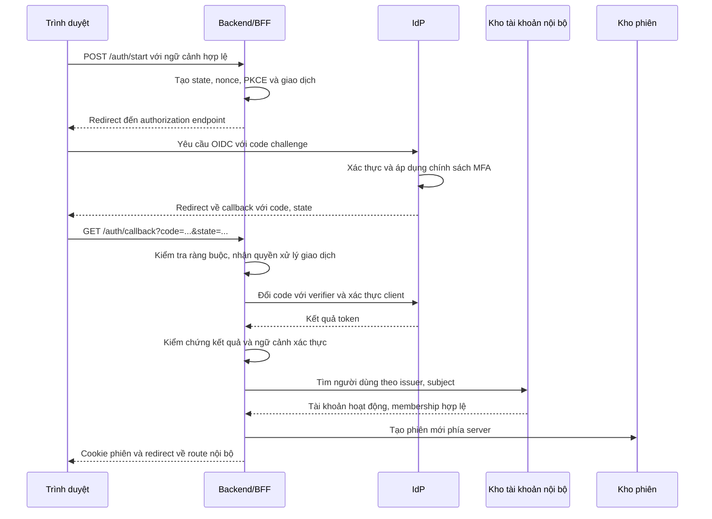

# Thiết kế authentication flow

Một authentication flow hoàn chỉnh phải giải thích được nhiều hơn câu “người dùng nhập đúng thông tin thì đăng nhập thành công”. Thiết kế cần xác định ai xác thực người dùng, ứng dụng tin kết quả bằng cách nào, khi nào tạo phiên, lúc nào yêu cầu xác thực lại và điều gì xảy ra khi người dùng mất phương tiện xác thực hoặc tài khoản bị khóa.

Bài thực hành này xây dựng luồng cho một **cổng quản trị tài liệu nội bộ giả định**. Người học cần tạo bản thiết kế có thể triển khai và kiểm thử, đồng thời giữ ranh giới rõ giữa xác thực danh tính và cấp quyền thao tác. Các thời hạn và chính sách dưới đây là lựa chọn của bài tập, không phải giá trị mặc định do một tiêu chuẩn quy định.

## 1. Đề bài và tiêu chí đầu ra

Cổng phục vụ nhân viên và quản trị viên, đăng nhập qua một Identity Provider — IdP — đã được tổ chức lựa chọn. Ứng dụng có giao diện web và backend cùng origin. Tài khoản được cấp trước bằng quy trình nhân sự; không cho phép tự đăng ký vào cổng chỉ bằng một email cùng tên miền.

Thiết kế phải đáp ứng:

- Nhân viên đăng nhập qua IdP; cổng không thu nhận mật khẩu hoặc mã OTP của IdP.
- Phiên ứng dụng chỉ được tạo khi kết quả xác thực và điều kiện tài khoản nội bộ đều hợp lệ.
- Thao tác cấp quyền quản trị cần ngữ cảnh xác thực mạnh hơn hoặc mới hơn theo chính sách đã thống nhất với IdP.
- Trình duyệt chỉ giữ cookie định danh phiên ứng dụng; token liên quan đến IdP được quản lý phía backend.
- Callback sai, bị phát lại, quá hạn hoặc thiếu dữ kiện phải kết thúc lượt đăng nhập tương ứng mà không tạo thêm phiên hay nâng mức xác thực.
- Khóa tài khoản, khôi phục, đổi phương tiện xác thực và đăng xuất phải có cách xử lý phiên rõ ràng.

Đầu ra của bài tập gồm sơ đồ trình tự, mô hình trạng thái, bảng dữ liệu tạm và phiên, chính sách xác thực lại, các nhánh lỗi và ma trận kiểm thử. Chưa cần triển khai một nhà cung cấp danh tính hoặc tự viết thư viện OIDC.

Danh tính workload và ứng dụng di động native cần thiết kế client riêng. Không dùng nguyên cookie flow của trình duyệt làm phương án xác thực cho mọi loại client trong hệ thống.

## 2. Lựa chọn kiến trúc cho bài tập

Phương án minh họa dùng backend theo vai trò **Backend for Frontend — BFF**. Backend là OIDC client có thể giữ thông tin xác thực client; trình duyệt chuyển hướng đến IdP nhưng không trực tiếp đổi authorization code lấy token.

OIDC bổ sung lớp danh tính trên OAuth 2.0. Trong bài này chọn **Authorization Code Flow kết hợp PKCE với `S256`**. RFC 9700 khuyến nghị PKCE cho confidential client và yêu cầu bảo vệ luồng redirect trước các tấn công như CSRF hoặc code injection. Nguồn: [OAuth 2.0 Security Best Current Practice — RFC 9700](https://www.rfc-editor.org/rfc/rfc9700.html).

| Thành phần | Trách nhiệm trong phương án |
|---|---|
| Trình duyệt | Hiển thị giao diện, chuyển hướng và gửi cookie phiên |
| Backend/BFF | Tạo giao dịch đăng nhập, xử lý callback, đổi code, kiểm chứng token và quản lý phiên |
| IdP | Xác thực người dùng, quản lý authenticator và phát hành kết quả theo giao thức |
| Kho tài khoản nội bộ | Ánh xạ danh tính ngoài vào người dùng, trạng thái tài khoản và membership |
| Lớp phân quyền | Quyết định người dùng được làm gì trên từng tài nguyên |

Đội dự án phải cấu hình trước issuer, client ID, redirect URI và phương thức xác thực client với IdP. Không chọn token endpoint hoặc nguồn khóa bằng một URL bất kỳ do callback hay token không tin cậy cung cấp.

Trong bài, chỉ có một IdP được chấp thuận. Khi mở rộng sang nhiều IdP, cần bổ sung thiết kế chống nhầm issuer, ánh xạ tenant và cấu hình riêng từng nhà cung cấp; việc thêm một ô nhập “địa chỉ IdP” chưa đáp ứng các yêu cầu ấy.

## 3. Xác định trạng thái và ranh giới tin cậy

Tách trạng thái của **lượt đăng nhập** khỏi trạng thái của **phiên đã đăng nhập**:

| Đối tượng | Trạng thái minh họa | Ý nghĩa |
|---|---|---|
| Giao dịch đăng nhập | `PENDING` | Chờ phản hồi từ IdP, chưa chứng minh người dùng đã xác thực |
| Giao dịch đăng nhập | `PROCESSING` | Một callback đã nhận quyền xử lý duy nhất |
| Giao dịch đăng nhập | `COMPLETED`, `FAILED`, `EXPIRED` | Lượt xử lý đã kết thúc và không được dùng lại |
| Phiên ứng dụng | `ACTIVE` | Có danh tính đã kiểm chứng và thời hạn phiên hợp lệ |
| Phiên ứng dụng | `REVOKED`, `EXPIRED` | Không còn được dùng để truy cập tài nguyên bảo vệ |

Một giao dịch `PENDING` không được truy cập API cần đăng nhập. Tương tự, việc IdP đã xác thực thành công không có nghĩa cổng phải tạo phiên: tài khoản nội bộ có thể bị khóa, chưa được cấp hoặc không còn membership.

Lượt đăng nhập thất bại không tự làm mất mọi phiên hợp lệ đang tồn tại của trình duyệt. Chẳng hạn, callback cũ bị phát lại phải bị từ chối, nhưng không nên trở thành cách để người ngoài tùy ý đăng xuất nạn nhân. Cách giữ hoặc thu hồi phiên hiện hành cần dựa trên sự kiện và chính sách cụ thể.

## 4. Tạo giao dịch đăng nhập

Khi người dùng chọn đăng nhập, trình duyệt gọi endpoint khởi tạo của BFF. Phương án này dùng `POST /auth/start`, gắn với ngữ cảnh trước đăng nhập và cơ chế chống CSRF thích hợp. BFF tạo các giá trị ngẫu nhiên độc lập cho từng lượt:

| Giá trị | Vai trò |
|---|---|
| `state` | Liên kết callback với giao dịch và trình duyệt đã khởi tạo |
| `nonce` | Liên kết ID Token với yêu cầu xác thực tương ứng |
| `code_verifier` | Bí mật của lượt PKCE, chỉ backend giữ trong phương án này |
| `code_challenge` | Giá trị suy ra từ verifier để gửi đến authorization endpoint |

Với `S256`, challenge được tính từ SHA-256 của verifier rồi mã hóa base64url không padding. Cơ chế và yêu cầu về verifier được định nghĩa trong [PKCE — RFC 7636](https://www.rfc-editor.org/rfc/rfc7636.html). Khi triển khai, dùng khả năng tạo giao dịch của thư viện đã được lựa chọn cùng nguồn ngẫu nhiên mật mã, thay vì tự ghép từ thời gian hoặc user ID.

Một bản ghi phía server có thể gồm:

```yaml
transactionId: login-tx-example
purpose: LOGIN
stateReference: server-held-reference
browserBindingReference: pre-login-browser-context
expectedIssuer: https://idp.example
clientId: document-portal
redirectUri: https://portal.example/auth/callback
nonceReference: server-held-reference
pkceVerifierReference: encrypted-temporary-storage
requestedContext: workforce-login-policy
returnRoute: /documents
expiresAfterSeconds: 300
state: PENDING
```

Đây là schema minh họa; các reference không phải giá trị có thể đem dùng làm token thật. Dữ liệu giao dịch được lưu trong kho riêng có giới hạn truy cập và thời gian sống. Verifier phải có thể lấy lại để đổi code, không thể chỉ giữ một hash không phục hồi của nó.

`returnRoute` được chọn từ các route nội bộ cho phép, không nhận nguyên một URL bên ngoài rồi chuyển hướng sau đăng nhập. Ngữ cảnh ràng buộc trình duyệt phải được bảo vệ, không chỉ là transaction ID xuất hiện công khai trong URL.

Mỗi tab có thể có giao dịch riêng; không dùng một biến `latestNonce` hoặc `latestVerifier` chung cho mọi lượt đăng nhập. Đồng thời cần giới hạn số giao dịch đang chờ để endpoint khởi tạo không trở thành nơi tạo dữ liệu tạm vô hạn.

## 5. Sơ đồ luồng thành công



Yêu cầu gửi đến IdP dùng `response_type=code`, scope chứa `openid`, redirect URI đã đăng ký cùng `state`, `nonce`, `code_challenge` và `code_challenge_method=S256`. Chỉ yêu cầu thêm scope hoặc claim khi chức năng thực sự cần.

Authorization code xuất hiện trong callback của code flow, nhưng access token và refresh token không được đưa vào URL giao diện của phương án này. Trang callback không chứa tài nguyên bên thứ ba không cần thiết; cấu hình log phải tránh thu thập toàn bộ query chứa code. Sau xử lý, chuyển hướng về URL ứng dụng sạch.

## 6. Thiết kế callback theo thứ tự kiểm tra

Callback là dữ liệu đầu vào không đáng tin. Việc có một tham số tên `code` không chứng minh nó do IdP mong đợi cấp cho lượt hiện tại. BFF cần kiểm tra cấu trúc đầu vào, giao dịch, ràng buộc trình duyệt và thời hạn trước khi tiếp tục.

Quyền xử lý giao dịch phải được nhận bằng thao tác nguyên tử, chẳng hạn chuyển `PENDING` sang `PROCESSING` nếu trạng thái và thời hạn còn phù hợp. Nếu hai request callback đến đồng thời, chỉ một request được đi tiếp. Lượt đã thất bại sau khi bắt đầu xử lý được kết thúc; người dùng có thể khởi tạo lượt mới thay vì tái sử dụng code không rõ đã được đổi hay chưa.

Sau khi đổi code qua kênh phía server, dùng thư viện OIDC để kiểm chứng ID Token theo cấu hình tin cậy:

| Nội dung | Điều cần đối chiếu trong thiết kế |
|---|---|
| Issuer | `iss` khớp issuer đã cấu hình |
| Bên nhận | `aud` chứa client ID; xử lý `azp` theo đặc tả và profile áp dụng |
| Bảo vệ token | Kiểm tra chữ ký, khóa và thuật toán đã chấp thuận trong phương án này |
| Thời gian | Token còn hạn; các kiểm tra thời gian và dung sai được cấu hình rõ |
| Ràng buộc lượt | `nonce` tồn tại và khớp vì yêu cầu ban đầu đã gửi nonce |
| Ngữ cảnh | `acr`, `auth_time` đáp ứng chính sách khi luồng yêu cầu chúng |

Đặc tả quy định chi tiết trong [OpenID Connect Core, mục ID Token Validation](https://openid.net/specs/openid-connect-core-1_0.html#IDTokenValidation). Không coi thao tác decode JWT là kiểm chứng token.

Một flow khái niệm có thể viết:

```text
handleCallback(request):
    input = parseAndValidateCallbackParameters(request)
    tx = loadPendingTransactionBoundToBrowser(input.state, request)
    claimTransactionOnce(tx)

    if input represents an IdP error:
        finishTransactionAsFailed(tx)
        return safeLoginFailure()

    tokens = exchangeCodeAtConfiguredIdP(input.code, tx.pkceVerifier)
    identity = validateOidcResult(tokens, tx)
    requireRequestedAuthenticationContext(identity, tx)

    account = findProvisionedAccount(identity.issuer, identity.subject)
    requireActiveAccountAndCurrentMembership(account)
    requireCompatibleCurrentBrowserSession(account, tx)

    session = createFreshServerSession(account, identity, tx)
    finishTransactionAsCompleted(tx)
    return sessionCookieAndAllowedRedirect(session, tx.returnRoute)
```

Đây là mô tả trách nhiệm, không phải mã đầy đủ để copy vào production. Nhánh lỗi, timeout, tranh chấp trạng thái và rollback cũng phải được hiện thực; phiên mới không được lộ ra trình duyệt trước khi các điều kiện tạo phiên hoàn tất. Nếu xử lý cuối thất bại sau khi đã tạo một bản ghi phiên tạm, phải có cách thu hồi hoặc dọn bản ghi ấy.

Ánh xạ tài khoản dùng cặp issuer và subject đã kiểm chứng. Trong bài, email chỉ phục vụ liên hệ hoặc hiển thị; không tự gộp hai tài khoản vì email giống nhau. Callback cũ cũng không được âm thầm đổi tài khoản của một phiên trình duyệt đã chuyển sang người khác; chuyển tài khoản là một ý định riêng cần xử lý rõ.

## 7. Quản lý phiên ứng dụng

Khi đăng nhập thành công, BFF tạo một session ID mới, ngẫu nhiên và không chứa thông tin cá nhân. Không nâng trực tiếp định danh phiên trước đăng nhập thành phiên có quyền bằng cách giữ nguyên ID. Ví dụ cookie:

```http
Set-Cookie: __Host-portal_session=<opaque-random-session-id>; Path=/; Secure; HttpOnly; SameSite=Lax
```

Prefix `__Host-` yêu cầu `Secure`, `Path=/` và không có thuộc tính `Domain`. `HttpOnly` hạn chế JavaScript đọc cookie, còn `SameSite` là một lớp hỗ trợ chống CSRF. Những thuộc tính và yêu cầu quản lý vòng đời phiên được giải thích trong [OWASP Session Management Cheat Sheet](https://cheatsheetseries.owasp.org/cheatsheets/Session_Management_Cheat_Sheet.html).

Phương án chọn callback top-level `GET` qua query và `SameSite=Lax` cho cookie ràng buộc thích hợp. Nếu chuyển sang callback cross-site `POST`, phải đánh giá lại hành vi cookie; không tắt kiểm tra state hoặc ràng buộc trình duyệt chỉ để callback chạy được.

Trong bài, có thể chọn cấu hình nội bộ:

```yaml
loginTransactionTtlSeconds: 300
sessionIdleTimeoutMinutes: 15
sessionAbsoluteTimeoutHours: 8
sensitiveOperationAuthenticationMaxAgeSeconds: 300
```

Các giá trị cần được điều chỉnh theo rủi ro và nhu cầu của hệ thống. Idle timeout và absolute timeout được cưỡng chế phía server; refresh token không tự kéo dài vô hạn absolute timeout của phiên ứng dụng.

Kho phiên có thể lưu user ID nội bộ, issuer/subject tham chiếu, thời điểm tạo và hoạt động, hạn tuyệt đối, trạng thái thu hồi, ngữ cảnh xác thực và thời điểm xác thực liên quan. Token lưu phía backend cần được bảo vệ theo mục đích sử dụng và giới hạn quyền đọc; không ghi nguyên token vào sự kiện kiểm toán.

`HttpOnly` không ngăn một đoạn mã XSS gửi request bằng phiên hiện tại. Cổng vẫn cần bảo vệ đầu ra, nguồn script và các chức năng ứng dụng. BFF giảm một số đường lộ token nhưng không làm giao diện miễn nhiễm trước XSS.

### Chống CSRF cho thao tác dùng cookie

Với các thao tác thay đổi dữ liệu, phương án dùng cơ chế CSRF của framework hoặc synchronizer token được kiểm tra tại backend, kết hợp kiểm tra origin phù hợp. Không dùng `GET` để cấp quyền hoặc đổi phương tiện xác thực. Nguồn: [OWASP CSRF Prevention Cheat Sheet](https://cheatsheetseries.owasp.org/cheatsheets/Cross-Site_Request_Forgery_Prevention_Cheat_Sheet.html).

`state` của giao dịch đăng nhập không thay thế CSRF token của mọi API sau đăng nhập. Hai giá trị được dùng trong hai ngữ cảnh khác nhau; thiết kế phải thể hiện nơi tạo, truyền và kiểm tra từng loại.

## 8. MFA và step-up cho hành động nhạy cảm

IdP chịu trách nhiệm thực hiện phương thức xác thực. Cổng chỉ sử dụng kết quả đã kiểm chứng theo hợp đồng tích hợp. Không nhận một trường `mfaPassed: true` do trình duyệt gửi để nâng mức phiên.

MFA cần các yếu tố xác thực khác nhau; mật khẩu cộng thêm một PIN do cùng cơ chế kiểm tra không tự thành hai yếu tố. Việc reset hoặc thay yếu tố cũng có thể tạo đường vòng nếu thiết kế yếu. Xem [OWASP Multifactor Authentication Cheat Sheet](https://cheatsheetseries.owasp.org/cheatsheets/Multifactor_Authentication_Cheat_Sheet.html).

Trong bài, thao tác cấp quyền quản trị có chính sách riêng: kết quả phải đạt ngữ cảnh mà tổ chức đã thống nhất với IdP và thời điểm xác thực không quá năm phút. Tên context là giá trị trong hợp đồng tích hợp, không mặc định một chuỗi `acr` bất kỳ tương đương một mức NIST.

Nếu phiên chưa đáp ứng, BFF tạo giao dịch mới với `purpose=STEP_UP`, ràng buộc user hiện hành, phiên và ý định cấp quyền. Khi quay lại, cần đối chiếu cả danh tính lẫn ngữ cảnh; xác thực một tài khoản khác không được nâng phiên ban đầu.

OIDC có claim `auth_time` và tham số `max_age`; ý nghĩa của `acr` phải được hiểu theo profile áp dụng. Thời điểm token được phát hành `iat` không thay thế thời điểm người dùng được xác thực. Nguồn: [OpenID Connect Core, phần ID Token](https://openid.net/specs/openid-connect-core-1_0.html#IDToken).

Sau step-up thành công, người dùng xác nhận lại hành động nhạy cảm qua request hợp lệ. BFF vẫn kiểm tra quyền cấp vai trò, tenant và tài khoản đích tại thời điểm thực hiện. Step-up không cấp cho nhân viên thường quyền quản trị mà họ chưa được phê duyệt.

Nếu IdP không trả đủ claim cần thiết hoặc trả context yếu hơn yêu cầu, hành động nhạy cảm tiếp tục bị chặn. Không hạ điều kiện chỉ vì người dùng đã quay lại callback thành công.

## 9. Làm mới token, đăng xuất và thu hồi

Nếu BFF cần refresh token để gọi dịch vụ được ủy quyền, quá trình làm mới diễn ra phía server. Trong bài, phạm vi token được giới hạn theo chức năng và không xin refresh token chỉ để có thêm một loại token. Cách bảo vệ, rotation hoặc ràng buộc token cần phù hợp với hỗ trợ của IdP và mô hình client. Xem [RFC 9700, phần bảo vệ token](https://www.rfc-editor.org/rfc/rfc9700.html#section-2.2).

Một lỗi làm mới không được tạo lại quyền từ dữ liệu cũ không còn hợp lệ. Khi có nhiều request đồng thời, BFF cần điều phối refresh để tránh các request tự làm hỏng chuỗi rotation hoặc ghi đè token mới bằng kết quả cũ.

Thiết kế phải phân biệt các sự kiện:

| Sự kiện | Xử lý trong phương án minh họa |
|---|---|
| Đăng xuất khỏi cổng | Thu hồi phiên tại server và xóa cookie tương ứng |
| Kết thúc phiên tại IdP | Dùng cơ chế tích hợp được hỗ trợ nếu sản phẩm yêu cầu SSO logout |
| Khóa tài khoản nội bộ | Chặn truy cập theo trạng thái tài khoản và xử lý các phiên liên quan |
| Người dùng yêu cầu đăng xuất mọi thiết bị | Thu hồi tập phiên thuộc người dùng theo phạm vi đã xác nhận |
| Phát hiện tài khoản bị chiếm | Kích hoạt quy trình xử lý sự cố, phiên và authenticator liên quan |

Đăng xuất được khởi tạo bằng thao tác có bảo vệ CSRF trong phương án này. Xóa cookie mà giữ nguyên phiên phía server không đáp ứng việc thu hồi nếu session ID đã bị lộ. Ngược lại, đăng xuất khỏi cổng không tự chứng minh phiên SSO tại IdP và mọi token của hệ thống khác đã bị hủy.

Muốn khóa tài khoản có hiệu lực với phiên hiện tại, cổng cần đường kiểm tra trạng thái hoặc cơ chế thu hồi có giới hạn độ trễ xác định. Đội thiết kế phải nêu cách thực hiện và kiểm thử, không chỉ kiểm tra `active` một lần lúc đăng nhập rồi bỏ qua mọi thay đổi về sau.

## 10. Khôi phục và thay phương tiện xác thực

Trong kiến trúc này, khôi phục mật khẩu hoặc authenticator được thực hiện tại IdP theo quy trình của tổ chức. Cổng không tự thêm một form “nhập email để bỏ qua MFA”. Nếu cần màn hình hỗ trợ, màn hình ấy chỉ dẫn tới quy trình đã được chấp thuận.

Với luồng khôi phục dùng token, các thuộc tính quan trọng gồm ngẫu nhiên mật mã, thời hạn, sử dụng một lần và bảo vệ khỏi việc dò tài khoản hoặc gửi yêu cầu quá mức. Đổi mật khẩu cũng chưa đủ để xử lý mọi hậu quả của một tài khoản bị chiếm. Nguồn: [OWASP Forgot Password Cheat Sheet](https://cheatsheetseries.owasp.org/cheatsheets/Forgot_Password_Cheat_Sheet.html).

Thiết kế capstone cần trả lời: ai xác nhận yêu cầu khôi phục, có thể dùng bằng chứng nào đã được thiết lập trước, người dùng được thông báo thế nào và phiên cũ bị xử lý ra sao. Không tự tin thông tin khôi phục vừa bị thay đổi nếu chính tài khoản đang bị nghi chiếm quyền.

Sau khôi phục, phương án yêu cầu người dùng đi lại luồng đăng nhập thông thường trước khi sử dụng cổng. Quyền nghiệp vụ không được mở rộng do người dùng vừa qua hỗ trợ. Với tài khoản quản trị, việc thay hoặc gỡ authenticator cần có điều kiện chặt chẽ và bằng chứng kiểm toán phù hợp.

## 11. Các nhánh lỗi cần mô tả trước khi triển khai

| Tình huống | Hành vi mong đợi |
|---|---|
| Thiếu state, sai ràng buộc trình duyệt hoặc giao dịch quá hạn | Từ chối callback, không tạo phiên mới |
| Callback đã được nhận quyền xử lý hoặc đã kết thúc | Không xử lý lại code và không tạo phiên thứ hai từ lượt đó |
| Người dùng hủy xác thực tại IdP | Kết thúc giao dịch, cho phép chủ động khởi tạo lượt khác |
| Token endpoint timeout hoặc báo code không hợp lệ | Không coi người dùng đã đăng nhập; xử lý kết thúc lượt theo thiết kế |
| Sai issuer, audience, nonce hoặc token không hợp lệ | Không tạo hoặc nâng mức phiên |
| Không xác minh được khóa trong chính sách refresh khóa có giới hạn | Không bỏ qua kiểm tra chữ ký để tiếp tục |
| Tài khoản nội bộ bị khóa hoặc không có membership | Không cấp phiên truy cập cổng dù IdP đã xác thực |
| Không đạt context của step-up | Không thực hiện hành động nhạy cảm |
| Kho phiên không thể kiểm tra trạng thái tin cậy | Không phục vụ tài nguyên bảo vệ bằng cách tự đoán phiên còn hợp lệ |

Thông báo cho người dùng nên dễ hiểu và có mã tham chiếu hỗ trợ, nhưng không chứa token, verifier, bí mật client hoặc chi tiết nội bộ không cần thiết. Log cần phân biệt lỗi giao thức, từ chối do tài khoản và lỗi hạ tầng để đội vận hành tìm đúng nguyên nhân.

Ở IdP và BFF, cần phân chia trách nhiệm giới hạn tốc độ: IdP bảo vệ các bước nhập phương tiện xác thực; BFF bảo vệ việc tạo giao dịch, callback và các endpoint hỗ trợ. Không chỉ dựa vào một địa chỉ IP vì người dùng có thể dùng mạng chung; cũng không tạo cơ chế để người ngoài dễ dàng khóa hàng loạt tài khoản.

## 12. Ma trận kiểm thử của bài capstone

Các tình huống sau là tiêu chí để người học xây dựng kiểm thử, chưa phải kết quả chạy một hệ thống thật:

| Nhóm | Ca kiểm thử | Bằng chứng cần quan sát |
|---|---|---|
| Thành công | Đăng nhập hợp lệ với tài khoản đã được cấp | Có phiên server mới, cookie đúng và danh tính nội bộ đúng |
| Ràng buộc | Đem callback của trình duyệt A sang B | Không tạo phiên cho B từ giao dịch ấy |
| Phát lại | Gửi hai callback cùng giao dịch đồng thời | Chỉ một callback nhận quyền xử lý |
| Nhiều tab | Mở hai lượt đăng nhập độc lập | Không dùng nhầm nonce hoặc verifier giữa các lượt |
| Token | Thay issuer, audience, nonce hoặc chữ ký | Từng trường hợp bị chặn trước khi tạo phiên |
| Tài khoản | IdP xác thực đúng nhưng tài khoản cổng bị khóa | Không có phiên truy cập mới |
| Danh tính | Hai subject có cùng email hiển thị | Không bị gộp tài khoản tự động |
| Session fixation | Có định danh trước đăng nhập do đối tượng khác biết | Phiên đăng nhập dùng ID mới; ID cũ không truy cập được |
| CSRF | Gửi request cấp quyền thiếu CSRF token | Không thay đổi quyền |
| Step-up | IdP trả context thấp hoặc thời điểm xác thực quá cũ | Chức năng nhạy cảm vẫn bị chặn |
| Step-up | Xác thực lại bằng user khác | Không nâng phiên của user ban đầu |
| Phân quyền | Nhân viên thường hoàn thành step-up | Vẫn không có quyền cấp quản trị nếu chính sách không cho phép |
| Thu hồi | Khóa tài khoản khi một phiên đang hoạt động | Truy cập bị chặn theo hợp đồng độ trễ đã đặt |
| Logout | Gửi lại cookie của phiên đã thu hồi | Server từ chối phiên đó |
| Hạ tầng | Kho giao dịch hoặc kho phiên lỗi | Không xuất hiện nhánh tự cho phép đăng nhập |
| Riêng tư | Kiểm tra log, URL và phản hồi lỗi | Không có access token, refresh token hoặc bí mật xác thực bị lộ |

Với từng ca bị từ chối, cần kiểm tra cả tác động phụ: không có phiên mới hoạt động, không cập nhật mức xác thực trái phép và không thực hiện nghiệp vụ nhạy cảm. Một màn hình báo lỗi chưa chứng minh backend không làm gì trước đó.

## 13. Hoàn thiện hồ sơ thiết kế

Người học có thể tự rà lại bản thiết kế bằng ba câu hỏi liên tiếp: dữ kiện này đến từ đâu, thành phần nào kiểm chứng nó và quyết định nào được phép dựa vào nó? Nếu câu trả lời chỉ là “frontend đã gửi” hoặc “token trông đúng định dạng”, ranh giới tin cậy còn thiếu.

Hồ sơ bàn giao cần chỉ ra nguồn cấu hình IdP, cách quản lý bí mật client, dữ liệu tạm và thời hạn, cách tạo/thu hồi phiên, hợp đồng MFA và step-up, luồng hỗ trợ người dùng, ma trận lỗi và bằng chứng kiểm thử. Nếu sử dụng thư viện Java hoặc framework cụ thể, bổ sung cấu hình và kiểm thử theo đúng phiên bản được chọn thay vì tự thực hiện phần kiểm chứng giao thức trong một controller.

Một authentication flow tốt kết thúc ở một phiên có danh tính đã được kiểm chứng, còn phù hợp với trạng thái tài khoản và có thể bị thu hồi. Từ phiên ấy, mỗi thao tác trên tài nguyên vẫn phải đi qua quyết định phân quyền riêng của ứng dụng.
