# Thiết kế MFA recovery

## 1. Bài toán thực hành

Trong một cổng quản trị doanh nghiệp, người dùng có thể mất điện thoại chứa OTP, làm hỏng khóa bảo mật hoặc không còn truy cập được thiết bị có passkey. Nếu không có đường khôi phục, họ có thể mất quyền truy cập lâu dài. Nếu đường khôi phục quá yếu, kẻ tấn công chỉ cần vượt qua đường này thay vì đánh bại MFA.

Bài thực hành yêu cầu thiết kế **MFA recovery cho một ứng dụng đa tenant**, gọi là **Harbor**. Sản phẩm thiết kế cần giải thích được ai có quyền khôi phục, bằng chứng nào đủ, trạng thái nào được phép chuyển và vì sao không thể dùng recovery để gọi API nghiệp vụ.

OWASP xem việc khôi phục và thay yếu tố là những đường có thể dẫn tới chiếm tài khoản; không có một quy trình phù hợp cho mọi nhóm người dùng. Cần chọn cách khôi phục theo bối cảnh và bảo vệ cả thao tác thay yếu tố. [OWASP Multifactor Authentication Cheat Sheet — Resetting MFA và Changing MFA Factors](https://cheatsheetseries.owasp.org/cheatsheets/Multifactor_Authentication_Cheat_Sheet.html#resetting-mfa).

Các ngưỡng, tên trạng thái và API trong bài là thiết kế minh họa của Harbor. Chúng không tự chứng minh hệ thống đáp ứng một mức assurance cụ thể.

## 2. Phân biệt các tình huống trước khi chọn recovery

| Tình huống | Hướng xử lý trong bài thực hành | Điều không được mặc định |
|---|---|---|
| Mất một thiết bị nhưng còn phương thức khác đủ yêu cầu | Đăng nhập bằng phương thức còn lại, rồi quản lý yếu tố với xác thực gần đây | Người dùng bắt buộc phải đi qua helpdesk |
| Còn mật khẩu và saved recovery code | Luồng tự phục vụ có kiểm chứng cả hai | Chỉ biết mật khẩu là được gỡ MFA |
| Không còn đủ authenticator nhưng tài khoản từng được proofing | Quy trình kiểm chứng lại phù hợp với hồ sơ và chính sách | Một ảnh giấy tờ bất kỳ tự chứng minh quyền với tài khoản |
| Không có bằng chứng khôi phục đã thiết lập | Chuyển đánh giá có kiểm soát hoặc không thể khôi phục | Helpdesk luôn phải có nút bỏ qua |
| MFA do IdP doanh nghiệp quản lý | Khôi phục ở nơi có thẩm quyền quản lý authenticator | Ứng dụng tự tạo đường đăng nhập cục bộ để né IdP |
| Tài khoản đã bị vô hiệu hóa theo vòng đời nhân sự | Từ chối phục hồi truy cập; xử lý trạng thái tài khoản theo quy trình riêng | Recovery được quyền kích hoạt lại tài khoản |

NIST SP 800-63B-4 phân biệt account recovery với việc gắn authenticator mới khi người dùng vẫn có thể xác thực phù hợp. Với recovery ở tài khoản có khả năng xác thực tối đa AAL2, tài liệu quy định các tổ hợp bằng chứng, chẳng hạn recovery code kết hợp authenticator một yếu tố đã gắn, hoặc các phương án khác được nêu trong tiêu chuẩn. Không suy ra hai mã cùng loại là hai phương pháp độc lập. [NIST SP 800-63B-4, mục 4.2](https://pages.nist.gov/800-63-4/sp800-63b.html#recovery).

Trong Harbor, luồng tự phục vụ chính được giới hạn ở **mật khẩu hiện tại và saved recovery code đã cấp trước đó**. Luồng này chưa bao phủ trường hợp quên cả mật khẩu; không được âm thầm bỏ kiểm tra mật khẩu khi bước đó thất bại.

## 3. Yêu cầu và các bất biến bảo mật

### 3.1. Yêu cầu chức năng

Người học cần thiết kế đủ các khả năng:

1. Chuẩn bị phương thức dự phòng khi tài khoản còn truy cập bình thường.
2. Bắt đầu một yêu cầu recovery mà không tiết lộ tài khoản có tồn tại.
3. Xác minh bằng chứng theo đúng loại tài khoản và tenant.
4. Cho phép đăng ký, kiểm chứng và kích hoạt authenticator thay thế.
5. Thu hồi yếu tố được xác định đã mất hoặc bị xâm phạm.
6. Xử lý phiên, refresh token và recovery code cũ theo chính sách.
7. Thông báo, ghi dấu vết và hỗ trợ điều tra gian lận.
8. Có đường hỗ trợ cho người không hoàn thành được luồng tự phục vụ mà không hạ yêu cầu tùy tiện.

### 3.2. Các bất biến phải giữ

Các điều kiện dưới đây là hợp đồng của bài thực hành:

- Yêu cầu recovery chưa được xác minh không làm mất MFA, khóa tài khoản hoặc thu hồi các phiên đang hợp lệ.
- Mọi bằng chứng và context đều gắn với đúng tài khoản, tenant, mục đích và phiên bản chính sách.
- Cookie của một phiên đang mở không tự đủ để thay yếu tố MFA.
- Recovery context chưa xác minh không có quyền nghiệp vụ; context đã xác minh cũng chỉ có quyền tái đăng ký yếu tố.
- Một saved recovery code chỉ được tiêu thụ thành công một lần trong toàn hệ thống.
- Authenticator mới chưa hoàn thành kiểm chứng không được dùng để tạo phiên đầy đủ.
- Recovery không cấp thêm vai trò, đổi chủ sở hữu tài khoản hoặc mở lại tài khoản đã bị vô hiệu hóa.
- Retry không tạo thêm grant, authenticator hoặc tác động thu hồi ngoài hợp đồng.
- Một yêu cầu hết hạn, bị hủy hoặc đã hoàn tất không được chuyển trở lại trạng thái đang hoạt động.

Các bất biến này nên xuất hiện trong thiết kế dữ liệu, API và kiểm thử; không chỉ được ghi ở tài liệu UX.

## 4. Mô hình đe dọa

Giả sử kẻ tấn công có thể biết username, có mật khẩu bị lộ, gửi request trực tiếp và phát lại dữ liệu đã lấy được. Trong một số kịch bản, kẻ tấn công còn giữ cookie phiên hoặc chiếm email. Không giả định IP nội bộ luôn đáng tin.

| Đường tấn công | Mục tiêu | Kiểm soát cần thể hiện trong thiết kế |
|---|---|---|
| Có mật khẩu nhưng thiếu yếu tố thứ hai | Gỡ MFA qua recovery | Bắt buộc bằng chứng bổ sung đã thiết lập |
| Có cookie phiên bị đánh cắp | Thêm authenticator của kẻ tấn công | Xác thực lại hoặc recovery đúng điều kiện, không chỉ dựa vào cookie |
| Chiếm email | Dùng email làm mọi bằng chứng | Không đồng nhất thông báo email với quyền khôi phục |
| Phát lại recovery code | Tạo nhiều lần khôi phục | Tiêu thụ nguyên tử, một lần và đúng bộ mã |
| Đổi account hoặc tenant trong request | Gắn yếu tố vào tài khoản khác | Server lấy đối tượng từ context đã ràng buộc |
| Thuyết phục helpdesk | Bỏ qua xác minh | Vai trò tối thiểu, kiểm chứng có căn cứ, phê duyệt độc lập khi cần |
| Spam yêu cầu công khai | Khóa người dùng hoặc gây ngập thông báo | Giới hạn lạm dụng; không đổi trạng thái tài khoản vì yêu cầu chưa xác minh |
| Gián đoạn sau khi đã thay yếu tố | Duy trì hai trạng thái không nhất quán | Giao dịch dữ liệu, trạng thái phục hồi được và cơ chế retry |

Một thông báo “có yêu cầu recovery” chỉ có giá trị phát hiện. Việc gửi thành công không chứng minh người nhận yêu cầu là chủ tài khoản, và thời gian chờ không tự thay thế bằng chứng.

## 5. Chuẩn bị trước khi người dùng mất MFA

### 5.1. Phương thức dự phòng và saved recovery code

Khi tài khoản đang được xác thực đủ yêu cầu, Harbor cho người dùng đăng ký phương thức dự phòng và tạo một bộ saved recovery code. UI phải giải thích cách lưu mã tách khỏi thiết bị có thể bị mất.

Trong cấu hình thực hành, mỗi mã có phần bí mật ngẫu nhiên 256 bit sinh bằng CSPRNG, kèm định danh không bí mật để tra cứu đúng bản ghi. Server chỉ giữ giá trị kiểm chứng một chiều của phần bí mật, gắn với tài khoản và bộ mã. Đây là lựa chọn của bài thực hành cho mã có entropy cao, không phải hướng dẫn băm OTP ngắn hoặc mật khẩu bằng cùng cách.

NIST yêu cầu saved recovery code được lưu ở dạng băm, chịu giới hạn thử và bị vô hiệu hóa sau sử dụng; việc cấp lại cũng thuộc vòng đời cần được xử lý. [NIST SP 800-63B-4 — Saved Recovery Codes](https://pages.nist.gov/800-63-4/sp800-63b.html#recovery).

Các quy tắc thiết kế bổ sung cho Harbor:

- Không lưu mã rõ trong log, analytics, ticket, email hoặc lịch sử request.
- Chỉ hiển thị bí mật khi phát hành; không có API đọc lại bộ mã rõ.
- Tạo bộ thay thế phải vô hiệu bộ cũ và gửi thông báo phù hợp.
- Một mã của A không thể xác minh cho B dù định dạng giống nhau.
- Chống thử sai ở cả context, tài khoản và nguồn request, theo giới hạn có chủ sở hữu.

### 5.2. Kênh thông báo và thay đổi thông tin liên hệ

Kênh thông báo được thiết lập khi người dùng còn kiểm soát tài khoản. Không cho người đang recovery nhập một email mới rồi coi email ấy là kênh đã được tin cậy.

Thông tin liên hệ vừa thay đổi có thể là dấu hiệu chiếm tài khoản. Cần đánh giá lịch sử và nguồn xác minh, nhưng không tự khôi phục mọi địa chỉ cũ: địa chỉ đó cũng có thể đã mất an toàn.

Các nguyên tắc về phản hồi nhất quán, bí mật dùng một lần và chống lạm dụng trong Forgot Password Cheat Sheet có ích khi thiết kế endpoint công khai. Tuy nhiên, password reset và MFA recovery là hai quy trình khác nhau; không dùng reset mật khẩu để tự đánh dấu MFA đã hoàn tất. [OWASP Forgot Password Cheat Sheet](https://cheatsheetseries.owasp.org/cheatsheets/Forgot_Password_Cheat_Sheet.html).

## 6. Máy trạng thái recovery

Một yêu cầu của Harbor có thể đi qua các trạng thái sau:

```mermaid
stateDiagram-v2
    [*] --> REQUESTED
    REQUESTED --> EVIDENCE_VERIFIED: Đủ bằng chứng theo policy
    REQUESTED --> MANUAL_REVIEW: Cần kiểm chứng có hỗ trợ
    MANUAL_REVIEW --> EVIDENCE_VERIFIED: Đạt quy trình được phê duyệt
    MANUAL_REVIEW --> REJECTED: Không đủ bằng chứng
    EVIDENCE_VERIFIED --> COOLING_OFF: Policy yêu cầu chờ
    EVIDENCE_VERIFIED --> REENROLLING: Được phép đăng ký lại
    COOLING_OFF --> REENROLLING: Đủ điều kiện và hết thời gian chờ
    REENROLLING --> COMPLETED: Yếu tố mới được kiểm chứng và commit
    REQUESTED --> EXPIRED
    MANUAL_REVIEW --> EXPIRED
    EVIDENCE_VERIFIED --> EXPIRED
    COOLING_OFF --> EXPIRED
    REENROLLING --> EXPIRED
    REQUESTED --> CANCELLED
    MANUAL_REVIEW --> CANCELLED
    EVIDENCE_VERIFIED --> CANCELLED
    COOLING_OFF --> CANCELLED
    REENROLLING --> CANCELLED
```



`COMPLETED`, `EXPIRED`, `CANCELLED` và `REJECTED` là các trạng thái kết thúc. Sơ đồ không có nghĩa mọi trường hợp đều được phép đi tiếp; mỗi cạnh chuyển trạng thái phải kiểm tra điều kiện phía server.

`COOLING_OFF` chỉ áp dụng nếu chính sách đã chọn cho loại tài khoản tương ứng. Không tự cho phép bỏ chờ chỉ vì người dùng đổi IP, gọi hỗ trợ hoặc mở lại trang.

Quan trọng hơn, chờ không phải bằng chứng. Một yêu cầu thiếu bằng chứng không được chuyển thành hợp lệ chỉ vì đã tồn tại đủ lâu.

## 7. Luồng tự phục vụ với context có quyền giới hạn

### 7.1. Bắt đầu yêu cầu

Client gửi thông tin định vị tài khoản và tenant qua HTTPS. Server áp dụng giới hạn lạm dụng, tạo context phù hợp và trả thông điệp tổng quát. Một cookie opaque có thể giữ bí mật ngẫu nhiên để liên kết trình duyệt với luồng; việc có cookie này chưa chứng minh quyền với tài khoản.

Ví dụ response công khai:

```json
{
  "message": "Hãy tiếp tục theo hướng dẫn khôi phục nếu tài khoản phù hợp.",
  "flowReference": "opaque-flow-reference"
}
```

Thiết kế phản hồi cho tài khoản tồn tại và không tồn tại phải được đánh giá cả body, status, cookie và thời gian xử lý. Không trả `mfaEnabled`, email đầy đủ hoặc danh sách yếu tố chỉ từ username.

### 7.2. Xác minh mật khẩu và mã đã cấp trước

Người dùng cung cấp mật khẩu hiện tại và một saved recovery code. Server kiểm chứng bằng bộ xác minh tin cậy, ghi nhận kết quả gắn với context và tiêu thụ code nguyên tử.

Không cho client gửi thêm `verified=true`, `skipPassword=true` hoặc account ID mới để thay đổi đối tượng. Định danh tài khoản và tenant phải được lấy từ quan hệ mà server đã thiết lập cho context.

Nếu thất bại, context không nhận quyền tái đăng ký. Mật khẩu đúng nhưng code sai không đủ để cấp phiên nghiệp vụ hoặc để gỡ yếu tố cũ.

### 7.3. Kích hoạt quyền tái đăng ký

Sau khi đủ bằng chứng, Harbor chỉ cấp cho context khả năng thực hiện các thao tác recovery đã định nghĩa. Context không mang vai trò quản trị, không đổi email và không đọc hồ sơ nghiệp vụ.

Để xử lý response bị mất, cookie context có thể được thiết lập từ trước bước xác minh. Transaction phía server cập nhật quyền của chính context đó. Retry từ cùng context chỉ đọc lại trạng thái đã đạt, không tiêu thụ thêm code hoặc tạo grant mới. Context khác không được hưởng kết quả xác minh này.

Nếu dùng cookie, thiết kế cần `Secure`, `HttpOnly`, chính sách `SameSite` phù hợp và bảo vệ CSRF cho thao tác thay đổi trạng thái. Context recovery và phiên nghiệp vụ phải được phân biệt trong bộ kiểm tra quyền. [OWASP Session Management Cheat Sheet](https://cheatsheetseries.owasp.org/cheatsheets/Session_Management_Cheat_Sheet.html).

### 7.4. Đăng ký và kiểm chứng authenticator mới

Với passkey, server sử dụng thư viện WebAuthn được duy trì và kiểm tra ceremony theo cấu hình RP. Registration phải gắn với đúng tài khoản, context và challenge; yêu cầu user verification phải được thực thi phía server khi profile đòi hỏi. User presence không tương đương user verification. [OWASP Passkey Security Cheat Sheet](https://cheatsheetseries.owasp.org/cheatsheets/Passkey_Security_Cheat_Sheet.html).

Trong bài thực hành, credential mới ở trạng thái `PENDING`. Sau registration, Harbor yêu cầu một lần kiểm chứng sử dụng credential mới bằng challenge riêng trước khi kích hoạt. Người học phải mô tả rõ dữ liệu nào do thư viện kiểm tra và challenge nào đã bị tiêu thụ.

Nếu triển khai TOTP thay cho passkey, seed mới cần được tạo riêng, lưu mã hóa và giữ trạng thái chờ; không sao chép seed của thiết bị mất. Người dùng cần chứng minh có thể sinh OTP đúng trước khi kích hoạt. Việc hiển thị QR trên UI không tự chứng minh người dùng đã đăng ký thành công.

Kiểm chứng yếu tố mới chỉ chứng minh khả năng sử dụng yếu tố ấy. Quyền gắn nó vào tài khoản phải đến từ bằng chứng recovery đã hoàn tất ở các bước trước.

### 7.5. Hoàn tất và quay lại đăng nhập bình thường

Harbor commit các thay đổi bảo mật theo hợp đồng, vô hiệu context recovery rồi yêu cầu đăng nhập bằng luồng thông thường. Không tự biến context recovery thành một phiên quản trị đầy đủ.

Sau đăng nhập thành công, người dùng được hướng dẫn tạo và lưu bộ recovery code mới nếu bộ cũ đã bị vô hiệu hóa. Không đưa mã mới vào thông báo hoặc outbox để tiện gửi lại khi response bị mất.

## 8. Thiết kế dữ liệu và xử lý đồng thời

### 8.1. Những thực thể tối thiểu

| Thực thể | Dữ liệu quan trọng | Mục đích |
|---|---|---|
| Account | `account_id`, `tenant_id`, `state`, `security_epoch` | Phạm vi tài khoản và phiên bản trạng thái bảo mật |
| Authenticator | Chủ sở hữu, loại, trạng thái, dữ liệu kiểm chứng, nguồn đăng ký | Quản lý yếu tố cũ và yếu tố chờ |
| Recovery code set | Chủ sở hữu, generation, trạng thái | Vô hiệu một bộ mã có kiểm soát |
| Recovery code | ID, giá trị kiểm chứng, `used_at`, quan hệ với bộ mã | Tiêu thụ một lần |
| Recovery request | Đối tượng, trạng thái, hạn dùng, policy version, version | Máy trạng thái và kiểm soát cạnh tranh |
| Recovery context | Quan hệ request, token digest, scope, hạn dùng, trạng thái | Ràng buộc trình duyệt với quyền giới hạn |
| Evidence reference | Loại, nguồn, thời điểm, kết quả, người kiểm chứng nếu có | Truy vết quyết định mà không lưu bí mật không cần thiết |
| Outbox event | ID sự kiện, đối tượng, loại, dữ liệu thông báo tối thiểu | Gửi thông báo và tích hợp sau commit |

Không dùng request ID như một bearer secret nếu nó xuất hiện trong log hoặc ticket. Có một định danh tham chiếu không đồng nghĩa có quyền điều khiển yêu cầu.

### 8.2. Tiêu thụ code và kích hoạt quyền một lần

Pseudocode dưới đây mô tả yêu cầu giao dịch, không phải mã sẵn sàng triển khai:

```text
BEGIN TRANSACTION
  lock account and recovery request using a consistent lock order
  require account is ACTIVE and belongs to the bound tenant
  require request and context are not terminal or expired
  require policy permits this recovery method

  if this exact context already completed this verification step:
      return its current permitted state without creating another grant

  require fresh password-verification evidence bound to this context
  require evidence matches current credential/security version

  consume the matching active recovery code only if used_at is empty
  require exactly one code was consumed

  persist EVIDENCE_VERIFIED and the context's restricted scope
  persist an audit/outbox event without the password or recovery code
COMMIT
```

Việc xác minh mật khẩu tốn tài nguyên có thể diễn ra trước transaction, nhưng kết quả phải có hạn, gắn với context và được kiểm tra lại phiên bản phù hợp trước commit. Không nhận một cờ kết quả do client tự khai.

Một thao tác “đọc thấy code chưa dùng” rồi “ghi đã dùng” ở hai bước không được bảo vệ có thể cho phép hai request cùng thắng. Dùng cập nhật có điều kiện, khóa hoặc cơ chế giao dịch tương đương và kiểm tra số bản ghi tác động.

Với retry cùng context, có thể có nhiều HTTP response thành công cho một kết quả đã lưu. Assertion đúng là chỉ một lần tiêu thụ và một lần cấp quyền, không nhất thiết chỉ một response 2xx.

### 8.3. Transaction hoàn tất

Khi yếu tố mới đã được kiểm chứng, transaction hoàn tất của Harbor cần:

1. Kiểm tra lại tài khoản, trạng thái request, hạn dùng và bằng chứng cần thiết.
2. Kích hoạt đúng authenticator đang chờ của request.
3. Vô hiệu authenticator được xác định đã mất hoặc bị xâm phạm.
4. Vô hiệu bộ recovery code cũ theo chính sách của bài thực hành.
5. Tăng `security_epoch` để phiên và refresh grant cũ bị từ chối theo cơ chế thực thi.
6. Kết thúc request, context và các yêu cầu recovery khác đã trở nên không còn hợp lệ.
7. Ghi sự kiện bền vững cho thông báo và điều tra.

Giả định bài thực hành là các trạng thái authoritative này do Harbor quản lý trong cùng miền giao dịch. Nếu authenticator nằm ở IdP ngoài, không được giả vờ có một transaction bao trùm cả hai hệ thống. Cần mô tả phối hợp, retry và trạng thái chờ, chỉ tuyên bố hoàn tất khi thay đổi tại nơi có thẩm quyền đã có hiệu lực.

Gửi email sau commit qua outbox để có thể retry khi dịch vụ thông báo lỗi. Dữ liệu credential hoặc recovery code rõ không thuộc payload thông báo.

## 9. Hợp đồng API và quy trình hỗ trợ

### 9.1. Phân tách quyền trên API

| API minh họa | Quyền hoặc trạng thái cần có | Hành động được phép |
|---|---|---|
| `POST /mfa-recovery/requests` | Công khai, có giới hạn lạm dụng | Bắt đầu luồng, chưa thay yếu tố |
| `POST /mfa-recovery/evidence` | Context chưa hết hạn, đúng request | Nộp và kiểm chứng bằng chứng |
| `GET /mfa-recovery/status` | Context đúng chủ thể của luồng | Xem trạng thái được phép hiển thị |
| `POST /mfa-recovery/enrollment/options` | Context có scope tái đăng ký | Tạo challenge cho yếu tố mới |
| `POST /mfa-recovery/enrollment/verify` | Cùng context và challenge phù hợp | Kiểm chứng credential đang chờ |
| `POST /mfa-recovery/complete` | Đủ bằng chứng và điều kiện policy | Commit thay đổi bảo mật |
| `POST /support/mfa-recovery/decisions` | Vai trò hỗ trợ đúng tenant và quyền quyết định | Ghi quyết định theo quy trình, không cấp phiên người dùng |

Server không tin `accountId`, `tenantId` hoặc `credentialId` trong body chỉ vì caller có một context hợp lệ. Mỗi đối tượng được tham chiếu phải có quan hệ đúng với context ấy.

Các endpoint thay đổi trạng thái cần chống CSRF nếu dùng cookie, giới hạn tải và xử lý retry phù hợp. Hạn dùng phải được kiểm tra phía server ở từng bước, không chỉ khi tạo request.

### 9.2. Manual review không phải “tắt MFA hộ”

Khi mất mọi phương tiện tự phục vụ, hỗ trợ viên nhận một case nhưng chỉ được xem dữ liệu cần thiết. Quy trình phải nêu nguồn thông tin kiểm chứng, người có quyền quyết định, điều kiện cần thêm người phê duyệt và các bước không được bỏ qua.

Đối với tài khoản quản trị trong ví dụ, Harbor yêu cầu người tiếp nhận và người phê duyệt khác nhau; không ai được tự phê duyệt case của mình. Việc doanh nghiệp chọn mô hình này là kiểm soát bổ sung, không tự chứng minh đã đạt một mức NIST.

Nếu dùng kiểm chứng lại danh tính, cần đối chiếu với quy trình và mối liên hệ tài khoản đã có. Một hồ sơ chưa từng được proofing không thể được gọi là “proofing lại” chỉ vì lúc này người yêu cầu gửi giấy tờ.

Hỗ trợ viên không yêu cầu mật khẩu, OTP hoặc saved recovery code qua chat; không sửa trực tiếp cột `mfa_enabled=false` để kết thúc ticket. Nếu không đủ bằng chứng, kết quả có thể là chưa thể khôi phục và chuyển tuyến phù hợp.

## 10. Thu hồi, thông báo và xử lý nghi ngờ gian lận

### 10.1. Thu hồi phải có đường thực thi

Trong mô hình thực hành, phiên và refresh grant ghi nhận `security_epoch` lúc cấp; khi sử dụng, thành phần kiểm tra đối chiếu với nguồn trạng thái chung. Tăng epoch chỉ có tác dụng nếu mọi đường truy cập liên quan thực sự kiểm tra nó.

Nếu một API chỉ xác minh JWT cục bộ mà không kiểm tra trạng thái thu hồi, token cũ có thể còn hợp lệ tới hết hạn. Khi chọn cache hoặc cơ chế thu hồi có độ trễ, người học phải ghi và đo khoảng thời gian tối đa thay vì tuyên bố vô hiệu hóa tức thì.

Việc gỡ authenticator không tự làm mất mọi session hay refresh token đã cấp. Thiết kế phải liệt kê từng loại dữ liệu xác thực và cách nó bị chặn sau recovery.

### 10.2. Thông báo không mang bí mật

Gửi thông báo qua kênh đã thiết lập khi có sự kiện recovery hoặc thay đổi yếu tố phù hợp. Nội dung có thể cho biết thời gian, thiết bị ở mức cần thiết, mã tham chiếu và đường báo cáo nghi ngờ.

Liên kết báo cáo không được tự khôi phục yếu tố đã mất hoặc mở lại phiên cũ. Nếu dùng nó để tạm dừng một yêu cầu đang chờ, phải giới hạn đúng tác dụng và đánh giá nguy cơ gây từ chối dịch vụ. Sau `COMPLETED`, xử lý nghi ngờ là một quy trình sự cố, không phải chuyển ngược máy trạng thái về yếu tố cũ.

Log và ticket chỉ cần định danh tương quan, loại bằng chứng, quyết định, người thao tác và phiên bản chính sách. Không ghi bí mật từ form hoặc URL. Sự kiện phải đủ để trả lời ai đã cho phép khôi phục và kiểm soát nào được áp dụng.

## 11. Bộ kiểm thử nghiệm thu

| Mã | Ca kiểm thử | Kỳ vọng |
|---|---|---|
| R01 | Mật khẩu đúng và saved code hợp lệ | Cấp quyền tái đăng ký giới hạn, chưa có phiên nghiệp vụ |
| R02 | Chỉ có mật khẩu | Không gỡ MFA hoặc cấp scope tái đăng ký |
| R03 | Chỉ có cookie phiên hoặc truy cập email | Không tự vượt điều kiện bằng chứng |
| R04 | Code của tài khoản hoặc tenant khác | Bị từ chối, không đổi dữ liệu của bên kia |
| R05 | Gửi lại code đã tiêu thụ từ context khác | Không tạo thêm grant |
| R06 | Hai request đồng thời dùng cùng code | Một lần tiêu thụ; không có hai luồng độc lập cùng được cấp quyền |
| R07 | Retry cùng context sau response xác minh bị mất | Trả trạng thái đã lưu, không tiêu thụ lại |
| R08 | Dùng context recovery gọi API dữ liệu hoặc cấp quyền | Bị từ chối |
| R09 | Challenge đăng ký sai, hết hạn hoặc của context khác | Credential không được kích hoạt |
| R10 | Tạo credential nhưng chưa kiểm chứng sử dụng | Chưa được coi là hoàn tất recovery |
| R11 | Request hết hạn trong khi đang đăng ký | Bước commit bị từ chối |
| R12 | Tài khoản bị vô hiệu hóa giữa luồng | Không được kích hoạt lại bởi recovery |
| R13 | Hoàn tất thành công | Yếu tố mới hoạt động; yếu tố mất và bộ mã cũ bị chặn theo policy |
| R14 | Dùng phiên hoặc refresh token cũ trên node khác | Bị chặn theo hợp đồng thu hồi đã công bố |
| R15 | Dịch vụ email tạm lỗi sau commit | Trạng thái bảo mật nhất quán; thông báo được retry |
| R16 | Lỗi giữa transaction hoàn tất | Không xuất hiện tập thay đổi authoritative nửa vời |
| R17 | Hỗ trợ viên sai tenant hoặc tự phê duyệt | Bị từ chối và có dấu vết phù hợp |
| R18 | Spam yêu cầu công khai cho người dùng khác | Không tự vô hiệu tài khoản hoặc yếu tố của nạn nhân |

Chạy ca hợp lệ làm đối chứng cho từng nhánh quan trọng. Nếu mọi request đều lỗi vì cấu hình WebAuthn sai, đó không phải bằng chứng recovery an toàn.

Để kiểm tra thời gian, dùng clock có thể điều khiển ở test thành phần; ở test tích hợp, ghi rõ thời điểm và sai số. Để kiểm tra đồng thời, dùng điểm xuất phát đồng bộ và đối chiếu dữ liệu tiêu thụ, grant và authenticator, không chỉ đếm HTTP status.

Các ca thực hành chỉ dùng tài khoản, tenant và bí mật thử nghiệm. Báo cáo kết quả phải che recovery code, cookie, seed OTP và dữ liệu cá nhân không cần thiết.

## 12. Sản phẩm bàn giao của bài capstone

Người học cần hoàn thành một bộ thiết kế gồm:

1. Phạm vi recovery và những trường hợp phải chuyển tới IdP hoặc quy trình khác.
2. Mô hình đe dọa và danh sách bất biến bảo mật.
3. Máy trạng thái với điều kiện, quyền và hạn dùng trên từng cạnh chuyển.
4. Mô hình dữ liệu, ràng buộc sở hữu và cơ chế tiêu thụ nguyên tử.
5. Hợp đồng API, context recovery và cách chống truy cập vượt phạm vi.
6. Luồng tự phục vụ, manual review và xử lý thiếu bằng chứng.
7. Quy tắc kích hoạt yếu tố mới, thu hồi yếu tố cũ, phiên và bộ mã.
8. Bộ kiểm thử có đối chứng, lỗi hạ tầng, đồng thời và nhiều node.
9. Bằng chứng thông báo, truy vết và giới hạn còn lại của thiết kế.

Một bài đạt yêu cầu phải giải thích được cả đường người dùng hợp lệ lấy lại quyền truy cập lẫn lý do người chỉ có mật khẩu, email hoặc cookie không thể dùng cùng quy trình để chiếm tài khoản. Đích đến là khôi phục khả năng xác thực có kiểm soát, không phải tạo một ngoại lệ đăng nhập lâu dài.
