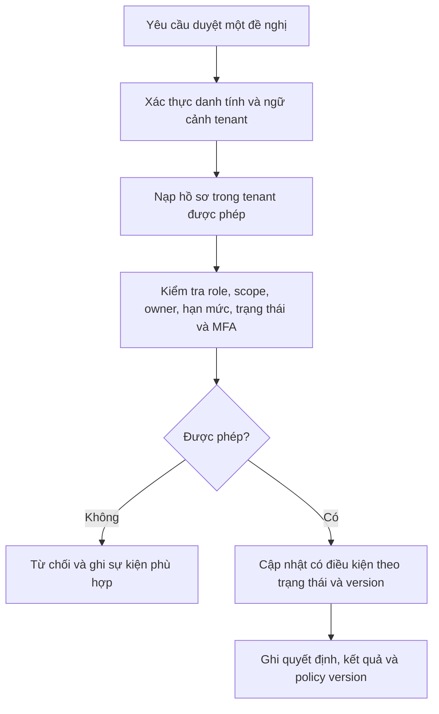

# Thiết kế authorization matrix

## 1. Mục tiêu của bài thực hành

Authorization matrix là ma trận mô tả chủ thể nào được thực hiện hành động nào trên tài nguyên nào, trong điều kiện nào. Kết quả cần đủ rõ để chủ nghiệp vụ xác nhận, lập trình viên triển khai và người kiểm thử viết được cả ca cho phép lẫn ca từ chối.

Một bảng có hàng là vai trò, cột là chức năng và dấu tích trong từng ô chỉ là điểm bắt đầu. Trong hệ thống IAM thực tế, cùng một vai trò có thể được xem hồ sơ của mình nhưng không được xem hồ sơ của đồng nghiệp; được duyệt trong một tenant nhưng không được duyệt ở tenant khác; được sửa bản nháp nhưng không được sửa tài liệu đã chốt.

Sau bài này, người học cần tạo được một bộ thiết kế gồm:

- Danh mục chủ thể, tài nguyên và hành động nghiệp vụ.
- Ma trận cấp quyền có điều kiện được định nghĩa chính xác.
- Các ràng buộc bắt buộc áp dụng cho mọi đường cấp quyền.
- Danh sách ca kiểm thử có kết quả mong đợi và tác dụng phụ mong đợi.
- Cách quản lý phiên bản, thay đổi vai trò và thu hồi quyền.

Bối cảnh xuyên suốt là một ứng dụng quản lý đề nghị hoàn phí nhiều tenant. Đây là thiết kế minh họa do bài học xây dựng; tên vai trò, ngưỡng tiền và thời hạn bên dưới là quyết định của tình huống thực hành, không phải quy định chung cho mọi tổ chức.

## 2. Bài toán: hệ thống hoàn phí nhiều tenant

Ứng dụng phục vụ các công ty độc lập. Nhân viên lập đề nghị hoàn phí; quản lý duyệt theo đơn vị; bộ phận tài chính kiểm tra và chuyển thanh toán; kiểm toán viên đọc bằng chứng; quản trị tenant quản lý thành viên và vai trò. Một workload riêng gửi lệnh chi đến hệ thống thanh toán.

Mỗi đề nghị có các thuộc tính tối thiểu:

```text
Expense
  id
  tenantId
  ownerId
  approvalUnitId
  amount
  currency
  status: DRAFT | SUBMITTED | APPROVED | REJECTED | PAID
  approvedBy
  version
```

Danh tính người dùng và danh tính workload có cấu trúc khác nhau:

```text
Human subject
  subjectId
  identityType = HUMAN
  accountStatus
  activeTenantId
  tenantMemberships
  roleAssignments: role + tenant + scope + validity
  authenticationContext

Workload subject
  subjectId
  identityType = WORKLOAD
  workloadStatus
  authorizedTenantIds
  permissions
  credentialValidity
```

`activeTenantId` trong thiết kế này là ngữ cảnh tenant đã được máy chủ xác minh với membership còn hiệu lực. Giá trị tenant trong URL, header hoặc request body là đầu vào cần kiểm tra, không tự trở thành bằng chứng về quyền truy cập.

Các câu hỏi nghiệp vụ phải chốt trước khi điền ma trận:

1. Quản lý được duyệt nhân viên của đơn vị hiện tại hay đơn vị được gắn với hồ sơ lúc nộp?
2. Người tạo có được duyệt đề nghị của chính mình khi đồng thời có vai trò quản lý không?
3. Tài chính được sửa nội dung đề nghị hay chỉ được chuyển trạng thái thanh toán?
4. Quản trị tenant có được đọc mọi chứng từ không?
5. Quyền xuất dữ liệu hàng loạt có đi cùng quyền xem từng hồ sơ không?
6. Khi người dùng chuyển đơn vị, các quyền đối với hồ sơ đang chờ duyệt thay đổi thế nào?

Không để câu trả lời tồn tại dưới dạng suy đoán trong mã nguồn. Trong bài thực hành, `approvalUnitId` được chốt khi nộp; đổi đơn vị duyệt phải qua một thao tác tái phân công có kiểm soát ngoài phạm vi ma trận mẫu. Người có nhiều vai trò vẫn bị cấm tự duyệt. Quản trị tenant không mặc nhiên được đọc chứng từ.

## 3. Tách vai trò, quyền và phạm vi

### 3.1. Vai trò mô tả trách nhiệm

| Vai trò | Trách nhiệm | Điều không được suy diễn |
|---|---|---|
| `REQUESTER` | Tạo và theo dõi đề nghị của mình | Không có quyền xem đề nghị của mọi nhân viên |
| `MANAGER` | Xem và quyết định đề nghị trong đơn vị được giao | Không có quyền duyệt đề nghị do chính mình tạo |
| `FINANCE` | Kiểm tra hồ sơ đã duyệt và yêu cầu thanh toán | Không được tự đổi nội dung hồ sơ hoặc bỏ qua bước duyệt |
| `AUDITOR` | Đọc hồ sơ và bằng chứng phục vụ kiểm toán | Không được sửa, duyệt hay thanh toán |
| `TENANT_ADMIN` | Quản trị membership và phân công vai trò theo quy trình | Không tự động có các quyền nghiệp vụ của bốn vai trò trên |
| `PAYMENT_WORKLOAD` | Thực thi lệnh chi hợp lệ bằng danh tính máy | Không được đăng nhập như người dùng hoặc cấp quyền IAM |

Một người có thể nhận nhiều vai trò nếu tổ chức cho phép. Tuy nhiên, vai trò không tạo thành một thang quyền mặc định. Không thiết kế quan hệ kế thừa `TENANT_ADMIN > FINANCE > MANAGER > REQUESTER` chỉ vì tên nghe có vẻ cao hơn.

### 3.2. Quyền dùng từ vựng ổn định

Đặt tên quyền theo tài nguyên và hành động nghiệp vụ:

```text
expense:create
expense:read
expense:update-draft
expense:submit
expense:approve
expense:reject
expense:export
payment:request
payment:execute
membership:read
membership:manage
role-assignment:request
role-assignment:approve
role-assignment:revoke
audit-event:read
```

Không dùng một quyền `expense:write` cho mọi việc sửa, duyệt và thanh toán. Các hành động này có điều kiện, người chịu trách nhiệm và mức rủi ro khác nhau. Cũng không dùng quyền `admin` làm ngoại lệ cho mọi kiểm tra.

Endpoint là nơi một hành động được gọi, không phải toàn bộ ý nghĩa của quyền. `POST /expenses/{id}/approve` và một consumer xử lý thông điệp duyệt đều phải tuân theo cùng quy tắc `expense:approve`.

### 3.3. Phạm vi là một phần của phân công vai trò

Ví dụ các phân công:

```text
alice -> REQUESTER, tenant=T-A
bob   -> MANAGER, tenant=T-A, approvalUnits=[U-10], limit=50_000_000 VND
carol -> FINANCE, tenant=T-A
sam   -> TENANT_ADMIN, tenant=T-A
svc-pay-a -> PAYMENT_WORKLOAD, tenants=[T-A], permissions=[payment:execute]
```

Nếu Bob còn là quản lý tại `T-B`, đó là một phân công khác với scope và thời hạn riêng. Quyền tại `T-A` không được dùng để xử lý hồ sơ của `T-B`.

Trong ví dụ, mọi đề nghị cần duyệt đều dùng VND. Nếu hỗ trợ nhiều loại tiền, phải định nghĩa cách so sánh hạn mức, nguồn tỷ giá và thời điểm chốt tỷ giá. Không so sánh hai con số khác đơn vị tiền tệ như thể chúng tương đương.

## 4. Định nghĩa điều kiện trước khi lập bảng

Dùng ký hiệu ngắn trong ma trận, nhưng mỗi ký hiệu phải có nội dung đầy đủ. Một ô `ALLOW IF OWNER` vô nghĩa nếu chưa thống nhất ai là owner và dữ liệu đó lấy từ đâu.

### 4.1. Điều kiện chung

| Mã | Ý nghĩa trong tình huống thực hành |
|---|---|
| `H` | Danh tính người đã được xác thực; tài khoản hoạt động; membership tenant và phân công vai trò còn hiệu lực |
| `W` | Danh tính workload đã được xác thực; workload và credential còn hiệu lực; đúng audience hoặc đích sử dụng theo cơ chế xác thực đã chọn |
| `T` | Tenant của tài nguyên bằng tenant đang được máy chủ xác minh; vai trò/quyền áp dụng cho chính tenant đó |
| `O` | `subjectId == expense.ownerId`; owner được đọc từ bản ghi tin cậy |
| `U` | `expense.approvalUnitId` nằm trong scope đơn vị của phân công quản lý đang có hiệu lực |
| `N` | `subjectId != expense.ownerId`; cấm tự quyết định đề nghị của mình |
| `L` | Số tiền và tiền tệ của hồ sơ nằm trong hạn mức duyệt được cấp |
| `F` | Có bằng chứng xác thực tăng cường đáp ứng yêu cầu của hành động nhạy cảm |
| `X` | Có quyền xuất dữ liệu riêng, mục đích đã được chấp thuận và giới hạn xuất phù hợp |

`T` với workload được đánh giá qua tenant của lệnh chi và tập tenant workload được cấp phép, không qua membership dành cho người dùng. Ký hiệu giống nhau mô tả cùng ranh giới tenant, nhưng nguồn thuộc tính khác nhau theo loại danh tính.

Trong thiết kế mẫu, `F` yêu cầu một phương thức MFA được hệ thống chấp nhận và bằng chứng về lần xác thực đáp ứng yêu cầu đó trong 10 phút gần nhất. Không dùng thời điểm phát hành token thay cho thời điểm người dùng thực sự hoàn tất xác thực tăng cường; refresh token có thể tạo access token mới mà không có lần MFA mới.

### 4.2. Điều kiện theo trạng thái nghiệp vụ

| Mã | Điều kiện |
|---|---|
| `DRAFT` | Hồ sơ đang ở trạng thái bản nháp |
| `SUBMITTED` | Hồ sơ đã nộp và đang chờ quyết định |
| `APPROVED` | Hồ sơ đã được duyệt và chưa thanh toán |
| `SEALED` | Hồ sơ thuộc tập trạng thái được bảo toàn cho kiểm toán: `APPROVED`, `REJECTED`, `PAID` |
| `VALID_REQUEST` | Lệnh chi tham chiếu hồ sơ đã duyệt, đúng số tiền/người nhận và chưa có thanh toán thành công |
| `GOVERNED` | Phân công vai trò thỏa quy trình phê duyệt, phạm vi ủy quyền và ràng buộc chống tự nâng quyền |

Các điều kiện kết hợp trong một ô theo phép AND, trừ khi viết rõ OR. `O ∨ (U ∧ N)` khác với `(O ∨ U) ∧ N`. Chỉ một dấu ngoặc sai cũng có thể làm người tạo mất quyền đọc hồ sơ hoặc làm người quản lý tự duyệt được.

## 5. Ma trận quyền nghiệp vụ

Trong bảng dưới, `—` nghĩa là vai trò đó không cung cấp một đường cấp quyền cho hành động. Đây không phải một luật từ chối riêng có thể vô tình vô hiệu hóa vai trò khác. Các ràng buộc bắt buộc ở phần sau mới là điều kiện chặn trên mọi đường cấp quyền.

Mọi ô cho phép của người dùng đều yêu cầu thêm `H ∧ T`. Tạo tài nguyên chưa có tenant trên bản ghi thì máy chủ gán tenant và owner từ ngữ cảnh đã xác minh; không lấy trực tiếp hai giá trị đó từ request body.

| Hành động | REQUESTER | MANAGER | FINANCE | AUDITOR | TENANT_ADMIN |
|---|---|---|---|---|---|
| `expense:create` | Cho phép | — | — | — | — |
| `expense:read` | `O` | `U` | `APPROVED ∨ PAID` | `SEALED` | — |
| `expense:update-draft` | `O ∧ DRAFT` | — | — | — | — |
| `expense:submit` | `O ∧ DRAFT` | — | — | — | — |
| `expense:approve` | — | `U ∧ N ∧ L ∧ SUBMITTED ∧ F` | — | — | — |
| `expense:reject` | — | `U ∧ N ∧ SUBMITTED ∧ F` | — | — | — |
| `expense:export` | — | — | `(APPROVED ∨ PAID) ∧ X ∧ F` | `SEALED ∧ X ∧ F` | — |
| `payment:request` | — | — | `APPROVED ∧ F` | — | — |
| `membership:read` | — | — | — | — | Cho phép |
| `membership:manage` | — | — | — | — | `GOVERNED ∧ F` |
| `role-assignment:request` | — | — | — | — | `GOVERNED ∧ F` |
| `role-assignment:approve` | — | — | — | — | `GOVERNED ∧ F` |
| `role-assignment:revoke` | — | — | — | — | `GOVERNED ∧ F` |
| `audit-event:read` | — | — | — | Sự kiện nghiệp vụ thuộc tenant | Sự kiện quản trị danh tính thuộc tenant |

Đây là ma trận đã chọn cho bài thực hành, không phải đáp án duy nhất. Chẳng hạn, vai trò quản lý có thể đọc hồ sơ trong đơn vị kể cả hồ sơ do chính mình tạo, nhưng vẫn không được duyệt hoặc từ chối hồ sơ đó. Giới hạn đọc của tài chính và kiểm toán viên cũng phải được xác nhận theo nhu cầu thực tế, không suy ra từ tên vai trò.

Quyền xuất là quyền đối với một tập dữ liệu: từng bản ghi vẫn phải thỏa điều kiện đọc tương ứng. Có `expense:export` không có nghĩa được xuất bản nháp, hồ sơ tenant khác hoặc các trường đã bị che trong giao diện đọc.

Ma trận dành cho workload được tách riêng:

| Hành động | PAYMENT_WORKLOAD | Điều kiện bổ sung |
|---|---|---|
| `payment:execute` | `W ∧ T ∧ VALID_REQUEST` | Chỉ nhận lệnh từ kênh đã xác thực và quy trình được cấp phép |
| `expense:read` | — | Đầu vào thanh toán tối thiểu được cấp qua lệnh chi, không có API đọc tự do |
| `expense:approve` | — | Workload không được tạo ra điều kiện phê duyệt cho chính lệnh chi |
| Mọi thao tác IAM | — | Không quản lý người dùng, membership hoặc phân công vai trò |

Nếu workload cần thêm dữ liệu để thực thi, thiết kế một quyền đọc có scope rõ ràng hoặc mở rộng payload tin cậy; không giải quyết bằng cách cấp vai trò quản trị tenant cho workload.

## 6. Ràng buộc bắt buộc và cách kết hợp nhiều vai trò

### 6.1. Quy tắc quyết định

Một cách diễn đạt chính sách của bài thực hành:

```text
ALLOW khi và chỉ khi:
  dữ liệu đầu vào cần thiết hợp lệ, có nguồn tin cậy
  AND mọi ràng buộc bắt buộc đều đạt
  AND có ít nhất một đường cấp quyền phù hợp trong ma trận

Các trường hợp còn lại: DENY
```

Ví dụ Alice có cả `REQUESTER` lẫn `MANAGER`. Với đề nghị của Alice, đường quản lý không cho phép duyệt vì `N` sai. Không có đường requester nào cấp `expense:approve`, nên kết quả là từ chối. Không được viết một nhánh `if manager then allow` đặt trước kiểm tra tự duyệt.

Bài học chọn quy tắc “điều kiện chặn bắt buộc được đánh giá trước các đường cho phép”. Đây là lựa chọn thiết kế của ví dụ; khi dùng một policy engine, phải cấu hình cách kết hợp luật tương ứng thay vì giả định mọi engine đều xử lý như nhau.

OWASP khuyến nghị mặc định từ chối, kiểm tra quyền trên mọi yêu cầu và đánh giá quyền với đúng đối tượng được truy cập. Những nguyên tắc này là cơ sở cho các điều kiện chung ở đây. [OWASP Authorization Cheat Sheet](https://cheatsheetseries.owasp.org/cheatsheets/Authorization_Cheat_Sheet.html)

### 6.2. Không vượt ranh giới tenant

Người dùng có quyền tại tenant A gửi URL chứa ID hồ sơ tenant B phải bị từ chối, kể cả khi tên vai trò ở hai tenant giống nhau. Tài nguyên con như ảnh hóa đơn, tệp đính kèm và đường tải xuống cũng phải liên kết được về tenant và đối tượng cha để đánh giá quyền.

Không chỉ lọc tenant tại màn hình danh sách rồi bỏ kiểm tra ở endpoint chi tiết. Các đường xem trước tệp, xuất CSV, tải báo cáo, tìm kiếm, thống kê và xử lý tác vụ nền đều thuộc phạm vi thiết kế.

### 6.3. Không tự nâng quyền hoặc tự phê duyệt

`GOVERNED` cần được tách thành các luật có thể kiểm thử. Với mẫu này:

- Người yêu cầu cấp vai trò không được tự phê duyệt cùng yêu cầu.
- Người thụ hưởng không được là người phê duyệt phân công đó.
- Người phê duyệt phải có thẩm quyền đối với đúng loại vai trò và scope được yêu cầu.
- Yêu cầu cấp `TENANT_ADMIN` cần một quản trị viên đủ thẩm quyền khác phê duyệt; tình huống chỉ còn một quản trị viên phải dùng quy trình phục hồi riêng được xác định trước.
- Không được cấp scope hoặc hạn mức vượt quá thẩm quyền được ủy quyền.
- Thao tác membership không được dùng làm đường vòng để sửa role assignment, tạo danh tính thay thế trái phép hoặc chiếm quyền tài khoản khác.
- Thu hồi quản trị viên cuối cùng bị chặn trong luồng thông thường để tránh mất quyền quản trị tenant; xử lý ngoại lệ phải qua quy trình phục hồi riêng.

Không tạo một endpoint cập nhật người dùng nhận mọi trường từ JSON rồi cho phép sửa đồng thời tên hiển thị, tenant, vai trò và hạn mức. Quyền quản lý hồ sơ không tự bao hàm quyền quản lý các thuộc tính quyết định authorization.

### 6.4. Trạng thái nghiệp vụ và tính nguyên tử

Quyền `expense:approve` chỉ có hiệu lực trên hồ sơ đang `SUBMITTED`. Sau khi kiểm tra quyền, một giao dịch khác có thể thay đổi trạng thái hoặc số tiền trước khi ghi kết quả.

Cần ràng buộc cập nhật với phiên bản và trạng thái đã kiểm tra, chẳng hạn một cập nhật có điều kiện:

```sql
UPDATE expense
SET status = 'APPROVED',
    approved_by = :actor_id,
    version = version + 1
WHERE id = :expense_id
  AND tenant_id = :tenant_id
  AND status = 'SUBMITTED'
  AND version = :checked_version;
```

Câu SQL này chỉ minh họa bảo vệ chuyển trạng thái; nó không thay thế kiểm tra vai trò, scope đơn vị, hạn mức, MFA và cấm tự duyệt. Nếu số dòng cập nhật bằng 0, không được báo duyệt thành công; cần xử lý xung đột theo hợp đồng API.

Tương tự, `payment:execute` cần cơ chế chống thực thi trùng và liên kết lệnh chi với hồ sơ đã duyệt. Authorization trả lời “ai được yêu cầu”, còn tính nhất quán giao dịch và idempotency bảo vệ việc thực thi đúng một nghiệp vụ hợp lệ.

## 7. Từ ma trận tới điểm thực thi

Một quyết định authorization tối thiểu cần bốn nhóm dữ liệu:

```text
subject   = danh tính và phân công quyền có hiệu lực
resource  = đối tượng và thuộc tính do máy chủ nạp
action    = hành động được endpoint hoặc handler ánh xạ
context   = tenant đã xác minh, thời gian, bằng chứng xác thực
```

Luồng xử lý đề nghị duyệt:



Nếu dùng PDP riêng để ra quyết định và PEP tại service để thực thi, PEP vẫn phải chặn thao tác khi kết quả không cho phép. Đặt quyết định ngoài service không tự bảo đảm mọi endpoint và consumer đều gọi nó. [OWASP Authorization Patterns Cheat Sheet](https://cheatsheetseries.owasp.org/cheatsheets/Authorization_Patterns_Cheat_Sheet.html)

Đoạn Java giả lập sau minh họa một nhánh duyệt. Các kiểu `Subject`, `Expense`, `Context`, `Decision` và hàm tra role là ký hiệu mô tả thiết kế, không phải một thư viện hoàn chỉnh:

```java
Decision canApprove(Subject subject, Expense expense, Context context) {
    if (!subject.isActiveHuman()
            || !context.hasVerifiedTenantMembership()) {
        return Decision.deny("INACTIVE_OR_INVALID_SUBJECT");
    }

    if (!expense.tenantId().equals(context.verifiedTenantId())) {
        return Decision.deny("TENANT_MISMATCH");
    }

    if (subject.id().equals(expense.ownerId())) {
        return Decision.deny("SELF_APPROVAL_FORBIDDEN");
    }

    if (expense.status() != SUBMITTED) {
        return Decision.deny("INVALID_RESOURCE_STATE");
    }

    if (!context.hasRequiredRecentMfa()) {
        return Decision.deny("STEP_UP_REQUIRED");
    }

    boolean hasMatchingGrant = subject.activeManagerAssignments(
            context.verifiedTenantId(), context.now()).stream()
        .anyMatch(grant ->
            grant.approvalUnits().contains(expense.approvalUnitId())
            && grant.currency().equals(expense.currency())
            && expense.amount().compareTo(grant.limit()) <= 0);

    return hasMatchingGrant
        ? Decision.allow("MATCHING_MANAGER_GRANT")
        : Decision.deny("NO_MATCHING_GRANT");
}
```

Chú ý mỗi phân công phải tự thỏa cả scope đơn vị lẫn hạn mức. Không lấy scope từ phân công thứ nhất ghép với hạn mức cao của phân công thứ hai để tạo ra một quyền tổng hợp chưa được cấp. Mã trên vẫn cần được kết hợp với nạp dữ liệu tin cậy, bảo vệ giao dịch và các ràng buộc chung của hệ thống khi triển khai thực tế.

Khi từ chối, mã lý do nội bộ phục vụ chẩn đoán không nhất thiết được trả nguyên văn cho client. API cần có hợp đồng phản hồi nhất quán; nếu dùng `404` để che sự tồn tại tài nguyên ngoài scope, phải kiểm thử cả việc không rò dữ liệu qua nội dung, thời gian và endpoint phụ. Không coi việc trả `403` hay `404` là bằng chứng duy nhất rằng thao tác đã bị ngăn chặn.

## 8. Biểu diễn chính sách để người và máy cùng sử dụng

Ma trận cho người đọc cần được liên kết với quy tắc và test case có định danh ổn định. Có thể dùng một cấu trúc nội bộ như sau:

```yaml
policyVersion: expense-authz-1
ruleId: EXPENSE_APPROVE_MANAGER
subjectType: HUMAN
role: MANAGER
action: expense:approve
resourceType: Expense
effect: ALLOW
allOf:
  - account_and_membership_active
  - role_assignment_active_in_verified_tenant
  - resource_in_verified_tenant
  - approval_unit_in_same_assignment_scope
  - amount_within_same_assignment_limit
  - actor_is_not_owner
  - expense_is_submitted
  - required_recent_mfa
owner: expense-process-owner
testCases:
  - AP-01
  - AP-02
  - AP-03
  - AP-04
  - AP-05
  - AP-06
  - AP-07
  - AP-08
  - AP-09
```

Đây là schema minh họa, không phải cú pháp chuẩn của một policy engine. Các tên điều kiện phải liên kết với định nghĩa cụ thể, nguồn dữ liệu và cách xử lý khi thiếu dữ liệu. Một file YAML chứa chữ `ALLOW` không có tác dụng bảo vệ nếu service chưa nạp, kiểm tra và thực thi nó.

OWASP trình bày cách lưu ma trận ở định dạng máy có thể xử lý và sử dụng làm đầu vào cho kiểm thử tích hợp. Bài thực hành áp dụng ý tưởng đó với schema minh họa ở trên; không yêu cầu lựa chọn cùng định dạng hoặc cùng công cụ. [OWASP Authorization Testing Automation](https://cheatsheetseries.owasp.org/cheatsheets/Authorization_Testing_Automation.html)

Không để bộ kiểm thử chỉ gọi lại chính hàm policy rồi dùng kết quả của nó làm đáp án mong đợi. Kết quả mong đợi phải xuất phát từ quy tắc nghiệp vụ đã được phê duyệt; nếu không, lỗi trong policy có thể đồng thời làm sai cả thực thi lẫn test mà bộ test vẫn xanh.

## 9. Thiết kế dữ liệu và ca kiểm thử

### 9.1. Bộ dữ liệu tối thiểu

Tạo hai tenant `T-A`, `T-B`; hai đơn vị `U-10`, `U-20` trong `T-A`; người tạo Alice; người tạo khác là David; quản lý Bob chỉ có scope `U-10`; một người vừa là requester vừa là manager; tài chính Carol; kiểm toán viên; quản trị tenant Sam; và workload `svc-pay-a` chỉ được xử lý `T-A`.

Chuẩn bị các hồ sơ riêng cho từng ca để tránh kết quả phụ thuộc thứ tự chạy. Bao gồm bản nháp, hồ sơ chờ duyệt, hồ sơ vượt hạn mức, hồ sơ đã duyệt, hồ sơ đã thanh toán và hồ sơ thuộc tenant B. Dùng cùng một cách đặt ID khó đoán không thay thế cho việc thử ID ngoài scope.

### 9.2. Các ca cho phép và từ chối

| ID | Tình huống | Kết quả mong đợi |
|---|---|---|
| AP-01 | Bob duyệt hồ sơ của Alice, đúng tenant, đúng đơn vị, dưới hạn mức, `SUBMITTED`, MFA mới | Cho phép; chuyển sang `APPROVED` đúng một lần |
| AP-02 | Như AP-01 nhưng hồ sơ ở `T-B` | Từ chối; không đọc lộ nội dung hoặc đổi trạng thái |
| AP-03 | Như AP-01 nhưng `approvalUnitId = U-20` | Từ chối do ngoài scope quản lý |
| AP-04 | Người vừa có REQUESTER vừa có MANAGER tự duyệt hồ sơ của mình | Từ chối dù phân công quản lý còn hiệu lực |
| AP-05 | Bob duyệt số tiền cao hơn hạn mức một đơn vị tiền nhỏ nhất | Từ chối; kiểm thêm ca bằng đúng hạn mức được phép |
| AP-06 | Bob duyệt hồ sơ đã `PAID` | Từ chối; không tạo quyết định duyệt mới |
| AP-07 | Bob có access token mới nhưng bằng chứng MFA quá hạn | Không thực hiện duyệt; yêu cầu hoàn tất step-up theo luồng ứng dụng |
| AP-08 | Role MANAGER đã bị thu hồi nhưng token cũ vẫn chứa role | Từ chối sau thời hạn hiệu lực thu hồi đã cam kết |
| AP-09 | Hai phân công khác nhau có scope và hạn mức không cùng phù hợp | Từ chối; không ghép thuộc tính để tạo quyền mới |
| RD-01 | Alice đọc hồ sơ của David trong cùng tenant | Từ chối nếu không có đường cấp quyền khác |
| RD-02 | Sam chỉ có TENANT_ADMIN đọc chứng từ hoàn phí | Từ chối vì quản trị IAM không cấp quyền đọc nghiệp vụ |
| EX-01 | Carol có quyền xem nhưng chưa có quyền xuất riêng | Từ chối xuất, vẫn cho xem bản ghi hợp lệ |
| EX-02 | Kiểm toán viên xuất hồ sơ `SEALED`, có X và MFA hợp lệ | Chỉ xuất bản ghi/trường thuộc scope đã cấp |
| IAM-01 | Sam yêu cầu rồi tự phê duyệt cấp FINANCE cho chính mình | Từ chối; không sinh role assignment hiệu lực |
| IAM-02 | Quản trị viên sửa role qua endpoint cập nhật hồ sơ thành viên | Từ chối trường không thuộc quyền của endpoint |
| WL-01 | `svc-pay-a` thực thi lệnh hợp lệ của `T-A` | Cho phép, ghi nhận kết quả và bảo vệ thực thi trùng |
| WL-02 | `svc-pay-a` nhận lệnh cùng cấu trúc nhưng của `T-B` | Từ chối do ngoài tenant được cấp phép |
| WL-03 | Workload gọi thao tác phê duyệt hoặc cấp vai trò | Từ chối vì không có đường cấp quyền |
| RC-01 | Hồ sơ thay đổi version sau khi kiểm tra quyền | Không ghi thành công trên dữ liệu cũ; trả kết quả xung đột phù hợp |

Với mỗi ca từ chối, kiểm tra cả phản hồi và trạng thái sau yêu cầu: bản ghi không bị sửa, không có tệp xuất được tạo, không phát thông điệp thanh toán, không cấp role assignment và không tạo URL tải xuống dùng được. Một handler trả lỗi sau khi đã phát sự kiện vẫn vi phạm mục tiêu kiểm soát quyền.

### 9.3. Kiểm thử các đường truy cập khác nhau

Một hành động có thể có nhiều đường gọi: REST, GraphQL, batch import, tác vụ nền hoặc công cụ quản trị. Lập bảng ánh xạ từ từng đường gọi sang action và điểm thực thi, rồi kiểm thử những đường thực sự tồn tại trong hệ thống.

Đối với danh sách, tìm kiếm và thống kê, kiểm tra lọc trước phân trang và không để tổng số lượng, facet hoặc dữ liệu tổng hợp lộ thông tin ngoài scope. Đối với export bất đồng bộ, kiểm tra quyền khi tạo job và quyền tải kết quả; xác định rõ việc thu hồi quyền trong lúc job đang chạy có hủy job hoặc chặn tải hay không.

Không cần nhân mọi chiều thành một tích Descartes quá lớn. Bắt đầu bằng một ca hợp lệ cho mỗi đường cho phép, rồi thay đổi lần lượt từng điều kiện bắt buộc để chứng minh nó có tác dụng. Bổ sung các tổ hợp dễ gây lỗi như nhiều vai trò, nhiều phân công scope, chuyển tenant và thay đổi trạng thái đồng thời.

## 10. Vòng đời quyền và dữ liệu quyết định

Ma trận mô tả chính sách; role assignment, membership, quan hệ quản lý và trạng thái tài khoản là dữ liệu thay đổi theo thời gian. Một thiết kế chỉ đúng tại thời điểm đăng nhập là chưa đủ.

Cần xác định nguồn chuẩn và thời điểm cập nhật cho từng thuộc tính:

| Thuộc tính | Nguồn tin cậy trong ví dụ | Thay đổi cần xử lý |
|---|---|---|
| Trạng thái tài khoản | Dịch vụ danh tính | Khóa hoặc nghỉ việc |
| Membership tenant | Kho membership của ứng dụng | Rời tenant, đình chỉ membership |
| Role và scope | Kho phân công quyền | Cấp mới, hết hạn, thu hồi, đổi hạn mức |
| Owner và tenant tài nguyên | Kho nghiệp vụ | Tạo tài nguyên; chuyển ownership chỉ qua nghiệp vụ cho phép |
| Đơn vị duyệt đã chốt | Bản ghi đề nghị | Tái phân công có kiểm soát |
| Bằng chứng MFA | Kết quả xác thực đã được kiểm chứng | Hết thời hạn xác thực tăng cường |
| Trạng thái và version hồ sơ | Kho nghiệp vụ | Nộp, duyệt, thanh toán, xung đột đồng thời |

Nếu cache quyết định cho phép, khóa cache phải phản ánh đầy đủ các đầu vào liên quan; cache theo mỗi `userId + role` sẽ không phân biệt tenant, action, đối tượng và trạng thái. TTL và invalidation cần phù hợp với yêu cầu thu hồi. Không tuyên bố thu hồi tức thời nếu hệ thống vẫn chấp nhận token hoặc cache cũ trong một khoảng thời gian.

Đối với bài thực hành, nhóm phải tự công bố một cam kết cụ thể, ví dụ mọi service ngừng chấp nhận role đã thu hồi trong tối đa 60 giây. Sau đó kiểm thử thời gian thực tế từ lúc thu hồi đến lần từ chối đầu tiên. Con số này là yêu cầu thiết kế mẫu, không phải mặc định mà mọi hệ thống IAM đều đáp ứng.

Không ghi token, secret, ảnh chứng từ hoặc nội dung nhạy cảm vào audit log. Bản ghi quyết định có thể gồm thời gian, actor, loại danh tính, tenant, action, resource ID phù hợp, kết quả, reason code, policy version và correlation ID. Quyền đọc log cũng cần scope; một audit API rộng có thể trở thành đường vòng để đọc dữ liệu đã bị chặn ở API nghiệp vụ.

## 11. Quản lý thay đổi ma trận

Mỗi thay đổi quyền cần được xem như một thay đổi hành vi của hệ thống. Phiên bản ma trận nên đi cùng phiên bản policy, danh sách endpoint/handler bị ảnh hưởng và test case liên quan.

Ví dụ yêu cầu mới: “Quản lý được xuất mọi hồ sơ trong đơn vị”. Trước khi thêm dấu cho phép, cần chốt tập trạng thái được xuất, trường dữ liệu nào được che, giới hạn số lượng, yêu cầu xác thực tăng cường, quyền tải kết quả và cách xử lý người quản lý mất scope trong lúc export đang chạy.

Quy trình gợi ý cho nhóm thực hành:

1. Chủ nghiệp vụ nêu nhu cầu và giải thích phạm vi dữ liệu cần thiết.
2. Nhóm cập nhật ô ma trận, điều kiện và các ràng buộc liên quan.
3. Người chịu trách nhiệm dữ liệu và an ninh xem xét đúng phần thay đổi.
4. Lập trình viên cập nhật policy cùng các điểm thực thi bị ảnh hưởng.
5. Kiểm thử thêm ca cho phép, ca vượt phạm vi và ca thu hồi.
6. Triển khai theo phiên bản, theo dõi từ chối bất thường và có kế hoạch quay lui.

Khi thêm một action mới, giữ mặc định từ chối cho đến khi có đường cấp quyền đã xác nhận. Không tự gán action mới cho tất cả vai trò hiện hữu để tránh làm gián đoạn bản phát hành.

## 12. Bài tập và tiêu chí hoàn thành

Hãy mở rộng thiết kế với một vai trò `DELEGATE_MANAGER`: được duyệt thay trong một đơn vị, trong thời gian hữu hạn, với hạn mức không cao hơn người ủy quyền. Người được ủy quyền vẫn không được duyệt hồ sơ của chính mình. Việc thu hồi ủy quyền phải có hiệu lực theo thời hạn mà nhóm công bố.

Sản phẩm cần nộp gồm một ma trận cập nhật, định nghĩa scope và điều kiện, ba ví dụ được phép, ít nhất sáu ví dụ bị từ chối, cùng giải thích cách tránh ghép scope của ủy quyền này với hạn mức của ủy quyền khác. Có thêm một ca thời gian hết hạn chính xác tại biên và một ca ủy quyền được thu hồi khi người nhận vẫn còn phiên đăng nhập.

Thiết kế đạt yêu cầu khi một người ngoài nhóm có thể trả lời nhất quán các câu hỏi sau từ tài liệu:

- Ai được làm gì, trên đối tượng và tenant nào?
- Những thuộc tính nào quyết định quyền và lấy từ nguồn nào?
- Nhiều vai trò hoặc nhiều phân công được kết hợp như thế nào?
- Luật cấm tự duyệt và tự nâng quyền có thể bị đường cấp quyền nào bỏ qua không?
- Danh sách, tệp đính kèm, export, tác vụ nền và workload được kiểm soát ở đâu?
- Sau khi thu hồi quyền, trong bao lâu các yêu cầu sẽ bị từ chối?
- Ca kiểm thử nào chứng minh từng điều kiện và kiểm tra cả tác dụng phụ?

Authorization matrix tốt không được đánh giá bằng số lượng dấu tích. Nó được đánh giá bằng việc mỗi đường cho phép có lý do nghiệp vụ, phạm vi rõ ràng, điểm thực thi xác định và bằng chứng kiểm thử; còn mọi trường hợp ngoài các đường đó đều có kết quả từ chối nhất quán.
