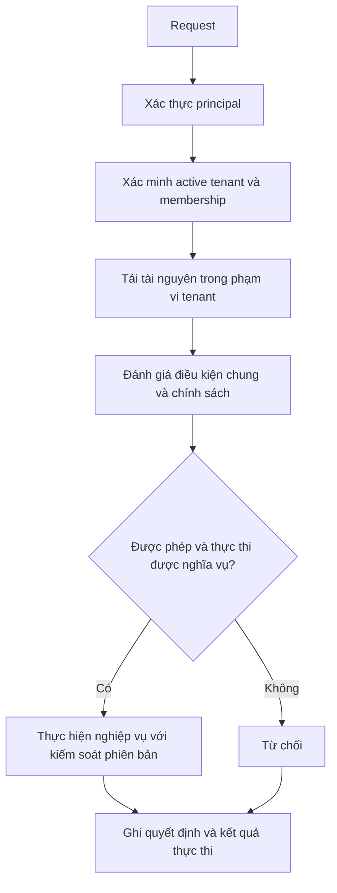

# Thiết kế ABAC theo tenant

Trong hệ thống SaaS nhiều tenant, cùng một người có thể làm việc cho nhiều tổ chức với quyền khác nhau. Câu hỏi cần trả lời cho mỗi yêu cầu là: **chủ thể này, trong tenant đang hoạt động, có được thực hiện hành động này trên tài nguyên này với các điều kiện hiện tại hay không?**

ABAC (Attribute-Based Access Control) đánh giá quyền từ thuộc tính của chủ thể, tài nguyên, hành động và môi trường. Đây là mô hình khái niệm được mô tả trong [NIST SP 800-162](https://csrc.nist.gov/pubs/sp/800/162/upd2/final). Bài thực hành dưới đây tự xây dựng một thiết kế cụ thể cho ứng dụng quản lý hóa đơn; các vai trò, ngưỡng tiền và thời hạn MFA là quyết định của tình huống, không phải ngưỡng do NIST quy định.

## 1. Đề bài và kết quả cần bàn giao

Bạn thiết kế lớp phân quyền cho dịch vụ **LedgerCloud**, nơi mỗi công ty là một tenant. Tenant `alpha` và `beta` cùng dùng một ứng dụng, nhưng sở hữu hóa đơn, thành viên và cấu hình riêng.

Một người dùng có thể đồng thời là `ANALYST` ở Alpha và `VIEWER` ở Beta. Chuyển tenant không làm thay đổi danh tính người đó, nhưng phải thay đổi tập quyền được áp dụng. Tài khoản dịch vụ xuất báo cáo cũng phải có danh tính, tenant và quyền riêng.

Phạm vi bài tập gồm bốn hành động:

| Hành động | Yêu cầu nghiệp vụ của bài tập |
| --- | --- |
| `invoice.read` | Thành viên đang hoạt động có vai trò được phép xem và đủ mức truy cập dữ liệu |
| `invoice.edit` | `ANALYST` sửa hóa đơn nháp do chính mình tạo |
| `invoice.approve` | `APPROVER` duyệt hóa đơn đã gửi, không phải người tạo, trong hạn mức được giao, có MFA gần đây |
| `invoice.export` | Có quyền `EXPORTER`, đáp ứng điều kiện dữ liệu và nghĩa vụ của chức năng xuất |

Các điều kiện chung áp dụng cho cả bốn hành động: chủ thể hợp lệ, tài khoản và tư cách thành viên còn hoạt động, tenant của tài nguyên đúng với tenant đã được xác minh, hành động được hỗ trợ và các thuộc tính bắt buộc có giá trị hợp lệ.

Bộ bàn giao cần có mô hình thuộc tính, chính sách quyết định quyền, vị trí thực thi trong ứng dụng, thiết kế truy vấn và cập nhật dữ liệu, ma trận kiểm thử, cùng một ví dụ audit event. Mục tiêu là chứng minh được cả trường hợp được phép và các đường truy cập bị từ chối.

## 2. Tách danh tính, tư cách thành viên và tenant đang hoạt động

Một thiết kế dễ sai là đặt một `role=ADMIN` vào người dùng rồi áp dụng vai trò đó ở mọi nơi. Thay vào đó, cần phân biệt ba đối tượng:

- **Principal:** người dùng hoặc workload đã được xác thực.
- **Membership:** quan hệ của principal với một tenant, chứa trạng thái, vai trò và thuộc tính quyền tại tenant đó.
- **Active tenant:** tenant được chọn và đã được máy chủ xác minh cho yêu cầu hiện tại.

Ví dụ minh họa:

```json
{
  "principal": {
    "issuer": "https://identity.example.test",
    "subject": "user-42",
    "enabled": true
  },
  "memberships": [
    {
      "tenantId": "alpha",
      "status": "ACTIVE",
      "roles": ["ANALYST"],
      "clearance": "CONFIDENTIAL"
    },
    {
      "tenantId": "beta",
      "status": "ACTIVE",
      "roles": ["VIEWER"],
      "clearance": "INTERNAL"
    }
  ]
}
```

Khi yêu cầu đang chạy trong Beta, chỉ membership của Beta được đưa vào quyết định. Không hợp nhất vai trò của Alpha và Beta thành một tập chung. Nếu hệ thống nhận danh tính từ nhiều issuer, cần ánh xạ cặp `issuer + subject` đã xác minh sang định danh nội bộ, thay vì giả định `subject` luôn duy nhất toàn hệ thống.

Tenant trong đường dẫn, hostname hoặc header là đầu vào dùng để chọn ngữ cảnh. Máy chủ phải đối chiếu đầu vào đó với membership hoặc phạm vi được cấp cho workload. Một header `X-Tenant-ID: alpha` tự nó chưa chứng minh người gọi có quyền ở Alpha.

Nguyên tắc gắn tenant với danh tính và quyền được máy chủ xác minh, kiểm soát truy cập theo từng đối tượng và áp dụng phạm vi tenant trên các đường truy cập là những điểm được nêu trong [OWASP Multi Tenant Security Cheat Sheet](https://cheatsheetseries.owasp.org/cheatsheets/Multi_Tenant_Security_Cheat_Sheet.html). Các mục tiếp theo triển khai nguyên tắc đó thành thiết kế riêng cho bài tập LedgerCloud.

## 3. Xây dựng từ điển thuộc tính và nguồn tin cậy

ABAC chỉ đáng tin khi thuộc tính đầu vào đáng tin. Trước khi viết điều kiện `allow`, hãy xác định ai tạo, ai được sửa và khi nào cần làm mới từng thuộc tính.

| Nhóm | Thuộc tính | Nguồn có thẩm quyền trong bài tập | Lưu ý |
| --- | --- | --- | --- |
| Chủ thể | `principalId`, `principalType`, `enabled` | Lớp xác thực và kho danh tính nội bộ | Không lấy từ JSON do client gửi |
| Membership | `tenantId`, `status`, `roles` | Kho thành viên theo tenant | Chỉ dùng membership của active tenant |
| Membership | `clearance`, `approvalLimitVnd` | Quy trình cấp quyền đã phê duyệt | Người dùng không tự nâng thuộc tính |
| Tài nguyên | `tenantId`, `createdBy`, `state` | Bản ghi hóa đơn trong kho dữ liệu | Không tin bản sao do client gửi |
| Tài nguyên | `classification`, `amountVnd`, `version` | Kho dữ liệu và nghiệp vụ hóa đơn | Dữ liệu ảnh hưởng quyết định phải được bảo vệ |
| Hành động | `invoice.read/edit/approve/export` | Ánh xạ tại service hoặc endpoint | Không nhận tùy ý một chuỗi “action” từ client |
| Môi trường | `now`, `mfaAuthenticatedAt` | Đồng hồ máy chủ và ngữ cảnh xác thực được xác minh | Không dùng giờ hay cờ MFA trong request body |
| Chính sách | `policyVersion`, `membershipVersion` | Kho chính sách, kho cấp quyền | Dùng để truy vết và kiểm soát dữ liệu cũ |

Trong bài tập, phân loại dữ liệu có đúng hai mức theo thứ tự:

```text
INTERNAL < CONFIDENTIAL
```

Đây là thứ tự do ứng dụng định nghĩa. Không so sánh chuỗi theo bảng chữ cái để suy ra độ nhạy. Giá trị lạ như `TOP_SECRET`, giá trị thiếu hoặc sai kiểu phải bị từ chối tại bước chuẩn hóa thuộc tính.

Tiền được biểu diễn bằng số nguyên VND không âm. Hạn mức của approver cũng theo cùng đơn vị. Nếu mở rộng nhiều loại tiền, phải thiết kế quy tắc quy đổi và thời điểm áp dụng trước khi so sánh; không so sánh trực tiếp các số tiền khác đơn vị.

Các thuộc tính phục vụ phân quyền không phải dữ liệu hồ sơ tùy ý. Chẳng hạn, cho người dùng sửa `clearance` trong màn hình cập nhật profile sẽ biến một chính sách chặt chẽ thành cơ chế tự cấp quyền.

## 4. Xác định các điều kiện không được phép vượt qua

Thiết kế chia quyết định thành điều kiện bắt buộc và quy tắc nghiệp vụ. Một vai trò có quyền nghiệp vụ rộng vẫn phải vượt qua điều kiện bắt buộc.

Đối với một tài nguyên thuộc tenant, cần giữ bất biến:

```text
verifiedActiveTenant == activeMembership.tenantId
verifiedActiveTenant == resource.tenantId
principal.enabled == true
activeMembership.status == ACTIVE
```

Việc hai chuỗi tenant bằng nhau chưa đủ. Membership phải thực sự thuộc principal hiện tại, còn tài nguyên phải được tải từ nguồn có thẩm quyền. Client không được gửi cả `principal.tenantId` và `resource.tenantId` để máy chủ chỉ so sánh hai giá trị do cùng client tự khai.

Thiết kế của bài tập dùng các quy tắc kết hợp sau:

1. Thiếu, sai kiểu, không nhận diện được thuộc tính bắt buộc hoặc không lấy được dữ liệu quyền cần thiết: từ chối.
2. Vi phạm điều kiện cách ly tenant hoặc trạng thái chủ thể: từ chối trước khi xét vai trò.
3. Có điều kiện cấm cụ thể của hành động: từ chối.
4. Có ít nhất một quy tắc cho phép phù hợp và mọi nghĩa vụ bắt buộc có thể thực thi: cho phép.
5. Các trường hợp còn lại: từ chối mặc định.

Đây là semantics được chọn cho bài tập. Khi dùng một policy engine cụ thể, cần ánh xạ rõ kết quả `Permit`, `Deny`, `NotApplicable`, `Indeterminate` và thuật toán kết hợp của engine. Không giả định mọi engine tự có cùng quy tắc ưu tiên.

## 5. Viết chính sách nghiệp vụ

### 5.1. Đọc và sửa hóa đơn

Trong LedgerCloud, các vai trò `VIEWER`, `ANALYST`, `APPROVER`, `EXPORTER`, `TENANT_ADMIN` được xem hóa đơn nếu đã vượt qua điều kiện chung và đủ clearance. Quyền xem không tự kéo theo quyền sửa, duyệt hoặc xuất.

Một analyst chỉ được sửa hóa đơn do chính mình tạo, khi hóa đơn còn ở trạng thái `DRAFT`. Các trường được sửa là những trường nghiệp vụ đã định nghĩa; không cho client sửa trực tiếp `tenantId`, `createdBy`, `classification`, `approvedBy` hoặc `version` qua cập nhật đại trà.

Nếu cần thay đổi phân loại dữ liệu, hãy thiết kế một hành động riêng như `invoice.reclassify` với quyền và kiểm toán riêng. Không dùng quyền sửa nội dung làm quyền hạ độ nhạy.

### 5.2. Duyệt hóa đơn

Một lần duyệt cần đồng thời đáp ứng:

- Có vai trò `APPROVER` trong tenant hiện tại.
- Hóa đơn đang `SUBMITTED`.
- Người duyệt khác người tạo.
- Số tiền không vượt `approvalLimitVnd` của người duyệt tại tenant đó.
- Người duyệt có MFA được xác minh trong 600 giây gần nhất.

Khoảng 600 giây là lựa chọn của bài tập. Điều kiện tuổi MFA cần kiểm tra cả hai vế `0 <= now - mfaAuthenticatedAt <= 600 giây`; một thời điểm trong tương lai không được làm yêu cầu tự vượt kiểm tra. Nếu có chính sách dung sai đồng hồ, phải định nghĩa dung sai cụ thể.

`createdBy` trong bài tập là principal nội bộ được máy chủ ghi khi tạo hóa đơn. Với hệ thống có ủy quyền hoặc người thao tác thay mặt người khác, cần mở rộng mô hình actor/delegation để điều kiện “khác người tạo” phản ánh đúng quy tắc tách nhiệm vụ.

### 5.3. Xuất và xử lý dữ liệu nhạy cảm

Vai trò `EXPORTER` mới có quyền xuất. Với dữ liệu `CONFIDENTIAL`, bài tập còn yêu cầu MFA gần đây cho các hành động đọc, sửa và xuất; hành động duyệt đã luôn yêu cầu MFA.

Quyết định xuất có thể kèm nghĩa vụ: che trường tài khoản thanh toán, gắn tenant vào manifest kết quả và đặt thời hạn tải tệp. Nếu trình xuất không thực thi được một nghĩa vụ bắt buộc, yêu cầu xuất phải thất bại.

Quyền export toàn bộ không được suy ra từ quyền đọc một hóa đơn. Xuất có thể làm tăng đáng kể lượng dữ liệu bị lấy ra trong một lần thao tác, nên có quyền, hạn mức khối lượng và dấu vết riêng.

### 5.4. Giới hạn của tenant administrator

`TENANT_ADMIN` quản lý thành viên trong phạm vi tenant theo một chính sách quản trị riêng. Trong thiết kế này, vai trò đó được đọc dữ liệu nếu đủ clearance, nhưng không tự động được duyệt hoặc xuất.

Quy trình cấp `APPROVER`, tăng hạn mức hoặc cấp `EXPORTER` cần một chủ thể có thẩm quyền riêng. Tenant admin không được tự cấp cho mình các thuộc tính vượt phạm vi được nền tảng cho phép. Nếu không bảo vệ đường quản trị thuộc tính, các điều kiện trên hóa đơn có thể bị vô hiệu hóa từ phía quản trị.

## 6. Biểu diễn thuật toán quyết định

Đoạn dưới là **mã giả**, không phải cú pháp chạy trực tiếp của một policy engine. Các đối tượng đầu vào đã được máy chủ xác minh và chuẩn hóa.

```text
evaluate(principal, membership, resource, action, environment):

    if required_attributes_invalid():
        return DENY("INVALID_ATTRIBUTES")

    if principal.enabled != true:
        return DENY("PRINCIPAL_DISABLED")

    if membership.principalId != principal.id:
        return DENY("MEMBERSHIP_SUBJECT_MISMATCH")

    if membership.status != ACTIVE:
        return DENY("MEMBERSHIP_INACTIVE")

    if membership.tenantId != environment.verifiedActiveTenant:
        return DENY("TENANT_CONTEXT_MISMATCH")

    if resource.tenantId != environment.verifiedActiveTenant:
        return DENY("RESOURCE_TENANT_MISMATCH")

    if action not in supportedInvoiceActions:
        return DENY("UNSUPPORTED_ACTION")

    if rank(membership.clearance) < rank(resource.classification):
        return DENY("INSUFFICIENT_CLEARANCE")

    recentMfa =
        environment.mfaAuthenticatedAt exists
        and 0 <= environment.now - environment.mfaAuthenticatedAt <= 600s

    if resource.classification == CONFIDENTIAL and not recentMfa:
        return DENY("RECENT_MFA_REQUIRED")

    if action == invoice.read:
        if membership.roles intersects invoiceReaderRoles:
            return PERMIT()
        return DENY("READ_NOT_GRANTED")

    if action == invoice.edit:
        if ANALYST in membership.roles
           and resource.state == DRAFT
           and resource.createdBy == principal.id:
            return PERMIT(onlyEditableBusinessFields)
        return DENY("EDIT_NOT_GRANTED")

    if action == invoice.approve:
        if APPROVER in membership.roles
           and resource.state == SUBMITTED
           and resource.createdBy != principal.id
           and resource.amountVnd <= membership.approvalLimitVnd
           and recentMfa:
            return PERMIT()
        return DENY("APPROVAL_NOT_GRANTED")

    if action == invoice.export:
        if EXPORTER in membership.roles:
            return PERMIT(maskPaymentAccount, tenantBoundDownload)
        return DENY("EXPORT_NOT_GRANTED")

    return DENY("NO_APPLICABLE_RULE")
```

`invoiceReaderRoles` là tập vai trò đọc đã liệt kê ở mục 5.1. `required_attributes_invalid()` kiểm tra thuộc tính theo hành động: ví dụ duyệt cần số tiền và hạn mức hợp lệ; đọc không cần một hạn mức duyệt không liên quan.

Một kết quả `PERMIT` chỉ có giá trị cho đúng subject, tenant, resource, action và dữ liệu đầu vào của lần đánh giá đó. Nó không phải một giấy phép chung cho mọi thao tác tiếp theo trong cùng request.

Mã lý do hỗ trợ kiểm thử và audit nội bộ. Phản hồi cho client có thể cần thống nhất để hạn chế lộ thông tin về tài nguyên tenant khác; không trả toàn bộ thuộc tính quyền và chi tiết quyết định ra ngoài.

## 7. Đặt điểm thực thi trên đường truy cập dữ liệu

Có thể tách các thành phần theo trách nhiệm:

- **PEP:** điểm chặn và thực thi quyết định trong ứng dụng.
- **PDP:** thành phần đánh giá chính sách.
- **Nguồn thuộc tính:** nơi lấy membership, thông tin tài nguyên và ngữ cảnh xác thực.
- **Kho chính sách:** nơi quản lý phiên bản và quyền thay đổi chính sách.



Trong bài tập, service nghiệp vụ là điểm bắt buộc đi qua cho các thao tác hóa đơn. Gateway có thể kiểm tra token và tenant sơ bộ, nhưng chưa có đủ thuộc tính đối tượng để quyết định người gọi được duyệt hóa đơn nào.

Repository nhận `VerifiedTenantContext` do máy chủ tạo, thay vì nhận tùy ý tenant từ request body. Tên lớp chỉ giúp biểu đạt ý định; ứng dụng vẫn cần hạn chế cách tạo đối tượng và kiểm tra các đường gọi nội bộ.

Một luồng đọc minh họa:

```text
principal = authenticate(request.credentials)
tenant = verifyTenantSelection(principal, request.routeTenant)
membership = loadCurrentMembership(principal.id, tenant.id)
invoice = repository.findByTenantAndId(tenant.id, request.invoiceId)

if invoice is absent:
    return notFoundAccordingToApiContract()

decision = policy.evaluate(
    principal, membership, invoice, invoice.read, trustedEnvironment
)

enforce(decision)
return serializeOnlyAllowedFields(invoice, decision.obligations)
```

Nếu truy vấn đã giới hạn tenant, hệ thống có thể không tải được tài nguyên ở tenant khác để sinh lý do `RESOURCE_TENANT_MISMATCH`. Khi đó trả “không tìm thấy trong phạm vi đã xác minh” là hợp lệ. Bất biến tenant vẫn cần ở policy và các đường gọi khác, đồng thời phải có kiểm thử trực tiếp cho bất biến đó.

Các đường tải tệp, API nội bộ, endpoint quản trị, tác vụ nền và giao diện tìm kiếm đều phải có điểm thực thi tương ứng. Ẩn nút trên giao diện không tạo thành kiểm soát truy cập ở máy chủ.

## 8. Giới hạn tenant trong truy vấn và cập nhật

### 8.1. Truy vấn một tài nguyên

Ví dụ SQL dùng tham số ràng buộc:

```sql
SELECT id, tenant_id, created_by, state,
       classification, amount_vnd, version
FROM invoice
WHERE tenant_id = :verified_tenant_id
  AND id = :invoice_id;
```

`:verified_tenant_id` là giá trị sau xác minh của máy chủ. Việc đặt tên tham số như trên không làm một giá trị do client tự khai trở nên đáng tin.

Nếu schema dùng mã đối tượng chỉ duy nhất trong từng tenant, khóa và quan hệ giữa các bảng cần phản ánh phạm vi đó. Chẳng hạn tham chiếu dòng hóa đơn phải giữ cả `tenant_id` và `invoice_id`, tránh nối dòng của tenant này với hóa đơn tenant khác.

### 8.2. Danh sách và tìm kiếm

Một API danh sách cần truy vấn các dòng mà người gọi được phép xem, rồi mới tính count, phân trang hoặc tổng hợp. Trong thiết kế này, tenant và classification là hai điều kiện lọc chung quan trọng; các quy tắc đọc bổ sung cũng phải được phản ánh nếu chính sách thay đổi.

Lấy 100 dòng toàn hệ thống rồi loại các dòng trái phép trong ứng dụng dễ làm sai phân trang và làm lộ count hoặc số liệu tổng. Với tìm kiếm, facet, gợi ý và báo cáo tổng, cần xác định cả metadata nào được phép trả về.

Nếu không thể biểu diễn chính sách đầy đủ bằng truy vấn, cần một phương án đánh giá và phân trang có giới hạn rõ ràng. Không tuyên bố API an toàn chỉ vì phần danh sách cuối cùng đã bị lọc.

### 8.3. Tránh quyết định trên trạng thái đã thay đổi

Giữa lúc policy cho phép và lúc ghi dữ liệu, hóa đơn có thể bị người khác duyệt, đổi số tiền hoặc đổi classification. Một cập nhật có điều kiện giúp phát hiện tài nguyên đã thay đổi:

```sql
UPDATE invoice
SET state = 'APPROVED',
    approved_by = :verified_principal_id,
    version = version + 1
WHERE tenant_id = :verified_tenant_id
  AND id = :invoice_id
  AND state = 'SUBMITTED'
  AND version = :evaluated_version;
```

Chỉ coi thao tác thành công khi đúng một dòng được cập nhật. Nếu không, tải lại dữ liệu phù hợp và đánh giá lại hoặc trả xung đột theo contract API; không lặp lại ghi một cách mù quáng.

Cách này giả định mọi thay đổi liên quan của hóa đơn đều tăng `version`. Nó chưa tự giải quyết việc membership hay chính sách bị thu hồi đồng thời. Thiết kế cần công bố cửa sổ chấp nhận dữ liệu quyền cũ, hoặc bổ sung cơ chế ràng buộc phiên bản quyền khi thao tác đòi hỏi thu hồi chặt hơn.

## 9. Áp dụng cho workload, tác vụ xuất và cache

### 9.1. Workload không mượn quyền quản trị của người dùng

Tài khoản dịch vụ xuất báo cáo có danh tính riêng, tenant được cấp riêng và tập hành động riêng. Nó không tự được dùng mọi membership của người đã bấm nút xuất.

Nếu công việc chạy thay mặt người dùng, dữ liệu công việc cần xác định actor, principal yêu cầu, tenant, hành động, phạm vi tài nguyên và thời hạn. Consumer xác thực nguồn công việc và đánh giá lại điều kiện cần thiết tại thời điểm thực thi.

Mã giả chính sách ở mục 6 mô tả nhánh người dùng với MFA. Workload cần nhánh chính sách riêng; không điền thời gian MFA giả hoặc gắn vai trò admin để vượt điều kiện của nhánh người dùng. Có thể yêu cầu phê duyệt của người dùng trước khi tạo job và một quyền workload giới hạn để thực thi job đó.

### 9.2. Xuất bất đồng bộ

Bài tập chọn cách: lưu phạm vi yêu cầu, kiểm tra lại quyền khi bắt đầu chạy và kiểm soát quyền khi tải kết quả. Một job được chấp nhận hôm qua không mặc nhiên được chạy hôm nay sau khi thành viên đã bị vô hiệu hóa.

Consumer lấy tài nguyên theo tenant, kiểm tra từng tài nguyên hoặc dùng truy vấn đã được chứng minh tương đương với chính sách. Nếu một phần batch không đủ quyền, cần chọn rõ cách thất bại toàn bộ hoặc kết quả từng phần. Không âm thầm ghi nhận “xuất tất cả thành công”.

Tệp kết quả thuộc tenant và người yêu cầu. Endpoint tải phải thực thi quyền hiện tại. Nếu dùng liên kết tải đã ký, cần hiểu rằng người giữ liên kết có thể sử dụng nó trong thời hạn còn hiệu lực; điều đó khác với endpoint tái kiểm tra quyền mỗi lần tải. Chọn cơ chế phù hợp với yêu cầu thu hồi của bài tập và ghi rõ giới hạn.

### 9.3. Cache quyết định

Nếu có cache, một khóa chỉ gồm `userId + action` sẽ dùng sai quyền giữa các tenant và tài nguyên. Khóa cần phản ánh những đầu vào ảnh hưởng quyết định, ví dụ:

```text
principalId
+ tenantId
+ action
+ resourceId
+ resourceVersion
+ membershipVersion
+ policyVersion
```

Danh sách trên chưa tự đủ cho mọi chính sách. Với MFA, thời hạn quyết định phải kết thúc không muộn hơn lúc cửa sổ MFA hết hiệu lực; các điều kiện môi trường khác cũng cần được xử lý.

Lưu phiên bản trong khóa chỉ hiệu quả khi hệ thống lấy được phiên bản hiện hành một cách đáng tin. Nếu chính bước đọc `membershipVersion` cũng bị cache quá lâu, người đã bị thu hồi quyền vẫn có thể dùng quyết định cũ. Với bản đầu tiên của bài tập, có thể bỏ cache quyết định để làm rõ tính đúng đắn trước.

## 10. Chính sách theo tenant và đường truy cập đặc biệt

Một nền tảng có thể cho tenant tùy chỉnh chính sách, nhưng phải giới hạn ngôn ngữ tùy chỉnh. Trong bài tập, tenant có thể giảm hạn mức duyệt, yêu cầu MFA thường xuyên hơn hoặc thu hẹp vai trò đọc. Tenant không được bỏ điều kiện cách ly, tự khai principal hoặc cho phép truy cập dữ liệu của tenant khác.

Một cách biểu diễn là:

```text
permit =
    platformMandatoryGuards
    AND platformBusinessGrant
    AND tenantAdditionalRestrictions
```

Đây là mô hình tenant chỉ được thu hẹp trong bài tập. Nếu sản phẩm cho phép tenant tự cấp quyền nghiệp vụ, cần thiết kế rõ phạm vi được cấp và giữ các điều kiện nền tảng ở lớp mà tenant không thể sửa.

Thao tác hỗ trợ xuyên tenant không được cài thành `if platformAdmin then allow` ở đầu policy thông thường. Hãy tạo một đường quản trị riêng với định danh đặc quyền, tenant đích rõ ràng, mục đích, phê duyệt khi cần, thời hạn và audit. Quyền admin của một tenant không phải quyền admin của nền tảng.

Trường hợp chia sẻ tài nguyên giữa hai tenant cũng cần một mô hình cấp quyền riêng. Không xử lý bằng cách bỏ phép so sánh tenant trong toàn bộ ứng dụng.

## 11. Ma trận kiểm thử

Dùng dữ liệu giả cố định:

- `user-42`: Alpha analyst, clearance confidential; Beta viewer, clearance internal.
- `user-77`: Alpha approver, clearance confidential, hạn mức 100.000.000 VND.
- `user-88`: Alpha tenant admin, clearance internal, không có exporter.
- `invoice-a1`: Alpha, do `user-42` tạo, submitted, confidential, 80.000.000 VND.
- `invoice-a2`: Alpha, do `user-42` tạo, draft, internal.
- `invoice-b1`: Beta, internal.

Các ca dưới giả định chủ thể và membership đang hoạt động, thuộc tính còn lại hợp lệ, trừ khi ca kiểm thử thay đổi điều đó.

| Ca | Thao tác hoặc thay đổi | Kết quả kỳ vọng |
| --- | --- | --- |
| 1 | User 42 chọn Alpha, sửa a2 | Cho phép |
| 2 | User 42 chọn Beta, sửa b1 bằng vai trò analyst của Alpha | Từ chối |
| 3 | User 42 chọn Alpha, đọc b1 | Từ chối hoặc không tìm thấy trong phạm vi Alpha |
| 4 | User 42 chọn Alpha, đọc a1 nhưng thiếu MFA gần đây | Từ chối |
| 5 | User 77 duyệt a1, MFA cách 60 giây | Cho phép |
| 6 | Đổi người tạo a1 thành user 77, rồi user 77 duyệt | Từ chối do tự duyệt |
| 7 | Tăng tiền a1 lên 120.000.000 VND, user 77 duyệt | Từ chối do vượt hạn mức |
| 8 | User 77 duyệt a1, MFA cách 601 giây | Từ chối |
| 9 | User 77 duyệt a1, MFA có thời điểm trong tương lai | Từ chối |
| 10 | User 88 đọc a1 | Từ chối vì clearance không đủ |
| 11 | User 88 xuất a2 | Từ chối vì không có exporter |
| 12 | Thu hồi membership Alpha trước yêu cầu đọc a2 | Từ chối |
| 13 | Gửi action không được hỗ trợ | Từ chối mặc định |
| 14 | Bỏ classification hoặc gửi classification không hợp lệ vào bộ đánh giá | Từ chối vì thuộc tính không hợp lệ |
| 15 | Sửa tenant hoặc owner trong payload cập nhật a2 | Bị chặn bởi contract cập nhật, không đổi thuộc tính được bảo vệ |
| 16 | Hai approver cùng duyệt một phiên bản a1 | Tối đa một cập nhật thành công |
| 17 | Job export đã xếp hàng nhưng quyền bị thu hồi trước khi chạy | Không xuất theo quyền đã mất |
| 18 | Đổi tenant giữa hai request có cache | Không dùng lại quyết định của tenant trước |
| 19 | Tenant policy cố bỏ điều kiện cách ly | Cấu hình bị từ chối, không được kích hoạt |
| 20 | Policy cho phép nhưng trình xuất không che được trường bắt buộc | Xuất thất bại |

Các fixture như đổi người tạo hoặc đổi classification phải được thiết lập trong bộ kiểm thử, không phải thông qua API vốn cấm sửa các trường đó.

Nên có hai tầng kiểm thử: kiểm thử trực tiếp bộ đánh giá chính sách bằng thuộc tính, và kiểm thử tích hợp toàn đường API đến dữ liệu. Tầng đầu phát hiện sai logic; tầng sau phát hiện endpoint bỏ qua policy, lấy tenant từ sai nguồn hoặc repository thiếu điều kiện phạm vi.

Đặc biệt kiểm tra list, count, tìm kiếm, tải tệp và endpoint nội bộ. Một bộ kiểm thử chỉ chạy trên `GET /invoices/{id}` không chứng minh được các đường còn lại có cùng bảo vệ.

## 12. Audit và tiêu chí hoàn thành thiết kế

Mỗi quyết định quan trọng cần có dấu vết đủ để trả lời: ai yêu cầu, trong tenant nào, làm gì, trên tài nguyên nào, chính sách nào được dùng và thao tác thực tế có thành công không.

Ví dụ event sau là cấu trúc do bài tập định nghĩa:

```json
{
  "eventType": "invoice.authorization",
  "requestId": "req-demo-901",
  "actorId": "user-77",
  "tenantId": "alpha",
  "action": "invoice.approve",
  "resourceId": "invoice-a1",
  "resourceVersion": 12,
  "decision": "PERMIT",
  "reasonCode": "APPROVAL_RULE_MATCHED",
  "policyVersion": "ledger-policy-7",
  "membershipVersion": 23,
  "executionOutcome": "CONFLICT"
}
```

`PERMIT` và `executionOutcome=CONFLICT` có thể cùng xuất hiện: policy đã cho phép nhưng cập nhật có điều kiện thất bại vì tài nguyên thay đổi. Không ghi “đã duyệt” chỉ dựa trên kết quả phân quyền.

Giá trị actor và tenant trong event phải xuất phát từ ngữ cảnh được xác minh. Không ghi access token, bí mật xác thực hay toàn bộ hóa đơn vào log. Quyền xem audit của tenant phải có phạm vi tenant; việc đọc audit toàn nền tảng cần quyền riêng.

Thiết kế đạt yêu cầu khi bạn giải thích và chứng minh được các điểm sau:

1. Một principal có nhiều membership nhưng mỗi yêu cầu chỉ sử dụng quyền của đúng tenant đã chọn.
2. Thuộc tính ảnh hưởng quyền có nguồn có thẩm quyền và đường thay đổi được bảo vệ.
3. Điều kiện tenant và trạng thái chủ thể luôn có hiệu lực trước các quyền nghiệp vụ.
4. Đọc, sửa, duyệt và xuất có điều kiện riêng, bao gồm tách nhiệm vụ và hạn mức.
5. API, truy vấn, cập nhật đồng thời, tác vụ nền và tải kết quả đều có điểm thực thi.
6. Thu hồi quyền, cache và nghĩa vụ của quyết định có semantics rõ ràng.
7. Các ca kiểm thử chéo tenant, dữ liệu thiếu và thay đổi trạng thái đều cho kết quả dự kiến.

Điểm quan trọng nhất của bài thực hành là biến “đúng tenant” thành một điều kiện có thể kiểm chứng ở mọi đường truy cập. ABAC cung cấp cách diễn đạt quyền theo thuộc tính; độ an toàn của thiết kế còn phụ thuộc vào nguồn thuộc tính, phạm vi quản trị và việc ứng dụng thực sự thi hành quyết định.
