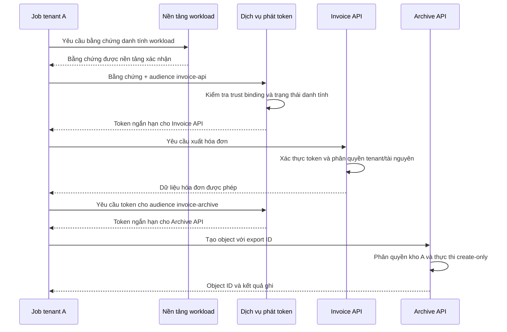

# Thiết kế service account

Một tiến trình xuất hóa đơn cần đọc dữ liệu, ghi tệp và chạy tự động mỗi đêm. Nếu cho tiến trình dùng tài khoản quản trị của lập trình viên, hệ thống có thể hoạt động ngay nhưng mất khả năng giới hạn quyền, xác định chủ sở hữu và thu hồi truy cập khi xảy ra sự cố. Nếu tạo một service account rồi phát cùng khóa cho mọi ứng dụng, vấn đề chỉ chuyển sang một tên tài khoản khác.

Bài thực hành này yêu cầu thiết kế một danh tính máy từ nhu cầu nghiệp vụ đến vận hành. Kết quả cần trả lời được: workload nào được dùng danh tính, được làm gì trên tài nguyên nào, lấy credential bằng cách nào, ai quản lý và làm sao dừng truy cập khi workload bị chiếm quyền.

## 1. Mục tiêu và đầu ra

Sau bài này, người học có thể xây dựng một thiết kế service account gồm:

- Danh mục danh tính có chủ sở hữu, mục đích và ranh giới môi trường.
- Ma trận quyền cụ thể theo hành động, tài nguyên và tenant.
- Quan hệ tin cậy giữa nền tảng chạy workload và bên phát credential.
- Luồng xác thực, phân quyền và ghi log cho mỗi hệ thống đích.
- Quy trình cấp phát, rà soát, thay credential và thu hồi danh tính.
- Bộ tình huống kiểm thử cả truy cập được phép và truy cập bị từ chối.

Phạm vi là nền tảng IAM: xác thực danh tính máy, RBAC/ABAC, đặc quyền, vòng đời truy cập và kiểm toán. Các sơ đồ, policy và mã giả bên dưới là thiết kế minh họa cho một hệ thống giả định; chúng không phải cấu hình có thể áp dụng nguyên trạng lên mọi nhà cung cấp.

## 2. Phân biệt những thành phần dễ bị gộp chung

| Thành phần | Câu hỏi nó trả lời | Ví dụ trong bài |
| --- | --- | --- |
| Workload | Tiến trình nào đang chạy? | Một instance của job xuất hóa đơn |
| Service account | Tiến trình hành động dưới danh tính nào? | `sa-invoice-export-prod-a` |
| Credential | Tiến trình chứng minh danh tính bằng gì? | Access token ngắn hạn hoặc chứng thư được nền tảng cấp |
| Role/policy | Danh tính được phép làm gì? | Đọc hóa đơn của tenant A |
| Trust binding | Workload nào được lấy credential cho danh tính này? | Job được phê duyệt trong môi trường production của tenant A |
| Owner | Ai chịu trách nhiệm về nhu cầu và vòng đời quyền? | Nhóm Billing Platform |

Service account không đồng nghĩa với một tệp khóa. Một danh tính có thể tồn tại lâu dài trong khi credential của nó được cấp mới liên tục và chỉ có hiệu lực trong thời gian ngắn. Xoay credential cũng không tự làm thay đổi quyền mà danh tính đang có.

Tên gọi khác nhau giữa các nền tảng: service account, managed identity, service principal hoặc workload identity có thể có mô hình đối tượng và cơ chế xác thực khác nhau. Cần kiểm tra semantics của nền tảng trước khi ánh xạ bản thiết kế thành cấu hình thật.

Trong Kubernetes, ServiceAccount là danh tính của tiến trình trong Pod và có phạm vi namespace. Khi dùng nó để truy cập dịch vụ bên ngoài, phải cấu hình quan hệ tin cậy và quyền ở hệ thống đích; việc tồn tại một ServiceAccount không tự cấp quyền cloud. Xem [tài liệu Service Accounts của Kubernetes](https://kubernetes.io/docs/concepts/security/service-accounts/).

## 3. Đề bài: job xuất hóa đơn cho hai tenant

Hệ thống SaaS có hai khách hàng A và B. Mỗi đêm, job `invoice-exporter` tạo tệp tổng hợp hóa đơn cho từng khách hàng rồi lưu vào kho lưu trữ tương ứng.

Các yêu cầu nghiệp vụ:

1. Đọc danh sách hóa đơn đã chốt của đúng tenant qua `Invoice API`.
2. Chỉ đọc các trường phục vụ báo cáo; không cần số thẻ hay bí mật thanh toán.
3. Tạo tệp xuất mới trong vùng lưu trữ của đúng tenant.
4. Không sửa hóa đơn, hoàn tiền, xóa tệp hay thay chính sách IAM.
5. Chạy lại một lượt xuất phải có cách xử lý trùng lặp rõ ràng.
6. Môi trường test không truy cập dữ liệu production.
7. Người vận hành phải truy ra được lượt chạy nào đã đọc dữ liệu và tạo tệp nào.
8. Khi một workload bị chiếm quyền, có thể cô lập nó mà không dừng xuất hóa đơn cho tenant còn lại.

Giả định thiết kế:

- Nền tảng chạy job có thể cung cấp bằng chứng danh tính workload được xác minh.
- Một dịch vụ phát token nội bộ hoặc cơ chế federation đã được phê duyệt cấp credential cho từng hệ thống đích.
- `Invoice API` và lớp truy cập kho tệp đều có điểm thực thi phân quyền.
- Tenant của mỗi hóa đơn được xác định từ dữ liệu phía server.
- Đội Billing Platform sở hữu job; đội Identity Platform quản lý cơ chế phát credential.

Thời hạn token, chu kỳ rà soát và mục tiêu thu hồi trong bài là lựa chọn cho tình huống giả định, không phải giá trị mặc định của một tiêu chuẩn hay sản phẩm.

## 4. Xác định ranh giới danh tính trước khi chọn credential

### 4.1. Tách theo môi trường và phạm vi ảnh hưởng

Thiết kế chọn hai danh tính runtime production:

| Danh tính | Workload được gắn | Phạm vi dữ liệu | Không được dùng cho |
| --- | --- | --- | --- |
| `sa-invoice-export-prod-a` | Job xuất hóa đơn tenant A | Hóa đơn và kho tệp A | Tenant B, test, triển khai |
| `sa-invoice-export-prod-b` | Job xuất hóa đơn tenant B | Hóa đơn và kho tệp B | Tenant A, test, triển khai |
| `sa-invoice-export-test` | Job trong môi trường test | Dữ liệu giả lập | Dữ liệu production |
| `sa-invoice-deploy-prod` | Pipeline triển khai được phê duyệt | Cấu hình triển khai đã giới hạn | Gọi API nghiệp vụ như runtime |

Tách A/B làm tăng số đối tượng quản lý nhưng phục vụ yêu cầu cô lập sự cố. Với hàng nghìn tenant, cần đánh giá giới hạn nền tảng, chi phí vận hành và phương án danh tính dùng chung kết hợp phân quyền tenant chặt chẽ. Không chọn mô hình chỉ từ mong muốn giảm số service account.

Không cần tạo một service account cho mỗi replica nếu các replica có cùng quyền, cùng owner và cùng ranh giới tin cậy. Có thể dùng chung danh tính logic nhưng ghi thêm instance ID và run ID để phân biệt hoạt động. Ngược lại, hai job có quyền khác nhau không nên dùng chung chỉ vì cùng một nhóm phát triển.

### 4.2. Runtime và pipeline là hai miền quyền khác nhau

Runtime cần dữ liệu hóa đơn; pipeline cần triển khai phiên bản. Hai nhu cầu đó không đòi cùng quyền. Tuy nhiên, pipeline có khả năng thay image hoặc gắn danh tính vào workload có thể gián tiếp sử dụng quyền runtime.

Vì vậy, thiết kế phải xét cả đường đi đặc quyền:

```text
Quyền sửa deployment hoặc mã chạy
             |
             v
Chạy mã dưới runtime identity
             |
             v
Đọc dữ liệu bằng quyền của runtime identity
```

Chỉ tách tên tài khoản chưa cắt được đường đi này. Cần kiểm soát nguồn image, quyền sửa cấu hình, danh tính được phép gắn, bước phê duyệt production và log triển khai. Người có quyền tạo Pod, sửa job hoặc truy cập shell bên trong workload cũng có thể ảnh hưởng đến credential mà workload nhận.

### 4.3. Hồ sơ danh tính

Một bản ghi thiết kế có thể như sau; đây là schema minh họa, không phải schema của sản phẩm IAM:

```yaml
identity: sa-invoice-export-prod-a
kind: workload
purpose: Export finalized invoices for tenant A
environment: production
tenant: tenant-a
businessOwner: billing-platform
technicalOwner: billing-runtime-oncall
approvedWorkload: invoice-exporter-a
credentialMode: federated-short-lived
allowedAudiences:
  - invoice-api
  - invoice-archive
humanInteractiveLogin: disabled
userManagedLongLivedKey: prohibited
reviewIntervalDays: 90
retirementTrigger: exporter-a-is-retired
```

Owner nên là nhóm có trách nhiệm và đầu mối vận hành thay vì chỉ một nhân viên. Mỗi lần thay owner, mục đích hoặc workload được gắn phải được ghi nhận và xem xét lại quyền.

## 5. Xây dựng ma trận quyền từ luồng dữ liệu

Trước khi chọn tên role có sẵn, liệt kê hành động thực sự cần dùng:

| Hệ thống | Hành động được phép với danh tính A | Ràng buộc | Hành động phải bị từ chối |
| --- | --- | --- | --- |
| Invoice API | `invoice.export.read` | Tenant A, hóa đơn đã chốt, trường được phép | Đọc B, sửa hóa đơn, hoàn tiền |
| Archive API | `archive.object.create` | Kho A, tên tệp do server chuẩn hóa | Ghi kho B, ghi đè, xóa, đổi ACL |
| IAM/token service | Nhận token cho chính danh tính từ workload được tin cậy | Đúng issuer, subject, target audience | Tạo khóa, sửa role, giả danh tài khoản khác |
| Nền tảng triển khai | Không có quyền quản trị ở runtime | Runtime chỉ thực thi công việc | Sửa deployment, tạo workload đặc quyền |

Không cấp quyền đọc danh sách mọi kho chỉ để ứng dụng tìm tên kho khi khởi động. Truyền resource ID đã được phê duyệt qua cấu hình, rồi cấp đúng quyền cần thiết trên resource đó.

### 5.1. RBAC và ABAC phối hợp

RBAC có thể gom hành động thành role `invoice-export-reader`. ABAC hoặc policy ở ứng dụng giới hạn tenant và trạng thái hóa đơn. Quyết định cho phép về mặt logic là:

```text
ALLOW khi đồng thời:
  credential hợp lệ với Invoice API
  AND principal đang hoạt động và chưa bị chặn
  AND principal có invoice.export.read
  AND tenant đã ràng buộc của principal == tenant của tài nguyên
  AND hóa đơn đã chốt
  AND môi trường == production
Mọi trường hợp khác: DENY
```

Trong mô hình này, tenant gắn với principal do hệ thống tin cậy quản lý. Header `X-Tenant`, tham số URL hay nội dung request không tự trở thành bằng chứng về tenant. Nếu request ghi tenant A nhưng ID hóa đơn thực tế thuộc B, server phải từ chối sau khi tra cứu dữ liệu có thẩm quyền.

Role có tên “reader” chưa chắc đủ hẹp. Cần kiểm kê permission thực tế, quyền kế thừa, group, role binding và khả năng giả danh danh tính khác. Những đường cấp quyền bổ sung có thể làm một policy giới hạn bị vô hiệu về mặt hiệu quả.

### 5.2. Tạo mới không đồng nghĩa với không ghi đè

Một quyền ghi object có thể cho phép thay thế object hiện có tùy hệ thống lưu trữ. Yêu cầu “chỉ tạo mới” phải được ánh xạ thành semantics có thể thực thi: API create-only, điều kiện tạo khi chưa tồn tại hoặc lớp dịch vụ kiểm soát thao tác nguyên tử.

Không triển khai bằng quy trình “kiểm tra chưa có rồi ghi” nếu giữa hai bước có thể có writer khác. Archive API cần xử lý tính duy nhất của export ID hoặc điều kiện ghi ở kho đích. Khi chạy lại, hệ thống trả về kết quả cũ đã xác nhận hoặc báo xung đột; không âm thầm ghi đè bản xuất.

Nếu nền tảng không giới hạn an toàn theo prefix, dùng kho riêng cho mỗi tenant hoặc thêm cổng truy cập có phân quyền đủ mạnh. Chuỗi `/tenant-a/` trong tên tệp tự nó không tạo ra một ranh giới bảo mật.

## 6. Thiết kế quan hệ tin cậy và credential

### 6.1. Ưu tiên credential ngắn hạn từ danh tính workload

Thiết kế chọn cơ chế nền tảng xác thực workload rồi cấp credential ngắn hạn, tránh phân phối tệp khóa dài hạn tới job. Google Cloud cũng khuyến nghị ưu tiên phương án xác thực an toàn hơn thay cho khóa service account do người dùng quản lý; xem [hướng dẫn quản lý khóa service account](https://docs.cloud.google.com/iam/docs/best-practices-for-managing-service-account-keys).

Luồng đề xuất:



Token dành cho `invoice-api` không mặc nhiên hợp lệ ở `invoice-archive`. Bản thiết kế dùng hai audience và hai token để giới hạn hệ thống có thể chấp nhận mỗi credential. Phía phát hành phải kiểm tra principal có được yêu cầu audience đó hay không; không tin audience do client yêu cầu một cách vô điều kiện.

### 6.2. Trust policy cần ràng buộc điều gì?

Trust policy không chỉ nói “tin nhà cung cấp X”. Nó phải giới hạn workload cụ thể trong miền tin cậy đó:

- Issuer nằm trong danh sách đã cấu hình và được xác minh đúng cơ chế.
- Subject khớp workload đã được phê duyệt, không dùng wildcard rộng.
- Môi trường, project hoặc namespace đúng phạm vi thiết kế.
- Audience của bằng chứng đầu vào đúng với dịch vụ tiếp nhận hoặc cấu hình federation.
- Danh tính đích được ánh xạ cố định hoặc theo quy tắc được kiểm soát.
- Danh tính còn hoạt động và quan hệ tin cậy chưa bị thu hồi.

Không dùng nhãn do chính ứng dụng tự khai làm bằng chứng đủ để nhận quyền production. Nếu label, subject hoặc claim có thể được người có quyền triển khai tùy ý thay đổi, phải kiểm soát bên có khả năng thay đổi đó và đường phát hành bằng chứng.

Đối với CI/CD federation, việc tin đúng issuer vẫn chưa đủ. Cần ràng buộc repository, ref hoặc môi trường triển khai và ngữ cảnh job theo claim mà nhà phát hành bảo đảm. Một workflow từ pull request chưa được tin cậy không được tự động nhận danh tính production.

### 6.3. Thời hạn và cách sử dụng token

Giả sử dịch vụ token trong bài hỗ trợ TTL 15 phút. Ứng dụng lấy token mới trước khi hết hạn, có khoảng đệm và jitter để nhiều replica không làm mới đồng loạt. Không ghi token vào log, URL, artifact CI, image hay dữ liệu báo cáo.

Cache token phải phân biệt ít nhất danh tính và audience; nếu có scope hoặc ràng buộc khác thì đưa chúng vào khóa cache. Một cache dùng chung với khóa duy nhất `access-token` có thể đưa nhầm credential giữa tenant hoặc giữa hệ thống đích.

Credential ngắn hạn vẫn có thể bị đánh cắp trong thời gian hợp lệ. Chúng làm giảm cửa sổ sử dụng, không thay thế việc bảo vệ runtime, phân quyền tối thiểu và kiểm soát đường truy cập tới cơ chế cấp credential. TLS bảo vệ đường truyền; token bearer bị lấy khỏi runtime vẫn cần được xử lý như một bí mật.

Nếu dùng JWT, API phải xác minh chữ ký bằng nguồn khóa tin cậy, giới hạn thuật toán được chấp nhận và kiểm tra issuer, audience, thời hạn cùng các claim bắt buộc. Chỉ giải mã payload không phải xác thực. Nếu dùng opaque token, API cần cơ chế kiểm tra hiệu lực tương ứng. Không mặc định dùng ID token làm credential gọi API; loại token phải đúng hợp đồng của API đích.

### 6.4. Trường hợp triển khai trên Kubernetes

Chọn ServiceAccount riêng và gắn rõ vào workload. Không tự động mount credential ở container không cần dùng. Với token projected, ứng dụng phải xử lý việc token được thay mới; không đọc một lần khi khởi động rồi dùng mãi. Token dành cho hệ thống ngoài cần audience và bên xác minh phù hợp. Xem [cơ chế token ServiceAccount trong Kubernetes](https://kubernetes.io/docs/concepts/security/service-accounts/).

Quyền Kubernetes RBAC và quyền đọc hóa đơn ở Invoice API là hai chính sách khác nhau. Không cấp `cluster-admin` cho job chỉ vì cần một danh tính để federation. Đồng thời, quyền tạo workload dưới ServiceAccount có đặc quyền cũng cần được quản lý như một đường tiếp cận đặc quyền đó.

## 7. Ví dụ điểm thực thi phân quyền ở Invoice API

Ví dụ dưới đây chỉ minh họa authorization sau khi authentication đã hoàn tất. `VerifiedWorkload` phải do thành phần xác thực tin cậy tạo; không deserialize trực tiếp nó từ request. Các tập quyền và tenant trong context được lấy từ policy hoặc claim đã được kiểm chứng theo hợp đồng hệ thống.

```java
import java.util.Set;

record VerifiedWorkload(
        String subject,
        String tenantId,
        String environment,
        Set<String> permissions) {
}

record Invoice(
        String id,
        String tenantId,
        boolean finalized) {
}

interface IdentityControl {
    // Nguồn trạng thái có thẩm quyền, bao gồm chặn khẩn cấp.
    boolean isActive(String subject);
}

final class InvoiceExportAuthorization {
    private final IdentityControl identityControl;

    InvoiceExportAuthorization(IdentityControl identityControl) {
        this.identityControl = identityControl;
    }

    void requireRead(VerifiedWorkload principal, Invoice invoice) {
        if (principal == null || invoice == null) {
            throw new SecurityException("Access denied");
        }

        boolean allowed =
                principal.subject() != null
                && identityControl.isActive(principal.subject())
                && "production".equals(principal.environment())
                && principal.permissions() != null
                && principal.permissions().contains("invoice.export.read")
                && principal.tenantId() != null
                && principal.tenantId().equals(invoice.tenantId())
                && invoice.finalized();

        if (!allowed) {
            throw new SecurityException("Access denied");
        }
    }
}
```

Invoice ở đây là bản ghi lấy từ nguồn dữ liệu phía server. Đối với truy vấn nhiều hóa đơn, nên áp bộ lọc tenant ngay tại truy vấn và vẫn bảo đảm mọi đường lấy dữ liệu đều tuân thủ policy. Không lấy toàn bộ dữ liệu đa tenant rồi dựa vào phía client để lọc.

Nếu `IdentityControl` lỗi, hệ thống phải có hành vi đã định trước. Trong thiết kế này, lỗi khiến yêu cầu mới bị từ chối thay vì bỏ qua kiểm tra. Nếu dùng cache trạng thái để tăng độ sẵn sàng, TTL cache và cách vô hiệu hóa khẩn cấp phải được tính vào độ trễ thu hồi thực tế.

Mã trên không bao gồm xác minh token, ánh xạ HTTP, kiểm soát giao dịch hay ghi audit. Khi tích hợp thật, lỗi authentication và lỗi authorization cần được phân loại trong log nội bộ; phản hồi ra ngoài không làm lộ dữ liệu tenant hoặc chi tiết policy không cần thiết.

## 8. Quản lý vòng đời và quyền quản trị danh tính

### 8.1. Cấp phát

Người yêu cầu nêu mục đích, workload, môi trường, dữ liệu và owner. Người phê duyệt kiểm tra ma trận quyền và cách chứng minh danh tính workload. Nền tảng tạo account, trust binding và role binding bằng quy trình có version, phê duyệt và audit.

Kiểm thử từ chối phải được thực hiện trước khi workload production xử lý dữ liệu thật. Tạo danh tính mà chưa gắn quyền nghiệp vụ là một trạng thái trung gian bình thường; không cấp role quản trị tạm thời để vượt qua bước thiết lập.

### 8.2. Vận hành và rà soát

Theo chu kỳ giả định 90 ngày, owner xác nhận workload vẫn tồn tại và quyền vẫn cần thiết. Kết hợp log sử dụng với thay đổi nghiệp vụ để thu hẹp quyền. Không kết luận quyền có thể xóa chỉ vì chưa thấy dùng trong một khoảng quan sát ngắn; có thể có job theo quý hoặc luồng phục hồi hiếm.

Account không có owner hoặc không gắn workload phải vào quy trình xử lý. Việc nhân viên chuyển nhóm không được làm danh tính máy mất người chịu trách nhiệm hoặc tiếp tục giữ quyền vô thời hạn.

### 8.3. Quyền quản trị và quyền sử dụng phải được xét riêng

Một người có thể không được đọc hóa đơn trực tiếp nhưng lại có quyền tạo khóa, giả danh service account hoặc thay trust binding. Những quyền đó có thể dẫn tới cùng khả năng đọc dữ liệu.

Thiết kế cần xét riêng quyền:

- Tạo, vô hiệu hóa hoặc xóa service account.
- Sửa role binding, trust policy và ánh xạ tenant.
- Phát credential hoặc giả danh một service account.
- Gắn account vào workload và sửa mã được chạy dưới account đó.
- Xem hoặc xuất bí mật nếu có ngoại lệ khóa dài hạn.

Con người thực hiện thao tác nhạy cảm bằng danh tính cá nhân, MFA và luồng phê duyệt phù hợp. Job tự động không cần đăng nhập tương tác bằng MFA; nó cần cơ chế chứng minh danh tính workload và quyền tối thiểu. Không dùng mật khẩu tài khoản cá nhân rồi tắt MFA để job hoạt động.

Nếu cần thao tác thay mặt service account để chẩn đoán, dùng cơ chế ủy quyền tạm thời có lưu actor con người và effective principal. Không tải khóa chung về máy của cả nhóm để xử lý sự cố.

### 8.4. Ngừng sử dụng

Khi bỏ job, dừng lịch chạy và chặn cấp credential mới, gỡ trust binding, thu hồi quyền ở các hệ thống đích rồi quan sát các truy cập còn lại. Dọn credential tồn dư và kết thúc tài khoản theo chính sách lưu giữ, bảo đảm vẫn tra được lịch sử hoạt động bằng định danh ổn định.

Chỉ xóa một tệp khóa trên máy triển khai không chứng minh mọi bản sao đã biến mất. Chỉ xóa deployment cũng không bảo đảm token đã phát hết hiệu lực.

## 9. Thu hồi và xử lý sự cố

### 9.1. Chặn phát mới và chặn sử dụng là hai việc khác nhau

Giả sử token đã phát được API kiểm tra cục bộ và còn hạn. Vô hiệu hóa việc phát token mới không tự động khiến API biết token cũ phải bị từ chối. Hiệu quả của việc disable account hoặc xóa khóa tùy cơ chế xác minh và nền tảng; phải kiểm chứng bằng thử nghiệm.

Thiết kế này dùng hai lớp:

1. Chặn phát credential mới bằng cách vô hiệu hóa trust binding hoặc danh tính tại issuer.
2. Chặn yêu cầu tiếp theo tại Invoice API và Archive API bằng trạng thái hoặc danh sách chặn có kiểm soát theo subject.

Nếu không có lớp thứ hai, cửa sổ tiếp tục sử dụng có thể kéo dài tới khi token hết hạn, cộng sai lệch thời gian được chấp nhận và các cơ chế cache có liên quan. Không ghi “thu hồi ngay” trong tài liệu khi chỉ dựa vào token TTL.

### 9.2. Runbook khi job tenant A bị chiếm quyền

1. Xác định subject, instance, run ID và thời điểm nghi ngờ; bảo toàn log cần thiết.
2. Cô lập workload bị ảnh hưởng và dừng các lượt chạy mới của A.
3. Chặn phát credential mới cho danh tính A; kiểm tra đường giả danh và binding liên quan.
4. Áp chặn danh tính A ở cả API hóa đơn và API lưu trữ, xác minh bằng credential đã phát trước sự cố.
5. Kiểm tra các dữ liệu đã đọc, object đã tạo và thay đổi cấu hình; không suy ra “không mất dữ liệu” chỉ từ việc đã thu hồi token.
6. Sửa nguyên nhân gốc, triển khai workload tin cậy và cấp lại đường truy cập sau phê duyệt.
7. Kiểm tra danh tính B tiếp tục chạy đúng phạm vi, rồi ghi nhận kết quả khôi phục.

Mục tiêu giả định: yêu cầu dùng token cũ của A bị từ chối tại hai API trong vòng 5 phút từ lệnh chặn khẩn cấp. Mục tiêu này chỉ khả thi khi cơ chế phân phối trạng thái, cache và mọi đường truy cập tới tài nguyên đều hỗ trợ nó. Cần đo thực tế; token 15 phút không tự đáp ứng mục tiêu 5 phút.

Không dùng tài khoản quản trị chung làm phương án tự động khi token service gặp lỗi. Job có thể trì hoãn và thử lại có giới hạn theo mức chịu lỗi nghiệp vụ. Truy cập khẩn cấp, nếu cần, phải là quy trình riêng có thời hạn, phạm vi và audit.

## 10. Ngoại lệ bắt buộc dùng credential dài hạn

Một hệ thống cũ có thể chỉ hỗ trợ khóa tĩnh hoặc client secret. Khi đó, thiết kế cần ghi rõ lý do không dùng được cơ chế ngắn hạn, người duyệt, thời hạn ngoại lệ và kế hoạch loại bỏ.

Lưu bí mật trong kho quản lý bí mật; workload chỉ được đọc đúng bí mật cần thiết. Không nhúng vào repository, image, email hay tài liệu triển khai. Kho bí mật bảo vệ lưu trữ và phân phối nhưng không tự thu hẹp quyền của service account hoặc ngăn bí mật bị lấy từ runtime.

Quy trình thay khóa có thể gồm:

1. Tạo credential mới với cùng phạm vi đã phê duyệt.
2. Phân phối bản mới tới đúng workload qua kênh quản lý bí mật.
3. Xác nhận workload dùng bản mới và mọi replica đã chuyển đổi.
4. Vô hiệu hóa bản cũ, kiểm thử bản cũ bị từ chối rồi dọn bản sao theo quy trình.

Nếu hệ thống cho phép hai credential đồng thời, giữ khoảng chồng lấn đủ cho chuyển đổi nhưng có thời hạn. Nếu chỉ hỗ trợ một credential, cần kế hoạch gián đoạn hoặc cơ chế chuyển đổi tương ứng. Với credential đã bị lộ, ưu tiên cô lập và chặn sử dụng; không áp dụng máy móc lịch xoay định kỳ trong khi để khóa cũ tiếp tục hoạt động.

## 11. Thiết kế audit và giám sát

Log nghiệp vụ và log IAM cần liên kết được mà không chứa credential hoặc dữ liệu hóa đơn đầy đủ. Mỗi quyết định truy cập nên có:

| Nhóm thông tin | Ví dụ |
| --- | --- |
| Danh tính | Subject ổn định, effective principal, actor gốc nếu có ủy quyền |
| Nguồn thực thi | Workload, môi trường, instance ID, run ID |
| Thao tác | Action, resource ID được chuẩn hóa, tenant đã xác minh |
| Quyết định | Allow/deny, reason code, phiên bản policy |
| Theo dõi | Thời điểm, request ID, trace ID, export ID |

Ví dụ bản ghi giả lập:

```json
{
  "event": "authorization.decision",
  "subject": "sa-invoice-export-prod-a",
  "workload": "invoice-exporter-a",
  "environment": "production",
  "runId": "run-example-041",
  "action": "invoice.export.read",
  "resourceId": "invoice-example-827",
  "resourceTenant": "tenant-b",
  "decision": "DENY",
  "reason": "TENANT_MISMATCH",
  "policyVersion": "invoice-export-policy-3",
  "requestId": "request-example-913"
}
```

Thông tin tenant và resource cũng có thể nhạy cảm, nên log cần kiểm soát người đọc, thời gian lưu và mức chi tiết. Quyền sửa hoặc xóa audit không cấp cho exporter. Run ID do client gửi chỉ dùng liên kết sự kiện; nó không phải bằng chứng xác thực.

Các tín hiệu đáng theo dõi gồm yêu cầu lấy token từ workload lạ, audience ngoài danh sách, truy cập chéo tenant, account đã ngừng dùng tiếp tục xuất hiện và thay đổi quyền ngoài quy trình. Đặt ngưỡng theo lịch chạy thực tế: job được chạy lại hợp lệ không nhất thiết là sự cố, còn một lần đổi trust binding ngoài phê duyệt có thể rất đáng chú ý.

## 12. Thực hiện bài thực hành theo các bước

### Bước 1 — Vẽ luồng dữ liệu và xác định owner

Ghi rõ nguồn hóa đơn, hệ thống lưu trữ, tenant, môi trường và người chịu trách nhiệm từng tài nguyên. Đánh dấu ranh giới nơi credential được phát hoặc kiểm tra. Không bắt đầu bằng việc chọn role quản trị để “thử cho chạy”.

### Bước 2 — Lập danh mục danh tính

Tạo bản thiết kế cho A, B, test và pipeline. Với mỗi danh tính, liệt kê workload được gắn, người có quyền sửa workload và người có quyền thay policy. Giải thích lựa chọn tách hoặc dùng chung bằng rủi ro và nhu cầu nghiệp vụ.

### Bước 3 — Hoàn thành ma trận quyền

Chuyển từng lời gọi cần thiết thành action và resource cụ thể. Đối chiếu permission của role dự kiến với ma trận, bao gồm quyền kế thừa và khả năng giả danh. Nếu API không hỗ trợ giới hạn cần thiết, ghi nhận thay đổi kiến trúc thay vì chỉ viết một điều kiện không thể thực thi.

### Bước 4 — Thiết kế trust và đường cấp credential

Mô tả nguồn bằng chứng, các trường được kiểm tra, cách ánh xạ sang service account, audience, TTL và cách làm mới. Chứng minh workload test, workload B và pipeline không tự nhận được danh tính runtime A ngoài đường đã phê duyệt.

### Bước 5 — Xác định điểm thực thi

Chỉ ra nơi kiểm tra token và nơi kiểm tra tenant ở từng API. Nếu có nhiều đường vào như tác vụ nền, endpoint nội bộ hoặc truy cập kho trực tiếp, tất cả phải tuân thủ ranh giới quyền tương đương. Một endpoint được bảo vệ không bù được một đường truy cập trực tiếp quá rộng.

### Bước 6 — Viết quy trình vận hành

Hoàn thành hồ sơ owner, rà soát, luồng thay credential, runbook thu hồi và cách nhận diện tài khoản bỏ quên. Quy định hành vi khi token service hoặc nguồn trạng thái danh tính bị lỗi.

### Bước 7 — Thu thập bằng chứng kiểm thử

Ghi đầu vào, danh tính, hành động, kết quả mong đợi, kết quả quan sát và request ID tương ứng. Dùng dữ liệu thử nghiệm được kiểm soát; không sao chép token hoặc bí mật vào báo cáo. Bộ kiểm thử dưới đây là yêu cầu thiết kế của bài, chưa phải kết quả đã chạy trên một hệ thống thật.

## 13. Ma trận kiểm thử bắt buộc

| Tình huống | Kết quả mong đợi | Bằng chứng cần thu |
| --- | --- | --- |
| A đọc hóa đơn A đã chốt | Cho phép | Audit allow và dữ liệu đúng phạm vi |
| A đọc hóa đơn B bằng ID trực tiếp | Từ chối | Audit tenant mismatch, không trả dữ liệu |
| A gửi header tenant A cho hóa đơn B | Từ chối | Tenant tài nguyên được xác định phía server |
| A đọc hóa đơn A chưa chốt | Từ chối | Policy kiểm tra trạng thái nghiệp vụ |
| A sửa hóa đơn hoặc hoàn tiền | Từ chối | Không có action tương ứng trong quyền hiệu quả |
| A tạo tệp mới ở kho A | Cho phép | Object ID và run ID liên kết được |
| A ghi đè hoặc xóa tệp đã có | Từ chối | Ràng buộc create-only thực sự có hiệu lực |
| A ghi sang kho B | Từ chối | Policy ở kho hoặc Archive API |
| Token Invoice API dùng tại Archive API | Từ chối | Audience không được chấp nhận |
| Token hết hạn hoặc sai issuer | Từ chối | Authentication thất bại, không vào nghiệp vụ |
| B hoặc test yêu cầu credential của A | Từ chối | Trust binding không khớp |
| Runtime A tạo khóa hoặc sửa IAM | Từ chối | Không có quyền quản trị gián tiếp |
| Pipeline chưa được duyệt gắn danh tính A | Từ chối | Kiểm soát triển khai và gắn identity |
| Token được làm mới khi job còn chạy | Tiếp tục đúng quyền | Không dùng token cũ quá hạn |
| Chặn A khi token cũ còn hạn | Từ chối theo mục tiêu đã đo | Thời điểm lệnh chặn và lần từ chối đầu tiên |
| Chặn A trong khi B vẫn chạy | B tiếp tục được phép | Không ảnh hưởng ngoài phạm vi A |
| Nguồn kiểm tra trạng thái lỗi | Không bỏ qua kiểm soát | Hành vi fail-closed hoặc giới hạn cache đã duyệt |

Đặc biệt, thực hiện ca thu hồi bằng token đã được phát trước khi chặn. Chỉ thử lấy token mới rồi thấy thất bại không chứng minh đã thu hồi credential đang lưu hành.

## 14. Các lỗi thiết kế cần phát hiện khi tự đánh giá

**Dùng một service account cho cả triển khai, runtime và dọn dữ liệu.** Quyền hiệu quả trở thành tổng nhu cầu của ba công việc; nếu job xuất báo cáo bị chiếm quyền, khả năng xóa dữ liệu và thay cấu hình cũng có thể bị lộ. Tách công việc dọn dữ liệu theo chính sách lưu giữ thành danh tính riêng nếu cần.

**Coi lưu khóa trong secret manager là hoàn tất IAM.** Đây mới là một phần của quản lý credential. Vẫn cần giới hạn ai đọc khóa, workload dùng khóa, quyền tài nguyên và quy trình thu hồi.

**Tin mạng nội bộ hoặc tên service account.** Network location có thể là điều kiện bổ sung; tên account chỉ là định danh. Quyết định truy cập vẫn dựa trên credential hợp lệ và policy có thẩm quyền.

**Cho runtime quyền giả danh account mạnh hơn.** Role trực tiếp có vẻ hẹp nhưng đường giả danh làm quyền thực tế mở rộng. Cần xem cả chuỗi ủy quyền và tài nguyên có thể sửa để thực thi dưới danh tính khác.

**Không thiết kế đường thất bại.** Nếu khi issuer lỗi ứng dụng chuyển sang khóa quản trị dự phòng, thiết kế đặc quyền tối thiểu không còn giữ được trong sự cố. Nếu lúc thu hồi chỉ xóa tệp token ở một replica, các replica khác có thể tiếp tục truy cập.

**Ghi đầy đủ token để dễ chẩn đoán.** Log trở thành nguồn credential thứ hai, thường có nhiều người đọc hơn runtime. Dùng metadata sự kiện và định danh đối chiếu phù hợp thay cho bí mật.

## 15. Tiêu chí hoàn thành bản thiết kế

Bản nộp đạt yêu cầu khi người đánh giá có thể chỉ ra danh tính nào thực thi mỗi bước, cách workload chứng minh quyền dùng danh tính và policy cụ thể giới hạn hành động trên dữ liệu. Hai tenant và môi trường test có ranh giới được thực thi ở hệ thống đích, không chỉ được mô tả bằng quy ước đặt tên.

Phần vận hành phải có owner, quy trình rà soát, kiểm soát quyền quản trị danh tính và cách ngừng sử dụng. Phần thu hồi phải giải thích credential đã phát chịu ảnh hưởng ra sao, đo được độ trễ chặn và xác nhận tenant không liên quan vẫn hoạt động.

Một service account được thiết kế tốt là một quan hệ có quản lý giữa workload, credential, quyền và người chịu trách nhiệm. Khi một trong những yếu tố đó thay đổi, cần xem xét lại quan hệ còn lại thay vì chỉ tạo một khóa mới rồi coi công việc đã xong.
