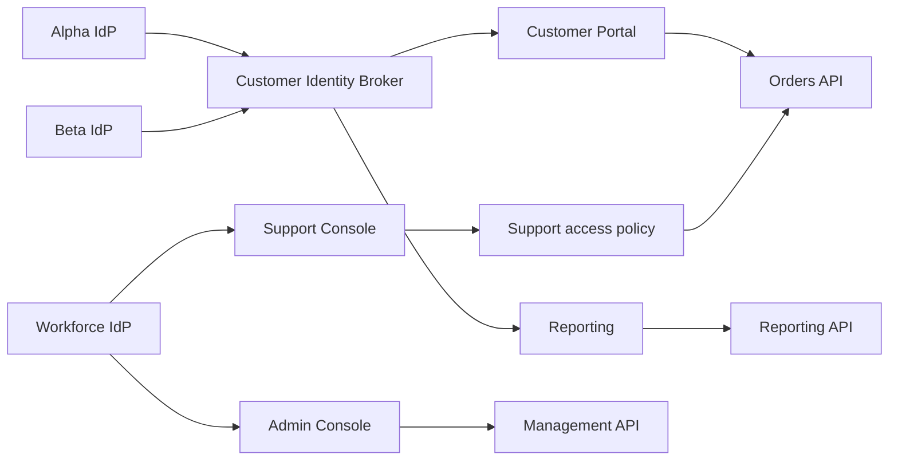

# Thiết kế SSO boundary

## 1. Mục tiêu thực hành

Một hệ thống có Single Sign-On (SSO) tốt cho phép người dùng chuyển giữa những ứng dụng được phép mà không phải nhập lại thông tin đăng nhập ở mọi ứng dụng. Thiết kế đó vẫn phải giữ được giới hạn: ai được đăng nhập ở đâu, ứng dụng nào được tin nguồn danh tính nào, phiên nào được dùng cho thao tác nào và sự cố ở một thành phần lan sang những thành phần nào.

**SSO boundary là ranh giới của sự tin cậy khi tái sử dụng kết quả xác thực.** Đường biên này được thực thi bằng cấu hình federation, client, issuer, phiên, token, tài khoản nội bộ và chính sách truy cập. Nó không chỉ là một đường bao quanh các ứng dụng trên sơ đồ.

Trong bài thực hành này, bạn thiết kế SSO cho một nền tảng SaaS có khách hàng, nhân viên vận hành và trang quản trị đặc quyền. Sản phẩm đầu ra là một bản thiết kế có thể kiểm chứng: sơ đồ luồng, bảng tin cậy, quy tắc ánh xạ danh tính, chính sách phiên, xử lý vòng đời và tập kiểm thử âm. Đây là phần thực hành tổng hợp của nền tảng IAM, kết nối xác thực, MFA, RBAC/ABAC, federation, tenant và nguyên tắc ít quyền nhất.

Sau bài học, bạn cần giải thích được hai quyết định khác nhau:

- Người dùng có thể tận dụng phiên đăng nhập sẵn có ở nguồn nào?
- Ứng dụng có được cấp phiên và quyền truy cập cụ thể cho người đó hay không?

Một câu trả lời thuận tiện cho câu hỏi đầu không thay thế được quyết định bảo vệ tài nguyên ở câu hỏi sau.

## 2. Đề bài: nền tảng An Phú Cloud

An Phú Cloud cung cấp dịch vụ quản lý đơn hàng cho nhiều doanh nghiệp. Hệ thống có các thành phần sau:

| Thành phần | Người sử dụng | Tài nguyên chính |
|---|---|---|
| Customer Portal | Thành viên của tenant Alpha hoặc Beta | Đơn hàng và thông tin doanh nghiệp |
| Reporting | Thành viên có quyền xem báo cáo | Báo cáo của đúng tenant |
| Support Console | Nhân viên hỗ trợ nội bộ | Phiếu hỗ trợ và dữ liệu được cho phép |
| Admin Console | Nhân viên vận hành đặc quyền | Cấu hình federation, quyền và tác vụ khẩn cấp |
| Orders API | Backend của các ứng dụng | Đơn hàng, trạng thái xử lý và thao tác nghiệp vụ |

Nhân viên nội bộ đăng nhập qua Workforce IdP. Khách hàng Alpha và Beta có IdP doanh nghiệp riêng; nền tảng dùng Customer Identity Broker để quản lý các kết nối đó và phát hành danh tính thống nhất cho ứng dụng khách hàng.

Một người có thể vừa là nhân viên An Phú Cloud, vừa là thành viên doanh nghiệp Alpha. Đây là hai bối cảnh sử dụng, không phải bằng chứng rằng mọi tài khoản và quyền của họ phải được gộp.

Đề bài đưa ra các yêu cầu:

1. Từ Customer Portal sang Reporting, người dùng hợp lệ có thể tận dụng phiên SSO tại Customer Identity Broker.
2. Phiên khách hàng không tạo phiên nhân viên hoặc quản trị viên.
3. Support Console không mặc nhiên cho phép đọc mọi tenant. Mỗi lần truy cập phải có quyền hỗ trợ tương ứng.
4. Admin Console yêu cầu mức xác thực mạnh và đủ mới cho tác vụ nhạy cảm.
5. Token phát hành cho Reporting không được sử dụng như token dành cho Orders API.
6. Khi một thành viên bị loại khỏi tenant, phiên SSO còn ở IdP không được làm sống lại tư cách thành viên đã bị thu hồi.
7. Khi đăng xuất, giao diện phải mô tả đúng phạm vi tác động và hệ thống phải đo được độ trễ thu hồi.

Những thời lượng và mức dịch vụ trong bài là giả định của bài thực hành. Chúng cần được điều chỉnh theo mức rủi ro, khả năng sản phẩm và yêu cầu vận hành thực tế.

## 3. Tách bốn loại ranh giới trước khi chọn công nghệ

### 3.1. Ranh giới danh tính

Ranh giới danh tính xác định nguồn nào có quyền khẳng định một người là ai và ứng dụng sẽ ánh xạ khẳng định đó thành tài khoản nội bộ nào.

Customer Identity Broker và Workforce IdP có thể dùng cùng một sản phẩm triển khai nhưng vẫn phải được xem là hai miền tin cậy riêng trong thiết kế. Ngược lại, tách hai tên miền không tự tạo ra sự cô lập nếu chúng vẫn dùng chung tài khoản quản trị, khóa ký hoặc quyền cấu hình không có kiểm soát.

Bản thiết kế cần ghi rõ phạm vi của từng issuer, nhóm người dùng được chấp nhận và bên chịu trách nhiệm cấu hình kết nối. Với broker, phải xem xét cả hai chặng: IdP khách hàng tới broker và broker tới ứng dụng.

### 3.2. Ranh giới phiên

Có ít nhất ba loại trạng thái liên quan:

- Phiên tại IdP hoặc broker, giúp quyết định có cần yêu cầu người dùng xác thực lại hay không.
- Phiên tại từng ứng dụng, giúp ứng dụng nhận biết những lần truy cập tiếp theo.
- Token và grant, phục vụ việc gọi API hoặc xin token mới theo quyền đã được cấp.

Một phiên IdP không phải là cookie phiên chung cho toàn bộ ứng dụng. Đóng phiên Customer Portal cũng chưa chứng minh Reporting hoặc Workforce IdP đã đóng phiên tương ứng.

### 3.3. Ranh giới token và tài nguyên

Mỗi API phải xác định token nào dành cho mình, được phát hành bởi nguồn nào và cho phép hành động gì. Việc cùng dùng một IdP không biến mọi token thành bằng chứng có thể trao đổi tùy ý giữa các API.

Trong bài này, mỗi ứng dụng có client riêng; mỗi API có audience và tập quyền được định nghĩa rõ. Việc cấp token cho Orders API là một quyết định riêng với việc đăng nhập Reporting.

### 3.4. Ranh giới tenant và đặc quyền

Tenant là phạm vi dữ liệu và tư cách thành viên. Đặc quyền là mức quyền thực hiện những hành động có ảnh hưởng lớn. Hai ranh giới này không được suy ra chỉ từ tên miền email, URL mà trình duyệt gửi hoặc sự tồn tại của một phiên đăng nhập.

Một nhân viên hỗ trợ có thể được phép xử lý một phiếu của Alpha nhưng không được đổi cấu hình SSO của Alpha. Một khách hàng quản trị tenant có thể quản lý thành viên Alpha nhưng không phải quản trị viên nền tảng.

## 4. Kiến trúc tham chiếu và bảng tin cậy

Thiết kế lựa chọn tách luồng khách hàng và nhân viên. Admin Console dùng client riêng trong miền workforce, với chính sách xác thực, phê duyệt và phiên nghiêm ngặt hơn.



Mỗi mũi tên ở phần đăng nhập đại diện cho một quan hệ federation được cấu hình, không phải việc chuyển nguyên phiên trình duyệt giữa các ứng dụng. Những mũi tên tới API còn cần quyền gọi và quyết định truy cập tài nguyên.

Bảng tin cậy là hợp đồng của thiết kế:

| Bên nhận | Nguồn danh tính chấp nhận | Client hoặc audience liên quan | Điều kiện bổ sung |
|---|---|---|---|
| Customer Portal | Customer broker đã cấu hình | Client portal riêng | Tài khoản và membership đang hoạt động |
| Reporting | Customer broker đã cấu hình | Client reporting riêng | Quyền xem báo cáo ở tenant hiện tại |
| Support Console | Workforce IdP | Client support riêng | Nhân viên đang hoạt động, có vai trò hỗ trợ |
| Admin Console | Workforce IdP | Client admin riêng | Nhân viên được cấp quyền đặc biệt, mức xác thực phù hợp |
| Orders API | Authorization server được cấu hình cho API | Audience Orders API | Scope hoặc permission và quyền trên đối tượng |
| Management API | Authorization server được cấu hình cho quản trị | Audience Management API | Chính sách đặc quyền, kiểm tra thao tác cụ thể |

Một API không cần chấp nhận mọi issuer đang được công ty sử dụng. Trường hợp tích hợp nhiều nguồn phải khai báo từng quan hệ tin cậy và cách chuẩn hóa principal; không mở rộng danh sách issuer chỉ để làm một ca đăng nhập đang lỗi chạy được.

### Vì sao không dùng một client cho mọi ứng dụng?

Dùng client riêng giúp giới hạn callback, cấu hình token, credential, quyền vận hành và phạm vi thay đổi. Nhóm Reporting có thể thay callback của Reporting mà không có quyền sửa callback của Admin Console.

Đây là sự giảm phụ thuộc và giảm phạm vi ảnh hưởng, chưa phải cô lập tuyệt đối. Nếu cùng một tài khoản quản trị có thể sửa tất cả client hoặc cùng một broker bị xâm phạm, nhiều ứng dụng vẫn có thể bị ảnh hưởng. Vì vậy, bản thiết kế phải ghi nhận cả quyền quản trị control plane, không chỉ luồng đăng nhập người dùng.

## 5. Luồng đăng nhập hợp lệ qua ranh giới

Bài thực hành chọn OpenID Connect với Authorization Code Flow cho ứng dụng web có backend. Backend giữ token và phát hành phiên ứng dụng; trình duyệt giữ cookie phiên phù hợp với ứng dụng đó.

Luồng từ Customer Portal sang Reporting:

1. Người dùng đã có phiên ở Customer Portal và phiên SSO tại Customer Identity Broker.
2. Khi mở Reporting, trình duyệt chưa có phiên Reporting.
3. Reporting khởi tạo giao dịch đăng nhập của chính nó, gắn với client, callback và bối cảnh dự kiến.
4. Broker xem xét phiên SSO hiện có và chính sách của Reporting. Có thể hoàn tất mà không yêu cầu nhập lại mật khẩu, hoặc yêu cầu tương tác bổ sung.
5. Reporting nhận kết quả của giao dịch, hoàn tất kiểm tra giao thức bằng thư viện được hỗ trợ.
6. Reporting ánh xạ danh tính ngoài sang tài khoản nội bộ, kiểm tra trạng thái và membership.
7. Reporting tạo một phiên riêng. Khi gọi API, nó dùng credential hoặc token được cấp đúng mục đích.
8. Reporting API kiểm tra quyền đọc từng tài nguyên của tenant.

OpenID Connect mô tả ID Token và cách bên nhận kiểm tra kết quả xác thực, gồm issuer, audience, thời hạn và nonce khi áp dụng; ứng dụng phải dùng quy trình validation phù hợp với flow. Không coi việc giải mã JSON trong token là xác thực token. [OpenID Connect Core, ID Token Validation](https://openid.net/specs/openid-connect-core-1_0.html#IDTokenValidation).

Thiết kế chọn PKCE và kiểm soát giao dịch đăng nhập, đồng thời đăng ký callback chính xác. Không nhận URL callback tùy ý từ query parameter hoặc dùng wildcard để “hỗ trợ mọi tenant”. Các biện pháp chống đánh cắp code, chuyển hướng sai và lẫn authorization server cần đi cùng nhau. [RFC 9700, bảo vệ luồng redirect](https://www.rfc-editor.org/rfc/rfc9700.html#section-2.1).

Thông tin `returnTo` của ứng dụng cũng phải có giới hạn. Có thể lưu một đường dẫn nội bộ đã được kiểm tra trong trạng thái giao dịch phía server; không biến callback hợp lệ thành một bước trung chuyển tới URL bên ngoài.

### Ba bằng chứng cần tách biệt

| Bằng chứng | Có thể giúp chứng minh | Không đủ để quyết định |
|---|---|---|
| Kết quả xác thực hợp lệ | Người dùng đã được nguồn tin cậy xác thực | Quyền đọc mọi dữ liệu |
| Membership đang hoạt động | Người dùng thuộc tenant theo hệ thống có thẩm quyền | Có mọi vai trò trong tenant |
| Quyền trên hành động và tài nguyên | Principal được thực hiện thao tác cụ thể | Mọi thao tác tương lai vẫn được phép |

Ví dụ, người dùng vẫn đăng nhập thành công tại broker nhưng đã bị xóa khỏi Alpha. Reporting phải từ chối cấp quyền vào Alpha, dù broker vừa xác thực người đó thành công.

## 6. Ánh xạ danh tính qua broker

Thiết kế cần một mô hình ánh xạ có thể kiểm toán:

```text
External identity
  configuredIssuer + subject
           |
           v
Identity mapping
  internalUserId
           |
           v
Tenant memberships
  tenantId + membershipState + roleAssignments
```

Đối với OIDC, cặp `iss` và `sub` là cơ sở nhận diện subject trong phạm vi issuer. Email là thuộc tính liên lạc; việc có cùng email không đủ làm bằng chứng gộp tài khoản hoặc cấp quyền. [OpenID Connect Core, Claim Stability and Uniqueness](https://openid.net/specs/openid-connect-core-1_0.html#ClaimStability).

Nếu broker phát hành subject khác nhau theo client, lớp ánh xạ phải được thiết kế tương ứng; không giả định mọi ứng dụng sẽ nhìn thấy cùng một chuỗi `sub`. Khi cần liên kết tài khoản, phải có quy trình chứng minh quyền kiểm soát và lưu lịch sử liên kết, thay vì so sánh email rồi gộp tự động.

Với An Phú Cloud, thiết kế chọn:

- Ứng dụng khách hàng nhận danh tính từ broker, ánh xạ tới `internalUserId`.
- Membership và vai trò lấy từ kho quyền có thẩm quyền của nền tảng.
- Workforce có ánh xạ riêng cho tài khoản nhân viên.
- Việc một người có mặt trong cả hai miền không tự sinh quyền chéo.
- Nhận lời mời hoặc cấp phát thành viên là quy trình riêng, có kiểm tra tenant và quyền của người mời.

Broker có thể giữ thông tin nguồn upstream phục vụ điều tra. Ứng dụng chỉ dùng thông tin upstream để ra quyết định khi hợp đồng claim đã xác định rõ ý nghĩa và broker thực thi ràng buộc tương ứng. Một chuỗi `upstreamTenant=Alpha` không có hợp đồng kiểm soát không nên được xem như membership đã được phê duyệt.

### Cấp phát vừa lúc cần đặc biệt chú ý điều gì?

Just-in-time provisioning có thể tạo hồ sơ tối thiểu sau lần đăng nhập đầu tiên. Nhưng chính sách “người nào đăng nhập được từ kết nối Alpha đều thành admin Alpha” sẽ biến lỗi cấu hình federation thành lỗi cấp quyền lớn.

Trong bài này, provisioning chỉ được tạo hoặc liên kết hồ sơ theo chính sách đã phê duyệt. Membership và vai trò cần điều kiện riêng. Đặc biệt, tài khoản hoặc membership đã bị vô hiệu hóa không được tự khôi phục chỉ vì một lần đăng nhập federation mới.

## 7. Bảo vệ ranh giới tenant trên từng request

Giả sử một request đến:

```http
GET /tenants/beta/orders/ORD-1042
Cookie: __Host-portal-session=<opaque-session-id>
```

Phiên hợp lệ của người dùng Alpha không cho phép request này đọc dữ liệu Beta. Server phải xác định tenant đích, kiểm tra membership phù hợp và kiểm tra tài nguyên thực sự thuộc tenant đó.

Một cách tổ chức quyết định:

```text
allow =
    sessionIsActive
    AND internalAccountIsActive
    AND membershipIsActive(targetTenant)
    AND permissionAllows(action, targetTenant)
    AND resourceBelongsTo(targetTenant)
    AND contextMeetsPolicy
```

Đây là biểu thức thiết kế, không phải một middleware hoàn chỉnh. Bên thực thi cần xử lý nhất quán khi dữ liệu chưa có, cache hết hạn hoặc dịch vụ quyền không khả dụng.

Khi người dùng thuộc nhiều tenant, thao tác chuyển tenant phải thay đổi bối cảnh được server kiểm tra. Không chỉ sửa một biến frontend. Các cache quyền, cache dữ liệu và truy vấn cũng cần mang tenant trong khóa hoặc điều kiện lọc để tránh trả dữ liệu từ bối cảnh trước.

Đối với Support Console, thiết kế chọn quyền hỗ trợ theo nhiệm vụ:

```text
workforce principal
  + approved support assignment
  + target tenant
  + allowed action set
  + expiry
  + ticket reference
```

Nhân viên hỗ trợ được gán xử lý Alpha trong một khoảng thời gian không trở thành thành viên toàn quyền Alpha. Nhật ký phải ghi principal nhân viên thực sự và tenant đích; nếu có chế độ hành động thay mặt khách hàng, cần lưu cả người khởi tạo và danh tính được đại diện.

Không dùng một tài khoản quản trị chung cho cả nhóm hỗ trợ. Điều đó làm mất liên kết giữa phiên, người chịu trách nhiệm và quyết định cấp quyền.

## 8. Ranh giới phiên, cookie và trình duyệt

SSO trong thiết kế này được thực hiện qua các giao dịch federation, còn mỗi ứng dụng giữ phiên riêng.

Ví dụ cookie của Customer Portal:

```http
Set-Cookie: __Host-portal-session=<random-opaque-value>; Path=/; Secure; HttpOnly; SameSite=Lax
```

Đây là minh họa cho một cookie host-only, không có thuộc tính `Domain`. Chính sách cookie thực tế cần kiểm thử cùng phương thức callback và trình duyệt được hỗ trợ. Giá trị `SameSite` không thay thế việc ràng buộc giao dịch đăng nhập hoặc bảo vệ CSRF cho các thao tác thay đổi dữ liệu.

Trong thiết kế An Phú Cloud:

- Portal và Reporting không dùng cookie phiên với `Domain=.anphu.example`.
- Session ID có tính ngẫu nhiên phù hợp; server quản lý trạng thái phiên và thời hạn.
- Backend thay session ID khi hoàn tất đăng nhập hoặc thay đổi mức đặc quyền.
- Token không được đưa vào URL điều hướng, log hoặc thông báo lỗi.
- Ứng dụng phía server giữ token ở nơi dành cho credential, với quyền truy cập giới hạn.
- Các response chứa dữ liệu nhạy cảm cần chính sách cache phù hợp.

Host-only cookie làm hẹp phạm vi cookie được gửi tới host khác. Tuy vậy, các subdomain có thể vẫn thuộc cùng một “site” theo mô hình trình duyệt. Nếu cần cô lập mạnh hơn trước một ứng dụng ít tin cậy cùng miền, phải đánh giá origin, khả năng chạy script, cấu hình reverse proxy và cả việc dùng miền tách biệt. Chỉ đặt tên cookie khác nhau chưa giải quyết được mọi quan hệ tin cậy trong trình duyệt.

Bài thực hành giả định ứng dụng web có backend. Nếu thay bằng SPA giữ token trong trình duyệt, hoặc ứng dụng di động, phải thiết kế lại nơi lưu credential và cơ chế callback theo loại client; không sao chép nguyên cấu hình server-side.

## 9. Ranh giới quản trị và xác thực tăng cường

Admin Console có client riêng, policy riêng và phiên riêng. Người dùng đã đăng nhập Support Console có thể tận dụng một phần trải nghiệm SSO nhưng vẫn cần đạt điều kiện của Admin Console.

Thiết kế đề xuất ba lớp kiểm tra:

1. Tài khoản workforce đang hoạt động và được cấp quyền quản trị nền tảng.
2. Bằng chứng xác thực đáp ứng mức bảo đảm được tổ chức chấp nhận.
3. Với hành động có ảnh hưởng lớn, bằng chứng đủ mới và hành động được chính sách cho phép.

Ví dụ thời lượng do bài thực hành chọn:

| Bối cảnh | Idle timeout | Absolute timeout | Điều kiện bổ sung |
|---|---|---|---|
| Customer Portal | 30 phút | 8 giờ | Membership còn hiệu lực |
| Reporting | 20 phút | 8 giờ | Quyền báo cáo của tenant |
| Support Console | 15 phút | 4 giờ | Phân công hỗ trợ còn hiệu lực |
| Admin Console | 10 phút | 1 giờ | Mức xác thực quản trị |
| Đổi kết nối federation | Theo giao dịch | Theo giao dịch | Xác thực tăng cường trong 5 phút gần nhất và phê duyệt phù hợp |

Các con số không phải khuyến nghị phổ quát hoặc yêu cầu của giao thức. Chúng giúp người học tạo các ca kiểm thử rõ ràng.

Với OIDC, hệ thống có thể dùng các cơ chế như `max_age`, `auth_time`, `acr` hoặc `amr` khi được hỗ trợ, nhưng phải xác định ý nghĩa của chúng trong hợp đồng với IdP. Không chấp nhận một chuỗi `acr` không được ánh xạ chính sách hoặc suy ra “có MFA mạnh” từ một giá trị bất kỳ.

Nếu ứng dụng yêu cầu xác thực tăng cường, nó phải kiểm tra kết quả trả về trước khi cho phép thao tác. Việc đã gửi tham số yêu cầu tới IdP không chứng minh yêu cầu đó đã được đáp ứng.

Một client riêng trong cùng Workforce IdP vẫn phụ thuộc vào control plane và khóa ký của IdP đó. Với yêu cầu cô lập cao, nhóm thiết kế phải đánh giá cả miền quản trị độc lập, account đặc quyền riêng, quy trình phê duyệt và khả năng phục hồi. Không có cấu hình một dòng nào tự tạo ra ranh giới đặc quyền hoàn chỉnh.

## 10. Đăng xuất, vô hiệu hóa và thời gian thu hồi

Một nút “Đăng xuất” có thể mang nhiều ý nghĩa. Giao diện và backend phải thống nhất ý nghĩa đang cung cấp.

| Sự kiện | Đối tượng bị tác động theo thiết kế | Điều chưa được tự động bảo đảm |
|---|---|---|
| Đăng xuất Portal | Phiên Portal và credential do Portal quản lý theo chính sách | Phiên Reporting hoặc IdP cũng kết thúc |
| Yêu cầu đăng xuất tại IdP | Phiên SSO thuộc phạm vi IdP xử lý | Mọi phiên cục bộ ở mọi ứng dụng đã đóng |
| Thu hồi refresh token | Khả năng dùng token đó xin token mới | Mọi access token đã phát hành lập tức mất hiệu lực tại mọi API |
| Vô hiệu hóa membership Alpha | Quyền truy cập Alpha | Phiên ở tenant khác hoặc phiên workforce cũng kết thúc |
| Khóa tài khoản nội bộ | Quyền của tài khoản trong phạm vi nền tảng | Tài khoản upstream cũng bị khóa |

RP-Initiated Logout cho phép ứng dụng yêu cầu OpenID Provider đăng xuất người dùng. Khả năng thông báo tới các ứng dụng khác cần cơ chế và hỗ trợ tương ứng; không thể suy ra từ việc redirect tới endpoint logout. [OpenID Connect RP-Initiated Logout](https://openid.net/specs/openid-connect-rpinitiated-1_0.html).

Token revocation là một cơ chế riêng. Đối với access token tự chứa được API kiểm tra cục bộ, cần thiết kế cách API biết trạng thái thu hồi hoặc chấp nhận khoảng tồn tại còn lại. Không giả định một yêu cầu revoke tự biến mọi bản sao token thành dữ liệu không thể sử dụng ở mọi nơi. [RFC 7009, Token Revocation và implementation considerations](https://www.rfc-editor.org/rfc/rfc7009.html#section-3).

Trong bài thực hành, nhóm đặt mục tiêu: thay đổi membership phải được thực thi tại các điểm truy cập liên quan trong tối đa 60 giây. Đây là yêu cầu của đề bài, cần chứng minh bằng đo đạc.

Một phương án đáp ứng gồm:

- Kho membership là nguồn có thẩm quyền.
- Quyết định truy cập dùng dữ liệu còn đủ mới, có giới hạn tuổi cache.
- Sự kiện thay đổi quyền có khả năng làm mất hiệu lực cache và phiên liên quan.
- Tác vụ đặc quyền kiểm tra trạng thái quyền theo chính sách chặt hơn.
- Có đo đạc từ thời điểm ghi thay đổi tới lần từ chối đầu tiên ở từng điểm thực thi.

Nếu một API chỉ tin membership được đóng trong JWT có hạn 15 phút và không kiểm tra thêm trạng thái, thiết kế đó chưa chứng minh được mục tiêu 60 giây. Cần đổi thời hạn hoặc bổ sung điểm kiểm tra và cơ chế lan truyền trạng thái.

Lưu ý thời gian cache không phải toàn bộ độ trễ: còn có hàng đợi sự kiện, retry, các node chưa cập nhật và request đang chạy. Kiểm thử cần bao gồm cả đường xử lý chậm, không chỉ trạng thái ổn định.

## 11. Cấu hình thiết kế mẫu

Mẫu sau là tài liệu mô tả chủ đích, không phải schema có thể nạp trực tiếp vào một sản phẩm IAM. Không có secret trong bản thiết kế.

```yaml
ssoBoundary:
  customer:
    issuer: https://customer-id.anphu.example
    applications:
      portal:
        clientId: customer-portal
        redirectUris:
          - https://portal.anphu.example/oidc/callback
      reporting:
        clientId: reporting-web
        redirectUris:
          - https://reports.anphu.example/oidc/callback
    identityMapping:
      externalKey: [issuer, subject]
      target: internalUserId
    authorization:
      membershipSource: platform-membership-store
      defaultDecision: deny

  workforce:
    issuer: https://workforce-id.anphu.example
    applications:
      support:
        clientId: support-console
        redirectUris:
          - https://support.anphu.example/oidc/callback
      admin:
        clientId: admin-console
        redirectUris:
          - https://admin.anphu.example/oidc/callback
        authenticationPolicy: privileged-workforce-policy

  resourceServers:
    orders:
      audience: urn:anphu:orders-api
      permissions: [orders.read, orders.update]
    reporting:
      audience: urn:anphu:reporting-api
      permissions: [reports.read]
    management:
      audience: urn:anphu:management-api
      permissions: [federation.manage, access.manage]

  session:
    sharedParentDomainCookie: false
    serverSide: true

  lifecycle:
    membershipEnforcementTargetSeconds: 60
```

Cấu hình vẫn cần một tài liệu đi kèm cho biết authorization server nào được API chấp nhận, credential được quản lý ra sao, ai được sửa client, upstream nào được nối vào broker và cơ chế rollback khi cấu hình sai.

Không cho phép tenant tự thêm issuer hoặc URL metadata rồi lập tức được tin. Thay đổi kết nối federation là thay đổi quan hệ tin cậy: cần xác minh bên yêu cầu, kiểm tra endpoint được phép, kiểm thử danh tính và ghi nhận phê duyệt.

## 12. Mô hình quyết định trong ứng dụng

Đoạn mã giả Java sau diễn tả thứ tự phân tách xác thực và cấp quyền. Nó không triển khai việc kiểm tra OIDC, cookie, token hoặc quản lý transaction.

```java
Decision authorize(
        ValidatedPrincipal principal,
        TenantId targetTenant,
        Resource resource,
        Action action) {

    if (!accounts.isActive(principal.internalUserId())) {
        return Decision.deny("ACCOUNT_INACTIVE");
    }

    Membership membership = memberships.findActive(
            principal.internalUserId(), targetTenant);

    if (membership == null) {
        return Decision.deny("NO_ACTIVE_MEMBERSHIP");
    }

    if (!resource.tenantId().equals(targetTenant)) {
        return Decision.deny("RESOURCE_TENANT_MISMATCH");
    }

    if (!policies.allows(principal, membership, action, resource)) {
        return Decision.deny("PERMISSION_DENIED");
    }

    return Decision.allow();
}
```

Đối với luồng support, cần một nhánh policy riêng có kiểm tra phân công hỗ trợ thay vì tạo membership giả cho nhân viên. Với tác vụ quản trị nền tảng, cần policy đặc quyền riêng thay vì tái sử dụng vai trò quản trị tenant.

Những mã lý do nội bộ giúp điều tra, nhưng response gửi ra ngoài không nhất thiết phải tiết lộ tài khoản, tenant hoặc tài nguyên tồn tại. Tài liệu thiết kế phải chỉ ra thông tin nào được ghi vào audit và thông tin nào được trả cho client.

API cũng không tin một header như `X-User-Id` chỉ vì request đến từ mạng nội bộ. Nếu gateway truyền danh tính đã xác minh, phải có hợp đồng tin cậy giữa gateway và API, bảo vệ đường truyền, loại bỏ header do client tự gửi và ngăn đường truy cập bỏ qua gateway. Phương án xác thực trực tiếp tại API vẫn cần kiểm tra token phù hợp với API đó.

## 13. Kiểm thử ranh giới bằng tình huống âm

Kiểm thử thuận xác nhận người dùng đi được qua luồng dự kiến. Kiểm thử âm chứng minh những luồng không được cho phép thực sự bị chặn.

| Ca kiểm thử | Thao tác | Kết quả mong đợi và bằng chứng |
|---|---|---|
| SSO khách hàng hợp lệ | Alpha mở Reporting sau khi đăng nhập Portal | Reporting có phiên riêng, quyền Alpha được kiểm tra |
| Lẫn miền workforce | Dùng kết quả đăng nhập khách hàng cho Admin Console | Từ chối; audit ghi sai miền tin cậy |
| Sai client nhận kết quả | Đưa ID Token của Portal vào giao dịch Reporting | Không tạo phiên Reporting |
| Sai audience API | Gọi Orders API bằng token dành cho Reporting API | Từ chối tại điểm kiểm tra token |
| Callback ngoài danh sách | Yêu cầu redirect về host do người dùng cung cấp | Giao dịch bị chặn, không gửi code tới host đó |
| Giao dịch không khớp | Trả callback không gắn với giao dịch khởi tạo | Không tạo phiên |
| Truy cập chéo tenant | Người Alpha đổi đường dẫn sang Beta | Không trả dữ liệu Beta |
| Membership đã thu hồi | Giữ phiên IdP, thử vào Alpha sau khi bị loại | Không cấp lại membership; từ chối trong mục tiêu đã đặt |
| Tự nâng quyền | Sửa role hoặc tenant trong request frontend | Server không nhận giá trị đó làm quyền có thẩm quyền |
| MFA chưa đạt | Mở Admin Console với bằng chứng không đáp ứng policy | Yêu cầu xác thực bổ sung hoặc từ chối |
| Bằng chứng quá cũ | Thử đổi federation sau cửa sổ xác thực tăng cường | Không thực hiện thay đổi trước khi đáp ứng điều kiện |
| Nhầm phạm vi logout | Đăng xuất Portal rồi kiểm tra Reporting | Kết quả đúng với hợp đồng logout, không suy đoán |
| Cache quyền chậm | Thu hồi membership khi một node chưa nhận sự kiện | Đo độ trễ thực tế; quá mục tiêu thì ca kiểm thử thất bại |
| IdP không khả dụng | Tạo đăng nhập mới khi IdP bị lỗi | Báo lỗi có kiểm soát; không tự hạ mức kiểm tra |
| Xoay khóa | Thay khóa ký theo quy trình vận hành | Khóa hợp lệ được cập nhật; lỗi không dẫn tới bỏ kiểm tra chữ ký |

Không ghi access token, refresh token, authorization code hoặc cookie thật vào báo cáo kiểm thử. Dùng correlation ID và các thuộc tính audit đủ cho việc đối chiếu.

Đối với lỗi IdP, các phiên hiện có có thể tiếp tục hay phải dừng là quyết định riêng, phụ thuộc thời hạn phiên, mức rủi ro và độ mới dữ liệu quyền. Bản thiết kế phải chỉ rõ hành vi cho phiên hiện có, đăng nhập mới và hành động đặc quyền. Không dùng thông báo chung “fail closed” thay cho ba quyết định đó.

## 14. Vận hành và giới hạn phạm vi ảnh hưởng

SSO tập trung giúp quản lý trải nghiệm và chính sách xác thực, đồng thời làm một số thành phần trở thành điểm phụ thuộc quan trọng. Bản thiết kế cần giải thích được các kịch bản vận hành sau.

**Một client bị lộ credential:** có thể vô hiệu hóa và thay credential của client đó, dừng grant liên quan, điều tra token và kiểm tra cấu hình callback. Không mặc định rằng cần đổi khóa ký toàn IdP, cũng không mặc định sự cố chỉ ảnh hưởng một client nếu control plane đã bị truy cập.

**Một kết nối khách hàng bị cấu hình sai:** cô lập kết nối đó, xác định tài khoản và phiên được tạo qua kết nối, kiểm tra membership có bị cấp sai hay không. Ranh giới tenant phải hỗ trợ việc giới hạn ảnh hưởng trong lúc sửa cấu hình.

**Quyền quản trị IdP bị xâm phạm:** xem đây là sự cố của miền tin cậy. Chỉ tách client sẽ không đủ; cần quy trình xác minh lại cấu hình, credential, khóa, session và các quan hệ federation liên quan.

**Sự kiện thu hồi bị gián đoạn:** hệ thống cần nhận biết dữ liệu quyền quá cũ. Với hành động nhạy cảm, không tiếp tục cho phép vô hạn chỉ vì cache từng ghi nhận quyền hợp lệ.

Audit tối thiểu của bài thực hành cần liên kết được:

```text
correlationId
eventTime
applicationId
configuredIssuer
internalPrincipalId
targetTenantId
action
decision
reasonCode
policyVersion
sessionReference
```

`sessionReference` là định danh phục vụ đối chiếu theo chính sách bảo vệ log, không phải session secret. Log cũng cần phân quyền đọc, giới hạn dữ liệu cá nhân và thời hạn lưu phù hợp.

## 15. Sản phẩm bàn giao của bài thực hành

Bản thiết kế hoàn chỉnh nên có sáu phần gắn với nhau:

1. Sơ đồ xác định IdP, broker, ứng dụng, API và các chặng vượt ranh giới.
2. Bảng tin cậy ghi issuer, client, callback, audience, chủ sở hữu và điều kiện chấp nhận.
3. Mô hình ánh xạ tài khoản, membership, tenant và quy trình liên kết hoặc cấp phát.
4. Hợp đồng phiên và vòng đời: timeout, xác thực tăng cường, logout, khóa tài khoản, thu hồi quyền.
5. Bảng kiểm thử có đầu vào, kết quả mong đợi và bằng chứng cần thu thập.
6. Quy trình vận hành khi thay đổi federation, xoay credential, lỗi IdP hoặc sự cố miền tin cậy.

Một bản thiết kế đạt yêu cầu phải trả lời được câu hỏi cụ thể như: “Người dùng vừa đăng nhập thành công tại Alpha IdP nhưng đã mất membership Alpha thì điều gì xảy ra ở Reporting, tại bước nào và sau bao lâu?”. Nếu câu trả lời chỉ là “SSO đã xác thực rồi”, ranh giới cấp quyền vẫn chưa được thiết kế đủ.

Giá trị của SSO boundary nằm ở việc cho phép tái sử dụng kết quả xác thực trong phạm vi đã định, đồng thời giữ các quyết định về ứng dụng, tenant, tài nguyên và đặc quyền ở đúng nơi có thẩm quyền. Trải nghiệm đăng nhập liền mạch và giới hạn truy cập rõ ràng cần được chứng minh bằng cùng một bản thiết kế.
