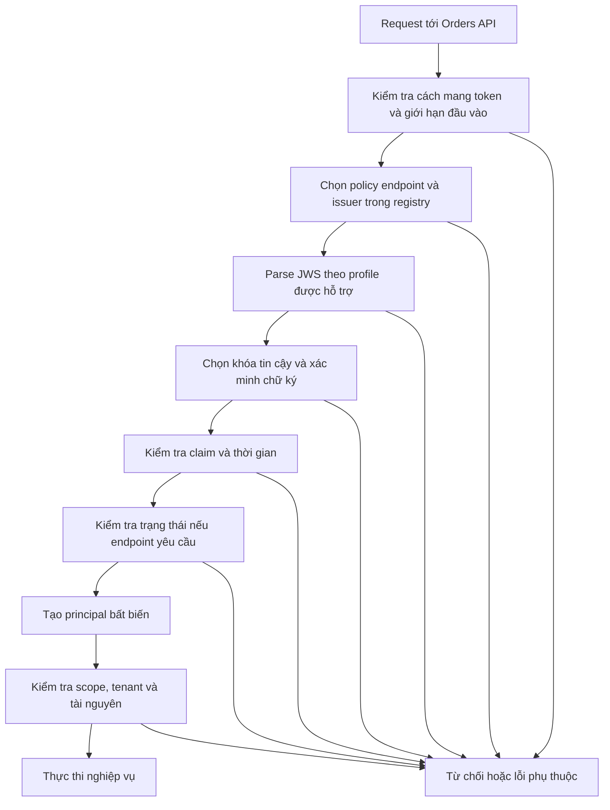

# Thiết kế token validation

## 1. Bài toán capstone

Một access token có chữ ký đúng vẫn có thể bị dùng sai: token dành cho API khác, token của tenant khác, token đã hết hạn hoặc token chỉ dành cho một ứng dụng đăng nhập. Vì vậy, thiết kế token validation phải trả lời đồng thời ba câu hỏi: ai đã cấp thông tin, thông tin có được phép dùng tại đây vào lúc này, và request cụ thể có được thực hiện hay không.

Bài thực hành sử dụng hệ thống giả định **Harbor**, một nền tảng quản lý đơn hàng đa tenant. Hệ thống gồm authorization server, ứng dụng web, workload đồng bộ dữ liệu và Orders API. Người học thiết kế bộ kiểm tra token tại Orders API, cùng hợp đồng cấu hình, xử lý lỗi và bộ nghiệm thu.

Trong bài này, các tên miền `.example`, thời lượng, endpoint và claim mở rộng là lựa chọn minh họa. Chúng giúp biến yêu cầu IAM thành một thiết kế có thể kiểm chứng, không phải cấu hình mặc định áp dụng cho mọi sản phẩm.

Sản phẩm cần bàn giao là một thiết kế giải thích được tại sao token hợp lệ được chấp nhận, token sai bị chặn ở đâu, và hệ thống xử lý thế nào khi không lấy được dữ liệu cần thiết để kiểm tra.

## 2. Chọn đúng loại token và phạm vi tin cậy

### 2.1. Hợp đồng của Harbor

Orders API chọn JWT access token có chữ ký bất đối xứng theo profile RFC 9068. Token đăng nhập OIDC, refresh token và JWT dùng để xác thực client không được dùng thay cho access token của API.

Profile này quy định `typ` là `at+jwt` hoặc `application/at+jwt`; các claim bắt buộc gồm `iss`, `exp`, `aud`, `sub`, `client_id`, `iat`, `jti`. Resource server kiểm tra chữ ký, issuer chính xác, audience phù hợp và thời hạn. Đây là profile riêng cho access token, không phải tập yêu cầu chung của mọi JWT. [RFC 9068, mục 2 và 4](https://www.rfc-editor.org/rfc/rfc9068.html#section-4).

Harbor bổ sung `tenant_id` và `actor_kind` vào hợp đồng nội bộ. Claim thứ hai phân biệt người dùng với workload; không đoán loại chủ thể chỉ từ hình thức của `sub`.

| Đối tượng nhận được | Orders API xử lý |
|---|---|
| JWT access token của Orders API | Kiểm tra theo hợp đồng đã cấu hình |
| JWT access token của Billing API | Từ chối do không dành cho Orders API |
| ID token của ứng dụng web | Từ chối; có chữ ký đúng chưa đủ |
| Refresh token | Từ chối tại resource endpoint |
| Token từ issuer chưa được đăng ký | Từ chối; không tự tạo quan hệ tin cậy |
| Opaque token | Chỉ hỗ trợ nếu endpoint được cấu hình riêng cho introspection |

Không chuyển một JWT kiểm tra thất bại sang introspection để “thử thêm”. Nếu cần hỗ trợ nhiều loại token, việc chọn profile phải dựa vào cấu hình của endpoint hoặc registry đã phê duyệt, không dựa vào việc cơ chế trước đó vừa từ chối.

### 2.2. Decode chưa tạo ra danh tính

Giải mã Base64url và đọc JSON chỉ tạo ra dữ liệu do người gửi cung cấp. Trước khi hoàn tất kiểm tra, `sub`, `tenant_id`, `scope` và `roles` đều chưa được dùng để truy vấn dữ liệu nghiệp vụ hay xây dựng principal.

Ví dụ, đọc `tenant_id=tenant-b` từ payload rồi chọn cơ sở dữ liệu tenant B trước khi xác minh là đưa dữ liệu chưa tin cậy qua ranh giới bảo mật. Trong Harbor, router xác định tenant đích từ cấu hình route đã biết; token phải chứng minh nó phù hợp với tenant đích đó sau khi được xác minh.

## 3. Các bất biến cần giữ

Người học phải thể hiện các điều kiện sau trong thiết kế:

1. Chỉ issuer nằm trong registry tin cậy mới có thể tạo principal.
2. Mỗi endpoint có audience và profile token rõ ràng.
3. Thuật toán và nguồn khóa do cấu hình server kiểm soát.
4. Dữ liệu chưa xác minh không được biến thành vai trò, tenant hoặc quyền.
5. Token hợp lệ không tự cấp quyền trên mọi đơn hàng trong cùng tenant.
6. Cache chỉ có hiệu lực trong giới hạn đã công bố; lỗi mạng không kéo dài giới hạn đó.
7. Không lấy được bằng chứng bắt buộc thì request không đi vào nghiệp vụ.
8. Mọi node áp dụng cùng phiên bản policy và cùng cách tính thời gian.
9. Token, header Authorization và bí mật client không xuất hiện trong log hoặc thông báo lỗi.

Các bất biến này là tiêu chí của capstone. Một sơ đồ có bước “validate JWT” nhưng không chỉ ra nguồn khóa, audience và điều kiện thất bại chưa đáp ứng yêu cầu.

## 4. Mô hình đe dọa

Giả sử kẻ tấn công có thể tự tạo chuỗi token, thay header và payload, gửi request trực tiếp tới service, phát lại token bị lấy cắp và gây nhiều cache miss. Không giả định mọi request đều đi qua giao diện chính thức.

| Tình huống | Điều có thể sai | Kiểm soát trong thiết kế Harbor |
|---|---|---|
| Sửa payload nhưng giữ chữ ký cũ | Vai trò hoặc tenant bị thay | Chữ ký phải được kiểm tra trước khi tạo principal |
| Dùng token được ký bởi server của kẻ tấn công | Chữ ký đúng với khóa không đáng tin | Khóa chỉ đến từ issuer đã đăng ký |
| Đổi thuật toán trong header | Bộ xác minh chọn cơ chế ngoài hợp đồng | Allowlist thuật toán theo issuer |
| Dùng ID token tại Orders API | Nhầm mục đích token | Profile, type và audience riêng |
| Gửi token của tenant A tới tenant B | Truy cập chéo tenant | Đối chiếu tenant đích sau xác minh |
| Gửi nhiều `kid` ngẫu nhiên | Mỗi request gây một lần gọi JWKS | Gộp refresh và giới hạn tải theo issuer |
| Giữ token sau khi tài khoản bị khóa | Quyền cũ còn dùng được | Hợp đồng thu hồi với giới hạn độ trễ cụ thể |
| Bỏ qua gateway và gọi thẳng service | Bỏ qua bộ kiểm tra tập trung | Service được bảo vệ bằng trust boundary rõ ràng |

Một token bearer bị lấy cắp có thể được dùng lại trong phạm vi còn hợp lệ. Kiểm tra chữ ký và `jti` không tự chứng minh người gửi hiện tại là người ban đầu được cấp token. Nếu capstone cần chống phát lại bằng cơ chế ràng buộc người gửi, phải mở rộng thiết kế bằng profile phù hợp và xác minh bằng chứng tương ứng.

## 5. Registry tin cậy và policy của endpoint

### 5.1. Cấu hình do người vận hành sở hữu

Ví dụ dưới đây là mô hình cấu hình, không phải schema của một thư viện:

```yaml
policyVersion: orders-validation-v1
resource:
  audience: "https://orders.harbor.example"
  tokenProfile: "jwt-access-token-rfc9068"
  maxTokenBytes: 8192
  clockSkewSeconds: 60
  maxLifetimeSeconds: 600
trustedIssuers:
  - issuer: "https://identity.harbor.example"
    jwksUri: "https://identity.harbor.example/keys"
    allowedAlgorithms: ["RS256"]
    allowedTypes: ["at+jwt", "application/at+jwt"]
    requireKid: true
    permittedTenants: ["tenant-a", "tenant-b"]
```

Trong Harbor, `kid` bắt buộc để việc luân chuyển khóa rõ ràng. Đây là lựa chọn của bài thực hành. Các giới hạn 8 KiB, 60 giây và 600 giây cũng là policy của Harbor; người học phải giải thích ảnh hưởng khi đổi chúng.

Registry cần có quyền cập nhật hạn chế, kiểm tra cấu hình trước khi phát hành và một phiên bản để truy vết. Cho phép tenant đăng ký issuer mới là một thay đổi quan hệ tin cậy, không chỉ là thêm một URL tùy ý vào form.

### 5.2. Discovery không thay thế việc xác định issuer tin cậy

Metadata có thể cung cấp `jwks_uri`. Khi dùng OAuth authorization server metadata, giá trị issuer trả về phải khớp issuer đã dùng để truy xuất; metadata không khớp không được sử dụng. [RFC 8414, mục 3.3](https://www.rfc-editor.org/rfc/rfc8414.html#section-3.3).

Harbor truy xuất metadata từ issuer đã đăng ký trong quá trình nạp cấu hình. Bộ kiểm tra request chỉ dùng snapshot registry đã được chấp nhận. Nó không tạo URL discovery từ bất kỳ `iss` nào do caller gửi tới.

Nếu một endpoint cho phép nhiều issuer, có thể đọc `iss` chưa xác minh để chọn một mục **đã có sẵn trong allowlist cục bộ**. Giá trị này chỉ là gợi ý chọn cấu hình. Sau xác minh, issuer phải tiếp tục khớp chính xác mục đã chọn.

Việc truy xuất JWKS có timeout, giới hạn kích thước và kiểm soát đích mạng. Redirect không được âm thầm đưa request ra ngoài các đích đã phê duyệt. Đây cũng là lý do không dùng một HTTP client với credential nghiệp vụ để tải khóa.

## 6. Pipeline kiểm tra



Sơ đồ thể hiện ranh giới tin cậy, không yêu cầu mọi thư viện phải chạy nội bộ theo đúng một thứ tự. Chẳng hạn, bộ kiểm tra có thể loại sớm header sai để giảm tải, nhưng không được coi những dữ liệu còn lại là đã xác minh.

### 6.1. Nhận token từ request

Hợp đồng Harbor sử dụng đúng một bearer credential trong header Authorization qua HTTPS. Server và proxy phải thống nhất cách xử lý header lặp, header bị gộp và kích thước tối đa.

Không nhận token từ query string trong thiết kế này vì URL dễ xuất hiện trong nhiều nơi ghi nhận request. Không lấy token từ cookie tùy ý để bù cho header bị thiếu. Một request đưa credential theo nhiều cách không được xử lý bằng cách chọn ngẫu nhiên một giá trị.

Bộ lọc xác thực chạy trước handler nghiệp vụ và trước những tác vụ có tác động. Nếu có reverse proxy kết thúc TLS, đường từ proxy đến service phải được bảo vệ theo hạ tầng đã chọn.

### 6.2. Parse cấu trúc được hỗ trợ

Harbor chỉ hỗ trợ compact JWS với ba phần. JWE, nested JWT và các kiểu mở rộng ngoài profile bị từ chối. Điều này là giới hạn của hệ thống mẫu, không phải khẳng định mọi JWT đều có ba phần.

Parser phải giới hạn độ dài và mức lồng JSON, xử lý UTF-8 đúng và không chấp nhận header hay claim trùng tên trong hợp đồng Harbor. Không tự viết parser JWT bằng cách tách chuỗi rồi gọi một hàm giải mã chung.

Header `crit` có phần mở rộng không được hỗ trợ phải dẫn tới từ chối. Không bỏ qua một yêu cầu xử lý quan trọng chỉ vì vẫn đọc được payload.

### 6.3. Chọn khóa và kiểm tra chữ ký

Trong Harbor, `alg` phải là `RS256`, còn `kid` chỉ dùng để tìm khóa trong snapshot của **đúng issuer**. Khóa được chọn phải phù hợp với thuật toán, loại khóa và mục đích xác minh. Không thử biến public key thành HMAC secret nếu header đổi sang thuật toán khác.

Khóa cache được định vị ít nhất theo cặp issuer và key ID. Hai issuer cùng sử dụng chuỗi `kid=key-1` không có nghĩa họ chia sẻ một khóa.

Không dùng `kid` như đường dẫn file hoặc chuỗi truy vấn ghép trực tiếp. Harbor không lấy khóa từ `jku`, `x5u` hay public key nhúng trong token.

Các rủi ro chọn thuật toán, tin header chứa địa chỉ khóa và nhầm loại JWT được phân tích trong JWT Best Current Practices. Việc xác minh dùng thư viện JOSE được duy trì và cấu hình tường minh. [RFC 8725, mục 3](https://www.rfc-editor.org/rfc/rfc8725.html#section-3).

Kết quả xác minh phải bao phủ đúng dữ liệu JWS được gửi. Không parse payload, chuẩn hóa JSON rồi tự ký lại một chuỗi khác để so sánh.

### 6.4. Kiểm tra claim theo hợp đồng

Sau khi xác minh mật mã, Harbor áp dụng các điều kiện nghiệp vụ của profile đã chọn:

| Dữ liệu | Điều kiện tại Orders API |
|---|---|
| `iss` | Khớp issuer của cấu hình đã chọn; không dùng so khớp tiền tố |
| `aud` | Có audience của Orders API; so khớp toàn bộ phần tử |
| `sub` | Chuỗi không rỗng; định danh được hiểu trong namespace issuer |
| `client_id` | Client đã được phép dùng profile và route tương ứng |
| `jti` | Chuỗi không rỗng; có thể dùng trong cơ chế trạng thái đã định nghĩa |
| `tenant_id` | Thuộc phạm vi issuer và khớp tenant mà request hướng tới |
| `actor_kind` | Giá trị đã thống nhất, ví dụ `user` hoặc `workload` |
| `scope` | Đúng kiểu và được phân tích theo tập giá trị, không tìm chuỗi con |

Nếu audience là mảng, kiểm tra từng phần tử; không tìm `orders` bên trong một chuỗi như `https://not-orders.attacker.example`. Nếu Harbor cho phép nhiều audience, phải giải thích rõ ý nghĩa scope ở từng tài nguyên; bài mẫu ưu tiên cấp token dành riêng cho Orders API.

Định danh chủ thể trong dữ liệu nội bộ là cặp issuer và subject. Không gộp hai người từ hai issuer chỉ vì họ có cùng `sub` hoặc cùng email.

Với workload, một `sub` hợp lệ không tự biến workload thành người dùng. Các route yêu cầu người dùng tương tác phải kiểm tra loại principal theo hợp đồng và policy riêng.

### 6.5. Kiểm tra thời gian với clock có thể điều khiển

NumericDate của JWT biểu diễn thời gian theo giây kể từ Unix epoch. `exp` là hạn sử dụng, `nbf` là thời điểm sớm nhất được chấp nhận, còn `iat` là thời điểm cấp; chúng có ý nghĩa khác nhau. [RFC 7519, mục 2 và 4.1](https://www.rfc-editor.org/rfc/rfc7519.html#section-4.1).

Harbor nhận các giá trị thời gian là số nguyên giây trong miền mà thư viện xử lý được. Không ép chuỗi `"2000000000"` thành số hoặc tự đoán timestamp tính theo mili giây. Đây là ràng buộc hẹp hơn của hệ thống mẫu.

Gọi thời điểm kiểm tra là `now`, sai lệch được phép là `S=60` giây. Hợp đồng Harbor quy định:

```text
required: exp, iat
optional: nbf

now < exp + S
nbf absent OR nbf <= now + S
iat <= now + S
exp > iat
exp - iat <= 600 seconds
nbf absent OR nbf <= exp
```

Các phép toán phải được thực hiện bằng kiểu thời gian an toàn, có kiểm tra miền giá trị để tránh tràn số. Không cộng tùy ý một số nguyên nhận từ token vào thời gian hiện tại.

Với công thức trên, token bị từ chối tại đúng `now = exp + 60`. Nếu triển khai thư viện có cách áp dụng leeway khác ở biên, phải cấu hình và kiểm thử để khớp hợp đồng đã công bố.

Giới hạn `exp-iat` là policy về tuổi thọ token do Harbor đặt thêm. Nó không thay kiểm tra hết hạn và không được áp dụng máy móc cho mọi issuer khác.

## 7. Ví dụ một quyết định chấp nhận

Sử dụng test clock cố định `now=2000000000`. Đây là dữ liệu kiểm thử, không phải token dùng trong môi trường thật.

Header sau đã được thư viện xác minh bằng khóa công khai tin cậy:

```json
{
  "alg": "RS256",
  "typ": "at+jwt",
  "kid": "orders-key-2026-11"
}
```

Payload minh họa:

```json
{
  "iss": "https://identity.harbor.example",
  "aud": "https://orders.harbor.example",
  "sub": "user-482",
  "client_id": "harbor-web",
  "iat": 1999999880,
  "nbf": 1999999880,
  "exp": 2000000480,
  "jti": "access-74c2",
  "tenant_id": "tenant-a",
  "actor_kind": "user",
  "scope": "orders:read"
}
```

Hai khối JSON trên chỉ mô tả nội dung; chúng không có chữ ký và không phải một credential có thể gửi tới API.

Request `GET /tenants/tenant-a/orders/order-19` vượt qua token validation khi các kiểm tra còn lại đều đạt. Sau đó, authorization vẫn phải kiểm tra `orders:read`, tenant của đơn hàng và quan hệ của principal với tài nguyên.

Nếu đổi request sang tenant B, token không cấp quyền ở tenant B. Nếu giữ tenant A nhưng dùng `POST` để sửa đơn hàng, scope đọc không đáp ứng scope ghi. Nếu đơn hàng thuộc một đơn vị mà người dùng không có quyền, token còn hạn cũng không đủ.

Không dùng phương thức kiểm tra như `scope.contains("orders:read")` trên chuỗi gốc. Chuỗi `orders:read-all` không tự thỏa điều kiện `orders:read`. Hãy phân tích scope thành tập và kiểm tra phần tử chính xác.

## 8. Khóa, cache và luân chuyển

### 8.1. Cache có giới hạn rõ ràng

Harbor chọn thiết kế minh họa sau:

| Thành phần | Quy tắc |
|---|---|
| Làm mới JWKS chủ động | Theo chu kỳ 60 giây, có jitter |
| Hiệu lực snapshot khóa | Tối đa 5 phút từ lần tải thành công |
| Refresh do `kid` chưa biết | Gộp theo issuer; có giới hạn tần suất |
| Negative cache | Có giới hạn số mục và thời gian ngắn |
| Lỗi tải JWKS | Giữ nguyên mốc hết hiệu lực, không tự gia hạn |
| Snapshot mới | Chỉ thay snapshot cũ sau khi kiểm tra thành công |

Một request dùng key đã có trong snapshot còn hiệu lực có thể tiếp tục được kiểm tra khi endpoint JWKS đang lỗi. Đây là sử dụng bằng chứng còn hiệu lực theo hợp đồng; không phải bỏ xác minh chữ ký.

Với `kid` chưa biết, server chỉ được thử làm mới trong giới hạn. Nếu sau lần cập nhật thành công vẫn không có khóa phù hợp thì từ chối token. Nếu không thể lấy bằng chứng vì phụ thuộc lỗi, request vẫn bị chặn và được phân loại là lỗi phụ thuộc.

Negative cache không được tăng vô hạn theo số `kid` do attacker tạo. Gộp các request refresh đang diễn ra thành một lần gọi cho cùng issuer để tránh hàng nghìn kết nối đồng thời.

### 8.2. Luân chuyển thông thường

Đợt luân chuyển có thể thực hiện theo trình tự:

1. Công bố public key mới trước khi bắt đầu ký bằng private key mới.
2. Cho các resource server thời gian cập nhật và xác minh khả năng nhận khóa.
3. Bắt đầu cấp token với key ID mới.
4. Giữ public key cũ trong thời gian cần thiết để token cũ hợp lệ được xác minh.
5. Ngừng công bố khóa cũ sau thời điểm chấp nhận cuối cùng và các khoảng dự phòng đã tính.

Trong policy hiện tại, mốc chấp nhận cuối cùng của token ký bằng khóa cũ phụ thuộc lần cấp cuối, tuổi thọ tối đa 600 giây và leeway 60 giây. Nếu issuer có ngoại lệ cấp token dài hơn, phép tính này không còn đủ.

Thay đổi thuật toán cũng cần thay policy đã phê duyệt trước khi cấp token theo thuật toán mới. Không giải quyết bằng cách mở allowlist thành mọi thuật toán thư viện hỗ trợ.

### 8.3. Sự cố lộ khóa là một quy trình khác

Khi private key bị lộ, không chờ token cũ hết hạn như một lần luân chuyển thông thường. Harbor cần cơ chế vô hiệu key ID hoặc issuer bị ảnh hưởng, đẩy cấu hình khẩn cấp và làm mất hiệu lực snapshot liên quan.

Xóa khóa khỏi JWKS không bảo đảm mọi node ngừng tin khóa ngay lập tức: snapshot đã tải có thể còn hiệu lực. Bài thiết kế phải nêu độ trễ của lệnh vô hiệu khẩn cấp và cách xác nhận từng node đã áp dụng.

Nếu có cache kết quả xác minh token, cache đó cũng phải bị vô hiệu theo sự kiện hoặc phiên bản policy; không chỉ xóa cache JWKS rồi giữ lại principal đã xác thực bằng khóa bị lộ.

## 9. Thu hồi và trạng thái tài khoản

### 9.1. Hợp đồng cho JWT xác minh cục bộ

Chữ ký không tự mang trạng thái mới nhất của tài khoản. Trong luồng chỉ kiểm tra JWT cục bộ, một token chưa hết hạn có thể tiếp tục được chấp nhận sau thao tác khóa tài khoản nếu không có kiểm tra trạng thái bổ sung.

Harbor công bố hai mức:

- Route đọc thông thường: chấp nhận thông tin token tới hạn thời gian theo policy; không hứa thu hồi ngay.
- Route đặc quyền: sau xác minh JWT, bắt buộc kiểm tra trạng thái authoritative của tài khoản và token trước mỗi request; không dùng kết quả cho phép đã cache.

Trong luồng thông thường, độ trễ thu hồi chỉ dựa vào hết hạn có thể xấp xỉ phần thời gian còn lại cộng leeway. Trong luồng đặc quyền, lỗi dịch vụ trạng thái làm request bị chặn. Các mức này phải được lựa chọn chủ động và ghi trong hợp đồng vận hành.

Nếu dùng danh sách thu hồi theo `jti`, khóa trạng thái phải bao gồm issuer. Việc có claim `jti` trong token không tự tạo danh sách thu hồi và cũng không làm bearer token trở thành token dùng một lần.

Khóa tài khoản, đổi mật khẩu, gỡ MFA và thu hồi refresh token là các sự kiện khác nhau. Thiết kế phải mô tả sự kiện nào làm access token hiện tại không được chấp nhận và thành phần nào thực thi điều đó.

### 9.2. Biến thể opaque token

Với introspection, resource server hỏi authorization server về trạng thái token. Phản hồi `active` là boolean; `active=false` không được tạo principal. Resource server cần được xác thực và được phép gọi endpoint này. [RFC 7662, mục 2](https://www.rfc-editor.org/rfc/rfc7662.html#section-2).

Nếu người học chọn biến thể opaque token, cần định nghĩa thêm audience, tenant, chủ thể và quyền từ dữ liệu introspection theo hợp đồng issuer. `active=true` chưa tự chứng minh token phù hợp với mọi route và mọi tài nguyên.

Harbor không coi HTTP 200 là đủ nếu body không hợp lệ. Chuỗi `"true"`, thiếu trường bắt buộc hoặc timeout là các tình huống khác với một phản hồi hợp lệ có `active=true`.

Cache phản hồi cho phép làm tăng khoảng thời gian quyết định cũ còn được dùng. Với một biến thể có cache 30 giây, không được hứa thu hồi tức thì. Thời hạn cache cũng không được vượt hạn token đã biết; nếu response không có hạn, phải có chính sách cục bộ rõ ràng.

Không ghi raw token vào tên metric hoặc khóa cache có thể đọc công khai. Harbor có thể dùng digest có khóa cho định danh nội bộ, đồng thời tách namespace theo issuer, endpoint và phiên bản policy.

## 10. Tạo principal và kiểm tra quyền

Pseudocode sau mô tả cách phân chia trách nhiệm; nó không thay thế API của thư viện JOSE:

```text
handle(request):
    endpointPolicy = serverPolicyFor(request.route)
    credential = readSingleBearerCredential(request)
    enforceInputLimits(credential, endpointPolicy)

    issuerPolicy = selectPreRegisteredIssuer(credential, endpointPolicy)
    verifiedClaims = joseVerifier.verifyAndValidate(
        credential,
        issuerPolicy,
        endpointPolicy,
        clock
    )

    enforceHarborClaimContract(verifiedClaims, request, endpointPolicy)

    if endpointPolicy.requiresOnlineState:
        requireAuthoritativeStateAllows(verifiedClaims)

    principal = immutablePrincipalFromVerifiedClaims(verifiedClaims)
    authorizeExactAction(principal, request.target, request.operation)
    return executeBusinessOperation(principal, request)
```

`verifyAndValidate` trong mô hình phải thực hiện đầy đủ các kiểm tra đã mô tả, không chỉ trả payload từ một hàm decode. Khi triển khai, người học cần chỉ ra kiểm tra nào do thư viện thực hiện, kiểm tra nào do adapter của ứng dụng đảm nhiệm.

Principal chỉ giữ các dữ liệu cần dùng: issuer, subject, client, loại chủ thể, tenant, scope và thông tin thời gian cần thiết. Không chuyển raw token qua mọi lớp xử lý hoặc lưu nó vào đối tượng thường bị serialize ra log.

Trong môi trường có gateway, backend không tin các header như `X-User-Id` do Internet gửi vào. Nếu chọn gateway xác minh thay backend, phải có kênh nội bộ được xác thực, loại bỏ header giả, chặn đường đi vòng và hợp đồng cho danh tính truyền xuống. Với bài mẫu, Orders API trực tiếp thực thi pipeline.

## 11. Phản hồi lỗi và khả năng quan sát

Lỗi bearer token cần phân biệt request sai, credential không hợp lệ và thiếu scope. RFC 6750 mô tả `invalid_request`, `invalid_token`, `insufficient_scope` và header `WWW-Authenticate`. [RFC 6750, mục 3.1](https://www.rfc-editor.org/rfc/rfc6750.html#section-3.1).

| Tình huống | Hành vi trong hợp đồng Harbor |
|---|---|
| Không có credential | 401 cùng bearer challenge; không thêm mã lỗi không cần thiết |
| Credential đưa theo nhiều cách hoặc request sai định dạng | 400, xử lý theo lỗi request |
| Token hết hạn, chữ ký sai, sai issuer hoặc audience | 401 với `invalid_token` |
| Principal hợp lệ nhưng thiếu scope | 403 với `insufficient_scope` |
| Không được phép truy cập đối tượng | 403 hoặc 404 theo policy chống tiết lộ tài nguyên |
| Không thể kiểm tra vì phụ thuộc bắt buộc đang lỗi | 503 theo hợp đồng vận hành; không thực thi nghiệp vụ |

Ví dụ phản hồi khi token không hợp lệ:

```http
HTTP/1.1 401 Unauthorized
WWW-Authenticate: Bearer realm="orders", error="invalid_token"
Cache-Control: no-store
```

Phản hồi công khai không cần nêu key ID có tồn tại, tên tenant nội bộ hoặc chi tiết stack trace. Nguyên nhân chi tiết có thể được giữ trong log nội bộ đã lọc dữ liệu.

Harbor ghi mã request, route, phiên bản policy, nhóm nguyên nhân, thời gian kiểm tra và tình trạng phụ thuộc. Chỉ ghi danh tính sau khi có kết quả xác minh phù hợp và có nhu cầu điều tra được xác định.

Metric có số lượng nhãn hữu hạn, ví dụ `signature_invalid`, `issuer_unknown`, `audience_mismatch`, `expired`, `key_unavailable`. Không dùng raw `sub`, `jti`, `kid` do caller đưa hoặc token làm nhãn, vì vừa có thể lộ dữ liệu vừa tạo cardinality không giới hạn.

## 12. Bộ nghiệm thu của capstone

### 12.1. Chuẩn bị fixture

Tạo issuer và cặp khóa chỉ dùng cho test. Chuẩn bị ít nhất một token hợp lệ của Orders API làm đối chứng. Các ca kiểm tra claim phải được ký hợp lệ bằng khóa test tin cậy, nếu không chúng chỉ chứng minh bước xác minh chữ ký đã chặn request.

Ví dụ, muốn kiểm tra audience sai, hãy tạo một token có chữ ký hợp lệ nhưng audience của Billing API. Nếu chỉ sửa payload của token cũ, kết quả thất bại có thể hoàn toàn do chữ ký sai.

### 12.2. Ma trận kiểm thử

| Mã | Dữ liệu hoặc tình huống | Kết quả cần chứng minh |
|---|---|---|
| V01 | Token hợp lệ và đủ quyền đối với đơn hàng | Request tới nghiệp vụ đúng một lần |
| V02 | Sửa payload mà không ký lại | Không tạo principal |
| V03 | Token ký bằng khóa attacker nhưng claim nhìn hợp lệ | Không tin khóa ngoài registry |
| V04 | Header chọn thuật toán ngoài allowlist hoặc không có chữ ký | Bị từ chối |
| V05 | ID token được ký bởi issuer tin cậy | Không được dùng làm access token |
| V06 | Token hợp lệ của Billing API | Không vượt kiểm tra audience |
| V07 | Audience là mảng có Orders API | Xử lý đúng hợp đồng mảng và policy tài nguyên |
| V08 | Audience chỉ chứa một chuỗi có tiền tố giống Orders API | Không vượt so khớp chính xác |
| V09 | Issuer khác chữ hoa, path hoặc dấu gạch cuối so với cấu hình | Không tự chuẩn hóa để tạo quan hệ tin cậy |
| V10 | Thiếu claim bắt buộc hoặc sai kiểu | Bị chặn trước nghiệp vụ |
| V11 | `exp` là chuỗi hoặc timestamp vượt miền hỗ trợ | Không ép kiểu hoặc gây tràn số |
| V12 | `now=exp+59` rồi `now=exp+60` | Lần đầu qua điều kiện hết hạn; lần sau bị chặn |
| V13 | `nbf=now+61` | Bị chặn theo leeway đã chọn |
| V14 | `iat` ở tương lai vượt leeway hoặc tuổi thọ trên 600 giây | Bị chặn theo policy Harbor |
| V15 | Token tenant A gọi route tenant B | Không đọc hoặc ghi dữ liệu tenant B |
| V16 | Workload gọi route chỉ dành cho người dùng | Bị từ chối theo loại chủ thể |
| V17 | `orders:read-all` thay cho `orders:read` | Không thỏa điều kiện scope chính xác |
| V18 | Đủ scope nhưng không có quyền trên đơn hàng | Authorization chặn truy cập đối tượng |
| V19 | Hai issuer có cùng `kid` | Không chọn chéo khóa |
| V20 | Khóa mới đã công bố và token dùng `kid` mới | Làm mới có kiểm soát rồi xác minh thành công |
| V21 | Nhiều request với `kid` ngẫu nhiên | Số lần gọi JWKS và kích thước cache được giới hạn |
| V22 | JWKS lỗi nhưng snapshot còn hiệu lực và có khóa phù hợp | Xác minh chữ ký bằng snapshot theo policy |
| V23 | Snapshot hết hiệu lực và JWKS tiếp tục lỗi | Không đi vào nghiệp vụ |
| V24 | Khóa bị vô hiệu khẩn cấp | Mọi node chặn theo giới hạn lan truyền đã công bố |
| V25 | Tài khoản bị khóa nhưng JWT còn hạn | Hành vi khớp mức thu hồi của từng route |
| V26 | Route đặc quyền không gọi được dịch vụ trạng thái | Không dùng kết quả cho phép cũ để thực thi |
| V27 | Introspection trả `active=false` hoặc sai kiểu | Không tạo principal trong biến thể opaque |
| V28 | Gọi trực tiếp backend bằng header danh tính giả | Không vượt trust boundary |
| V29 | Token quá dài, JSON trùng field hoặc extension không hỗ trợ | Bị chặn với tài nguyên xử lý hữu hạn |
| V30 | Request lỗi được ghi log | Không có raw token, Authorization hoặc secret |

V12 chỉ nói về điều kiện thời gian; để cả request được chấp nhận, các điều kiện khác vẫn phải đạt. Các ca cache và luân chuyển phải được chạy trên nhiều instance hoặc mô hình tương đương, không chỉ kiểm một biến trong bộ nhớ của một tiến trình.

Với bài kiểm tải `kid`, ghi số request đầu vào, số lần gọi JWKS, số tác vụ refresh đồng thời và số mục cache. Chỉ quan sát HTTP 401 chưa chứng minh server chống được việc làm cạn tài nguyên.

Đối với sự kiện thu hồi, ghi thời điểm thay đổi trạng thái và thời điểm từng node từ chối lần đầu. Nếu hệ thống cho phép một độ trễ, đo độ trễ đó thay vì chỉ kiểm kết quả sau khi đã đợi rất lâu.

## 13. Sản phẩm bàn giao

Người học cần bàn giao:

1. Hợp đồng token cho từng endpoint: loại token, issuer, audience, claim và policy thời gian.
2. Registry tin cậy và quy trình bổ sung hoặc vô hiệu issuer.
3. Pipeline chỉ rõ ranh giới dữ liệu chưa xác minh, principal và authorization.
4. Thiết kế khóa, cache, luân chuyển thường lệ và xử lý lộ khóa.
5. Hợp đồng thu hồi, hành vi khi phụ thuộc lỗi và giới hạn độ trễ.
6. Ma trận nghiệm thu với fixture hợp lệ, dữ liệu âm và bằng chứng trên nhiều node.
7. Quy tắc phản hồi, log và metric đủ dùng để điều tra mà không làm lộ credential.

Một thiết kế đạt yêu cầu phải lý giải được một quyết định chấp nhận bằng policy cụ thể. “JWT có chữ ký đúng” chỉ là một phần bằng chứng; quyết định cuối còn phụ thuộc mục đích token, thời gian, trạng thái, tenant và quyền trên tài nguyên đang được yêu cầu.
