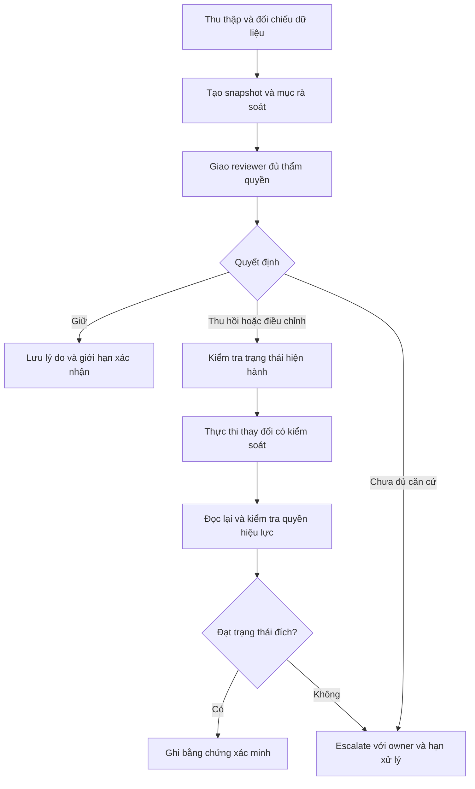

# Thiết kế access review

Một nhân viên chuyển bộ phận nhưng vẫn giữ quyền xuất báo cáo cũ. Một nhà thầu kết thúc hợp đồng nhưng còn trong nhóm hỗ trợ. Một service account vẫn có quyền quản trị sau khi dự án không còn người phụ trách. Những tình huống này cho thấy cấp quyền đúng lúc ban đầu chưa đủ: tổ chức còn phải xác nhận quyền đó có tiếp tục cần thiết hay không.

Access review là quá trình rà soát có chủ đích các quyền truy cập hiện có, đưa ra quyết định giữ, thu hồi hoặc điều chỉnh, rồi theo dõi việc thực thi đến khi có bằng chứng. Trong bài thực hành này, người học thiết kế một đợt access review cho dịch vụ SaaS nhiều tenant, bao gồm người dùng, quản trị viên và danh tính workload. Trọng tâm là quyền hiệu lực, trách nhiệm ra quyết định và khả năng chứng minh quyền không còn cần thiết đã được xử lý.

## 1. Xác định bài toán và ranh giới

Giả sử dịch vụ có cổng quản trị, API nghiệp vụ, kho báo cáo và các tác vụ nền. Quyền có thể đến từ role gán trực tiếp, thành viên nhóm hoặc role kế thừa. Một số danh tính do hệ thống bên ngoài quản lý và được đồng bộ vào ứng dụng.

Đợt rà soát cần trả lời bốn câu hỏi:

1. Chủ thể nào đang có quyền gì, trên tài nguyên hoặc tenant nào?
2. Quyền đến từ nguồn nào và còn lý do nghiệp vụ hợp lệ không?
3. Ai có đủ thông tin và thẩm quyền để quyết định?
4. Sau quyết định, quyền thực tế đã thay đổi như yêu cầu chưa?

Access review không thay thế kiểm tra phân quyền trên từng request. Một quyết định giữ quyền không cho phép bỏ qua MFA, scope tenant, thời hạn assignment hay điều kiện truy cập khác. Rà soát định kỳ cũng không thay thế việc khóa tài khoản và thu hồi quyền ngay khi có sự kiện nghỉ việc hoặc sự cố.

Đầu ra của capstone gồm chính sách đợt rà soát, mô hình dữ liệu, cách chọn reviewer, luồng thực thi quyết định, bộ bằng chứng và các ca kiểm thử. Không coi một danh sách đã đánh dấu “đã xem” là kết quả hoàn chỉnh nếu chưa biết quyền cần thu hồi đã biến mất ở hệ thống đích hay chưa.

## 2. Chốt phạm vi và lịch rà soát

Một campaign là một đợt rà soát có phạm vi, mốc dữ liệu và hạn xử lý xác định. Chính sách phải nêu rõ loại chủ thể, nguồn quyền, tenant, tài nguyên và loại quyền được đưa vào campaign.

Ví dụ chính sách cho bài thực hành:

| Nhóm quyền | Phạm vi rà soát | Nhịp rà soát minh họa | Sự kiện cần xử lý sớm |
|---|---|---|---|
| Quản trị tenant | Role quản lý tài khoản và quyền | Hằng tháng | Chuyển nhóm, thay người phụ trách, phát hiện cấp quyền bất thường |
| Xuất dữ liệu | Quyền xuất báo cáo theo tenant | Hằng tháng | Kết thúc nhiệm vụ, thay đổi loại dữ liệu được phép dùng |
| Người dùng nghiệp vụ | Role theo công việc | Hằng quý | Chuyển vị trí, nghỉ việc, hết hợp đồng |
| Danh tính workload | Role của service account hoặc workload | Hằng quý | Dừng dịch vụ, thay owner, thay phạm vi tích hợp |
| Đặc quyền khẩn cấp | Mỗi lần kích hoạt và assignment còn hiệu lực | Sau mỗi lần dùng | Quá hạn hoặc hoạt động ngoài mục đích được ghi nhận |

Các nhịp trên là lựa chọn giả định của bài thực hành, không phải lịch bắt buộc cho mọi tổ chức. Người học cần giải thích lịch đã chọn theo tác động của quyền, tốc độ thay đổi nhân sự và năng lực xử lý.

Đối với mỗi campaign, xác định ít nhất:

```text
campaignId
scopeDefinition
sourceSystems
snapshotTime
reviewDeadline
remediationDeadline
policyVersion
campaignOwner
```

Không nên gom mọi quyền của mọi hệ thống vào một đợt duy nhất nếu reviewer không đủ khả năng xử lý. Có thể tách theo tài nguyên hoặc mức ảnh hưởng, nhưng phải có cách phát hiện khoảng trống giữa các campaign. Các quyền ngoài phạm vi phải được ghi nhận rõ, không biến mất khỏi báo cáo mà không có lý do.

## 3. Lập danh mục nguồn và kiểm tra độ đầy đủ

Nguồn nhân sự giúp xác định tình trạng làm việc và quan hệ quản lý; nó không nhất thiết phản ánh đầy đủ quyền hiệu lực trong ứng dụng. Danh mục role trong hệ thống IAM cũng có thể thiếu tài khoản local hoặc quyền được gán trực tiếp tại ứng dụng đích.

Vì vậy, cần xác định nguồn có thẩm quyền cho từng loại dữ liệu:

| Dữ liệu | Nguồn sử dụng | Kiểm tra cần thực hiện |
|---|---|---|
| Tình trạng nhân viên, hợp đồng | Nguồn nhân sự hoặc hồ sơ hợp đồng | Mốc cập nhật và cách liên kết với danh tính kỹ thuật |
| Tài khoản và tenant | Directory và ứng dụng đích | Tài khoản local, tài khoản không liên kết được, tài khoản bị vô hiệu hóa |
| Assignment trực tiếp | IAM và ứng dụng đích | ID ổn định, role, scope, thời hạn, trạng thái thu hồi |
| Thành viên nhóm | Directory hoặc nhà cung cấp danh tính | Nhóm lồng nhau, thành viên từ nguồn đồng bộ khác |
| Role–permission | Kho chính sách hoặc ứng dụng | Phiên bản định nghĩa role tại thời điểm chụp |
| Workload và owner | Danh mục dịch vụ hoặc kho quản lý danh tính workload | Dịch vụ còn vận hành, owner còn hoạt động |
| Hoạt động truy cập | Log của các hệ thống liên quan | Độ phủ, thời gian lưu, nguồn thiếu dữ liệu |

Mỗi lần lấy dữ liệu cần lưu thời điểm, kết quả phân trang, lỗi nguồn và số lượng đối chiếu được. Một snapshot có checksum chỉ giúp phát hiện thay đổi trên dữ liệu đã thu thập; nó không chứng minh rằng việc thu thập đã đầy đủ.

Nếu một nguồn quan trọng không truy cập được hoặc trả dữ liệu thiếu, đánh dấu phần tương ứng là chưa đủ dữ liệu và chặn việc kết luận campaign hoàn tất trong phạm vi đó. Không biểu diễn lỗi đồng bộ thành “không có quyền cần rà soát”.

## 4. Rà soát quyền hiệu lực và đường cấp quyền

Đơn vị kỹ thuật ban đầu có thể là một assignment, nhưng quyết định nghiệp vụ thường quan tâm một quyền hiệu lực trên tài nguyên. Hai đơn vị này không luôn trùng nhau.

Ví dụ:

```text
Linh
  ├─ assignment trực tiếp → REPORT_EXPORTER → report.export tại tenant A
  └─ thành viên nhóm Ops-A → role DATA_OPERATOR → report.export tại tenant A
```

Nếu reviewer kết luận Linh không còn cần xuất báo cáo tại tenant A, xóa assignment trực tiếp chưa đạt mục tiêu vì đường qua nhóm vẫn tồn tại. Ngược lại, xóa toàn bộ nhóm `Ops-A` có thể làm nhiều người khác mất quyền hoặc ảnh hưởng tenant ngoài phạm vi.

Mỗi mục rà soát nên liên kết được:

- Chủ thể ổn định và loại danh tính: nhân sự, nhà thầu hoặc workload.
- Quyền hoặc tập permission đang có hiệu lực.
- Tài nguyên và scope tenant.
- Tất cả đường cấp quyền liên quan trong dữ liệu đã thu thập.
- Các assignment, membership và phiên bản định nghĩa role tạo ra đường cấp đó.
- Mục đích, thời hạn, nguồn phê duyệt và owner liên quan.

Có thể gom các quyền cùng trách nhiệm thành một mục để reviewer dễ hiểu, nhưng phải giữ khả năng truy ngược đến từng đường cấp. Khi quyền đến từ nhóm dùng chung, cần đưa thay đổi tới đúng owner và đánh giá tác động trước khi thực thi. Không tự ý sửa một role toàn cục chỉ để thu hồi quyền của một người.

Với nhóm lồng nhau, trình tính quyền phải xử lý chu trình và giới hạn kỹ thuật một cách rõ ràng. Nếu không tính đủ đồ thị, đánh dấu kết quả chưa xác định; không suy rằng không tìm thấy đường cấp đồng nghĩa không có quyền.

## 5. Tạo snapshot và quản lý thay đổi phát sinh

Snapshot giúp reviewer biết mình đang đánh giá trạng thái nào. Nó cần lưu ID ổn định, thời điểm và phiên bản của assignment, membership, role và quan hệ owner cần thiết. Không ghi đè snapshot cũ khi nguồn thay đổi.

Tuy nhiên, hệ thống vẫn hoạt động trong thời gian rà soát. Một assignment có thể bị thu hồi, được cấp lại hoặc đổi scope sau mốc chụp. Chính sách cần tách ba loại dữ liệu:

1. Baseline: trạng thái tại mốc snapshot, làm căn cứ cho quyết định ban đầu.
2. Delta: thay đổi sau mốc đó, được theo dõi riêng.
3. Trạng thái hiện hành: dữ liệu kiểm tra trước khi thực thi và khi xác minh.

Ví dụ reviewer đồng ý thu hồi assignment `ra-71` phiên bản 3. Trước khi tác vụ chạy, assignment được sửa thành phiên bản 4 với phạm vi khác. Tác vụ không được âm thầm áp dụng quyết định cũ lên nội dung mới. Nó cần phát hiện xung đột, tải trạng thái hiện hành và đưa mục về luồng xem xét phù hợp.

Quyền mới phát sinh có thể vào đợt bổ sung hoặc campaign kế tiếp theo chính sách. Đối với quyền nhạy cảm, cần một đường xử lý sớm. Báo cáo phải nêu rõ baseline nào đã được rà soát và delta nào còn mở; không dùng snapshot cũ để tuyên bố toàn bộ quyền hiện tại đã được xác nhận.

## 6. Phân công reviewer có đủ thẩm quyền

Người quản lý trực tiếp thường hiểu nhu cầu công việc, nhưng chưa chắc hiểu tác động của quyền trên một hệ thống. Chủ sở hữu tài nguyên hiểu dữ liệu và nghiệp vụ, nhưng có thể không biết nhân sự đã chuyển vai trò. Vì vậy quyền nhạy cảm thường cần kết hợp hai góc nhìn.

Thiết kế phân công cho bài thực hành:

| Trường hợp | Reviewer chính | Kiểm tra bổ sung |
|---|---|---|
| Quyền nghiệp vụ thông thường | Quản lý của người dùng | Owner tài nguyên khi mô tả quyền chưa rõ |
| Quyền quản trị hoặc xuất dữ liệu | Owner tài nguyên | Xác nhận nhu cầu từ quản lý và người duyệt độc lập theo chính sách |
| Quyền của workload | Owner dịch vụ | Owner tài nguyên đích xác nhận scope cần thiết |
| Quyền của chính reviewer | Người khác có thẩm quyền | Chặn tự xác nhận |
| Không có owner hợp lệ | Campaign owner tiếp nhận | Escalate để chỉ định owner hoặc xử lý rủi ro |

Việc nhân viên tự khai báo nhu cầu có ích để bổ sung ngữ cảnh, nhưng không thay thế quyết định độc lập khi chính sách yêu cầu. Người tạo campaign cũng không mặc nhiên có quyền duyệt mọi quyền trong campaign.

Nếu reviewer nghỉ phép hoặc rời tổ chức, cho phép chuyển giao với danh tính người giao, người nhận, lý do và thời gian. Hệ thống phải xác nhận người nhận có thẩm quyền và không phát sinh xung đột lợi ích. Không cho người dùng tự chọn một đồng nghiệp bất kỳ để duyệt quyền của mình.

Reviewer chỉ được xem các mục thuộc trách nhiệm được giao, trong scope phù hợp. Lý do nghiệp vụ, dữ liệu nhân sự và thông tin tài khoản có thể nhạy cảm; giao diện chỉ cần hiển thị phần đủ để ra quyết định, không đính kèm secret hoặc token.

## 7. Định nghĩa quyết định và bằng chứng

Một nút “Approve” chung dễ gây nhầm giữa xác nhận nhu cầu và cấp quyền mới. Trong campaign này, dùng các quyết định rõ nghĩa:

| Quyết định | Ý nghĩa | Điều kiện tiếp theo |
|---|---|---|
| `RETAIN` | Quyền hiện có vẫn cần thiết trong phạm vi đã xem | Lưu lý do, thời hạn xác nhận và người quyết định |
| `REVOKE` | Quyền hoặc đường cấp phải được thu hồi | Tạo yêu cầu thực thi và xác minh tại hệ thống đích |
| `MODIFY` | Cần thu hẹp hoặc thay đổi quyền | Mô tả trạng thái đích; xử lý phần cấp mới qua phê duyệt tương ứng |
| `ESCALATE` | Chưa thể kết luận do thiếu dữ liệu hoặc thẩm quyền | Giao owner và hạn xử lý; chưa tính là hoàn tất |

Quyết định `RETAIN` không kéo dài `expiresAt` của assignment. Nếu assignment sắp hết hạn mà nghiệp vụ cần tiếp tục, việc gia hạn phải đi qua quy trình cấp quyền được phép. Tương tự, `MODIFY` không phải quyền tùy ý cấp role mạnh hơn.

Thông tin reviewer cần cân nhắc gồm công việc hiện tại, loại dữ liệu, phạm vi tenant, người sở hữu tài nguyên, thời hạn, lần phê duyệt gần nhất và hoạt động sử dụng có độ phủ xác định. “Không dùng 60 ngày” là tín hiệu cần xem xét, không tự chứng minh quyền thừa: quyền khôi phục sự cố có thể ít được sử dụng nhưng vẫn cần thiết.

Ngược lại, có hoạt động gần đây không chứng minh nhu cầu hợp lệ. Hoạt động đó có thể do tác vụ tự động, tài khoản bị dùng sai hoặc chính quyền đang cần thu hồi tạo ra. Reviewer phải nêu lý do dựa trên nhu cầu nghiệp vụ, thay vì chỉ xác nhận một con số last-used.

Quyết định cần gắn với đúng nội dung được xem: chủ thể, role hoặc permission, scope, các đường cấp và phiên bản snapshot. Nếu các thành phần ảnh hưởng đến quyết định thay đổi đáng kể, yêu cầu đánh giá lại thay vì giữ nguyên dấu duyệt cũ.

## 8. Mô hình dữ liệu tối thiểu

Tách dữ liệu campaign, mục rà soát, quyết định và thực thi để không nhầm “đã quyết định” với “đã xử lý”. Một cấu trúc khái niệm có thể gồm:

```text
Campaign
  id, scope, snapshotId, policyVersion
  ownerId, reviewDeadline, remediationDeadline, status

ReviewItem
  id, campaignId, subjectId, subjectType, tenantId
  entitlement, resourceId, grantPaths, sourceVersions
  reviewerAssignments, reviewState

Decision
  id, reviewItemId, decisionVersion, decisionType
  targetState, rationale, reviewerId, decidedAt
  reviewedSnapshotId, reviewedContentDigest

Remediation
  id, decisionId, targetSystem, targetObjects
  expectedVersions, desiredState, executionState
  attempts, lastError, verificationEvidenceId
```

Ví dụ một mục thu hồi quyền xuất dữ liệu:

```yaml
reviewItemId: review-104
campaignId: tenant-a-review-01
subjectId: person-82
subjectType: HUMAN
tenantId: tenant-a
entitlement: report.export
grantPaths:
  - pathId: path-direct-71
    sourceObjectId: ra-71
    sourceVersion: 3
  - pathId: path-group-19
    sourceObjectId: membership-19
    sourceVersion: 8
reviewState: DECIDED
decision:
  type: REVOKE
  targetState: NO_EFFECTIVE_REPORT_EXPORT_IN_TENANT_A
  rationale: Người dùng đã chuyển sang công việc không cần xuất báo cáo.
  reviewerId: resource-owner-4
  version: 1
remediation:
  executionState: PENDING
```

Đây là dữ liệu thiết kế minh họa, không phải lệnh thu hồi. Thành phần thực thi vẫn phải xác định thao tác cụ thể trên từng nguồn và đánh giá ảnh hưởng của đường qua nhóm. Chuỗi `targetState` mô tả kết quả mong muốn; không thay thế việc định nghĩa thuật toán kiểm tra quyền hiệu lực.

Giữ lịch sử các phiên bản quyết định. Không sửa đè lý do hoặc người duyệt sau khi thực thi để làm hồ sơ khớp với trạng thái mới. Nếu cần thay đổi quyết định, tạo phiên bản có liên kết, lý do và kiểm tra thẩm quyền tương ứng.

## 9. Tách trạng thái rà soát và trạng thái thực thi

Phần rà soát có thể dùng `PENDING`, `IN_REVIEW`, `DECIDED` và `ESCALATED`. Phần thực thi có thể dùng `NOT_REQUIRED`, `PENDING`, `APPLYING`, `VERIFY_PENDING`, `VERIFIED`, `CONFLICT` và `FAILED`.

Ví dụ một mục đã có quyết định thu hồi nhưng API đích lỗi:

```text
reviewState    = DECIDED
decision       = REVOKE
executionState = FAILED
```

Mục đó đã được reviewer xử lý nhưng quyền chưa được chứng minh là đã thu hồi. Không hiển thị nó như một thành công hoàn chỉnh.

Luồng tổng quát:



Quyết định giữ quyền thường không cần thay đổi hệ thống đích, nhưng vẫn cần phát hiện thay đổi so với nội dung đã duyệt. Nếu cùng lúc role được bổ sung permission nhạy cảm, dấu giữ quyền trên phiên bản cũ không xác nhận phần mở rộng đó.

## 10. Thực thi thu hồi an toàn và có thể lặp lại

Thành phần thực thi nhận quyết định đã được kiểm tra thẩm quyền, không nhận một danh sách ID tùy ý từ client. Nó cần xác minh campaign, phiên bản quyết định, tenant và trạng thái hiện hành của đối tượng trước khi thay đổi.

Trình tự đề xuất:

1. Kiểm tra quyết định còn hiệu lực và chưa bị thay thế.
2. Tải assignment hoặc membership đích từ nguồn quản lý đúng đối tượng.
3. So sánh ID, scope và phiên bản với điều kiện dự kiến.
4. Đánh giá tác động nếu thay đổi ảnh hưởng nhiều người hoặc nhiều quyền.
5. Thực hiện thao tác tối thiểu cần thiết để đạt trạng thái đích.
6. Lưu kết quả yêu cầu và chuyển sang chờ xác minh.
7. Đọc lại từ hệ thống đích, tính lại quyền hiệu lực và kiểm tra các đường cấp còn lại.

Mỗi thao tác cần khóa idempotency hoặc cơ chế tương đương, gắn với quyết định, phiên bản và đối tượng đích. Retry sau lỗi mạng không được tạo một assignment mới hoặc tác động sang tenant khác. Nếu assignment đã bị xóa, vẫn phải xác minh trạng thái đích thay vì báo thành công chỉ vì API trả “không tìm thấy”.

Với hệ thống đồng bộ, xóa quyền ở ứng dụng đích có thể bị nguồn directory cấp lại. Tác vụ cần thay đổi ở nguồn điều khiển đúng đường cấp hoặc phối hợp owner nguồn đó; sau đó xác minh sau khi đồng bộ hội tụ. Một thay đổi tạm thời trên bản sao không phải thu hồi bền vững.

Nếu nguồn chưa hỗ trợ thay đổi tự động, có thể tạo việc cho người vận hành, nhưng việc chỉ được đóng sau khi có bằng chứng đọc lại. Không coi ảnh chụp màn hình thao tác gửi lệnh là bằng chứng đầy đủ cho mọi loại quyền.

Thu hồi assignment chưa chắc chặn được phiên hoặc token đã phát hành. Với quyền nhạy cảm, kế hoạch xử lý cần xác định có phải thu hồi phiên, vô hiệu hóa cache phân quyền, chặn tải file đã tạo hoặc xử lý credential riêng hay không. Xóa một assignment không tự chứng minh rằng mọi bearer token hoặc khóa truy cập liên quan đã mất hiệu lực.

## 11. Thiết kế hạn xử lý và ngoại lệ

Không phản hồi trước hạn không đồng nghĩa với đồng ý giữ quyền. Chính sách cần nêu hành động khi quá hạn: nhắc việc, chuyển người có thẩm quyền, hạn chế tạm thời hoặc tự thu hồi đối với loại quyền đã được xác định trước.

Không nên áp dụng một mặc định giống nhau cho mọi quyền. Tự thu hồi quyền xuất dữ liệu tạm thời đã quá hạn có thể phù hợp với chính sách đã công bố; thu hồi đột ngột quyền của workload đang xử lý nghiệp vụ quan trọng có thể gây gián đoạn. Với workload, cần kế hoạch giảm phạm vi hoặc chuyển danh tính cùng owner chịu trách nhiệm, trong khi vẫn xử lý rủi ro quyền không có chủ sở hữu.

Ngoại lệ phải là một bản ghi có quản lý, gồm:

- Quyền, chủ thể và scope được phép giữ tạm.
- Rủi ro, lý do và biện pháp giảm thiểu cụ thể.
- Người chịu trách nhiệm và người phê duyệt có thẩm quyền.
- Thời điểm hết hạn và điều kiện đánh giá lại.
- Liên kết đến mục rà soát và kế hoạch xử lý tiếp.

Không dùng lý do “hệ thống cũ” làm ngoại lệ vô thời hạn. Ngoại lệ không được âm thầm gia hạn theo mỗi lần tạo campaign mới. Khi ngoại lệ hết hạn, hệ thống phải đưa nó về luồng xử lý xác định trước.

Trong chính sách capstone này, mục ngoại lệ vẫn được báo riêng. Campaign chỉ được đóng khi mọi mục có kết quả hợp lệ: quyền giữ có quyết định đủ căn cứ; thay đổi đã được xác minh; hoặc có ngoại lệ còn hiệu lực được chấp nhận theo chính sách. Không còn mục thiếu dữ liệu, chờ reviewer, xung đột hoặc thực thi lỗi mà chưa có cách xử lý được phê duyệt.

## 12. Xử lý danh tính workload và quyền đặc biệt

Service account không có quản lý nhân sự theo nghĩa thông thường. Reviewer cần biết nó phục vụ dịch vụ nào, ai chịu trách nhiệm, tài nguyên đích nào cần truy cập và cơ chế credential ra sao.

Không coi “đăng nhập lần cuối đã lâu” là đủ để xóa workload. Một tác vụ theo quý hoặc dịch vụ dự phòng có thể hoạt động thưa. Cần đối chiếu lịch tác vụ, cấu hình triển khai, log có độ phủ phù hợp và xác nhận của owner dịch vụ.

Nếu không tìm được owner, đó là một mục cần xử lý riêng. Có thể chỉ định owner hợp lệ, thu hẹp quyền, chuyển workload sang danh tính được quản lý hoặc dừng workload theo kế hoạch. Việc gắn một owner bất kỳ chỉ để điền đủ trường không giải quyết trách nhiệm vận hành.

Với role quản trị khẩn cấp, rà soát cả assignment còn tồn tại và từng lần kích hoạt: ai dùng, trong bao lâu, vì lý do gì và đã kết thúc đặc quyền chưa. Có quyền được kích hoạt trong sự cố không đồng nghĩa có nhu cầu giữ assignment thường trực.

Với người dùng nhiều tenant, quyết định giữ quyền tại tenant A không được áp dụng cho tenant B. Danh tính bên ngoài hoặc tài khoản liên kết cần được đối chiếu bằng ID ổn định có ngữ cảnh nguồn; trùng email không đủ để khẳng định hai tài khoản là cùng một chủ thể.

## 13. Bộ bằng chứng và chỉ số theo dõi

Bộ bằng chứng nên cho phép một người có thẩm quyền dựng lại quá trình mà không cần tin vào lời xác nhận miệng. Nó bao gồm định nghĩa phạm vi, snapshot và nguồn dữ liệu, phân công reviewer, phiên bản quyết định, yêu cầu thay đổi và kết quả xác minh.

Lưu thời gian, actor, đối tượng, tenant, phiên bản và correlation ID cho các chuyển trạng thái quan trọng. Hạn chế quyền sửa bằng chứng, quản lý lịch sử và thời gian lưu theo chính sách của tổ chức. Không đưa secret hoặc toàn bộ dữ liệu cá nhân không cần thiết vào hồ sơ rà soát.

Các chỉ số cần tách rõ mẫu số:

| Chỉ số | Cách hiểu |
|---|---|
| Độ phủ dữ liệu | Các nguồn và đối tượng trong phạm vi đã đối chiếu được so với phạm vi phải thu thập |
| Tỷ lệ đã quyết định | Số mục có quyết định hợp lệ chia cho số mục đủ điều kiện trong baseline |
| Tỷ lệ thực thi đã xác minh | Số mục cần thay đổi đã đạt trạng thái đích chia cho tổng số mục cần thay đổi |
| Số mục quá hạn | Tách quá hạn reviewer, quá hạn thực thi và ngoại lệ hết hạn |
| Độ trễ thu hồi | Khoảng thời gian từ quyết định có hiệu lực đến khi xác minh quyền đã bị chặn |
| Delta chưa xử lý | Các thay đổi sau snapshot chưa được đánh giá theo chính sách |

Ví dụ baseline có 100 mục: 60 giữ, 25 thu hồi, 10 điều chỉnh và 5 chưa đủ căn cứ. Có thể báo 95 mục đã có quyết định cuối cùng nếu 5 mục còn lại đang escalate; không được báo hoàn tất toàn campaign. Nếu mới xác minh được 20 trong 35 mục cần thay đổi, tỷ lệ thực thi là `20/35`, không phải `20/100` và cũng không phải 100% vì reviewer đã bấm nút.

Nếu số lượng mục tăng do phát hiện quyền bị bỏ sót, cần phiên bản hóa phạm vi và mẫu số hoặc báo một đợt bổ sung. Không thay đổi mẫu số âm thầm để làm tỷ lệ hoàn thành đẹp hơn. Tỷ lệ giữ quyền cao hoặc thấp tự nó không chứng minh chất lượng rà soát; cần xem độ đầy đủ dữ liệu, lý do và kết quả thực thi.

## 14. Kịch bản thực hành xuyên suốt

Tạo dữ liệu giả lập cho tenant A gồm người dùng Bình, người duyệt Hà và workload `invoice-sync`. Bình từng làm hỗ trợ nhưng vừa chuyển sang bộ phận khác. Bình có quyền xuất báo cáo qua assignment trực tiếp và nhóm `Ops-A`; workload có quyền ghi hóa đơn cùng quyền quản trị không còn giải thích được.

Thực hiện theo thứ tự:

1. Chụp baseline của tài khoản, assignment, nhóm, role và owner; kiểm tra có đủ dữ liệu từ ứng dụng đích.
2. Tạo mục rà soát quyền xuất báo cáo của Bình, giữ cả hai đường cấp trong hồ sơ.
3. Giao owner báo cáo quyết định sau khi nhận thông tin chuyển vị trí; chặn Bình tự duyệt.
4. Ghi quyết định Bình không còn cần quyền xuất báo cáo tại A.
5. Tạo thao tác thu hồi assignment trực tiếp và xử lý đường qua nhóm theo quyền hạn của owner nhóm, đánh giá quyền khác Bình sẽ mất.
6. Xác minh quyền hiệu lực sau thay đổi, kể cả sau đồng bộ và trên phiên cũ theo chính sách thu hồi.
7. Với `invoice-sync`, yêu cầu owner dịch vụ giải thích quyền tối thiểu; thu hẹp quyền quản trị qua kế hoạch có kiểm thử, giữ khả năng ghi hóa đơn nếu còn cần.
8. Trước khi đóng campaign, đưa một thay đổi role mới vào delta và kiểm tra nó không bị dấu duyệt baseline bao phủ nhầm.

Người học cần trình bày vì sao thao tác được chọn đạt đúng trạng thái đích mà không làm ảnh hưởng các chủ thể khác. Nếu giải pháp là xóa một nhóm dùng chung hoặc sửa role toàn cục, phải chỉ ra tác động và luồng phê duyệt phù hợp; không được coi đó là bước mặc định.

## 15. Kiểm thử và điều kiện nghiệm thu

Bộ kiểm thử phải bao gồm quyết định đúng, thao tác bị từ chối, lỗi nguồn và khoảng cách giữa quyết định với quyền hiệu lực.

| Ca kiểm thử | Kết quả cần đạt |
|---|---|
| Reviewer được giao giữ quyền còn nhu cầu | Lưu đúng principal, scope, lý do và phiên bản; không tự gia hạn assignment |
| Người dùng tự xác nhận quyền nhạy cảm | Bị chặn hoặc chuyển người duyệt độc lập theo chính sách |
| Reviewer sửa ID sang mục tenant khác | Bị từ chối tại backend, không chỉ ẩn trên giao diện |
| Nguồn dữ liệu thiếu một trang | Phát hiện thiếu dữ liệu; không tạo kết luận campaign hoàn tất |
| Quyền có hai đường cấp | Xóa một đường chưa được đánh dấu đã mất quyền hiệu lực |
| Assignment đổi phiên bản sau quyết định | Chuyển sang xung đột hoặc đánh giá lại; không áp dụng mù |
| Membership do nguồn ngoài quản lý | Thay đổi đúng nguồn và xác minh không bị đồng bộ cấp lại |
| Reviewer không phản hồi | Thực hiện chính sách quá hạn; không mặc định giữ quyền |
| API thu hồi timeout nhưng đích đã đổi | Retry an toàn, đọc lại và không tạo tác dụng phụ trùng |
| API báo thành công nhưng quyền vẫn còn | Giữ trạng thái chưa xác minh hoặc lỗi; campaign chưa hoàn tất |
| Token cũ còn dùng được | Phát hiện và xử lý trong giới hạn thu hồi đã công bố |
| Workload không có owner | Có owner xử lý, hạn rõ ràng và kế hoạch giảm rủi ro; không tự đánh dấu giữ |
| Quyền mới phát sinh sau snapshot | Nằm trong delta hoặc đợt bổ sung có theo dõi |
| Ngoại lệ hết hạn | Trở lại luồng xử lý; không được gia hạn âm thầm |
| Xuất hồ sơ campaign | Có đủ bằng chứng cần thiết và chỉ người có thẩm quyền đọc được |

Nghiệm thu capstone khi người học chứng minh được ba mối liên hệ: dữ liệu nguồn bao phủ phạm vi; reviewer quyết định trên đúng quyền và đúng phiên bản; kết quả thực thi đạt trạng thái đích tại hệ thống thực tế. Các mục giữ quyền phải có căn cứ, các mục thay đổi phải có bằng chứng xác minh, và ngoại lệ phải có owner cùng thời hạn còn hiệu lực.

Một thiết kế access review có giá trị làm cho quyền truy cập tiếp tục phù hợp với trách nhiệm hiện tại. Nó nối dữ liệu danh tính, nhu cầu nghiệp vụ và cơ chế thu hồi thành một quy trình có thể kiểm tra, thay vì chỉ tạo thêm một vòng bấm xác nhận định kỳ.
