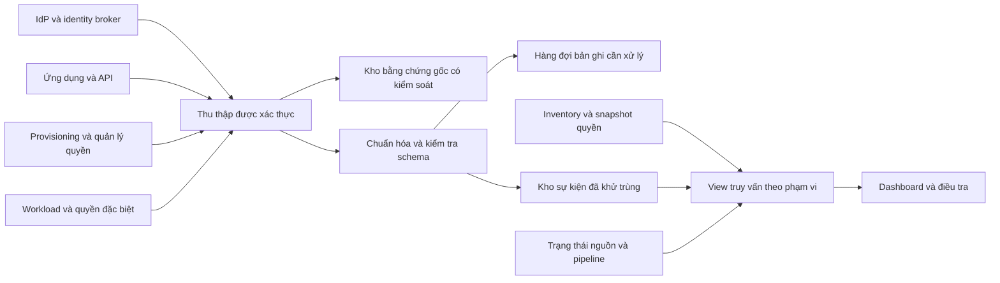

# Thiết kế IAM audit dashboard

## 1. Mục tiêu của bài thực hành

Một IAM audit dashboard hữu ích phải giúp người xem trả lời: **ai đã làm gì, đối với danh tính hoặc tài nguyên nào, trong phạm vi nào, vào thời điểm nào, theo chính sách nào và kết quả thực sự là gì**. Những biểu đồ đăng nhập thành công hoặc thất bại chỉ là một phần của câu trả lời.

Bài thực hành này yêu cầu thiết kế dashboard cho nền tảng SaaS nhiều tenant. Phạm vi bao gồm xác thực, MFA, phiên, cấp phát tài khoản, thay đổi RBAC/ABAC, federation, danh tính workload và quyền đặc biệt. Mục đích là kết nối những kiến thức IAM nền tảng thành một hệ thống quan sát có thể hỗ trợ điều tra và kiểm toán.

Sản phẩm đầu ra là bản thiết kế dữ liệu và màn hình, không bắt buộc gắn với một công cụ BI hoặc SIEM cụ thể. Một bản thiết kế tốt cần chứng minh được cả ba điều:

- Chỉ số thể hiện đúng sự kiện và trạng thái mà nó tuyên bố.
- Người xem có thể đi từ con số tổng hợp tới bằng chứng gốc trong phạm vi được phép.
- Dashboard cho biết khi dữ liệu thiếu hoặc chậm, thay vì biến sự im lặng của nguồn log thành trạng thái an toàn.

Dashboard trình bày bằng chứng và hỗ trợ quyết định. Nó không tự chứng minh toàn bộ hệ thống tuân thủ một tiêu chuẩn, cũng không thay thế kiểm tra cấu hình, rà soát quyền hoặc ứng phó sự cố.

## 2. Đề bài: nền tảng Minh An Services

Minh An Services vận hành một nền tảng đơn hàng với nhiều doanh nghiệp khách hàng. Hệ thống gồm Customer Identity Broker, Workforce IdP, các ứng dụng khách hàng, API nghiệp vụ, dịch vụ cấp phát tài khoản và cơ chế cấp quyền đặc biệt có thời hạn.

Ba nhóm sử dụng dashboard:

| Nhóm | Câu hỏi chính | Phạm vi được xem |
|---|---|---|
| Nhóm an ninh | Có thay đổi quyền hoặc hành vi đáng điều tra không? | Các nguồn và tenant theo nhiệm vụ được cấp |
| Chủ sở hữu IAM | Tài khoản, membership, quyền và vòng đời có được xử lý đúng không? | Phạm vi quản lý được phê duyệt |
| Kiểm toán viên của tenant | Ai thay đổi quyền trong tenant và có bằng chứng gì? | Dữ liệu của chính tenant đó |

Đề bài đưa ra bảy câu hỏi kiểm toán:

1. Những ai được cấp thêm quyền quản trị trong khoảng thời gian đã chọn, bởi ai và dựa trên phê duyệt nào?
2. Có thao tác nhạy cảm nào được thực hiện bằng phiên không đáp ứng chính sách xác thực tương ứng không?
3. Sau khi một nhân sự nghỉ việc hoặc membership bị thu hồi, các hệ thống đích đã thực thi thay đổi chưa?
4. Có thay đổi nào đối với kết nối SSO, client, callback hoặc cấu hình chính sách không?
5. Workload nào đang sử dụng quyền vượt ngoài mục đích đã đăng ký?
6. Nguồn audit nào đang chậm, bị gián đoạn hoặc chưa có đủ trường dữ liệu?
7. Có thể tái dựng một chuỗi sự kiện cấp quyền, sử dụng quyền và thu hồi quyền hay không?

Câu hỏi số 6 là điều kiện để diễn giải sáu câu hỏi còn lại. Nếu log của dịch vụ quyền đặc biệt đang mất, việc dashboard hiển thị “không có grant mới” chưa đủ làm bằng chứng rằng không có grant mới.

## 3. Bắt đầu từ câu hỏi và hành động, không từ loại biểu đồ

Mỗi ô thông tin cần có một hợp đồng chỉ số: ý nghĩa, nguồn, phạm vi, cách tính, giới hạn và hành động tiếp theo.

Ví dụ:

| Ô thông tin | Ý nghĩa được phép tuyên bố | Dữ liệu cần có | Hành động khi cần điều tra |
|---|---|---|---|
| Cấp quyền quản trị mới | Số thay đổi đã áp dụng thành công trong cửa sổ | Sự kiện thay đổi quyền có kết quả cuối | Mở actor, subject, grant và phê duyệt |
| Quyền đặc biệt đang hiệu lực | Trạng thái grant tại thời điểm tham chiếu | Inventory hoặc lịch sử trạng thái đầy đủ | Xác minh owner, thời hạn, mục đích |
| Yêu cầu thu hồi quá hạn | Yêu cầu chưa có xác nhận hoàn tất đúng hạn | Yêu cầu, deadline, trạng thái từng đích | Mở những hệ thống còn chưa xác nhận |
| Nguồn audit chậm | Nguồn không đạt yêu cầu độ mới | Trạng thái pipeline và checkpoint nguồn | Xử lý việc thu thập dữ liệu |
| Thao tác bị từ chối | Quyết định deny đã ghi nhận | Sự kiện authorization decision | Xem reason, policy và tài nguyên |

“Số lần cấp quyền trong ngày” và “số người đang giữ quyền” là hai loại đại lượng khác nhau. Một người được cấp rồi thu hồi trong cùng ngày vẫn góp vào số thay đổi, nhưng có thể không nằm trong inventory cuối ngày.

Không cộng mọi sự kiện có chữ “admin” thành một chỉ số. “Yêu cầu cấp”, “được phê duyệt”, “đã ghi vào kho quyền”, “đã được hệ thống đích áp dụng” và “đã sử dụng” phải có ý nghĩa riêng.

## 4. Kiến trúc dữ liệu tham chiếu

Thiết kế chọn luồng xử lý sau:



Kho bằng chứng gốc giữ bản ghi nhận được cùng metadata thu thập phù hợp. Kho chuẩn hóa phục vụ truy vấn; inventory thể hiện trạng thái. Chúng có thể dùng chung hạ tầng vật lý nếu có kiểm soát đáp ứng yêu cầu, nhưng phải giữ được ý nghĩa và quyền quản trị của từng lớp.

Bản ghi không đạt schema không được âm thầm loại bỏ. Nó cần đi vào vùng xử lý lỗi, tăng bộ đếm lỗi và có người chịu trách nhiệm. Việc giữ bản ghi gốc cũng phải theo chính sách dữ liệu; không dùng lý do “bằng chứng” để thu thập credential hoặc dữ liệu cá nhân không cần thiết.

Nguồn log phải được xác thực và nhận diện. Một trường `source_id` bên trong JSON do bên gửi tự điền không đủ chứng minh nguồn phát; collector cần đối chiếu với danh tính kết nối hoặc cơ chế xác thực đã thiết kế.

## 5. Hợp đồng sự kiện IAM

### 5.1. Phân biệt actor, subject và resource

- **Actor** là danh tính thực hiện hoặc khởi tạo hành động.
- **Subject** là danh tính bị tác động, nếu hành động có đối tượng là một danh tính.
- **Resource** là tài nguyên hoặc đối tượng cấu hình bị tác động.
- **Tenant** là phạm vi dữ liệu hoặc quyền mà sự kiện liên quan.

Ví dụ, nhân viên quản trị cấp vai trò cho một khách hàng thì actor là nhân viên, subject là khách hàng, resource có thể là grant hoặc membership. Nếu chỉ ghi `user_id`, người xem dễ hiểu sai ai được cấp quyền và ai đã cấp quyền.

Trong luồng tự động, actor có thể là workload. Khi workload hành động theo yêu cầu của một người, lưu được cả actor thực thi và người khởi tạo theo hợp đồng ủy quyền. Không thay workload bằng tên người rồi làm mất dấu thành phần đã thực sự thực thi.

### 5.2. Ví dụ bản ghi

Schema dưới đây là đề xuất riêng cho bài thực hành, không tuyên bố là schema chuẩn của một sản phẩm:

```json
{
  "schema_version": "1.0",
  "source_id": "access-control-prod",
  "event_id": "evt-01842",
  "event_type": "iam.role_assignment.applied",
  "occurred_at": "2026-11-20T03:10:12.100Z",
  "observed_at": "2026-11-20T03:10:12.600Z",
  "ingested_at": "2026-11-20T03:10:13.000Z",
  "environment": "production",
  "tenant_id": "tenant-alpha",
  "actor": {
    "principal_id": "workforce-083",
    "principal_type": "human",
    "identity_domain": "workforce"
  },
  "subject": {
    "principal_id": "customer-426",
    "principal_type": "human"
  },
  "resource": {
    "type": "role_assignment",
    "id": "grant-710",
    "role_id": "tenant-admin"
  },
  "action": "role.assign",
  "outcome": "success",
  "reason_code": "APPROVED_REQUEST",
  "policy_version": "access-policy-42",
  "request_id": "req-510",
  "correlation_id": "change-223",
  "approval_ref": "approval-972",
  "evidence_ref": "audit-evidence/01842"
}
```

Actor, subject và các giá trị trong ví dụ là dữ liệu giả lập. `evidence_ref` là tham chiếu nội bộ có kiểm soát truy cập, không phải URL công khai hoặc link mang credential.

### 5.3. Ba mốc thời gian có ý nghĩa riêng

Trong schema này:

- `occurred_at`: thời điểm nguồn cho biết sự kiện xảy ra.
- `observed_at`: thời điểm collector quan sát bản ghi.
- `ingested_at`: thời điểm pipeline đã lưu bản ghi tại lớp được định nghĩa.

OpenTelemetry cũng phân biệt thời điểm sự kiện và thời điểm hệ thống thu thập quan sát sự kiện. Vì vậy, không nên coi mọi timestamp trong pipeline là cùng một đại lượng. [OpenTelemetry Logs Data Model](https://opentelemetry.io/docs/specs/otel/logs/data-model/#field-observedtimestamp).

Thời gian cần dùng định dạng và múi giờ thống nhất khi lưu; dashboard có thể hiển thị múi giờ người dùng đã chọn. Nhãn màn hình và file export phải ghi rõ múi giờ.

Nếu đồng hồ nguồn lệch, hiệu `ingested_at - occurred_at` có thể âm hoặc không phản ánh đúng độ trễ. Dashboard phải thể hiện nhóm dữ liệu thời gian không đáng tin, thay vì ép giá trị âm thành 0 rồi công bố pipeline rất nhanh.

### 5.4. Quy ước kết quả và nguyên nhân

Thiết kế chọn `success`, `failure`, `denied` và `unknown` cho trường kết quả trong từng loại sự kiện, với bảng ánh xạ nguồn được quản lý phiên bản.

`denied` là một quyết định từ chối được ghi nhận; `failure` có thể là lỗi xử lý. Một lỗi mạng khi gọi provisioning không tương đương với việc chính sách từ chối cấp quyền.

`unknown` không được tự đổi thành `success`. Mỗi event type phải nói rõ khi nào được xem là hoàn tất. Chẳng hạn `iam.role_assignment.applied` thành công nghĩa là thay đổi đã được áp dụng tại thành phần được nêu trong hợp đồng; không suy ra mọi hệ thống hạ nguồn đã đồng bộ.

## 6. Danh mục sự kiện cần thiết

| Nhóm | Sự kiện minh họa | Điều cần giữ để điều tra |
|---|---|---|
| Xác thực | Login hoàn tất, thất bại, bị chặn | Principal nếu xác định được, client, nguồn xác thực, reason |
| MFA và khôi phục | Đăng ký, xóa, reset phương thức | Actor, subject, phương thức theo phân loại, phê duyệt |
| Phiên và token | Tạo phiên, kết thúc phiên, yêu cầu thu hồi | Tham chiếu phiên hoặc grant không phải secret |
| Vòng đời tài khoản | Tạo, khóa, mở khóa, nghỉ việc | Hệ thống có thẩm quyền, yêu cầu, kết quả từng đích |
| Membership và quyền | Thêm, đổi, thu hồi vai trò hoặc thuộc tính | Tenant, subject, quyền thay đổi, phiên bản policy |
| Federation | Thêm issuer, sửa callback, thay mapping | Cấu hình nào đổi, ai đổi, quy trình phê duyệt |
| Workload identity | Cấp credential, xoay credential, dùng quyền | Workload, owner, môi trường, tài nguyên |
| Quyền đặc biệt | Yêu cầu, phê duyệt, kích hoạt, hết hạn | Người hưởng quyền, thời hạn, lý do, phiên sử dụng |
| Chính hệ thống audit | Sửa retention, tắt nguồn, đọc hoặc export log | Actor, phạm vi, thời gian và kết quả |

Audit và telemetry hiệu năng không nhất thiết có cùng chính sách lấy mẫu. Nếu mục tiêu yêu cầu mọi thay đổi quyền quản trị đều có bằng chứng, một trace được lấy mẫu không thể làm nguồn duy nhất cho các thay đổi đó.

Đối với authentication, cần định nghĩa cấp độ đếm. Một hành trình đăng nhập có thể có redirect, thử MFA và nhiều request kỹ thuật. Dashboard của bài này đếm sự kiện hoàn tất `iam.authentication.completed` theo `attempt_id` hoặc khóa giao dịch đã quy định, không đếm mọi HTTP request thành một lần đăng nhập.

Không lưu mật khẩu, access token, refresh token hoặc session secret để “tiện điều tra”. Những thuộc tính nhạy cảm cần được loại bỏ, che hoặc xử lý theo mục đích được phê duyệt; log phải được bảo vệ khỏi truy cập và sửa đổi trái phép. [OWASP Logging Cheat Sheet, Data to exclude và Protection](https://cheatsheetseries.owasp.org/cheatsheets/Logging_Cheat_Sheet.html#data-to-exclude).

## 7. Độ đầy đủ, khử trùng và dữ liệu đến muộn

### 7.1. Khử trùng không được xóa nhầm sự kiện

Pipeline có thể giao lại một bản ghi. Bài thực hành chọn khóa duy nhất `(source_id, event_id)` cho bảng canonical và lưu thời điểm nhận đầu tiên cùng số lần giao lại trong metadata riêng.

Hai nguồn khác nhau dùng cùng chuỗi `event_id` không nhất thiết là một sự kiện. Ngược lại, nếu cùng khóa nhưng payload khác nhau, không tự chọn “bản mới nhất” và bỏ bằng chứng xung đột. Hệ thống cần cảnh báo hoặc cách ly bản ghi xung đột.

Nhiều sự kiện thuộc cùng một thao tác vẫn là các sự kiện khác nhau: yêu cầu cấp quyền, phê duyệt và áp dụng không phải duplicate. Chúng được liên kết bằng `correlation_id`, không hợp nhất chỉ vì cùng một request.

### 7.2. Đến muộn làm thay đổi số liệu

Thiết kế phân biệt:

- Biểu đồ theo thời gian xảy ra sự kiện phục vụ tái dựng hoạt động.
- Biểu đồ theo thời gian nhận dữ liệu phục vụ theo dõi pipeline.
- Mốc dữ liệu được cập nhật gần nhất phục vụ diễn giải kết quả.

Nếu sự kiện lúc 09:00 đến vào 09:20, biểu đồ hoạt động lúc 09:00 có thể được cập nhật lại. Một bản báo cáo đã xuất phải ghi thời điểm chốt và quy tắc xử lý dữ liệu đến muộn; không nên âm thầm biến bản báo cáo cũ thành một kết quả khác.

### 7.3. “Không có sự kiện” chưa phải “không có hoạt động”

Cần có registry nguồn dự kiến: tên nguồn, owner, môi trường, phạm vi tenant, loại sự kiện phải phát, điều kiện hoạt động, heartbeat hoặc checkpoint và yêu cầu độ mới.

Heartbeat chứng minh một phần của đường thu thập còn hoạt động, nhưng chưa chứng minh mọi loại sự kiện đều được ghi đầy đủ. Có thể cần đối chiếu số giao dịch có thẩm quyền, sequence hoặc checkpoint của nguồn, bản ghi outbox và số sự kiện được nhận. Mỗi nguồn phải nói rõ mức độ đảm bảo có thể đo được.

Khi nguồn dự kiến chưa có dữ liệu đủ tin cậy, ô chỉ số cần hiển thị `UNKNOWN` hoặc “Dữ liệu chưa đủ”, cùng lý do và nguồn bị ảnh hưởng. Số 0 chỉ được hiển thị khi phép đếm trên phạm vi được xác định thực sự có kết quả bằng 0.

## 8. Định nghĩa các chỉ số trước khi dựng màn hình

Mỗi chỉ số cần có tên kỹ thuật, mô tả, đơn vị, cửa sổ thời gian, tử số, mẫu số, chính sách thiếu dữ liệu và phiên bản định nghĩa. Thay đổi cách tính cần được ghi nhận; nếu không, người xem có thể hiểu nhầm một thay đổi công thức là thay đổi rủi ro.

### 8.1. Kết quả đăng nhập

Bài thực hành chọn một bảng đã xử lý nghiệp vụ `auth_terminal_attempts`, có một dòng cuối cùng cho mỗi attempt trong từng nguồn. Việc tạo bảng phải xử lý rõ retry, kết quả xung đột và giao dịch chưa hoàn tất; khử duplicate ở mức event chưa đủ thay cho bước này.

Ví dụ trong cửa sổ có 1.000 attempt đã có bản ghi kết quả cuối:

| Kết quả | Số attempt |
|---|---:|
| success | 940 |
| failure | 30 |
| denied | 20 |
| unknown | 10 |

Định nghĩa được chọn:

```text
known_completed = success + failure + denied
known_unsuccessful_rate = (failure + denied) / known_completed
unknown_outcome_rate = unknown / all_recorded_terminal_attempts
```

Kết quả là tỷ lệ không thành công đã biết xấp xỉ 5,05%, đi cùng tỷ lệ kết quả chưa rõ 1%. Mẫu số bằng 0 thì tỷ lệ là không xác định, không phải 0%.

Chỉ số này không đo số attempt bị mất hoàn toàn khỏi pipeline, cũng không bao gồm giao dịch đang chờ kết quả. Dashboard cần các ô riêng cho dữ liệu nguồn và attempt quá hạn chưa hoàn tất.

Không so sánh các tenant chỉ bằng tỷ lệ thất bại mà bỏ qua số lượng và loại client. Năm lần từ chối trên mười attempt khác rất nhiều về khối lượng với năm nghìn lần từ chối trên mười nghìn attempt.

### 8.2. MFA: đăng ký, yêu cầu và đáp ứng là ba đại lượng

Có thể thiết kế ba chỉ số riêng:

- Tỷ lệ principal thuộc diện bắt buộc MFA đã đăng ký phương thức được chấp nhận, tính trên inventory tại thời điểm tham chiếu.
- Tỷ lệ attempt được chính sách xác định cần mức xác thực tương ứng.
- Tỷ lệ attempt đã chứng minh đáp ứng mức xác thực đó, theo hợp đồng dữ liệu với IdP.

Không dùng “có phương thức MFA” để kết luận một thao tác cụ thể đã được bảo vệ bằng MFA. Một lần SSO không hiện challenge cũng chưa chứng minh không có MFA, vì hệ thống có thể tái sử dụng bằng chứng xác thực trước đó theo chính sách.

Các trạng thái thiếu claim, claim chưa được ánh xạ hoặc không biết phiên bản policy phải có nhóm riêng. Đừng gộp chúng vào nhóm “đạt”.

### 8.3. Quyền đặc biệt đang hiệu lực

Chỉ số này dựa trên inventory hoặc lịch sử trạng thái đã đủ để tái dựng tại `as_of`:

```text
grant được tính tại as_of nếu:
    đã có hiệu lực trước hoặc tại as_of
    AND chưa hết hạn tại as_of
    AND chưa bị thu hồi có hiệu lực tại as_of
    AND subject và phạm vi grant được xác định
```

Nếu báo cáo quyền thực tế tại hệ thống đích, cần dữ liệu xác nhận áp dụng hoặc snapshot từ chính hệ thống đích. Trạng thái “được phê duyệt trong hệ thống quản lý quyền” không tự chứng minh quyền đã được áp dụng ở đích.

Cần phân biệt grant trực tiếp và quyền hiệu lực thông qua nhóm, vai trò lồng nhau hoặc policy. Đếm số grant trực tiếp không được gắn nhãn “tất cả người có quyền quản trị” nếu mô hình còn có đường cấp quyền gián tiếp.

### 8.4. Thời gian thực thi thu hồi

Thiết kế theo từng cặp yêu cầu và hệ thống đích:

```text
revocation_latency(target) =
    target_enforcement_confirmed_at - revocation_requested_at
```

Một yêu cầu tới ba hệ thống phải có ba trạng thái đích. Chỉ tính hoàn tất toàn yêu cầu khi đạt điều kiện hoàn tất đã định cho mọi đích bắt buộc.

Nếu chưa có xác nhận, đó là trường hợp pending, overdue hoặc unknown. Không loại khỏi dashboard chỉ vì chưa tính được độ trễ. Percentile trên các trường hợp đã hoàn tất phải đi cùng số yêu cầu còn mở và tuổi của yêu cầu mở lâu nhất.

Trong bài này, nhóm giả định mục tiêu thực thi thu hồi là 60 giây tại các đích được chỉ định. Đây là yêu cầu giả lập, cần kiểm thử cơ chế thu hồi và xác nhận; không phải thời hạn mặc định của mọi hệ thống IAM.

### 8.5. Độ mới và phạm vi dữ liệu

Một ô sức khỏe dữ liệu nên nêu được:

```text
Nguồn dự kiến: 12
Nguồn đạt yêu cầu độ mới: 10
Nguồn chậm: 1
Nguồn chưa xác định: 1
Thời điểm đánh giá: ...
Phạm vi chỉ số bị ảnh hưởng: ...
```

Danh sách nguồn dự kiến lấy từ registry có quản lý, không chỉ lấy những nguồn đang gửi log. Nếu nguồn im lặng biến mất khỏi mẫu số, tỷ lệ nguồn khỏe sẽ đẹp lên đúng lúc việc giám sát bị yếu đi.

## 9. Truy vấn minh họa và hợp đồng sử dụng

Các truy vấn dưới đây dùng cú pháp PostgreSQL để minh họa cách tính. Đây không phải mã đã được chạy trên cơ sở dữ liệu của đề bài. Các tham số phải được bind, còn phạm vi tenant phải được backend kiểm tra theo quyền người xem.

### 9.1. Tổng hợp kết quả attempt đã hoàn tất

Giả định bảng `auth_terminal_attempts` đã đáp ứng tính duy nhất nghiệp vụ, có `tenant_id`, `completed_at` và `outcome` đã chuẩn hóa:

```sql
WITH counts AS (
    SELECT
        COUNT(*) AS total_recorded,
        COUNT(*) FILTER (WHERE outcome = 'success') AS succeeded,
        COUNT(*) FILTER (WHERE outcome = 'failure') AS failed,
        COUNT(*) FILTER (WHERE outcome = 'denied') AS denied,
        COUNT(*) FILTER (WHERE outcome = 'unknown') AS unknown
    FROM auth_terminal_attempts
    WHERE tenant_id = :authorized_tenant_id
      AND completed_at >= :from_inclusive
      AND completed_at < :to_exclusive
)
SELECT
    total_recorded,
    succeeded,
    failed,
    denied,
    unknown,
    100.0 * (failed + denied)
        / NULLIF(succeeded + failed + denied, 0)
        AS known_unsuccessful_percent,
    100.0 * unknown
        / NULLIF(total_recorded, 0)
        AS unknown_outcome_percent
FROM counts;
```

Cửa sổ nửa mở giúp hai khoảng liên tiếp không cùng tính một sự kiện đúng tại ranh giới. Màn hình hiển thị tỷ lệ cần giữ nguyên khả năng trả về null khi không có mẫu số hợp lệ.

Những kết quả chưa ánh xạ không được để lọt thành giá trị tùy ý ngoài bốn nhóm, khiến tổng nhóm không bằng tổng bản ghi. Validation phải đưa chúng vào diện xử lý rõ ràng và có bộ đếm lỗi dữ liệu.

### 9.2. Độ trễ từ nguồn tới kho canonical

Giả định `iam_audit_events` là bảng canonical có `ingested_at` bắt buộc, dùng thời điểm nhận đầu tiên và đã khử duplicate theo khóa sự kiện:

```sql
SELECT
    source_id,
    COUNT(*) AS received_events,
    COUNT(*) FILTER (
        WHERE occurred_at IS NULL
           OR ingested_at < occurred_at
    ) AS invalid_time_events,
    COUNT(*) FILTER (
        WHERE occurred_at IS NOT NULL
          AND ingested_at >= occurred_at
    ) AS valid_time_events,
    percentile_cont(0.95) WITHIN GROUP (
        ORDER BY EXTRACT(EPOCH FROM (ingested_at - occurred_at))
    ) FILTER (
        WHERE occurred_at IS NOT NULL
          AND ingested_at >= occurred_at
    ) AS p95_ingestion_delay_seconds
FROM iam_audit_events
WHERE tenant_id = :authorized_tenant_id
  AND ingested_at >= :from_inclusive
  AND ingested_at < :to_exclusive
GROUP BY source_id;
```

`percentile_cont` tính percentile liên tục và có thể nội suy. Lựa chọn đó phải được ghi trong định nghĩa chỉ số nếu cần đối chiếu với công cụ khác. [PostgreSQL, Aggregate Functions](https://www.postgresql.org/docs/current/functions-aggregate.html).

Truy vấn tách bản ghi có thời gian không hợp lệ khỏi mẫu tính percentile và vẫn đếm chúng. Nó không liệt kê nguồn không gửi bản ghi nào; cần kết hợp registry nguồn ở lớp truy vấn hoặc widget sức khỏe dữ liệu để hiển thị các nguồn im lặng.

Các truy vấn theo tenant không phù hợp để tổng hợp sự kiện toàn nền tảng có `tenant_id` rỗng. Loại sự kiện đó cần view và quyền riêng, với ngữ nghĩa “global” được khai báo; không tự gán cho mọi tenant.

## 10. Bố cục dashboard có đường dẫn tới bằng chứng

Có thể tổ chức màn hình thành bốn vùng:

```text
+----------------------------------------------------------------+
| Phạm vi được phép | Thời gian | Múi giờ | Dữ liệu chốt đến lúc ...|
+----------------------------------------------------------------+
| Sức khỏe dữ liệu: nguồn chậm, nguồn thiếu, lỗi schema, thời gian  |
+----------------------------------------------------------------+
| Thay đổi quyền | Quyền đặc biệt | Thu hồi quá hạn | Thay đổi SSO |
+----------------------------------------------------------------+
| Diễn biến theo thời gian       | Các nhóm cần điều tra           |
+----------------------------------------------------------------+
| Danh sách sự kiện -> chuỗi liên quan -> bằng chứng được phép xem |
+----------------------------------------------------------------+
```

Vùng sức khỏe dữ liệu cần hiện rõ, không bị ẩn trong một tab ít người mở. Những widget bị ảnh hưởng bởi nguồn chậm phải có trạng thái hoặc chú thích tương ứng.

Ví dụ đường đi từ một chỉ số:

1. Người xem chọn “7 thay đổi quyền quản trị đã áp dụng”.
2. Hệ thống mở danh sách bảy sự kiện thuộc đúng bộ lọc và phạm vi quyền.
3. Chọn một sự kiện để thấy actor, subject, tenant, quyền, policy và tham chiếu phê duyệt.
4. Mở timeline gồm yêu cầu, phê duyệt, áp dụng và các lần sử dụng liên quan đã biết.
5. Nếu có quyền, người xem mở bằng chứng gốc hoặc tạo export được kiểm soát.

Nếu không tìm thấy sự kiện liên quan, timeline ghi “chưa có bằng chứng liên kết”, không tự kết luận thao tác đó không xảy ra. Một `correlation_id` hữu ích cho liên kết, nhưng nó không thay thế xác thực nguồn hoặc bảo đảm dữ liệu đầy đủ.

Mỗi widget nên hiển thị đơn vị, phạm vi, thời gian và định nghĩa khi cần. Những trạng thái quan trọng cần có nhãn hoặc ký hiệu bên cạnh màu sắc để người dùng không phải dựa hoàn toàn vào màu.

## 11. Bảo vệ chính dashboard

Dashboard audit tập trung dữ liệu có giá trị điều tra và thông tin cấu trúc quyền. Vì vậy, nó cần được coi là một ứng dụng có tài nguyên nhạy cảm.

Thiết kế phân quyền theo ba chiều:

| Chiều | Ví dụ kiểm soát |
|---|---|
| Phạm vi dữ liệu | Tenant được cấp, nguồn được cấp, môi trường |
| Mức chi tiết | Tổng hợp, sự kiện đã che dữ liệu, bằng chứng gốc |
| Hành động | Xem, truy vấn sâu, export, quản lý cấu hình |

Backend phải áp dụng phạm vi ở mọi request, truy vấn, cache và job export. Việc giao diện chỉ có một tenant trong dropdown không bảo vệ dữ liệu nếu người dùng có thể sửa tham số request.

Cache tổng hợp cần gắn với phạm vi ủy quyền phù hợp; không trả bản cache toàn nền tảng cho người chỉ có quyền một tenant. Chỉ số tổng cũng có thể tiết lộ hoạt động của tenant khác, dù không hiển thị từng sự kiện.

Trường dữ liệu do bên gửi kiểm soát phải được hiển thị như dữ liệu, không được diễn giải thành HTML hoặc đường dẫn có thể chạy mã. Điều này đặc biệt quan trọng với tên tài khoản, mô tả tài nguyên và message lỗi.

Đối với export:

- Kiểm tra quyền khi khởi tạo và khi tải kết quả theo chính sách.
- Ghi phạm vi, thời gian truy vấn, thời điểm chốt dữ liệu và phiên bản định nghĩa.
- Ghi nhận ai đã export, lý do nếu quy trình yêu cầu và tham chiếu file.
- Bảo vệ file trong thời gian lưu, giới hạn khả năng chia sẻ và xử lý hết hạn.
- Khi thu hồi quyền người xem, có cơ chế xử lý các link tải hoặc job còn hiệu lực.

Các log xem và export audit phải được quản lý bằng luồng có kiểm soát. Không để việc ghi log cho một lần đọc log tự tạo chuỗi sự kiện đệ quy không giới hạn.

## 12. Bảo toàn bằng chứng và khả năng tái dựng

Thiết kế phải tách hai câu hỏi:

1. Bản ghi có còn nguyên vẹn so với lúc hệ thống lưu bằng chứng không?
2. Bản ghi có mô tả đúng điều đã xảy ra ở nguồn và có bị thiếu bản ghi khác không?

Hash, chữ ký hoặc lưu trữ hạn chế sửa đổi có thể hỗ trợ câu hỏi đầu trong những giả định tin cậy cụ thể. Chúng không tự chứng minh câu hỏi thứ hai. Một nguồn bị xâm phạm có thể phát một bản ghi sai nhưng vẫn được pipeline lưu nguyên vẹn.

Bài thực hành yêu cầu nêu rõ:

- Ai có quyền ghi, đọc, sửa retention và xóa bằng chứng.
- Log được chuyển qua kênh nào và nguồn gửi được xác thực thế nào.
- Cách phát hiện sửa đổi, thiếu chuỗi hoặc sự kiện xung đột nếu nguồn hỗ trợ.
- Khóa hoặc điểm neo kiểm chứng được quản lý độc lập ra sao.
- Lịch sử chỉnh sửa mapping, parser và công thức chỉ số.
- Khả năng truy lại bản ghi gốc sau khi dữ liệu được chuẩn hóa lại.

Một hash được lưu ngay cạnh bản ghi và cùng bị một tài khoản có quyền sửa cả hai không đủ làm bảo đảm chống sửa đổi. Nếu dùng hash chain, cần cả cách giữ điểm neo và nhận biết phần cuối chuỗi bị cắt.

Retention phải dựa trên mục đích và yêu cầu áp dụng cho tổ chức. Bài thiết kế không đặt một thời hạn chung cho mọi log; nó yêu cầu có quyết định rõ cho bằng chứng gốc, dữ liệu truy vấn, snapshot và file export. Những bản sao phụ cũng phải nằm trong phạm vi quản lý vòng đời dữ liệu.

## 13. Cảnh báo phải có owner và đường xử lý

Dashboard có thể hiển thị tín hiệu cần chú ý, nhưng chỉ số rủi ro không tự trở thành sự cố đã được xác nhận.

Ví dụ các quy tắc giả lập:

| Tín hiệu | Điều kiện minh họa | Việc cần làm |
|---|---|---|
| Cấp quyền đặc biệt ngoài quy trình | Grant đã áp dụng nhưng chưa có approval hợp lệ theo hợp đồng | Kiểm tra giao dịch và người phê duyệt |
| Thu hồi chậm | Đích bắt buộc chưa xác nhận sau 60 giây | Giao owner đích xử lý và đo tác động |
| Nguồn audit chậm | Checkpoint không đạt yêu cầu của nguồn | Điều tra pipeline và đánh dấu widget bị ảnh hưởng |
| Thay đổi federation | Callback hoặc mapping thay đổi | Đối chiếu yêu cầu thay đổi, actor và rollback |
| Workload dùng quyền lạ | Hành động ngoài profile được đăng ký | Xác minh owner, mục đích và phạm vi |

Ngưỡng 60 giây và các điều kiện trên là giả định để thực hành. Cần điều chỉnh theo hợp đồng hệ thống, lưu lượng và quy trình ứng phó.

Mỗi cảnh báo cần owner, mức độ, khóa gom nhóm, bằng chứng, trạng thái xử lý và điều kiện đóng. Nếu cùng một lỗi pipeline sinh hàng trăm cảnh báo nguồn, cần có cách liên kết hoặc gom nhóm mà vẫn giữ thông tin ảnh hưởng.

Tác vụ được phê duyệt trong cửa sổ bảo trì vẫn cần bằng chứng audit. Chỉ thay đổi cách thông báo hoặc đánh giá theo quy trình, không xóa sự kiện để đồ thị ít nhiễu.

## 14. Bộ dữ liệu thử và tiêu chí nghiệm thu

Thiết kế một bộ dữ liệu nhỏ có kết quả biết trước. Mục đích là kiểm tra cách diễn giải số liệu và ranh giới truy cập, không chỉ kiểm tra biểu đồ có hiển thị.

| Tình huống đưa vào bộ dữ liệu | Kết quả dashboard phải thể hiện |
|---|---|
| Một sự kiện được giao ba lần với cùng khóa | Một sự kiện canonical, có dấu vết giao lại |
| Cùng khóa nhưng payload khác nhau | Xung đột được phát hiện, không ghi đè âm thầm |
| Yêu cầu, phê duyệt và áp dụng cùng correlation ID | Ba bước trong timeline, không khử thành một |
| Một lần cấp rồi thu hồi quyền trong ngày | Có thay đổi trong ngày, inventory cuối ngày phản ánh đúng |
| Một grant gián tiếp qua nhóm | Không bỏ sót khi widget tuyên bố đo quyền hiệu lực |
| Một nguồn dự kiến ngừng gửi | Nguồn vẫn nằm trong registry và được đánh dấu thiếu hoặc chậm |
| Một event đến muộn 20 phút | Biểu đồ thời gian sự kiện và thời gian nhận có hành vi đúng |
| Timestamp nguồn nằm trong tương lai | Dữ liệu thời gian bất thường được đếm, không ép độ trễ về 0 |
| Không có attempt nào trong cửa sổ | Số lượng bằng 0, tỷ lệ không có mẫu số hiển thị không xác định |
| Kết quả chưa ánh xạ | Không bị tính thành thành công |
| Thu hồi ở hai đích thành công, một đích chưa rõ | Yêu cầu tổng chưa được coi là hoàn tất |
| Tenant Alpha cố xem hoặc export Beta | Backend từ chối, không rò cả số tổng |
| Người chỉ có quyền tổng hợp mở raw evidence | Bị từ chối theo quyền chi tiết |
| Message chứa ký tự xuống dòng hoặc HTML | Dữ liệu được xử lý an toàn, không giả dòng hoặc chạy nội dung |

Cần kiểm tra cả export và giao diện vì chúng có thể dùng hai đường truy vấn khác nhau. Việc widget đúng không chứng minh file export cũng dùng đúng tenant, múi giờ hoặc thời điểm chốt.

Bản thiết kế chỉ đạt tiêu chí khi người đánh giá có thể tái tính chỉ số từ bộ dữ liệu thử, truy ra bằng chứng được phép xem và nhận biết trường hợp dữ liệu chưa đủ.

## 15. Hồ sơ bàn giao

Hồ sơ nên gồm:

1. Danh sách câu hỏi kiểm toán, người dùng và hành động sau khi xem.
2. Registry nguồn cùng owner, phạm vi, hợp đồng phát sự kiện và độ mới.
3. Schema sự kiện, bảng ánh xạ và quy tắc cho actor, subject, tenant, thời gian.
4. Từ điển chỉ số, công thức, mẫu số, cửa sổ và cách xử lý trạng thái chưa rõ.
5. Mô hình inventory hoặc snapshot có thời điểm tham chiếu.
6. Wireframe, đường điều tra và phân quyền cho xem, drill-down, bằng chứng, export.
7. Thiết kế pipeline, khử duplicate, xử lý lỗi, dữ liệu đến muộn và bảo toàn bằng chứng.
8. Bộ dữ liệu thử, kết quả kỳ vọng và quy trình vận hành cảnh báo.

Câu hỏi cuối cùng để tự kiểm tra là: “Nếu dashboard ghi nhận không có thay đổi quyền quản trị trong ngày, bằng chứng nào cho thấy nguồn liên quan đã được thu thập đúng phạm vi và đủ độ mới?”. Nếu chưa trả lời được, màn hình mới thể hiện số liệu đã nhận, chưa đủ để hỗ trợ kết luận kiểm toán về toàn bộ hoạt động.
