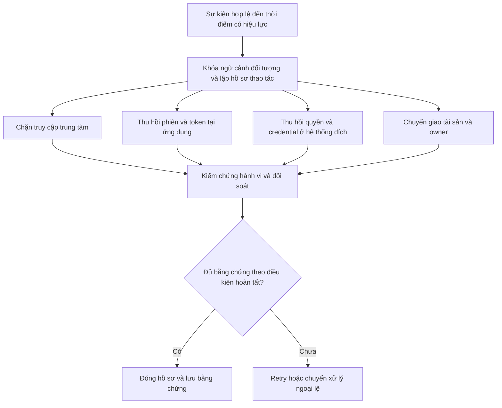

# Mô phỏng user offboarding

## 1. Mục tiêu và phạm vi thực hành

User offboarding là quy trình kết thúc quyền truy cập gắn với một người khi họ nghỉ việc, kết thúc hợp đồng hoặc không còn thuộc phạm vi được cấp quyền. Một lần khóa tài khoản ở nhà cung cấp danh tính chưa chứng minh rằng mọi phiên ứng dụng, token API, quyền đặc biệt và credential cá nhân đã ngừng hoạt động.

Trong bài thực hành này, người học xây dựng một cuộc diễn tập có dữ liệu giả lập, thời điểm bắt đầu rõ ràng và các phép thử trước/sau. Mục tiêu là trả lời bằng bằng chứng: người đã offboard còn truy cập được hệ thống nào, bằng đường nào và trong bao lâu?

Kết quả cần có:

- Một bản kiểm kê danh tính, tài khoản đích, quyền, phiên và credential liên quan.
- Một kế hoạch chặn truy cập có thứ tự và thời hạn đo được.
- Một kịch bản chạy lại an toàn khi sự kiện trùng, connector lỗi hoặc kết quả chưa chắc chắn.
- Một ma trận kiểm chứng hành vi, thay vì chỉ thu thập thông báo “thành công” của API quản trị.
- Một báo cáo phân biệt thu hồi truy cập, chuyển giao trách nhiệm và xử lý dữ liệu.

Mọi thao tác mô phỏng bên dưới dành cho tenant thử nghiệm và tài khoản giả lập. Các tên API, ngưỡng thời gian và trạng thái workflow nội bộ là thiết kế mẫu của bài học; khi triển khai phải ánh xạ sang khả năng thực tế của từng hệ thống.

## 2. Tình huống: nhân viên có nhiều đường truy cập

Nhân viên giả lập Linh có mã hồ sơ nội bộ `person-003`, thuộc đợt làm việc `employment-003-v2`. Linh sẽ kết thúc quyền workforce tại thời điểm `T0`.

Môi trường diễn tập gồm:

| Thành phần | Trạng thái trước offboarding | Đường truy cập cần kiểm chứng |
|---|---|---|
| IdP workforce | Tài khoản hoạt động, đã đăng ký MFA | Đăng nhập mới, SSO và khôi phục tài khoản |
| Ứng dụng Expense | Có phiên trình duyệt trên hai thiết bị | Cookie phiên cũ, API và kết nối đang mở nếu có |
| API tài liệu | Có access token và refresh token | Truy cập bằng token đã cấp; xin token mới |
| SaaS quản lý dự án | Được provision qua SCIM | SSO, phiên cục bộ và đăng nhập trực tiếp nếu được bật |
| Kho mã nguồn | Có membership, PAT và SSH key cá nhân | API qua PAT; thao tác Git qua SSH |
| Hệ thống đặc quyền | Có quyền quản trị đủ điều kiện và một phiên đang hoạt động | Kích hoạt quyền mới; tiếp tục phiên đặc quyền cũ |
| Tác vụ báo cáo | Chạy bằng workload riêng nhưng Linh là owner quản trị | Khả năng quản lý của Linh và tính liên tục của tác vụ |
| Kho tài liệu | Có tài liệu nhóm và một liên kết chia sẻ công khai | Quyền trực tiếp, quyền nhóm và truy cập không cần danh tính |

Người dùng kiểm soát `user-control-01` có quyền tương tự nhưng không nằm trong hồ sơ offboarding. Tác vụ `svc-report-nightly` là danh tính máy độc lập. Hai đối tượng này giúp phát hiện việc thu hồi quá rộng gây ảnh hưởng ngoài mục tiêu.

Phạm vi của tình huống là toàn bộ quyền workforce của Linh trong tổ chức thử nghiệm. Một tài khoản khách ở tổ chức khác, hay người khác trùng tên/email, không tự động thuộc phạm vi đó. Nếu bài toán chỉ kết thúc một membership tenant, phải thu hẹp tác động về membership đó thay vì vô hiệu hóa danh tính dùng chung trên mọi tenant.

## 3. Xác định đúng người và đúng lần làm việc

### 3.1. Không dùng email làm khóa thu hồi duy nhất

Email có thể đổi, được tái cấp phát hoặc xuất hiện trên nhiều tài khoản. Một ánh xạ đối tượng đáng tin cậy cần giữ được quan hệ giữa hồ sơ nghiệp vụ, danh tính tại IdP và tài khoản tại từng hệ thống đích.

```text
person-003
  employmentInstanceId = employment-003-v2
  workforce identity = issuer + subject
  IdP accountId = idp-user-8f3
  Expense accountId = expense-user-91
  SCIM target userId = scim-user-a17
  repository memberId = repo-member-62
```

Với OIDC, cặp issuer và subject giúp định vị danh tính trong đúng miền phát hành. Tuy nhiên, không giả định giá trị subject giống nhau ở mọi ứng dụng: một triển khai có thể dùng subject riêng cho từng client. Bảng ánh xạ provisioning và tài khoản đích phải giải quyết quan hệ đó.

Trước khi chạy, kiểm tra từng ID đích thuộc đúng tenant, đúng người và đúng đợt làm việc. Nếu có hai bản ghi ứng viên hoặc thiếu ánh xạ, đưa phần việc đó vào trạng thái cần xử lý, không tự chọn bản ghi đầu tiên theo tên.

### 3.2. Sự kiện offboarding có ngữ cảnh đầy đủ

Ví dụ sự kiện nội bộ dùng cho diễn tập:

```yaml
eventId: offboard-event-003-008
eventType: employment.ended
source: hr-simulator
personId: person-003
employmentInstanceId: employment-003-v2
sourceVersion: 8
effectiveAt: '2026-12-01T17:00:00+07:00'
mode: SCHEDULED
scope: ORGANIZATION_WORKFORCE
caseId: offboard-case-003
approvalRef: approval-lab-003
```

Đây là schema giả lập, không phải chuẩn giao thức IAM. `effectiveAt` có múi giờ tường minh. Nguồn sự kiện, thẩm quyền phê duyệt và tính toàn vẹn thông điệp phải được xác minh trước khi áp dụng. Chỉ ghi tên nguồn trong JSON/YAML không khiến một thông điệp trở nên đáng tin cậy.

`employmentInstanceId` phân biệt một người quay lại làm việc với lần làm việc trước. `sourceVersion` hỗ trợ xử lý thứ tự trong cùng luồng đối tượng do nguồn chuẩn quản lý. Không dùng thời gian nhận thông điệp làm tiêu chí duy nhất để quyết định trạng thái mới nhất.

Nếu một sự kiện onboarding cũ đến sau offboarding, hệ thống không được tự cấp lại quyền. Nếu Linh được tuyển lại theo một đợt mới, việc cấp quyền phải theo một hồ sơ mới được phê duyệt, không phải bằng cách chạy ngược toàn bộ thao tác offboarding cũ.

## 4. Chốt điều kiện đúng trước khi diễn tập

Nhóm cần viết các bất biến có thể kiểm tra. Trong tình huống này:

1. Sau thời điểm có hiệu lực, Linh không được thiết lập truy cập workforce mới ngoài khoảng trễ đã công bố.
2. Phiên và credential đã cấp trước đó phải bị vô hiệu hóa hoặc bị chặn tại điểm truy cập trong thời hạn của từng lớp kiểm soát.
3. Không được dùng role, group, quyền trực tiếp, tài khoản cục bộ hoặc phiên đặc quyền để đi vòng.
4. Sự kiện trùng và retry không làm mở lại tài khoản hoặc cấp lại quyền.
5. Một SaaS bị lỗi không được ngăn các nhánh thu hồi khác tiếp tục chạy.
6. Tài liệu và log cần giữ được bảo toàn theo chính sách của bài thực hành.
7. Người dùng kiểm soát và workload không liên quan tiếp tục hoạt động.

Đặt mục tiêu diễn tập cụ thể, chẳng hạn:

| Kiểm soát | Mục tiêu mẫu tính từ T0 | Bằng chứng cần có |
|---|---|---|
| Chặn đăng nhập mới ở IdP | Không quá 30 giây | Thử đăng nhập bị chặn; kiểm tra trạng thái tài khoản |
| Chặn phiên Expense và access token tại API có cơ chế kiểm tra trạng thái | Không quá 60 giây | Cookie/token cũ không thực hiện được thao tác được bảo vệ |
| Thu hồi refresh grant và credential cá nhân | Không quá 60 giây | Không cấp token mới; PAT/key cũ không dùng được |
| Đồng bộ vô hiệu hóa SaaS | Không quá 5 phút | Readback tài khoản đích và thử đường đăng nhập/phiên đã kiểm kê |
| Chuyển giao owner của tài sản nhóm | Không quá một ngày làm việc trong kịch bản | Owner mới nhận đúng quyền; Linh không còn quyền quản lý |

Các số này là yêu cầu của môi trường mẫu, không phải bảo đảm của OAuth, OIDC, SCIM hoặc mọi nhà cung cấp. Nếu kiến trúc hiện tại không đáp ứng được một ngưỡng, báo kết quả không đạt và chỉ rõ cửa sổ truy cập còn lại.

Trong kịch bản có lịch, `T0` là thời điểm offboarding có hiệu lực đã được xác nhận. Với tình huống khẩn cấp, `T0` là thời điểm lệnh thu hồi hợp lệ được hệ thống tiếp nhận để thi hành ngay. Ghi thêm thời điểm nguồn phát sự kiện và thời điểm hệ thống nhận để không che giấu độ trễ đầu vào.

## 5. Kiểm kê các lớp truy cập

Một bảng kiểm kê tốt ghi cả nơi cấp quyền và nơi thực thi quyền:

| Lớp | Cần tìm | Hành động thu hồi trong thiết kế |
|---|---|---|
| Danh tính trung tâm | Trạng thái người dùng, credential đăng nhập, recovery, liên kết IdP | Vô hiệu hóa theo chính sách, chặn đăng nhập và thay đổi recovery trái phép |
| Phiên | Phiên IdP, phiên từng ứng dụng, phiên trên nhiều thiết bị | Kết thúc hoặc đánh dấu không còn hợp lệ tại từng điểm thực thi |
| OAuth | Refresh grant, access token, quyền ứng dụng đã ủy quyền | Thu hồi grant/token và kiểm chứng tác động tại authorization server lẫn resource server |
| Authorization | Group, role, quyền trực tiếp, ACL, scope, quyền kế thừa | Thu hồi tất cả đường cấp quyền thuộc phạm vi |
| Credential cá nhân | PAT, API key, SSH key, chứng thư, mật khẩu cục bộ | Thu hồi ở hệ thống đã phát hành hoặc điểm xác thực tương ứng |
| Đặc quyền | Phân công đủ điều kiện, lần kích hoạt, phiên PAM, credential đã checkout | Ngăn kích hoạt mới, chặn phiên hiện hữu, xử lý credential đã được tiết lộ |
| Ứng dụng đích | Tài khoản SCIM và tài khoản ngoài provisioning | Vô hiệu hóa, thu hồi phiên/credential cục bộ theo khả năng ứng dụng |
| Tài sản và trách nhiệm | Chủ sở hữu tài liệu, automation, ứng dụng, phê duyệt đang chờ | Chuyển giao bằng danh tính người hoặc workload phù hợp |
| Truy cập không gắn danh tính | Link công khai, bearer URL, bí mật dùng chung đã biết | Thu hồi link hoặc xoay bí mật khi thuộc phạm vi kiểm soát |

Không thể thu hồi khả năng đọc một bản dữ liệu đã được tải xuống trước đó chỉ bằng khóa tài khoản. Báo cáo phải phân biệt chặn truy cập tương lai với dữ liệu đã rời khỏi hệ thống. Tương tự, tắt tài khoản không tự vô hiệu hóa liên kết chia sẻ công khai vốn không yêu cầu danh tính.

## 6. Chuẩn bị baseline và phép thử đối chứng

Trước `T0`, tạo bằng chứng rằng các đường truy cập thực sự hoạt động:

- Đăng nhập Linh trên hai phiên trình duyệt độc lập.
- Dùng cookie phiên gọi một thao tác đọc không gây thay đổi dữ liệu.
- Dùng access token gọi API và refresh token xin một access token mới.
- Dùng PAT thực hiện thao tác đọc thử; dùng SSH key kiểm tra quyền đọc repository thử nghiệm.
- Mở một phiên đặc quyền có kiểm soát, nếu môi trường hỗ trợ.
- Tạo một job hoặc báo cáo do Linh quản lý nhưng thực thi bằng workload riêng.
- Xác nhận `user-control-01` và workload có thể thực hiện đúng nghiệp vụ của chúng.

Nếu một credential đã hỏng trước khi offboarding, việc nó tiếp tục bị từ chối sau đó không chứng minh quy trình thu hồi có tác dụng. Gắn kết quả baseline với từng phép thử, từng đối tượng đích và thời điểm đo.

Credential của lab cần được giữ trong nơi chứa bí mật của test harness; báo cáo chỉ ghi ID hoặc fingerprint phù hợp. Không chép access token, refresh token, PAT, private key hoặc cookie vào log và ảnh chụp báo cáo.

Đóng băng danh sách mục tiêu của lượt diễn tập nhưng vẫn cho phép bổ sung tài khoản được phát hiện muộn bằng một bản cập nhật có dấu vết. Không đánh dấu “đã bao phủ tất cả” nếu mới kiểm tra các ứng dụng dễ tích hợp.

## 7. Thực hiện quy trình theo các nhánh độc lập



Sơ đồ biểu diễn các nhánh có thể được điều phối song song theo phụ thuộc thực tế. Không chờ chuyển giao tài liệu hoàn tất mới bắt đầu chặn truy cập. Trong trường hợp khẩn cấp, ưu tiên containment; các việc bàn giao chưa xong không phải lý do tiếp tục giữ credential của người đã offboard.

### 7.1. Chặn danh tính và cấp truy cập mới

Áp dụng trạng thái vô hiệu hóa tại IdP theo cơ chế quản trị được hỗ trợ. Đồng thời kiểm tra luồng đăng nhập mới, SSO và khôi phục tài khoản. Việc đổi mật khẩu đơn lẻ không bao phủ phiên đang có, đăng nhập liên kết hay mọi credential khác.

Nếu ứng dụng sử dụng JIT provisioning, phải bảo đảm một lần đăng nhập hoặc sự kiện đồng bộ muộn không tạo lại tài khoản hoạt động. Nguồn quyền và quy tắc trạng thái phải nhận biết hồ sơ đã bị kết thúc.

### 7.2. Kết thúc phiên ở IdP và ứng dụng

Phiên IdP và phiên ứng dụng là hai đối tượng khác nhau. Một ứng dụng có thể tiếp tục chấp nhận cookie cục bộ dù IdP đã tắt tài khoản. Cần kiểm tra từng ứng dụng có cơ chế hủy phiên hay đánh giá lại trạng thái người dùng.

OIDC Back-Channel Logout cho phép OpenID Provider gửi thông báo logout trực tiếp tới Relying Party. Ứng dụng đích vẫn phải xác minh thông báo và kết thúc phiên được xác định; cơ chế này không tự thay thế toàn bộ quy trình offboarding hoặc thu hồi mọi grant offline. [OpenID Connect Back-Channel Logout 1.0](https://openid.net/specs/openid-connect-backchannel-1_0.html)

Thử lại cả hai phiên trình duyệt đã mở từ baseline. Nếu có kết nối kéo dài như WebSocket hoặc phiên đặc quyền, xác định rõ cách đóng kết nối hay kiểm tra lại quyền theo hành động; chặn request HTTP mới không chứng minh kết nối cũ đã mất quyền.

### 7.3. Thu hồi token và grant

Thu hồi refresh token hoặc grant nhằm ngăn cấp token tiếp theo. Nhưng access token đã cấp có thể còn được resource server chấp nhận tùy cơ chế kiểm tra trạng thái, cache và chính sách thu hồi.

RFC 7009 mô tả token revocation và quan hệ thu hồi token liên quan, đồng thời lưu ý sự khác biệt về hỗ trợ và độ trễ lan truyền. Phản hồi HTTP 200 của revocation endpoint cũng được dùng cho token không hợp lệ, nên không chứng minh một resource server cụ thể đã từ chối token cũ. [RFC 7009 — OAuth 2.0 Token Revocation](https://www.rfc-editor.org/rfc/rfc7009.html)

Trong lab, thực hiện hai phép thử riêng: dùng refresh token cũ để xin token mới và dùng access token đã có để gọi API. Nếu API chỉ kiểm tra chữ ký và thời hạn JWT cục bộ, không nhận trạng thái thu hồi nào, việc khóa IdP không tự làm JWT hết hạn sớm.

Để đáp ứng mục tiêu 60 giây của ví dụ, nhóm phải có cơ chế thực thi thích hợp như kiểm tra trạng thái chủ thể, introspection có chính sách cache phù hợp hoặc thông tin thu hồi được phân phối tới điểm truy cập. Không giải quyết bằng cách đổi khóa ký toàn hệ thống cho một người dùng; cách đó có phạm vi ảnh hưởng khác và cũng phụ thuộc hành vi cache khóa của bên xác minh.

### 7.4. Vô hiệu hóa tài khoản đích qua SCIM

Ví dụ request cho SCIM service hỗ trợ PATCH:

```http
PATCH /scim/v2/Users/scim-user-a17 HTTP/1.1
Host: saas-lab.example.com
Authorization: Bearer <SCIM_CONNECTOR_CREDENTIAL>
Content-Type: application/scim+json

{
  "schemas": ["urn:ietf:params:scim:api:messages:2.0:PatchOp"],
  "Operations": [
    {
      "op": "replace",
      "path": "active",
      "value": false
    }
  ]
}
```

Đường dẫn và ID là ví dụ của lab; request chỉ được gửi sau khi ánh xạ chính xác tài khoản. `active` là trạng thái quản trị của User trong SCIM; ý nghĩa triển khai cụ thể do service provider quyết định. Vì vậy phải xác nhận tác động tới đăng nhập và phiên của sản phẩm đích. [RFC 7643, thuộc tính active](https://www.rfc-editor.org/rfc/rfc7643.html#section-4.1.1)

Cấu trúc PatchOp dựa trên giao thức SCIM PATCH. Trước khi dùng cần biết service có hỗ trợ thao tác này và xử lý lỗi đúng hợp đồng. Đây không phải một lệnh xóa User hoặc xóa dữ liệu nghiệp vụ. [RFC 7644 — Modifying Resources Using PATCH](https://www.rfc-editor.org/rfc/rfc7644.html#section-3.5.2)

Sau thao tác, đọc lại User bằng quyền quản trị hợp lệ và thử các đường truy cập đã kiểm kê. Nếu `active=false` nhưng một PAT cục bộ còn dùng được, ghi nhận đó là nhánh thu hồi còn thiếu; không đánh dấu hoàn thành dựa riêng vào field `active`.

### 7.5. Thu hồi authorization và đặc quyền

Loại bỏ hoặc vô hiệu hóa các phân công group, role, quyền trực tiếp và ACL nằm trong phạm vi. Kiểm tra cả quyền kế thừa và vai trò được gán ở một tenant khác của cùng tổ chức nếu hồ sơ offboarding bao phủ chúng.

Với quyền đặc biệt, xử lý ít nhất ba đối tượng: khả năng được kích hoạt trong tương lai, lần kích hoạt hiện còn hiệu lực và phiên đang sử dụng quyền đó. Chỉ xóa trạng thái eligible không chứng minh phiên quản trị hiện tại đã bị chặn.

Nếu người dùng từng checkout một mật khẩu dùng chung, khóa tài khoản cá nhân không làm họ quên bí mật. Xoay credential dùng chung theo quy trình có kiểm soát, cập nhật bên tiêu thụ và kiểm thử tính liên tục. Ghi rõ ai chịu trách nhiệm, phạm vi và bằng chứng hoàn tất.

## 8. Bảo toàn workload và chuyển giao trách nhiệm

Linh là owner quản trị của `svc-report-nightly` không có nghĩa workload đó phải bị vô hiệu hóa cùng tài khoản Linh. Nhóm cần xác định credential thực tế mà tác vụ đang dùng.

| Tình huống | Cách xử lý trong diễn tập |
|---|---|
| Tác vụ dùng danh tính workload độc lập, có owner nhóm | Thu hồi quyền quản lý của Linh, chuyển trách nhiệm và kiểm tra tác vụ vẫn chạy |
| Tác vụ dùng PAT cá nhân của Linh | Thay bằng danh tính phù hợp; thu hồi PAT theo thời hạn; xác nhận tác vụ sau chuyển đổi |
| Linh biết secret dùng chung của workload | Lập nhánh xoay secret, cập nhật consumer và kiểm tra secret cũ không dùng được |
| Linh là người duy nhất phê duyệt job hoặc sở hữu ứng dụng tích hợp | Chuyển owner/quy trình phê duyệt để tránh tài sản không có người chịu trách nhiệm |

Không trì hoãn chặn truy cập khẩn cấp chỉ để giữ một automation phụ thuộc tài khoản cá nhân tiếp tục chạy. Nếu chưa thể chuyển đổi ngay, báo ảnh hưởng vận hành, owner xử lý và biện pháp thay thế; không âm thầm giữ credential cá nhân còn hiệu lực.

Với tài liệu, chỉ chuyển những tài sản nghiệp vụ thuộc phạm vi bàn giao cho chủ thể được phê duyệt. Không trao toàn bộ danh tính, mật khẩu hay phiên của Linh cho người tiếp nhận. Các tác vụ đang chờ phê duyệt phải được tái phân công bằng hành động có dấu vết, không giả mạo quyết định của người đã nghỉ.

Vô hiệu hóa truy cập và xóa dữ liệu là hai quyết định khác nhau. Trong lab, giữ bản ghi người dùng và audit trail ở trạng thái phù hợp để đối soát. Thời hạn lưu giữ hoặc xóa sau đó được xác định bằng chính sách của tổ chức, không suy ra từ chữ “offboarding”.

## 9. Retry, sự kiện trùng và kết quả chưa chắc chắn

### 9.1. Theo dõi trạng thái từng nhánh

Ví dụ trạng thái của một thao tác đích:

```text
PENDING -> DISPATCHED -> ACKNOWLEDGED -> VERIFIED
                    \-> UNKNOWN_RESULT -> RECONCILING
                    \-> RETRYABLE_FAILURE
                    \-> MANUAL_REQUIRED
```

`ACKNOWLEDGED` nghĩa là phía đích đã nhận hoặc phản hồi; `VERIFIED` nghĩa là trạng thái và hành vi cần kiểm chứng đã phù hợp. Không gom tất cả thành một cờ `done=true` ngay khi request trả về.

Nếu request timeout, đích có thể đã xử lý nhưng phản hồi bị mất. Đọc lại trạng thái hoặc tra cứu operation trước khi thực hiện một thao tác có thể gây hậu quả lặp. Với mục tiêu “đảm bảo tài khoản inactive”, retry có thể được thiết kế idempotent; với chuyển owner hoặc xoay secret, cần cơ chế nhận diện phiên bản và thao tác đã hoàn tất.

### 9.2. Chống xử lý sai thứ tự

Lưu `eventId`, đợt làm việc và phiên bản nguồn đã áp dụng. Cần phối hợp kiểm soát đồng thời để hai consumer không cùng ghi các trạng thái trái ngược cho một người.

Pseudocode mô tả điều phối, không phải mã Java chạy độc lập:

```java
void onEmploymentEnded(Event event) {
    verifyTrustedSourceAndScope(event);
    SubjectRef subject = resolveExactIdentity(event);

    CaseRef caseRef = transaction(() -> {
        assertEmploymentInstanceMatches(subject, event);
        ignoreIfDuplicateOrSuperseded(event);
        persistOffboardingIntent(subject, event);
        return enqueueIndependentTargetActions(event);
    });

    // Worker riêng xử lý từng action từ hàng đợi bền vững.
    // Mỗi action có idempotency key và bước reconcile + verify.
    scheduleVerification(caseRef);
}
```

`ignoreIfDuplicateOrSuperseded` phải kết thúc xử lý sự kiện không áp dụng hoặc trả lại hồ sơ hiện có; nó không được chỉ ghi log rồi để luồng tiếp tục enqueue thêm tác động. Trong triển khai thực tế, việc ghi intent và phát công việc cần cơ chế tránh mất thông điệp, chẳng hạn hàng đợi giao dịch hoặc outbox phù hợp.

Retry dùng backoff và giới hạn tốc độ của connector. Lỗi cần phê duyệt hoặc sai ánh xạ không được retry vô hạn như lỗi mạng. Đưa vào hàng đợi xử lý ngoại lệ với người phụ trách, thời hạn và mức phơi nhiễm hiện tại.

### 9.3. Hệ thống đích không sẵn sàng

Cho SaaS dự án trả lỗi tạm thời trong ba phút. Các nhánh IdP, Expense, API và credential vẫn phải hoàn tất theo thời hạn riêng. Hồ sơ tổng thể ghi SaaS còn pending hoặc đang retry.

Nếu SaaS có local login và phiên cục bộ còn hoạt động, chặn IdP chỉ bảo vệ đường SSO mới. Cần dùng biện pháp quản trị khác của SaaS hoặc biện pháp containment thực sự bao phủ các đường còn lại. Khi chưa có biện pháp hữu hiệu, báo truy cập còn tồn tại; không coi SaaS outage là bằng chứng quyền đã bị thu hồi.

Sau khi SaaS phục hồi, connector đọc lại trạng thái, áp dụng mục tiêu còn thiếu và chạy lại phép thử. Việc đã vượt thời hạn 5 phút vẫn phải được giữ trong kết quả; thành công về sau không xóa lần vi phạm trước đó.

## 10. Ma trận kiểm chứng sau offboarding

Các phép thử dùng credential/phiên đã được chứng minh hoạt động ở baseline:

| ID | Phép thử | Kết quả mong đợi | Bằng chứng bổ sung |
|---|---|---|---|
| OF-01 | Đăng nhập workforce mới bằng danh tính Linh | Bị chặn trong thời hạn IdP | Đúng accountId; không phải lỗi mật khẩu nhập sai |
| OF-02 | Dùng SSO khi trình duyệt còn cookie IdP cũ | Không tạo phiên ứng dụng hữu hiệu mới | Không có session/grant mới hoạt động |
| OF-03 | Gọi Expense bằng cookie phiên thứ nhất và thứ hai | Cả hai không truy cập được dữ liệu được bảo vệ | Không có thao tác thành công hoặc side effect |
| OF-04 | Gọi API bằng access token phát hành trước T0 | Bị chặn theo ngưỡng đã đặt | Đo từng resource server/đường truy cập liên quan |
| OF-05 | Dùng refresh token cũ | Không nhận token mới dùng được | Xác nhận đúng client và grant của baseline |
| OF-06 | Gọi SaaS sau khi SCIM báo inactive | Không truy cập qua các đường đã kiểm kê | Kiểm phiên cũ và local login nếu có |
| OF-07 | Dùng PAT hoặc SSH key cá nhân | Không đọc/ghi được repository trong phạm vi | Không chỉ kiểm tra giao diện membership |
| OF-08 | Kích hoạt hoặc tiếp tục dùng quyền đặc biệt | Không có quyền hiệu lực ngoài thời hạn | Kiểm cả phiên đang mở và quyền đủ điều kiện |
| OF-09 | Truy cập tài liệu bằng quyền trực tiếp hoặc quyền nhóm cũ | Bị chặn | Thử cả link tệp và API tải xuống |
| OF-10 | Dùng link công khai đã được đưa vào phạm vi thu hồi | Link không còn cho truy cập | Không phụ thuộc vào việc Linh có đăng nhập hay không |
| OF-11 | Gửi lại sự kiện offboarding | Không phát sinh mở quyền hoặc bàn giao lặp sai | Hồ sơ ghi nhận trùng và trạng thái đích vẫn đúng |
| OF-12 | Gửi onboarding cũ của cùng đợt làm việc | Không kích hoạt lại tài khoản | Bằng chứng kiểm soát phiên bản nguồn |
| OF-13 | Người dùng kiểm soát đăng nhập và làm nghiệp vụ | Tiếp tục hoạt động | Không thu hồi nhầm người hoặc tenant |
| OF-14 | Workload độc lập chạy báo cáo theo quyền của nó | Tiếp tục hoạt động theo thiết kế | Linh không còn quản lý được workload |
| OF-15 | Truy cập bằng credential dùng chung cũ sau khi xoay | Bị chặn | Consumer hợp lệ đã chuyển sang credential mới |

Một HTTP 403 có thể là từ chối quyền, nhưng một HTTP 500 hoặc lỗi mạng không phải bằng chứng thu hồi thành công. Với ứng dụng che giấu tài nguyên bằng 404, cần kiểm chứng trạng thái hệ thống và hành vi thực tế tương ứng. Giao diện chuyển về màn hình đăng nhập cũng chưa đủ nếu API phía dưới vẫn trả dữ liệu.

Các request có khả năng thay đổi dữ liệu cần chạy trên đối tượng lab riêng và kiểm tra rằng không có tác dụng phụ sau khi bị từ chối: không tạo export, không ghi phê duyệt, không phát lệnh thanh toán và không cấp credential mới.

## 11. Đo cửa sổ truy cập còn lại

Ghi ít nhất các mốc:

```text
sourceEmittedAt
receivedAt
effectiveAt = T0
actionSentAt[target]
acknowledgedAt[target]
lastSuccessfulProbeAt[path]
firstDeniedProbeAt[path]
verificationCompletedAt[target]
```

Nếu probe mỗi 10 giây, lần cuối thành công ở `T0 + 20s` và lần đầu bị từ chối ở `T0 + 30s`, chỉ biết ranh giới chặn nằm sau lần thành công cuối và không muộn hơn lần từ chối đầu trong điều kiện đo đó. Không kết luận hệ thống thu hồi chính xác ở giây thứ 30.

Một lần từ chối chưa chứng minh mọi node đã đồng nhất. Thử các đường/replica/region nằm trong phạm vi và theo dõi một khoảng ổn định đã định nghĩa để phát hiện kết quả luân phiên cho phép rồi từ chối. Đồng bộ đồng hồ của các thành phần, ghi độ phân giải đo và tính đến sai lệch thời gian khi đánh giá thời hạn.

Các chỉ số hữu ích gồm độ trễ tiếp nhận sự kiện, thời gian chặn đăng nhập mới, thời gian ngừng chấp nhận token cũ, tỷ lệ tài khoản đích có bằng chứng xác minh và số nhánh vượt hạn. Không lấy trung bình giữa một nhánh nhanh và một nhánh chưa chặn để tuyên bố người dùng đã mất mọi quyền.

## 12. Các biến thể cần tiêm lỗi trong diễn tập

Chạy từng biến thể trên baseline mới hoặc khôi phục fixture có kiểm soát, tránh dùng credential vốn đã bị thu hồi từ lượt trước:

1. Connector SCIM trả 429 hoặc lỗi tạm thời; các nhánh độc lập vẫn tiến triển và retry tuân theo hợp đồng đích.
2. Request timeout sau khi SaaS đã vô hiệu hóa tài khoản; reconcile xác nhận trạng thái thay vì báo thành công hay thất bại tùy tiện.
3. Access token còn hạn nhiều phút; API chỉ xác minh JWT cục bộ tiếp tục cho phép, làm lộ khoảng trống thiết kế.
4. Phiên Expense thứ hai bị bỏ sót; phép thử nhiều thiết bị phát hiện truy cập còn lại.
5. Quyền trực tiếp vẫn tồn tại sau khi xóa group; kiểm thử authorization phát hiện đường cấp quyền dư.
6. Có tài khoản local ngoài provisioning dùng cùng người; kiểm kê và đối soát phải phát hiện tài khoản đó.
7. Sự kiện onboarding cũ đến muộn; hệ thống không cấp lại quyền cho đợt đã kết thúc.
8. Linh quay lại với `employment-003-v3`; job retry của v2 không được thu hồi nhầm các quyền mới của v3.
9. Linh từng biết shared secret; credential cũ phải ngừng dùng được sau nhánh xoay.
10. Workload báo cáo dùng PAT cá nhân; thu hồi phát hiện phụ thuộc và buộc nhóm chuyển sang mô hình danh tính phù hợp.

Khi diễn tập cần khôi phục dữ liệu cho lượt tiếp theo, dùng quy trình reset riêng của môi trường lab. Trong quy trình offboarding thật, một connector lỗi không phải lý do tự động bật lại tài khoản đã bị khóa. Việc hủy một hồ sơ nghỉ việc hoặc tuyển lại là quyết định nghiệp vụ mới cần được xác nhận theo thẩm quyền.

## 13. Điều kiện đóng hồ sơ và báo cáo

Phân biệt ba kết quả:

| Kết quả | Ý nghĩa |
|---|---|
| `ACCESS_CONTAINED` | Các đường truy cập bắt buộc đã bị chặn và có bằng chứng; việc bàn giao còn có thể tiếp tục |
| `COMPLETE` | Thu hồi truy cập, đối soát tài khoản và các việc bàn giao bắt buộc đều hoàn tất theo tiêu chí |
| `OPEN_EXCEPTION` | Còn quyền chưa thu hồi, mục tiêu chưa xác minh hoặc nhánh đang cần xử lý |

Nếu một ngoại lệ được cấp có thẩm quyền chấp nhận tạm thời, vẫn phải ghi rõ quyền còn tồn tại, thời hạn, biện pháp bù trừ và người chịu trách nhiệm. Không đổi nhãn phép thử không đạt thành PASS chỉ vì đã có người biết về rủi ro đó.

Báo cáo mẫu:

```yaml
caseId: offboard-case-003
subjectRef: person-003
employmentInstanceId: employment-003-v2
result: OPEN_EXCEPTION
accessChecks:
  idpNewLogin: VERIFIED_DENIED
  expenseExistingSessions: VERIFIED_DENIED
  apiOldAccessToken: VERIFIED_DENIED
  refreshGrant: VERIFIED_DENIED
  repositoryPersonalCredentials: VERIFIED_DENIED
  projectSaas: PENDING_VERIFICATION
businessHandoff:
  reportWorkloadOwner: VERIFIED_TRANSFERRED
  teamDocuments: PENDING
controlChecks:
  unrelatedUser: VERIFIED_WORKING
  independentWorkload: VERIFIED_WORKING
exceptions:
  - target: projectSaas
    reason: connector_temporarily_unavailable
    owner: iam-operations-lab
    exposure: existing_local_session_not_yet_verified
    deadlineRef: lab-saas-deadline
```

Đây là định dạng báo cáo minh họa. Chỉ sử dụng trạng thái `VERIFIED_*` sau khi đã có bằng chứng tương ứng; không điền sẵn theo kết quả mong muốn. Bằng chứng cần liên kết được với case, đối tượng đích, action, thời gian và phiên bản quy trình, đồng thời tránh chứa bí mật hoặc dữ liệu cá nhân không cần thiết.

## 14. Bài tập mở rộng và tiêu chí đánh giá

Hãy thay tình huống có lịch bằng offboarding khẩn cấp trong lúc SaaS quản lý dự án mất kết nối và Linh đang có một phiên đặc quyền. Nhóm phải xác định những đường nào có thể chặn ngay, những đường nào vẫn còn khả năng truy cập và biện pháp nào thực sự bao phủ chúng.

Nộp một sơ đồ điều phối, bảng ánh xạ danh tính, kiểm kê credential, timeline thực đo, kết quả các probe và danh sách ngoại lệ. Bổ sung một phép thử chứng minh job retry của đợt làm việc cũ không ảnh hưởng lần tuyển lại mới.

Bài thực hành đạt yêu cầu khi nhóm chứng minh được mục tiêu thu hồi bằng cả trạng thái quản trị lẫn hành vi tại điểm truy cập, phát hiện được các lớp không được giao thức tự bao phủ, xử lý được thất bại từng phần và giữ được quyền của đối tượng không liên quan. Hồ sơ còn nhánh chưa xác minh phải thể hiện đúng phần chưa hoàn tất, cùng chủ thể chịu trách nhiệm xử lý.
