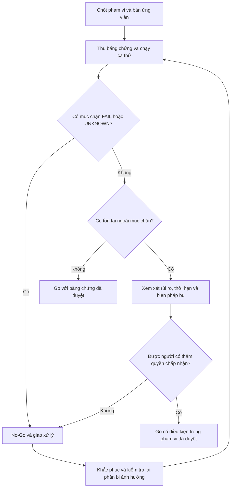

# Checklist production IAM readiness

Một hệ thống đăng nhập thành công chưa có nghĩa là sẵn sàng vận hành IAM trong production. Nhân viên có thể vẫn giữ phiên sau khi nghỉ việc, API có thể chấp nhận token của ứng dụng khác, service account có thể đọc dữ liệu của mọi tenant, hoặc người trực vận hành không biết chặn credential đã phát khi có sự cố.

Production IAM readiness là khả năng chứng minh rằng danh tính, credential, quyền truy cập và các quy trình vận hành cùng hoạt động đúng trên phiên bản sắp phát hành. Checklist hữu ích khi mỗi mục gắn với một điều kiện kiểm chứng được, người chịu trách nhiệm và bằng chứng. Một danh sách chỉ đánh dấu “đã bật MFA”, “đã dùng JWT”, “đã có log” chưa trả lời được rủi ro thực tế.

Bài thực hành này hướng dẫn xây dựng và sử dụng checklist trước khi phát hành một hệ thống có người dùng, SSO, API, tenant, service account và quyền quản trị. Các mốc thời gian và điều kiện chặn phát hành bên dưới thuộc tình huống giả định của bài, không phải ngưỡng bắt buộc chung cho mọi tổ chức.

## 1. Đầu ra cần có

Một hồ sơ readiness hoàn chỉnh gồm:

- Phạm vi hệ thống và phiên bản cấu hình được đánh giá.
- Danh mục danh tính, tài nguyên, luồng truy cập và owner.
- Checklist có trạng thái rõ ràng và bằng chứng cho từng mục.
- Kết quả kiểm thử truy cập hợp lệ, truy cập bị từ chối và xử lý sự cố.
- Danh sách tồn tại, ngoại lệ có thời hạn và quyết định phát hành.
- Kế hoạch giám sát sau phát hành, rollback và đánh giá lại.

Readiness là kết luận cho một phạm vi và thời điểm cụ thể. Nó không thay thế kiểm thử bảo mật toàn hệ thống, không tự chứng minh tuân thủ pháp lý và không có giá trị vĩnh viễn sau những thay đổi về role, IdP, workload hay dữ liệu.

## 2. Tình huống thực hành

Một sản phẩm SaaS quản lý hóa đơn chuẩn bị mở production. Kiến trúc dự kiến có:

| Thành phần | Danh tính và nhu cầu truy cập |
| --- | --- |
| Cổng người dùng | Khách hàng thuộc tenant A hoặc B, có role viewer và manager |
| Identity Provider | Xác thực nhân viên, quản trị viên và cung cấp SSO |
| Invoice API | Kiểm tra token và phân quyền trên từng hóa đơn |
| Job xuất báo cáo | Service account đọc dữ liệu được phép và tạo tệp cho đúng tenant |
| Pipeline triển khai | Cập nhật ứng dụng qua quy trình được phê duyệt |
| Công cụ hỗ trợ | Nhân viên hỗ trợ truy cập giới hạn, có lý do nghiệp vụ và audit |
| Hệ thống giám sát | Thu thập sự kiện IAM và gửi cảnh báo cho người trực |

Môi trường development, staging và production có cấu hình và danh tính tách biệt theo thiết kế. Staging dùng dữ liệu thử nghiệm và mô hình quyền tương ứng; việc thử nghiệm ở staging không tự chứng minh cấu hình production đã giống bản được duyệt.

Nhóm phụ trách xác định trước ba bất biến:

1. Một principal chỉ truy cập dữ liệu tenant mà nó được cấp quyền.
2. Người dùng hoặc workload bị thu hồi phải mất quyền trong cửa sổ đã công bố cho từng loại credential.
3. Thao tác đặc quyền phải xác định được ai thực hiện, dưới danh tính nào, trên tài nguyên nào và có phê duyệt ra sao.

Checklist phải thu thập bằng chứng cho các bất biến này, không chỉ kiểm tra có sản phẩm IAM hay không.

## 3. Cách ghi trạng thái và bằng chứng

### 3.1. Dùng trạng thái đủ để phản ánh điều chưa biết

| Trạng thái | Ý nghĩa | Điều kiện sử dụng |
| --- | --- | --- |
| `PASS` | Đạt điều kiện trong phạm vi đã đánh giá | Có bằng chứng hợp lệ cho bản ứng viên phát hành |
| `FAIL` | Không đạt điều kiện | Đã quan sát hành vi hoặc cấu hình sai |
| `UNKNOWN` | Chưa thể kết luận | Thiếu kiểm thử, thiếu quyền quan sát hoặc bằng chứng không còn phù hợp |
| `N/A` | Không áp dụng | Có lý do, phạm vi loại trừ và người xác nhận |

“Chưa có ai báo lỗi” không phải bằng chứng `PASS`. Một cấu hình được bật nhưng chưa kiểm tra hành vi cần có trạng thái phản ánh phần chưa được xác minh. Nếu mục gồm nhiều nhánh và một nhánh chưa được kiểm tra, không đánh dấu toàn bộ mục đã đạt.

Ngoại lệ không biến một `FAIL` thành `PASS`. Ghi riêng trạng thái kỹ thuật và quyết định chấp nhận rủi ro. Cách này giữ nguyên sự thật khi xem lại sau phát hành.

### 3.2. Mẫu bản ghi cho một mục

Đây là schema minh họa cho hồ sơ đánh giá, không phải file cấu hình sản phẩm:

```yaml
controlId: AUTHZ-02
scope: invoice-api / tenant isolation
candidate: release-candidate-example-7
policyVersion: invoice-policy-example-12
owner: billing-api-team
reviewer: security-reviewer
status: UNKNOWN
expected: Principal tenant A cannot read or change tenant B invoices
evidenceRefs: []
testedAt: null
finding: Negative-path tests have not been performed
releaseBlocker: true
riskAcceptance: null
retestTrigger: Tenant mapping or authorization policy changes
```

Một bằng chứng nên ghi môi trường, bản ứng dụng, phiên bản policy, thời điểm, danh tính thử, thao tác, kết quả mong đợi, kết quả quan sát và định danh đối chiếu log. Không đưa token thật, mật khẩu, private key hay dữ liệu khách hàng vào hồ sơ.

Ảnh chụp trang cấu hình có thể chứng minh một giá trị được thiết lập, nhưng không đủ chứng minh toàn bộ đường thực thi tuân thủ giá trị đó. Chẳng hạn, cấu hình MFA ở IdP không tự chứng minh một tài khoản local của ứng dụng đã bị vô hiệu hóa.

### 3.3. Xác định điều kiện chặn trước khi kiểm tra

Với tình huống của bài, các lỗi sau chặn phát hành: truy cập chéo tenant, bỏ qua xác thực ở API được bảo vệ, không kiểm soát được đường quản trị, credential production bị lộ mà chưa được xử lý, hoặc không có cách thu hồi quyền theo mô hình đã cam kết.

Danh sách cụ thể phải do các owner sản phẩm, an toàn hệ thống và vận hành thống nhất theo rủi ro. Không thay mức độ nghiêm trọng chỉ để tăng tỷ lệ checklist đạt. Một lỗi cô lập tenant không được bù bằng nhiều mục định dạng tài liệu đã hoàn thành.

## 4. Checklist phạm vi, owner và danh mục danh tính

| ID | Điều kiện kiểm tra | Bằng chứng cần có |
| --- | --- | --- |
| GOV-01 | Phạm vi gồm cổng người dùng, API, job nền, công cụ hỗ trợ và đường quản trị | Sơ đồ luồng truy cập, danh sách endpoint và tài nguyên |
| GOV-02 | Mỗi hệ thống và nhóm danh tính có owner nghiệp vụ, owner kỹ thuật và đầu mối sự cố | Danh mục owner đã xác nhận, lịch trực hoặc kênh tiếp nhận |
| GOV-03 | Bản ứng dụng, policy, trust configuration và môi trường đánh giá được định danh | Mã phiên bản, bản ghi triển khai, cấu hình đã được duyệt |
| GOV-04 | Có danh mục người dùng, khách, tài khoản local, service account, pipeline và tài khoản khẩn cấp | Inventory và đối chiếu với nguồn danh tính có thẩm quyền |

Danh mục không chỉ lấy từ IdP. Một cơ sở dữ liệu có tài khoản riêng, một dashboard có local admin hoặc một đối tác có API key vẫn nằm trong bề mặt IAM nếu có thể tiếp cận dữ liệu production.

Định danh ổn định giúp liên kết tài khoản dù email hoặc tên hiển thị thay đổi. Với môi trường nhiều issuer, không giả định cùng một `sub` hoặc email ở hai issuer là cùng một người. Quy tắc liên kết danh tính và thay đổi tenant phải được kiểm soát như thay đổi quyền.

Nếu không xác định được một danh tính đang dùng bởi ai hoặc workload nào, ghi nhận thiếu sót và điều tra. Không gán owner tùy ý chỉ để điền đủ cột.

## 5. Checklist xác thực, MFA và khôi phục tài khoản

| ID | Điều kiện kiểm tra | Bằng chứng cần có |
| --- | --- | --- |
| AUTHN-01 | Mọi điểm đăng nhập nằm trong chính sách xác thực đã duyệt | Kiểm thử SSO, tài khoản local, API và đường quản trị |
| AUTHN-02 | Quản trị viên và các nhóm rủi ro cao bị áp chính sách MFA phù hợp; fallback không làm mất yêu cầu này | Kết quả đăng nhập mới, đổi thiết bị, phương án dự phòng và tài khoản đặc biệt |
| AUTHN-03 | Đăng ký, thay yếu tố và khôi phục tài khoản có kiểm tra danh tính đủ mạnh | Ca kiểm thử mất yếu tố, đổi email, reset credential và audit tương ứng |
| AUTHN-04 | Đăng nhập bất thường và thử credential hàng loạt có biện pháp kiểm soát phù hợp | Kiểm thử giới hạn tần suất, cảnh báo và quy trình phản ứng |

MFA không phải một giá trị boolean duy nhất. Cần biết chính sách áp lên nhóm nào, luồng nào, lúc nào phải xác thực lại và có đường bỏ qua nào. Nếu yêu cầu khả năng chống phishing cho thao tác đặc quyền, phải kiểm tra phương thức thực tế được chấp nhận và các phương thức dự phòng, thay vì suy ra từ việc có hai bước nhập thông tin.

Luồng khôi phục là một đường cấp lại khả năng kiểm soát tài khoản. Một tài khoản có MFA mạnh vẫn có thể yếu nếu nhân viên hỗ trợ được phép tắt MFA chỉ từ email yêu cầu. Quy trình hỗ trợ cần kiểm tra người yêu cầu, quyền của người xử lý, lý do và thông báo phù hợp cho chủ tài khoản.

Kiểm thử giới hạn đăng nhập cần xét cả bảo vệ tài khoản lẫn khả năng gây từ chối dịch vụ cho người dùng hợp lệ. Ghi rõ phạm vi giới hạn, đường gỡ chặn và cách xử lý trường hợp tấn công phân tán; không coi một ngưỡng khóa cứng là lời giải cho mọi luồng.

## 6. Checklist phiên, token và SSO/federation

| ID | Điều kiện kiểm tra | Bằng chứng cần có |
| --- | --- | --- |
| FED-01 | Ứng dụng tin đúng issuer, client và endpoint đã cấu hình | Cấu hình trust và thử issuer ngoài danh sách |
| FED-02 | Luồng chuyển hướng chống giả mạo và gắn phản hồi với đúng giao dịch đăng nhập | Thử callback không mong đợi, redirect URI sai, phản hồi dùng lại và giao dịch bị tráo |
| TOK-01 | API kiểm tra token theo hợp đồng: chữ ký hoặc cơ chế xác minh, audience, issuer, thời hạn và loại token | Ca đúng/sai cho từng điều kiện, log phân biệt thất bại |
| SES-01 | Phiên có thời hạn, cơ chế xác thực lại và bảo vệ phù hợp với ứng dụng | Thử idle timeout, absolute timeout, đổi quyền và thao tác nhạy cảm |
| SES-02 | Logout, thu hồi refresh token và thu hồi phiên có semantics được ghi rõ | Thử riêng phiên IdP, phiên ứng dụng, access token và thiết bị khác |

Trong thiết kế OAuth/OIDC của tình huống này, dùng Authorization Code với PKCE khi phù hợp với loại client, kiểm tra redirect URI và ràng buộc giao dịch xác thực. Cơ chế chống CSRF, `state`, `nonce` và PKCE phải được lựa chọn, cấu hình và kiểm tra theo luồng thực tế; không chỉ kiểm tra sự xuất hiện của tên tham số. Xem [OAuth 2.0 Security Best Current Practice, RFC 9700](https://www.rfc-editor.org/rfc/rfc9700.html).

Không dùng việc giải mã được JWT làm bằng chứng token hợp lệ. Nếu hệ thống có nhiều API, thử token được phát cho API X tại API Y. Kiểm tra cả trường hợp chữ ký hợp lệ nhưng issuer, audience hoặc mục đích sử dụng không khớp. ID token dùng cho bước xác thực người dùng tại client không mặc nhiên là access token của mọi API.

Đối với cookie phiên, kiểm tra `Secure`, `HttpOnly`, phạm vi domain/path và lựa chọn `SameSite` theo luồng cần hỗ trợ; xác minh thêm kiểm soát CSRF cho thao tác thay đổi trạng thái. Giá trị cookie đúng không tự chứng minh logout đã vô hiệu hóa phiên phía server.

SSO tạo liên kết xác thực nhưng không bảo đảm mọi ứng dụng đồng bộ kết thúc phiên tức thì. Readiness phải ghi rõ khi người dùng logout hoặc bị khóa ở IdP thì phiên local, refresh token và access token hiện có chịu ảnh hưởng gì. Nếu một giới hạn không thể loại bỏ ngay, phải đưa nó vào mô hình thu hồi và quyết định rủi ro.

## 7. Checklist phân quyền và cô lập tenant

| ID | Điều kiện kiểm tra | Bằng chứng cần có |
| --- | --- | --- |
| AUTHZ-01 | Mọi đường vào tài nguyên áp phân quyền phía server và mặc định từ chối khi không có cấp quyền phù hợp | Ma trận role/action/resource và ca truy cập không có quyền |
| AUTHZ-02 | Tenant của tài nguyên được xác định từ nguồn đáng tin cậy; không có truy cập chéo tenant | Thử A đọc, sửa, tải tệp và xuất dữ liệu B qua các đường khác nhau |
| AUTHZ-03 | Quyền hiệu quả gồm kế thừa, group, ủy quyền và quyền quản trị gián tiếp đã được kiểm kê | Báo cáo effective access và đường giả danh/gắn danh tính |
| AUTHZ-04 | Thay role hoặc policy có phiên bản, phê duyệt và ảnh hưởng thu hồi đã đo | Thử hạ quyền trong khi người dùng đang có phiên |

OWASP nhấn mạnh đặc quyền tối thiểu, mặc định từ chối và kiểm tra quyền trên mỗi request, bao gồm tài nguyên cụ thể được yêu cầu. Những nguyên tắc này giúp thiết kế ca thử, nhưng kết quả readiness vẫn phải dựa trên hành vi của hệ thống đang đánh giá. Xem [OWASP Authorization Cheat Sheet](https://cheatsheetseries.owasp.org/cheatsheets/Authorization_Cheat_Sheet.html).

Không giới hạn kiểm tra ở việc ẩn nút trên giao diện. Với một người dùng viewer, cần gọi trực tiếp endpoint sửa hóa đơn để xác nhận server từ chối. Với tenant A, thay ID hóa đơn, ID tệp, bộ lọc tìm kiếm và định danh tenant ở request để kiểm tra nguồn dữ liệu có thẩm quyền.

Bao phủ cả endpoint chi tiết, tìm kiếm, bulk API, tác vụ export, tệp tải xuống, job nền và cache. Một request đã được xác thực không cho phép bỏ qua kiểm tra tenant ở đường đọc dữ liệu khác. Cache phản hồi dùng chung cũng có thể làm lộ dữ liệu nếu khóa cache không chứa ràng buộc quyền cần thiết.

Lỗi kết nối tới thành phần phân quyền không được tự chuyển thành cho phép. Nếu dùng bản policy hoặc trạng thái được cache để duy trì hoạt động, phải ghi rõ tuổi tối đa, nguồn tin cậy, hành vi khi quá hạn và tác động đến thu hồi quyền.

## 8. Checklist vòng đời danh tính và thu hồi quyền

| ID | Điều kiện kiểm tra | Bằng chứng cần có |
| --- | --- | --- |
| LIFE-01 | Cấp tài khoản và quyền có nguồn yêu cầu, người phê duyệt và hạn sử dụng nếu cần | Ca onboard nhân viên, khách và tài khoản tạm |
| LIFE-02 | Chuyển nhóm hoặc chức năng thu hồi quyền cũ thay vì chỉ cộng quyền mới | So sánh quyền trước/sau của một danh tính thử |
| LIFE-03 | Nghỉ việc, kết thúc hợp đồng hoặc khóa khẩn cấp tác động tới các hệ thống liên quan | Diễn tập offboarding từ nguồn danh tính đến ứng dụng đích |
| LIFE-04 | Có cơ chế rà soát account không dùng, mất owner và quyền phát sinh ngoài quy trình | Báo cáo kiểm kê, quyết định xử lý và lịch rà soát |

Joiner, mover và leaver là ba luồng khác nhau. Một hệ thống tự động tạo tài khoản tốt vẫn có thể thất bại khi người dùng chuyển nhóm hoặc rời tổ chức. Việc đồng bộ provisioning thành công không tự chứng minh phiên ứng dụng và token đang lưu hành đã mất quyền.

Xác định các thời điểm:

```text
t0: sự kiện khóa hoặc thu hồi được chấp nhận ở nguồn có thẩm quyền
t1: hệ thống đích nhận thay đổi
t2: quyền hoặc credential mới không còn được cấp
t3: request dùng phiên/token cũ bị từ chối tại tài nguyên
```

Chỉ báo cáo `t2 - t0` sẽ bỏ qua khoảng thời gian credential đã phát vẫn dùng được. Cần đo đến `t3` theo từng hệ thống đích và từng loại phiên/token. Một lần đo thành công cũng không bảo đảm mọi replica đã đồng bộ; thử các đường vào và node đại diện cho kiến trúc thực tế.

Ví dụ, nhóm sản phẩm đặt mục tiêu chặn thao tác quản trị trong 2 phút và truy cập thông thường trong 10 phút từ `t0`. Đây là yêu cầu giả định. Nếu access token còn hạn 30 phút và API xác minh cục bộ mà không kiểm tra trạng thái thu hồi, hệ thống chưa chứng minh đáp ứng mục tiêu 10 phút.

## 9. Checklist service account, workload và bí mật

| ID | Điều kiện kiểm tra | Bằng chứng cần có |
| --- | --- | --- |
| WORK-01 | Mỗi danh tính máy có mục đích, owner, môi trường và workload được phép dùng | Inventory workload và binding tương ứng |
| WORK-02 | Runtime, pipeline và công việc đặc quyền có phạm vi quyền phù hợp; trust không dùng wildcard quá rộng | Policy, trust binding, quyền gắn identity và quyền sửa workload |
| WORK-03 | Ưu tiên credential ngắn hạn khi có thể; ngoại lệ khóa dài hạn có quản lý | Luồng cấp credential, TTL, cơ chế làm mới hoặc hồ sơ ngoại lệ |
| WORK-04 | Bí mật không bị đưa vào source, image, log hoặc báo cáo; thay và thu hồi đã được thử | Kết quả kiểm tra artifact và diễn tập thay credential |

Với job xuất báo cáo, thử lấy credential từ workload sai môi trường, từ tenant khác và từ pipeline chưa được duyệt. Đường xác thực workload phải dựa trên bằng chứng được kiểm chứng, không chỉ label hoặc chuỗi tên do chính workload khai báo.

Quyền runtime hẹp chưa đủ nếu pipeline hoặc người có quyền sửa deployment có thể gắn một account mạnh hơn. Kiểm kê khả năng tạo workload, sửa image, truy cập shell, giả danh principal và phát credential cho danh tính khác. Đây là những đường có thể dẫn tới quyền dữ liệu dù không xuất hiện dưới tên role nghiệp vụ.

Thử xoay credential khi workload vẫn chạy: replica phải nhận bản mới, token cũ hết hạn không làm job âm thầm chuyển sang credential quản trị dự phòng, và lỗi lấy credential phải có hành vi đã duyệt. Kho quản lý bí mật giúp bảo vệ phân phối nhưng không tự bảo đảm ứng dụng có quyền tối thiểu.

## 10. Checklist đặc quyền, hỗ trợ và truy cập khẩn cấp

| ID | Điều kiện kiểm tra | Bằng chứng cần có |
| --- | --- | --- |
| PRIV-01 | Tài khoản quản trị có danh tính cá nhân, MFA theo yêu cầu và giới hạn phạm vi | Ca đăng nhập, kiểm kê admin và quyền hiệu quả |
| PRIV-02 | Quyền nâng tạm thời có lý do, thời hạn, phê duyệt và hết hiệu lực thực sự | Ca cấp quyền, hết hạn và kiểm tra request sau hết hạn |
| PRIV-03 | Nhân viên hỗ trợ chỉ truy cập dữ liệu theo quy trình; giữ được actor gốc khi ủy quyền | Ticket, ca truy cập hỗ trợ và audit chuỗi danh tính |
| PRIV-04 | Truy cập khẩn cấp dùng được trong sự cố dự kiến và bị giám sát | Diễn tập break-glass, cảnh báo, kết thúc và rà soát sau sử dụng |

Tài khoản khẩn cấp có thể cần một đường xác thực hoặc khôi phục không phụ thuộc hoàn toàn vào thành phần đang hỏng. Điều đó không có nghĩa là để một admin chung không kiểm soát. Cần owner, phạm vi, bảo vệ credential, điều kiện sử dụng, thông báo và quy trình kết thúc rõ ràng.

Khi thử break-glass, xác nhận người trực thực sự lấy được quyền cần thiết trong tình huống giả định, hành động tạo log và quyền được thu hồi sau đó. Việc ghi một mật khẩu trong tài liệu chưa chứng minh khả năng phục hồi; việc chỉ đăng nhập thành công cũng chưa chứng minh kiểm soát sau sử dụng.

Nếu công cụ hỗ trợ cho phép thao tác thay khách hàng, log cần phân biệt actor nhân viên hỗ trợ và effective principal hoặc ngữ cảnh khách hàng. Không chia sẻ mật khẩu của khách hàng để giải quyết yêu cầu hỗ trợ.

## 11. Checklist audit, cảnh báo và bảo vệ dữ liệu log

| ID | Điều kiện kiểm tra | Bằng chứng cần có |
| --- | --- | --- |
| AUD-01 | Sự kiện xác thực, từ chối quan trọng, thay quyền, phát credential và thao tác đặc quyền có dấu vết phù hợp | Bộ sự kiện mẫu liên kết được với request và actor |
| AUD-02 | Log không chứa credential hoặc dữ liệu vượt mục đích; quyền đọc/sửa được giới hạn | Kiểm tra nội dung, phân quyền log và chính sách lưu |
| AUD-03 | Cảnh báo IAM đi tới đúng người và có quy trình xử lý | Diễn tập từ sự kiện đến thông báo, tiếp nhận và phản ứng |
| AUD-04 | Sự cố pipeline log có phát hiện và hành vi đã định trước | Thử gián đoạn thu thập, queue đầy, mất đồng bộ thời gian |

Một sự kiện audit nên giúp trả lời: ai hoặc workload nào, làm gì, với tài nguyên và tenant nào, được cho phép hay từ chối, theo policy nào và vào lúc nào. Dùng định danh đối chiếu để liên kết các hệ thống; kiểm soát giá trị do client gửi để tránh giả mạo nội dung log.

Access token, mật khẩu và khóa mã hóa không nên được ghi trực tiếp vào log. Những dữ liệu nhận diện hoặc nội dung nhạy cảm khác cần xử lý theo mục đích và mức bảo vệ của hệ thống log. Xem [OWASP Logging Cheat Sheet](https://cheatsheetseries.owasp.org/cheatsheets/Logging_Cheat_Sheet.html).

Không ghi nhận `PASS` chỉ vì truy vấn thấy log ở máy ứng dụng. Cần thử log đến nơi tập trung, cảnh báo phát ra và người nhận biết phải làm gì. Nếu ứng dụng có thể xóa toàn bộ dấu vết của chính nó, khả năng điều tra còn hạn chế.

Khi nơi nhận audit không sẵn sàng, hành vi phải phù hợp từng loại thao tác. Thiết kế có thể buộc thao tác đặc quyền dừng nếu không lưu được audit bắt buộc, trong khi một số hoạt động khác dùng hàng đợi bền vững có giới hạn và cảnh báo. Không chọn bỏ log âm thầm hoặc cho queue tăng vô hạn.

## 12. Checklist độ sẵn sàng, thay đổi và khôi phục

| ID | Điều kiện kiểm tra | Bằng chứng cần có |
| --- | --- | --- |
| OPS-01 | IdP, issuer, thành phần phân quyền và phụ thuộc có owner, giám sát và hành vi khi lỗi | Bản đồ phụ thuộc và diễn tập lỗi theo luồng |
| OPS-02 | Thay khóa ký hoặc cấu hình trust không gây bỏ kiểm tra hoặc gián đoạn ngoài mức chấp nhận | Diễn tập chuyển khóa, cache khóa và credential còn hợp lệ |
| OPS-03 | Phát hành và rollback policy có kiểm soát, không phục hồi quyền đã thu hồi ngoài ý muốn | Bản ứng viên, kế hoạch rollback và kiểm tra trạng thái sau khôi phục |
| OPS-04 | Bản sao lưu, khôi phục và cấu hình production được bảo vệ, kiểm thử và đối chiếu | Kết quả diễn tập cùng quyền sau phục hồi |

Kiểm thử thành phần xác thực không khả dụng phải phân biệt đăng nhập mới và request với phiên còn hợp lệ. Tùy kiến trúc, một số request có thể tiếp tục bằng dữ liệu xác minh đã được cache. Chỉ chấp nhận hành vi đó khi cache có nguồn tin cậy, thời hạn và không vi phạm yêu cầu thu hồi. Không bỏ xác minh chữ ký hoặc audience để duy trì hoạt động.

Khi thay khóa ký, kiểm tra cả token mới, token cũ còn hợp lệ và trường hợp không tìm được key ID. Cơ chế nạp khóa không được tự tin một URL khóa bất kỳ do token không đáng tin cung cấp. Việc thay khóa bình thường và chặn một khóa bị lộ có thể cần hai runbook khác nhau.

Rollback ứng dụng không đồng nghĩa rollback mọi trạng thái danh tính. Nếu người dùng vừa bị thu hồi quyền, phục hồi database hoặc bản policy cũ có thể vô tình cấp lại quyền đó. Kế hoạch khôi phục phải xác định dữ liệu nào là nguồn chuẩn và cách đối chiếu những thay đổi danh tính sau thời điểm backup.

## 13. Thực hiện bốn bài diễn tập readiness

Các bước dưới đây là yêu cầu thực hành trên hệ thống thử nghiệm được cho phép. Chúng không phải kết quả kiểm thử đã thực hiện của tài liệu này.

### 13.1. Diễn tập ma trận quyền và cô lập tenant

Chuẩn bị principal viewer A, manager A, viewer B và service account xuất báo cáo A. Tạo hóa đơn và tệp mẫu cho A/B. Ghi rõ action được phép theo từng principal trước khi gửi request.

| Ca thử | Kết quả mong đợi |
| --- | --- |
| Viewer A đọc hóa đơn A được cấp | Cho phép |
| Viewer A sửa hóa đơn A | Từ chối |
| Manager A sửa hóa đơn A theo policy | Cho phép |
| Manager A đọc hoặc sửa hóa đơn B bằng ID trực tiếp | Từ chối |
| Service account A đọc dữ liệu B hoặc đổi IAM | Từ chối |
| Viewer A tải tệp B từ đường tải xuống riêng | Từ chối |
| Viewer A gọi bulk/export với danh sách trộn A và B | Thực thi chính sách đã định, không trả dữ liệu B |

Thực hiện tại API chứ không chỉ giao diện. Với ca từ chối, kiểm tra cả mã phản hồi, nội dung, tác dụng phụ và audit. Một phản hồi lỗi nhưng dữ liệu đã bị ghi hoặc tệp đã được tạo vẫn là lỗi kiểm soát.

### 13.2. Diễn tập thu hồi khi credential đang còn hạn

1. Đăng nhập bằng người dùng thử và tạo phiên ứng dụng; nhận credential hợp lệ theo luồng hỗ trợ.
2. Thực hiện request được phép để chứng minh trạng thái trước thu hồi.
3. Tại `t0`, khóa người dùng hoặc gỡ quyền qua nguồn có thẩm quyền.
4. Dùng phiên/token cũ gọi lại tài nguyên và thử lấy credential mới.
5. Đo thời điểm từng hệ thống đích bắt đầu từ chối; đối chiếu log và cache.
6. Kiểm tra một người dùng không liên quan tiếp tục hoạt động bình thường.

Lặp lại cho service account nếu cơ chế thu hồi khác. Không kết luận đạt chỉ từ việc lần đăng nhập mới bị từ chối. Nếu credential cũ tiếp tục được phép quá cửa sổ đã duyệt, ghi `FAIL` và xác định thành phần giữ quyền cũ.

### 13.3. Diễn tập nâng quyền tạm và break-glass

Yêu cầu quyền quản trị tạm thời với lý do và thời hạn. Kiểm tra người phê duyệt, scope được cấp, thông báo và quyền hiệu quả. Sau thời hạn, dùng lại phiên đang mở để xác nhận thao tác đặc quyền đã bị từ chối.

Tiếp đó, mô phỏng một tình huống hỏng thành phần chính trong phạm vi thử nghiệm và thực hiện quy trình truy cập khẩn cấp. Xác nhận audit vẫn được giữ theo kế hoạch, người trực được thông báo và quyền khẩn cấp được kết thúc. Kiểm tra không có credential hoặc role dự phòng tồn tại vô thời hạn ngoài inventory.

### 13.4. Diễn tập cảnh báo từ đầu đến cuối

Tạo một sự kiện giả lập được xác định trước, chẳng hạn workload A yêu cầu credential của danh tính không được gắn. Theo dõi chuỗi sự kiện từ nguồn phát đến nơi tập trung, quy tắc phát hiện, thông báo và người tiếp nhận.

Ghi thời gian từng bước, ngữ cảnh người trực có thể nhìn thấy và hành động họ thực hiện được. Một cảnh báo không có resource, principal hoặc owner thường không đủ để phản ứng. Ngược lại, đưa credential đầy đủ vào cảnh báo tạo thêm nơi lưu bí mật và không phải giải pháp chẩn đoán phù hợp.

## 14. Ra quyết định Go/No-Go bằng bằng chứng

### 14.1. Trình tự đánh giá



`UNKNOWN` ở mục chặn cũng làm `No-Go`: chưa có bằng chứng không đồng nghĩa rủi ro đã biến mất. Với mục `N/A`, người đánh giá cần kiểm tra lý do loại trừ có đúng với kiến trúc. Ví dụ, có một đường truy cập khẩn cấp thì không thể loại phần break-glass bằng lý do “chỉ dùng khi sự cố”.

### 14.2. Hồ sơ chấp nhận rủi ro

Ngoại lệ chỉ dùng cho tồn tại được chính sách phát hành cho phép xem xét. Hồ sơ cần ghi:

- Mục kiểm soát và hiện trạng kỹ thuật còn không đạt.
- Tài nguyên, principal, dữ liệu và người có thể bị ảnh hưởng.
- Biện pháp bù đang hoạt động và bằng chứng của nó.
- Owner khắc phục, hạn kết thúc và tiêu chí hoàn tất.
- Người có thẩm quyền chấp nhận, điều kiện thu hồi ngoại lệ và cách theo dõi.

Không coi một ticket sửa lỗi chưa có owner là biện pháp bù. Không chấp nhận “sẽ bổ sung log sau” thay cho khả năng điều tra bắt buộc của một luồng đặc quyền đang được mở. Nếu lỗi thuộc điều kiện chặn đã thống nhất, cần khắc phục hoặc thay đổi phạm vi phát hành bằng quyết định có thẩm quyền và đánh giá lại; không lách qua bằng cách sửa trạng thái.

### 14.3. Ví dụ kết luận minh họa

Giả sử hồ sơ thử nghiệm của tình huống phát hiện:

| Phát hiện giả định | Đánh giá | Hệ quả phát hành |
| --- | --- | --- |
| Manager A tải được tệp hóa đơn B qua URL nội bộ | `AUTHZ-02 = FAIL` | No-Go do lỗi cô lập tenant |
| Khóa user ngăn đăng nhập mới nhưng phiên cũ còn dùng quá mục tiêu | `LIFE-03 = FAIL` | No-Go theo yêu cầu thu hồi đã thống nhất |
| Một trường owner phụ trong báo cáo inventory chưa đầy đủ, nhưng owner vận hành và trách nhiệm đã xác nhận | Tồn tại tài liệu cần phân loại | Chỉ xem xét ngoại lệ nếu chính sách cho phép và có hạn sửa |

Các kết quả trong bảng là ví dụ giả định để luyện ra quyết định, không phải bằng chứng về một hệ thống đã được kiểm tra. Không tính “tổng số mục PASS chia tổng số mục” rồi dùng một tỷ lệ cao để vượt qua hai lỗi đầu.

## 15. Sau phát hành và thời điểm phải đánh giá lại

Readiness kết thúc bằng bàn giao vận hành, không kết thúc ở chữ ký. Người trực cần biết dashboard, cảnh báo, runbook thu hồi, đầu mối IdP, owner API và cách thực hiện rollback đã duyệt.

Trong giai đoạn đầu, theo dõi tỷ lệ đăng nhập thất bại, từ chối bất thường, lỗi phát/làm mới token, thay đổi đặc quyền, độ trễ provisioning và độ trễ thu hồi. Các chỉ số này phải có ngữ cảnh để phân biệt lỗi cấu hình với hành vi tấn công hoặc thay đổi sử dụng bình thường.

Đánh giá lại phần liên quan khi có một trong các thay đổi:

- Thêm IdP, client, redirect URI hoặc cơ chế federation.
- Thay role, nguồn thuộc tính, ánh xạ tenant hoặc mô hình ủy quyền.
- Thêm API, đường export, kho dữ liệu, công cụ hỗ trợ hoặc job nền.
- Thay cách cache, thời hạn token, thư viện xác minh hoặc cơ chế thu hồi.
- Thay nền tảng triển khai, trust binding, quyền pipeline hoặc cơ chế cấp credential.
- Xảy ra sự cố, khôi phục từ backup hoặc hết hạn một ngoại lệ.

Bằng chứng từ bản cũ chỉ được tái sử dụng khi xác định thay đổi không làm mất hiệu lực của bằng chứng đó. Mọi thay đổi IAM nhạy cảm cần có liên kết đến policy và ca kiểm thử liên quan để tránh phụ thuộc vào trí nhớ của một cá nhân.

## 16. Tiêu chí hoàn thành bài thực hành

Bản nộp phải có sơ đồ phạm vi, danh mục danh tính và checklist đã điền trạng thái cho từng mục áp dụng. Mỗi `PASS` dẫn tới bằng chứng; mỗi `FAIL` có phát hiện và owner; mỗi `UNKNOWN` chỉ rõ điều chưa biết; mỗi `N/A` có lý do loại trừ.

Phần kiểm thử phải thể hiện cả truy cập được phép và bị từ chối, bao gồm vượt quyền, chéo tenant, credential sai đối tượng nhận và thu hồi credential đang còn hạn. Phần vận hành cần chứng minh cảnh báo tới người trực, đường truy cập khẩn cấp có kiểm soát và khôi phục không tự tái cấp quyền đã bị gỡ.

Kết luận cuối cùng nêu rõ Go, Go có điều kiện hoặc No-Go cho bản ứng viên và phạm vi nào, ai chịu trách nhiệm quyết định, tồn tại nào còn mở và khi nào cần đánh giá lại. Một hồ sơ như vậy giúp đội ngũ hiểu chính xác IAM đã sẵn sàng ở đâu và còn thiếu bằng chứng ở đâu trước khi đưa dữ liệu thật vào hệ thống.
