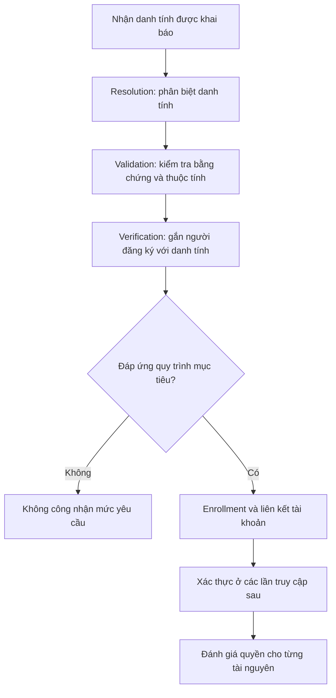

# Identity Assurance Level

## Mục tiêu bài học

Một người có thể tạo tài khoản bằng tên bất kỳ rồi đăng nhập bằng MFA. Hệ thống có thể có bằng chứng tốt về quyền kiểm soát tài khoản, nhưng vẫn chưa có cơ sở tương ứng để khẳng định tên trong hồ sơ là danh tính ngoài đời thực của người đó.

**Identity Assurance Level — IAL** mô tả mức bảo đảm của quá trình thẩm tra danh tính: danh tính được khai báo có tồn tại ngoài đời thực và người đang làm thủ tục có gắn với danh tính đó đến mức nào. Bài học sử dụng **NIST SP 800-63A-4**, thuộc bộ Digital Identity Guidelines Revision 4, làm khung tham chiếu. [NIST SP 800-63A-4](https://pages.nist.gov/800-63-4/sp800-63a.html)

Sau bài học này, bạn có thể:

- Phân biệt IAL với mức bảo đảm xác thực và liên kết danh tính.
- Nhận diện khác biệt quan trọng giữa cách dùng IAL1 ở Revision 3 và Revision 4.
- Giải thích các mục tiêu của resolution, validation và verification.
- Chọn yêu cầu thẩm tra dựa trên rủi ro của dịch vụ và nhóm người dùng.
- Sử dụng kết quả thẩm tra trong IAM mà không biến nó thành quyền truy cập tự động.

## 1. IAL trả lời câu hỏi nào?

IAL liên quan đến **identity proofing**, tức quá trình thu thập và kiểm tra căn cứ cho danh tính được khai báo. Nó khác với việc người dùng tự điền tên vào hồ sơ hoặc chứng minh có thể nhận một email.

Ví dụ, tài khoản `principal-801` đang khai tên “Nguyễn Mai”. Có ít nhất ba câu hỏi riêng:

1. Có căn cứ nào gắn tài khoản này với danh tính ngoài đời mà người đăng ký khai báo?
2. Người đang đăng nhập có kiểm soát phương tiện xác thực gắn với tài khoản không?
3. Tài khoản đó được đọc, sửa hoặc duyệt tài nguyên nào?

IAL tập trung vào câu hỏi thứ nhất. Một kết quả thẩm tra không tự trả lời đầy đủ hai câu hỏi còn lại.

### Mức bảo đảm không phải phần trăm xác suất

Không nên diễn giải `IAL2` thành “chắc chắn 99% đây là đúng người” nếu không có một mô hình đo lường riêng làm căn cứ. Đây là mức được định nghĩa bằng yêu cầu đối với quy trình và các kiểm soát tương ứng, không phải một điểm số tùy ý của ứng dụng.

Tương tự, không suy ra số mức từ số lượng bước giao diện: chụp giấy tờ, chụp khuôn mặt và nhập OTP không tự biến một flow thành IAL3. Điều cần đánh giá là các yêu cầu của khung tham chiếu có thực sự được đáp ứng hay không.

## 2. IAL, AAL và FAL là ba trục khác nhau

| Trục | Câu hỏi chính | Thành phần được xem xét |
|---|---|---|
| IAL — Identity Assurance Level | Người đăng ký gắn với danh tính khai báo đến mức nào? | Quy trình thẩm tra và đăng ký danh tính |
| AAL — Authentication Assurance Level | Lần xác thực cho thấy quyền kiểm soát authenticator đến mức nào? | Phương tiện và giao dịch xác thực |
| FAL — Federation Assurance Level | Việc chuyển và sử dụng phát biểu danh tính giữa các bên được bảo vệ đến mức nào? | Giao thức federation và assertion |

AAL được trình bày trong [NIST SP 800-63B-4](https://pages.nist.gov/800-63-4/sp800-63b.html); FAL được trình bày trong [NIST SP 800-63C-4](https://pages.nist.gov/800-63-4/sp800-63c.html).

Ba mức không cần có cùng số. Tăng mức xác thực bằng một bước xác thực bổ sung không tự hoàn thành phần thẩm tra danh tính còn thiếu. Bảo vệ tốt đường truyền assertion cũng không tự cải thiện chất lượng bằng chứng mà nguồn danh tính đã dùng trước đó.

Ví dụ thiết kế:

- Một diễn đàn có thể cho dùng bút danh nhưng vẫn bảo vệ đăng nhập bằng MFA.
- Một tài khoản đã được thẩm tra có thể bị chiếm nếu đường khôi phục tài khoản yếu.
- Một IdP có quy trình tốt vẫn cần một quan hệ federation được bên nhận cấu hình và kiểm tra đúng.
- Một chủ thể đáp ứng các yêu cầu assurance vẫn có thể không được cấp vai trò quản trị.

Trong tài liệu thiết kế, nên ghi riêng yêu cầu cho từng trục, kèm phiên bản khung tham chiếu, thay vì dùng một nhãn chung như “tài khoản xác thực mức 2”.

## 3. Điểm thay đổi cần nhớ: IAL1 ở Revision 3 và Revision 4

Trong Revision 3, IAL1 không yêu cầu gắn người đăng ký với một danh tính ngoài đời thực; thuộc tính có thể được tự khai. Đây là cách diễn giải thường gặp trong tài liệu cũ. [NIST SP 800-63A, Revision 3, mục 2.2](https://pages.nist.gov/800-63-3/sp800-63a.html#sec2)

Revision 4 tách trường hợp **không thẩm tra danh tính** khỏi IAL1. IAL1 của Revision 4 có hoạt động thẩm tra; không thể dùng việc tạo tài khoản tự khai để tự kết luận đã đạt IAL1. [NIST SP 800-63A-4, Identity Assurance Levels](https://pages.nist.gov/800-63-4/sp800-63a.html)

Vì vậy, một bản ghi chỉ có `ial=1` là thiếu ngữ cảnh. Khi tích hợp hệ thống cũ hoặc đối tác, cần biết mức đó thuộc phiên bản nào, do quy trình nào tạo ra và bên nhận đã chấp nhận cách diễn giải nào.

Nếu sản phẩm dùng nhãn nội bộ như “chưa xác minh” hoặc “Level 0”, phải ghi rõ đây là trạng thái của sản phẩm, không tự coi nó là một mức IAL chuẩn của NIST.

## 4. Các mức IAL trong Revision 4

| Mức | Điểm chính |
|---|---|
| IAL1 | Có kiểm tra bằng chứng, thuộc tính cốt lõi và sự gắn kết với người đăng ký |
| IAL2 | Tăng yêu cầu về bằng chứng, validation và verification; có nhiều pathway, không bắt buộc mọi trường hợp đều dùng đối sánh sinh trắc học tự động |
| IAL3 | Thẩm tra on-site attended, với yêu cầu bổ sung về sinh trắc học và quy trình |

Tại IAL3, người thẩm tra có thể cùng địa điểm với người đăng ký hoặc tương tác qua kiosk hay thiết bị do bên cung cấp dịch vụ danh tính (CSP) kiểm soát. Một cuộc gọi video bất kỳ từ nhà không tự đáp ứng mô hình này. Bảng chỉ định hướng khái niệm; yêu cầu chi tiết nằm trong [NIST SP 800-63A-4, mục 4](https://pages.nist.gov/800-63-4/sp800-63a/ial/).

### Không gán mức chỉ từ công nghệ được nhìn thấy

Những tên chức năng như “eKYC”, “AI nhận diện khuôn mặt”, “quét giấy tờ” hay “video xác minh” không đủ để xác định một IAL. Chúng có thể là thành phần của quy trình, nhưng bên triển khai còn phải đánh giá nguồn bằng chứng, cách phát hiện gian lận, cách ràng buộc kết quả với tài khoản và các yêu cầu liên quan.

Một nhà cung cấp có tính năng selfie không có nghĩa mọi cấu hình, đường xử lý ngoại lệ hoặc khách hàng của họ đều dùng cùng một quy trình. Bên tích hợp cần biết chính xác gói dịch vụ và cấu hình nào tạo ra kết quả mà mình sẽ dựa vào.

## 5. Resolution, validation, verification và enrollment

NIST mô tả ba trách nhiệm thẩm tra:

- **Resolution:** thu thập dữ kiện phù hợp để phân biệt danh tính trong quần thể được phục vụ.
- **Validation:** kiểm tra tính xác thực, chính xác và hợp lệ của bằng chứng, thuộc tính.
- **Verification:** kiểm tra người trình bằng chứng gắn với danh tính mà bằng chứng thể hiện.

Sau đó, enrollment thiết lập tài khoản và liên kết authenticator với danh tính đã được thẩm tra theo quy trình. [NIST SP 800-63A-4, Identity Proofing Overview](https://pages.nist.gov/800-63-4/sp800-63a/proofing/)



Sơ đồ trình bày trách nhiệm logic, không bắt buộc mọi sản phẩm phải có đúng từng màn hình theo thứ tự đó.

### Ví dụ phân biệt lỗi

Các ví dụ sau giúp phân tích thiết kế, không phải danh sách kiểm tra đầy đủ của một IAL:

| Tình huống | Trách nhiệm có thể bị thiếu |
|---|---|
| Hai hồ sơ cùng tên bị coi là cùng một người | Phân biệt danh tính và xử lý xung đột |
| Hình ảnh tài liệu bị sửa nhưng được chấp nhận | Kiểm tra tính hợp lệ của bằng chứng |
| Dữ kiện hợp lệ của người khác được dùng để đăng ký | Kiểm tra quan hệ giữa người đăng ký và danh tính |
| Quy trình thẩm tra đúng nhưng kết quả bị gắn sang tài khoản khác | Liên kết kết quả với principal và giao dịch |
| Tài khoản đã thẩm tra bị tiếp quản qua khôi phục yếu | Bảo vệ vòng đời authenticator và tài khoản |

Tải lên một ảnh không đồng nghĩa ảnh đã được kiểm tra. Kiểm tra được ảnh tài liệu cũng không tự chứng minh người gửi là đúng người mà tài liệu mô tả.

## 6. Chọn mức theo rủi ro và nhu cầu thật

Phương pháp quản lý rủi ro của NIST xem xét cả tác hại khi nhận nhầm người và rủi ro do chính hệ thống danh tính tạo ra, như dữ liệu bị lộ hoặc người hợp lệ không hoàn tất được quy trình. Việc lựa chọn cần xét dịch vụ, nhóm người dùng và chức năng tương ứng. [NIST SP 800-63-4, Digital Identity Risk Management](https://pages.nist.gov/800-63-4/sp800-63/dirm/)

Khi thiết kế một ứng dụng, có thể đặt các câu hỏi:

1. Chức năng có cần biết danh tính ngoài đời thực hay chỉ cần một tài khoản ổn định?
2. Nếu người A dùng danh tính người B, người dùng và tổ chức bị ảnh hưởng như thế nào?
3. Những thuộc tính nào thực sự cần được kiểm chứng?
4. Dữ liệu bổ sung tạo ra gánh nặng bảo vệ và lưu trữ nào?
5. Người dùng hợp lệ có thể gặp rào cản gì, và có đường hỗ trợ được kiểm soát không?

Không mặc định mọi tài khoản phải chịu cùng một quy trình. Cũng không tự gán “administrator thì luôn IAL3” mà bỏ qua phân tích nhu cầu thẩm tra và các trục assurance khác.

### Ví dụ: cổng học tập cấp chứng nhận

Giả sử một nền tảng có các nhóm chức năng sau. Bảng dưới đây là phân tích nghiệp vụ minh họa, không tự tuyên bố hệ thống đạt chuẩn:

| Chức năng | Nhu cầu cần xem xét |
|---|---|
| Đọc nội dung công khai | Có thể không cần tài khoản hoặc danh tính ngoài đời |
| Lưu tiến độ học cá nhân | Cần phân biệt tài khoản và bảo vệ truy cập; chưa chắc cần thẩm tra danh tính ngoài đời |
| Cấp chứng nhận gắn với tên đã kiểm chứng | Cần một quy trình thẩm tra được chọn và đánh giá theo rủi ro nhận nhầm người |
| Quản trị danh sách chứng nhận | Cần quyền quản trị, xác thực phù hợp và kiểm toán; yêu cầu thẩm tra được đánh giá riêng |

Nếu tổ chức quyết định chức năng cấp chứng nhận cần IAL2 theo Revision 4, đó mới là yêu cầu mục tiêu. Đội triển khai phải chọn hoặc xây dựng quy trình phù hợp rồi có căn cứ xác nhận kết quả, thay vì thêm một trường `ial=2` vào hồ sơ.

## 7. Lưu kết quả assurance có nguồn gốc

Một ứng dụng cần sử dụng kết quả thẩm tra như dữ kiện có nguồn, ngữ nghĩa và vòng đời. Một trường boolean `identityVerified=true` khó giải thích đã kiểm tra điều gì và theo quy trình nào.

Mô hình sau là ví dụ thiết kế ứng dụng, không phải schema chuẩn của NIST:

```text
IdentityProofingRecord
  record_id
  principal_id
  framework
  framework_revision
  achieved_level
  status
  proofing_provider
  process_version
  completed_at
  review_due_at_if_required
  evidence_reference
```

Các điểm cần làm rõ:

- `principal_id` gắn kết quả với đúng chủ thể nội bộ.
- `framework` và `framework_revision` ngăn trộn các mức khác ngữ nghĩa.
- `achieved_level` chỉ ghi mức có căn cứ, tách khỏi mức đang được yêu cầu.
- `status` phân biệt đang xử lý, hoàn tất, không thành công hoặc không còn được chấp nhận theo chính sách.
- `proofing_provider` và `process_version` giúp xác định nguồn và quy trình.
- `evidence_reference` có thể trỏ đến hồ sơ được bảo vệ, không yêu cầu mọi API giữ bản sao giấy tờ.

Không có nghĩa mọi IAL đều có một thời hạn hết hiệu lực cố định giống nhau. Việc rà soát lại, cập nhật thuộc tính hoặc thẩm tra lại phải được xác định theo khung áp dụng và chính sách dịch vụ, thay vì tự đặt một con số rồi coi là yêu cầu phổ quát.

### Tách trạng thái xử lý khỏi kết quả đạt được

```text
requested_level = IAL2
workflow_status = PENDING
achieved_level = chưa có kết quả được chấp nhận
```

Yêu cầu IAL2 không chứng minh đã đạt IAL2. Một callback thành công về mặt truyền tin cũng không chứng minh kết quả thẩm tra là thành công. Bên nhận cần kiểm tra nội dung, nguồn, principal liên quan và giao dịch đang chờ.

## 8. Sử dụng IAL trong quyết định truy cập

IAL có thể là một điều kiện bổ sung cho quyền nghiệp vụ. Nó không thay thế membership, vai trò, quan hệ với tài nguyên hoặc trạng thái tài khoản.

Ví dụ, một chức năng cho phép yêu cầu phát hành chứng nhận chỉ khi:

```text
Tài khoản đang hoạt động
VÀ người dùng có quyền yêu cầu phát hành
VÀ điều kiện học tập được đáp ứng
VÀ kết quả identity proofing đáp ứng chính sách
VÀ phiên hiện tại đáp ứng yêu cầu xác thực
VÀ yêu cầu nằm trong đúng phạm vi tenant.
```

Giả mã trách nhiệm:

```text
function requestCertificate(request):
    principal = requireAuthenticatedPrincipal(request)
    account = loadCurrentAccount(principal.id)
    requireAccountActive(account)

    course = loadCourseInAuthorizedTenant(principal, request.courseId)
    requirePermission(principal, "certificate:request", course)
    requireLearningConditionsSatisfied(principal, course)

    requirement = loadIdentityPolicy(course)
    proofing = loadAcceptedProofingRecord(principal.id)

    if not meetsIdentityProofingRequirement(proofing, requirement):
        return controlledProofingRequiredResponse()

    requireAuthenticationContext(
        principal,
        requirement.authenticationConditions
    )

    createCertificateRequest(principal, course, proofing.recordId)
```

`meetsIdentityProofingRequirement` phải xét framework, phiên bản, nguồn được chấp nhận, trạng thái và quan hệ với principal. Không chỉ chuyển chuỗi `IAL2` thành số rồi so sánh với dữ liệu do client gửi.

Trong hệ thống thật, các trạng thái quan trọng phải được kiểm tra nhất quán trước khi ghi kết quả nghiệp vụ. Ví dụ này không mô tả toàn bộ xử lý đồng thời, lỗi dịch vụ hoặc kiểm soát chống lạm dụng.

### Step-up authentication không thay cho proofing

Nếu người dùng thiếu kết quả thẩm tra phù hợp, yêu cầu nhập thêm OTP không tự bổ sung bằng chứng về danh tính ngoài đời. Ngược lại, gửi người dùng đi thẩm tra lại cũng không tự chứng minh phiên đang có chưa bị chiếm đoạt.

Ứng dụng cần phản hồi đúng loại thiếu hụt: yêu cầu thực hiện quy trình proofing, xác thực lại, xin quyền hoặc từ chối theo chính sách. Không gộp tất cả thành một nút “xác minh thêm” mà không xác định mục tiêu.

## 9. IAL khi dùng SSO và liên kết danh tính

Trong một thiết kế federation, ứng dụng có thể nhận kết quả hoặc tham chiếu assurance từ nhà cung cấp đã được chấp nhận. Bên nhận cần biết nguồn nào có thẩm quyền xác nhận quy trình, dữ kiện đó được ràng buộc với subject nào và hợp đồng tin cậy diễn giải nó ra sao.

Không mặc định:

- Mọi người dùng đăng nhập qua cùng một IdP đều có cùng kết quả proofing.
- Một email có trạng thái đã xác nhận đồng nghĩa danh tính ngoài đời đã được thẩm tra.
- Giá trị `acr` hoặc `amr` bất kỳ trong OIDC tự ánh xạ thành một IAL của NIST.
- Token có chữ ký hợp lệ làm mọi phát biểu về mức bảo đảm trở nên phù hợp với chính sách của ứng dụng.

Đây là các yêu cầu phân tích tích hợp: kiểm tra đúng giao thức là một phần, còn việc chấp nhận ý nghĩa assurance cần cấu hình và thỏa thuận rõ. Nếu một profile cụ thể dùng claim để biểu diễn thông tin bổ sung, phải dùng chính định nghĩa của profile đó.

Quan hệ subject ngoài và principal nội bộ cũng phải chính xác. Một kết quả proofing tốt nhưng bị liên kết nhầm sang tài khoản khác sẽ không bảo vệ được chức năng cần đúng người.

## 10. Vòng đời, quyền riêng tư và giới hạn áp dụng

### Bảo vệ sau thời điểm thẩm tra

Một tài khoản đã hoàn tất proofing vẫn có thể gặp rủi ro do lộ credential, liên kết thêm phương thức đăng nhập yếu, quy trình khôi phục không phù hợp hoặc thay đổi dữ liệu sai thẩm quyền.

Hệ thống cần quản lý các sự kiện này với căn cứ và lưu vết thích hợp. Khi có nghi ngờ gian lận hoặc ánh xạ sai, có thể cần giới hạn chức năng, xem xét hồ sơ hoặc thẩm tra lại theo chính sách. Không tự khẳng định một kết quả cũ bảo đảm mọi phiên tương lai đều thuộc đúng người.

### Giảm dữ liệu tại các điểm không cần thiết

API chỉ cần biết kết quả được chấp nhận có thể không cần nhận ảnh giấy tờ hay mẫu sinh trắc học. Phân tách kho bằng chứng khỏi API nghiệp vụ giúp giảm phạm vi người và hệ thống có thể xem dữ liệu nhạy cảm.

Cần xác định ai được xem hồ sơ, ai được sửa trạng thái, cách bảo vệ dữ liệu lưu và thời hạn lưu phù hợp. Log có thể ghi mã hồ sơ, kết quả, nguồn và principal thay vì ghi nguyên bằng chứng, token hoặc dữ liệu xác thực bí mật.

Các đường hỗ trợ người gặp lỗi cần có quy trình và trách nhiệm rõ ràng. Không để nhân viên hỗ trợ tự đổi `achieved_level` chỉ vì nhận được một yêu cầu qua email.

### Không tự gán IAL của con người cho workload hoặc device

Phạm vi identity proofing của SP 800-63A-4 là cá nhân. Không nên gọi một dịch vụ có chứng chỉ hợp lệ là “IAL2” chỉ từ cơ chế xác thực máy. [Phạm vi NIST SP 800-63A-4](https://pages.nist.gov/800-63-4/sp800-63a.html)

Với workload hoặc device, hãy mô tả riêng nguồn cấp danh tính, bằng chứng, quy trình đăng ký, bảo vệ khóa và chính sách quyền. Các đặc tính đó quan trọng cho IAM nhưng không tự tương đương một mức thẩm tra con người.

## 11. Những tình huống cần tự phân tích

| Tình huống | Kết luận cần tránh | Cách phân tích phù hợp |
|---|---|---|
| Người dùng bật MFA | Tự nâng IAL | Phân biệt thay đổi cơ chế xác thực với kết quả proofing |
| Tài khoản có nhãn `IAL1` từ hệ thống cũ | Coi cùng nghĩa với mọi phiên bản | Kiểm tra framework, revision và quy trình nguồn |
| Người dùng tải lên ảnh giấy tờ | Coi đã hoàn tất thẩm tra | Xác định bước kiểm tra nào đã thực sự hoàn thành |
| API nhận `ial=2` trong body | Dùng để mở chức năng nhạy cảm | Đọc kết quả có thẩm quyền gắn đúng principal |
| Người đã được thẩm tra bị chiếm phiên | Coi IAL cao là đủ an toàn | Kiểm tra phiên, authenticator và cơ chế khôi phục |
| Người có kết quả assurance phù hợp nhưng thiếu vai trò | Tự cấp quyền vì đã biết đúng người | Thực thi RBAC, ABAC và phạm vi tài nguyên riêng |
| Nhà cung cấp quảng bá có eKYC | Coi mọi flow của họ đạt cùng mức | Kiểm tra dịch vụ, cấu hình và căn cứ của quy trình được dùng |

Khi dùng IAL trong thiết kế IAM, hãy gắn mức với framework, phiên bản, quy trình và đúng principal. Sau đó kết hợp kết quả đó với xác thực, federation và quyền truy cập phù hợp, thay vì coi một nhãn assurance là sự bảo đảm cho toàn bộ tài khoản.
