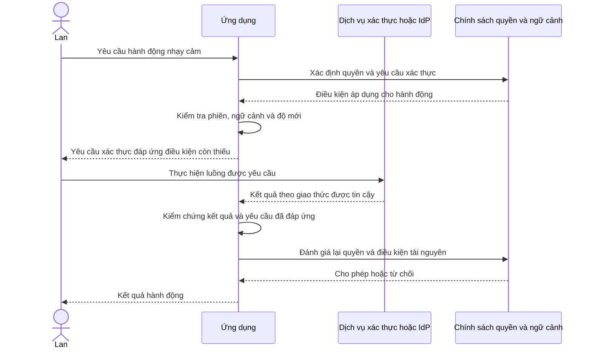

# Authentication Assurance Level

## Mục tiêu bài học

Trong chương **Identity assurance**, bài học này giải thích Authentication Assurance Level và cách sử dụng nó trong quản lý danh tính và quyền truy cập — IAM. Sau khi học, bạn có thể:

- Phân biệt AAL với mức bảo đảm danh tính, federation và quyền nghiệp vụ.
- Giải thích điểm khác nhau cốt lõi giữa AAL1, AAL2 và AAL3.
- Phân tích yếu tố xác thực, khả năng chống phát lại, chống phishing và bảo vệ khóa.
- Nhận biết ảnh hưởng của phiên, xác thực lại, khôi phục tài khoản và phương thức dự phòng.
- Mô tả cách ứng dụng sử dụng ngữ cảnh xác thực đáng tin cậy để yêu cầu step-up mà vẫn kiểm tra quyền trên tài nguyên.

## 1. AAL trả lời câu hỏi nào?

**Authentication Assurance Level (AAL)** là mức bảo đảm của quá trình xác thực: hệ thống có cơ sở tin cậy đến đâu rằng bên đang đăng nhập kiểm soát authenticator đã được liên kết với tài khoản. Bài học dùng khung **NIST SP 800-63B-4**, tránh trộn yêu cầu giữa các phiên bản. [NIST SP 800-63B-4 — Authentication and Authenticator Management](https://pages.nist.gov/800-63-4/sp800-63b.html)

Ví dụ, tài khoản Lan có thể đã được ghi danh đúng quy trình, nhưng một lần đăng nhập chỉ kiểm tra một mật khẩu. Một lần khác, Lan sử dụng phương tiện mật mã với yếu tố kích hoạt phù hợp. Hai lần đăng nhập không nhất thiết có cùng mức bảo đảm chỉ vì cùng tài khoản.

AAL cần được nhìn như đặc tính của **quá trình được thực hiện và ngữ cảnh truy cập được duy trì**, không phải một huy hiệu cố định gắn với mọi thao tác của người dùng.

### Bốn câu hỏi khác nhau

| Góc nhìn | Câu hỏi |
| --- | --- |
| Identity proofing | Tài khoản được gắn với danh tính được khai bằng quy trình nào? |
| Authentication | Bên đang thao tác chứng minh quyền kiểm soát phương tiện của tài khoản ra sao? |
| Federation | Kết quả được chuyển từ bên xác thực tới ứng dụng và kiểm chứng như thế nào? |
| Authorization | Chủ thể được làm gì trên tài nguyên cụ thể? |

Trong hệ thống IAM, các phần trên phối hợp với nhau nhưng không thay thế nhau. Một lần xác thực mạnh không tự xác minh lại toàn bộ thông tin ngoài đời và cũng không tự cấp quyền quản trị.

## 2. Nền tảng: yếu tố, authenticator và quá trình xác thực

### 2.1. Yếu tố xác thực không phải số màn hình

Ba nhóm yếu tố thường được diễn đạt là điều biết, điều sở hữu và đặc điểm sinh trắc học. Nhiều bằng chứng thuộc cùng một nhóm không tự tạo thành nhiều yếu tố. [NIST SP 800-63-4 — Digital Identity Model](https://pages.nist.gov/800-63-4/sp800-63/model/)

| Tình huống minh họa | Phân tích |
| --- | --- |
| Mật khẩu rồi một PIN được gửi tới verifier như bí mật thứ hai | Cả hai đều thuộc nhóm điều biết; không thể chỉ đếm hai ô nhập để kết luận MFA |
| Mật khẩu và mã từ một authenticator OTP được triển khai phù hợp | Có thể kết hợp điều biết với khả năng kiểm soát phương tiện tạo mã; còn phải xét đầy đủ quy trình |
| Dùng khóa mật mã cần PIN cục bộ hoặc kiểm tra sinh trắc học để kích hoạt | Có thể là một authenticator đa yếu tố; không nhất thiết phải có hai thiết bị |
| IP thuộc mạng công ty | Là thông tin ngữ cảnh, không tự chứng minh một yếu tố xác thực của chủ thể |

PIN kích hoạt khóa cục bộ cần được phân biệt với một bí mật thứ hai gửi tới máy chủ. Trong trường hợp kích hoạt, hệ thống sử dụng cả quyền kiểm soát phương tiện mật mã và điều kiện cho phép sử dụng phương tiện đó.

### 2.2. Authenticator đa yếu tố không đồng nghĩa nhiều thiết bị

Một thiết bị có thể yêu cầu hai yếu tố cho một giao dịch xác thực. Ngược lại, sử dụng hai thiết bị không tự chứng minh đủ hai yếu tố: phải biết mỗi thiết bị và giao thức đang chứng minh điều gì.

Ví dụ, việc một điện thoại đã được mở khóa trước đó không đủ để ứng dụng tự kết luận lần xác thực hiện tại đã sử dụng sinh trắc học. Cần có cơ sở từ giao thức và kết quả kiểm chứng tương ứng.

### 2.3. Sinh trắc học cần gắn với phương tiện

Trong mô hình NIST, đặc điểm sinh trắc học không được coi là authenticator độc lập; nó được sử dụng cùng phương tiện vật lý hoặc làm yếu tố kích hoạt authenticator đa yếu tố theo điều kiện tương ứng. [NIST SP 800-63B-4 — Authenticator and Verifier Requirements](https://pages.nist.gov/800-63-4/sp800-63b/authenticators/)

Vì thế, một hệ thống có màn hình “quét khuôn mặt” chưa đủ cơ sở để công bố AAL. Cần xem đó là cơ chế nào, gắn với tài khoản và phương tiện ra sao, verifier kiểm chứng điều gì và dữ liệu nhạy cảm được bảo vệ thế nào.

## 3. So sánh AAL1, AAL2 và AAL3

Các đặc điểm chính theo NIST SP 800-63B-4 được tóm tắt dưới đây; bảng không thay cho toàn bộ yêu cầu về authenticator, verifier và vận hành. [NIST SP 800-63B-4 — Authentication Assurance Levels](https://pages.nist.gov/800-63-4/sp800-63b/aal/)

| Đặc điểm | AAL1 | AAL2 | AAL3 |
| --- | --- | --- | --- |
| Yếu tố | Cho phép đơn yếu tố | Yêu cầu hai yếu tố phân biệt | Đa yếu tố, có phương tiện mật mã khóa công khai |
| Chống phát lại | Không bắt buộc ở mức này | Bắt buộc có authenticator đáp ứng | Bắt buộc |
| Chống phishing | Không bắt buộc | Phải cung cấp lựa chọn đáp ứng | Bắt buộc trong quá trình được chấp nhận |
| Khóa riêng không xuất được | Không bắt buộc | Không bắt buộc | Bắt buộc |
| Authentication intent | Không bắt buộc | Được khuyến nghị | Bắt buộc |

### 3.1. AAL1: cho phép đơn yếu tố, vẫn có yêu cầu bảo vệ

Một luồng dùng mật khẩu có thể là ứng viên cho AAL1 nếu đáp ứng yêu cầu liên quan. AAL1 không có nghĩa được phép lưu mật khẩu tùy tiện, bỏ qua bảo vệ kênh truyền hoặc chấp nhận mọi cách kiểm tra bí mật.

Ví dụ, một cổng nội dung có tài khoản cơ bản có thể chọn chính sách đăng nhập thấp hơn một cổng quản trị. Đó là lựa chọn theo nhu cầu và rủi ro của dịch vụ, không phải quyền suy ra từ việc giao diện “chỉ có nội dung”.

Sử dụng một phương thức mạnh trong ứng dụng chỉ yêu cầu AAL1 cũng không làm toàn bộ quy trình vận hành tự động đáp ứng AAL2 hoặc AAL3. Còn phải xét những yêu cầu ngoài riêng thao tác đăng nhập đó.

### 3.2. AAL2: MFA là điều kiện quan trọng, chưa phải toàn bộ kết luận

Điểm dễ nhớ của AAL2 là hai yếu tố phân biệt. Tuy vậy, số yếu tố không bao quát toàn bộ điều kiện về giao thức, kênh truyền, xử lý xác thực và vòng đời.

Ví dụ, ứng dụng có mật khẩu và OTP nhưng một endpoint dự phòng vẫn cho tạo phiên đầy đủ chỉ bằng mật khẩu. Lần truy cập qua đường dự phòng không thể được coi như đã thực hiện đủ hai yếu tố chỉ vì tài khoản có đăng ký OTP.

Yêu cầu cung cấp lựa chọn chống phishing không có nghĩa mọi phương thức được chấp nhận tại AAL2 đều tự chống phishing. Một tổ chức có thể áp chính sách chặt hơn cho nhóm người dùng hoặc hành động cụ thể; cần phân biệt chính sách đó với mô tả chung của mức AAL.

### 3.3. AAL3: không phải thêm một OTP vào AAL2

AAL3 đưa ra những điều kiện về phương tiện mật mã và bảo vệ khóa, không chỉ đếm thêm bước. NIST còn quy định các yêu cầu kỹ thuật và kiểm định mật mã tương ứng; vì vậy, chỉ cắm một thiết bị phần cứng không đủ để kết luận đạt mức này. [NIST SP 800-63B-4 — Authentication Assurance Level 3](https://pages.nist.gov/800-63-4/sp800-63b.html#authentication-assurance-level-3)

Một ví dụ ứng viên có thể là phương tiện khóa công khai phù hợp, yêu cầu kích hoạt bằng yếu tố thứ hai và được triển khai cùng verifier, giao thức, quản lý phiên đáp ứng đầy đủ điều kiện. Từ “ứng viên” quan trọng: mô tả tính năng ở mức khái niệm chưa phải một đánh giá tuân thủ.

## 4. Chống phát lại, chống phishing và intent khác nhau

### 4.1. Chống phát lại — replay resistance

Cơ chế chống phát lại nhằm ngăn kẻ tấn công lấy một bằng chứng xác thực đã sử dụng rồi trình lại như một giao dịch hợp lệ khác. Challenge được ràng buộc với giao dịch hoặc mã dùng một lần có kiểm soát là những cách thể hiện ý tưởng này theo từng giao thức.

### 4.2. Chống phishing — phishing resistance

Chống phishing trong ngữ cảnh này gắn với khả năng giao thức ngăn bằng chứng bị sử dụng cho bên giả mạo, không chỉ dựa vào việc người dùng tự nhận ra website lạ. Một OTP có thể bị chuyển tiếp trong thời gian còn dùng được; đặc tính một lần không tự ngăn kịch bản đó.

### 4.3. Authentication intent

Intent liên quan đến việc có tương tác thể hiện chủ ý xác thực, thay vì để phần mềm sử dụng phương tiện hoàn toàn ngoài nhận thức người dùng. Một thao tác chạm có thể phục vụ intent nhưng không mặc nhiên chứng minh kiểm tra người dùng cục bộ hoặc yếu tố thứ hai.

Các đặc tính trên được NIST mô tả riêng cho authenticator và giao thức. [NIST SP 800-63B-4 — Authenticator Requirements](https://pages.nist.gov/800-63-4/sp800-63b/authenticators/)

### Ví dụ phân tích

Lan nhập OTP vào một trang giả. Kẻ tấn công chuyển OTP sang dịch vụ thật ngay lập tức. Dịch vụ có thể từ chối lần sử dụng thứ hai nhưng vẫn chấp nhận lần chuyển tiếp đầu tiên.

Trong ví dụ này, tính một lần không đủ để chứng minh giao dịch chống phishing. Cũng không thể kết luận Lan đã đồng ý cho một hành động nghiệp vụ cụ thể chỉ vì Lan có ý định đăng nhập.

## 5. Passkey, đồng bộ khóa và giới hạn của nhãn sản phẩm

Một tên sản phẩm hoặc phương thức như “passkey” không tự quyết định AAL. Cần biết phương tiện có sử dụng yếu tố kích hoạt hay không, khóa có thể xuất hoặc đồng bộ không, verifier kiểm chứng dữ liệu nào và những yêu cầu khác được đáp ứng ra sao.

NIST cho phép syncable authenticators hỗ trợ AAL2 khi đáp ứng các điều kiện liên quan. Khả năng đồng bộ khóa đòi hỏi khóa có thể xuất, nên không đáp ứng yêu cầu không xuất khóa của AAL3. [NIST SP 800-63B-4 — Syncable Authenticators](https://pages.nist.gov/800-63-4/sp800-63b/syncable/)

| Câu hỏi về một triển khai minh họa | Vì sao cần hỏi? |
| --- | --- |
| Verifier có kiểm chứng việc xác minh người dùng cục bộ không? | Không chỉ dựa vào việc giao diện thiết bị có hiển thị PIN hoặc sinh trắc học |
| Khóa có thể được sao chép hoặc đồng bộ không? | Phân biệt đặc tính bảo vệ khóa và phạm vi có thể sử dụng |
| Phương tiện gắn với bên nhận và giao dịch thế nào? | Đánh giá các đặc tính giao thức liên quan |
| Phương thức dự phòng được chấp nhận là gì? | Một đường truy cập khác có thể không có cùng mức bảo đảm |
| Việc khôi phục làm thay đổi quyền kiểm soát khóa thế nào? | Cần xem vòng đời, không chỉ lần đăng nhập bình thường |

Không nên suy luận “không dùng mật khẩu thì chỉ có một yếu tố”. Một phương tiện mật mã được kích hoạt bằng yếu tố phù hợp có thể là authenticator đa yếu tố. Ngược lại, bỏ màn hình mật khẩu cũng không tự làm một cơ chế trở thành MFA.

## 6. Mức yêu cầu, khả năng tài khoản và lần xác thực thực tế

Cần phân biệt ba thông tin thường bị gộp:

1. **Mức dịch vụ yêu cầu:** chính sách đặt ra cho ứng dụng hoặc hành động.
2. **Khả năng đã đăng ký:** tài khoản có những authenticator nào, có thể thực hiện những luồng nào.
3. **Bằng chứng của lần truy cập hiện tại:** luồng nào thực sự đã được thực hiện và còn được chấp nhận trong ngữ cảnh phiên.

Ví dụ minh họa:

```text
Tài khoản Lan:
    có mật khẩu và một authenticator đa yếu tố được chấp nhận

Phiên hiện tại:
    được tạo từ một luồng đăng nhập đơn yếu tố

Hành động quản trị:
    yêu cầu ngữ cảnh xác thực cao hơn và còn mới theo chính sách

Kết luận:
    khả năng đã đăng ký không tự nâng phiên hiện tại;
    ứng dụng cần yêu cầu luồng đáp ứng điều kiện trước khi tiếp tục.
```

Một cờ `mfaEnabled=true` trong hồ sơ chỉ mô tả một trạng thái cấu hình theo cách sản phẩm định nghĩa. Nó không chứng minh lần đăng nhập hiện tại đã dùng MFA, có chống phishing hoặc vừa được thực hiện.

Tương tự, một tài khoản quản trị không tự có AAL3. “Quản trị viên” là vai trò quyền; AAL là yêu cầu và bằng chứng về quá trình xác thực. Chính sách có thể yêu cầu quản trị viên dùng luồng mạnh hơn, nhưng hệ thống vẫn phải thực thi yêu cầu đó.

## 7. Chọn AAL theo rủi ro của dịch vụ

NIST đặt việc lựa chọn mức bảo đảm trong quá trình đánh giá rủi ro, đồng thời xét ảnh hưởng của cơ chế danh tính tới quyền riêng tư và khả năng sử dụng dịch vụ. [NIST SP 800-63-4 — Digital Identity Risk Management](https://pages.nist.gov/800-63-4/sp800-63/dirm/)

Với ứng dụng minh họa, nhóm thiết kế có thể phân tích:

- Nếu kẻ khác kiểm soát tài khoản thì đọc hoặc thay đổi được dữ liệu gì?
- Một hành động có thể ảnh hưởng riêng người dùng hay nhiều tổ chức khác?
- Tài khoản có khả năng cấp quyền, đổi phương thức xác thực hoặc thay cấu hình tin cậy không?
- Người dùng có thiết bị và phương thức nào; trường hợp mất phương tiện được xử lý thế nào?
- Có yêu cầu riêng về chống phishing hoặc bảo vệ khóa cho nhóm thao tác nào?

### Ví dụ lựa chọn nội bộ

Một nền tảng có phần nội dung công khai, phần hóa đơn của khách hàng và khu vực quản trị chính sách. Tổ chức có thể đặt yêu cầu khác nhau cho các vùng hoặc hành động theo đánh giá của mình.

Không nên gắn một mức AAL cố định cho mọi hệ thống có cùng tên nghiệp vụ. Hai cổng “báo cáo” có thể khác rất lớn về dữ liệu và khả năng gây hại. Bảng hay ví dụ học tập không thể thay thế việc xác định yêu cầu cho dịch vụ cụ thể.

Các tín hiệu như vị trí bất thường hoặc thiết bị mới có thể kích hoạt kiểm tra bổ sung. Chúng không tự trở thành một yếu tố và không tự nâng AAL chỉ vì điểm rủi ro được tính cao hoặc thấp.

## 8. Phiên và xác thực lại là một phần của bài toán

Xác thực thường được dùng để bắt đầu một phiên, giúp người dùng tiếp tục làm việc mà không phải trình lại toàn bộ bằng chứng ở mọi yêu cầu. Phiên không được xem là có mức bảo đảm cao hơn sự kiện xác thực làm cơ sở cho nó. [NIST SP 800-63B-4 — Session Management](https://pages.nist.gov/800-63-4/sp800-63b/session/)

### 8.1. Phân biệt ba loại thời gian

| Khái niệm | Câu hỏi |
| --- | --- |
| Thời điểm xác thực | Người dùng hoàn tất quá trình được chấp nhận vào lúc nào? |
| Thời hạn tổng thể | Khi nào cần xác thực lại dù phiên vẫn liên tục có hoạt động? |
| Thời hạn không hoạt động | Phiên được chấp nhận im lặng trong bao lâu? |

Thời điểm phát hành token là một thông tin khác. Một token vừa được cấp có thể vẫn dựa trên một lần xác thực đã diễn ra từ trước. Làm mới token không tự chứng minh người dùng vừa trình lại authenticator.

### 8.2. Đọc đúng mức bắt buộc và khuyến nghị

NIST SP 800-63B-4 nêu các mốc xác thực lại sau; cần giữ nguyên khác biệt giữa **SHALL** và **SHOULD**, thay vì biến tất cả thành một loại giới hạn. [NIST SP 800-63B-4 — Reauthentication by AAL](https://pages.nist.gov/800-63-4/sp800-63b/aal/)

| Mức | Thời hạn tổng thể | Thời hạn không hoạt động |
| --- | --- | --- |
| AAL1 | Phải xác định thời hạn; khuyến nghị không quá 30 ngày | Có thể áp dụng, không bắt buộc ở mức này |
| AAL2 | Phải xác định thời hạn; khuyến nghị không quá 24 giờ | Khuyến nghị không quá 1 giờ |
| AAL3 | Bắt buộc không quá 12 giờ | Khuyến nghị không quá 15 phút |

Các mốc trên không phải lý do mặc định chọn thời gian dài nhất cho mọi ứng dụng. Chính sách thực tế còn phải xét môi trường và các yêu cầu áp dụng. “Khuyến nghị” cũng không đồng nghĩa có thể bỏ qua mà không cân nhắc căn cứ.

### 8.3. Một chính sách hành động có thể chặt hơn thời hạn phiên

Giả sử ứng dụng đặt yêu cầu riêng: thay phương thức khôi phục phải dựa trên một lần xác thực phù hợp trong khoảng 5 phút vừa qua. Đây là **giá trị giả định của ví dụ**, không phải một mốc chung của NIST.

Lan có thể có phiên còn hợp lệ nhưng lần xác thực đã cũ hơn yêu cầu này. Khi đó, ứng dụng cần xác thực lại theo chính sách trước khi cho thay đổi. Không nên chỉ nhìn cookie còn hạn hoặc token có `exp` ở tương lai.

Ngược lại, một lần xác thực vừa xảy ra nhưng dùng phương thức không đạt yêu cầu cũng chưa đủ. **Độ mạnh** và **độ mới** là hai điều kiện cần xét riêng.

## 9. Step-up authentication: nâng mức khi cần

**Step-up authentication** là việc yêu cầu một quá trình xác thực bổ sung hoặc mạnh hơn khi ngữ cảnh hiện tại chưa đáp ứng yêu cầu của hành động. Tùy tình huống, người dùng có thể cần thêm yếu tố, dùng phương thức khác hoặc thực hiện lại quá trình đầy đủ.

Không phải mọi step-up đều là “gửi thêm một OTP”. Nếu chính sách yêu cầu chống phishing, một OTP dễ bị chuyển tiếp có thể vẫn chưa đáp ứng. Nếu cần đặc tính khóa không xuất được, thêm một bước nhập mã không tạo ra đặc tính đó.

### 9.1. Luồng minh họa tại ứng dụng



Sơ đồ biểu diễn trách nhiệm, không phải toàn bộ thông điệp OIDC hoặc giao thức xác thực. Việc gửi yêu cầu step-up chưa chứng minh phía xác thực đã thực hiện đúng; ứng dụng phải kiểm tra kết quả thực tế.

### 9.2. Giả mã kiểm tra tại phía được tin cậy

```text
function performSensitiveAction(request):
    principal = requireVerifiedPrincipal(request)
    resource = loadRequestedResource(request)

    requireCurrentPermission(principal, request.action, resource)
    requirement = loadAuthenticationRequirement(request.action, resource)
    context = loadVerifiedAuthenticationContext(principal.sessionId)

    if not satisfiesAcceptedProfile(context, requirement):
        return beginBoundStepUpTransaction(principal, request, requirement)

    if not satisfiesFreshness(context, requirement):
        return beginBoundReauthentication(principal, request, requirement)

    requireCurrentPermission(principal, request.action, resource)
    requireBusinessConditions(resource, request.action)
    return executeWithinRequiredConsistencyBoundary(request, resource)
```

Đây là mô hình tự xây dựng để phân trách nhiệm, không phải thư viện hoặc cấu hình tuân thủ NIST. Các giao dịch step-up cần được ràng buộc với đúng principal, phiên và yêu cầu; không cho đổi tài nguyên hoặc hành động ngoài phạm vi được phép sau khi hoàn tất.

Ví dụ dùng `satisfiesAcceptedProfile` thay vì chỉ so sánh trực tiếp tên các mức AAL. Trong triển khai thực tế, cần biết nguồn nào xác nhận ngữ cảnh, hồ sơ nào được chấp nhận và những đặc tính bổ sung như chống phishing có được đáp ứng không.

Sau thời gian người dùng chuyển sang IdP, quyền hoặc trạng thái tài nguyên có thể đã thay đổi. Vì thế, hoàn tất xác thực không thay cho việc kiểm tra lại điều kiện trước khi thực hiện thao tác.

## 10. Truyền ngữ cảnh xác thực qua federation

Trong SSO hoặc federation, ứng dụng có thể dựa vào quá trình xác thực tại IdP. Ứng dụng cần tiếp nhận thông tin theo quan hệ tin cậy và giao thức, không chấp nhận một trường `aal` tự khai từ trình duyệt.

OIDC có các claim liên quan: `acr` tham chiếu lớp ngữ cảnh xác thực; `amr` mô tả phương thức đã dùng; `auth_time` là thời điểm xác thực. `iat` biểu thị thời điểm phát hành token. Ý nghĩa các giá trị `acr` cần được các bên thống nhất, không có quy tắc chung rằng chuỗi bất kỳ tự ánh xạ thành AAL NIST. [OpenID Connect Core 1.0 — ID Token](https://openid.net/specs/openid-connect-core-1_0.html#IDToken)

### 10.1. Thông tin cần có cơ sở tin cậy

Một thiết kế minh họa có thể lưu ngữ cảnh nội bộ sau khi đã kiểm chứng giao thức:

```text
VerifiedAuthenticationContext
    localPrincipal: user-781
    source: approved-company-idp
    acceptedProfile: company-workforce-mfa
    authenticationTime: thời điểm do nguồn tin cậy cung cấp
    phishingResistance: kết quả được ánh xạ theo hợp đồng tin cậy
    sourceTransaction: tham chiếu giao dịch đã kiểm chứng
```

Đây là dữ liệu nội bộ minh họa, không phải tên claim chuẩn. Trường `acceptedProfile` chỉ có ý nghĩa nếu tổ chức đã xác định nó cam kết gì và bằng chứng nào được chấp nhận.

Ví dụ, nhận `amr` cho biết mật khẩu và OTP đã được sử dụng không tự mô tả đầy đủ mọi điều kiện về verifier, phiên hoặc vòng đời. Ứng dụng không nên tự công bố đạt một AAL chỉ từ việc thấy hai phần tử trong mảng.

### 10.2. Yêu cầu gửi đi và kết quả nhận về

Ứng dụng có thể yêu cầu ngữ cảnh hoặc độ mới qua cơ chế được provider hỗ trợ. Với OIDC, việc yêu cầu một giá trị `acr` chưa đủ để bỏ qua kiểm tra giá trị thực tế trả về; một yêu cầu ưu tiên có thể không mang cùng tính bắt buộc với yêu cầu thiết yếu. [OpenID Connect Core 1.0 — Requesting the acr Claim](https://openid.net/specs/openid-connect-core-1_0.html#acrSemantics)

Trong ví dụ, nếu thao tác cần hồ sơ chống phishing mà kết quả không chứng minh đáp ứng, ứng dụng phải dừng hoặc tiếp tục luồng thích hợp. Không được coi phản hồi “đăng nhập thành công” là mặc nhiên thỏa mọi điều kiện đã mong muốn.

### 10.3. Phiên IdP và phiên ứng dụng độc lập

Một ứng dụng hết hạn phiên có thể chuyển user tới IdP vẫn còn phiên. IdP có thể cung cấp kết quả dựa trên ngữ cảnh cũ nếu luồng cho phép. Ứng dụng vẫn cần xác định yêu cầu xác thực lại của chính mình đã được đáp ứng hay chưa.

Đăng xuất tại một bên cũng không mặc nhiên kết thúc mọi phiên ở bên khác. Chính sách AAL không thể chỉ dựa vào việc “đã dùng SSO” mà bỏ qua vòng đời từng phiên.

## 11. Đăng ký, khôi phục và phương thức dự phòng

Khả năng xác thực mạnh phụ thuộc việc phương tiện được liên kết với đúng tài khoản và được quản lý trong suốt vòng đời. Thêm phương tiện, thay thế và khôi phục là các sự kiện bảo mật cần có quy trình phù hợp. [NIST SP 800-63B-4 — Authenticator Event Management](https://pages.nist.gov/800-63-4/sp800-63b/events/)

### 11.1. Mạnh ở luồng chính, yếu ở đường khác

Giả sử Lan thường dùng một phương thức chống phishing. Nếu ứng dụng đồng thời cho phép tạo phiên có cùng quyền và nhãn bảo đảm chỉ bằng một đường hỗ trợ yếu hơn, kẻ tấn công có thể chọn đường đó.

Cần xác định mức của **quá trình thực tế được chấp nhận**, không suy ra từ phương thức mạnh nhất mà tài khoản sở hữu. Sau một luồng dự phòng, ứng dụng có thể phải hạn chế hành động hoặc yêu cầu đáp ứng lại hồ sơ phù hợp trước thao tác nhạy cảm.

### 11.2. Khôi phục không phải miễn kiểm tra

Khôi phục có thể giúp chủ tài khoản đăng ký lại phương tiện, nhưng không nên biến thành khả năng tự nâng ngữ cảnh. Một nhân viên hỗ trợ đánh dấu “đã xác minh” cần có quy trình, bằng chứng và thẩm quyền rõ ràng.

Nếu thay phương tiện hoặc phát hiện chiếm tài khoản, cũng cần xem những phiên, token và quyền đặc quyền còn hiệu lực. Chỉ thu hồi một phương tiện không chứng minh mọi phiên được tạo từ trước đã mất hiệu lực.

### 11.3. Thay đổi tài khoản không đồng nghĩa làm mới xác thực

Cấp vai trò quản trị cho Lan không làm lần đăng nhập cũ đáp ứng yêu cầu xác thực của khu vực quản trị. Ngược lại, thu hồi vai trò phải được áp dụng dù phiên có ngữ cảnh xác thực mạnh. Vòng đời quyền và ngữ cảnh xác thực là các đầu vào khác nhau của quyết định truy cập.

## 12. AAL phối hợp với phân quyền và đặc quyền

Có thể mô tả quyết định cho một hành động được bảo vệ bằng mô hình khái niệm:

```text
Cho phép thực hiện khi:
    danh tính và phiên được chấp nhận
    AND tài khoản, membership còn hiệu lực
    AND quyền cho hành động và tài nguyên được đáp ứng
    AND ngữ cảnh xác thực đạt yêu cầu của hành động
    AND độ mới và điều kiện nghiệp vụ được đáp ứng
```

Một quản trị viên đã xác thực mạnh vẫn có thể bị từ chối vì không được quản lý tổ chức đích. Một người có quyền đọc vẫn có thể cần step-up trước chức năng thay phương thức xác thực. Không nên sửa vai trò chỉ để biểu thị một lần đăng nhập vừa đạt điều kiện mạnh hơn.

RBAC và ABAC tổ chức việc đánh giá quyền; PAM quản lý truy cập đặc quyền theo phạm vi và thời gian. Chúng có thể đặt hoặc sử dụng yêu cầu xác thực, nhưng không đồng nghĩa với AAL.

### Danh tính workload

AAL trong mô hình bài học tập trung vào xác thực người dùng. Một workload dùng chứng thư hoặc token ngắn hạn có cơ chế bảo đảm riêng; không tự gọi nó là AAL3 chỉ vì có khóa riêng hoặc không dùng mật khẩu.

Khi workload làm thay người dùng, cần phân biệt danh tính workload với ngữ cảnh người khởi tạo. Job chạy nền không được tự ghi nhận người dùng vừa hoàn tất MFA chỉ vì workload đã lấy một access token mới.

## 13. Kiểm toán và dữ liệu ngữ cảnh

Hệ thống cần biết tại sao một hành động được phép, bị từ chối hoặc được yêu cầu xác thực bổ sung. Một sự kiện nội bộ có thể chứa:

```text
actor: user-781
action: account.change-recovery-method
resource: tài khoản đích
requiredProfile: sensitive-account-change
observedProfile: hồ sơ đã được ánh xạ từ nguồn tin cậy
authenticationTime: thời điểm có cơ sở kiểm chứng
contextSource: approved-company-idp
result: STEP_UP_REQUIRED
reason: authentication_too_old
requestId: mã tương quan
policyVersion: phiên bản chính sách đang áp dụng
```

Cấu trúc này chỉ là ví dụ, không phải định dạng chuẩn. Cần phân biệt **đã yêu cầu step-up**, **step-up thành công** và **hành động nghiệp vụ đã hoàn tất**. Ba sự kiện không thay thế nhau.

Nhật ký không nên chứa mật khẩu, mã OTP đang có hiệu lực, token đầy đủ hoặc mẫu sinh trắc học. Dữ liệu thiết bị và hành vi cũng cần được giới hạn theo nhu cầu và chính sách riêng tư.

Khi provider thay cấu hình hoặc một phương thức dự phòng mới được thêm vào, cần xem lại ánh xạ ngữ cảnh. Một nhãn hồ sơ giữ nguyên tên không chứng minh quy trình thực tế vẫn giữ nguyên đặc tính.

## 14. Những hiểu nhầm thường gặp

| Hiểu nhầm | Cách hiểu đúng |
| --- | --- |
| AAL là mức quyền của tài khoản | AAL liên quan đến xác thực; quyền trên tài nguyên cần kiểm tra riêng |
| Tài khoản bật MFA thì mọi phiên đều là MFA | Cần xem luồng đã thực hiện trong phiên hiện tại |
| Hai màn hình hoặc hai bí mật là hai yếu tố | Phải phân biệt nhóm yếu tố và cách chứng minh |
| Có OTP thì chống phishing | Mã có thể bị chuyển tiếp; chống phát lại không đồng nghĩa chống phishing |
| Passkey hoặc khóa phần cứng luôn là AAL3 | Phải xét kích hoạt, khả năng xuất khóa, giao thức và đầy đủ yêu cầu liên quan |
| Sinh trắc học tự nó chứng minh một mức AAL | Cần xét phương tiện và quy trình mà sinh trắc học tham gia |
| Token mới đồng nghĩa xác thực mới | Thời điểm phát hành khác thời điểm người dùng xác thực |
| SSO thành công là đủ cho mọi thao tác | RP cần kiểm tra ngữ cảnh, độ mới và quyền của chính mình |
| Tín hiệu thiết bị hoặc điểm rủi ro là yếu tố thứ hai | Tín hiệu có thể điều chỉnh chính sách nhưng không tự thay yếu tố |
| Nâng AAL sẽ tự sửa các quyền quá rộng | Ít quyền nhất và phân quyền vẫn cần được thiết kế riêng |

## 15. Ví dụ tổng hợp: thay đổi phương thức khôi phục

Một nền tảng cho phép Lan xem các dữ liệu được giao sau đăng nhập. Với thao tác thay phương thức khôi phục, tổ chức đặt yêu cầu nội bộ về hồ sơ chống phishing đã được chấp nhận và xác thực gần đây.

Lan mở màn hình thay đổi từ một phiên cũ. Ứng dụng kiểm tra quyền thao tác trên tài khoản đích, sau đó kiểm tra ngữ cảnh xác thực. Nếu hồ sơ hoặc độ mới chưa đáp ứng, ứng dụng khởi tạo giao dịch step-up được ràng buộc với phiên của Lan.

Sau khi IdP trả kết quả, ứng dụng kiểm chứng giao thức, đối chiếu principal, đọc ngữ cảnh theo hợp đồng tin cậy và đánh giá các điều kiện. Nó không chỉ giải mã token để tìm chuỗi `mfa`, cũng không lấy thời điểm phát hành token làm thời điểm xác thực.

Nếu kết quả phù hợp, ứng dụng kiểm tra lại quyền và điều kiện trước khi thay đổi. Nếu IdP không thể cung cấp yêu cầu cần thiết hoặc user hủy, thao tác chưa được thực hiện. Một thông báo đăng nhập thành công ở nơi khác không làm thay đổi kết luận này.

Hệ thống ghi nhận các sự kiện cần thiết, thông báo thay đổi theo chính sách và xử lý ảnh hưởng tới quyền kiểm soát tài khoản. Như vậy, yêu cầu xác thực được gắn với hành động thực tế thay vì chỉ là một nhãn trong hồ sơ.

## 16. Các câu hỏi khi áp dụng AAL vào IAM

Khi phân tích một thiết kế, hãy tìm câu trả lời cụ thể:

- Dịch vụ hoặc hành động yêu cầu gì, và yêu cầu đó dựa trên đánh giá rủi ro nào?
- Phương thức được chấp nhận thực sự chứng minh những yếu tố và đặc tính nào?
- Cách triển khai authenticator, verifier và quản lý phiên có đáp ứng toàn bộ điều kiện liên quan không?
- Hệ thống phân biệt khả năng đã đăng ký với lần xác thực đang làm cơ sở cho phiên ra sao?
- Ngữ cảnh và thời điểm xác thực đến từ nguồn nào; nếu dùng federation, các giá trị được ánh xạ theo thỏa thuận nào?
- Khi cần step-up, giao dịch được ràng buộc và kết quả được kiểm tra ở đâu?
- Phương thức dự phòng, khôi phục và các phiên cũ có làm thay đổi mức thực tế được chấp nhận không?
- Sau khi xác thực đủ điều kiện, quyền trên hành động và tài nguyên có vẫn được kiểm tra không?

Các câu trả lời này giúp sử dụng AAL như một yêu cầu có thể thực thi và kiểm chứng trong chuỗi xác thực, phiên, federation và phân quyền của hệ thống IAM.
