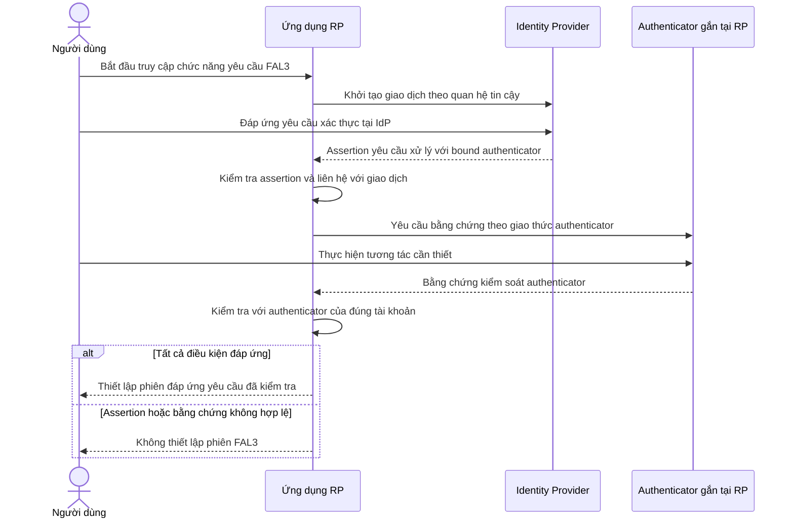

# Federation Assurance Level

## 1. FAL bảo đảm điều gì?

**Federation Assurance Level — FAL** là mức bảo đảm cho giao dịch liên kết danh tính: cách kết quả xác thực và thông tin danh tính được chuyển từ bên cung cấp danh tính đến bên sử dụng, rồi được kiểm tra để thiết lập đúng phiên cho đúng chủ thể.

Trong một hệ thống IAM, người dùng có thể đăng nhập tại **Identity Provider — IdP**, còn ứng dụng đóng vai trò **Relying Party — RP**. RP nhận một assertion, tức phát biểu có thể kiểm chứng về tài khoản hoặc sự kiện xác thực. Với OIDC, ID token là một dạng assertion; trong SAML có SAML assertion. FAL tập trung vào độ tin cậy của quá trình liên kết này, không chỉ vào thao tác đăng nhập tại IdP. [NIST: Introduction](https://pages.nist.gov/800-63-4/sp800-63c/introduction/)

Ví dụ, người dùng đã xác thực mạnh tại IdP, nhưng ứng dụng lại chấp nhận phản hồi được phát hành cho một ứng dụng khác. Bước xác thực ban đầu có thể đúng, trong khi việc đưa kết quả đó vào phiên tại RP lại sai. Đây là loại khoảng trống mà thiết kế federation phải xử lý.

Bài học sử dụng **NIST SP 800-63C-4, bản final tháng 7/2025**, làm mốc thuật ngữ và yêu cầu. Cần ghi rõ phiên bản khi trao đổi về FAL vì yêu cầu của bản này đã thay đổi so với bản trước. [Thông tin xuất bản chính thức](https://csrc.nist.gov/pubs/sp/800/63/c/4/final)

Mục tiêu là hiểu FAL1, FAL2 và FAL3, phân biệt FAL với các mức bảo đảm khác, đồng thời biết những bằng chứng cần có trước khi tuyên bố một tích hợp đáp ứng mức cụ thể.

## 2. Phân biệt FAL với IAL, AAL và quyền truy cập

Ba trục bảo đảm trả lời các câu hỏi khác nhau:

| Trục | Trọng tâm | Câu hỏi minh họa |
|---|---|---|
| Identity Assurance Level — IAL | Quy trình chứng minh và gắn người đăng ký với danh tính được khai báo | Tài khoản này đã được liên hệ với danh tính thực bằng quy trình nào? |
| Authentication Assurance Level — AAL | Việc chứng minh kiểm soát authenticator gắn với tài khoản | Lần xác thực này có mức bảo đảm ra sao? |
| Federation Assurance Level — FAL | Bảo vệ giao dịch chuyển và tiếp nhận bằng chứng danh tính | RP có nhận và xử lý đúng bằng chứng cho giao dịch này không? |

Các mức được lựa chọn theo rủi ro và chức năng của dịch vụ. Không có quy tắc chung rằng ba số phải bằng nhau. [NIST: Digital Identity Risk Management](https://pages.nist.gov/800-63-4/sp800-63/dirm/)

Một cách nhìn thực tế là tách ba hồ sơ bằng chứng: bằng chứng đăng ký danh tính, bằng chứng xác thực và bằng chứng xử lý federation. Tài liệu đầy đủ ở hồ sơ thứ nhất không tự bổ sung phần thiếu ở hồ sơ thứ ba.

**Phân quyền** lại là câu hỏi riêng: chủ thể được làm gì trên tài nguyên nào. Một phiên đáp ứng yêu cầu FAL vẫn có thể bị từ chối vì người dùng không có vai trò phê duyệt, không thuộc tenant của tài nguyên hoặc đang tự phê duyệt yêu cầu do mình tạo.

Vì vậy, không dùng nhãn FAL làm vai trò nghiệp vụ như `admin` hay coi đó là căn cứ bỏ qua RBAC, ABAC và nguyên tắc ít quyền nhất.

## 3. Các rủi ro cần nhận diện

### 3.1. Assertion giả hoặc bị thay đổi

RP cần xác định bằng chứng đến từ bên phát hành được chấp nhận và không bị sửa. Chỉ giải mã được nội dung một JWT hoặc đọc được tên người dùng trong XML chưa chứng minh bằng chứng hợp lệ.

### 3.2. Sai bên nhận

Một assertion dành cho ứng dụng A không được tự động chấp nhận ở ứng dụng B. Nếu bỏ qua phạm vi bên nhận, một phản hồi hợp lệ ở nơi này có thể bị sử dụng sai ở nơi khác.

### 3.3. Phát lại và assertion injection

**Replay** là việc sử dụng lại bằng chứng ngoài điều kiện được phép. **Assertion injection** là việc đưa assertion hoặc tham chiếu assertion vào luồng của RP để khiến RP gắn phiên với chủ thể sai. Phản hồi có thể bị đánh cắp hoặc được tạo cho một ngữ cảnh khác; kiểm tra chữ ký riêng lẻ không giải quyết toàn bộ vấn đề. [NIST: Common Federation Requirements, mục 3.11.1](https://pages.nist.gov/800-63-4/sp800-63c/Federation/#protection-from-assertion-injection-attacks)

Ví dụ minh họa: RP đang chờ phản hồi cho lần đăng nhập của trình duyệt X, nhưng một phản hồi của lần đăng nhập Y được gửi vào điểm nhận kết quả. Câu hỏi cần kiểm tra là RP có phát hiện sai liên hệ với yêu cầu và phiên ban đầu hay không, thay vì chỉ hỏi phản hồi có được IdP ký hay không.

### 3.4. Chỉ có assertion chưa chứng minh thêm khả năng kiểm soát authenticator

Với cách trình bearer assertion, bên trình không cung cấp một bằng chứng kiểm soát authenticator bổ sung tại RP như trong cơ chế FAL3. Điều này không có nghĩa mọi bearer assertion đều dễ sử dụng lại: giao thức vẫn có thể có các biện pháp bảo vệ giao dịch khác.

Cần phân tích cả đường trình bằng chứng, mối liên hệ với giao dịch và các kiểm tra tại RP. Một phép kiểm tra đơn lẻ không đại diện cho toàn bộ mức bảo đảm.

## 4. Ba mức FAL theo SP 800-63C-4

| Tiêu chí | FAL1 | FAL2 | FAL3 |
|---|---|---|---|
| Audience | Một hoặc nhiều RP | Một RP | Một RP |
| Chống phát lại | Bắt buộc | Bắt buộc | Bắt buộc |
| Chống injection | Khuyến nghị | Bắt buộc | Bắt buộc |
| Giao dịch bắt đầu tại RP | Khuyến nghị | Bắt buộc | Bắt buộc |
| Thỏa thuận tin cậy | Thiết lập trước hoặc qua subscriber | Thiết lập trước | Thiết lập trước |
| Thiết lập định danh các bên | Động hoặc thủ công | Động hoặc thủ công | Thủ công |
| Cách trình bằng chứng | Bearer assertion | Bearer assertion | Holder-of-key hoặc bound authenticator |

Mức cao kế thừa các yêu cầu của mức thấp, trừ nội dung được quy định cụ thể hơn. Mọi mức đều đòi hỏi kiểm tra assertion; FAL1 không cho phép bỏ kiểm tra chữ ký, audience hay phát lại. Bảng chỉ là tóm tắt, không phải danh sách đầy đủ để kết luận đáp ứng. [NIST: Federation Assurance Level, mục 2](https://pages.nist.gov/800-63-4/sp800-63c/fal/)

Khi đọc bảng, cần phân biệt việc thiết lập định danh với vận hành khóa. Chẳng hạn, “thủ công” không nên được diễn giải thành yêu cầu sao chép mọi khóa bằng tay ở mọi lần thay đổi. Quy trình thiết lập quan hệ ban đầu và cơ chế cập nhật vật liệu kiểm tra là các phần phải được mô tả rõ.

Một lỗi đánh giá thường gặp là đếm số tính năng đã bật. Có chữ ký, HTTPS và MFA chưa đủ để tự suy ra mức FAL nếu chưa biết cách RP liên kết phản hồi với giao dịch và thực hiện các điều kiện còn lại.

## 5. Vì sao không dùng công thức cũ về mã hóa?

Trong bản trước, người học có thể gặp mô tả ngắn theo dạng “FAL1 ký, FAL2 ký và mã hóa, FAL3 thêm holder-of-key”. Không nên dùng công thức đó để giải thích SP 800-63C-4.

Bản Revision 4 chuyển yêu cầu mã hóa khỏi cách phân mức FAL; yêu cầu bảo vệ phụ thuộc vào đường truyền và việc assertion chứa thông tin cá nhân đi qua bên không tin cậy. FAL2 nhấn mạnh chống injection, còn FAL3 mở rộng khả năng sử dụng bound authenticator. [NIST: Change Log](https://pages.nist.gov/800-63-4/sp800-63c/changelog/)

Hệ quả khi rà soát một tích hợp:

- Bật mã hóa assertion không sửa được việc RP chấp nhận phản hồi sai giao dịch.
- Assertion không mã hóa ở lớp thông điệp không tự động cho biết toàn bộ giao dịch đang ở mức nào; cần xem kênh trình và dữ liệu bên trong.
- HTTPS bảo vệ một chặng truyền, còn mã hóa assertion và ràng buộc giao dịch giải quyết những vấn đề khác.
- Một tài liệu chỉ ghi “FAL2” mà không ghi phiên bản có thể làm các nhóm hiểu khác nhau về yêu cầu.

Không dùng số mức như một nhãn tiếp thị. Hồ sơ thiết kế cần chỉ ra yêu cầu nào được đáp ứng bằng cơ chế nào và ai chịu trách nhiệm kiểm tra.

## 6. Hiểu đúng phần bổ sung ở FAL3

FAL3 yêu cầu RP kiểm tra khả năng kiểm soát authenticator bổ sung cùng assertion. Hai cách chính khác nhau ở nơi quản lý và cách nhận biết authenticator:

| Cách | Đặc điểm |
|---|---|
| Holder-of-key | Assertion nhận diện authenticator; RP kiểm tra người dùng kiểm soát authenticator tương ứng |
| Bound authenticator | Authenticator được gắn với tài khoản tại RP và do RP quản lý; assertion cho biết cần kiểm tra nó |

Authenticator phải phù hợp yêu cầu chống phishing. Chỉ yêu cầu nhập thêm một mật khẩu tại RP không tạo ra cơ chế bound authenticator theo nghĩa này. [NIST: FAQ về HoK và Bound Authenticators](https://pages.nist.gov/800-63-4-Implementation-Resources/faqs/index.html#sp-800-63c-federation)

### Luồng minh họa với bound authenticator đã được gắn hợp lệ



Sơ đồ cố ý bắt đầu từ authenticator đã được gắn hợp lệ. Việc gắn lần đầu, thêm phương tiện mới, mất phương tiện và khôi phục là các quy trình nhạy cảm có yêu cầu riêng. Không nên biến một callback đăng nhập bất kỳ thành quyền tự gắn authenticator mới vào tài khoản đặc quyền.

Ví dụ thiết kế: nếu tài khoản A có authenticator đã đăng ký, một yêu cầu thêm authenticator B cần có căn cứ xác nhận theo quy trình quản lý. Việc người gọi đang giữ một assertion có chủ thể A chưa phải lý do để bỏ qua mọi kiểm soát đăng ký mới.

FAL3 giúp giảm một số rủi ro liên quan đến việc chỉ dựa vào IdP, nhưng không tạo miễn nhiễm trước lỗi ánh xạ tài khoản, lỗi kiểm tra tại RP hoặc quy trình khôi phục sai.

## 7. OIDC, SAML và MFA không tự quyết định FAL

Tên giao thức không đủ để kết luận mức bảo đảm. NIST đưa ra ví dụ các cấu hình OIDC, SAML hoặc wallet có thể hỗ trợ các mức khác nhau, đồng thời nhấn mạnh phải xem toàn bộ quá trình federation. Bảng ví dụ giao thức không phải ánh xạ tuân thủ bắt buộc. [NIST: Protocol Examples](https://pages.nist.gov/800-63-4/sp800-63c/examples/#mapping-fals-to-common-federation-protocols)

Trong một thiết kế OIDC, các cơ chế như Authorization Code, PKCE, nonce và kiểm tra ngữ cảnh phản hồi có thể tham gia bảo vệ luồng. Tuy nhiên, câu trả lời “đang dùng Code + PKCE” chưa cung cấp bằng chứng về mọi yêu cầu FAL.

Tương tự, một ứng dụng dùng SAML cần biết cách assertion được trình, cách liên hệ với yêu cầu và cách kiểm tra tại SP. Chỉ có một chứng thư trong cấu hình không giải thích được các phần còn lại.

MFA tại IdP cũng không tự nâng FAL. NIST nêu rõ việc sử dụng credential mạnh để xác thực trực tiếp, chẳng hạn PIV, tự nó chưa tạo thành một giao dịch federation FAL3. [NIST: FAQ về PIV và FAL3](https://pages.nist.gov/800-63-4-Implementation-Resources/faqs/index.html#sp-800-63c-federation)

Ngoài ra, ID token phục vụ kết quả đăng nhập tại RP và access token phục vụ truy cập API là các đối tượng cần phân biệt. Việc áp dụng sender-constrained access token cho API không tự thay thế yêu cầu về authenticator của subscriber tại RP trong FAL3. [NIST: Ví dụ phân biệt bảo vệ federation và API](https://pages.nist.gov/800-63-4/sp800-63c/examples/)

## 8. Thỏa thuận tin cậy và khai báo mức bảo đảm

IdP và RP cần thống nhất ai được chấp nhận, những thuộc tính nào được trao đổi, mức bảo đảm phục vụ từng mục đích và trách nhiệm của các bên. Thỏa thuận tin cậy không chỉ là việc lưu URL của IdP hoặc tải một khóa công khai. [NIST: Trust Agreements](https://pages.nist.gov/800-63-4/sp800-63c/GenIdP/#trust-agreements)

Một hồ sơ tích hợp thực tế có thể ghi:

| Nội dung | Câu hỏi cần làm rõ |
|---|---|
| Phiên bản tham chiếu | Đang đánh giá theo SP 800-63C-4 hay bộ yêu cầu khác? |
| Chức năng được bảo vệ | Mức yêu cầu áp dụng cho đăng nhập nào hoặc thao tác nào? |
| Đối tượng tin cậy | Bên phát hành, RP, tenant và nhóm tài khoản nào thuộc phạm vi? |
| Giao dịch | Ai khởi tạo và RP liên hệ phản hồi với yêu cầu ra sao? |
| Bằng chứng | Cách kiểm tra nguồn, audience, thời hạn và sử dụng lại như thế nào? |
| FAL3 nếu áp dụng | Ai quản lý authenticator và RP kiểm tra đúng tài khoản bằng cách nào? |
| Vận hành | Thay khóa, thay cấu hình, gián đoạn và khôi phục được quản lý ra sao? |
| Ngoại lệ | Khi thiếu điều kiện thì từ chối, hạn chế chức năng hay chuyển quy trình nào? |

Thông tin mức bảo đảm phải có ngữ nghĩa thống nhất và nguồn đáng tin cậy. Một trường `fal=3` do client tự gửi không phải bằng chứng. Tương tự, RP không thể chỉ nhận một nhãn từ IdP rồi bỏ qua các nghĩa vụ mà chính RP phải thực hiện.

Ví dụ, nếu IdP cho biết giao dịch yêu cầu bound authenticator nhưng RP chưa xác minh authenticator đó, RP không được ghi nhận rằng phần kiểm tra của mình đã hoàn tất. Cần tách điều được bên ngoài tuyên bố khỏi điều hệ thống thực sự kiểm chứng.

## 9. Ví dụ thiết kế: cổng điều hành cho đối tác

Giả sử một công ty có cổng điều hành nhận đăng nhập từ IdP đối tác. Cổng cho phép xem trạng thái công việc và có một nhóm chức năng thay đổi cấu hình nhạy cảm. Ví dụ này minh họa cách lập luận, không đặt một mức FAL bắt buộc cho mọi cổng tương tự.

### 9.1. Xác định rủi ro theo chức năng

Nhóm thiết kế cần hỏi: nếu phản hồi bị gắn sai phiên, kẻ tấn công có thể xem hoặc thay đổi gì? Phạm vi ảnh hưởng chỉ một tài khoản hay nhiều khách hàng? Nếu IdP đối tác bị xâm phạm, RP còn kiểm tra độc lập được điều gì?

Việc lựa chọn mức bảo đảm nên dựa trên đánh giá rủi ro của dịch vụ và nhóm người dùng, rồi ghi nhận những điều kiện và sai khác liên quan. [NIST: Risk Management và lựa chọn FAL](https://pages.nist.gov/800-63-4/sp800-63/dirm/#selecting-initial-fal)

### 9.2. Lập hồ sơ cho đường đăng nhập

Giả sử tổ chức đặt mục tiêu FAL2 cho một đường đăng nhập. Nhóm triển khai phải lập bằng chứng đối với các yêu cầu áp dụng, thay vì chỉ ghi “SSO đã chạy được”.

Ví dụ các bằng chứng kỹ thuật có thể cần thu thập trong phạm vi thiết kế:

- Một phản hồi ngoài giao dịch dự kiến bị từ chối.
- Phản hồi dành cho RP khác không được chấp nhận.
- Việc sử dụng lại bằng chứng được xử lý đúng.
- Cấu hình bên phát hành, định danh và nguồn khóa được kiểm soát.
- Những thuộc tính người dùng được phép tự sửa không trở thành căn cứ tăng quyền.

Danh sách này là ví dụ để tổ chức công việc, không thay thế toàn bộ yêu cầu normative.

### 9.3. Bổ sung đường đáp ứng FAL3 khi được lựa chọn

Nếu đánh giá dẫn đến yêu cầu FAL3 cho một chức năng, RP phải có cơ chế tương ứng để kiểm tra authenticator bổ sung. Việc chỉ yêu cầu người dùng xác thực lại tại IdP không tự chứng minh phần này đã được thực hiện.

Nhóm vận hành cũng cần đường xử lý khi người dùng mất authenticator, cùng điều kiện bảo vệ việc đăng ký lại. Nếu hỗ trợ cho phép bỏ qua bước đó chỉ vì một email tự nhận là người dùng, ranh giới thiết kế có thể bị phá vỡ.

### 9.4. Kiểm tra quyền nghiệp vụ sau federation

Ngay cả khi giao dịch đáp ứng yêu cầu bảo đảm, người dùng vẫn chỉ được thực hiện các hành động đã cấp. RP kiểm tra tenant, vai trò và tài nguyên; không lấy FAL3 làm quyền quản trị mặc định.

Nếu một pipeline tự động gọi API thay mặt người dùng, cần giữ riêng ngữ cảnh workload, ngữ cảnh người dùng và phạm vi ủy quyền. Không tự gán FAL3 cho toàn bộ chuỗi API chỉ vì phiên đăng nhập ban đầu có mức đó.

## 10. Qua broker: không tự nâng mức bằng cách phát hành lại

Trong mô hình proxy hoặc broker, có thể tồn tại chặng IdP → broker và chặng broker → RP. Theo SP 800-63C-4, FAL đến RP phía sau được giới hạn bởi chặng thấp nhất trên đường liên kết; broker phải biểu diễn đúng mức đó. [NIST: Proxied Federation](https://pages.nist.gov/800-63-4/sp800-63c/Federation/#proxied-federation)

Ví dụ, chặng đầu chỉ đáp ứng FAL1. Việc broker ký một assertion mới với cấu hình tốt hơn ở chặng sau không tự biến toàn bộ giao dịch thành FAL2.

Khi tiếp nhận một sơ đồ có broker, cần yêu cầu bằng chứng cho từng chặng. Một nhãn duy nhất đặt cạnh broker không giải thích được dữ liệu nào được tin, ai kiểm tra và điều kiện nào bị mất khi chuyển đổi giao thức.

## 11. Phiên, kiểm toán và dữ liệu cần bảo vệ

### 11.1. Ghi nhận kết quả thực sự được kiểm tra

Nên có khả năng phân biệt mức được yêu cầu, thông tin do IdP cung cấp và kết quả kiểm tra tại RP. Một sự kiện minh họa có thể là:

```json
{
  "event": "federation.acceptance_failed",
  "transaction_id": "fed_739",
  "rp_id": "operations-portal",
  "issuer_id": "partner-idp",
  "requested_fal": "FAL3",
  "idp_intended_fal": "FAL3",
  "assertion_validation": "passed",
  "bound_authenticator_validation": "failed",
  "session_created": false,
  "reason": "required_authenticator_not_verified"
}
```

Đây là cấu trúc log nội bộ minh họa, không phải tập claim chuẩn của OIDC hoặc SAML. Các trường phải được tạo từ ngữ cảnh đã kiểm tra, không sao chép nhãn do client khai báo.

Không ghi toàn bộ assertion, access token hay khóa bí mật để tiện điều tra. Dùng mã giao dịch và dữ liệu tối thiểu đủ giải thích quyết định, đồng thời giới hạn người được xem dấu vết.

### 11.2. Không kéo dài mức bảo đảm bằng một cờ cố định

Ứng dụng cần biết phiên được tạo từ giao dịch nào và những điều kiện nào còn áp dụng. Một cờ `high_assurance=true` tồn tại vô thời hạn dễ làm mất thông tin về lần kiểm tra thực tế.

Chẳng hạn, nếu một chức năng cần ngữ cảnh đáp ứng yêu cầu riêng nhưng phiên hiện tại thiếu thông tin chứng minh, ứng dụng phải thực hiện quy trình phù hợp thay vì tự coi cờ hồ sơ người dùng là đủ.

Đăng xuất, thu hồi phiên, thay đổi authenticator và kết thúc vòng đời tài khoản vẫn là các công việc cần thiết. FAL không thay thế quản lý phiên hoặc tự bảo đảm rằng mọi token đã phát hành đều bị thu hồi ngay khi tài khoản đổi trạng thái.

### 11.3. Bảo đảm cao vẫn phải xem xét quyền riêng tư

Federation có thể tạo khả năng liên kết hoạt động của cùng người qua nhiều RP. Một số authenticator hoặc thuộc tính cũng có thể cung cấp dấu vết để theo dõi xuyên dịch vụ. Cần giảm dữ liệu trao đổi theo mục đích và xem xét các rủi ro đó cùng thiết kế bảo mật. [NIST: Privacy Considerations](https://pages.nist.gov/800-63-4/sp800-63c/privacy/)

Ví dụ, ứng dụng chỉ cần một định danh ổn định và một thuộc tính đủ điều kiện không nên mặc định nhận toàn bộ hồ sơ nhân sự. Bằng chứng bảo đảm và dữ liệu nghiệp vụ cần được phân biệt khi quyết định thu thập, chia sẻ và lưu giữ.

## 12. Những hiểu nhầm thường gặp

| Hiểu nhầm | Cách hiểu đúng |
|---|---|
| “Có MFA nên đã đạt FAL2.” | Cần đánh giá riêng việc bảo vệ giao dịch federation. |
| “Assertion mã hóa là đủ cho FAL2 Revision 4.” | Mã hóa không thay thế các yêu cầu về giao dịch, nguồn tin cậy và chống injection. |
| “FAL3 nghĩa là dùng ba yếu tố.” | Con số chỉ mức bảo đảm federation, không phải số yếu tố đăng nhập. |
| “Thêm mật khẩu ở RP là bound authenticator.” | Cơ chế phải đáp ứng yêu cầu tương ứng; không thể suy ra từ việc có thêm một bước nhập liệu. |
| “OIDC hoặc SAML mặc định có một FAL cố định.” | Phải đánh giá cấu hình, quy trình và toàn bộ đường liên kết. |
| “IdP khai mức cao thì RP chỉ cần tin.” | RP phải thực hiện và chứng minh các nghĩa vụ của mình. |
| “Broker phát lại token mới sẽ nâng FAL cả chuỗi.” | Chặng yếu hơn vẫn ảnh hưởng mức có thể biểu diễn ở phía sau. |
| “FAL3 cho phép bỏ kiểm tra quyền tài nguyên.” | Phân quyền vẫn được thực thi theo hành động và phạm vi cụ thể. |

## 13. Tự kiểm tra qua tình huống

**Tình huống 1:** Người dùng xác thực mạnh tại IdP, nhưng RP không kiểm tra phản hồi có thuộc giao dịch mình khởi tạo không. Có đủ căn cứ kết luận mức federation cao không?

Chưa đủ. Cần đánh giá đường tiếp nhận và khả năng ngăn gắn sai phiên, cùng toàn bộ yêu cầu của mức đang tuyên bố. Chất lượng xác thực tại IdP không sửa phần kiểm tra bị thiếu tại RP.

**Tình huống 2:** Nhóm tích hợp dùng tài liệu cũ, đặt mục tiêu FAL2 bằng cách bật mã hóa assertion. Cần làm rõ điều gì trước?

Cần xác định phiên bản tiêu chuẩn và lập lại bảng yêu cầu theo mốc đó. Nếu dùng SP 800-63C-4, không thể dựa vào công thức cũ để kết luận đã đáp ứng.

**Tình huống 3:** Assertion cho biết cần bound authenticator nhưng RP chưa kiểm tra được. Hệ thống có nên tạo phiên FAL3 trước để người dùng tiếp tục không?

Không nên ghi nhận phiên đáp ứng FAL3 khi điều kiện bắt buộc chưa được kiểm chứng. Phải xử lý theo luồng từ chối hoặc ngoại lệ đã được thiết kế, giữ đúng phạm vi chức năng được phép.

**Tình huống 4:** Phiên đã đáp ứng yêu cầu federation, nhưng người dùng truy cập tài nguyên của tenant khác. FAL có quyết định cho phép không?

Không. Đây còn là quyết định phân quyền và cách ly tài nguyên. Ứng dụng vẫn cần kiểm tra vai trò, tenant và quan hệ với đối tượng đang yêu cầu.

## 14. Những điểm cần ghi nhớ

- FAL tập trung vào bảo đảm giao dịch federation; phải phân biệt với chứng minh danh tính, xác thực và phân quyền.
- Luôn ghi rõ phiên bản tiêu chuẩn khi mô tả hoặc đánh giá một mức.
- Chữ ký, mã hóa, MFA và tên giao thức là các thông tin thành phần, không phải bằng chứng đầy đủ cho một mức FAL.
- Cơ chế FAL3 cần sự kiểm tra bổ sung tại RP, cùng quy trình quản lý authenticator phù hợp.
- Việc đánh giá cần bao phủ cả hai phía và các chặng trung gian, không chỉ tính năng của IdP.
- Chỉ ghi nhận mức đã được chứng minh trong đúng giao dịch và phạm vi; tiếp tục quản lý quyền, phiên và vòng đời truy cập theo thiết kế IAM.
