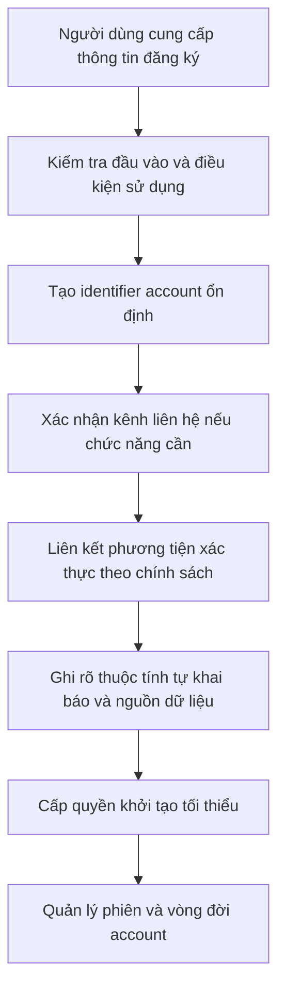

# IAL1

Một ứng dụng có thể nhận diện ổn định một account, xác thực bằng phương thức mạnh và kiểm soát quyền chặt chẽ mà vẫn chưa xác minh người sử dụng account là ai trong đời thực.

Ví dụ, Lan đăng ký một diễn đàn bằng biệt danh, xác nhận email rồi liên kết một khóa bảo mật. Hệ thống có bằng chứng về quyền kiểm soát phương thức đăng nhập, nhưng điều đó không tự chứng minh tên pháp lý, nơi làm việc hoặc quan hệ đại diện mà Lan khai báo.

**Identity Assurance Level — IAL** mô tả mức bảo đảm của việc xác lập danh tính theo một khuôn khổ cụ thể. Hiểu IAL1 giúp phân biệt dữ liệu tự khai báo với danh tính đã được kiểm chứng, đồng thời tránh dùng kết quả đăng nhập để suy ra những sự thật chưa được chứng minh.

## 1. Phạm vi phiên bản và ý nghĩa IAL1 trong bài

### 1.1. Nhãn assurance phải đi cùng chuẩn và phiên bản

Một giá trị như `IAL1` không nên được lưu hoặc diễn giải mà thiếu khuôn khổ áp dụng. Yêu cầu của một mức assurance có thể thay đổi theo chuẩn, phiên bản hoặc profile triển khai.

**Bài này sử dụng ý nghĩa IAL1 trong NIST SP 800-63-3 để giải thích mô hình không yêu cầu identity proofing liên kết người đăng ký với danh tính đời thực.** Bài không khẳng định đây là định nghĩa của mọi phiên bản khác, cũng không dùng nội dung này để tuyên bố tuân thủ một bộ yêu cầu chưa được xác định.

Khi một dự án áp dụng phiên bản khác, phải xác định lại yêu cầu của phiên bản đó. Không chuyển nguyên kết luận “IAL1 không yêu cầu proofing” sang một phiên bản khác chỉ vì nhãn vẫn có số 1.

Trong mô hình dữ liệu và hợp đồng liên kết danh tính, nên giữ được ít nhất:

```text
assurance_framework
assurance_version
assurance_profile, nếu có
assurance_level
căn cứ hoặc tham chiếu kết quả đánh giá
```

Các tên field trên chỉ là gợi ý mô hình, không phải bộ claim chuẩn bắt buộc.

### 1.2. IAL1 theo phạm vi đã chọn

Theo cách phân loại của NIST SP 800-63-3 được dùng trong bài:

- Không yêu cầu liên kết người đăng ký với một danh tính đời thực cụ thể bằng identity proofing.
- Thuộc tính do người đăng ký cung cấp không tự được coi là thông tin đã được kiểm chứng về danh tính đời thực.
- Hệ thống vẫn có thể tạo account, đăng ký phương tiện xác thực và quản lý truy cập.
- Người sử dụng có thể dùng biệt danh hoặc một biểu diễn không công khai tên thật.

Kết luận cần giữ là: **hệ thống không có căn cứ từ mức IAL1 này để khẳng định account tương ứng với một danh tính đời thực đã được kiểm chứng**.

Không suy ra account không có chủ thể, không có lịch sử hoặc không cần bảo vệ. Cũng không suy ra ứng dụng phải thu thập giấy tờ để được tạo mọi loại account.

### 1.3. Thông tin cá nhân có mặt không có nghĩa đã được xác minh

Một biểu mẫu có các field tên, ngày sinh, công ty và chức danh vẫn có thể chỉ chứa dữ liệu tự khai báo.

Số lượng field không quyết định mức bảo đảm. Điều quan trọng là nguồn, bằng chứng, quy trình kiểm tra và mối liên hệ giữa bằng chứng với người đăng ký theo khuôn khổ áp dụng.

Ví dụ:

```text
Tên hiển thị: Nguyễn Lan
Công ty: Công ty A
Chức danh: Quản trị viên
```

Nếu ba giá trị do người dùng tự nhập, ứng dụng chưa có đủ căn cứ coi đó là nhân viên Công ty A hoặc quản trị viên của tổ chức.

## 2. Tách identity assurance khỏi authentication và authorization

### 2.1. Ba câu hỏi khác nhau

| Khía cạnh | Câu hỏi chính | Ví dụ |
|---|---|---|
| Identity assurance | Đã có căn cứ gì cho sự liên hệ với danh tính được khai báo? | Người đăng ký có được liên kết với danh tính đời thực theo quy trình proofing không? |
| Authentication assurance | Bên truy cập chứng minh quyền kiểm soát phương tiện xác thực với mức bảo đảm nào? | Phiên có đáp ứng yêu cầu xác thực của ứng dụng không? |
| Authorization | Chủ thể có được thực hiện hành động trên tài nguyên không? | Account có quyền sửa bản nháp của mình không? |

Trong các khuôn khổ có phân loại tương ứng, IAL, AAL và FAL mô tả những chiều khác nhau: danh tính, xác thực và liên kết danh tính. Không nên cộng chúng thành một điểm tổng duy nhất hoặc thay thế lẫn nhau.

Bài này chỉ giải thích ranh giới khái niệm; không suy ra một mức AAL hay FAL cụ thể từ tên một phương thức hoặc một loại token.

### 2.2. MFA không tự nâng identity assurance

Lan có thể đăng ký account bằng biệt danh rồi sử dụng MFA.

MFA hỗ trợ mức bảo đảm của xác thực theo cơ chế và chính sách được đáp ứng. Nó không tự chứng minh biệt danh là tên thật, email thuộc nhân viên đang làm việc hoặc người sử dụng là chủ của một hồ sơ bên ngoài.

Ngược lại, một quy trình proofing tốt không miễn yêu cầu bảo vệ đăng nhập và phiên. Một account đã được proofing vẫn có thể bị chiếm nếu credential hoặc quy trình khôi phục không được bảo vệ.

Vì vậy, không dùng quy tắc:

```text
Đã bật MFA
    → danh tính đời thực đã được kiểm chứng
```

Cũng không gán một mức AAL chỉ vì giao diện có thêm bước nhập mã. Việc phân loại chính thức cần đáp ứng toàn bộ yêu cầu của chuẩn và phiên bản áp dụng.

### 2.3. IAL1 không cấp hay cấm một role theo mặc định

IAL là thông tin về mức bảo đảm danh tính, không phải một role như `viewer` hoặc `administrator`.

Một account trong mô hình không proofing vẫn có thể sở hữu nội dung tự tạo và được quyền quản lý nội dung đó theo chính sách.

Tuy nhiên, một chức năng yêu cầu biết người thực sự có thẩm quyền đại diện tổ chức không thể được đáp ứng chỉ bằng role do người dùng tự khai báo.

Cần đánh giá đồng thời:

```text
Quyền được cấp đúng phạm vi
+ mức bảo đảm danh tính cần thiết
+ ngữ cảnh xác thực phù hợp
+ trạng thái account và tài nguyên
→ quyết định truy cập
```

Không dùng một cờ `trusted_user=true` để thay tất cả các chiều này.

## 3. Những kết luận nào có thể và chưa thể đưa ra?

### 3.1. Nhận diện account là một kết luận có giới hạn

Nếu hệ thống tạo account `account-2048` và quản lý liên kết xác thực đúng, nó có thể phân biệt account đó với account khác.

Sau một lần xác thực hợp lệ, hệ thống có căn cứ thiết lập principal của account theo cơ chế được dùng.

Nhưng identifier ổn định của account không tự chứng minh người dùng là một cá nhân có tên hoặc vị trí cụ thể ngoài hệ thống.

```text
Có thể:
  “Yêu cầu này thuộc ngữ cảnh xác thực của account-2048.”

Không tự suy ra:
  “Người gửi là Nguyễn Lan, nhân viên phòng tài chính Công ty A.”
```

Kết luận thứ hai cần căn cứ riêng cho các thuộc tính và quan hệ được nêu.

### 3.2. Xác nhận email chứng minh điều gì?

Một quy trình xác nhận email có thể cung cấp bằng chứng về khả năng kiểm soát địa chỉ tại thời điểm kiểm tra, trong điều kiện của quy trình.

Nó không tự chứng minh:

- Tên pháp lý của người kiểm soát địa chỉ.
- Người đó là cá nhân duy nhất có thể dùng hộp thư.
- Quan hệ lao động hiện hành.
- Quyền quản trị một tổ chức.
- Quyền sở hữu mọi hồ sơ có cùng email.
- Các thuộc tính khác trong biểu mẫu.

Email vẫn là thuộc tính hữu ích cho liên hệ và một số luồng account. Cần dùng đúng phạm vi kết luận.

### 3.3. Thời gian sử dụng không thay thế proofing

Một account hoạt động lâu hoặc có nhiều nội dung không tự chuyển thành danh tính đã được kiểm chứng.

Hệ thống có thể có uy tín, lịch sử hoặc điểm rủi ro của account. Đây là các tín hiệu khác, có thể hỗ trợ quyết định vận hành nhưng không tự đáp ứng một quy trình identity proofing cụ thể.

Tương tự, CAPTCHA, số lần đăng nhập hoặc thiết bị thường dùng không tự chứng minh tên và thẩm quyền của người sử dụng.

### 3.4. Một account không nhất thiết là một người duy nhất

Nếu chưa có cơ chế phù hợp, không thể coi:

```text
mỗi account = một con người duy nhất trong đời thực
```

Một người có thể tạo nhiều account; nhiều người có thể dùng chung một account; credential có thể bị chuyển giao hoặc đánh cắp.

Điều này ảnh hưởng tới các chức năng như giới hạn “mỗi người một lần”, phân biệt người đại diện tổ chức hoặc hợp nhất hồ sơ.

Không giải quyết các yêu cầu ấy chỉ bằng một identifier nội bộ hoặc email được tự khai báo.

## 4. Biểu diễn mức bảo đảm và nguồn thuộc tính

### 4.1. Lưu căn cứ thay vì một số đơn lẻ

Một mô hình minh họa cho phạm vi SP 800-63-3 của bài:

```json
{
  "account_id": "account-2048",
  "identity_assurance": {
    "framework": "NIST_SP_800_63",
    "version": "3",
    "level": "IAL1",
    "scope": "identity_proofing",
    "real_world_identity_proofing": "not_performed"
  },
  "profile_attributes": {
    "display_name": {
      "value": "Lan",
      "source": "self_asserted"
    },
    "organization_name": {
      "value": "Example Organization",
      "source": "self_asserted"
    }
  },
  "contact_verification": {
    "email": {
      "status": "confirmed",
      "confirmed_at": "2026-10-01T08:00:00Z"
    }
  }
}
```

Các tên field là lựa chọn nội bộ minh họa. Bản ghi không phải chứng nhận tuân thủ và không mô tả yêu cầu của phiên bản khác.

Đặc biệt, trạng thái xác nhận liên hệ được tách khỏi trạng thái proofing. Không dùng một field chung `verified=true` khiến các thành phần hiểu thành “mọi thông tin về người dùng đều đã được kiểm chứng”.

### 4.2. Những trường hợp cần tách biệt

| Dữ liệu hoặc kết quả | Ý nghĩa cần ghi rõ |
|---|---|
| Tên hiển thị tự nhập | Thông tin tự khai báo phục vụ hồ sơ |
| Email đã xác nhận | Kết quả của quy trình xác nhận liên hệ |
| Khóa xác thực đã đăng ký | Phương tiện được liên kết với account theo quy trình |
| Một lần xác thực thành công | Sự kiện xác thực của phiên hoặc yêu cầu |
| Kết quả identity proofing | Kết quả theo chuẩn, phiên bản và profile xác định |
| Membership tổ chức | Quan hệ cần có nguồn hoặc quy trình cấp phù hợp |
| Role ứng dụng | Quyền được cấp trong phạm vi cụ thể |

Các kết quả có thể liên quan nhưng không được thay thế nhau chỉ vì cùng có từ “xác minh”.

### 4.3. Nguồn có thẩm quyền cho từng thuộc tính

Người dùng có thể tự quản lý tên hiển thị, nhưng không nhất thiết được tự thay thuộc tính phòng ban dùng để cấp quyền.

Một hệ thống nhân sự có thể là nguồn có thẩm quyền cho trạng thái nhân viên. Một lời mời do người quản trị tenant có quyền gửi có thể là căn cứ tạo membership theo chính sách.

Các quy trình ấy cung cấp căn cứ cho một thuộc tính hoặc quan hệ cụ thể. Không nên tự suy rằng toàn bộ account đã đạt một mức IAL cao hơn nếu chưa đáp ứng yêu cầu đầy đủ của khuôn khổ được chọn.

Mức bảo đảm danh tính, nguồn thuộc tính và nguồn quyền cần có cách mô tả riêng.

## 5. Đăng ký và xác thực account trong mô hình không proofing

### 5.1. Một luồng đăng ký minh họa



Luồng này không chứa một bước tự động chứng minh danh tính đời thực. Việc xác nhận liên hệ hoặc đăng ký authenticator không được đổi tên thành proofing chỉ để nâng nhãn assurance.

Các bước cụ thể phụ thuộc sản phẩm. Không phải mọi ứng dụng đều cần cùng một tập thuộc tính hoặc cùng cơ chế đăng ký.

### 5.2. Giữ identifier ổn định

Account cần identifier riêng để gắn nội dung, quyền và lịch sử. Tên hoặc email có thể thay đổi mà không làm các quan hệ đó tự chuyển sang người khác.

Khi account bị xóa hoặc ngừng sử dụng, không tái cấp identifier cũ tùy tiện cho một người đăng ký mới có cùng email.

Nếu địa chỉ email được tái cấp, quyền kiểm soát địa chỉ ở thời điểm mới không tự chứng minh người mới là chủ của mọi dữ liệu account cũ.

### 5.3. Bảo vệ account vẫn là yêu cầu thực tế

Trong mô hình IAL1 của bài, hệ thống vẫn cần thiết kế:

- Phương thức xác thực phù hợp rủi ro.
- Bảo vệ credential và cơ chế đăng ký phương thức mới.
- Hạn chế thử đăng nhập và lạm dụng.
- Bảo vệ phiên và thao tác thay đổi trạng thái.
- Cơ chế khóa, thu hồi và khôi phục.
- Quyền đối với tài nguyên của account.
- Kiểm toán các thay đổi có ảnh hưởng bảo mật.

Việc chưa proofing danh tính đời thực không làm credential trở thành dữ liệu công khai hoặc khiến tài nguyên riêng của account mất quyền bảo vệ.

Một diễn đàn dùng biệt danh vẫn cần ngăn account khác sửa nội dung của người dùng. Một kho ghi chú vẫn cần kiểm tra quyền sở hữu tài nguyên, dù không thu thập tên pháp lý.

### 5.4. Không suy mức xác thực từ mức IAL

Một account không proofing có thể sử dụng phương thức xác thực mạnh hơn yêu cầu tối thiểu của một chức năng ít rủi ro.

Ngược lại, account đã proofing cũng có thể sử dụng một phiên không đủ điều kiện cho thao tác nhạy cảm.

Chính sách cần đánh giá đúng các chiều:

```text
identity_assurance đáp ứng yêu cầu của chức năng?
authentication_context đáp ứng yêu cầu của phiên?
authorization đáp ứng action và resource?
```

Không gộp chúng thành một so sánh số như `user.level >= 2` mà không biết số đó thuộc chiều và phiên bản nào.

## 6. Khôi phục account và liên kết đăng nhập

### 6.1. Khôi phục phải dựa trên căn cứ đã được thiết lập

Nếu account chỉ có dữ liệu tự khai báo, bộ phận hỗ trợ không thể dùng việc người liên hệ nhắc lại tên, ngày sinh hoặc công ty để kết luận chắc chắn họ là chủ account.

Thông tin có thể công khai, dễ đoán hoặc do người khác biết. Một câu trả lời khớp hồ sơ chưa chứng minh quyền kiểm soát account.

Cơ chế khôi phục cần được thiết kế từ trước, chẳng hạn thông qua các phương tiện, mã hoặc kênh đã được liên kết và bảo vệ theo chính sách.

Không nên tạo một đường khôi phục yếu hơn nhiều so với đăng nhập thông thường rồi coi MFA là đã đủ bảo vệ account.

### 6.2. Mất mọi phương tiện có thể không còn đủ căn cứ khôi phục

Nếu ứng dụng không có proofing danh tính đời thực và người dùng mất tất cả phương tiện khôi phục đã thiết lập, có thể không còn cách đáng tin để phân biệt họ với người khác.

Không nên giải quyết bằng cách yêu cầu một tài liệu bất kỳ rồi tự động coi người gửi là chủ account cũ. Tài liệu cần được đánh giá và liên kết theo một quy trình phù hợp; sự xuất hiện của tên trùng nhau chưa đủ.

Thiết kế sản phẩm cần làm rõ giới hạn khôi phục và khuyến khích chuẩn bị phương tiện phù hợp, thay vì hứa khả năng lấy lại account trong mọi trường hợp.

### 6.3. Liên kết thêm một nguồn đăng nhập là thay đổi quyền kiểm soát

Nếu account được liên kết với một nhà cung cấp danh tính mới, người kiểm soát danh tính ngoài đó có thể có thêm đường truy cập account.

Vì vậy, cần kiểm tra quyền của bên thực hiện và bằng chứng liên kết theo chính sách. Không gộp hai account tự động chỉ vì cùng tên hoặc cùng email.

Việc nguồn đăng nhập mới sử dụng MFA cũng không tự chứng minh liên kết đang trỏ tới đúng người trong đời thực.

### 6.4. SSO không tự nâng IAL

Khi RP nhận kết quả đăng nhập từ một IdP hoặc OP, nó cần hiểu nguồn đó khẳng định điều gì và theo khuôn khổ nào.

Một kết quả OIDC hợp lệ có thể giúp thiết lập issuer và subject cho account. Nó không tự khẳng định subject đã được proofing ở một mức cụ thể.

Những claim như `acr`, `amr` hoặc `email_verified` không nên được diễn giải tùy ý thành IAL. Nếu một profile có quy ước truyền thông tin assurance, RP cần quan hệ tin cậy và ánh xạ rõ về chuẩn, phiên bản, phạm vi cùng căn cứ.

Không so sánh một chuỗi có số 2 từ một issuer với một chuỗi có số 1 từ issuer khác rồi kết luận danh tính thứ nhất “đáng tin hơn” cho mọi mục đích.

## 7. Sử dụng assurance trong quyết định truy cập

### 7.1. Phân loại nhu cầu theo điều cần biết

Câu hỏi thiết kế không chỉ là “ứng dụng có đăng nhập không?” mà còn là:

- Chỉ cần biết account nào đang thao tác?
- Cần biết người đó có quan hệ với một tổ chức không?
- Cần chứng minh người sử dụng tương ứng với một danh tính đời thực cụ thể không?
- Cần chứng minh quyền đại diện hoặc thẩm quyền thực hiện hành động không?

Những nhu cầu này cần các căn cứ khác nhau.

Một chức năng cho account quản lý nội dung tự tạo có thể không cần biết tên pháp lý của người dùng. Chức năng liên kết một hồ sơ sẵn có của người khác lại không thể dựa vào tên tự khai báo.

Các ví dụ chỉ minh họa cách phân tích; việc chọn mức bảo đảm chính thức cần đánh giá rủi ro và yêu cầu của hệ thống.

### 7.2. RBAC không làm thuộc tính tự khai báo trở thành đáng tin

Nếu người đăng ký nhập `role=administrator`, ứng dụng không được cấp role đó chỉ vì dữ liệu có mặt.

Role phải được cấp bởi nguồn hoặc quy trình có thẩm quyền, có phạm vi và vòng đời phù hợp.

Một account chưa proofing vẫn có thể nhận một quyền qua quy trình được thiết kế, nhưng phải hiểu căn cứ của việc cấp đó. Không biến nhãn IAL thành cơ chế tự động suy ra mọi role.

### 7.3. ABAC phải giữ nguồn và phạm vi thuộc tính

Một policy dùng `subject.department == resource.department` sẽ không có ý nghĩa bảo vệ như mong đợi nếu subject tự sửa được `department`.

Cần xác định nguồn có thẩm quyền cho thuộc tính và cách cập nhật. Khi chỉ có dữ liệu tự khai báo, policy không được diễn giải nó như thuộc tính tổ chức đã xác nhận.

Ví dụ:

```text
display_name:
  có thể dùng cho giao diện

self_asserted_company:
  không tự tạo membership doanh nghiệp

membership từ quy trình được phép:
  có thể dùng theo policy và phạm vi đã thiết kế
```

### 7.4. Workload không nên nhận nhãn IAL chỉ vì dùng credential

Một service chứng minh quyền sử dụng khóa hoặc nhận danh tính từ nền tảng là một bài toán xác thực workload.

Không tự gán `IAL1` hoặc một mức IAL dành cho proofing con người chỉ vì service có client secret hay access token.

Mô hình service cần quản lý chủ sở hữu, nguồn cấp danh tính, môi trường, quyền và credential theo cơ chế phù hợp. Những căn cứ đó không đồng nhất với việc xác lập danh tính đời thực của một người đăng ký.

## 8. Khi chức năng cần mức bảo đảm cao hơn

### 8.1. Xác định yêu cầu trước khi thu thập bằng chứng

Nếu một chức năng cần căn cứ danh tính mạnh hơn mô hình đang có, hệ thống phải xác định chuẩn, phiên bản và profile đích.

Sau đó mới thiết kế quy trình đáp ứng yêu cầu, gồm nguồn dữ liệu, bằng chứng, cách kiểm tra, mối liên hệ với người đăng ký và các kiểm soát liên quan.

Không nâng nhãn assurance chỉ vì:

- Người dùng gửi một tệp ảnh.
- Bộ phận hỗ trợ nhìn thấy tên giống hồ sơ.
- Account đã tồn tại đủ lâu.
- Đã bật MFA.
- Người dùng trả thêm một thuộc tính tự khai báo.

Một ảnh tài liệu không tự nói rằng tài liệu hợp lệ, thuộc về người gửi hoặc đã được kiểm tra theo yêu cầu.

### 8.2. Nâng mức cần giữ đúng liên kết account

Khi hoàn tất một quy trình proofing, phải liên kết kết quả với đúng account và đúng giao dịch.

Nếu người thực hiện quy trình không kiểm soát account đang được nâng mức, hệ thống có thể gắn danh tính thật của một người vào account của người khác.

Cần bảo vệ cả:

- Khả năng truy cập account ở thời điểm bắt đầu.
- Giao dịch proofing và kết quả trả về.
- Quy tắc liên kết hoặc xử lý xung đột.
- Bên có quyền ghi trạng thái assurance.
- Dấu vết của thay đổi.

Không gộp quyền của hai account chỉ vì quy trình xác định chúng liên quan tới cùng một người. Tài khoản thường và tài khoản đặc quyền vẫn có thể cần tách biệt.

### 8.3. Cập nhật kết quả có căn cứ

Một bản ghi kết quả có thể cần giữ:

```text
Chuẩn, phiên bản và profile
Mức hoặc trạng thái đánh giá
Nguồn thực hiện đánh giá
Thời điểm hoàn tất
Tham chiếu kết quả, hạn chế chứa dữ liệu nhạy cảm
Account được liên kết
Điều kiện rà soát hoặc hiệu lực theo chính sách
```

Đây là thông tin khái niệm, không phải danh sách yêu cầu của một mức IAL cao hơn.

Không dùng một phép gán `ial = 2` như thay thế cho quy trình. Phép gán chỉ nên phản ánh một kết quả đã có căn cứ và được ghi nhận đúng.

### 8.4. Thay đổi và thu hồi cần đúng phạm vi

Một kết quả proofing, một trạng thái liên hệ và một quan hệ làm việc có vòng đời khác nhau.

Email thay đổi có thể cần xác nhận lại email. Chuyển việc có thể cần cập nhật membership. Credential bị lộ có thể cần thu hồi và khôi phục.

Không nên tự cho rằng mọi sự kiện đều xóa cùng một kết quả assurance, hoặc không sự kiện nào có ảnh hưởng. Cách xử lý phải theo yêu cầu và chính sách của profile đang áp dụng.

Lịch sử kết quả cũng cần được phân biệt với mức đủ điều kiện cho một quyết định hiện tại. Có một sự kiện kiểm tra trong quá khứ không tự chứng minh mọi điều kiện hiện tại vẫn đáp ứng.

## 9. Tối thiểu hóa dữ liệu và kiểm toán

### 9.1. Không thu thập thêm dữ liệu chỉ để account trông đáng tin

Nếu chức năng không cần chứng minh danh tính đời thực, việc yêu cầu nhiều thông tin cá nhân có thể làm tăng rủi ro dữ liệu mà không cung cấp căn cứ cần thiết.

Với mỗi thuộc tính, cần xác định:

- Dùng cho mục đích nào.
- Có cần xác minh không và xác minh điều gì.
- Nguồn nào quản lý.
- Ai có thể đọc hoặc thay đổi.
- Lưu trong bao lâu.
- Khi thiếu hoặc thay đổi, hành vi nào bị ảnh hưởng.

Một mô hình không proofing có thể vẫn lưu dữ liệu nhạy cảm do người dùng nhập. “Chưa xác minh” không đồng nghĩa “không cần bảo vệ”.

### 9.2. Biệt danh không bảo đảm ẩn danh tuyệt đối

Account dùng biệt danh có thể có identifier ổn định, email, log truy cập và lịch sử hoạt động.

Những dữ liệu đó có thể cho phép liên kết hoạt động hoặc nhận diện người dùng trong một số bối cảnh.

Do đó, không mô tả IAL1 trong phạm vi bài là một cam kết không thể truy vết. Nó mô tả giới hạn về identity proofing, không phải toàn bộ tính chất riêng tư của hệ thống.

### 9.3. Ghi nhận kết luận đúng phạm vi

Một sự kiện minh họa:

```json
{
  "event": "protected_note_read",
  "account_id": "account-2048",
  "identity_assurance_basis": {
    "framework": "NIST_SP_800_63",
    "version": "3",
    "level": "IAL1"
  },
  "authentication_context_ref": "auth-context-71f",
  "action": "note.read",
  "resource_id": "note-9001",
  "authorization_decision": "PERMIT",
  "authorization_reason": "ACCOUNT_OWNS_RESOURCE",
  "request_id": "request-28a",
  "occurred_at": "2026-10-01T08:00:00Z"
}
```

Schema chỉ minh họa cách tách căn cứ danh tính, ngữ cảnh xác thực và lý do cấp quyền. Nó không mô tả một bằng chứng tuân thủ đầy đủ.

Log có thể nói account được phép đọc tài nguyên do chính account sở hữu. Không nên ghi “Nguyễn Lan đã được xác minh đọc tài liệu” nếu hệ thống chỉ có tên tự khai báo.

Không ghi mật khẩu, khóa riêng, session cookie, recovery code hoặc toàn bộ token. Nếu cần tham chiếu kết quả proofing, bảo vệ các tham chiếu và dữ liệu liên quan theo mục đích sử dụng.

## 10. Ví dụ áp dụng và cách suy luận

### 10.1. Diễn đàn dùng biệt danh và khóa bảo mật

Người dùng đăng ký với biệt danh, xác nhận email rồi đăng nhập bằng một phương thức mạnh.

**Phân tích:** hệ thống có thể quản lý account và xác thực theo cơ chế của nó. Trong mô hình SP 800-63-3 của bài, chưa có quy trình liên kết người đăng ký với danh tính đời thực thì không được coi tên tự khai báo là đã được kiểm chứng.

Phương thức đăng nhập mạnh bảo vệ việc kiểm soát account; nó không tự xác minh nghề nghiệp hoặc tên pháp lý.

### 10.2. Kho ghi chú cá nhân

Một account tạo ghi chú riêng. API lấy subject từ phiên hợp lệ và kiểm tra account sở hữu ghi chú trước khi trả dữ liệu.

**Phân tích:** quyền dựa trên quan hệ nội bộ giữa account và tài nguyên. Ứng dụng có thể kiểm soát quyền đó mà không cần dùng tên thật làm khóa sở hữu.

Tuy nhiên, vẫn phải đánh giá rủi ro của dữ liệu, bảo vệ account, khôi phục và phiên. Không suy từ ví dụ rằng mọi loại dữ liệu đều phù hợp với cùng mức bảo đảm.

### 10.3. Người đăng ký tự khai là nhân viên

Người dùng nhập tên một công ty và yêu cầu đọc tài liệu nội bộ của công ty đó.

**Phân tích:** thông tin tự khai báo chưa đủ để tạo membership hoặc cấp role. Cần một nguồn hoặc quy trình có thẩm quyền cho quan hệ tổ chức theo chính sách.

Xác nhận email cũng không tự thay toàn bộ kiểm tra quan hệ và quyền. Cần xác định chính xác điều gì được nguồn email hoặc quy trình lời mời bảo đảm.

### 10.4. SSO có claim email_verified

RP nhận kết quả đăng nhập OIDC hợp lệ với thông tin email đã được xác nhận.

**Phân tích:** RP cần diễn giải claim theo nguồn và hợp đồng áp dụng. Không chuyển nó thành “danh tính đã được proofing ở mức cao hơn” nếu không có căn cứ.

Liên kết account phải dùng định danh có phạm vi và quy trình thích hợp. Nếu cần mức assurance cụ thể, phải có cách truyền, kiểm tra và ánh xạ mức đó theo chuẩn cùng phiên bản được chấp nhận.

### 10.5. Nhập dữ liệu từ hệ thống cũ có cờ verified

Một hệ thống cũ xuất dữ liệu với `verified=true`, nhưng không mô tả cờ đó nghĩa là email đã xác nhận, hỗ trợ đã xem hồ sơ hay đã hoàn tất proofing.

**Phân tích:** không đủ căn cứ ánh xạ cờ đó thành một mức IAL. Cần làm rõ ý nghĩa và lịch sử nguồn.

Nếu không có căn cứ, giữ trạng thái chưa xác định theo chính sách thay vì tự tạo một mức assurance cao. Đánh mất thông tin nguồn trong quá trình chuyển đổi có thể khiến hệ thống mới tin nhiều hơn điều hệ thống cũ thực sự biết.

## 11. Những lỗi thiết kế thường gặp

| Lỗi | Hậu quả | Cách thiết kế phù hợp |
|---|---|---|
| Dùng IAL1 mà không ghi chuẩn và phiên bản | Diễn giải sai yêu cầu giữa hệ thống hoặc thời điểm | Giữ framework, version, profile và căn cứ |
| Coi IAL1 luôn có cùng nghĩa ở mọi phiên bản | Áp dụng một định nghĩa ngoài phạm vi | Đối chiếu đúng phiên bản được chọn |
| Có nhiều thông tin cá nhân thì coi là đã proofing | Thuộc tính tự khai báo được tin quá mức | Ghi nguồn và kết quả kiểm tra rõ ràng |
| Email xác nhận thì coi mọi thuộc tính đúng | Cấp quyền từ kết luận vượt bằng chứng | Tách xác nhận liên hệ khỏi proofing |
| Bật MFA thì nâng IAL | Nhầm identity assurance với authentication | Quản lý hai chiều riêng |
| Account lâu năm thì tự nâng mức | Lịch sử bị dùng thay quy trình | Giữ uy tín và proofing là các loại căn cứ khác nhau |
| Dùng tên tự khai báo để khôi phục account | Người khác có thể chiếm quyền điều khiển | Khôi phục theo phương tiện và quy trình đã thiết lập |
| Nhận SSO thì tin mọi role | Mở rộng quyền từ nguồn không có thẩm quyền | Kiểm tra nguồn, mapping và phạm vi |
| Dùng một cờ verified cho mọi việc | Thành phần hiểu sai ý nghĩa xác minh | Có trạng thái riêng cho từng kết quả |
| Proofing thành công thì cấp quản trị | Mức bảo đảm bị biến thành entitlement | Cấp role theo quy trình quyền độc lập |
| Gán IAL của con người cho service chỉ vì có token | Sai loại assurance | Dùng mô hình danh tính workload phù hợp |
| Không proofing thì không bảo vệ dữ liệu | Account và nội dung bị truy cập trái phép | Vẫn thực thi xác thực, phiên và quyền tài nguyên |

## 12. Các câu hỏi cần trả lời khi thiết kế

1. Nhãn IAL đang thuộc chuẩn, phiên bản và profile nào?
2. Chức năng chỉ cần nhận diện account hay cần căn cứ về danh tính đời thực?
3. Thuộc tính nào là tự khai báo, thuộc tính nào đã được kiểm tra, và kiểm tra điều gì?
4. Xác nhận email hoặc số liên hệ được diễn giải trong phạm vi nào?
5. Mức xác thực của phiên được quản lý tách biệt với identity assurance ra sao?
6. Quyền và membership do nguồn nào cấp, có phạm vi gì?
7. Khôi phục account dựa trên căn cứ nào khi không có proofing đời thực?
8. Khi liên kết thêm IdP hoặc phương thức đăng nhập, bên nào có thể nhận quyền kiểm soát account?
9. Nếu cần assurance cao hơn, quy trình đích được xác định và gắn với account thế nào?
10. Hệ thống có lưu đủ nguồn và thời điểm để không nâng nhãn chỉ bằng một phép gán không?
11. Log có phản ánh giới hạn của kết luận danh tính không?
12. Dữ liệu cá nhân nào thật sự cần được thu thập và lưu giữ?

## 13. Những điểm cần ghi nhớ

Trong phạm vi NIST SP 800-63-3 được chọn cho bài, IAL1 không yêu cầu identity proofing liên kết người đăng ký với một danh tính đời thực cụ thể. Các thông tin tự khai báo không tự trở thành thuộc tính đã được kiểm chứng.

Đây không phải kết luận account không cần bảo vệ hoặc không thể xác thực mạnh. Identity assurance, authentication assurance và authorization trả lời các câu hỏi khác nhau; email đã xác nhận, MFA hoặc SSO không tự thay thế proofing.

Mọi nhãn assurance cần đi cùng chuẩn, phiên bản và căn cứ. Khi yêu cầu áp dụng thuộc phiên bản khác, phải xác định lại ngữ nghĩa cùng các yêu cầu tương ứng trước khi đưa ra kết luận hoặc tuyên bố đáp ứng.
