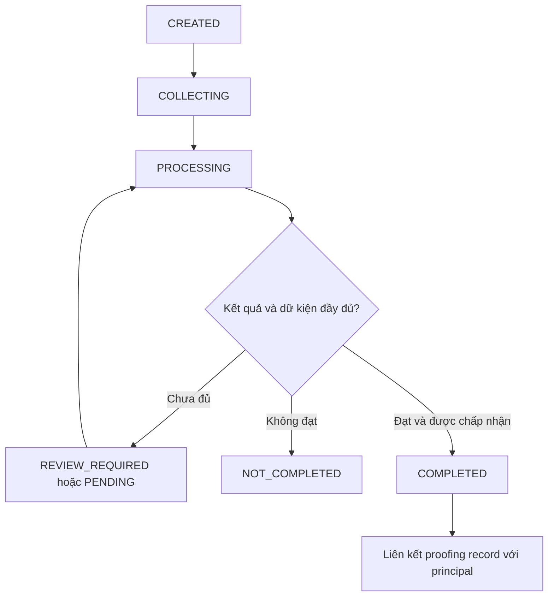

# IAL2

## Mục tiêu bài học

Một tài khoản có email đã xác nhận và MFA có thể được bảo vệ tốt khi đăng nhập, nhưng chưa chắc đã được gắn với đúng danh tính ngoài đời thực. Khi dịch vụ cần căn cứ cho mối liên hệ đó, nó phải thiết kế quy trình identity proofing, thay vì chỉ thêm một bước đăng nhập.

**IAL2 — Identity Assurance Level 2** là một mức bảo đảm cho việc thẩm tra danh tính. Bài học lấy **NIST SP 800-63A-4**, thuộc Revision 4, làm mốc: IAL2 bổ sung yêu cầu về bằng chứng và kiểm tra để giảm rủi ro mạo danh so với IAL1. [NIST SP 800-63A-4](https://pages.nist.gov/800-63-4/sp800-63a.html)

Sau bài học này, bạn có thể:

- Giải thích IAL2 bảo đảm điều gì và không tự bảo đảm điều gì.
- Nhận diện yêu cầu về bằng chứng, thuộc tính và các pathway xác minh.
- Phân biệt kiểm tra bằng chứng với kiểm tra người đang trình bằng chứng.
- Thiết kế cách tiếp nhận kết quả proofing, liên kết tài khoản và xử lý ngoại lệ.
- Kết hợp IAL2 với xác thực, quyền nghiệp vụ và vòng đời tài khoản trong IAM.

## 1. IAL2 giải quyết rủi ro nào?

Giả sử một cổng cộng tác cho chuyên gia bên ngoài truy cập hồ sơ dự án. Người đăng ký khai mình là Linh. Dịch vụ cần phân biệt hai vấn đề:

1. Người đăng ký có căn cứ phù hợp để được nhận diện là Linh ngoài đời thực không?
2. Người đó có hợp đồng còn hiệu lực và được phép đọc hồ sơ dự án nào?

Proofing phục vụ vấn đề thứ nhất. Membership, hợp đồng và quyền tài nguyên phục vụ vấn đề thứ hai. Một kết quả IAL2 không tự chứng minh chuyên môn, quan hệ lao động hoặc quyền đại diện một doanh nghiệp.

Tương tự, IAL2 không có nghĩa tài khoản sẽ không bao giờ bị chiếm. Một kết quả proofing tốt vẫn cần được gắn đúng tài khoản và được bảo vệ qua đăng nhập, quản lý phiên, liên kết danh tính và khôi phục truy cập.

### Không quy đổi thành điểm số tùy ý

`IAL2` không phải cách viết khác của “độ tin cậy 80 điểm” hoặc “chắc chắn đúng người 99%”. Nếu nhà cung cấp có điểm rủi ro riêng, ứng dụng phải hiểu mô hình đó và không tự quy đổi một ngưỡng điểm thành mức của NIST.

Một nhãn sản phẩm như “eKYC nâng cao” cũng không đủ để kết luận đạt IAL2. Cần biết quy trình, cấu hình, bằng chứng và căn cứ đánh giá thực sự đang được dùng.

## 2. Tóm tắt yêu cầu IAL2 theo Revision 4

| Thành phần | Tóm tắt |
|---|---|
| Bằng chứng | 1 FAIR + 1 STRONG; hoặc 2 STRONG; hoặc 1 SUPERIOR |
| Thuộc tính | Thu thập, kiểm tra các thuộc tính cốt lõi, gồm ít nhất một government identifier |
| Hình thức | Từ xa hoặc tại chỗ, có hoặc không có người giám sát, theo yêu cầu tương ứng |
| Non-Biometric Pathway | Không đối sánh sinh trắc học tự động; có thể gồm so ảnh bằng mắt |
| Biometric Pathway | Đối sánh tự động mẫu sinh trắc học với bằng chứng hoặc bản ghi liên quan |
| Digital Evidence Pathway | Sử dụng bằng chứng số cùng cơ chế verification tương ứng |

Verification phải bao phủ các bằng chứng đã trình; riêng on-site attended, quy định yêu cầu xác minh quan hệ với bằng chứng mạnh nhất. Không suy ra một OTP bất kỳ thay được mọi phương pháp. Chi tiết nằm trong [NIST SP 800-63A-4, mục 4.2](https://pages.nist.gov/800-63-4/sp800-63a/ial/).

### FAIR, STRONG, SUPERIOR không phải nhãn tự đặt

Mức bằng chứng phụ thuộc quy trình cấp, khả năng validation và khả năng hỗ trợ verification. Không chỉ nhìn tên tài liệu để tự xếp loại; bằng chứng có thể ở dạng vật lý hoặc số. [NIST SP 800-63A-4, Identity Evidence and Attributes](https://pages.nist.gov/800-63-4/sp800-63a/proofing/)

Ví dụ, ảnh chụp một tài liệu không tự có đủ khả năng kiểm tra như bản gốc hoặc cơ chế trình bằng chứng số của nó. Một tệp PDF có tên “chứng nhận danh tính” cũng không tự mang đặc tính SUPERIOR chỉ vì được truyền qua HTTPS.

Quy trình cần biết phiên bản tài liệu hoặc credential, nguồn cấp và các phương pháp kiểm tra có thể thực hiện. Nếu một khả năng bảo vệ cần thiết không được sử dụng trong cấu hình triển khai, không nên đánh giá kết quả như thể khả năng đó đã được kiểm tra.

## 3. Tách resolution, validation và verification

Ba trách nhiệm cốt lõi có mục tiêu khác nhau:

| Trách nhiệm | Câu hỏi |
|---|---|
| Resolution | Dữ kiện có giúp phân biệt danh tính trong quần thể được phục vụ không? |
| Validation | Bằng chứng và thuộc tính có xác thực, chính xác, hợp lệ không? |
| Verification | Người trình bằng chứng có gắn với danh tính mà bằng chứng thể hiện không? |

Đây là các bước của identity proofing, không phải ba tên gọi cho việc quét ảnh. [NIST SP 800-63A-4, Identity Proofing and Enrollment](https://pages.nist.gov/800-63-4/sp800-63a/proofing/)

### Minh họa ba lỗi khác nhau

- Hai người trùng tên bị ghép vào cùng hồ sơ: cần xem cách phân biệt danh tính và xử lý xung đột.
- Ảnh tài liệu bị chỉnh sửa nhưng được chấp nhận: cần xem cơ chế kiểm tra bằng chứng.
- Dữ kiện thật của một người bị người khác dùng để đăng ký: cần xem việc ràng buộc người đăng ký với danh tính.

Một bản ghi tồn tại trong nguồn dữ liệu chưa chứng minh người đang thao tác là đúng người. Ngược lại, nhìn thấy một người trước camera chưa chứng minh mọi thuộc tính họ khai là chính xác.

### Không nhầm thuộc tính tự khai với thuộc tính đã kiểm tra

Một form có thể cho người dùng bổ sung tên hoặc địa chỉ khi bằng chứng không đủ dữ liệu cho quy trình. Việc điền form mới tạo ra đầu vào. Hệ thống phải giữ rõ thuộc tính nào đã được kiểm tra, dựa vào nguồn nào và thuộc phạm vi kết quả nào.

Điều này cũng ảnh hưởng đến giao diện hồ sơ: tên hiển thị người dùng tự sửa không được tự thay thế tên đã được dùng trong quyết định proofing. Nếu cần cập nhật dữ kiện được kiểm chứng, phải đi qua quy trình có thẩm quyền.

## 4. Hiểu các pathway mà không biến thành công thức giao diện

Pathway cho biết cách verification được thực hiện trong quy trình. Nó không nên bị rút gọn thành một tên nút như “selfie”, “video” hoặc “OTP”.

### 4.1. Khi không dùng đối sánh sinh trắc học tự động

Đội tích hợp cần xác định ai thực hiện kiểm tra, nguồn tham chiếu nào được chấp nhận và bằng chứng về kết quả được lưu như thế nào. Một nhân viên nhìn ảnh có thể là một phần của quy trình, nhưng việc họ bấm nút “duyệt” không tự chứng minh các yêu cầu khác đã hoàn thành.

Nếu khách hàng không thể sử dụng camera hoặc kết quả tự động thất bại, không nên tự chuyển sang “chấp nhận mọi tài liệu”. Cần có đường thay thế đã được thiết kế và đánh giá, cùng giới hạn trách nhiệm rõ ràng.

### 4.2. Khi có đối sánh sinh trắc học tự động

Ứng dụng cần biết nhà cung cấp trả về kết quả gì: điểm đối sánh, quyết định cuối cùng hay chỉ trạng thái đã xử lý ảnh. Một điểm đối sánh không bao quát toàn bộ quyết định proofing.

Phân tích lỗi phải tách trường hợp nhận nhầm, từ chối nhầm và lỗi chất lượng đầu vào. Nếu tất cả đều bị hiển thị thành “không đúng danh tính”, người dùng hợp lệ có thể không có cách khắc phục phù hợp.

### 4.3. Khi dùng bằng chứng số

Đội triển khai cần kiểm tra nguồn phát hành, tính toàn vẹn và cơ chế trình bằng chứng, thay vì chỉ đọc các thuộc tính do client chuyển đến. Phải biết bằng chứng nào được dùng và phương thức nào chứng minh quan hệ giữa người đăng ký với bằng chứng đó.

Không có quy tắc “đăng nhập SSO bất kỳ là đạt IAL2”. Nếu một quy trình sử dụng dữ kiện từ hệ thống ngoài, bên nhận phải có căn cứ chấp nhận quy trình và mức bảo đảm của nguồn đó.

Các phần trên là hướng phân tích triển khai; không thay thế yêu cầu cụ thể của từng pathway trong tiêu chuẩn.

## 5. Chống gian lận và xử lý ngoại lệ là một phần của dịch vụ

NIST yêu cầu quản lý gian lận, tài liệu hóa quy trình và kiểm soát cho các hình thức proofing liên quan. Với luồng thu ảnh hoặc video từ xa, đối sánh sinh trắc học đơn thuần không ngăn được mọi tấn công chèn nội dung giả. Đường xử lý ngoại lệ cũng cần được quy định, có thể có trusted referee theo phạm vi được phép. [NIST SP 800-63A-4, yêu cầu chung](https://pages.nist.gov/800-63-4/sp800-63a/ial-general/)

**Trusted referee** là người được giao và đào tạo để xử lý một số trường hợp thẩm tra ngoại lệ theo quy trình, không phải bất kỳ nhân viên hỗ trợ nào.

### Các câu hỏi cho thiết kế vận hành

| Tình huống | Câu hỏi cần giải quyết |
|---|---|
| Nhiều lượt đăng ký lặp với dữ kiện gần giống | Hệ thống có phát hiện và điều tra, hay chỉ tạo thêm hồ sơ? |
| Nguồn kiểm tra thuộc tính không phản hồi | Yêu cầu được giữ chờ, thử lại hay chuyển xử lý theo quy trình nào? |
| Ảnh không đủ chất lượng | Người dùng được hướng dẫn sửa đầu vào hay bị từ chối như gian lận? |
| Có dấu hiệu nội dung bị thao túng | Đường thu nhận và xử lý bằng chứng có được đánh giá không? |
| Người dùng thiếu phương tiện cho flow chính | Có phương án thay thế được kiểm soát và có căn cứ không? |
| Nhân viên hỗ trợ muốn bỏ qua một bước | Ai có thẩm quyền, trong trường hợp nào và bằng chứng được lưu ở đâu? |

Nếu một kiểm tra bắt buộc chưa hoàn tất, ứng dụng không được diễn giải timeout thành kết quả thành công. Có thể giữ trạng thái chờ hoặc hạn chế chức năng trong khi xử lý, thay vì tự ghi nhận đã đạt mức yêu cầu.

Thông báo cho người dùng cũng cần tránh làm lộ dữ kiện trong nguồn có thẩm quyền cho một bên chưa được chấp nhận. Ví dụ, phân biệt chi tiết từng trường đúng hay sai có thể vô tình hỗ trợ dò thông tin cá nhân.

## 6. Enrollment: kết quả phải gắn với đúng tài khoản

Một quy trình proofing đúng vẫn có thể thất bại ở ranh giới tích hợp nếu kết quả của Linh bị gắn vào tài khoản của người khác.

NIST quy định duy trì tài khoản subscriber có định danh duy nhất và hồ sơ về proofing, mức đạt được, phương thức đã dùng cùng authenticator được liên kết. [NIST SP 800-63A-4, Subscriber Accounts](https://pages.nist.gov/800-63-4/sp800-63a/accounts/)

Với ứng dụng nghiệp vụ, cần tách ít nhất các định danh sau:

```text
principal_id:
  chủ thể nội bộ cần được gắn kết quả

proofing_request_id:
  giao dịch thẩm tra mà máy chủ đã tạo

provider_transaction_id:
  giao dịch tương ứng tại nhà cung cấp

proofing_record_id:
  tham chiếu đến kết quả đã được tiếp nhận và chấp nhận
```

Không lấy một `principalId` bất kỳ trong callback rồi cập nhật trực tiếp hồ sơ đó. Máy chủ phải đối chiếu callback với giao dịch đã khởi tạo, nguồn dự kiến và principal được ràng buộc từ trước.

### Ví dụ máy trạng thái tích hợp

Các tên trạng thái dưới đây là ví dụ ứng dụng, không phải bộ trạng thái chuẩn của NIST:



`PROCESSING` không phải `COMPLETED`. HTTP 200 từ API nhà cung cấp có thể chỉ cho biết yêu cầu đã được tiếp nhận. Hệ thống phải đọc và diễn giải kết quả nghiệp vụ theo hợp đồng tích hợp.

Các sự kiện đến lặp hoặc sai thứ tự không được làm một hồ sơ bị chuyển nhầm sang thành công. Cần xác định trạng thái cuối, thứ tự hợp lệ và cách xử lý xung đột theo giao thức thực tế.

## 7. Ví dụ xuyên suốt: chuyên gia được xét quyền vào dự án

Nền tảng cộng tác có chính sách minh họa:

- Linh có principal nội bộ `principal-501`.
- Chủ dự án mời Linh vào tenant A với vai trò reviewer.
- Hồ sơ hạn chế yêu cầu kết quả proofing IAL2 theo Revision 4 từ nguồn được chấp nhận.
- Phiên truy cập phải đáp ứng yêu cầu xác thực riêng.
- Hợp đồng và membership phải còn hiệu lực.

Đây là yêu cầu thiết kế của ví dụ, không phải quy định rằng mọi cộng tác viên hoặc reviewer trong mọi hệ thống đều bắt buộc IAL2.

### 7.1. Khởi tạo yêu cầu proofing

Máy chủ xác định principal từ phiên đã được kiểm tra, tạo yêu cầu với nhà cung cấp đã cấu hình và lưu quan hệ giữa các mã giao dịch. Client chỉ nhận thông tin cần thiết để tiếp tục flow.

Không dùng email tự khai để quyết định callback sau này thuộc về principal nào. Email có thể đổi, trùng giữa các nguồn hoặc bị tái cấp.

### 7.2. Tiếp nhận kết quả

Giả mã dưới đây minh họa trách nhiệm của ứng dụng nhận kết quả, không phải cách tự triển khai toàn bộ IAL2:

```text
function acceptProofingResult(callback):
    providerMessage = verifyProviderMessage(callback)
    pending = loadExpectedProofingRequest(providerMessage.transactionId)

    requireExpectedProvider(pending, providerMessage)
    requireCorrectTransactionBinding(pending, providerMessage)

    result = fetchOrVerifyFinalResult(pending, providerMessage)
    requireAcceptedFrameworkAndProcess(result, pending.requiredPolicy)

    transaction:
        lockProofingRequest(pending.id)
        requireAllowedResultTransition(pending.id, result)

        if result does not satisfy pending.requiredPolicy:
            recordUnsuccessfulOrPendingOutcome(pending, result)
            return

        saveAcceptedProofingRecord(
            principalId = pending.principalId,
            result = result
        )
        markRequestCompleted(pending.id)
        persistRequiredAuditEvent(pending, result)
```

`verifyProviderMessage` phải phù hợp giao thức, cấu hình nguồn và cơ chế bảo vệ thông điệp. Một trường `signatureValid=true` do bên gọi gửi không phải kết quả xác minh của máy chủ.

Việc đánh giá nguồn bao gồm quy trình và phiên bản được chấp nhận, không chỉ tên nhà cung cấp. Nếu tích hợp hỗ trợ nhiều gói hoặc mức proofing, ứng dụng phải phân biệt kết quả của đúng gói đã yêu cầu.

### 7.3. Đánh giá quyền đọc hồ sơ

Khi Linh mở tài liệu, API cần kết hợp các điều kiện:

```text
principal đang hoạt động
VÀ membership tenant A còn hiệu lực
VÀ reviewer được đọc tài liệu cụ thể
VÀ hợp đồng đáp ứng điều kiện nghiệp vụ
VÀ proofing record đáp ứng chính sách IAL2 đã chọn
VÀ phiên đáp ứng yêu cầu xác thực.
```

Nếu Linh thay ID tài liệu để truy cập tenant B, kết quả IAL2 không làm yêu cầu đó hợp lệ. RBAC, ABAC và kiểm tra phạm vi tài nguyên vẫn phải được thực thi ở API.

## 8. Lưu kết quả để có thể giải thích và rà soát

Ví dụ cấu trúc ứng dụng:

```text
AcceptedProofingRecord
  record_id
  principal_id
  framework = NIST-SP-800-63A
  revision = 4
  achieved_level = IAL2
  provider_id
  process_version
  proofing_type
  verification_pathway
  completed_at
  acceptance_status
  evidence_record_reference
```

Đây không phải claim chuẩn hoặc schema bắt buộc. Mục tiêu là giữ ngữ nghĩa đủ rõ để bộ đánh giá quyền không chỉ thấy một số `2` không biết nguồn gốc.

Ứng dụng cần phân biệt:

- **Mức được yêu cầu:** mục tiêu của chức năng.
- **Mức đã đạt:** kết quả có căn cứ từ quy trình.
- **Trạng thái chấp nhận:** kết quả hiện có còn được dịch vụ chấp nhận theo chính sách không.
- **Trạng thái tài khoản:** chủ thể có đang được phép sử dụng hệ thống không.

Một kết quả đã đạt không tự làm tài khoản bị vô hiệu hóa trở thành hoạt động. Một lần đăng nhập thành công cũng không tự đổi trạng thái proofing đang chờ thành hoàn tất.

Không mặc định mọi IAL2 có cùng một ngày hết hạn phổ quát. Chính sách cần xác định các sự kiện xem xét lại, chẳng hạn dữ kiện cốt lõi thay đổi, nghi ngờ gian lận hoặc điều kiện tái thẩm tra áp dụng cho dịch vụ.

## 9. IAL2, AAL2 và federation

**IAL2** liên quan đến danh tính đã được thẩm tra. **AAL2** liên quan đến yêu cầu đối với xác thực. Chỉ dùng MFA không tự tạo ra IAL2; đã có IAL2 cũng không tự chứng minh lần đăng nhập hiện tại đáp ứng AAL2. [NIST SP 800-63B-4](https://pages.nist.gov/800-63-4/sp800-63b.html)

Trong một số quy trình, xác thực và federation có thể là thành phần kiểm tra bằng chứng số. Điều đó không có nghĩa chỉ cần đăng nhập vào bất kỳ tài khoản bên ngoài nào là hoàn tất proofing. Cần đúng nguồn, đúng bằng chứng, đúng phương thức và quan hệ tài khoản mà quy trình chấp nhận.

Khi ứng dụng dựa vào IdP ngoài, nó cần một quan hệ tin cậy rõ về subject và thông tin assurance. Cơ chế federation bảo vệ việc sử dụng assertion; nó không tự sửa chất lượng proofing ở nguồn. [NIST SP 800-63C-4](https://pages.nist.gov/800-63-4/sp800-63c.html)

Không tự diễn giải `acr=2`, `amr=mfa` hoặc một claim tùy chỉnh thành IAL2 nếu profile và thỏa thuận tích hợp không định nghĩa ánh xạ đó. Chữ ký token hợp lệ cũng không thay thế toàn bộ việc kiểm tra nguồn, bên nhận, hiệu lực và ngữ nghĩa thông tin.

## 10. Bảo vệ dữ liệu và vòng đời sau proofing

### Giới hạn dữ liệu lan truyền

API đọc tài liệu có thể chỉ cần một kết quả assurance được chấp nhận và tham chiếu hồ sơ. Nó không nhất thiết cần nhận ảnh giấy tờ, mã định danh của chính phủ hoặc mẫu sinh trắc học.

Cần phân biệt kho bằng chứng với hồ sơ phục vụ quyết định truy cập. Các quyền xem, xuất, sửa hoặc xóa bằng chứng phải được kiểm soát theo chức trách, có lưu vết và thời hạn lưu phù hợp. Không dùng mã định danh nhạy cảm làm khóa công khai chỉ để tiện tra cứu.

### Bảo vệ tài khoản sau enrollment

Một tài khoản đã proofing vẫn có thể bị tiếp quản qua mật khẩu lộ, phiên bị đánh cắp hoặc quy trình đặt lại MFA không phù hợp. Bảo vệ đường khôi phục và phương thức đăng nhập bổ sung là yêu cầu thiết kế cần xem xét cùng mức bảo đảm ban đầu.

Nếu liên kết thêm danh tính ngoài vào cùng principal, cần xác minh quyền kiểm soát theo chính sách. Không ghép tài khoản chỉ vì trùng email rồi cho danh tính mới hưởng toàn bộ kết quả và quyền của principal đã được thẩm tra.

### Thu hồi và phản ứng với gian lận

Khi kết quả proofing bị nghi ngờ hoặc tài khoản bị vô hiệu hóa, hệ thống cần xác định hành vi của phiên, token, cache và các dịch vụ phụ thuộc. Đổi một trạng thái trong kho quản trị không bảo đảm mọi đường truy cập dừng ngay.

Cần giữ bằng chứng điều tra phù hợp và hạn chế chức năng theo chính sách trong khi xử lý. Log có thể ghi principal, mã hồ sơ, quy trình, trạng thái và người quyết định; không ghi nguyên token, mật khẩu, OTP hoặc bản sao bằng chứng vào log thông thường.

IAL2 trong bài là mức thẩm tra cá nhân. Không tự gán cùng nhãn cho workload hoặc thiết bị chỉ vì chúng có chứng chỉ hoặc credential hợp lệ; mô hình bảo đảm danh tính máy cần được mô tả riêng.

## 11. Những hiểu nhầm cần tránh

| Hiểu nhầm | Cách hiểu phù hợp |
|---|---|
| IAL2 luôn là giấy tờ + selfie + OTP | Cần xét yêu cầu và pathway cụ thể, không suy mức từ giao diện |
| Có hai ảnh giấy tờ là đủ bằng chứng | Số lượng ảnh không xác định mức của bằng chứng hoặc việc kiểm tra đã hoàn tất |
| Non-Biometric Pathway không bao giờ liên quan đến ảnh khuôn mặt | Tên pathway không loại trừ việc so ảnh bằng mắt theo quy trình |
| Video có nhân viên là tự đạt mức yêu cầu | Nhân sự, bằng chứng, cách kiểm tra và các kiểm soát còn lại vẫn phải phù hợp |
| Callback thành công nghĩa là người dùng đã đạt IAL2 | Phải xác minh kết quả nghiệp vụ và liên kết đúng giao dịch, principal |
| Đạt IAL2 thì được cấp quyền quản trị | Quyền và phạm vi tài nguyên được quyết định riêng |
| Tài khoản đã proofing không thể bị chiếm | Xác thực, phiên và khôi phục vẫn có rủi ro riêng |
| Nhà cung cấp có hỗ trợ IAL2 nên mọi cấu hình đều tương đương | Cần biết quy trình, phiên bản và dịch vụ cụ thể đang được sử dụng |

Khi đưa IAL2 vào IAM, hãy theo được chuỗi từ bằng chứng, phương thức kiểm tra và kết quả đến đúng principal. Sau đó áp dụng trạng thái tài khoản, quyền nghiệp vụ và yêu cầu xác thực riêng để kết quả thẩm tra được sử dụng đúng mục đích trong toàn bộ vòng đời truy cập.
