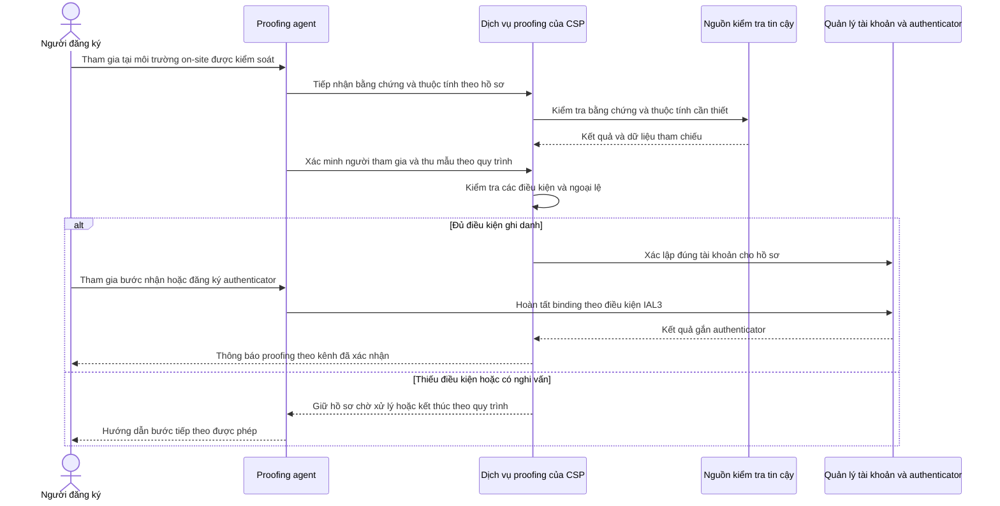

# IAL3

## 1. IAL3 bảo đảm điều gì?

**Identity Assurance Level 3 — IAL3** là mức bảo đảm danh tính cao nhất trong bộ ba IAL của NIST, tập trung vào quy trình liên hệ người đăng ký với danh tính thực được khai báo. Quy trình tăng cường bảo vệ trước mạo danh, sử dụng bằng chứng bị đánh cắp hoặc làm giả và các hình thức thao túng người thực hiện xác minh.

Bài học sử dụng **NIST SP 800-63A-4, bản final tháng 7/2025**, làm mốc thuật ngữ và yêu cầu. Đây là phần hướng dẫn về identity proofing và enrollment, tức chứng minh danh tính và ghi danh tài khoản để sử dụng dịch vụ danh tính. [Thông tin xuất bản chính thức](https://csrc.nist.gov/pubs/sp/800/63/A/4/final)

IAL3 trả lời câu hỏi: **hệ thống có căn cứ mạnh đến đâu để cho rằng người được ghi danh chính là người mang danh tính đã khai báo?** Nó không tự trả lời người đó được làm gì trong ứng dụng hoặc lần đăng nhập hiện tại được bảo vệ ra sao.

Ví dụ, một tổ chức chọn quy trình IAL3 cho một nhóm người có khả năng tác động đến hạ tầng quan trọng. Sau khi hoàn tất chứng minh danh tính, việc cấp vai trò vận hành, giới hạn môi trường và phê duyệt đặc quyền vẫn phải đi qua các quy trình riêng.

Sau bài học, bạn có thể phân biệt IAL3 với AAL3 và FAL3, mô tả các bước chính của quy trình, nhận diện yêu cầu về bằng chứng và sinh trắc học, đồng thời đánh giá những điểm có thể làm mất liên kết giữa người được xác minh với tài khoản được cấp.

## 2. Phân biệt IAL3 với AAL3, FAL3 và quyền quản trị

| Khái niệm | Trọng tâm | Không được tự suy ra |
|---|---|---|
| IAL3 | Căn cứ liên hệ người đăng ký với danh tính thực | Người này đã có mọi quyền trong hệ thống |
| AAL3 | Mức bảo đảm của cơ chế xác thực bằng authenticator | Quy trình chứng minh danh tính trước đó đạt IAL3 |
| FAL3 | Mức bảo đảm của giao dịch liên kết danh tính | Mọi tài khoản sử dụng giao dịch đó đều đã được chứng minh ở IAL3 |
| Vai trò quản trị | Tập quyền trên tài nguyên và hành động | Danh tính hoặc phương thức xác thực tự đáp ứng một mức bảo đảm cụ thể |

Các trục bảo đảm được lựa chọn theo rủi ro, không bắt buộc có cùng con số. Một quy trình có thể cần cải thiện cách chứng minh danh tính dù người dùng đã có authenticator mạnh; trường hợp khác cần tăng cường xác thực dù hồ sơ danh tính đã được chứng minh chặt chẽ. [NIST: Digital Identity Risk Management](https://pages.nist.gov/800-63-4/sp800-63/dirm/)

Trong mô hình này, IAL dành cho **con người**. Không tự gán IAL3 cho service account, container hoặc pipeline vì workload có chứng thư hoặc khóa được bảo vệ tốt. Danh tính workload cần được đánh giá theo bằng chứng về phần mềm, môi trường thực thi và quan hệ tin cậy thích hợp. Phạm vi natural person của hướng dẫn được nêu trong phần mở đầu SP 800-63A-4. [NIST: Introduction](https://pages.nist.gov/800-63-4/sp800-63a.html#introduction)

## 3. Các bước phải phân biệt trong identity proofing

Một quy trình không thể chỉ có thao tác chụp giấy tờ rồi đặt `verified=true`. Cần hiểu ít nhất các trách nhiệm sau:

| Bước | Câu hỏi cần giải quyết | Ví dụ kết quả |
|---|---|---|
| Resolution — phân giải danh tính | Danh tính được khai báo có thể được phân biệt trong tập người mà dịch vụ quản lý không? | Tìm đúng hồ sơ, phát hiện ứng viên trùng hoặc mâu thuẫn |
| Evidence validation — kiểm tra bằng chứng | Bằng chứng có thật, đúng nguồn và đáp ứng chất lượng cần thiết không? | Kết quả kiểm tra đặc tính bảo vệ hoặc chữ ký của bên phát hành |
| Attribute validation — kiểm tra thuộc tính | Các thuộc tính cốt lõi có được xác nhận về độ chính xác không? | Đối chiếu với nguồn có thẩm quyền hoặc dữ liệu ký số phù hợp |
| Verification — xác minh quan hệ với người đăng ký | Người đang tham gia có phải chủ thể của bằng chứng không? | So sánh người tham gia với ảnh hoặc dữ liệu sinh trắc liên quan |
| Enrollment và binding | Tài khoản và authenticator có được gắn đúng với người đã chứng minh không? | Tài khoản được ghi danh, authenticator được gắn theo quy trình |

Đây là các trách nhiệm khác nhau dù một công cụ có thể hỗ trợ nhiều bước. Giấy tờ thật vẫn có thể được người khác mang đến; người thật đứng trước camera vẫn có thể khai danh tính không thuộc về mình. [NIST: Identity Proofing Overview](https://pages.nist.gov/800-63-4/sp800-63a/proofing/)

Ví dụ, đầu đọc kiểm tra được dữ liệu ký số của một bằng chứng. Kết quả đó hỗ trợ tính xác thực của bằng chứng, nhưng chưa tự chứng minh người đứng trước đầu đọc là người được ghi trên bằng chứng. Nếu giao diện chỉ hiển thị một dấu tích xanh chung, người vận hành dễ nhầm hai kết luận này.

## 4. Những yêu cầu nổi bật của IAL3 theo Revision 4

### 4.1. Bảng định hướng

| Khía cạnh | Điểm chính |
|---|---|
| Hình thức | On-site attended; có proofing agent tham gia |
| Bằng chứng | 1 FAIR + 1 STRONG, hoặc 2 STRONG, hoặc 1 SUPERIOR |
| Thuộc tính | Thu thập các core attributes, gồm ít nhất một government identifier |
| Sinh trắc học | Thu thập và lưu mẫu từ người đăng ký theo yêu cầu áp dụng |
| Xác minh | Xác minh quan hệ với bằng chứng mạnh nhất bằng phương pháp được chấp nhận |
| Gắn authenticator ban đầu | Phát hoặc đăng ký trong tương tác on-site attended với proofing agent |
| Thông báo | Gửi thông báo proofing theo quy định về địa chỉ đã được xác nhận |

Bảng chỉ định hướng; kết luận đáp ứng phải xét các yêu cầu chung và các điều khoản chi tiết. Các tổ hợp bằng chứng đầu vào của IAL2 và IAL3 giống nhau trong bản này; không thể phân biệt hai mức chỉ bằng cách đếm giấy tờ. [NIST: IAL3, mục 4.3](https://pages.nist.gov/800-63-4/sp800-63a/ial/#identity-assurance-level-3)

### 4.2. On-site attended có nghĩa gì?

Người đăng ký tham gia tại địa điểm và trên thiết bị được CSP kiểm soát. **CSP — Credential Service Provider** là bên chịu trách nhiệm đối với dịch vụ chứng minh và quản lý tài khoản danh tính trong phạm vi liên quan.

Proofing agent có thể cùng vị trí với người đăng ký hoặc tương tác qua kiosk, thiết bị do CSP kiểm soát. Vì vậy, “agent không ở cùng phòng” không tự làm quy trình trở thành cuộc gọi video thông thường từ xa.

Ngược lại, người đăng ký dùng điện thoại cá nhân ở nhà để gọi video không tự đáp ứng hình thức này. Cần phân biệt quyền kiểm soát địa điểm, thiết bị và sự tham gia của agent, thay vì chỉ nhìn việc có camera và có người hướng dẫn. [NIST: Proofing Types](https://pages.nist.gov/800-63-4/sp800-63a/proofing/#identity-proofing-types)

### 4.3. Nhãn mức phải đi cùng phiên bản và quy trình

Một hợp đồng hoặc màn hình chỉ ghi “IAL3 verified” sẽ thiếu ngữ cảnh nếu không biết ai thực hiện, theo phiên bản nào và bằng quy trình nào. Khi tiếp nhận kết quả từ nhà cung cấp, RP cần đủ thông tin và hồ sơ dịch vụ để đánh giá việc sử dụng kết quả đó.

Không nên trộn danh sách bằng chứng từ bản cũ với hình thức proofing của bản mới rồi coi đó là một quy trình đã đáp ứng đầy đủ. Từng quyết định về thiết kế và đánh giá cần có mốc tham chiếu thống nhất.

## 5. Đánh giá bằng chứng và thuộc tính

### 5.1. FAIR, STRONG và SUPERIOR là phân loại theo yêu cầu

Các mức chất lượng bằng chứng phụ thuộc vào đặc điểm phát hành, nội dung, cơ chế bảo vệ và khả năng kiểm tra. Không thể suy ra mức chỉ từ tên giấy tờ, việc có mã QR hoặc hình thức trông hiện đại.

Ví dụ, một chip có thể chứa dữ liệu hữu ích, nhưng khả năng đọc dữ liệu chưa chứng minh nguồn phát hành. Với bằng chứng được xử lý như SUPERIOR, cần có việc kiểm tra mật mã phù hợp đối với dữ liệu và nguồn, gồm chuỗi tin cậy khi áp dụng. [NIST: Identity Evidence](https://pages.nist.gov/800-63-4/sp800-63a/proofing/#identity-evidence)

Khi thiết kế, CSP cần ghi rõ loại bằng chứng nào được chấp nhận, vì sao đạt chất lượng tương ứng và phương pháp kiểm tra thực sự có thể thực hiện. Không tự gán một loại giấy tờ cụ thể ở mọi quốc gia vào cùng mức chỉ vì cùng được gọi là giấy tờ nhà nước.

### 5.2. Kiểm tra mọi bằng chứng được dùng trong tổ hợp

Nếu quy trình dùng hai bằng chứng, không nên chỉ kiểm tra bằng chứng thứ nhất rồi coi bằng chứng thứ hai là phần trang trí để đủ số lượng. Mỗi bằng chứng có vai trò trong quyết định phải được xử lý theo yêu cầu chất lượng tương ứng.

Một tình huống minh họa: CSP dự kiến dùng một bằng chứng SUPERIOR, nhưng hệ thống không kiểm tra được chữ ký của nguồn phát hành. Không được báo kiểm tra thành công chỉ vì màn hình vẫn đọc ra tên và ngày sinh.

Quy trình có thể xem xét phương án đánh giá lại chất lượng hoặc dùng tổ hợp thay thế nếu các yêu cầu cho phép và đã được thực hiện đầy đủ. Không được tự hạ tiêu chí kỹ thuật rồi giữ nguyên kết luận cũ.

### 5.3. Thuộc tính tự khai không tự trở thành thuộc tính đã xác nhận

CSP xác định và tài liệu hóa tập core attributes cần thiết. Dữ liệu do người đăng ký bổ sung có thể là đầu vào, nhưng trạng thái “đã nhập” và “đã kiểm tra” phải được phân biệt.

Ví dụ, nếu thông tin địa chỉ trên các nguồn khác nhau chưa thống nhất, hệ thống cần ghi nhận và xử lý theo quy trình. Không âm thầm sửa nguồn đối chiếu cho khớp với bản tự khai để làm hồ sơ vượt qua kiểm tra.

Các bước kiểm tra bằng chứng, thuộc tính và quan hệ với người đăng ký cần có dấu vết riêng. Cách tổ chức này giúp điều tra lỗi nguồn mà không phải suy đoán từ một cờ xác minh chung.

## 6. Sinh trắc học trong IAL3

### 6.1. Không chỉ là chụp một ảnh selfie

IAL3 có yêu cầu thu thập và lưu mẫu sinh trắc trong quá trình proofing. Mẫu hỗ trợ liên hệ người tham gia giữa các giai đoạn và những mục đích được quy định. Điều này khác với việc một thư viện xác thực ảnh trả về một điểm tương đồng rồi ứng dụng tự đánh dấu hoàn tất.

Cần xác định rõ mẫu nào được thu, mẫu tham chiếu ở đâu, ai kiểm soát thiết bị và kết quả được dùng cho bước nào. Kết quả đối sánh không thay thế việc kiểm tra nguồn gốc của bằng chứng danh tính.

### 6.2. Hiệu năng và chống giả mạo

Nếu dùng thuật toán đối sánh, cần đánh giá sai khớp, bỏ sót người đúng và tác động đến các nhóm người dùng trong điều kiện vận hành. NIST có các yêu cầu về hiệu năng và đánh giá độc lập; một tỷ lệ thành công quảng cáo chung không đủ mô tả chất lượng toàn bộ quy trình. [NIST: Requirements for the Use of Biometrics](https://pages.nist.gov/800-63-4/sp800-63a/ial-general/#requirements-for-the-use-of-biometrics)

Ví dụ, thuật toán cho điểm thấp có thể do ánh sáng, cảm biến hoặc chất lượng mẫu; không nên tự coi mọi thất bại là bằng chứng gian lận. Trường hợp cần hỗ trợ phải đi vào quy trình được phép, vẫn giữ tiêu chí và dấu vết quyết định.

Ngược lại, điểm đối sánh cao cũng không chứng minh dữ liệu được thu từ đúng nguồn trong phiên. Nếu mẫu bị thay thế trước khi đến bộ so sánh, điểm số chỉ mô tả hai đầu vào mà công cụ đã nhận.

### 6.3. Thông báo, đồng ý và bảo vệ dữ liệu

CSP cần công khai cách sử dụng sinh trắc, thu sự đồng ý có hiểu biết, quản lý hồ sơ đồng ý, thời hạn lưu và quy trình xóa theo yêu cầu áp dụng. Tập dữ liệu nhạy cảm này không nên trở thành dữ liệu tiện dụng để chia sẻ cho mọi ứng dụng.

Ảnh giấy tờ, mẫu sinh trắc, kết quả đối sánh và video phiên làm việc là các đối tượng khác nhau. Yêu cầu lưu mẫu không tự đồng nghĩa phải ghi hình và lưu vô thời hạn mọi phiên. Khi ghi hình, phải xử lý các điều kiện thông báo, đồng ý và lưu giữ tương ứng. [NIST: Privacy Considerations](https://pages.nist.gov/800-63-4/sp800-63a/privacy/)

Trong triển khai, cần tách quyền truy cập dữ liệu gốc với quyền xem trạng thái hồ sơ. Nhân viên hỗ trợ có thể cần biết “chờ xử lý tại bước thu mẫu” mà không cần tải mẫu sinh trắc của người đăng ký.

## 7. Môi trường on-site và trách nhiệm proofing agent

### 7.1. Có con người tham gia vẫn cần kiểm soát

Proofing agent phải có năng lực phù hợp để kiểm tra bằng chứng, so sánh hình ảnh khi sử dụng phương pháp đó và nhận diện dấu hiệu thao túng, cưỡng ép hoặc social engineering. Cần cơ chế chuyển xử lý nghi vấn thay vì buộc agent luôn chọn thành công hoặc thất bại ngay tại quầy.

Ví dụ, một người đi cùng có thể cố gắng trả lời thay hoặc gây áp lực yêu cầu bỏ qua bước kiểm tra. Agent cần biết giới hạn vai trò của người hỗ trợ và cách xử lý tình huống mà không tự thay tiêu chí của quy trình.

Một người được quyền tiếp nhận giấy tờ không mặc nhiên được quyền sửa kết quả, xóa dấu vết hoặc cấp vai trò quản trị sau proofing. Tách trách nhiệm giúp giảm tác động khi tài khoản hoặc người vận hành bị lạm dụng.

### 7.2. Kiosk không phải webcam bất kỳ

Với mô hình kiosk, phải xét thiết bị thu nhận tích hợp, khả năng quan sát của agent, chống can thiệp và bảo vệ hệ thống. Ví dụ thiết kế cần kiểm tra: agent có nhìn được thao tác quan trọng không, đầu đọc có gắn đúng phiên không và mẫu có đến từ người đang tham gia không?

Việc đặt một laptop ở văn phòng chưa tự chứng minh môi trường đã được kiểm soát đầy đủ. Một nhãn “kiosk” không giải thích cấu hình thiết bị, quyền quản trị, lịch kiểm tra và khả năng phát hiện bị thay đổi.

### 7.3. Quy trình và hồ sơ dịch vụ

CSP cần có tài liệu về quy trình, bằng chứng được chấp nhận, nguồn xác nhận, công nghệ sử dụng, xử lý ngoại lệ và điều kiện kiểm tra lại. Các thay đổi như thay nhà cung cấp cảm biến hoặc nguồn dữ liệu có thể làm thay đổi cơ sở đánh giá của quy trình. [NIST: Identity Service Documentation and Records](https://pages.nist.gov/800-63-4/sp800-63a/ial-general/#identity-service-documentation-and-records)

Vì vậy, hồ sơ đáp ứng cần gắn với phiên bản quy trình thực tế. Không nên dựa vào một kết quả đánh giá cũ nếu những thành phần quan trọng đã thay đổi mà chưa được xem xét.

## 8. Ghi danh và gắn authenticator đúng người

### 8.1. Không để mất liên kết ở bước cuối

Một hồ sơ có thể được kiểm tra chặt chẽ nhưng vẫn thất bại về mục tiêu nếu authenticator cuối cùng được giao cho người khác hoặc gắn vào tài khoản khác.

Ví dụ, agent chứng minh danh tính của người A, nhưng ứng dụng lấy tài khoản đích từ một tham số do trình duyệt tự gửi. Nếu tham số bị thay thành tài khoản B, quy trình có thể gắn kết quả hoặc authenticator sai chủ thể.

Cần bảo toàn quan hệ giữa mã hồ sơ, người tham gia, tài khoản được tạo và authenticator được đăng ký. Nếu liên kết với tài khoản đã tồn tại, phải xác minh đúng quan hệ sở hữu, không tự động hợp nhất theo tên hoặc email giống nhau.

### 8.2. Yêu cầu riêng cho authenticator ban đầu

Theo mục 4.3.10 của SP 800-63A-4, CSP phát hoặc đăng ký authenticator ban đầu trong tương tác on-site attended với proofing agent. Nếu việc này diễn ra ngoài một phiên được bảo vệ liên tục với subscriber, phải so sánh mẫu sinh trắc mới với mẫu lúc proofing trước khi đăng ký authenticator. [NIST: Initial Authenticator Binding tại IAL3](https://pages.nist.gov/800-63-4/sp800-63a/ial/#initial-authenticator-binding-2)

Do đó, một mã lịch hẹn hoặc một email xác nhận không tự thay thế phần liên kết người nhận authenticator với người đã được chứng minh. Quy trình phải chỉ rõ trường hợp hoàn tất trong cùng phiên và trường hợp cần quay lại hoàn tất.

IAL3 cũng không tự quyết định rằng authenticator được gắn sẽ đạt AAL3. Loại authenticator, cơ chế bảo vệ khóa và giao thức đăng nhập phải được đánh giá theo yêu cầu xác thực tương ứng.

### 8.3. Luồng minh họa



Sơ đồ thể hiện trách nhiệm ở mức khái niệm. Nó không thay thế các điều khoản về loại bằng chứng, phương pháp kiểm tra và thu nhận sinh trắc. Trong mô hình kiosk, tương tác của agent phải được thực hiện qua cơ chế được kiểm soát tương ứng.

## 9. Thông báo proofing và khả năng phản đối ghi danh

Thông báo proofing giúp người nhận biết có một sự kiện chứng minh và ghi danh diễn ra dưới danh tính của họ. Nó cũng cần chỉ dẫn cách báo nếu họ không tham gia sự kiện đó.

Ở IAL3, quy định chung yêu cầu thông báo đến địa chỉ bưu chính hoặc số điện thoại đã được xác nhận; email đơn lẻ không phải kênh thay thế tương đương cho yêu cầu này. Phần IAL3 khuyến nghị dùng địa chỉ bưu chính. Cần phân biệt điều bắt buộc với khuyến nghị khi lập quy trình. [NIST: Notifications of Identity Proofing](https://pages.nist.gov/800-63-4/sp800-63a/ial-general/#requirements-for-notifications-of-identity-proofing)

Một thông báo không nên chứa toàn bộ dữ liệu bằng chứng hoặc mẫu sinh trắc. Mục tiêu là cho người nhận hiểu sự kiện, biết đơn vị thực hiện và có đường phản hồi rõ ràng.

Ví dụ, nếu người nhận báo không tham gia, hệ thống cần đưa hồ sơ vào quy trình điều tra và xử lý tài khoản liên quan. Không nên chỉ đóng ticket hỗ trợ vì bản ghi trước đó đã có trạng thái thành công.

## 10. Ví dụ: ghi danh kỹ sư vận hành hạ tầng quan trọng

Giả sử một tổ chức lựa chọn IAL3 cho nhóm kỹ sư có trách nhiệm vận hành một hạ tầng nhạy cảm. Đây là ví dụ về quyết định thiết kế sau đánh giá rủi ro, không phải quy định rằng mọi người có chức danh kỹ sư đều cần cùng mức.

### 10.1. Chuẩn bị trước buổi làm việc

Tổ chức thông báo địa điểm, cách đặt lịch, loại bằng chứng được chấp nhận và thông tin cần chuẩn bị. Người đăng ký được biết mẫu sinh trắc nào sẽ thu, mục đích sử dụng và cách nhận hỗ trợ.

Hướng dẫn cho người dùng nên nói bằng ngôn ngữ cụ thể như “mang bằng chứng thuộc danh sách được chấp nhận”, thay vì buộc họ tự hiểu FAIR hoặc SUPERIOR. Việc giúp người dùng chuẩn bị đầy đủ làm giảm trường hợp phải quay lại mà không hạ tiêu chí kiểm tra. [NIST: Customer Experience Considerations](https://pages.nist.gov/800-63-4/sp800-63a/customer/)

### 10.2. Thực hiện kiểm tra

Tại điểm tiếp nhận, agent xác nhận đúng hồ sơ, kiểm tra bằng chứng, đối chiếu thuộc tính và xác minh quan hệ với người tham gia. Mẫu sinh trắc được thu bằng phương tiện nằm trong quy trình đã xác định.

Giả sử người đăng ký mang một bằng chứng mà CSP đã xác định có thể được xử lý ở mức SUPERIOR. Nếu bộ kiểm tra mật mã không xác nhận được dữ liệu và nguồn, hồ sơ chưa thể đi tiếp chỉ nhờ đọc được nội dung.

Agent ghi rõ bước chưa hoàn tất và sử dụng quy trình xử lý phù hợp. Nếu xem xét tổ hợp bằng chứng khác, phải thực hiện đầy đủ các kiểm tra của phương án đó. Không sửa thủ công kết quả bộ kiểm tra thành “passed” để hoàn thành lịch hẹn.

### 10.3. Gắn tài khoản và authenticator

Sau khi đáp ứng các điều kiện, hệ thống xác lập tài khoản nội bộ ổn định cho đúng người. Authenticator được đăng ký trong tương tác được yêu cầu; kết quả được liên kết với cùng hồ sơ proofing.

Nếu việc nhận authenticator phải diễn ra trong một buổi khác, quy trình áp dụng bước liên hệ lại bằng sinh trắc trước khi đăng ký theo yêu cầu IAL3. Không chỉ tìm một tên giống nhau trong danh sách rồi giao thiết bị.

### 10.4. Cấp quyền vận hành bằng quy trình riêng

Sau ghi danh, kỹ sư vẫn cần được phê duyệt vai trò, phạm vi môi trường và thời hạn truy cập. Tài khoản có thể được ghi danh thành công mà chưa có quyền production.

Các điều kiện MFA, xác thực lại, truy cập đặc quyền tạm thời và phân tách nhiệm vụ được quản lý riêng. Việc gắn hồ sơ IAL3 vào tài khoản không tự biến mọi phiên của tài khoản đó thành phiên đặc quyền.

Nếu kỹ sư quản lý một workload, workload sử dụng danh tính riêng. Quyền quản lý workload của kỹ sư được cấp và thu hồi theo nhiệm vụ, không được suy ra trực tiếp từ mức IAL.

## 11. Lưu kết quả và chia sẻ với ứng dụng

### 11.1. Kết quả phải có nguồn và ngữ cảnh

Một cờ `identity_verified=true` không đủ giải thích quy trình đã thực hiện. Hệ thống cần biết bên chịu trách nhiệm, phiên bản khuôn khổ, lần proofing và trạng thái kết quả.

Ví dụ bản ghi nội bộ sau khi các điều kiện của quy trình đã được hoàn tất:

```json
{
  "subject_id": "person_1042",
  "proofing_event_id": "proof_1093",
  "csp_id": "organization-proofing-service",
  "framework": "NIST SP 800-63A-4",
  "identity_assurance_level": "IAL3",
  "proofing_type": "on_site_attended",
  "procedure_revision": "proofing-procedure-12",
  "outcome": "enrolled",
  "initial_authenticator_binding": "completed",
  "proofing_notification": "sent",
  "completed_at": "2026-11-25T03:00:00Z"
}
```

Đây là ví dụ về dữ liệu quản trị, không phải tập claim chuẩn bắt buộc của OIDC hay SAML. Nó cũng không thay thế hồ sơ bằng chứng được bảo vệ ở phía CSP.

Ứng dụng nhận thông tin bảo đảm phải xác định nguồn được phép đưa ra kết luận và ý nghĩa của thông tin. Người dùng không được tự sửa trường mức bảo đảm trong hồ sơ hoặc gửi một giá trị IAL3 để hệ thống tin theo.

### 11.2. Chỉ chia sẻ phần cần thiết

Một ứng dụng có thể chỉ cần biết danh tính đã đạt mức yêu cầu từ nguồn được chấp nhận. Nó không mặc nhiên cần bản chụp giấy tờ hoặc mẫu sinh trắc của người dùng.

Cần phân biệt quyền đọc kết quả với quyền truy cập bằng chứng gốc. Mã hồ sơ giúp tham chiếu khi kiểm toán, nhưng việc biết mã đó không được trở thành quyền tải toàn bộ hồ sơ.

Ví dụ, hệ thống cấp quyền nhận kết quả và định danh ổn định; bộ phận điều tra có thể truy cập bằng chứng qua quy trình riêng. Thiết kế như vậy giữ trách nhiệm ở đúng nơi và giảm việc nhân bản dữ liệu nhạy cảm không cần thiết.

### 11.3. Giữ lịch sử và điều kiện kiểm tra lại

Một sự kiện proofing là kết quả tại thời điểm thực hiện. Tổ chức vẫn cần xác định các tình huống phải kiểm tra lại, sửa sai hoặc thu hồi việc dựa vào kết quả đó.

Thay đổi tên không tự đồng nghĩa đổi người; phát hiện bằng chứng bị cấp sai hoặc tài khoản bị gắn nhầm có thể đòi hỏi điều tra sâu hơn. Cần giữ lịch sử để biết thuộc tính, liên kết hoặc trạng thái nào đã thay đổi, thay vì ghi đè âm thầm.

Khi người dùng mất authenticator, khôi phục phải tuân theo cơ chế áp dụng cho tài khoản và phương thức xác thực. Không nên coi việc từng đạt IAL3 là lý do cho phép hỗ trợ bỏ qua mọi kiểm tra sau này.

## 12. Ngoại lệ, khả năng tiếp cận và chất lượng dịch vụ

### 12.1. Hỗ trợ người đúng hoàn tất quy trình

Người đăng ký có thể thiếu một loại bằng chứng, thay đổi thông tin gần đây, gặp khó khăn khi thu mẫu hoặc cần hỗ trợ ngôn ngữ và khả năng tiếp cận. Những tình huống đó cần đường xử lý rõ ràng.

Đường hỗ trợ phải nêu ai được quyết định, phương án nào được phép và điều kiện nào vẫn cần đáp ứng. Không tự gắn nhãn IAL3 nếu một yêu cầu bắt buộc chưa được hoàn tất; cũng không mặc định người gặp khó khăn là người gian lận.

Ví dụ, nếu thiết bị thu mẫu không sử dụng được với một người, agent cần có hướng dẫn chuyển xử lý. Tự bỏ bước thu mẫu để tránh làm phiền người dùng sẽ tạo kết luận khác với quy trình đã công bố.

### 12.2. Không đánh giá bằng mỗi tỷ lệ hoàn tất

Tăng số hồ sơ thành công bằng cách nới lỏng tùy tiện sẽ làm giảm chất lượng. Ngược lại, một quy trình từ chối quá nhiều người đúng cũng có vấn đề cần điều tra.

Các dữ liệu hữu ích gồm:

| Dữ liệu | Câu hỏi vận hành |
|---|---|
| Hồ sơ chờ theo từng bước | Điểm nghẽn nằm ở nguồn dữ liệu, thiết bị hay thao tác nào? |
| Lỗi kiểm tra bằng chứng | Công cụ có hỗ trợ đúng loại bằng chứng đã công bố không? |
| Lỗi thu mẫu và sai khớp | Điều kiện thu, cảm biến hoặc quy trình có làm người đúng thất bại không? |
| Ngoại lệ và thay đổi quyết định | Ai quyết định và dựa trên căn cứ nào? |
| Binding chưa hoàn tất | Có trường hợp proofing xong nhưng chưa gắn authenticator đúng quy trình không? |
| Khiếu nại và sự kiện nghi mạo danh | Người nhận có đường báo và việc xử lý có đến nơi không? |

Không diễn giải một chỉ số thuật toán thành xác suất toàn bộ danh tính chắc chắn đúng. Quy trình còn phụ thuộc bằng chứng đầu vào, môi trường thu nhận, người vận hành và bước gắn tài khoản.

### 12.3. Điều kiện lựa chọn IAL3

Quyết định cần phản ánh hậu quả nếu đăng ký nhầm người, tác động tới các bên và chi phí vận hành đối với nhóm người dùng. Việc thu thập thêm dữ liệu cũng tạo rủi ro phải quản lý.

Một chức năng ít rủi ro không mặc nhiên cần IAL3 chỉ vì nền tảng có khả năng cung cấp. Tổ chức cần xác định mức phù hợp với mục đích và ghi nhận cơ sở lựa chọn, cùng những điều kiện bổ sung liên quan. [NIST: Lựa chọn mức bảo đảm theo rủi ro](https://pages.nist.gov/800-63-4/sp800-63/dirm/)

## 13. Những hiểu nhầm thường gặp

| Hiểu nhầm | Cách hiểu đúng |
|---|---|
| “IAL3 nghĩa là có ba yếu tố đăng nhập.” | IAL đánh giá proofing; số mức không phải số yếu tố xác thực. |
| “Bật MFA mạnh là đạt IAL3.” | Cần đánh giá riêng bằng chứng và quá trình liên hệ với người đăng ký. |
| “IAL3 luôn cần nhiều giấy tờ hơn IAL2.” | Các tổ hợp đầu vào giống nhau trong Revision 4; còn có yêu cầu về quy trình và môi trường. |
| “Agent phải ở cùng phòng trong mọi trường hợp.” | Có thể dùng mô hình kiosk do CSP kiểm soát với agent tham gia theo yêu cầu. |
| “Cuộc gọi video từ nhà tự động là on-site attended.” | Phải xét địa điểm, thiết bị và quyền kiểm soát của CSP. |
| “Có chip hoặc QR là bằng chứng SUPERIOR.” | Phải đánh giá đặc điểm và thực hiện cách kiểm tra được yêu cầu. |
| “Giấy tờ thật chứng minh người mang là chủ.” | Cần xác minh quan hệ giữa người đăng ký với bằng chứng. |
| “Thu sinh trắc đồng nghĩa phải lưu toàn bộ video mãi mãi.” | Mẫu, video và hồ sơ có mục đích và yêu cầu quản lý riêng. |
| “Proofing xong có thể giao authenticator cho ai đọc đúng mã hẹn.” | Phải giữ liên kết với người đã được chứng minh theo quy trình binding. |
| “IAL3 cho phép cấp quyền quản trị mặc định.” | Quyền phải được cấp theo nhiệm vụ và nguyên tắc ít quyền nhất. |
| “Từng đạt IAL3 thì sau này khôi phục bằng cách nào cũng được.” | Khôi phục và thay phương thức xác thực vẫn là các đường nhạy cảm cần kiểm soát. |

## 14. Tự kiểm tra qua tình huống

**Tình huống 1:** Người dùng gửi ảnh giấy tờ và selfie từ điện thoại tại nhà. Một nhân viên xem qua video rồi đặt trạng thái IAL3. Có đủ căn cứ không?

Chưa đủ. Cần đánh giá hình thức proofing, môi trường, bằng chứng, các bước kiểm tra và yêu cầu ghi danh. Việc có agent qua video không tự biến thiết bị và địa điểm cá nhân thành môi trường on-site được CSP kiểm soát.

**Tình huống 2:** CSP dùng một bằng chứng dự kiến thuộc SUPERIOR, nhưng không kiểm tra được chữ ký. Có thể bỏ qua vì ảnh và tên vẫn khớp không?

Không được coi phần kiểm tra đó đã đạt. Cần xử lý lỗi hoặc dùng phương án bằng chứng khác đáp ứng đầy đủ yêu cầu được phép. Nội dung đọc được không tự chứng minh nguồn phát hành.

**Tình huống 3:** Người đã hoàn tất proofing quay lại nhận authenticator ở phiên khác. Họ đọc đúng mã hồ sơ. Bước đó có tự thay thế việc liên hệ lại với người đã proofing không?

Không. Quy trình IAL3 có yêu cầu cụ thể khi phát hoặc đăng ký authenticator ngoài phiên được bảo vệ liên tục, gồm so sánh mẫu sinh trắc trước khi đăng ký. Mã hồ sơ chủ yếu giúp tìm đúng hồ sơ, không tự chứng minh đúng người nhận.

**Tình huống 4:** Một tài khoản đạt IAL3 nhưng chưa được chủ sở hữu tài nguyên phê duyệt quyền production. Hệ thống có nên cho truy cập ngay không?

Không. Mức bảo đảm danh tính và quyền truy cập là hai phần khác nhau. Cần hoàn tất quy trình cấp quyền và kiểm tra phạm vi tài nguyên.

**Tình huống 5:** Một ứng dụng chỉ cần biết người dùng đã đáp ứng mức proofing yêu cầu. Có cần nhận toàn bộ mẫu sinh trắc để lưu cùng hồ sơ ứng dụng không?

Không mặc định. Cần xác định mục đích và dữ liệu tối thiểu. Kết quả đáng tin cậy cùng tham chiếu phù hợp có thể đáp ứng nhu cầu mà không sao chép bằng chứng nhạy cảm sang mọi hệ thống.

## 15. Những điểm cần ghi nhớ

- IAL3 tập trung vào độ bảo đảm liên hệ người đăng ký với danh tính thực; không đồng nhất với AAL3, FAL3 hoặc quyền quản trị.
- Phải ghi rõ phiên bản tiêu chuẩn và quy trình khi mô tả kết quả.
- Trong Revision 4, IAL3 dùng on-site attended; mô hình kiosk có agent tham gia phải nằm trong điều kiện kiểm soát tương ứng.
- Chất lượng bằng chứng, kiểm tra thuộc tính và xác minh đúng chủ thể là các trách nhiệm cần phân biệt.
- Sinh trắc học là phần của quy trình, cần quản lý nguồn thu, chất lượng, quyền truy cập và vòng đời dữ liệu.
- Phải giữ liên kết đến đúng tài khoản và authenticator, kể cả khi proofing và phát authenticator diễn ra ở các phiên khác nhau.
- Kết quả cần có nguồn, dấu vết và khả năng xử lý sai sót; không được dựa vào một cờ tự khai.
- Cấp quyền, quản lý phiên, khôi phục và thu hồi truy cập tiếp tục được thực hiện theo thiết kế IAM riêng.
