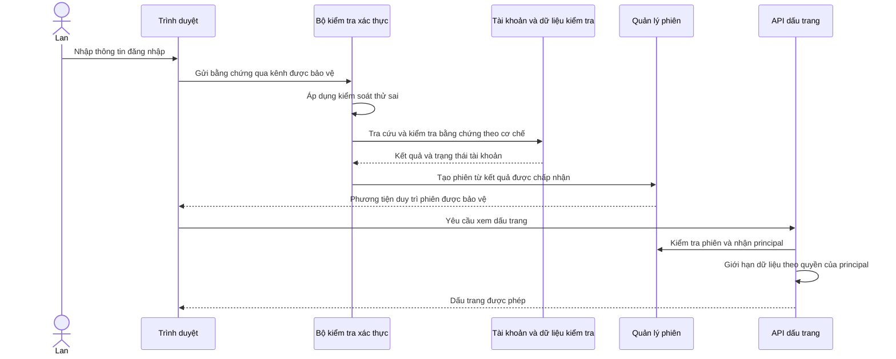

# AAL1

## Mục tiêu bài học

Trong chương **Identity assurance**, bài học này đi sâu vào Authentication Assurance Level 1 — AAL1. Sau khi học, bạn có thể:

- Giải thích AAL1 bảo đảm điều gì và không tự chứng minh điều gì.
- Nhận biết các loại authenticator được phép và vì sao AAL1 không chỉ có mật khẩu.
- Mô tả yêu cầu bảo vệ cho một luồng mật khẩu đơn yếu tố theo NIST SP 800-63B-4.
- Phân biệt lần xác thực, phiên, phương thức đã đăng ký và quyền trên tài nguyên.
- Phân tích rủi ro còn lại, điều kiện cần xác thực bổ sung và ảnh hưởng của khôi phục hoặc thu hồi.

## 1. AAL1 là gì?

**AAL1 — Authentication Assurance Level 1** cung cấp mức tin cậy cơ bản rằng bên đang xác thực kiểm soát một authenticator đã được liên kết với tài khoản. Mức này cho phép xác thực đơn yếu tố và cũng cho phép sử dụng phương thức đa yếu tố. Bài học sử dụng **NIST SP 800-63B-4** làm khung tham chiếu. [NIST SP 800-63B-4 — Authentication Assurance Level 1](https://pages.nist.gov/800-63-4/sp800-63b/aal/#authentication-assurance-level-1)

Câu hỏi trung tâm là:

> Bên đang đăng nhập có chứng minh được quyền kiểm soát phương tiện xác thực mà dịch vụ công nhận cho tài khoản này không?

AAL1 không đồng nghĩa “chỉ cần nhập một tên người dùng”. Tên đăng nhập giúp chọn tài khoản cần xác thực; hệ thống còn phải kiểm tra bằng chứng theo cơ chế phù hợp.

### Ví dụ xuyên suốt

Một cổng đọc tài liệu có nội dung công khai và cho phép người dùng lưu danh sách bài yêu thích. Lan đăng ký tài khoản để giữ tùy chọn đọc và dấu trang. Giả sử tổ chức đã đánh giá tác động và lựa chọn một hồ sơ xác thực đáp ứng AAL1 cho phạm vi chức năng này.

Lan đăng nhập bằng mật khẩu qua kênh được bảo vệ. Cổng kiểm tra bằng chứng, tạo phiên và chỉ cho Lan quản lý danh sách thuộc tài khoản của mình. Khi cổng bổ sung chức năng có tác động lớn hơn, tổ chức cần đánh giá lại yêu cầu; không được giữ mức cũ chỉ vì đã có sẵn màn hình đăng nhập.

Đây là một tình huống giả định để phân tích, không phải kết luận rằng mọi cổng học hoặc mọi chức năng lưu dữ liệu đều phù hợp với AAL1.

## 2. Phạm vi bảo đảm: nhận đúng tài khoản khác biết đầy đủ con người

Một lần đăng nhập có thể chứng minh quyền kiểm soát authenticator nhưng không tự chứng minh toàn bộ thông tin ngoài đời của người dùng.

| Câu hỏi | Thuộc trách nhiệm nào? |
| --- | --- |
| Người đăng ký có đúng danh tính được khai theo quy trình cần thiết không? | Identity proofing và ghi danh |
| Bên hiện tại có kiểm soát authenticator gắn với tài khoản không? | Authentication, trong đó có yêu cầu AAL |
| Kết quả từ nhà cung cấp danh tính được chuyển và kiểm chứng đúng không? | Federation |
| Tài khoản có được đọc, sửa hoặc quản trị tài nguyên đích không? | Authorization |

Ví dụ, tên hiển thị của Lan do Lan tự nhập chưa trở thành thông tin đã được kiểm chứng ngoài đời chỉ vì mật khẩu được xác thực đúng. Tương tự, đăng nhập thành công không làm Lan trở thành quản trị viên của cổng.

### AAL1 không phải IAL1 hoặc FAL1

Các mức có cùng chữ số không tự suy ra nhau. Một hệ thống có thể cần xác thực tài khoản mà không cần kiểm chứng danh tính ngoài đời theo cùng cách một dịch vụ khác thực hiện. Nếu có federation, việc tiếp nhận kết quả còn có yêu cầu riêng.

Cần xác định từng loại bảo đảm theo nhu cầu dịch vụ, không gắn một nhãn “mức 1” chung rồi coi như mọi khâu đều được giải quyết. [NIST SP 800-63-4 — Digital Identity Risk Management](https://pages.nist.gov/800-63-4/sp800-63/dirm/)

## 3. AAL1 cho phép những phương thức nào?

AAL1 không bắt buộc dùng mật khẩu. Các loại được NIST liệt kê gồm password, look-up secret, thiết bị out-of-band, OTP đơn hoặc đa yếu tố, và xác thực mật mã đơn hoặc đa yếu tố. Mỗi loại vẫn phải đáp ứng yêu cầu tương ứng của nó. [NIST SP 800-63B-4 — Permitted Authenticator Types](https://pages.nist.gov/800-63-4/sp800-63b/aal/)

| Loại | Bằng chứng khái niệm | Điều cần hiểu đúng |
| --- | --- | --- |
| Mật khẩu | Kiến thức về bí mật đã thiết lập | Không phải cứ có ô mật khẩu là đáp ứng AAL1 |
| Look-up secret | Khả năng cung cấp bí mật từ một tập được giữ và quản lý phù hợp | Không đồng nghĩa câu hỏi về thông tin cá nhân |
| Out-of-band | Khả năng kiểm soát phương tiện qua kênh phụ theo giao thức | Không phải mọi kênh nhận mã đều được chấp nhận |
| OTP | Khả năng tạo hoặc sử dụng bằng chứng một lần từ authenticator | Còn phải kiểm soát thời hạn, sử dụng lại và số lần thử theo loại |
| Phương tiện mật mã | Chứng minh khả năng sử dụng khóa trong giao thức | Một khóa công khai tự tải lên chưa chứng minh liên kết hợp lệ |
| Phương tiện đa yếu tố | Sử dụng phương tiện kèm điều kiện kích hoạt phù hợp | Có thể dùng ở dịch vụ yêu cầu AAL1; không tự nâng toàn bộ hệ thống lên mức khác |

### Không giảm yêu cầu của phương thức vì mức đích là AAL1

Ví dụ, nếu sử dụng một loại OTP có yêu cầu chỉ chấp nhận thành công một lần, không được bỏ kiểm soát đó với lý do “AAL1 không bắt buộc chống phát lại ở cấp mức”. Yêu cầu chung của mức và yêu cầu của từng loại authenticator phải được xét cùng nhau.

### Những thứ không tự trở thành authenticator hợp lệ

- Một địa chỉ email hoặc số điện thoại được gửi trong request.
- Một trường `userId` do trình duyệt tự chọn.
- IP quen thuộc, vị trí địa lý hoặc điểm rủi ro thấp.
- Một cookie cũ chỉ vì người dùng đã chọn ghi nhớ trình duyệt.
- Câu trả lời về thông tin cá nhân mà nhiều người có thể biết.

Các giá trị này có thể phục vụ định tuyến, ngữ cảnh hoặc quản lý phiên theo thiết kế, nhưng không tự thay thế bằng chứng xác thực cần thiết.

## 4. Một yếu tố không đồng nghĩa một bước, một thiết bị hoặc một màn hình

Với mật khẩu dùng một mình, bằng chứng thuộc nhóm điều người dùng biết. Một PIN khác cũng được gửi tới máy chủ như bí mật thứ hai không tự biến quy trình thành hai yếu tố phân biệt.

Ngược lại, một authenticator mật mã được kích hoạt bằng PIN cục bộ hoặc sinh trắc học phù hợp có thể sử dụng nhiều yếu tố trong cùng một thiết bị. Cần xem cơ chế thực tế chứ không chỉ đếm màn hình.

### Hai mức thông tin cần tách

```text
Cấu hình tài khoản:
    Lan đã đăng ký mật khẩu và một phương tiện khác.

Lần đăng nhập hiện tại:
    Lan chỉ sử dụng luồng mật khẩu được ứng dụng cho phép.

Kết luận:
    không được ghi nhận đã sử dụng phương tiện thứ hai
    chỉ vì phương tiện đó tồn tại trong hồ sơ.
```

Một cờ `mfaEnabled` thường mô tả cấu hình theo cách sản phẩm định nghĩa. Nó không đủ để chứng minh một lần truy cập cụ thể đã thực hiện MFA hoặc có khả năng chống phishing.

AAL1 cũng không cấm tổ chức cung cấp lựa chọn mạnh hơn. Việc cung cấp lựa chọn và việc yêu cầu sử dụng nó cho từng hành động là hai quyết định khác nhau.

## 5. Ví dụ mật khẩu đơn yếu tố theo SP 800-63B-4

Mật khẩu là một ví dụ quen thuộc cho AAL1, nhưng cần xem cả thiết lập, kiểm tra và lưu trữ. Phần này tập trung vào mật khẩu được gửi tới verifier để kiểm tra, không phải PIN chỉ dùng cục bộ để kích hoạt một authenticator.

NIST SP 800-63B-4 yêu cầu mật khẩu dùng làm cơ chế đơn yếu tố dài ít nhất **15 ký tự**; không áp quy tắc bắt buộc pha trộn nhóm ký tự hoặc đổi mật khẩu định kỳ khi không có căn cứ bị lộ. Khi có bằng chứng phương tiện bị xâm phạm, phải buộc thay đổi. [NIST SP 800-63B-4 — Password Verifiers](https://pages.nist.gov/800-63-4/sp800-63b/authenticators/#password-verifiers)

### 5.1. Độ dài không phải toàn bộ bảo vệ

Giả sử cổng yêu cầu mật khẩu dài nhưng cho thử không giới hạn. Kẻ tấn công vẫn có thể đoán trực tuyến hoặc dùng mật khẩu đã bị lộ ở dịch vụ khác. Nếu cổng lưu bản rõ, một sự cố dữ liệu có thể làm lộ ngay bí mật của người dùng.

Do đó, việc kiểm tra một điều kiện độ dài không chứng minh toàn bộ luồng đáp ứng AAL1. Cần xem các lớp bảo vệ khác, bao gồm quy tắc từ chối bí mật phổ biến hoặc bị lộ, giới hạn thử sai và lưu trữ phù hợp.

### 5.2. Từ chối bí mật dễ bị đoán

Trong ví dụ, mật khẩu dài nhưng được dùng phổ biến hoặc xuất hiện trong tập bí mật đã bị lộ không nên được chấp nhận chỉ vì vượt ngưỡng ký tự. Cơ chế blocklist phục vụ việc giảm lựa chọn mà kẻ tấn công dễ thử.

Thông báo từ chối cần giúp người dùng chọn bí mật khác, không khuyến khích chỉ thay một ký tự theo mẫu. Quy tắc tùy tiện như cấm mọi dấu cách hoặc ép đổi hàng tháng cũng có thể làm người dùng chọn các biến thể khó nhớ nhưng vẫn dễ đoán.

### 5.3. Bảo vệ phía verifier

Một triển khai cần dùng cơ chế băm mật khẩu có salt và chi phí phù hợp để chống đoán ngoại tuyến; không dùng băm nhanh đơn thuần hoặc mã hóa có thể giải ngược như cách lưu mật khẩu thông thường. Cổng cũng cần giới hạn hiệu quả các lần xác thực thất bại trên tài khoản. Đây là các trách nhiệm được nêu trong yêu cầu verifier. [NIST SP 800-63B-4 — Password Requirements](https://pages.nist.gov/800-63-4/sp800-63b/authenticators/)

Trong thiết kế ứng dụng, nên dùng thành phần hoặc thư viện xác thực được duy trì phù hợp để xử lý những việc này. Một đoạn ví dụ gọi hàm `verifyPassword` không phải triển khai đầy đủ thuật toán băm hoặc cơ chế hạn chế thử sai.

### 5.4. Hỗ trợ người dùng sử dụng bí mật đúng cách

Trình quản lý mật khẩu và khả năng tự điền giúp người dùng duy trì bí mật riêng cho từng dịch vụ. Không nên thiết kế giao diện cản trở các công cụ đó chỉ vì xem việc gõ thủ công là một dấu hiệu bảo mật.

Cũng không ghi mật khẩu vào log lỗi, dữ liệu phân tích hành vi hoặc hệ thống theo dõi request. Bảo vệ kho tài khoản sẽ thiếu hiệu quả nếu cùng bí mật lại được sao chép sang một kho log ít kiểm soát hơn.

## 6. Kênh truyền và bảo vệ phiên không được bỏ qua

AAL1 yêu cầu giao tiếp xác thực qua kênh được bảo vệ và xác thực phía nhận, đồng thời có yêu cầu mật mã liên quan. Đây không phải mức cho phép gửi bí mật qua một đường truyền bất kỳ. [NIST SP 800-63B-4 — AAL1 Requirements](https://pages.nist.gov/800-63-4/sp800-63b/aal/)

Trong ví dụ web, ứng dụng cần cấu hình kênh bảo vệ và kiểm tra chứng thư đúng cách. Chuyển hướng tới trang an toàn sau khi đã gửi mật khẩu qua một đường không được bảo vệ không sửa được việc bí mật đã có thể bị lộ.

### Đường từ giao diện tới verifier

Nếu ứng dụng dùng proxy, gateway hoặc một backend trung gian, cần xác định nơi nào tiếp nhận bí mật, đường nào truyền tiếp và thành phần nào có quyền truy cập dữ liệu. Không nên giả định mọi chặng bên trong đều an toàn chỉ vì một chặng bên ngoài dùng HTTPS.

### TLS không tự làm mật khẩu chống phishing

Người dùng vẫn có thể nhập mật khẩu vào một trang giả có kết nối HTTPS riêng. Bảo vệ kênh tới một website không tự chứng minh website đó là đúng bên mà người dùng định sử dụng.

Vì vậy, “có HTTPS” và “có giao thức chống phishing” là hai đặc tính khác nhau. AAL1 không tự cam kết loại bỏ rủi ro phishing chỉ vì kênh truyền hợp lệ.

## 7. Luồng xác thực và truy cập trong ví dụ



Sơ đồ mô tả đường thành công. Khi bằng chứng sai, tài khoản không được sử dụng hoặc điều kiện chưa đáp ứng, ứng dụng cần dừng đúng chỗ thay vì tạo phiên rồi chỉ ẩn giao diện.

### Giả mã phân chia trách nhiệm

```text
function loginWithPassword(request):
    requireProtectedAuthenticationChannel(request)
    attempt = checkAndTrackAttemptPolicy(request)
    account = lookupAccountForAuthentication(request.loginName)

    result = passwordVerifier.verifyWithAccountProtection(
        account,
        request.password,
        attempt
    )

    if result is not accepted:
        recordSafeAuthenticationFailure(attempt)
        return genericAuthenticationFailure()

    requireAccountPermittedToAuthenticate(account)
    context = establishContextFromAssessedPasswordFlow(account, result)
    session = sessionService.createProtectedSession(account.id, context)

    recordAuthenticationSuccess(account.id, context)
    return sessionService.createClientResponse(session)
```

Đây là giả mã về trách nhiệm, không phải mã triển khai hoàn chỉnh hoặc chứng nhận AAL1. Hàm kiểm tra phải xử lý cả trường hợp tài khoản không tồn tại, dữ liệu sai và kiểm soát thử lại, tránh vô tình làm lộ thông tin qua phản hồi hoặc khác biệt xử lý.

`establishContextFromAssessedPasswordFlow` biểu thị việc ứng dụng dùng một luồng đã được xác định và đánh giá. Không được chỉ gắn nhãn AAL1 cho bất kỳ request nào có mật khẩu đúng mà bỏ qua các điều kiện của hệ thống.

## 8. Phiên AAL1 và xác thực lại

Sau xác thực, một phiên có thể được dùng để duy trì tương tác. Việc giữ session secret không đồng nghĩa người dùng trình lại authenticator ở từng request. Phiên không được coi có mức bảo đảm cao hơn lần xác thực làm cơ sở cho nó. [NIST SP 800-63B-4 — Session Management](https://pages.nist.gov/800-63-4/sp800-63b/session/)

### 8.1. Thời hạn tổng thể khác thời hạn không hoạt động

- **Thời hạn tổng thể** giới hạn khoảng thời gian từ xác thực hoặc xác thực lại, dù phiên vẫn có hoạt động.
- **Thời hạn không hoạt động** xử lý khoảng im lặng không có hoạt động người dùng theo chính sách.

Với AAL1, NIST yêu cầu xác định thời hạn tổng thể để xác thực lại và khuyến nghị không quá **30 ngày**. Thời hạn không hoạt động có thể được áp dụng nhưng không bắt buộc ở cấp mức này. [NIST SP 800-63B-4 — AAL1 Reauthentication](https://pages.nist.gov/800-63-4/sp800-63b/aal/)

Không nên diễn giải thành “mọi ứng dụng nên giữ phiên 30 ngày” hoặc “AAL1 không bao giờ cần timeout”. Ứng dụng có thể cần thời gian ngắn hơn theo môi trường và tác động. Các từ bắt buộc, khuyến nghị và tùy chọn có ý nghĩa khác nhau.

### 8.2. Ghi nhớ trình duyệt không thay việc xác thực

Trong ví dụ, một cookie cũ có thể duy trì một phiên còn hợp lệ theo thiết kế. Nó không tự là bằng chứng của một lần xác thực mới. Nếu phiên đã hết điều kiện sử dụng, việc thiết bị trông quen thuộc không đủ để bỏ qua quy trình cần thiết.

Cần thực thi hết hạn ở phía có thẩm quyền, không chỉ đặt ngày hết hạn trên trình duyệt. Nếu backend vẫn chấp nhận một định danh phiên đã bị thu hồi, việc xóa cookie ở giao diện không bảo vệ các yêu cầu gửi trực tiếp.

### 8.3. Token mới không đồng nghĩa người dùng vừa có mặt

Một access token hoặc refresh token có thể tiếp tục tồn tại ngoài thời gian người dùng tương tác trực tiếp. Không được lấy việc vừa phát token làm kết luận rằng Lan vừa nhập lại mật khẩu hoặc hoàn tất một bước xác thực khác.

Ứng dụng cần phân biệt thời điểm xác thực, thời điểm phát hành token và thời điểm bắt đầu hoặc làm mới phiên. Những giá trị này phục vụ các mục đích khác nhau.

## 9. AAL1 còn những rủi ro nào?

AAL1 không bắt buộc mọi giao dịch phải có đặc tính chống phishing, chống phát lại hoặc authentication intent ở cấp mức. Tuy nhiên, vẫn phải tuân thủ yêu cầu của phương thức đang dùng. Không được dùng nhãn AAL1 như lý do bỏ các kiểm tra giao thức cần thiết.

| Rủi ro minh họa | Vì sao vẫn cần quan tâm? | Lớp bảo vệ liên quan |
| --- | --- | --- |
| Mật khẩu bị lộ ở dịch vụ khác | Kẻ tấn công có thể dùng lại bí mật nếu người dùng tái sử dụng | Bí mật riêng, blocklist, theo dõi và kiểm soát đăng nhập |
| Đoán trực tuyến | Có thể thử nhiều giá trị nếu không bị giới hạn | Cơ chế hạn chế thử sai và xử lý tài khoản phù hợp |
| Đoán ngoại tuyến sau rò rỉ kho dữ liệu | Giới hạn request không còn ngăn được thao tác đoán trên bản sao | Lưu trữ mật khẩu chống đoán ngoại tuyến |
| Phishing | Người dùng có thể trình bí mật cho bên giả mạo | Lựa chọn giao thức chống phishing hoặc yêu cầu mạnh hơn khi phù hợp |
| Chiếm phiên | Có thể sử dụng session secret mà không biết mật khẩu | Bảo vệ phiên, thiết bị, kênh truyền và thu hồi |
| Khôi phục bị lợi dụng | Có thể thay phương tiện rồi kiểm soát tài khoản | Quy trình khôi phục và thay đổi thông tin xác thực |
| Quyền quá rộng | Đăng nhập đúng vẫn có thể đọc hoặc sửa quá nhiều | Ít quyền nhất, RBAC, ABAC và kiểm tra tài nguyên |

Bảng là phân tích cho thiết kế ứng dụng, không phải danh sách mọi đe dọa. Việc chọn AAL1 là một quyết định chấp nhận mức bảo đảm theo nhu cầu, không phải khẳng định tài khoản không còn khả năng bị chiếm quyền.

### Rủi ro hành vi không tự biến thành yếu tố

Một địa chỉ IP quen thuộc có thể giúp giảm nghi ngờ, nhưng kẻ tấn công cũng có thể sử dụng thiết bị hoặc mạng đã bị xâm phạm. Điểm rủi ro có thể làm ứng dụng yêu cầu thêm kiểm tra; nó không tự chứng minh một yếu tố xác thực mà người dùng chưa thực hiện.

## 10. Xác minh email, mã đăng nhập và khôi phục không được gộp tùy tiện

### 10.1. Mã qua email không mặc nhiên là out-of-band authentication hợp lệ

NIST SP 800-63B-4 không cho dùng email làm kênh out-of-band authentication. Quy định này phân biệt với mã dùng để xác nhận địa chỉ email hoặc mã khôi phục, là các quy trình có mục đích và yêu cầu riêng. [NIST SP 800-63B-4 — Out-of-Band Authenticators](https://pages.nist.gov/800-63-4/sp800-63b/authenticators/#out-of-band-authenticators)

Vì thế, không nên tự công bố một luồng đăng nhập đáp ứng AAL1 chỉ vì nó gửi mã tới email và gọi mã đó là OTP. Cần xem phương thức đó có thuộc loại được chấp nhận và đáp ứng các yêu cầu của khung đã chọn hay không.

Trong ví dụ cổng tài liệu, xác nhận email lúc đăng ký có thể phục vụ liên lạc hoặc hoàn tất ghi danh theo chính sách. Kết quả đó không tự thay cho lần xác thực mật khẩu về sau.

### 10.2. Sinh trắc học không phải một phép gắn nhãn AAL

Một ứng dụng có hình ảnh hoặc chức năng nhận diện khuôn mặt chưa tự chứng minh đang dùng authenticator được chấp nhận. Cần biết sinh trắc học tham gia cơ chế nào, có gắn với phương tiện vật lý không và verifier thực sự kiểm chứng gì.

Tương tự, hai màn hình xác nhận hoặc một câu hỏi về đời tư không thể được tính như phương thức xác thực phù hợp chỉ vì chúng xuất hiện trước trang chủ.

## 11. Sau đăng nhập AAL1, ứng dụng vẫn phải phân quyền

Ở cổng tài liệu, Lan chỉ được đọc và sửa danh sách dấu trang của mình. API không nên lấy `userId` từ tham số rồi coi đó là người gọi.

```text
function getMyBookmarks(request):
    session = requireAcceptedSession(request)
    principal = session.verifiedPrincipal
    requireAccountAndMembershipActive(principal)

    return bookmarkRepository.listWithinAllowedScope(principal.id)
```

Đây là giả mã về phạm vi dữ liệu, không phải triển khai đầy đủ quản lý phiên. Nếu có API quản trị để đọc danh sách của người khác, đó là một hành động riêng cần quyền và điều kiện tương ứng.

### Phân biệt ba kết quả

| Trạng thái | Ví dụ |
| --- | --- |
| Chưa có ngữ cảnh truy cập hợp lệ | Phiên hết hạn hoặc bằng chứng không được chấp nhận |
| Có phiên nhưng thiếu quyền | Lan không được đọc danh sách của Minh |
| Có quyền nhưng thiếu ngữ cảnh xác thực yêu cầu cho hành động | Một chức năng nhạy cảm yêu cầu luồng mạnh hơn hoặc xác thực mới hơn |

Các trạng thái này có thể dẫn tới hành vi khác nhau: yêu cầu đăng nhập, từ chối hoặc khởi tạo xác thực bổ sung. Không nên giải quyết việc thiếu quyền bằng cách chỉ yêu cầu nhập lại cùng mật khẩu rồi cho phép.

### Vai trò không phải mức xác thực

Tài khoản có vai trò quản trị không tự có AAL cao hơn. Ngược lại, một phiên dùng phương thức mạnh không tự cấp vai trò quản trị. RBAC và ABAC phải giữ rõ phạm vi hành động, tổ chức, tài nguyên và điều kiện nghiệp vụ.

## 12. AAL1 trong SSO, federation và OAuth/OIDC

Một ứng dụng không cần tự kiểm tra mật khẩu nếu sử dụng nhà cung cấp danh tính — IdP. Khi đó, vai trò verifier tại hệ thống danh tính thực hiện quá trình xác thực, còn ứng dụng tiếp nhận kết quả qua giao thức và quan hệ tin cậy.

Ứng dụng vẫn cần xác định kết quả nói về chủ thể nào, quy trình nào đã được thực hiện và ngữ cảnh đó đáp ứng yêu cầu của mình không. Dữ liệu khai từ client như `aal=1` hoặc `loginSuccess=true` không phải bằng chứng đáng tin.

### SSO không nâng mức tự động

Lan đăng nhập ở một ứng dụng rồi mở ứng dụng khác. Nếu SSO tận dụng phiên đã có, ứng dụng sau cần hiểu ngữ cảnh được chuyển sang, thay vì coi việc không hỏi lại mật khẩu là một lần xác thực mạnh hơn hoặc mới hơn.

OIDC bổ sung lớp danh tính trên OAuth 2.0; access token phục vụ truy cập tài nguyên theo mục đích của nó. Việc một ứng dụng nhận được token không tự mô tả đầy đủ mức xác thực. Các thông tin ngữ cảnh phải có ý nghĩa đã được thống nhất giữa các bên và được kiểm chứng đúng cách.

### Phiên tại các bên có vòng đời riêng

Phiên IdP và phiên RP không tự có chung thời điểm kết thúc. Khi ứng dụng cần xác thực lại, việc IdP phát một phản hồi mới từ phiên cũ chưa tự chứng minh người dùng vừa thực hiện lại quá trình cần thiết. NIST yêu cầu xem xét riêng quản lý phiên trong federation. [NIST SP 800-63B-4 — Reauthentication](https://pages.nist.gov/800-63-4/sp800-63b/session/#reauthentication)

Trong ví dụ, ứng dụng cần ghi nhận ngữ cảnh từ nguồn được chấp nhận và thực thi chính sách của mình. Không nên chỉ dựa vào tên nhà cung cấp hoặc logo đăng nhập để suy ra mức bảo đảm.

## 13. Đăng ký, khôi phục và thu hồi

Authenticator cần được liên kết với đúng tài khoản và quản lý khi thêm, mất, thay thế hoặc thu hồi. Những sự kiện này được xử lý trong vòng đời authenticator, không chỉ ở hàm kiểm tra đăng nhập. [NIST SP 800-63B-4 — Authenticator Event Management](https://pages.nist.gov/800-63-4/sp800-63b/events/)

### 13.1. Đăng ký đúng tài khoản

Nếu một người không đủ thẩm quyền có thể đặt mật khẩu cho tài khoản Lan, bộ kiểm tra có thể xác thực mật khẩu đó chính xác nhưng quyền kiểm soát tài khoản đã bị thay đổi.

Do đó, cần bảo vệ việc tạo, thay và liên kết phương tiện. Trong thao tác quản trị, phải phân biệt actor thực hiện với tài khoản đích, đồng thời kiểm tra phạm vi quản lý.

### 13.2. Khôi phục không chỉ là lấy lại giao diện đăng nhập

Một quy trình khôi phục có thể giúp Lan đăng ký phương tiện mới khi không còn đủ khả năng xác thực. Hệ thống phải có điều kiện chấp nhận, xử lý ngoại lệ và thông báo phù hợp; không bỏ qua mọi kiểm tra chỉ vì user biết tên hoặc địa chỉ liên hệ.

Việc có kênh khôi phục không làm kênh đó tự trở thành phương thức đăng nhập thông thường. Cần giữ đúng mục đích và yêu cầu của từng luồng.

### 13.3. Thu hồi cần xem các đường truy cập còn hiệu lực

Khi mật khẩu bị nghi lộ, xử lý có thể liên quan đến thay bí mật, kiểm tra phiên và phương tiện khác. Chỉ đổi mật khẩu không tự chứng minh mọi phiên hoặc token đã được phát hành đều ngừng hoạt động.

Khi Lan kết thúc nhu cầu sử dụng, cần xử lý tài khoản hoặc membership theo phạm vi thích hợp. Với tổ chức, luồng Joiner, Mover, Leaver phải phản ánh thay đổi đến nơi thực thi, không chỉ cập nhật một danh sách người dùng.

## 14. Khi nào cần đánh giá lại hoặc yêu cầu mức cao hơn?

AAL1 không phải lựa chọn cố định cho toàn bộ tuổi đời sản phẩm. Tổ chức cần đánh giá lại khi dữ liệu, hành động, nhóm người dùng hoặc tác động thay đổi.

Trong cổng tài liệu giả định, những thay đổi sau có thể làm phát sinh yêu cầu mới:

- Bổ sung dữ liệu riêng có tác động đáng kể nếu bị lộ.
- Cho phép thay cấu hình tin cậy, cấp quyền hoặc quản lý tài khoản người khác.
- Thêm thao tác có thể làm ảnh hưởng nhiều người hoặc nhiều tổ chức.
- Có yêu cầu rõ về chống phishing cho một nhóm truy cập.
- Mở rộng quyền của một tài khoản vượt phạm vi ban đầu đã đánh giá.

Các thay đổi này là lý do xem lại yêu cầu, không phải bảng ánh xạ tự động một chức năng sang một mức AAL cụ thể.

### Step-up phải được kiểm chứng

Nếu hành động cần ngữ cảnh cao hơn, ứng dụng có thể yêu cầu luồng xác thực bổ sung hoặc khác. Sau khi hoàn tất, cần kiểm tra kết quả đáp ứng hồ sơ yêu cầu và còn mới theo chính sách, rồi đánh giá lại quyền trước khi thực hiện.

```text
Đã có phiên được chấp nhận cho chức năng cơ bản
    -> yêu cầu hành động nhạy cảm
    -> kiểm tra quyền và yêu cầu xác thực
    -> thực hiện step-up nếu cần
    -> kiểm chứng kết quả
    -> kiểm tra lại điều kiện và thực hiện hành động
```

Không được nâng nhãn phiên chỉ vì đã hiển thị màn hình MFA. User hủy, provider không đáp ứng hoặc kết quả không hợp lệ đều có thể khiến hành động chưa được phép tiếp tục.

### Workload không tự kế thừa AAL của người khởi tạo

Một job do Lan tạo có thể chạy sau khi Lan rời ứng dụng. Danh tính workload và ngữ cảnh của Lan cần được quản lý riêng. Việc workload xác thực bằng khóa hoặc lấy token mới không chứng minh Lan vừa thực hiện một lần xác thực mới.

## 15. Kiểm toán và khả năng giải thích kết quả

Nhật ký hữu ích cần phân biệt kết quả xác thực, việc thiết lập phiên và hành động được thực hiện. Ví dụ một cấu trúc nội bộ:

```text
actor: user-781
flow: assessed-password-login
result: SUCCESS
authenticationTime: thời điểm xác thực được ghi nhận
sessionRef: tham chiếu nội bộ phù hợp
policyVersion: phiên bản chính sách
requestId: mã tương quan
```

Đây là dữ liệu minh họa, không phải claim chuẩn hoặc nhãn chứng nhận. Nếu hệ thống ghi mức bảo đảm, cần có căn cứ về luồng và cấu hình được đánh giá, không chỉ thêm một chuỗi tĩnh vào mọi sự kiện thành công.

Không ghi mật khẩu, mã có thể dùng để xác thực, cookie hoặc bearer token đầy đủ. Nhật ký cũng cần bảo vệ quyền truy cập và tính toàn vẹn.

Vận hành cần phân biệt bằng chứng sai, tài khoản bị chặn, lỗi phụ thuộc, phiên hết hạn và thiếu quyền trên tài nguyên. Gộp tất cả thành “đăng nhập thất bại” có thể làm mất khả năng tìm đúng nguyên nhân.

## 16. Những hiểu nhầm thường gặp

| Hiểu nhầm | Cách hiểu đúng |
| --- | --- |
| AAL1 là bất kỳ màn hình có username và password | Cần đáp ứng yêu cầu của luồng, verifier, phương thức và phiên |
| AAL1 chỉ cho dùng mật khẩu | Nhiều loại authenticator được phép, kể cả phương thức đa yếu tố |
| Mật khẩu đủ dài là đã đáp ứng toàn bộ AAL1 | Còn có lưu trữ, hạn chế thử sai, kênh truyền và các yêu cầu liên quan |
| AAL1 không cần bảo vệ mật mã vì là mức cơ bản | Kênh và cơ chế vẫn có yêu cầu bảo vệ tương ứng |
| Gửi mã qua email thì mặc nhiên là AAL1 | Cần xét đúng loại phương thức; NIST không cho email làm out-of-band authentication |
| Hai bí mật kiến thức luôn là MFA | Hai bằng chứng cùng nhóm không tự trở thành hai yếu tố |
| Cookie ghi nhớ trình duyệt là một yếu tố mới | Phải phân biệt duy trì phiên với xác thực |
| Phiên có thể kéo dài mãi nếu user vẫn bấm nút | Hoạt động không tự thay việc xác thực lại theo thời hạn tổng thể |
| AAL1 chứng minh người dùng là danh tính ngoài đời đã khai | Identity proofing là trách nhiệm khác |
| Đăng nhập đúng thì được đọc mọi dữ liệu | Quyền trên từng tài nguyên vẫn phải được thực thi |

## 17. Ví dụ tổng hợp: cổng tài liệu mở rộng chức năng

Ban đầu cổng cho Lan quản lý dấu trang cá nhân trên nội dung công khai. Tổ chức giả định đã lựa chọn và đánh giá một luồng mật khẩu phù hợp với AAL1 cho phạm vi này.

Hệ thống bảo vệ việc thiết lập mật khẩu, sử dụng kênh truyền phù hợp, kiểm tra bằng chứng, kiểm soát thử sai và tạo phiên có vòng đời. API dấu trang xác định principal từ phiên hợp lệ, không lấy người gọi từ một `userId` tự khai.

Sau đó, cổng bổ sung khu vực quản trị có khả năng gán vai trò và thay cấu hình đăng nhập. Nhóm thiết kế không coi phiên cơ bản hiện có là đủ chỉ vì Lan được cấp một vai trò mới. Họ đánh giá yêu cầu cho chức năng mới và đặt chính sách xác thực tương ứng.

Khi Lan truy cập thao tác nhạy cảm, ứng dụng kiểm tra quyền trong phạm vi đích, yêu cầu ngữ cảnh cần thiết và kiểm chứng kết quả trước khi thực hiện. Nếu Lan chỉ có phiên cơ bản hoặc lần xác thực không còn mới theo yêu cầu, thao tác chưa được tiến hành.

Khi phát hiện mật khẩu của Lan bị lộ, đội vận hành xử lý phương tiện và các phiên liên quan theo quy trình. Nhật ký giúp nối sự kiện đăng nhập, phiên và thao tác, thay vì giả định đổi mật khẩu đã giải quyết mọi truy cập trước đó.

Ví dụ cho thấy AAL1 có ý nghĩa khi được gắn với phạm vi dịch vụ, một quá trình được bảo vệ và vòng đời có thể quan sát, chứ không chỉ với một lựa chọn giao diện.

## 18. Các câu hỏi khi mô tả một luồng AAL1

Khi khảo sát hoặc thiết kế, hãy xác định:

- Dịch vụ đang yêu cầu mức bảo đảm nào và dựa trên tác động gì?
- Authenticator thuộc loại nào, liên kết với tài khoản bằng quy trình nào?
- Verifier có thực hiện đầy đủ kiểm tra và bảo vệ của loại đó không?
- Nếu dùng mật khẩu đơn yếu tố, chính sách theo phiên bản tiêu chuẩn nào và các lớp bảo vệ khác đã được xác định chưa?
- Kênh nào nhận, xử lý và chuyển bí mật; thành phần nào có quyền đọc dữ liệu?
- Phiên được tạo, hết hạn, xác thực lại và thu hồi thế nào?
- Các đường dự phòng, federation và khôi phục có được phân biệt đúng mục đích không?
- Sau đăng nhập, phạm vi dữ liệu, membership và quyền vẫn được kiểm tra ở đâu?
- Khi chức năng trở nên nhạy cảm hơn, ứng dụng đánh giá lại và yêu cầu ngữ cảnh phù hợp thế nào?

Những câu trả lời này giúp đặt AAL1 đúng vị trí trong nền tảng IAM: một mức bảo đảm xác thực cơ bản có yêu cầu cụ thể, phối hợp với quản lý phiên, vòng đời danh tính, ít quyền nhất và kiểm toán.
