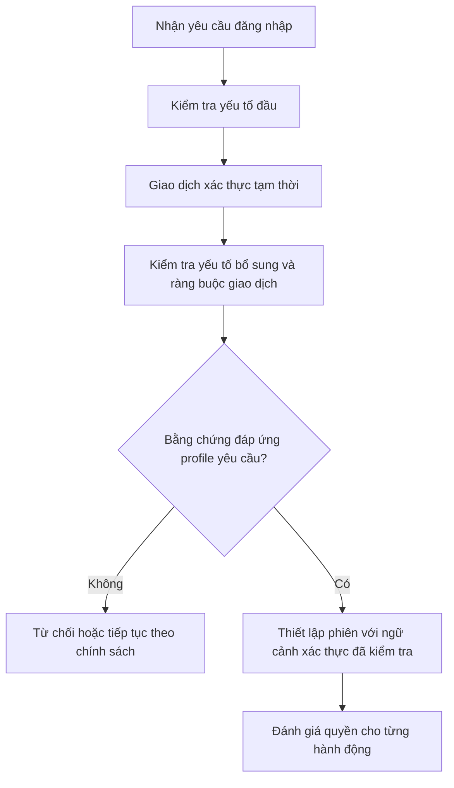

# AAL2

## Mục tiêu bài học

Một tài khoản đã đăng ký MFA chưa chắc đang có một phiên được xác thực bằng hai yếu tố. Người dùng có thể vừa đi qua đường đăng nhập khác, dùng một cơ chế khôi phục hoặc chỉ hoàn tất bước đầu của flow. Muốn sử dụng mức bảo đảm xác thực trong IAM, hệ thống phải biết lần xác thực thực sự đã chứng minh điều gì.

**AAL2 — Authentication Assurance Level 2** là mức bảo đảm xác thực yêu cầu chứng minh quyền kiểm soát hai yếu tố xác thực khác loại, gắn với tài khoản subscriber. Bài học sử dụng **NIST SP 800-63B-4**, thuộc Revision 4, làm khung tham chiếu. [NIST SP 800-63B-4, Introduction](https://pages.nist.gov/800-63-4/sp800-63b/introduction/)

Sau bài học này, bạn có thể:

- Giải thích vì sao hai bước giao diện không tự đồng nghĩa hai yếu tố.
- Phân biệt chống phát lại với chống phishing.
- Nhận diện điều kiện khi dùng OTP, khóa bảo mật và passkey cho xác thực đa yếu tố.
- Mô tả cách thiết lập, nâng mức và giới hạn vòng đời phiên.
- Kết hợp AAL2 với quyền tài nguyên, SSO và quy trình khôi phục tài khoản.

## 1. AAL2 bảo đảm điều gì?

AAL tập trung vào việc người đang truy cập có kiểm soát authenticator được liên kết với tài khoản hay không. **Authenticator** là phương tiện tạo bằng chứng xác thực, chẳng hạn ứng dụng OTP hoặc khóa mật mã được kích hoạt bằng PIN.

AAL2 không tự chứng minh tên ngoài đời trong hồ sơ là chính xác. Phần thẩm tra danh tính thuộc trục IAL. Nó cũng không tự quyết định dữ liệu nào được đọc: quyền truy cập vẫn do chính sách authorization kiểm soát.

Ví dụ, Mai có thể dùng một tài khoản bút danh với xác thực mạnh. Ngược lại, tài khoản có danh tính đã được thẩm tra vẫn có thể bị chiếm nếu phiên hoặc đường khôi phục không được bảo vệ phù hợp.

### Phân biệt ba trạng thái

| Trạng thái | Ý nghĩa |
|---|---|
| Tài khoản đã đăng ký MFA | Có authenticator hoặc phương thức để thực hiện MFA |
| Một flow có hỗ trợ AAL2 | Thiết kế và cấu hình có khả năng thực hiện xác thực đáp ứng yêu cầu |
| Giao dịch xác thực đã đạt AAL2 | Lần xác thực cụ thể có bằng chứng và kiểm tra tương ứng |

Không lấy trạng thái thứ nhất để tự kết luận trạng thái thứ ba. Đánh giá mức phải gắn với giao dịch và ngữ cảnh thực tế, không chỉ với nhãn tài khoản.

## 2. Hai yếu tố không phải hai màn hình

Các loại yếu tố thường được diễn giải như sau:

- **Something you know:** điều người dùng biết, như mật khẩu hoặc PIN kích hoạt.
- **Something you have:** phương tiện hoặc bí mật mà người dùng chứng minh đang kiểm soát, như khóa trong authenticator.
- **Something you are:** đặc tính sinh trắc học được sử dụng theo cơ chế phù hợp.

Hai yếu tố có thể được thực hiện bằng hai authenticator hoặc bằng một authenticator đa yếu tố. Không bắt buộc mỗi yếu tố phải có một màn hình hoặc một thiết bị riêng.

| Cách xác thực minh họa | Cách phân tích |
|---|---|
| Mật khẩu rồi một PIN độc lập khác, đều kiểm tra như bí mật ghi nhớ | Hai lần kiểm tra cùng loại yếu tố biết |
| Mật khẩu và TOTP từ authenticator đã liên kết | Có thể kết hợp yếu tố biết và sở hữu; còn phải đáp ứng yêu cầu triển khai |
| Chỉ chạm một khóa bảo mật không có user verification | Không tự chứng minh hai loại yếu tố |
| Khóa mật mã được kích hoạt bằng PIN hoặc sinh trắc học theo cơ chế phù hợp | Có thể là authenticator đa yếu tố |
| `deviceId` và `trustedDevice=true` do client tự gửi | Không phải bằng chứng xác thực thiết bị có thẩm quyền |

Sinh trắc học không được coi là một authenticator độc lập trong mô hình NIST; nó cần được kết hợp với authenticator vật lý thích hợp. [NIST SP 800-63B-4, Authenticator and Verifier Requirements](https://pages.nist.gov/800-63-4/sp800-63b/authenticators/)

### Vai trò của PIN cục bộ

PIN dùng để kích hoạt khóa trong authenticator khác với một mật khẩu được gửi đến máy chủ. Người dùng có thể nhập PIN cục bộ, còn máy chủ kiểm tra kết quả của giao thức mật mã và dữ kiện cho biết yêu cầu kích hoạt đã được đáp ứng.

Vì vậy, không nên yêu cầu phải có mật khẩu gửi lên máy chủ trong mọi flow AAL2. Cũng không nên đếm việc mở màn hình điện thoại trước đó thành yếu tố thứ hai nếu giao thức và cấu hình không có căn cứ phù hợp cho lần xác thực đang xét.

## 3. Những yêu cầu chính theo Revision 4

| Thành phần | Điểm cần nhớ |
|---|---|
| Yếu tố | Hai yếu tố khác loại qua giao thức phù hợp |
| Mật mã và kênh | Đáp ứng yêu cầu mật mã; dùng kênh được xác thực và bảo vệ |
| Chống phát lại | Ít nhất một authenticator phải replay-resistant |
| Chống phishing | Verifier phải cung cấp ít nhất một lựa chọn phishing-resistant |
| Tái xác thực | Phải xác định timeout tổng thể; khuyến nghị không quá 24 giờ |
| Không hoạt động | Khuyến nghị timeout không quá 1 giờ |

Các mốc thời gian trên là mức **SHOULD**, không phải cách viết lại thành giới hạn **SHALL** tuyệt đối cho mọi triển khai. Yêu cầu chi tiết và phạm vi bổ sung được trình bày trong [NIST SP 800-63B-4, mục 2.2](https://pages.nist.gov/800-63-4/sp800-63b/aal/).

Một sản phẩm có thể áp dụng giới hạn ngắn hơn hoặc yêu cầu phương thức chống phishing cho một thao tác cụ thể. Cần ghi rõ đó là chính sách của dịch vụ, thay vì nói rằng mọi hệ thống dùng AAL2 đều có cùng hành vi.

Bảng này định hướng việc đọc tiêu chuẩn, không phải căn cứ duy nhất để tuyên bố một sản phẩm hoặc flow đã đáp ứng đầy đủ AAL2.

## 4. Chống phát lại và chống phishing khác nhau

**Replay resistance** giới hạn khả năng dùng lại một kết quả xác thực cho lần khác. **Phishing resistance** ngăn một bên giả mạo nhận được bí mật hoặc kết quả xác thực có thể dùng tại bên thật theo mô hình giao thức.

Một OTP chỉ được chấp nhận một lần vẫn có thể bị người dùng nhập vào trang giả. Kẻ giả mạo có thể chuyển mã còn hiệu lực đến dịch vụ thật trước khi nó được dùng. Vì vậy, OTP không được coi là phishing-resistant. [NIST SP 800-63B-4, mục 3.2.5 và yêu cầu OTP](https://pages.nist.gov/800-63-4/sp800-63b/authenticators/)

### Hệ quả khi chọn phương thức

Mật khẩu kết hợp TOTP có thể là một phương án MFA trong một triển khai phù hợp, nhưng không nên được giới thiệu như phương án chống phishing. Khi chính sách yêu cầu chống phishing, hệ thống phải kiểm tra đặc tính đó ngoài mức AAL.

Một cổng quản trị có thể cho phép người dùng đọc thông tin thường bằng phương thức đã chấp nhận, nhưng yêu cầu xác thực chống phishing trước khi thay đổi cấu hình nguồn danh tính. Đây là giới hạn theo hành động, không phải sự thay đổi ngầm ý nghĩa của TOTP.

### OTP qua email và SMS

NIST không cho dùng email làm kênh out-of-band authentication; mã xác nhận địa chỉ email hoặc mã khôi phục thuộc ngữ cảnh khác. SMS hoặc cuộc gọi qua PSTN thuộc nhóm bị hạn chế, với điều kiện và phương án thay thế tương ứng; không nên tự gọi chúng là bị cấm trong mọi trường hợp. [NIST SP 800-63B-4, Out-of-Band Authentication](https://pages.nist.gov/800-63-4/sp800-63b/authenticators/)

Khi đánh giá một sản phẩm, hãy ghi phương thức cụ thể thay vì chỉ viết “OTP”. Kênh, cách ràng buộc, thời hạn và đường khôi phục đều ảnh hưởng đến thiết kế.

## 5. Passkey, khóa bảo mật và user verification

Một passkey hoặc credential WebAuthn không tự mang nhãn AAL2 chỉ vì giao diện cho đăng nhập không mật khẩu. Cần xem authenticator và lần xác thực thực sự có đặc tính gì.

### User presence không đồng nghĩa user verification

Trong WebAuthn, **UP — User Present** cho biết có tương tác hiện diện, như chạm vào authenticator. **UV — User Verified** cho biết authenticator đã thực hiện xác minh người dùng cục bộ. Bên nhận cần kiểm tra kết quả UV khi flow yêu cầu yếu tố kích hoạt, cùng challenge, origin, RP ID, chữ ký và liên kết credential đúng tài khoản. [W3C WebAuthn, Verifying an Authentication Assertion](https://www.w3.org/TR/webauthn-2/#sctn-verifying-assertion)

Không nhận một boolean `uv=true` trong body rồi coi là bằng chứng. Dữ kiện phải được kiểm tra như một phần của phản hồi giao thức hợp lệ.

### Passkey đồng bộ có thể hỗ trợ AAL2

NIST cho phép syncable authenticator hỗ trợ AAL2 khi đáp ứng các yêu cầu tương ứng, bao gồm bảo vệ việc đồng bộ và cách sử dụng yếu tố kích hoạt. Khóa đồng bộ có khả năng xuất nên không đáp ứng yêu cầu non-exportability của AAL3. [NIST SP 800-63B-4, Syncable Authenticators](https://pages.nist.gov/800-63-4/sp800-63b/syncable/)

Hệ quả thiết kế là cần phân biệt:

- Credential có khả năng đa yếu tố với giao dịch đã thực sự thực hiện yếu tố cần thiết.
- Khả năng đồng bộ với chính sách tổ chức cho phép đồng bộ.
- Xác thực tài khoản với trạng thái thiết bị managed hoặc compliant.

Đăng nhập bằng passkey không tự chứng minh thiết bị đã gia nhập hệ thống quản lý của công ty. Một thiết bị compliant cũng không thay thế việc kiểm tra bằng chứng xác thực người dùng.

## 6. Tổ chức flow: bước đầu chưa tạo phiên đầy đủ

Với flow mật khẩu và TOTP, việc xác minh mật khẩu mới hoàn tất một phần. Hệ thống có thể tạo một giao dịch xác thực tạm thời, nhưng giao dịch đó không được phép dùng như phiên đầy đủ để đọc tài nguyên bảo vệ.



Sơ đồ minh họa một kiểu flow. Authenticator đa yếu tố có thể hoàn tất cả hai yếu tố trong cùng một ceremony, không cần tách thành hai màn hình.

### Giả mã trách nhiệm phía máy chủ

```text
function finishPasswordAndOtpLogin(request):
    transaction:
        pending = lockPendingAuthentication(request.transactionReference)
        requirePendingTransactionActive(pending)
        requireFirstFactorAlreadyVerified(pending)
        requireExpectedEndpointBinding(pending, request)

        authenticator = loadExpectedAuthenticator(pending)
        requireAuthenticatorActive(authenticator)

        secondResult = verifyAndConsumeOtpOnce(
            authenticator,
            request.otp,
            pending
        )

        context = evaluateActualAuthentication(
            pending.firstFactorResult,
            secondResult,
            deployedAuthenticationProfile
        )
        requireContextMeetsRequestedPolicy(context, pending)

        consumePendingTransaction(pending)
        session = createOrRotateSession(pending.principalId, context)
        persistAuthenticationAuditEvent(pending, context)

    return session
```

Đây là giả mã kiến trúc, không phải thuật toán OTP hoặc triển khai AAL2 hoàn chỉnh. Các thư viện và cơ chế kiểm tra cần đáp ứng yêu cầu áp dụng, có giới hạn thử và quản lý lỗi phù hợp.

`verifyAndConsumeOtpOnce` cần bảo vệ cả trường hợp hai request đồng thời cùng gửi một mã hợp lệ. Việc kiểm tra rồi đánh dấu đã dùng ở hai bước không được bảo vệ có thể tạo cửa sổ dùng lại. Tương tự, giao dịch xác thực tạm thời phải gắn đúng principal, đúng flow và có thời hạn.

Không giữ nguyên một session ID chưa xác thực rồi chỉ bật `mfa=true`. Quy trình thiết lập hoặc nâng phiên cần bảo vệ trước session fixation và ngăn một kết quả xác thực bị gắn sang phiên khác.

## 7. Ngữ cảnh xác thực phải do máy chủ xác lập

Một mô hình ứng dụng có thể lưu:

```text
AuthenticationContext
  principal_id
  framework
  revision
  achieved_aal
  authentication_time
  method_record_reference
  phishing_resistant
  session_id
  overall_deadline
  inactivity_deadline
  status
```

Đây là ví dụ dữ liệu ứng dụng, không phải schema claim chuẩn. Nội dung được suy ra từ kết quả đã kiểm tra và profile triển khai được chấp nhận.

Các trường `achieved_aal` hay `phishing_resistant` do client tự gửi không có thẩm quyền. Cũng không nên suy ra chúng chỉ từ `mfa_enrolled=true` trong bảng tài khoản.

### Nâng mức phải gắn đúng người và đúng phiên

Khi người dùng đang có phiên chưa đáp ứng một thao tác nhạy cảm, ứng dụng có thể yêu cầu step-up. Kết quả step-up phải áp dụng cho đúng principal và phiên đã khởi tạo yêu cầu đó.

Nếu người dùng xác thực một tài khoản khác ở IdP, ứng dụng không được dùng kết quả đó để nâng mức cho tài khoản cũ. Nếu policy yêu cầu chống phishing, hoàn tất một OTP không đủ để đáp ứng riêng điều kiện này.

Không chỉ dựa vào thời điểm API callback đến. Cần biết thời điểm sự kiện xác thực thực tế và căn cứ được chấp nhận cho mức đạt được.

## 8. Phiên, timeout và tái xác thực

Phiên duy trì tính liên tục bằng session secret; nó không cao hơn mức của sự kiện xác thực tạo ra nó. IdP và ứng dụng có thể quản lý phiên độc lập. Access token còn hiệu lực cũng không tự chứng minh người dùng vẫn đang hiện diện. [NIST SP 800-63B-4, Session Management](https://pages.nist.gov/800-63-4/sp800-63b/session/)

Cần phân biệt:

- **Overall timeout:** giới hạn tính từ xác thực hoặc tái xác thực phù hợp.
- **Inactivity timeout:** giới hạn khi không có hoạt động của người dùng theo thiết kế.
- **Độ mới cho thao tác:** giới hạn riêng khi một hành động cần xác thực gần đây hơn.

Một ứng dụng có thể yêu cầu xác thực trong vòng vài phút trước khi đổi phương thức khôi phục, dù phiên tổng thể chưa hết hạn. Khoảng thời gian cụ thể phải được ghi là chính sách của ứng dụng.

NIST có trường hợp tái xác thực AAL2 bằng mật khẩu hoặc đối sánh sinh trắc học kết hợp session secret khi timeout không hoạt động đã hết nhưng overall timeout chưa hết. Không được mở rộng ngoại lệ đó thành việc cho cookie thay thế một lần đăng nhập mới. [NIST SP 800-63B-4, mục 2.2.3](https://pages.nist.gov/800-63-4/sp800-63b/aal/)

### Tránh làm mới mức một cách hình thức

Làm mới access token, tải lại trang hoặc tạo một ID token mới không nhất thiết là một sự kiện người dùng vừa xác thực lại. Ứng dụng phải quản lý các mốc thời gian theo đúng ngữ nghĩa thay vì dùng thời gian phát hành token làm thời gian xác thực trong mọi trường hợp.

Cookie phiên cần được bảo vệ theo mô hình ứng dụng, gồm kênh truyền, phạm vi và kiểm soát truy cập từ script thích hợp. Thời hạn trên cookie không thay thế việc máy chủ kiểm tra hiệu lực phiên.

## 9. AAL2 khi dùng SSO và OIDC

Trong OIDC, `acr` mô tả authentication context class, `amr` cung cấp thông tin phương thức và `auth_time` thể hiện thời điểm xác thực theo điều kiện của giao thức. Các giá trị cần được hiểu theo profile và thỏa thuận giữa các bên; chuỗi `acr=2` không tự có nghĩa NIST AAL2 trong mọi hệ thống. [OpenID Connect Core, ID Token](https://openid.net/specs/openid-connect-core-1_0.html#IDToken)

Ứng dụng dựa vào IdP ngoài cần xác định:

1. Nguồn nào được chấp nhận và claim được kiểm tra bằng cách nào?
2. Profile xác thực nào ánh xạ sang yêu cầu của dịch vụ?
3. Có biết phương thức đã dùng và đặc tính chống phishing không?
4. Sự kiện xác thực có còn đủ mới cho hành động đang yêu cầu không?
5. Nếu thông tin thiếu hoặc không nhận diện được, ứng dụng xử lý thế nào?

Không tin một header `X-AAL: 2` từ nguồn bất kỳ. Nếu gateway chuyển ngữ cảnh xác thực, phải bảo vệ đường chuyển tiếp và ngăn client tự ghi đè dữ kiện có thẩm quyền.

SSO thành công cũng không đồng nghĩa mọi lần quay lại IdP đều có tương tác xác thực mới. Ứng dụng phải đánh giá kết quả đáp ứng điều kiện của mình, kể cả khi IdP vẫn còn phiên.

## 10. Binding, phương thức dự phòng và khôi phục

Quá trình thêm, thay hoặc thu hồi authenticator quyết định ai có thể tạo bằng chứng xác thực về sau. NIST yêu cầu theo dõi các authenticator đã liên kết cùng đặc tính và sự kiện vòng đời; việc thêm authenticator phải được bảo vệ theo quy trình tương ứng. [NIST SP 800-63B-4, Authenticator Event Management](https://pages.nist.gov/800-63-4/sp800-63b/events/)

### Không để đường dự phòng vô tình bỏ qua chính sách

Nếu flow chính dùng khóa bảo mật nhưng một flow cũ cho phép đăng nhập chỉ bằng mật khẩu rồi vẫn gắn mức AAL2, hệ thống đã đánh giá sai giao dịch. Nếu recovery cho tạo phiên hạn chế, phiên đó không tự có cùng khả năng với phiên đủ điều kiện thực hiện thao tác đặc quyền.

Mã dự phòng, authenticator bổ sung và quy trình recovery có vai trò riêng. Không nên coi mọi chuỗi mã là cùng một loại OTP hoặc tự kết luận rằng có mã được chấp nhận thì đã đạt mức yêu cầu.

Nhân viên hỗ trợ đặt lại MFA có thể ảnh hưởng trực tiếp đến quyền kiểm soát tài khoản. Cần xác minh người yêu cầu, giới hạn thẩm quyền và ghi lại thao tác. Không giữ nguyên một nhãn assurance cao chỉ vì tài khoản từng có cấu hình MFA trước khi bị đặt lại.

### Khi mất thiết bị hoặc nghi lộ credential

Cần xác định credential nào bị ảnh hưởng, cách thu hồi và các phiên còn có thể tiếp tục hoạt động. Thu hồi authenticator không mặc nhiên hủy mọi session hoặc access token đã cấp nếu hệ thống không có cơ chế tương ứng.

Với passkey đồng bộ, phải xem cả mô hình bảo vệ và khôi phục của môi trường đồng bộ. Bảo vệ giao thức đăng nhập không loại bỏ mọi rủi ro do chia sẻ credential hoặc thiết bị bị kiểm soát.

## 11. Ví dụ: quản trị viên đổi quyền trong tenant A

Hà có quyền quản trị thành viên của tenant A. Nền tảng đặt chính sách minh họa cho thao tác cấp vai trò nhạy cảm:

```text
Tài khoản và phiên đang hoạt động
VÀ Hà được phép cấp đúng vai trò cho đúng đối tượng
VÀ phạm vi thay đổi nằm trong tenant A
VÀ xác thực đáp ứng AAL2 theo profile được chấp nhận
VÀ dùng phương thức chống phishing
VÀ sự kiện xác thực còn đủ mới cho thao tác
VÀ có phê duyệt hợp lệ nếu chính sách yêu cầu.
```

Yêu cầu chống phishing và độ mới trong ví dụ là các điều kiện cụ thể của thao tác. Không dùng một cờ “admin đã MFA” để thay toàn bộ biểu thức.

Các kết quả có thể xảy ra:

| Tình huống | Xử lý theo ví dụ |
|---|---|
| Hà xác thực bằng phương thức đạt profile nhưng không chống phishing | Yêu cầu phương thức phù hợp trước thao tác |
| Hà dùng phương thức phù hợp nhưng sự kiện đã quá cũ | Yêu cầu xác thực lại theo chính sách |
| Hà đáp ứng yêu cầu xác thực nhưng muốn sửa tenant B | Từ chối vì không có phạm vi quyền |
| Hà dùng credential của tài khoản khác để hoàn tất step-up | Không nâng phiên hiện tại cho principal của Hà |
| Hà hoàn tất đầy đủ nhưng phê duyệt không đúng nội dung | Từ chối thay đổi theo chính sách cấp quyền |

MFA và AAL2 giúp bảo vệ danh tính thực hiện; RBAC, ABAC, tách biệt nhiệm vụ và kiểm toán bảo vệ việc người đó được làm gì. Những trách nhiệm này cần được kết hợp, không thay thế lẫn nhau.

## 12. Những hiểu nhầm cần tránh

| Hiểu nhầm | Cách hiểu phù hợp |
|---|---|
| Nhập hai bí mật là hai yếu tố | Cần hai loại yếu tố và cơ chế phù hợp |
| Đã bật MFA thì mọi phiên là AAL2 | Phải xét lần xác thực và đường truy cập thực tế |
| OTP một lần thì chống phishing | Chống phát lại không ngăn mọi hành vi giả mạo verifier |
| Chạm khóa là đã xác minh người dùng | User presence khác user verification |
| Mọi passkey tự đạt AAL2 hoặc AAL3 | Phải xét yếu tố kích hoạt, đặc tính khóa và yêu cầu triển khai |
| Làm mới token làm mới thời điểm xác thực | Thời điểm phát hành token và sự kiện xác thực có thể khác nhau |
| Nhãn `acr=2` luôn là NIST AAL2 | Cần profile và ánh xạ được chấp nhận |
| Đạt AAL2 thì có quyền quản trị | Quyền, tenant và tài nguyên được kiểm tra riêng |

Khi sử dụng AAL2 trong IAM, hãy xác định bằng chứng của từng giao dịch, đặc tính của phương thức và hiệu lực phiên hiện tại. Sau đó giữ những dữ kiện đó gắn đúng principal, đồng thời kiểm soát quyền, vòng đời authenticator và đường khôi phục để mức bảo đảm có ý nghĩa trong thực tế.
