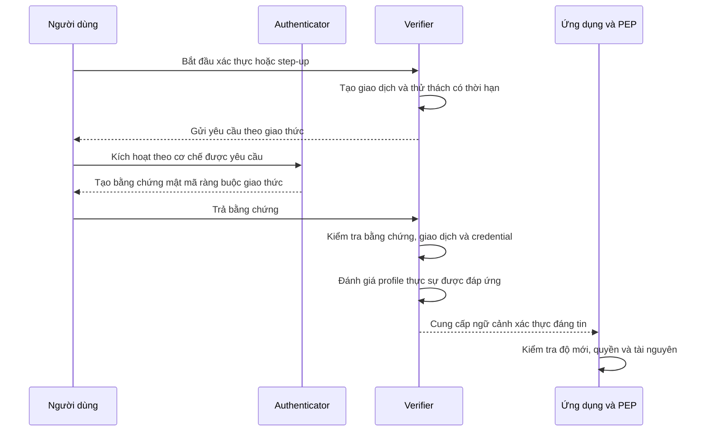

# AAL3

Một người dùng có thể đã bật MFA nhưng vẫn bị lừa nhập mã vào trang giả. Một hệ thống có thể triển khai khóa bảo mật nhưng cho phép khôi phục account bằng một đường yếu hơn nhiều. Một ứng dụng có thể nhận token ghi “MFA” nhưng không biết phương thức nào đã được dùng hoặc kết quả đó còn đủ mới hay không.

Những tình huống này cho thấy mức bảo đảm xác thực không được quyết định bằng số màn hình đăng nhập hoặc tên thiết bị.

**Authentication Assurance Level 3 — AAL3** là mức bảo đảm xác thực cao trong khuôn khổ NIST được chọn cho bài. Nó gắn với một tập yêu cầu về authenticator, giao thức mật mã, nhiều yếu tố, khả năng chống giả mạo verifier và quản lý vòng đời. Một sản phẩm có chữ “hardware” hoặc “MFA” chưa đủ để tự gán nhãn AAL3.

## 1. Phạm vi và câu hỏi AAL3 trả lời

### 1.1. Ghi rõ chuẩn, phiên bản và profile

Bài này giải thích AAL3 theo góc nhìn kiến trúc của **NIST SP 800-63-3**, trong đó các yêu cầu xác thực được trình bày ở phần hướng dẫn SP 800-63B thuộc bộ tài liệu tương ứng.

Bài không phải danh sách đầy đủ để xác nhận tuân thủ. Khi triển khai theo phiên bản hoặc profile khác, phải xác định lại các yêu cầu tương ứng, đặc biệt với authenticator, kiểm định mật mã, thời hạn phiên và cơ chế liên kết danh tính.

Một nhãn assurance nên có căn cứ như:

```text
Framework: khuôn khổ áp dụng
Version: phiên bản
Profile: tập yêu cầu triển khai nếu có
Level: mức được đánh giá
Basis: nguồn và căn cứ của kết quả
```

Không coi một giá trị `3` trong cấu hình là bằng chứng hệ thống đã đạt mức 3.

### 1.2. AAL tập trung vào xác thực

AAL liên quan đến mức tin cậy rằng bên đang truy cập kiểm soát những authenticator được liên kết với account theo quy trình phù hợp.

Nó không tự chứng minh:

- Tên pháp lý của người dùng.
- Quan hệ lao động hiện hành.
- Quyền đại diện một tổ chức.
- Quyền đọc một tài nguyên cụ thể.
- Mọi thiết bị hoặc phiên sau đăng nhập đều không thể bị xâm phạm.

Những câu hỏi về danh tính đời thực, quyền truy cập, thiết bị và phiên cần các căn cứ khác.

### 1.3. Phân biệt AAL, IAL và FAL

| Chiều bảo đảm | Trọng tâm | Ví dụ câu hỏi |
|---|---|---|
| IAL | Identity proofing theo khuôn khổ áp dụng | Account được liên kết với danh tính được khai báo bằng quy trình nào? |
| AAL | Xác thực và kiểm soát authenticator | Lần truy cập này chứng minh quyền kiểm soát authenticator ở mức nào? |
| FAL | Bảo đảm trong liên kết danh tính | Kết quả xác thực được truyền và sử dụng qua quan hệ liên kết ra sao? |

Các chiều có liên quan nhưng không thay thế nhau.

Một account có thể sử dụng xác thực mạnh mà ứng dụng không thu thập tên pháp lý. Ngược lại, một account đã được proofing vẫn cần bảo vệ đăng nhập và khôi phục.

Không tự yêu cầu hoặc suy ra IAL3 chỉ vì một chức năng yêu cầu AAL3. Việc lựa chọn các mức phải dựa trên yêu cầu của hệ thống và khuôn khổ áp dụng.

## 2. Những đặc tính cốt lõi của AAL3

Trong phạm vi SP 800-63-3 của bài, AAL3 không chỉ là “thêm một yếu tố” so với một phương thức bất kỳ.

### 2.1. Xác thực bằng giao thức mật mã

Bên xác thực cần có bằng chứng mật mã phù hợp về quyền kiểm soát khóa được liên kết với account.

Một mô hình khái niệm:

```text
Verifier tạo thử thách mới
    ↓
Authenticator sử dụng khóa bí mật theo giao thức
    ↓
Verifier kiểm tra bằng chứng với khóa hoặc quan hệ đã đăng ký
    ↓
Chấp nhận hoặc từ chối lần xác thực
```

Thử thách và ràng buộc giao thức giúp chống sử dụng lại bằng chứng cũ. Việc gửi lại một chuỗi tĩnh không có cùng tính chất.

Tuy nhiên, có chữ ký chưa đủ. Chữ ký phải thuộc đúng giao thức, giao dịch, account và bên nhận dự kiến.

### 2.2. Yếu tố và phần cứng phù hợp

AAL3 trong phạm vi này yêu cầu nhiều yếu tố và việc sử dụng authenticator dựa trên phần cứng theo các cấu hình được chấp nhận.

Yếu tố có thể được kết hợp trong một authenticator đa yếu tố hoặc qua một tổ hợp phù hợp. Không bắt buộc mọi cấu hình đều có cùng giao diện hoặc cùng số thiết bị.

Điều quan trọng là chứng minh được các yếu tố và đặc tính cần thiết, không phải đếm số thao tác.

Ví dụ:

- Chạm thiết bị không nhất thiết là kiểm tra một yếu tố kiến thức hoặc sinh trắc.
- Hai mật khẩu không tự trở thành hai loại yếu tố độc lập.
- Có một thiết bị phần cứng không có nghĩa mọi giao thức mà thiết bị tạo ra đều chống phishing.
- Một authenticator đa yếu tố có thể thực hiện kiểm tra cục bộ nhưng verifier vẫn cần xác minh kết quả theo cơ chế được hỗ trợ.

### 2.3. Khóa được bảo vệ đúng đặc tính

Một yêu cầu kiến trúc quan trọng là bảo vệ khóa xác thực bằng phần cứng và các kiểm soát phù hợp với mức đích.

Cần biết khóa được tạo và lưu ở đâu, có thể bị xuất hoặc sao chép bằng cách nào, phần mềm nào có thể yêu cầu dùng khóa và kiểm soát kích hoạt là gì.

Một tệp khóa riêng trong ổ đĩa không tự có cùng đặc tính với khóa được bảo vệ bởi authenticator phần cứng.

Nếu một cơ chế cho phép xuất hoặc đồng bộ khóa, không được mặc định nó đáp ứng các yêu cầu bảo vệ khóa của profile AAL3. Phải đánh giá chính xác mô hình đó.

### 2.4. Chống giả mạo verifier

**Verifier impersonation resistance** là đặc tính quan trọng của AAL3 trong phạm vi bài: bằng chứng xác thực được ràng buộc để không thể chỉ chuyển tiếp tới một verifier giả rồi sử dụng như tại verifier thật.

Một người dùng có thể bị lừa tương tác với trang giả. Giao thức chống kiểu giả mạo này giúp hạn chế việc authenticator tạo ra bằng chứng có thể dùng thành công ở sai bên nhận.

HTTPS bảo vệ kết nối tới một tên miền, nhưng một trang phishing cũng có thể có HTTPS cho tên miền của nó. Chỉ thấy biểu tượng kết nối bảo mật không đủ để kết luận đang xác thực với đúng dịch vụ.

### 2.5. Toàn bộ triển khai phải đáp ứng yêu cầu

Ngoài các đặc tính dễ nhận thấy, khuôn khổ còn có các yêu cầu liên quan đến mật mã, authenticator, verifier, quản lý vòng đời và phiên.

Các điều kiện về module mật mã hoặc kiểm định cần được đối chiếu theo đúng phiên bản và profile. Không suy rằng một thiết bị có giao diện tương thích là đã đáp ứng mọi yêu cầu.

Bài tập trung giải thích cách suy luận, không thay việc kiểm tra hồ sơ kỹ thuật và yêu cầu đầy đủ của triển khai.

## 3. Vì sao “MFA” chưa đủ để kết luận AAL3?

### 3.1. Mật khẩu và mã một lần có giới hạn

Mật khẩu kết hợp mã một lần có thể tạo một luồng nhiều yếu tố theo thiết kế phù hợp. Nhưng nếu người dùng có thể nhập cả hai vào một trang giả và mã được chuyển tiếp, luồng đó chưa có đặc tính chống giả mạo verifier cần cho AAL3.

Mã chỉ tồn tại ngắn hoặc chỉ dùng một lần không tự ngăn được việc chuyển tiếp trong lúc nó còn hợp lệ.

Một token phần cứng chỉ hiển thị mã OTP cũng không tự trở thành giao thức mật mã chống phishing. Cần xét cách bằng chứng được ràng buộc với bên nhận.

### 3.2. Nhiều lần nhắc xác nhận không phải nhiều yếu tố hơn

Ứng dụng có thể hỏi mật khẩu, gửi mã, yêu cầu bấm xác nhận rồi hỏi thêm thông tin hồ sơ.

Số bước tăng không tự làm luồng đạt AAL3. Một số thông tin có thể cùng loại yếu tố, tự khai báo hoặc dễ bị chuyển tiếp.

Các bước bổ sung cũng không bù được việc giao thức hoặc quản lý khóa không có đặc tính bắt buộc.

### 3.3. Sinh trắc không tự là danh tính đời thực

Một kiểm tra sinh trắc cục bộ có thể được dùng để kích hoạt authenticator theo thiết kế phù hợp. Nó không tự nói với RP rằng người dùng là một cá nhân có tên pháp lý cụ thể.

Cần phân biệt:

- Kiểm tra người dùng hoặc kích hoạt cục bộ.
- Bằng chứng mật mã mà verifier nhận.
- Kết quả identity proofing liên kết account với danh tính được khai báo.

Không ghi “đã nhận diện đúng Nguyễn Lan” chỉ vì thiết bị báo kiểm tra sinh trắc thành công.

## 4. Khóa bảo mật, passkey và các tín hiệu cần hiểu đúng

### 4.1. Tên công nghệ không phải mức assurance

WebAuthn và các cơ chế liên quan có thể hỗ trợ ràng buộc xác thực với phạm vi RP và origin theo thiết kế giao thức.

Để đánh giá một triển khai, vẫn cần biết:

- Authenticator thực tế thuộc loại nào.
- Khóa được bảo vệ ra sao.
- Yếu tố hoặc cơ chế kích hoạt nào được kiểm tra.
- Verifier có kiểm tra đúng bằng chứng và các điều kiện giao thức không.
- Mô hình đăng ký, khôi phục và quản trị có đáp ứng profile không.
- Các yêu cầu kiểm định áp dụng có được đáp ứng không.

Không gán AAL3 cho mọi thứ được giao diện gọi là “passkey” hoặc “security key”.

### 4.2. User presence và user verification có ý nghĩa khác nhau

Một thao tác chạm có thể cho biết người dùng đang hiện diện hoặc có ý định tương tác trong ngữ cảnh giao thức. Nó không nhất thiết kiểm tra PIN hoặc sinh trắc.

Kiểm tra người dùng bằng PIN hoặc sinh trắc cục bộ lại có yêu cầu và kết quả riêng.

Verifier phải kiểm tra các tín hiệu theo quy tắc của giao thức và profile, thay vì chỉ thấy authenticator trả một phản hồi có chữ ký.

### 4.3. Sao lưu không nhất thiết phải sao chép cùng một khóa

Có thể thiết kế phương tiện dự phòng bằng cách đăng ký các authenticator riêng biệt theo chính sách. Mỗi authenticator có khóa và vòng đời được quản lý riêng.

Điều này khác với việc xuất cùng một khóa sang mọi thiết bị.

Số authenticator dự phòng không tạo ra một mức “AAL4”. Nó giúp tính liên tục và khôi phục nếu từng phương tiện cùng quy trình quản lý đáp ứng yêu cầu liên quan.

## 5. Đánh giá một lần xác thực thực tế

### 5.1. Từ chính sách tới giao dịch

Hệ thống cần xác định profile yêu cầu trước khi chấp nhận kết quả. Một cấu hình minh họa:

```text
Profile nội bộ: privileged-hardware-authentication
Khuôn khổ đối chiếu: NIST SP 800-63-3
Mức mục tiêu: AAL3

Các nhóm căn cứ cần đánh giá:
  authenticator và đặc tính bảo vệ khóa
  yếu tố xác thực và cơ chế kích hoạt
  giao thức và ràng buộc verifier
  trạng thái đăng ký, thu hồi và quản lý vòng đời
  yêu cầu mật mã và kiểm định áp dụng
  chính sách phiên và xác thực lại
```

Profile nội bộ không tự chứng minh đã đáp ứng chuẩn. Nó phải được đối chiếu và vận hành đúng.

Client không được tự gửi `aal=3` hoặc `hardware=true` rồi làm server chấp nhận nhãn đó.

### 5.2. Luồng minh họa dùng authenticator mật mã



Sơ đồ không có nghĩa mọi thao tác trên giao diện đều trực tiếp được authenticator ký. Nếu ứng dụng cần xác nhận nội dung giao dịch cụ thể, đó là yêu cầu bổ sung phải được thiết kế rõ.

### 5.3. Kiểm tra bằng thư viện giao thức phù hợp

Với một triển khai WebAuthn minh họa, verifier cần kiểm tra các ràng buộc như thử thách, origin, phạm vi RP, bằng chứng mật mã, credential đã đăng ký và các tín hiệu mà chính sách yêu cầu.

Những kiểm tra đó nên do thư viện và cơ chế được hỗ trợ thực hiện theo cấu hình đúng. Không tự xác minh bằng cách nhìn vào một field `success=true` trong JSON do trình duyệt gửi.

Nếu dùng attestation hoặc metadata làm căn cứ cho loại và đặc tính authenticator, cần kiểm tra nguồn, chuỗi tin cậy và chính sách chấp nhận phù hợp. Nhãn thiết bị tự khai báo không thay thế căn cứ đó.

Ngay cả khi bằng chứng giao thức hợp lệ, hệ thống vẫn cần xác định triển khai có đáp ứng profile AAL3 hay không. Một bằng chứng hợp lệ từ authenticator ngoài profile không tự được nâng mức.

### 5.4. Giả mã tách kiểm tra mật mã khỏi đánh giá assurance

```text
function finishStrongAuthentication(request):
    transaction = consumeBoundAuthenticationTransaction(request)
    if transaction is missing or expired:
        rejectAndStop()

    candidateCredential = resolveCandidateRegisteredCredential(
        request,
        transaction
    )

    if candidateCredential is missing or revoked:
        rejectAndStop()

    verification = authenticationLibrary.verifyResponse(
        response = request,
        expectedTransaction = transaction,
        registeredCredential = candidateCredential,
        verifierConfiguration = trustedVerifierConfiguration()
    )

    if verification is not valid:
        recordAuthenticationFailureWithoutSecrets()
        rejectAndStop()

    account = resolveAccountFromVerifiedCredential(candidateCredential)
    if account is disabled:
        denyAndStop()

    if transaction is stepUp and account does not match transaction.subject:
        rejectAndStop()

    achievedProfile = assurancePolicy.evaluate(
        verifiedEvent = verification,
        credentialEvidence = candidateCredential.assuranceEvidence,
        lifecycleState = candidateCredential.lifecycleState,
        verifierState = trustedVerifierState()
    )

    if achievedProfile does not satisfy transaction.requiredProfile:
        rejectOrStartAnAppropriateNewFlow()

    authenticationContext = createTrustedAuthenticationContext(
        account = account,
        achievedProfile = achievedProfile,
        authenticatedAt = currentTrustedTime()
    )

    establishOrReplaceSessionContext(authenticationContext)
    recordAuthenticationResult(account, achievedProfile)
```

Đây là giả mã về trách nhiệm, không phải API của một thư viện cụ thể hoặc toàn bộ quy trình xác nhận tuân thủ.

Việc tra cứu credential ứng viên chưa chứng minh danh tính. Danh tính chỉ được thiết lập sau khi bằng chứng được kiểm tra với liên kết đăng ký phù hợp.

Profile đạt được được tính từ căn cứ thực tế. Không lấy profile mà client yêu cầu làm profile đã hoàn tất.

## 6. Dùng AAL3 trong quyết định truy cập

### 6.1. Quyền và mức xác thực phải cùng được đáp ứng

Một thao tác nhạy cảm có thể có chính sách:

```text
Cho phép thay cấu hình cấp quyền khi:
  account đang hoạt động
  và subject có permission phù hợp trong phạm vi tài nguyên
  và authentication profile đáp ứng yêu cầu AAL3 đã xác định
  và sự kiện xác thực còn đủ mới theo chính sách
  và các điều kiện nghiệp vụ khác được đáp ứng
```

Hoàn tất AAL3 không cấp role quản trị. Một người không có quyền vẫn phải bị từ chối sau khi xác thực mạnh.

Ngược lại, quản trị viên có role phù hợp có thể cần step-up nếu phiên hiện tại chưa đáp ứng yêu cầu xác thực.

PEP là nơi thực thi các điều kiện đó trước khi thao tác xảy ra.

### 6.2. Account có authenticator mạnh không có nghĩa phiên đang dùng nó

Một account có thể đăng ký nhiều phương thức. Nếu người dùng đăng nhập bằng một phương thức yếu hơn, ứng dụng không được gán AAL3 chỉ vì account có sẵn khóa phần cứng.

Cần phân biệt:

```text
Capability:
  account có thể thực hiện một phương thức mạnh

Event:
  phương thức và điều kiện nào thực sự đã được đáp ứng

Session:
  ngữ cảnh nào đang được sử dụng và còn hiệu lực
```

Field `security_key_registered=true` chỉ nói về khả năng hoặc trạng thái đăng ký, không chứng minh sự kiện hiện tại.

### 6.3. Step-up phải giữ đúng subject và ý định giao dịch

Khi một phiên đang hoạt động cần xác thực bổ sung, giao dịch step-up phải gắn với đúng account và ngữ cảnh.

Không chấp nhận việc người dùng xác thực một account khác rồi gắn mức mạnh đó vào phiên cũ.

Sau khi step-up thành công, ứng dụng cần đánh giá lại quyền cùng trạng thái tài nguyên. Trong lúc người dùng thực hiện xác thực, role có thể bị thu hồi hoặc tài nguyên có thể thay đổi.

Nếu cần bảo vệ một hành động cụ thể, ứng dụng phải kiểm soát việc tham số hoặc tài nguyên đích bị thay sau bước xác thực. Không suy rằng AAL3 tự ký và xác nhận mọi dữ liệu nghiệp vụ.

### 6.4. Số lần xác nhận không thay thế quyết định quyền

Yêu cầu người dùng chạm khóa nhiều lần không sửa được policy sai tenant hoặc quyền quản trị được cấp quá rộng.

Ít quyền nhất vẫn phải giới hạn subject, action, resource và thời gian sử dụng đặc quyền theo mô hình của hệ thống.

AAL3 cung cấp một phần căn cứ bảo mật, không làm những phần còn lại trở nên tùy chọn.

## 7. Đăng ký, thay thế và khôi phục authenticator

### 7.1. Đăng ký khóa là thao tác bảo mật

Nếu kẻ tấn công chiếm được một phiên yếu rồi được tự do đăng ký khóa của mình vào account, các lần xác thực mật mã sau có thể hợp lệ nhưng thuộc về người không được phép.

Cần kiểm soát việc liên kết authenticator với đúng subscriber/account, các điều kiện đăng ký và quyền thực hiện thay đổi.

Tùy profile, có thể cần xác thực hiện có đủ mức, quy trình khôi phục hoặc các kiểm soát khác được chấp nhận. Không được bỏ qua yêu cầu này chỉ vì authenticator mới có đặc tính phần cứng mạnh.

### 7.2. Quản lý phương tiện dự phòng

Phương tiện dự phòng cần được đăng ký và quản lý trước theo chính sách.

Một cơ chế dự phòng có thể bảo toàn đặc tính xác thực khi từng authenticator và quy trình liên kết đáp ứng yêu cầu. Nhưng một đường dự phòng yếu hơn không được âm thầm giữ nguyên nhãn AAL3.

Ví dụ, nếu người dùng mất khóa rồi truy cập bằng một phương thức khác, hệ thống phải ghi nhận profile thực sự được đáp ứng. Quyền nhạy cảm chỉ được mở khi đủ điều kiện.

Tính tiện dụng của khôi phục và yêu cầu bảo đảm cần được giải quyết bằng thiết kế rõ ràng, không bằng một nhãn assurance bất biến.

### 7.3. Bộ phận hỗ trợ không được tự bỏ qua ràng buộc

Một cuộc gọi hỗ trợ hoặc thông tin hồ sơ dễ biết không tự đủ để cấp một authenticator mới có quyền điều khiển account đặc quyền.

Cần có quy trình đã xác định, kiểm soát người thực hiện, các bước xác minh phù hợp và dấu vết thay đổi.

Nếu quá trình khôi phục chưa tái lập đủ căn cứ, hệ thống có thể giới hạn quyền theo chính sách cho tới khi hoàn tất các yêu cầu cần thiết. Không cấp quyền nhạy cảm chỉ để người dùng “đăng nhập tạm”.

### 7.4. Thu hồi không chỉ là xóa thiết bị khỏi giao diện

Khi authenticator bị mất hoặc nghi bị lộ, cần xem xét:

- Trạng thái credential ở verifier.
- Phiên đã được tạo bằng credential đó.
- Refresh token và token truy cập liên quan.
- Khả năng nhận hoặc liên kết authenticator mới.
- Quyền đặc biệt đã kích hoạt.
- Các hệ thống liên kết nhận kết quả xác thực trước đó.

Vô hiệu hóa credential có thể chặn lần xác thực mới nhưng không mặc nhiên kết thúc mọi phiên đã phát hành.

Cần có cơ chế và giới hạn thời gian rõ ràng cho việc thu hồi. Giao diện bỏ tên thiết bị không đủ chứng minh các đường truy cập liên quan đều đã ngừng.

## 8. Phiên, xác thực lại và SSO

### 8.1. Kết quả xác thực cần được giữ đúng ngữ cảnh

Sau một lần xác thực, ứng dụng thường tạo phiên để người dùng không phải thực hiện lại toàn bộ giao thức cho từng request.

Ngữ cảnh có thể cần lưu:

- Subject đã được xác thực.
- Profile thực sự đạt được và căn cứ.
- Thời điểm xác thực.
- Các ràng buộc và thời hạn phiên.
- Credential hoặc sự kiện tham chiếu khi cần thu hồi.
- Nguồn cung cấp kết quả.

Việc lưu này không thay thế yêu cầu bảo vệ phiên. Nếu cookie hoặc bearer token bị đánh cắp, kẻ khác có thể khai thác ngữ cảnh đã cấp trong phạm vi cơ chế cho phép.

Cần quản lý HTTPS, cookie/token, chống chiếm phiên, kết thúc phiên và các kiểm soát liên quan theo kiến trúc.

### 8.2. Thời hạn phiên khác với thời hạn token

Một token có thể hết hạn trong khi phiên ứng dụng vẫn tồn tại, hoặc một phiên có thể bị chấm dứt trước khi token tới hạn.

Chính sách AAL3 theo phiên bản áp dụng cần được chuyển thành giới hạn tổng thể, giới hạn không hoạt động và điều kiện xác thực lại phù hợp.

Không để việc liên tục làm mới token kéo dài vô hạn một kết quả xác thực cũ.

Tương tự, không tự xem token mới là bằng chứng người dùng vừa chạm khóa hoặc thực hiện lại yếu tố cần thiết.

### 8.3. Phân biệt thời điểm phát hành và thời điểm xác thực

Trong hệ thống liên kết danh tính, thời điểm token được phát hành không nhất thiết là thời điểm người dùng vừa xác thực.

RP phải sử dụng dữ liệu đã kiểm tra và có ý nghĩa phù hợp cho yêu cầu độ mới. Không lấy `iat` rồi mặc định đó là lần xác thực mới của người dùng.

Nếu khởi tạo một luồng xác thực lại, RP cần kiểm tra kết quả đáp ứng điều kiện mà nó yêu cầu. Việc chuyển hướng sang IdP rồi quay lại chưa chứng minh authenticator phần cứng vừa được sử dụng.

### 8.4. RP cần hợp đồng rõ về mức assurance

Một RP nhận kết quả từ IdP cần biết:

- IdP được tin cho profile nào.
- Profile thuộc chuẩn và phiên bản nào.
- Claim hoặc thông tin nào truyền kết quả.
- Cách kiểm tra issuer, bên nhận và ràng buộc giao dịch.
- Cách diễn giải phương thức cùng thời điểm xác thực.
- Giới hạn phiên và thu hồi giữa các hệ thống.

Một chuỗi `acr` có số 3 không tự mang nghĩa AAL3. Chuỗi `amr` có từ “mfa” cũng không tự chứng minh toàn bộ yêu cầu.

Nếu RP dựa vào IdP để xác nhận mức đạt được, phải có căn cứ và trách nhiệm phù hợp cho sự tin cậy đó. RP không trực tiếp quan sát authenticator của người dùng trong mọi kiến trúc.

FAL và việc kiểm tra giao thức liên kết là các phần riêng cần được đáp ứng theo yêu cầu. Xác thực người dùng mạnh không sửa được việc RP nhận token sai audience hoặc gắn nhầm account.

### 8.5. HSM ký token không đồng nghĩa người dùng đạt AAL3

IdP có thể bảo vệ khóa ký token bằng phần cứng. Điều đó liên quan tới bảo vệ khóa của IdP và kết quả nó phát hành.

Nó không tự nói người dùng đã xác thực bằng phương thức nào.

Cần phân biệt:

```text
Khóa ký token của IdP
    → bảo vệ việc phát hành kết quả theo cơ chế của IdP

Khóa xác thực của người dùng
    → tham gia chứng minh quyền kiểm soát authenticator

Quyền workload của một service
    → bài toán danh tính phần mềm
```

Không dùng việc “hệ thống có HSM” để gán AAL3 cho mọi người dùng hoặc mọi service.

## 9. AAL3 bảo vệ điều gì và còn giới hạn gì?

### 9.1. Các rủi ro được xử lý bằng những đặc tính cụ thể

Một số mối liên hệ khái niệm:

| Rủi ro | Đặc tính hoặc kiểm soát liên quan |
|---|---|
| Sao chép và sử dụng lại bằng chứng cũ | Thử thách, tính mới và ràng buộc giao thức |
| Giả mạo verifier để lấy bằng chứng dùng tại nơi khác | Giao thức chống giả mạo verifier |
| Đánh cắp một bí mật phần mềm dễ sao chép | Bảo vệ khóa bằng phần cứng và kiểm soát phù hợp |
| Chỉ mất một yếu tố | Cấu hình nhiều yếu tố đáp ứng profile |
| Gắn khóa của kẻ tấn công vào account | Kiểm soát đăng ký và thay authenticator |
| Lấy lại account qua đường yếu hơn | Quy trình khôi phục không làm sai nhãn assurance |

Mỗi đặc tính giải quyết một nhóm rủi ro. Không nên dùng một biện pháp để kết luận mọi rủi ro khác đã biến mất.

### 9.2. Không thay thế bảo vệ ứng dụng và endpoint

AAL3 không tự ngăn:

- Một người có quyền cố tình lạm dụng.
- Policy cho sai tenant hoặc cấp quá nhiều quyền.
- Ứng dụng bị sửa để bỏ kiểm tra.
- Thiết bị hoặc trình duyệt bị kiểm soát trong những cách nằm ngoài khả năng của authenticator.
- Dữ liệu bị gửi sai đích sau khi đã được truy cập hợp lệ.
- Phiên sau xác thực được bảo vệ không đúng.
- Một giao dịch nghiệp vụ bị thay tham số ở phần ứng dụng.

Cần duy trì ít quyền nhất, phân tách trách nhiệm, kiểm soát phiên, bảo vệ endpoint và kiểm toán tương ứng.

Khả năng chống phishing của giao thức cũng không có nghĩa người dùng không thể bị lừa thực hiện một thao tác có hại trên chính ứng dụng thật. Xác thực đúng chủ thể và xác nhận đúng ý định nghiệp vụ vẫn là các việc cần phân tích riêng.

## 10. Mô hình dữ liệu và kiểm toán

### 10.1. Lưu mức đạt được cùng căn cứ

Một cấu trúc minh họa cho ngữ cảnh sau đánh giá:

```json
{
  "subject_account_id": "account-2048",
  "authentication_event_ref": "authentication-event-71f",
  "assurance_basis": {
    "framework": "NIST_SP_800_63",
    "version": "3",
    "local_profile": "privileged-hardware-authentication",
    "evaluated_level": "AAL3"
  },
  "authenticated_at": "2026-10-01T08:00:00Z",
  "credential_ref": "credential-28a",
  "context_source": "trusted-verifier"
}
```

Schema chỉ minh họa cách biểu diễn. Field `evaluated_level` chỉ được ghi khi có quy trình và căn cứ phù hợp cho toàn bộ mức đích; sự có mặt của field không chứng minh điều đó.

Không cho client tự đặt các giá trị này. Nếu kết quả đến từ IdP, cần kiểm tra và ánh xạ theo hợp đồng được chấp nhận.

### 10.2. Phân biệt đăng ký, xác thực và sử dụng quyền

Những sự kiện khác nhau có thể gồm:

- Đăng ký authenticator.
- Thay hoặc thu hồi credential.
- Bắt đầu và hoàn tất xác thực.
- Không đáp ứng profile yêu cầu.
- Step-up thành công.
- Phiên hết hạn hoặc bị hủy.
- Thao tác nhạy cảm được cho phép hoặc từ chối.

Đăng ký khóa thành công không phải sự kiện xác thực mạnh cho mọi phiên sau đó. Step-up thành công cũng không phải kết quả cấp quyền cho mọi thao tác.

Log cần giữ được sự phân biệt này cùng request ID hoặc tham chiếu sự kiện phù hợp.

### 10.3. Giảm dữ liệu nhạy cảm trong log

Không ghi:

- Khóa riêng hoặc bí mật kích hoạt.
- PIN.
- Mẫu sinh trắc.
- Recovery code.
- Session cookie hoặc toàn bộ access token.
- Toàn bộ dữ liệu kỹ thuật của authenticator khi chỉ cần tham chiếu.

Trong mô hình sinh trắc cục bộ, RP không cần thu thập mẫu sinh trắc chỉ để ghi rằng một điều kiện xác thực đã được đáp ứng.

Attestation hoặc tham chiếu thiết bị có thể tạo dữ liệu liên kết nhạy cảm. Chỉ lưu và chia sẻ phần cần thiết, với quyền truy cập cùng thời hạn lưu phù hợp.

### 10.4. Kiểm soát cấu hình assurance

Các thay đổi có thể làm giảm mức bảo đảm gồm:

- Cho phép loại authenticator mới.
- Bỏ kiểm tra ràng buộc giao thức.
- Thay nguồn metadata hoặc cấu hình tin cậy.
- Chấp nhận một luồng khôi phục khác.
- Đổi mapping claim thành mức assurance.
- Nới thời hạn phiên hoặc yêu cầu xác thực lại.
- Cho đăng ký khóa mới từ ngữ cảnh không đủ căn cứ.

Các thay đổi này cần owner, dấu vết và cách đánh giá tác động. Không nên để tên profile giữ nguyên trong khi nội dung đã không còn đáp ứng mức được công bố.

## 11. Ví dụ và cách suy luận

### 11.1. Token OTP phần cứng

Một người dùng có thiết bị cầm tay hiển thị mã một lần rồi nhập mã vào website.

**Phân tích:** có phần cứng nhưng phải xem giao thức. Nếu mã có thể được nhập vào verifier giả và chuyển tiếp, không thể chỉ dựa vào thiết bị để kết luận đáp ứng yêu cầu chống giả mạo verifier của AAL3.

### 11.2. Khóa bảo mật đăng ký nhưng đăng nhập bằng phương thức khác

Account có khóa bảo mật, nhưng phiên hiện tại được tạo bằng một phương thức dự phòng không đáp ứng profile đích.

**Phân tích:** chỉ ghi mức thực sự đạt được. Với thao tác yêu cầu AAL3, cần luồng phù hợp trước khi cấp quyền. Khả năng của account không thay thế sự kiện của phiên.

### 11.3. Passkey có mô hình đồng bộ khóa

Ứng dụng hỗ trợ một credential có thể được đồng bộ giữa thiết bị.

**Phân tích:** cần đánh giá mô hình xuất, sao chép và bảo vệ khóa theo profile áp dụng. Không gán AAL3 chỉ vì giao diện gọi nó là passkey hoặc phương thức đó chống một số kiểu phishing.

Khả năng chống phishing và yêu cầu phần cứng/bảo vệ khóa là các thuộc tính phải được đáp ứng đồng thời khi mức đích yêu cầu.

### 11.4. IdP phát token mới mà không có xác thực lại

RP nhận token mới nhưng người dùng không thực hiện lại phương thức xác thực.

**Phân tích:** token mới có thể phản ánh một phiên đang có. RP không dùng thời điểm phát hành để giả định một sự kiện xác thực mới. Cần kiểm tra thời điểm, profile và điều kiện theo hợp đồng.

### 11.5. Khôi phục bằng một kênh yếu nhưng vẫn ghi AAL3

Người dùng mất khóa. Bộ phận hỗ trợ cho vào account bằng một bước xác nhận khác rồi giữ nhãn AAL3 cho phiên.

**Phân tích:** nhãn đã không phản ánh căn cứ thực tế. Cần quy trình khôi phục phù hợp và giới hạn quyền cho tới khi các yêu cầu của mức đích được đáp ứng lại.

### 11.6. AAL3 thành công nhưng không có quyền tài nguyên

Lan hoàn tất xác thực theo profile AAL3 nhưng yêu cầu thay quyền trong một tenant mà Lan không quản trị.

**Phân tích:** từ chối theo authorization. Xác thực mạnh không tạo membership hoặc permission còn thiếu.

## 12. Những lỗi thiết kế thường gặp

| Lỗi | Hậu quả | Cách thiết kế phù hợp |
|---|---|---|
| Đếm số bước MFA để gán AAL3 | Bỏ qua đặc tính giao thức và authenticator | Đánh giá toàn bộ profile theo phiên bản |
| Có phần cứng thì coi đủ | Nhầm OTP, lưu khóa và giao thức chống giả mạo | Xác minh từng đặc tính yêu cầu |
| Có chữ ký thì coi mọi kết quả đáng tin | Chấp nhận bằng chứng sai giao dịch hoặc bên nhận | Kiểm tra ràng buộc giao thức đầy đủ |
| Tin flag assurance từ client | Tự nâng mức xác thực | Tạo ngữ cảnh từ verifier đáng tin |
| Khóa đã đăng ký thì mọi phiên là AAL3 | Gán sai phương thức thực tế | Ghi và dùng kết quả từng sự kiện |
| Dùng token refresh như xác thực mới | Kéo dài độ mới không có căn cứ | Giữ thời điểm xác thực và chính sách reauthentication |
| Luồng khôi phục yếu nhưng nhãn không đổi | Đường vòng chiếm account đặc quyền | Quản lý khôi phục theo yêu cầu mức đích |
| Nhầm HSM ký token với authenticator người dùng | Gán assurance sai lớp | Phân biệt khóa IdP, credential người dùng và workload |
| AAL3 thì tự cho quyền quản trị | Mất ranh giới authorization | Kiểm tra role, scope và tài nguyên riêng |
| Thu hồi khóa nhưng bỏ qua phiên | Truy cập cũ tiếp tục | Thiết kế thu hồi trên các ngữ cảnh liên quan |

## 13. Các câu hỏi thiết kế cần trả lời được

1. AAL3 được áp dụng theo chuẩn, phiên bản và profile nào?
2. Authenticator cùng giao thức đáp ứng những đặc tính cụ thể nào?
3. Khóa được tạo, bảo vệ, kích hoạt và có thể sao chép ra sao?
4. Các yếu tố thực sự được kiểm tra là gì?
5. Verifier chống giả mạo và sử dụng lại bằng chứng bằng cơ chế nào?
6. Căn cứ về loại authenticator, kiểm định và vòng đời được quản lý từ đâu?
7. Kết quả đạt được của từng lần xác thực được tạo và bảo vệ ra sao?
8. Step-up có gắn đúng subject và còn đủ mới cho thao tác không?
9. Đăng ký, thay thế và khôi phục có giữ đúng mức bảo đảm không?
10. Thu hồi credential ảnh hưởng tới phiên và token trong bao lâu?
11. Nếu dùng SSO, RP tin claim và profile nào, theo hợp đồng nào?
12. Role, membership và quyền tài nguyên có được kiểm tra độc lập không?

## 14. Những điểm cần ghi nhớ

Trong phạm vi NIST SP 800-63-3 của bài, AAL3 đòi hỏi một tập đặc tính về xác thực mật mã, nhiều yếu tố, authenticator dựa trên phần cứng và khả năng chống giả mạo verifier, cùng các yêu cầu triển khai và vòng đời liên quan.

MFA, khóa phần cứng, passkey hoặc HSM không tự là chứng nhận AAL3. Mức đạt được phải dựa trên authenticator, giao thức, sự kiện xác thực, quy trình quản lý và profile thực sự được đáp ứng.

AAL3 không thay IAL, FAL hay authorization. Hệ thống vẫn cần bảo vệ phiên, khôi phục, kiểm tra độ mới, áp dụng ít quyền nhất và ghi nhận đủ căn cứ để giải thích ai đã xác thực bằng cách nào trước khi thực hiện thao tác.
