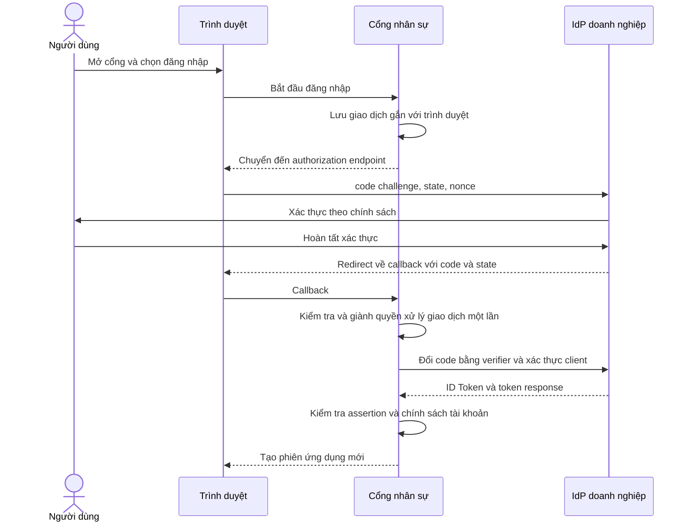

# FAL2

## Mục tiêu và bối cảnh

Trong chương **Identity assurance** của nền tảng quản lý danh tính và quyền truy cập (IAM), FAL2 giúp người thiết kế đánh giá độ tin cậy của bước chuyển kết quả xác thực từ nhà cung cấp danh tính sang ứng dụng. Đây là bước nối giữa đăng nhập tập trung, SSO và phiên làm việc tại ứng dụng.

Sau bài này, người học có thể:

- Phân biệt bảo đảm liên kết danh tính với bảo đảm xác thực và định danh.
- Giải thích các yêu cầu chính của FAL2 và ý nghĩa của việc chống chèn assertion.
- Đọc một luồng OIDC, nhận diện nơi cần ràng buộc giao dịch và chống phát lại.
- Kết nối kết quả liên kết danh tính với tài khoản nội bộ, phân quyền, thu hồi và kiểm toán.

**Phạm vi phiên bản:** bài sử dụng NIST SP 800-63C-4, bản chính thức tháng 7/2025. Khi đánh giá một hệ thống hoặc tài liệu cũ, cần ghi rõ phiên bản tiêu chuẩn mà tuyên bố FAL2 đang dựa vào. [Trang công bố của NIST](https://csrc.nist.gov/pubs/sp/800/63/C/4/final).

## 1. FAL2 bảo vệ bước nào trong IAM?

### 1.1. Các bên và thông điệp

Một hệ thống đăng nhập liên kết thường có:

| Thành phần | Vai trò trong ví dụ cổng nhân sự |
| --- | --- |
| Người dùng, còn gọi là subscriber | Nhân viên muốn xem hồ sơ của mình |
| Identity Provider — IdP | Hệ thống danh tính doanh nghiệp xác thực nhân viên |
| Relying Party — RP | Cổng nhân sự tin kết quả do IdP phát hành |
| User agent | Trình duyệt chuyển người dùng giữa RP và IdP |
| Assertion | Thông điệp IdP phát hành để RP xác lập danh tính và ngữ cảnh xác thực |

Trong OIDC, ID Token đóng vai trò assertion. Một assertion có thể còn kèm thuộc tính danh tính. RP phải xử lý thông điệp này trước khi tạo phiên đăng nhập tại ứng dụng. [NIST — Common Federation Requirements](https://pages.nist.gov/800-63-4/sp800-63c/Federation/).

Ví dụ, nhân viên Lan mở cổng nhân sự. Cổng chuyển Lan đến IdP; sau khi xác thực, IdP đưa kết quả trở lại cổng. Nếu cổng chỉ nhìn thấy một JWT có chữ ký đúng rồi lập tức tạo phiên, cổng vẫn chưa biết JWT ấy có thuộc giao dịch mà trình duyệt của Lan vừa bắt đầu hay không.

Câu hỏi cần giải quyết là: **ứng dụng có tiếp nhận đúng kết quả, từ đúng nguồn, dành cho mình, trong đúng lần đăng nhập hay không?**

### 1.2. FAL, AAL và IAL là ba trục riêng

| Trục bảo đảm | Câu hỏi chính | Ví dụ quyết định thiết kế |
| --- | --- | --- |
| IAL — Identity Assurance Level | Quá trình chứng minh danh tính đáng tin đến đâu? | Xác minh người đăng ký có đúng là người được khai báo |
| AAL — Authentication Assurance Level | Quá trình xác thực và việc kiểm soát authenticator mạnh đến đâu? | Chọn cơ chế MFA phù hợp với yêu cầu đăng nhập |
| FAL — Federation Assurance Level | Việc truyền kết quả xác thực, thuộc tính từ IdP đến RP được bảo vệ đến đâu? | Ngăn ứng dụng nhận kết quả bị chèn hoặc phát lại |

Việc lựa chọn các mức phải dựa trên rủi ro của dịch vụ và nhóm người dùng. Một mức FAL không tự quyết định hai mức còn lại. [NIST — Digital Identity Risk Management](https://pages.nist.gov/800-63-4/sp800-63/dirm/).

Trong ví dụ cổng nhân sự, bật MFA tại IdP giúp xử lý rủi ro xác thực. Cổng vẫn phải tự bảo vệ callback và giao dịch liên kết. Ngược lại, callback được ràng buộc tốt cũng không chứng minh nhân viên đã dùng hai yếu tố xác thực.

Tương tự, FAL2 không quyết định Lan được đọc hồ sơ của ai. Sau khi xác lập danh tính, ứng dụng còn phải kiểm tra quyền theo tài nguyên và hành động cụ thể.

## 2. Các yêu cầu cốt lõi của FAL2

FAL2 kế thừa yêu cầu FAL1, gồm ký assertion và kiểm tra chữ ký bằng khóa gắn với IdP mong đợi. Những điểm sau cần được chú ý khi đọc bản 800-63C-4:

| Yêu cầu | Ý nghĩa |
| --- | --- |
| Chống chèn assertion mạnh | Không để kết quả của giao dịch khác bị nhận nhầm |
| RP khởi tạo giao dịch | RP có yêu cầu đang chờ để đối chiếu phản hồi |
| Một RP cho mỗi assertion | Giới hạn audience và kiểm tra tại RP |
| Chống phát lại | RP không chấp nhận lại cùng assertion |
| Định danh liên kết không chứa thông tin cá nhân dạng rõ | Tránh dùng email, tên đăng nhập, mã nhân viên làm định danh liên kết |
| Thỏa thuận tin cậy có trước giao dịch | Các bên thống nhất trách nhiệm trước khi liên kết |

Với IdP do cơ quan liên bang Hoa Kỳ vận hành hoặc thuê vận hành, khóa ký dùng ở FAL2 trở lên phải được bảo vệ bằng cơ chế được thẩm định FIPS 140 Level 1 trở lên. [NIST — Federation Assurance Level](https://pages.nist.gov/800-63-4/sp800-63c/fal/).

Bảng này là điểm bắt đầu để học và rà soát thiết kế. Một tuyên bố đáp ứng FAL2 phải xét đầy đủ yêu cầu áp dụng của tiêu chuẩn, giao thức, mô hình triển khai và thỏa thuận tin cậy.

### 2.1. Chữ ký đúng chưa đủ để nhận kết quả đăng nhập

Giả sử cổng nhân sự và cổng đào tạo cùng tin IdP doanh nghiệp. Một kết quả được ký đúng nhưng phát hành cho cổng đào tạo vẫn có thể đến callback của cổng nhân sự do lỗi tích hợp hoặc hành vi tấn công.

Cổng nhân sự cần trả lời nhiều câu hỏi độc lập:

1. Ai đã phát hành thông điệp?
2. Thông điệp có bị thay đổi không?
3. Thông điệp có dành riêng cho cổng này không?
4. Nó thuộc yêu cầu đăng nhập nào đang chờ?
5. Yêu cầu đó có gắn với đúng trình duyệt không?
6. Kết quả đã được dùng để tạo phiên trước đó chưa?

Chỉ kiểm tra chữ ký giải quyết được một phần của chuỗi câu hỏi.

### 2.2. Audience restriction không thay thế phân quyền

Trong ví dụ OIDC của bài, RP có `client_id` là `hr-portal`. Hồ sơ tích hợp được thiết kế chỉ chấp nhận audience duy nhất `hr-portal`.

Nếu nhận `aud = "training-portal"`, RP phải từ chối. Nếu nhận danh sách gồm cả `hr-portal` và `training-portal`, thiết kế FAL2 này cũng phải từ chối, dù thư viện OIDC tổng quát có thể hỗ trợ nhiều audience.

Sau khi audience hợp lệ, ứng dụng vẫn chưa có kết luận Lan là quản trị viên. Audience mô tả bên nhận thông điệp; quyền truy cập hồ sơ là quyết định khác.

### 2.3. Định danh liên kết và email có vai trò khác nhau

Có thể thiết kế dữ liệu nội bộ như sau:

| Trường | Giá trị minh họa | Cách sử dụng |
| --- | --- | --- |
| `issuer` | `https://id.example.test` | Phân biệt nguồn danh tính |
| `subject` | `p_7f3b28a0` | Định danh opaque trong namespace của nguồn |
| `internal_user_id` | `user-1042` | Liên kết với tài khoản ứng dụng |
| `email` | `lan@example.test` | Liên hệ hoặc hiển thị khi được phép |
| `employment_status` | `active` | Đầu vào chính sách có nguồn và độ mới xác định |

Khóa ánh xạ của thiết kế là cặp `(issuer, subject)`. Email có thể thay đổi khi đổi tên, đổi miền hoặc được cấp lại cho người khác, nên việc tự động nối tài khoản theo email cần được tránh trong ví dụ này.

Một subject opaque cũng không đương nhiên khiến mọi hoạt động trở nên vô danh. Hệ thống vẫn có thể liên hệ subject với tài khoản nội bộ; vì vậy dữ liệu ánh xạ và log cần được bảo vệ.

## 3. Hiểu đúng thay đổi về mã hóa

Ở NIST SP 800-63C thuộc bộ 800-63-3, mô tả FAL2 yêu cầu assertion được ký và mã hóa cho RP. Đây là nguồn gốc của cách diễn giải quen thuộc “FAL2 là assertion đã mã hóa”. [NIST SP 800-63C — phiên bản trước](https://pages.nist.gov/800-63-3/sp800-63c.html).

Bản 800-63C-4 đã thay đổi cách định nghĩa: mã hóa không còn là điều kiện phân mức FAL; yêu cầu bảo vệ nội dung phụ thuộc vào việc thông tin cá nhân đi qua bên không được tin cậy và các điều kiện áp dụng khác. Chống chèn assertion trở thành điểm bắt buộc ở FAL2. [NIST — Change Log](https://pages.nist.gov/800-63-4/sp800-63c/changelog/).

Có thể tách các mục đích bảo vệ để phân tích thiết kế:

| Cơ chế | Câu hỏi mà cơ chế giúp trả lời |
| --- | --- |
| Chữ ký | Ai phát hành và nội dung có bị sửa không? |
| Mã hóa nội dung | Bên nào có thể đọc assertion? |
| Kênh TLS được xác thực | Trao đổi trên kết nối này có được bảo vệ không? |
| Ràng buộc giao dịch | Kết quả có thuộc đúng lần đăng nhập đang chờ không? |
| Cơ chế dùng một lần | Kết quả có bị tiếp nhận lần thứ hai không? |

Ví dụ, mã hóa ID Token cho cổng nhân sự không tự khiến cổng nhận biết token thuộc tab đăng nhập nào. Ngược lại, nonce đúng cũng không giúp che nội dung của một token bị đưa vào log.

Vì thế, khi nhóm tích hợp nói “đã bật mã hóa nên đạt FAL2”, cần yêu cầu họ chỉ ra cả phiên bản tiêu chuẩn và các cơ chế bảo vệ giao dịch. Khi họ nói “bản mới không bắt buộc mã hóa theo mức FAL nên có thể gửi mọi thuộc tính dạng rõ qua trình duyệt”, cũng cần đánh giá lại đường đi dữ liệu.

## 4. Luồng OIDC minh họa

Ví dụ dưới đây chọn ứng dụng web có backend, OIDC Authorization Code Flow và PKCE với `S256`. Đây là một phương án thiết kế để giải thích các điểm kiểm soát; tên luồng hoặc một vài tùy chọn cấu hình không tự chứng nhận FAL2.

### 4.1. Trình tự xử lý



OIDC quy định việc lấy token qua token endpoint và các kiểm tra ID Token, gồm issuer, audience, thời hạn và nonce khi đã gửi trong yêu cầu. [OpenID Connect Core — Authorization Code Flow](https://openid.net/specs/openid-connect-core-1_0.html#CodeFlowAuth).

Thiết kế ví dụ sử dụng đồng thời ba giá trị riêng biệt:

| Giá trị | Nơi lưu trong ví dụ | Mục đích |
| --- | --- | --- |
| `state` | Giá trị khó đoán trong giao dịch phía RP | Liên hệ callback với lần bắt đầu đăng nhập |
| `nonce` | Trong giao dịch RP và yêu cầu gửi IdP | Đối chiếu kết quả xác thực trong ID Token |
| `code_verifier` | Chỉ ở backend RP | Chứng minh yêu cầu đổi code thuộc lần khởi tạo tương ứng |

PKCE tạo `code_challenge` từ verifier; với `S256`, challenge được tính bằng SHA-256 rồi mã hóa base64url không padding. IdP kiểm tra verifier trước khi trả token. [RFC 7636 — Protocol](https://www.rfc-editor.org/rfc/rfc7636.html#section-4).

RFC 9700 yêu cầu public client dùng PKCE và khuyến nghị PKCE cho confidential client. Các giá trị chống chèn phải riêng cho từng giao dịch và được gắn an toàn với client cùng user agent. RP hỗ trợ nhiều issuer còn cần phòng chống mix-up; redirect URI phải được kiểm tra theo quy tắc chặt chẽ của giao thức. [RFC 9700 — Protecting Redirect-Based Flows](https://www.rfc-editor.org/rfc/rfc9700.html#section-2.1).

### 4.2. Trạng thái tạm của một lần đăng nhập

Ví dụ một bản ghi logic, không phải dữ liệu để đưa vào URL hay log:

```text
login_transaction:
  state_digest: digest-cua-state-ngau-nhien
  browser_binding: tham-chieu-phien-tam
  expected_issuer: https://id.example.test
  client_id: hr-portal
  redirect_uri: https://hr.example.test/oidc/callback
  expected_nonce: nonce-ngau-nhien-rieng
  pkce_verifier: bi-mat-tam-cua-giao-dich
  expires_at: thoi-diem-het-han
  status: PENDING
```

`browser_binding` phải được kiểm tra qua ngữ cảnh trình duyệt do RP quản lý. Chỉ tìm được một bản ghi có cùng state trong cơ sở dữ liệu chưa đủ nếu RP không kiểm tra bản ghi đó thuộc trình duyệt đang gửi callback.

Nếu cho phép nhiều tab đăng nhập, mỗi giao dịch cần bản ghi riêng. Lưu một nonce duy nhất trong session rồi liên tục ghi đè có thể làm tab trước thất bại hoặc gây lỗi ghép kết quả.

Thời hạn giao dịch, độ lệch đồng hồ và thời gian tồn tại của dữ liệu chống phát lại phải là các cấu hình được thiết kế có chủ đích. Các giá trị đó không nên được suy ra từ số “2” trong tên FAL2.

### 4.3. Pseudocode kiểm tra callback

Đoạn sau minh họa thứ tự và ranh giới trách nhiệm. Các hàm là khái niệm; ứng dụng thực tế cần thư viện giao thức đã được duy trì và cơ chế lưu trữ phù hợp.

```text
handle_callback(request):
    require_single_values_for_security_parameters(request)

    tx = transaction_store.find_by_state_digest(
        digest(request.state)
    )

    require(tx exists)
    require(tx.status == PENDING)
    require(now < tx.expires_at)
    require(browser_binding_matches(request, tx))
    require(expected_callback_route_matches(request, tx))

    # Phản hồi lỗi cũng phải thuộc một giao dịch hợp lệ.
    if request.contains_oidc_error:
        transaction_store.finish_once(tx, FAILED)
        reject_login()

    require(request.code exists)

    # Thực hiện nguyên tử: chỉ một callback giành được giao dịch.
    require(transaction_store.claim_once(tx) == SUCCESS)

    try:
        tokens = oidc_client.exchange_code(
            issuer = tx.expected_issuer,
            redirect_uri = tx.redirect_uri,
            code = request.code,
            code_verifier = tx.pkce_verifier,
            client_authentication = configured_method
        )

        claims = oidc_client.validate_signed_id_token(
            token = tokens.id_token,
            expected_issuer = tx.expected_issuer,
            allowed_algorithms = configured_allowlist,
            trusted_keys = keys_for_expected_issuer,
            expected_audience = tx.client_id,
            expected_nonce = tx.expected_nonce,
            validate_time_claims = true
        )

        require(unique_audiences(claims.aud) == {tx.client_id})
        require_authorized_party_if_applicable(claims, tx.client_id)
        require_accepted_authentication_context(claims, local_policy)

        account = account_store.find(claims.iss, claims.sub)
        require(account exists and account.status == ACTIVE)

        # Hoàn tất dùng một lần trước khi phát phiên cho trình duyệt.
        require(transaction_store.complete_once(tx) == SUCCESS)

        session = session_service.create_fresh_session(account)
        audit_login_success(tx, account, session)
        issue_protected_session_cookie(session)

    catch validation_or_processing_error:
        transaction_store.finish_as_failed_if_possible(tx)
        audit_login_failure_without_credentials(tx)
        reject_login_and_require_new_transaction()
```

Một số lựa chọn trong pseudocode là chính sách của ví dụ:

- Giao dịch bị lỗi sau khi được claim sẽ không quay lại trạng thái có thể sử dụng. Người dùng bắt đầu lần đăng nhập mới.
- Nhiều instance RP dùng chung kho trạng thái có phép cập nhật nguyên tử. Hai callback đến hai instance không được đồng thời tạo hai phiên.
- Account phải tồn tại và hoạt động trước khi tạo phiên. Nếu sản phẩm dùng cấp phát vừa lúc đăng nhập, bước cấp phát cần quy tắc phê duyệt và ánh xạ riêng.
- Không nhận ID Token tùy ý từ request của trình duyệt để thay cho ID Token vừa nhận từ token endpoint trong luồng đã chọn.

Nếu dùng một kho replay riêng theo định danh assertion, cần lưu khóa chống trùng đủ lâu cho toàn bộ cửa sổ mà assertion còn có thể được chấp nhận. TTL ngắn hơn cửa sổ đó có thể khiến cùng kết quả được nhận lại.

### 4.4. Ví dụ payload để đọc hiểu

```json
{
  "iss": "https://id.example.test",
  "sub": "p_7f3b28a0",
  "aud": "hr-portal",
  "iat": 1900000000,
  "exp": 1900000300,
  "nonce": "gia-tri-khop-giao-dich-dang-cho",
  "auth_time": 1899999980,
  "acr": "urn:example:authn:employee-mfa"
}
```

Đây chỉ là payload minh họa với mốc thời gian giả định. Nó thiếu lớp chữ ký và không phải token sử dụng được.

`acr` trong ví dụ là giá trị do tổ chức tự định nghĩa. Hai bên cần thống nhất nó biểu thị điều gì và RP phải kiểm tra theo chính sách. Việc có chuỗi chứa “mfa” không tự chứng minh đáp ứng AAL2; thêm `"fal": 2` vào JSON cũng không làm một giao dịch đáp ứng FAL2.

Quy tắc xác minh ID Token phải do thư viện và hồ sơ tích hợp thực hiện, không dừng ở việc giải mã base64 rồi đọc payload. [OpenID Connect Core — ID Token Validation](https://openid.net/specs/openid-connect-core-1_0.html#IDTokenValidation).

## 5. Vì sao chống chèn khác với chống phát lại?

NIST mô tả assertion injection là việc ép RP tiếp nhận assertion hoặc tham chiếu assertion để tạo ngữ cảnh danh tính sai. Các biện pháp có thể gồm trình bày qua back channel, nonce, xác thực RP và theo dõi trạng thái liên tục của giao dịch. [NIST — Protection From Assertion Injection Attacks](https://pages.nist.gov/800-63-4/sp800-63c/Federation/#protection-from-assertion-injection-attacks).

### 5.1. Hai tình huống khác nhau

**Tình huống chèn:** Lan chưa từng dùng token T. Kẻ tấn công lấy T từ một giao dịch khác rồi tìm cách khiến trình duyệt của Lan gửi nó vào callback. Token chưa bị phát lại nhưng vẫn không thuộc lần đăng nhập của Lan.

**Tình huống phát lại:** một callback hợp lệ đã tạo phiên. Do refresh trang, proxy gửi lại hoặc hành vi tấn công, cùng kết quả đến lần nữa. RP phải từ chối việc dùng lại để tạo một phiên đăng nhập mới.

Một cơ chế chỉ lưu “token đã thấy” có thể chặn tình huống thứ hai nhưng vẫn chấp nhận lần đầu tiên của token bị chèn. Một cơ chế chỉ kiểm tra “đúng state” nhưng cho state được dùng nhiều lần cũng chưa xử lý đầy đủ tình huống thứ hai.

### 5.2. Các phép thử thiết kế cho ví dụ

Đây là các tình huống kiểm thử tích hợp được đề xuất cho ứng dụng minh họa, không phải kết quả kiểm thử một hệ thống đang chạy.

| Tình huống | Kết quả mong đợi |
| --- | --- |
| Callback không có giao dịch đang chờ | Từ chối, không tạo session |
| State của giao dịch A gửi bằng trình duyệt B | Từ chối do không khớp browser binding |
| Code của giao dịch A đi cùng trạng thái giao dịch B | Không hoàn tất đăng nhập |
| Nonce trong ID Token khác nonce đã lưu | Từ chối |
| Token cho RP khác | Từ chối |
| Token có hai audience dù một audience đúng | Từ chối trong hồ sơ FAL2 của ví dụ |
| Callback giống nhau đến đồng thời hai instance | Tối đa một lần được xử lý thành công |
| Chữ ký đúng nhưng token hết hạn | Từ chối |
| Token từ issuer ngoài cấu hình tin cậy | Từ chối |
| Tài khoản nội bộ đã bị khóa | Không tạo phiên dù assertion hợp lệ |

Ví dụ phép thử đồng thời giúp phát hiện một lỗi thường khó thấy khi thử thủ công: hai request cùng đọc trạng thái PENDING, cùng kiểm tra thành công rồi cùng ghi COMPLETED. Phép đọc và đổi trạng thái cần được kết hợp thành thao tác nguyên tử.

## 6. Thỏa thuận tin cậy và vận hành

Trong cổng nhân sự minh họa, nhóm IAM và nhóm ứng dụng nên có một hồ sơ tích hợp cụ thể để trả lời:

- Issuer nào được tin cậy và ai có quyền phê duyệt thêm issuer?
- RP nào được đăng ký, redirect URI nào được phép sử dụng?
- Nguồn metadata và khóa xác minh được xác thực bằng cách nào?
- Những ngữ cảnh xác thực nào được chấp nhận cho từng nhóm thao tác?
- Thuộc tính nào được phát hành, dùng vào mục đích gì và giữ bao lâu?
- Khi khóa bị lộ, IdP ngừng hoạt động hoặc nhân viên nghỉ việc, bên nào xử lý?
- Dấu vết nào giúp liên hệ sự kiện IdP với giao dịch RP mà không ghi credential?

Ví dụ quy trình thay khóa: nhóm IdP công bố khóa mới qua nguồn đã được tin cậy; RP cập nhật theo chính sách cache và khoảng chuyển tiếp đã thống nhất. Khi gặp `kid` chưa biết, RP không được tùy ý lấy khóa từ URL do token cung cấp rồi tin khóa đó.

Ví dụ xử lý sự cố: nếu khóa ký bị lộ, việc xoay khóa cần đi cùng đánh giá các phiên đã tạo từ assertion bị ảnh hưởng. Chặn đăng nhập mới không tự làm mất hiệu lực mọi phiên ứng dụng cũ.

Các câu hỏi này giúp biến tuyên bố “IdP hỗ trợ SSO” thành trách nhiệm vận hành có thể kiểm tra. Chi tiết cách phê duyệt, thời hạn và phân công là lựa chọn của tổ chức, không được suy diễn từ tên sản phẩm.

## 7. FAL2 liên hệ thế nào với phiên và quyền truy cập?

### 7.1. Tạo phiên tại RP là một bước chuyển trách nhiệm

Sau khi xác minh kết quả liên kết, RP tạo phiên riêng. Trong thiết kế cổng nhân sự, phiên đó nên có định danh mới, cookie được bảo vệ phù hợp và cơ chế hết hạn theo chính sách.

Thời hạn ID Token và thời hạn session phải được xem là hai giá trị khác nhau. Nếu assertion chỉ có giá trị vài phút nhưng cổng tạo phiên tám giờ, việc token hết hạn không tự đăng xuất phiên tám giờ đó.

Vì vậy nhóm phát triển cần xác định thời điểm nào phải xác thực lại, khi nào phải kiểm tra trạng thái tài khoản mới và khi nào cần thu hồi phiên.

### 7.2. RBAC, ABAC và nguyên tắc ít quyền nhất

Giả sử Lan có vai trò nhân viên. Cổng có thể áp dụng:

```text
Cho phép xem hồ sơ khi:
    tài khoản đang hoạt động
    AND hồ sơ thuộc Lan
    AND phiên còn hợp lệ

Cho phép quản lý chỉnh sửa hồ sơ cấp dưới khi:
    có vai trò HR_MANAGER
    AND thuộc đơn vị được phân công
    AND hành động nằm trong phạm vi được cấp
    AND thỏa điều kiện xác thực bổ sung nếu chính sách yêu cầu
```

Kết quả liên kết cung cấp đầu vào danh tính cho quyết định này. Ứng dụng cần kiểm tra quyền trên từng thao tác, tránh mặc định rằng người đăng nhập qua SSO có quyền rộng.

Nếu IdP gửi group hoặc role, RP phải biết nguồn đó có thẩm quyền cấp quyền nào. Không nên tự động coi mọi chuỗi `admin` từ mọi issuer là quyền quản trị ứng dụng.

### 7.3. Cấp phát, thu hồi và đặc quyền

Một ví dụ vòng đời đầy đủ:

1. Nhân sự được tuyển dụng và cấp tài khoản theo quy trình của tổ chức.
2. RP ánh xạ danh tính liên kết với tài khoản nội bộ đúng người.
3. Quyền được cấp theo công việc và được rà soát khi chuyển bộ phận.
4. Tài khoản bị vô hiệu hóa khi nghỉ việc; phiên và token liên quan được xử lý theo chính sách.
5. Nhật ký ghi lại sự kiện thay đổi quyền và các lần đăng nhập bị từ chối.

Trong bước 4, vô hiệu hóa ở IdP có thể ngăn đăng nhập mới nhưng RP vẫn cần cơ chế xử lý phiên đã tồn tại. Đây là lý do một thiết kế liên kết tốt phải được đặt trong vòng đời IAM.

Đối với tài khoản đặc quyền, có thể cần xác thực bổ sung, phê duyệt hoặc cơ chế bảo đảm cao hơn theo đánh giá rủi ro. Việc đã dùng FAL2 không tự đáp ứng toàn bộ yêu cầu quản lý đặc quyền.

### 7.4. Giới hạn với danh tính workload

Ví dụ trong bài là liên kết danh tính người dùng. Một dịch vụ gọi dịch vụ khác bằng OAuth client credentials không có cùng ngữ cảnh trình duyệt và người dùng.

Không nên gắn nhãn FAL2 cho mọi luồng máy với máy chỉ vì cùng sử dụng JWT, OAuth hoặc cùng IdP. Danh tính workload cần được phân tích riêng về chủ thể, credential, audience, quyền, thời hạn và luân chuyển khóa.

## 8. Nhật ký và bằng chứng cần giữ

Để điều tra lỗi mà vẫn hạn chế lộ dữ liệu, có thể thiết kế sự kiện như sau:

```text
event: federation_login_rejected
transaction_id: login-82c1
rp_id: hr-portal
expected_issuer_id: corporate-idp
reason: NONCE_MISMATCH
occurred_at: thoi-diem-su-kien
```

Không đưa ID Token, access token, refresh token, authorization code, PKCE verifier hay cookie phiên vào sự kiện này. Tham chiếu tài khoản nội bộ chỉ nên được thêm khi đã xác định đáng tin và thực sự cần cho mục đích kiểm toán.

Trong ví dụ, các bằng chứng hữu ích gồm cấu hình issuer và audience đã được phê duyệt, mô tả phép cập nhật nguyên tử chống dùng lại, kết quả thử các tình huống từ chối và quy trình xử lý khóa bị lộ.

Một dashboard chỉ ghi “SSO thành công” khó giúp xác định vì sao callback lạ bị chấp nhận. Mã lý do từ chối rõ ràng và transaction ID hỗ trợ tìm nguyên nhân mà không cần sao chép token vào log.

## 9. Những cách hiểu cần sửa

| Cách hiểu | Điều cần kiểm tra lại |
| --- | --- |
| Có MFA nên đạt FAL2 | MFA thuộc bài toán xác thực; liên kết cần bộ kiểm soát riêng |
| JWT ký đúng là đủ | Còn nguồn phát, bên nhận, giao dịch, thời gian và dùng một lần |
| HTTPS tự chống replay | Một thông điệp hợp lệ vẫn có thể được gửi lại |
| Gửi nonce là đã bảo vệ | RP phải lưu, đối chiếu và quản lý vòng đời nonce |
| Audience chứa RP của mình là đủ trong mọi trường hợp | Hồ sơ FAL2 yêu cầu giới hạn một RP |
| Bật JWE là tự đạt FAL2 hiện hành | Cần ghi phiên bản và đánh giá đầy đủ bảo vệ giao dịch |
| SSO thành công thì được quyền quản trị | Quyền phải do chính sách ứng dụng quyết định |
| Khóa tài khoản tại IdP là mọi phiên RP biến mất | Cần cơ chế thu hồi hoặc đánh giá lại phiên ở RP |

## 10. Vận dụng vào một quyết định thiết kế

Với cổng nhân sự, nhóm triển khai có thể bắt đầu bằng mô tả hành vi cụ thể: nhân viên đăng nhập từ cổng, chỉ được xem hồ sơ thuộc phạm vi quyền của mình, và kết quả của một lần đăng nhập không thể được dùng để tạo phiên ở trình duyệt khác.

Từ đó, nhóm phân công IdP chịu trách nhiệm xác thực và phát hành assertion đúng hồ sơ tích hợp; RP chịu trách nhiệm ràng buộc giao dịch, kiểm tra kết quả, ánh xạ tài khoản và áp dụng quyền. Hai bên cùng thống nhất xử lý thay khóa, sự cố và thay đổi vòng đời tài khoản.

Khi đánh giá FAL2, bằng chứng có giá trị là hành vi được kiểm tra trên toàn giao dịch cùng các yêu cầu áp dụng. Tên giao thức, một claim trong token hoặc tùy chọn “bật SSO” chỉ mô tả một phần của thiết kế.

