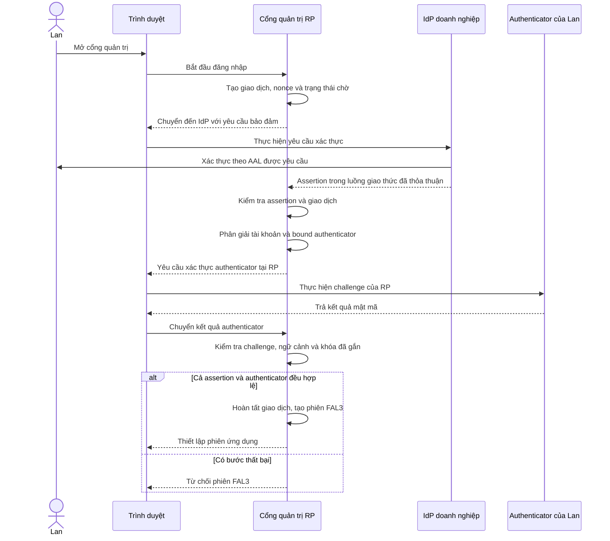

# FAL3: bảo đảm liên kết danh tính bằng bằng chứng kiểm soát authenticator

## 1. FAL3 giải quyết vấn đề gì?

Trong một hệ thống đăng nhập liên kết, ứng dụng thường không trực tiếp kiểm tra mật khẩu của người dùng. Một **Identity Provider (IdP)** xác thực người dùng, sau đó phát hành **assertion** để **Relying Party (RP)** xác lập phiên đăng nhập. Ví dụ, cổng quản trị của doanh nghiệp là RP, còn hệ thống đăng nhập tập trung là IdP.

Chữ ký trên assertion giúp RP kiểm tra nguồn phát hành và tính toàn vẹn. Tuy nhiên, chữ ký đó không tự chứng minh rằng người đang hoàn tất giao dịch tại RP kiểm soát một authenticator của chủ thể được nêu trong assertion. Nếu thiết kế cho phép dùng assertion như một bearer artifact, kẻ tấn công có thể tìm cách đánh cắp, tiêm hoặc sử dụng sai ngữ cảnh assertion để mạo danh người dùng.

**FAL3 — Federation Assurance Level 3** bổ sung một ràng buộc quan trọng: ngoài việc xác minh assertion, RP phải kiểm tra người dùng kiểm soát một authenticator thông qua cơ chế holder-of-key hoặc bound authenticator. Đây là mức cao nhất trong ba mức FAL của NIST SP 800-63C-4. Giao dịch phải đáp ứng toàn bộ yêu cầu áp dụng, không chỉ có một trường dữ liệu ghi rằng nó đạt FAL3. [Nguồn: NIST SP 800-63C-4, mục 2](https://pages.nist.gov/800-63-4/sp800-63c/fal/).

Trong nền tảng quản lý danh tính và quyền truy cập (IAM), FAL3 nối ba phần thường bị triển khai rời nhau: đăng nhập tập trung, authenticator người dùng và phiên ứng dụng. Nó đặc biệt hữu ích khi thiết kế truy cập đặc quyền, nhưng vẫn phải phối hợp với cấp phát tài khoản, vòng đời quyền, RBAC/ABAC, kiểm toán và nguyên tắc ít quyền nhất.

Sau bài này, người học có thể:

- Phân biệt FAL3 với IAL3, AAL3 và việc bật MFA tại IdP.
- Giải thích sự khác nhau giữa holder-of-key và bound authenticator.
- Đọc một luồng đăng nhập và chỉ ra thời điểm RP được phép tạo phiên FAL3.
- Xác định các điểm dễ mất bảo đảm trong đăng ký authenticator, khôi phục, thay khóa và quản lý phiên.
- Đánh giá một thiết kế OIDC hoặc SAML mà không đồng nhất tên giao thức với mức bảo đảm thực tế.

## 2. Chốt phiên bản tiêu chuẩn trước khi thiết kế

Bài này dùng **NIST SP 800-63C-4** làm cơ sở. Đây là chi tiết cần ghi rõ trong tài liệu kiến trúc vì mô tả các mức FAL đã thay đổi giữa các phiên bản.

Ở bản SP 800-63C thuộc bộ SP 800-63-3, bảng tóm tắt mô tả FAL2 là bearer assertion được ký và mã hóa tới RP; FAL3 là holder-of-key assertion được ký và mã hóa tới RP. Bản SP 800-63C-4 trình bày các mức qua nhiều thuộc tính hơn, nhấn mạnh bảo vệ chống assertion injection, đồng thời cho phép bound authenticator ở FAL3. Không nên ghép bảng của bản cũ với quy trình của bản mới rồi coi đó là cùng một hồ sơ tuân thủ. [Nguồn: bảng FAL của SP 800-63C bản trước](https://pages.nist.gov/800-63-3/sp800-63c.html#sec4), [bảng FAL của SP 800-63C-4](https://pages.nist.gov/800-63-4/sp800-63c/fal/).

Trong bản 4, mã hóa assertion vẫn có vai trò bảo vệ dữ liệu và có thể được yêu cầu bởi thỏa thuận tin cậy hoặc cách triển khai. Nhưng chỉ nhìn thấy một JWE, một SAML assertion được mã hóa hay một kết nối TLS không đủ để kết luận giao dịch đạt FAL3. Cần xét cả xác minh assertion, ràng buộc giao dịch và authenticator tại RP. [Nguồn: NIST SP 800-63C-4, mục 3.13](https://pages.nist.gov/800-63-4/sp800-63c/Federation/#assertion-protection).

## 3. Các vai trò và ba trục bảo đảm

### 3.1. Ai chịu trách nhiệm cho phần nào?

| Thành phần | Trách nhiệm trong ví dụ đăng nhập liên kết |
| --- | --- |
| Subscriber | Người dùng có tài khoản và sử dụng authenticator để xác thực |
| Credential Service Provider (CSP) | Quản lý tài khoản, quá trình xác minh danh tính và việc gắn authenticator theo mô hình áp dụng |
| IdP | Xác thực người dùng, phát hành assertion cho RP theo thỏa thuận tin cậy |
| RP | Kiểm tra assertion, xác định tài khoản cục bộ, kiểm tra authenticator cần cho FAL3 và tạo phiên |
| User agent | Trình duyệt hoặc ứng dụng tham gia chuyển tiếp thông điệp; không phải nguồn tin cậy để tự khai báo mức bảo đảm |

CSP và IdP có thể do cùng một tổ chức vận hành, nhưng cần phân biệt hai vai trò khi xác định trách nhiệm. Bài này tập trung vào mô hình IdP dùng chung của doanh nghiệp; các yêu cầu riêng cho ví danh tính do người dùng kiểm soát cần được xét thêm nếu triển khai mô hình đó. [Nguồn: NIST SP 800-63C-4, mục 3.1–3.2](https://pages.nist.gov/800-63-4/sp800-63c/Federation/).

### 3.2. IAL, AAL và FAL trả lời ba câu hỏi khác nhau

| Trục | Câu hỏi chính | Điều không thể tự suy ra |
| --- | --- | --- |
| IAL — Identity Assurance Level | Danh tính của người có tài khoản đã được kiểm chứng đến đâu? | Không quyết định giao dịch liên kết có chống đánh cắp assertion hay không |
| AAL — Authentication Assurance Level | Việc xác thực và quản lý authenticator đáp ứng mức bảo đảm nào? | Không tự chứng minh RP đã kiểm tra authenticator ngoài assertion |
| FAL — Federation Assurance Level | Giao dịch chuyển kết quả xác thực từ IdP sang RP được bảo vệ như thế nào? | Không tự cấp quyền nghiệp vụ hoặc xác lập IAL3/AAL3 |

Một người dùng có thể xác thực bằng cơ chế rất mạnh tại IdP, trong khi RP chỉ tiếp nhận kết quả theo một giao dịch không đạt FAL3. Ngược lại, việc giao dịch đạt FAL3 không có nghĩa tài khoản đã trải qua kiểm chứng danh tính ở IAL3.

Vì vậy, chính sách phải mô tả từng trục cần thiết. Ví dụ, một tổ chức có thể lựa chọn IAL2, AAL2 và FAL3 cho một chức năng sau khi đánh giá rủi ro; đây là ví dụ về cách diễn đạt chính sách, không phải tổ hợp mặc định bắt buộc cho mọi hệ thống. [Nguồn: NIST SP 800-63C-4, mục 2.5](https://pages.nist.gov/800-63-4/sp800-63c/fal/#requesting-and-processing-xals).

## 4. Điều kiện nền tảng của một giao dịch FAL3

FAL3 kế thừa yêu cầu của các mức thấp hơn, trừ những điểm được thay bằng yêu cầu cụ thể hoặc nghiêm ngặt hơn. Bảng sau tóm tắt các khác biệt chính của bản 4, không thay thế toàn bộ tiêu chuẩn.

| Thuộc tính | FAL1 | FAL2 | FAL3 |
| --- | --- | --- | --- |
| Audience của assertion | Có thể hướng đến nhiều RP; khuyến nghị một RP | Một RP | Một RP |
| Chống replay | Bắt buộc tại từng RP | Bắt buộc | Bắt buộc |
| Chống assertion injection | Được khuyến nghị | Bắt buộc; giao dịch bắt đầu tại RP | Bắt buộc; giao dịch bắt đầu tại RP |
| Thỏa thuận tin cậy | Có thể do người dùng thiết lập hoặc có sẵn | Thiết lập trước giao dịch | Thiết lập trước giao dịch |
| Thiết lập định danh và khóa của các bên | Có thể động hoặc thủ công | Có thể động hoặc thủ công | Thiết lập định danh thủ công, gắn với khóa xác minh qua cơ chế tin cậy |
| Cách trình bày | Bearer assertion | Bearer assertion | Holder-of-key assertion hoặc bound authenticator |

[Nguồn: NIST SP 800-63C-4, bảng 1 và mục 2.2–2.4](https://pages.nist.gov/800-63-4/sp800-63c/fal/).

Khi chuyển bảng thành thiết kế, cần hiểu các điểm sau:

1. **Assertion phải thực sự hợp lệ.** RP kiểm tra chữ ký, issuer mong đợi, audience, thời gian hiệu lực, nonce, khả năng replay và các điều kiện trong thỏa thuận. Authenticator tốt không bù được việc tin một issuer không được phép.
2. **Giao dịch phải được gắn với yêu cầu do RP khởi tạo.** Một callback chứa assertion hợp lệ nhưng không thuộc giao dịch đang chờ vẫn có thể là một nỗ lực injection. Ở FAL2 trở lên, assertion phải chứa nonce của yêu cầu từ RP.
3. **Trust agreement có trước giao dịch.** Thỏa thuận cần làm rõ các mức bảo đảm, thuộc tính được chia sẻ, thuật toán và khóa được chấp nhận, loại authenticator, trách nhiệm vận hành và xử lý sự cố.
4. **Thiết lập tin cậy không dựa trên URL tự khai báo trong token.** Ở FAL3, định danh CSP, IdP và RP được thiết lập thủ công, mỗi định danh liên kết rõ với khóa xác minh. Việc truyền hoặc tải khóa vẫn có thể tự động qua cơ chế đã được tin cậy; không có nghĩa mỗi lần xoay khóa đều phải sao chép thủ công.
5. **Định danh liên kết không chứa thông tin cá nhân dạng rõ ở FAL2 trở lên.** RP cũng cần hiểu subject trong phạm vi issuer, tránh gộp hai người từ hai IdP chỉ vì cùng một giá trị subject hoặc email.
6. **RP phải kiểm tra authenticator ngoài assertion.** Chỉ báo FAL3 trong thông điệp là yêu cầu cần xử lý, không phải bằng chứng rằng RP đã hoàn thành xử lý.

[Nguồn: NIST SP 800-63C-4, mục 2](https://pages.nist.gov/800-63-4/sp800-63c/fal/), [mục 4.9 về nội dung và kiểm tra assertion](https://pages.nist.gov/800-63-4/sp800-63c.html#assertion-contents).

## 5. Hai cách kiểm tra authenticator tại RP

### 5.1. Holder-of-key assertion

Với **holder-of-key (HoK)**, assertion chỉ ra authenticator mà RP phải kiểm tra, chẳng hạn khóa công khai hoặc một định danh chứng thư của người dùng. Người dùng phải chứng minh kiểm soát authenticator đó cho RP.

Ví dụ, một nhân viên có smart card chứa khóa riêng. IdP phát hành assertion nêu chứng thư tương ứng. Tại RP, một quá trình xác thực mật mã phù hợp chứng minh nhân viên kiểm soát khóa riêng, rồi RP đối chiếu authenticator vừa xác minh với thông tin đã được IdP ký trong assertion.

RP phải kiểm tra cả hai mệnh đề:

- Assertion hợp lệ và chỉ đúng authenticator cần dùng.
- Bằng chứng nhận được thực sự thuộc authenticator đó, trong đúng ngữ cảnh xác thực tại RP.

Một chuỗi ký tự chứa thumbprint không phải là bằng chứng sở hữu khóa. Tương tự, tải chứng thư công khai lên RP chỉ cung cấp dữ liệu công khai; ai cũng có thể sao chép chứng thư mà không có khóa riêng. Trong mô hình HoK, authenticator được chỉ ra phải có cơ chế chống phishing phù hợp. Authenticator này có thể khác authenticator đã dùng tại IdP. [Nguồn: NIST SP 800-63C-4, mục 3.15 và 3.17](https://pages.nist.gov/800-63-4/sp800-63c/Federation/#holder-of-key-assertions).

### 5.2. Bound authenticator

Với **bound authenticator**, RP quản lý liên kết giữa tài khoản cục bộ và authenticator. Assertion của IdP có chỉ báo rằng RP phải kiểm tra bound authenticator để xử lý giao dịch FAL3. RP tra cứu authenticator đã gắn với tài khoản, rồi xác minh người dùng kiểm soát authenticator đó.

Ví dụ, nhân viên dùng khóa bảo mật hỗ trợ WebAuthn:

- Khi xác thực tại IdP, thiết bị sử dụng credential và khóa dành cho IdP.
- Khi xác thực tại RP, thiết bị sử dụng credential và khóa riêng dành cho RP.
- Dù người dùng thao tác cùng một thiết bị vật lý, hai bên nhìn thấy hai khóa khác nhau. IdP không cần biết khóa riêng tại RP.

Bound authenticator phải dùng cơ chế chống phishing, được gắn duy nhất cho một subscriber tại RP và có cơ sở đáng tin cậy để RP đánh giá đặc tính bảo mật của nó. Không thể thay bước này bằng mật khẩu hay OTP chỉ vì chúng được hỏi ở màn hình thứ hai. Việc chọn một loại WebAuthn credential cụ thể vẫn phải đáp ứng chính sách authenticator và yêu cầu triển khai áp dụng. [Nguồn: NIST SP 800-63C-4, mục 3.16](https://pages.nist.gov/800-63-4/sp800-63c/Federation/#bound-authenticators), [ví dụ 9.7](https://pages.nist.gov/800-63-4/sp800-63c/examples/#fal3-with-a-non-pki-bound-authenticator).

### 5.3. So sánh cách gắn authenticator

| Câu hỏi | Holder-of-key | Bound authenticator |
| --- | --- | --- |
| RP biết authenticator cần kiểm tra từ đâu? | Định danh authenticator trong assertion | Liên kết authenticator trong tài khoản RP |
| Assertion cần diễn đạt gì? | Tham chiếu authenticator cần chứng minh kiểm soát | Yêu cầu dùng bound authenticator tại RP |
| Ai quản lý liên kết tại RP? | RP xử lý tham chiếu có trong assertion theo trust agreement và quy tắc phân giải tài khoản | RP quản lý trực tiếp liên kết tài khoản–authenticator |
| Ví dụ điển hình | Smart card và chứng thư trong một môi trường PKI phù hợp | Credential WebAuthn đã gắn với tài khoản RP |
| Sai sót dễ gặp | Chỉ đối chiếu tên chứng thư mà không xác minh kiểm soát khóa | Cho gắn khóa mới bằng bất kỳ phiên SSO nào, rồi dùng khóa đó để truy cập đặc quyền |

Cả hai cách đều đòi hỏi assertion hợp lệ và bằng chứng authenticator hợp lệ trước khi hoàn thành phiên FAL3. Không được coi một bước thất bại là lý do để tự chuyển sang bearer login cho tài nguyên đang yêu cầu FAL3.

## 6. Luồng mẫu: SSO kết hợp bound authenticator

Giả sử cổng quản trị đã có tài khoản của Lan và một bound authenticator được đăng ký đúng quy trình. Cổng yêu cầu FAL3 cho phiên truy cập quản trị. Sơ đồ dưới đây mô tả luồng logic; cách đóng gói thông điệp phụ thuộc giao thức và hồ sơ triển khai.



Điểm quyết định là khoảng giữa việc nhận assertion và tạo phiên ứng dụng. RP cần trạng thái chờ được bảo vệ để hoàn tất bước authenticator, nhưng trạng thái đó chưa cho phép người dùng truy cập chức năng quản trị như một phiên FAL3 đã hoàn thành.

Nếu sử dụng WebAuthn, thư viện xác minh cần xử lý chữ ký, challenge, origin, RP ID, credential được phép và các cờ xác thực theo chính sách. Những kiểm tra này phải gắn với đúng tài khoản và giao dịch đang chờ. Không nên viết một hàm kiểm tra chữ ký đơn lẻ rồi coi nó đã thực hiện đầy đủ giao thức.

Đây là một cách cụ thể hóa yêu cầu RP xác minh assertion và authenticator trước khi xác lập phiên, không phải một giao thức mới. [Nguồn: NIST SP 800-63C-4, mục 3.9 và 3.17](https://pages.nist.gov/800-63-4/sp800-63c/Federation/), [ví dụ 9.7](https://pages.nist.gov/800-63-4/sp800-63c/examples/#fal3-with-a-non-pki-bound-authenticator).

## 7. Đăng ký, thêm, mất và thu hồi authenticator

### 7.1. Gắn authenticator lần đầu là một ranh giới tin cậy

Nếu kẻ tấn công có thể gắn khóa của mình vào tài khoản của Lan, việc kiểm tra khóa ở những lần đăng nhập tiếp theo chỉ chứng minh kẻ tấn công đang giữ khóa đã gắn sai. Vì vậy, vòng đời authenticator là một phần thiết yếu của thiết kế FAL3.

NIST phân biệt authenticator do RP cấp và authenticator do người dùng cung cấp:

- **RP cấp:** RP cần có cách độc lập để xác định người nhận authenticator đúng là chủ thể của tài khoản, tuân thủ quy trình gắn authenticator phù hợp, rồi lưu định danh authenticator trong tài khoản RP.
- **Người dùng cung cấp:** RP có thể hỗ trợ binding ceremony để thiết lập liên kết ban đầu, với các giới hạn riêng thay vì dùng một trang thêm khóa thông thường.

Trong binding ceremony ban đầu của authenticator do người dùng cung cấp:

1. RP xử lý một assertion đáp ứng các yêu cầu còn lại của FAL3 và chỉ rõ ý định dùng bound authenticator.
2. RP lập phiên chỉ dành cho binding ceremony, lập tức yêu cầu trình bày và xác thực authenticator được đề xuất.
3. Sau khi xác minh thành công, RP lưu định danh authenticator và gắn với tài khoản đúng của giao dịch.
4. Phiên ceremony có thời gian chờ tối đa **5 phút** và không được dùng làm phiên xác thực cho bất kỳ mục đích khác.
5. RP lập tức yêu cầu assertion FAL3 mới từ IdP, rồi yêu cầu và xác minh authenticator vừa gắn trước khi hoàn thành phiên sử dụng ứng dụng.

Đây là quy trình khởi tạo liên kết được tiêu chuẩn cho phép, với rủi ro của việc tin cậy ở lần dùng đầu tiên. Nó không có nghĩa mọi lần thêm khóa đều được bỏ qua authenticator hiện có. Nếu tài khoản đã có bound authenticator, binding ceremony để thêm authenticator do người dùng cung cấp phải sử dụng một authenticator hiện có để đạt FAL3 ở bước xác thực ban đầu. [Nguồn: NIST SP 800-63C-4, mục 3.16.1–3.16.2](https://pages.nist.gov/800-63-4/sp800-63c/Federation/#bound-authenticators).

### 7.2. Thay và thu hồi authenticator

Khi thêm hoặc bỏ bound authenticator, RP phải thông báo cho người dùng qua một kênh ngoài băng phù hợp. Khi bỏ authenticator, RP phải kết thúc toàn bộ phiên FAL3 hiện tại của subscriber và yêu cầu xác thực lại từ IdP ở FAL3. RP không được buộc người dùng xác thực bằng chính authenticator đang bị bỏ, vì thiết bị đó có thể đã mất hoặc bị xâm phạm. Nếu không còn bound authenticator nào, người dùng không thể đạt FAL3 theo cách này cho đến khi được gắn authenticator mới. [Nguồn: NIST SP 800-63C-4, mục 3.16](https://pages.nist.gov/800-63-4/sp800-63c/Federation/#bound-authenticators).

Với một cổng quản trị, quy trình vận hành có thể bổ sung kiểm tra của bộ phận hỗ trợ, phê duyệt cho tài khoản đặc quyền, nhật ký thay đổi và một authenticator dự phòng đã đăng ký trước. Đây là các lựa chọn quản trị rủi ro cần thiết kế theo bối cảnh, không phải lý do để bỏ qua các yêu cầu của binding ceremony.

Một đường khôi phục bằng email có thể giúp bắt đầu xác minh sự cố, nhưng không nên lập tức biến thành quyền gắn khóa mới rồi truy cập quản trị. Nếu chính sách cho phép một chế độ khôi phục có bảo đảm thấp hơn, chế độ đó cần được ghi nhận rõ và không được gắn nhãn FAL3 cho thao tác yêu cầu FAL3.

## 8. Đừng nhầm ba loại khóa

| Loại khóa | Chủ thể kiểm soát | Nó chứng minh điều gì? |
| --- | --- | --- |
| Khóa ký assertion | IdP | Assertion đến từ IdP được tin cậy và không bị sửa trái phép |
| Khóa xác thực client của RP | RP | Bên gọi token endpoint hoặc dịch vụ tương ứng là RP được đăng ký |
| Khóa của authenticator người dùng | Người dùng thông qua authenticator | Người thực hiện xác thực kiểm soát authenticator cần cho giao dịch FAL3 |

Ví dụ, RP dùng private key JWT để xác thực với token endpoint là một biện pháp xác thực RP. Khóa đó nằm ở máy chủ RP, không chứng minh Lan đang kiểm soát authenticator của Lan.

Tương tự, TLS giữa hai máy chủ bảo vệ đường truyền và có thể xác thực máy chủ hoặc client của kết nối. Nếu client là máy chủ RP, chứng thư client đó không tự thay cho bằng chứng authenticator người dùng. Trong một thiết kế HoK bằng smart card, cần xác định rõ kết nối nào thực sự chứng minh khóa của subscriber và RP nhận được bằng chứng đó qua ranh giới tin cậy nào.

## 9. FAL3 khi triển khai OIDC, SAML và bảo vệ API

### 9.1. OIDC

Trong OIDC, **ID Token** là assertion phục vụ đăng nhập. Authorization Code Flow, PKCE, nonce, ràng buộc callback và xác thực client là những thành phần quan trọng của một thiết kế an toàn, nhưng riêng chúng chưa chứng minh người dùng đã trình bày authenticator cho RP theo yêu cầu FAL3.

NIST SP 800-63C-4 nêu rằng ID Token có thể mang các claim cần cho holder-of-key hoặc bound authenticator, nhưng tại thời điểm công bố tài liệu chưa có hồ sơ tiêu chuẩn công nghiệp thực hiện việc này. Vì vậy, khi xây dựng giải pháp OIDC, cần thống nhất rõ cách biểu diễn yêu cầu, thông tin trong assertion và nghĩa vụ kiểm tra giữa các bên; không coi một claim tự đặt là một quy ước OIDC phổ quát. [Nguồn: NIST SP 800-63C-4, mục 9.1](https://pages.nist.gov/800-63-4/sp800-63c/examples/#mapping-fals-to-common-federation-protocols).

`acr` và `amr` có thể giúp truyền ngữ cảnh hoặc phương thức xác thực theo hồ sơ được thỏa thuận. RP vẫn phải biết các giá trị đó có nghĩa gì, chúng đáp ứng chính sách nào và bước authenticator tại RP đã hoàn thành hay chưa. Một chuỗi chứa từ `mfa` hoặc số `3` không thay thế các kiểm tra đó.

### 9.2. SAML

SAML có hồ sơ Holder-of-Key có thể phù hợp với phần assertion của FAL3 khi kết hợp các lựa chọn triển khai khác. Tuy nhiên, chọn một phương thức SubjectConfirmation phù hợp mới chỉ là một phần công việc. SP/RP phải kiểm tra nội dung đã ký, recipient/audience, thời gian, liên kết request–response, chống replay và bằng chứng authenticator theo hồ sơ áp dụng. [Nguồn: NIST SP 800-63C-4, mục 9.1](https://pages.nist.gov/800-63-4/sp800-63c/examples/#mapping-fals-to-common-federation-protocols).

### 9.3. Access token và danh tính workload

Một access token bị ràng buộc với bên gửi bảo vệ việc gọi API bằng cách đòi hỏi thêm bằng chứng khóa. Cần phân biệt khóa của bên gọi API với khóa authenticator của người dùng trong giao dịch đăng nhập. NIST đưa ra ví dụ một hệ thống có thể vừa yêu cầu holder-of-key assertion cho FAL3, vừa dùng access token bị ràng buộc với bên gửi cho API; hai cơ chế bảo vệ những quan hệ khác nhau. [Nguồn: NIST SP 800-63C-4, mục 9.1](https://pages.nist.gov/800-63-4/sp800-63c/examples/#mapping-fals-to-common-federation-protocols).

Tương tự, một workload dùng chứng thư hoặc khóa riêng để truy cập dịch vụ không vì thế tự động là một giao dịch đăng nhập người dùng đạt FAL3. Khi đánh giá danh tính workload, cần xác định loại chủ thể, cơ chế cấp và thu hồi danh tính, bên giữ khóa và mô hình ủy quyền, thay vì chuyển nhãn FAL3 từ một luồng SSO sang mọi kết nối có mật mã.

## 10. Mô hình xử lý phía RP

Đoạn giả mã dưới đây mô tả ranh giới xử lý cho trường hợp tài khoản đã có bound authenticator. Nó không phải thư viện OIDC, SAML hay WebAuthn và không thay thế trình xác minh giao thức.

```text
Khi bắt đầu đăng nhập:
    tạo giao dịch ngắn hạn gắn với ngữ cảnh trình duyệt
    lưu issuer mong đợi, audience, nonce và chính sách yêu cầu
    chuyển yêu cầu liên kết tới IdP đã được cấu hình tin cậy

Khi nhận phản hồi liên kết:
    tìm giao dịch đang chờ; từ chối nếu không tồn tại hoặc đã hết hạn
    kiểm tra phản hồi theo giao thức và xác minh assertion
    kiểm tra issuer, audience, thời gian, nonce và chống replay
    kiểm tra các mức bảo đảm đáp ứng trust agreement và chính sách
    yêu cầu assertion chỉ rõ chế độ bound authenticator cần thiết
    phân giải tài khoản bằng định danh liên kết đã xác minh
    từ chối nếu tài khoản bị vô hiệu hóa
    lấy tập bound authenticator còn hiệu lực của tài khoản
    nếu tập rỗng: chuyển sang quy trình đăng ký được phép, chưa cấp phiên FAL3
    tạo challenge mới gắn với tài khoản và giao dịch này
    lưu trạng thái chờ authenticator; chưa cấp quyền ứng dụng FAL3

Khi nhận kết quả authenticator:
    yêu cầu giao dịch còn hiệu lực và chưa hoàn tất
    xác minh kết quả bằng trình xác minh giao thức thích hợp
    kiểm tra đúng challenge, ngữ cảnh RP và authenticator đã gắn
    kiểm tra lại trạng thái tài khoản và authenticator
    nếu thất bại: từ chối hoàn tất, không tự hạ mức bảo đảm
    nếu thành công:
        hoàn tất giao dịch và tiêu thụ challenge đúng một lần
        bảo đảm xử lý đồng thời không tạo nhiều phiên từ một kết quả
        tạo hoặc thay phiên ứng dụng để phản ánh kết quả FAL3
        lưu bằng chứng kiểm toán và áp dụng chính sách phân quyền
```

Chống replay có thể cần lưu định danh assertion hoặc trạng thái tương đương tùy giao thức. Trong hệ thống nhiều instance, thao tác ghi nhận đã dùng và hoàn tất giao dịch cần có hiệu lực nhất quán giữa các instance. Chỉ giữ bộ nhớ cục bộ ở một instance có thể để cùng kết quả bị chấp nhận ở instance khác.

Các đề xuất như kiểm tra lại trạng thái tài khoản ở bước cuối hoặc xử lý nguyên tử khi hoàn tất là cách triển khai nhằm tránh đua trạng thái; cần cụ thể hóa theo kiến trúc thực tế. Chúng bổ trợ cho các yêu cầu xác minh của tiêu chuẩn.

## 11. Phiên FAL3 và quyền truy cập là hai quyết định liên quan

Giả sử Lan đã hoàn thành giao dịch FAL3 để vào cổng quản trị. Điều đó không tự cho Lan quyền sửa mọi chính sách IAM.

| Bước quyết định | Ví dụ trong cổng quản trị |
| --- | --- |
| Xác định tài khoản | Assertion hợp lệ ánh xạ đến tài khoản Lan tại RP |
| Xác minh bảo đảm | Giao dịch và authenticator đáp ứng chính sách FAL3 |
| Kiểm tra tài khoản | Lan vẫn đang làm việc và tài khoản chưa bị khóa |
| Kiểm tra quyền | RBAC cho phép vai trò của Lan quản lý một nhóm tài nguyên cụ thể |
| Kiểm tra điều kiện | ABAC yêu cầu đúng tenant, phạm vi tài nguyên và điều kiện phê duyệt |
| Ghi nhận thao tác | Nhật ký thể hiện ai thay đổi gì, lúc nào và dựa trên phiên nào |

RP nên lưu đủ ngữ cảnh để biết phiên được tạo từ giao dịch nào, đạt các mức bảo đảm nào và authenticator nào đã được xác minh, thay vì chỉ lưu `loggedIn = true`. Nếu một chức năng yêu cầu FAL3 mà phiên hiện tại chưa đáp ứng, RP cần thực hiện luồng tăng mức bảo đảm và chỉ cho phép chức năng sau khi luồng thành công.

Không lấy thời hạn của assertion làm thời hạn phiên RP. Assertion có cửa sổ hiệu lực để được RP chấp nhận khi thiết lập phiên; phiên có vòng đời riêng, chịu chính sách xác thực lại và quản lý phiên áp dụng. FAL3 cũng không ấn định một giá trị timeout duy nhất cho mọi ứng dụng. [Nguồn: NIST SP 800-63C-4, mục 4.7 và 4.9](https://pages.nist.gov/800-63-4/sp800-63c.html).

Nếu cookie phiên bị đánh cắp sau khi đăng nhập, các biện pháp bảo vệ assertion trước đó không tự bảo vệ mọi lần sử dụng cookie. Thiết kế vẫn cần bảo vệ phiên, kiểm soát truy cập phía máy chủ, xử lý XSS/CSRF phù hợp, xác thực lại khi chính sách yêu cầu và thu hồi khi có sự cố.

## 12. Những mối đe dọa FAL3 giúp giảm và giới hạn còn lại

| Tình huống | Cơ chế liên quan | Giới hạn cần hiểu |
| --- | --- | --- |
| Assertion bị sao chép | RP còn yêu cầu bằng chứng authenticator | Vẫn cần chống injection, replay và bảo vệ phiên |
| Assertion dành cho RP khác | Kiểm tra audience và cấu hình issuer | Có chữ ký hợp lệ không làm audience sai trở thành hợp lệ |
| Phản hồi bị chèn vào giao dịch của người khác | RP khởi tạo, nonce và liên kết trạng thái | Authenticator không phải lý do bỏ các ràng buộc giao dịch |
| Kẻ tấn công thử khóa khác | Đối chiếu authenticator đúng với tài khoản hoặc HoK assertion | Cho phép gắn lại khóa tùy ý có thể phá vỡ ràng buộc |
| IdP bị xâm phạm | Xác thực thêm tại RP cung cấp một lớp kiểm tra khác | Mức bảo vệ phụ thuộc mô hình gắn khóa và phần tin cậy còn lại |
| RP hoặc thiết bị người dùng bị xâm phạm | Cần các kiểm soát hệ thống và phiên bổ sung | FAL3 không biến thiết bị hoặc ứng dụng bị chiếm quyền thành an toàn |

Trong thiết kế bound authenticator đã được gắn đúng, kẻ có khả năng tạo assertion giả cho tài khoản Lan vẫn còn phải vượt qua authenticator cục bộ mà RP đã lưu. Nhưng nếu cùng kẻ đó có thể sửa bảng liên kết authenticator hoặc kiểm soát đường khôi phục, lớp bảo vệ này suy yếu đáng kể.

Với HoK, thông tin tham chiếu authenticator trong assertion vẫn là thông tin nằm trong phạm vi tin cậy dành cho IdP theo trust agreement. Vì vậy, không nên diễn đạt rằng mọi hệ thống FAL3 miễn nhiễm với IdP độc hại hoặc bị chiếm quyền. Khi phân tích rủi ro cần nêu rõ thành phần nào còn đáng tin và kẻ tấn công điều khiển được dữ liệu nào. [Nguồn: NIST SP 800-63C-4, mục 2.4](https://pages.nist.gov/800-63-4/sp800-63c/fal/#federation-assurance-level-3-fal3), [mục 3.17](https://pages.nist.gov/800-63-4/sp800-63c/Federation/#rp-processing-of-holder-of-key-assertions-and-bound-authenticators).

## 13. Ví dụ áp dụng trong quản trị IAM

Một doanh nghiệp cho phép nhân viên xem hồ sơ qua SSO thông thường. Riêng chức năng thay chính sách phân quyền sản xuất phải thỏa mãn chính sách bảo đảm cao hơn do doanh nghiệp lựa chọn, bao gồm FAL3.

Luồng xử lý có thể được thiết kế như sau:

1. Người dùng mở chức năng sửa chính sách. Backend kiểm tra quyền và điều kiện truy cập, đồng thời nhận thấy phiên hiện tại chưa đáp ứng FAL3.
2. RP bắt đầu giao dịch liên kết mới, yêu cầu các mức bảo đảm đã được thỏa thuận cho thao tác này.
3. IdP thực hiện xác thực cần thiết và trả assertion. RP kiểm tra assertion và yêu cầu bound authenticator đã gắn với tài khoản.
4. Sau khi kiểm tra authenticator thành công, RP cập nhật ngữ cảnh phiên phía máy chủ. Khi xử lý lệnh sửa, backend vẫn đánh giá lại quyền với tài nguyên cụ thể.
5. RP ghi nhận kết quả xác thực và thay đổi chính sách để có thể điều tra, đối chiếu phê duyệt và thu hồi khi cần.

Nếu người dùng làm mất khóa, yêu cầu sửa chính sách tiếp tục bị chặn cho đến khi quy trình khôi phục và xác thực phù hợp hoàn tất. Một tài khoản khẩn cấp, nếu được tổ chức thiết kế, có chính sách riêng và nhật ký riêng; không được tự động xem là phiên FAL3 chỉ vì dùng trong sự cố.

Ví dụ này cho thấy lợi ích thực tế của FAL3 nằm ở ràng buộc bổ sung trước khi tạo hoặc nâng mức phiên. Nguyên tắc ít quyền nhất vẫn quyết định người dùng được phép sửa những tài nguyên nào sau bước đó.

## 14. Bằng chứng vận hành cần giữ

Một nhật ký hữu ích có thể ghi mã giao dịch, issuer, định danh tài khoản nội bộ, kết quả kiểm tra assertion, chế độ HoK/bound authenticator, tham chiếu authenticator, thời điểm xác minh, mức bảo đảm được chấp nhận và mã lý do từ chối.

Thiết kế lưu trữ nên ưu tiên tham chiếu tối thiểu đủ điều tra, bảo vệ quyền đọc và có thời hạn lưu phù hợp. Không ghi khóa riêng, mã OTP, cookie phiên hoặc toàn bộ token chỉ để dễ gỡ lỗi. Token và assertion có thể chứa thông tin cá nhân hoặc dữ liệu hữu ích cho việc tấn công.

Các dấu hiệu đáng chú ý gồm nhiều assertion hợp lệ nhưng bước authenticator liên tục thất bại, thử dùng credential không thuộc tài khoản, nonce sai, replay, thay khóa ngay trước thao tác đặc quyền và số lượng bất thường các phiên binding ceremony không hoàn tất. Đây là gợi ý giám sát để vận hành hệ thống, không phải bằng chứng độc lập rằng giao dịch đạt FAL3.

## 15. Các hiểu lầm thường gặp

| Nhận định | Cách hiểu đúng |
| --- | --- |
| “IdP bật MFA nên mọi RP đều đạt FAL3.” | MFA tại IdP không thay thế bước authenticator tại RP và các yêu cầu của giao dịch liên kết. |
| “Có JWT ký số là FAL3.” | Chữ ký chỉ là một phần của kiểm tra assertion; còn thiếu nhiều ràng buộc và bằng chứng authenticator. |
| “Dùng cùng một khóa bảo mật ở hai website nghĩa là cùng khóa mật mã.” | Một thiết bị có thể sử dụng các credential và khóa khác nhau theo từng RP. |
| “RP gửi client certificate đến IdP là đã xác thực người dùng ở FAL3.” | Cần phân biệt xác thực RP với xác thực authenticator của subscriber. |
| “Thêm OTP sau SSO là bound authenticator FAL3.” | Bound authenticator phải có cơ chế chống phishing theo yêu cầu áp dụng. |
| “PKCE hoặc access token ràng buộc với bên gửi tự động tạo FAL3.” | Cần kiểm tra đúng chủ thể giữ khóa và quan hệ được bảo vệ. |
| “Một claim ghi FAL3 đủ để tạo phiên.” | RP chỉ tạo phiên FAL3 sau khi kiểm tra đủ điều kiện, bao gồm authenticator. |
| “FAL3 đồng nghĩa có quyền quản trị.” | Phân quyền vẫn do chính sách RBAC/ABAC và trạng thái tài khoản quyết định. |
| “Mất khóa thì cho dùng email và giữ nguyên nhãn FAL3.” | Đường khôi phục không được âm thầm bỏ yêu cầu bảo đảm của tài nguyên. |

FAL3 cần được nhìn như một thuộc tính của giao dịch liên kết đã hoàn tất với các điều kiện cụ thể. Thiết kế tốt làm rõ bên nào được tin, khóa nào thuộc người dùng, RP kiểm tra bằng chứng nào và phiên nào được phép sử dụng kết quả đó.

## Tài liệu tham khảo

- [NIST SP 800-63C-4 — Federation Assurance Level: các mức FAL và yêu cầu xAL](https://pages.nist.gov/800-63-4/sp800-63c/fal/).
- [NIST SP 800-63C-4 — Common Federation Requirements: trust agreement, phiên, HoK và bound authenticator](https://pages.nist.gov/800-63-4/sp800-63c/Federation/).
- [NIST SP 800-63C-4 — Toàn văn: mục 4.9 về nội dung và kiểm tra assertion](https://pages.nist.gov/800-63-4/sp800-63c.html).
- [NIST SP 800-63C-4 — Examples: ánh xạ giao thức, smart card và authenticator không dùng PKI](https://pages.nist.gov/800-63-4/sp800-63c/examples/).
- [NIST SP 800-63C thuộc bộ SP 800-63-3 — chỉ dùng để đối chiếu cách định nghĩa ở bản trước](https://pages.nist.gov/800-63-3/sp800-63c.html).
