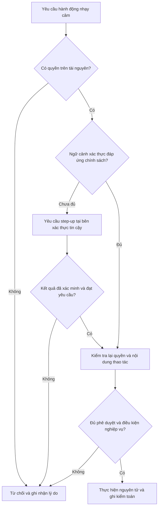

# Chọn assurance theo impact

## 1. Bắt đầu từ hậu quả của việc tin nhầm danh tính

Một cổng nhà cung cấp cho phép người dùng xem yêu cầu hỗ trợ, tải chứng từ, đổi tài khoản nhận tiền và cấu hình đăng nhập SSO cho tổ chức. Tất cả đều bắt đầu bằng thao tác đăng nhập, nhưng hậu quả của việc nhận nhầm người thực hiện rất khác nhau:

- Kẻ chiếm tài khoản chỉ xem được một yêu cầu hỗ trợ chứa thông tin công khai có thể gây thiệt hại nhỏ.
- Kẻ xem được hợp đồng và chứng từ của nhà cung cấp có thể làm lộ thông tin kinh doanh.
- Kẻ đổi tài khoản nhận tiền có thể chuyển hướng các khoản thanh toán tương lai.
- Kẻ sửa cấu hình SSO có thể tạo đường đăng nhập trái phép cho nhiều tài khoản cùng lúc.

**Chọn assurance theo impact** là xác định mức bảo đảm danh tính cần có dựa trên hậu quả nếu một chức năng danh tính thất bại. Impact ở đây là mức độ thiệt hại tiềm tàng; assurance là mức tin cậy có cơ sở vào các quy trình và bằng chứng liên quan đến danh tính. Assurance cao hơn đòi hỏi những kiểm soát mạnh hơn, nhưng không bảo đảm mọi giao dịch đều an toàn.

Trong IAM, quyết định này nối các công việc thường được thiết kế riêng: xác minh danh tính, cấp tài khoản, MFA, phiên đăng nhập, SSO, cấp quyền, khôi phục tài khoản và kiểm toán. Nếu chỉ làm mạnh màn hình đăng nhập mà bỏ qua các đường còn lại, yêu cầu bảo đảm có thể bị vượt qua bằng một luồng yếu hơn.

Sau bài học, người học có thể:

1. Mô tả hậu quả của việc xác minh, xác thực hoặc liên kết danh tính sai.
2. Tách impact khỏi xác suất tấn công và khỏi quyền mà một tài khoản đang có.
3. Chọn yêu cầu bảo đảm riêng cho từng nhóm người dùng và hành động.
4. Chuyển yêu cầu thành chính sách thực thi ở phía máy chủ, bao gồm step-up, phiên, recovery và đường ngoại lệ.
5. Ghi lại lý do lựa chọn, rủi ro còn lại và điều kiện phải đánh giá lại.

## 2. Phân biệt các khái niệm trước khi chọn mức bảo đảm

### 2.1. Impact không phải likelihood

**Impact** trả lời: nếu hệ thống tin sai danh tính hoặc chấp nhận một phiên trái phép, ai chịu thiệt hại và thiệt hại đến đâu?

**Likelihood** trả lời: trong bối cảnh hiện tại, sự cố đó có khả năng xảy ra như thế nào?

**Risk** xét cả hai yếu tố, cùng các điều kiện và độ bất định của việc đánh giá. Có thể dùng ý tưởng “khả năng xảy ra kết hợp với hậu quả” để trao đổi ban đầu, nhưng không nên coi phép nhân hai điểm số thứ bậc là một phép đo chính xác.

Ví dụ, thay đổi cấu hình IdP chỉ được thực hiện vài lần mỗi năm. Tần suất sử dụng thấp không làm hậu quả của một thay đổi độc hại trở nên thấp. Ngược lại, một hành động được sử dụng hàng triệu lần cũng không tự động có impact cao nếu không tiết lộ dữ liệu, không thay đổi quyền và không gây thiệt hại đáng kể.

Tín hiệu như IP mới hoặc thiết bị lạ giúp điều chỉnh quyết định theo bối cảnh. Chúng không xóa hậu quả vốn có của thao tác xuất toàn bộ dữ liệu khách hàng. Một yêu cầu xuất dữ liệu vẫn cần mức bảo đảm tối thiểu ngay cả khi đến từ vị trí quen thuộc.

### 2.2. Assurance không phải authorization

Hai câu hỏi phải được xử lý riêng:

- **Authorization:** chủ thể có quyền thực hiện hành động trên tài nguyên này không?
- **Assurance:** bằng chứng danh tính và xác thực hiện tại có đủ cho hành động đó không?

Nhân viên hỗ trợ có thể đăng nhập bằng phương thức rất mạnh nhưng vẫn không có quyền đổi tài khoản nhận tiền. Một nhân viên tài chính có quyền đổi tài khoản nhận tiền vẫn có thể bị yêu cầu xác thực lại vì phiên hiện tại quá cũ.

RBAC và ABAC biểu diễn quyền hoặc điều kiện truy cập. Yêu cầu assurance là một điều kiện bổ sung trong quyết định truy cập, không phải lý do để cấp thêm quyền. Nguyên tắc ít quyền nhất giúp giảm phạm vi thiệt hại nếu một tài khoản bị chiếm; assurance giúp tăng độ tin cậy khi hệ thống nhận diện chủ thể sử dụng quyền đó.

### 2.3. Không gom tất cả thành một nhãn “đã xác minh”

Một địa chỉ email đã được xác nhận chỉ chứng minh quyền kiểm soát hộp thư trong ngữ cảnh xác nhận đó. Nó không tự chứng minh tên pháp lý, tư cách đại diện doanh nghiệp hoặc quyền phê duyệt thanh toán.

Tương tự, MFA cho biết có một cơ chế xác thực nhiều yếu tố được sử dụng trong điều kiện cụ thể; thông tin đó chưa đủ để kết luận quy trình cấp tài khoản đúng người, phiên hiện tại còn phù hợp hoặc giao dịch đã được phê duyệt hợp lệ.

Khi một ứng dụng lưu trường `verified = true`, cần hỏi rõ trường này mang nghĩa gì, do ai thiết lập, bằng chứng nào hỗ trợ, còn hiệu lực đến khi nào và hành động nào được phép dựa vào nó.

## 3. Ba trục bảo đảm cần lựa chọn riêng

NIST SP 800-63-4 phân biệt IAL cho xác minh danh tính, AAL cho xác thực và FAL cho liên kết danh tính. Các trục có thể được chọn khác nhau; một dịch vụ cũng có thể không cần identity proofing. Khi áp dụng mức chuẩn, phải đối chiếu các yêu cầu đầy đủ của phiên bản tương ứng. [NIST: Digital Identity Risk Management](https://pages.nist.gov/800-63-4/sp800-63/dirm/).

| Trục | Câu hỏi khi thiết kế | Ví dụ bằng chứng hoặc kiểm soát cần xem xét |
| --- | --- | --- |
| Xác minh danh tính, liên quan đến IAL | Tài khoản đang được gắn với người hay danh tính ngoài đời nào? Việc gắn sai gây hại gì? | Nguồn xác minh thuộc tính, quy trình đối chiếu người đăng ký, hồ sơ cấp tài khoản |
| Xác thực, liên quan đến AAL | Người đang truy cập có kiểm soát authenticator đã gắn với tài khoản không? | Phương thức xác thực, cách gắn và thay authenticator, chống phishing, trạng thái phiên |
| Liên kết danh tính, liên quan đến FAL | Ứng dụng có thể tin kết quả và thuộc tính do IdP truyền sang đến mức nào? | Quan hệ tin cậy với IdP, kiểm tra assertion/token, chống dùng lại sai ngữ cảnh, bảo vệ cấu hình federation |

Một diễn đàn dùng bút danh có thể cần bảo vệ mạnh việc quay lại cùng tài khoản mà không cần biết tên pháp lý. Một cổng dành cho người đại diện nhà cung cấp có thể cần xác minh tư cách đại diện trước khi cấp quyền tài chính. Một ứng dụng đăng nhập trực tiếp, không dùng federation, không có cùng bài toán truyền kết quả danh tính từ IdP sang ứng dụng.

Không suy ra `IAL = AAL = FAL` chỉ từ một điểm impact. Cũng không suy ra “có SSO nên assurance cao”: SSO tập trung sự tin cậy vào IdP, cấu hình của nó và cách từng ứng dụng kiểm tra kết quả.

Trong các phần tiếp theo, những hồ sơ kiểm soát là **đề xuất thiết kế cho ví dụ**, không phải bảng quy đổi sang mức NIST và không phải tuyên bố đạt chuẩn.

## 4. Đánh giá impact theo một hành động và một đường thất bại cụ thể

### 4.1. Xác định phạm vi đủ nhỏ

Thay vì viết “cổng nhà cung cấp có impact cao”, hãy mô tả:

> Người đại diện tài chính thay tài khoản nhận tiền cho nhà cung cấp A; nếu kẻ giả mạo được hệ thống chấp nhận, các khoản thanh toán sau đó có thể đi vào tài khoản do kẻ đó kiểm soát.

Mô tả này xác định được chủ thể, hành động, tài nguyên và hậu quả. Sau đó mới mở rộng sang việc cùng một người có thể đại diện nhiều nhà cung cấp hoặc một thao tác có thể ảnh hưởng nhiều khoản thanh toán.

Đơn vị phân tích hữu ích là:

```text
Nhóm người dùng + hành động + tài nguyên + kiểu thất bại danh tính
→ hậu quả đối với từng bên bị ảnh hưởng
→ yêu cầu bảo đảm và các kiểm soát bổ sung
```

### 4.2. Xét nhiều kiểu thất bại

Một hành động có thể bị lạm dụng qua các đường khác nhau:

| Kiểu thất bại | Tình huống tại cổng nhà cung cấp | Câu hỏi cần giải quyết |
| --- | --- | --- |
| Cấp tài khoản sai người | Kẻ giả mạo được ghi nhận là đại diện nhà cung cấp | Nguồn nào xác nhận tư cách đại diện và ai có quyền phê duyệt? |
| Xác thực sai chủ thể | Kẻ tấn công chiếm mật khẩu hoặc authenticator | Bằng chứng kiểm soát tài khoản nào đủ cho thao tác này? |
| Phiên bị chiếm | Cookie phiên bị lấy sau một lần MFA hợp lệ | Phiên được bảo vệ, giới hạn và thu hồi như thế nào? |
| Federation bị lạm dụng | Ứng dụng chấp nhận token từ sai IdP hoặc sai đối tượng nhận | Ranh giới tin cậy và kiểm tra kết quả đăng nhập có đúng không? |
| Khôi phục sai người | Bộ phận hỗ trợ cấp lại quyền kiểm soát cho kẻ giả mạo | Luồng recovery có thể vô hiệu hóa các kiểm soát trước đó không? |
| Quyền không được thu hồi | Cựu nhân viên vẫn còn vai trò đại diện tài chính | Ai cập nhật quan hệ đại diện và khi nào quyền hết hiệu lực? |

Không phải mọi dòng đều được xử lý chỉ bằng tăng mức xác thực. Quyền tồn đọng cần quy trình vòng đời quyền; token sai đối tượng nhận cần sửa kiểm tra federation; cấp tài khoản sai người cần sửa quy trình xác minh và phê duyệt.

### 4.3. Mô tả thiệt hại trước khi chấm mức

Với mỗi đường thất bại, ghi lại các chiều sau:

| Chiều xem xét | Câu hỏi làm rõ hậu quả |
| --- | --- |
| Thông tin bị lộ | Dữ liệu nào bị đọc, tải xuống hoặc suy ra? Có thể ảnh hưởng người khác không? |
| Tính toàn vẹn | Nội dung, người nhận tiền, quyền truy cập hoặc cấu hình nào bị thay đổi? |
| Khả năng cung cấp dịch vụ | Có thể khóa người dùng, làm ngừng tích hợp hoặc cản trở hoạt động quan trọng không? |
| Thiệt hại tiền và công sức | Tiền mất, thời gian xử lý, điều tra và phục hồi có thể lớn đến đâu? |
| Con người và bên liên quan | Người dùng, đối tác hoặc người không dùng hệ thống có thể chịu hậu quả gì? |
| Phạm vi và khả năng đảo ngược | Một bản ghi hay cả tenant? Thiệt hại có thể thu hồi đầy đủ không? |

Đừng chỉ ghi “lộ dữ liệu”. Hãy ghi “có thể tải danh sách tài khoản ngân hàng của toàn bộ nhà cung cấp trong tenant”. Đừng chỉ ghi “mất uy tín”. Hãy nêu sự kiện cụ thể và nhóm bị ảnh hưởng.

Với dữ liệu cá nhân, việc thu hồi quyền sau sự cố không làm các bản sao đã bị tải xuống biến mất. Đây là lý do khả năng đảo ngược phải được xét riêng với thời gian sửa lỗi kỹ thuật.

## 5. Tạo thang impact nội bộ có thể giải thích

Một nhóm sản phẩm có thể bắt đầu bằng ba mức dưới đây. Đây là thang minh họa; tổ chức phải xác định tiêu chí và ngưỡng riêng dựa trên dịch vụ của mình.

| Mức minh họa | Đặc điểm hậu quả | Ví dụ trong phạm vi giả định |
| --- | --- | --- |
| Thấp | Phạm vi nhỏ, không liên quan dữ liệu nhạy cảm hoặc quyền quan trọng; khôi phục tương đối đơn giản | Đổi ngôn ngữ hiển thị của một tài khoản |
| Vừa | Ảnh hưởng đáng kể đến một người hoặc một nhóm; cần điều tra hoặc khôi phục có tổ chức | Xem chứng từ riêng của một nhà cung cấp |
| Cao | Có thể gây thiệt hại lớn, ảnh hưởng nhiều người, thay đổi đường nhận tiền hoặc làm mất kiểm soát hệ thống | Đổi tài khoản nhận tiền, sửa IdP, cấp quản trị tenant |

Không nên lấy trung bình cơ học để một hậu quả nghiêm trọng bị làm mờ bởi nhiều hậu quả nhỏ. Với ví dụ này, nhóm chọn quy tắc bảo thủ: một kịch bản thiệt hại cao, có cơ sở trong phạm vi đã mô tả, đủ để đưa hành động vào nhóm cần xem xét kiểm soát cao. Đây là quy tắc của ví dụ, không phải công thức áp dụng bắt buộc cho mọi tổ chức.

Cần phân biệt hai thời điểm đánh giá:

- **Trước khi xét các kiểm soát dự định triển khai:** nếu chức năng danh tính thất bại thì hậu quả có thể là gì?
- **Sau khi thiết kế kiểm soát:** còn đường nào gây hại, hậu quả có bị giới hạn thực sự và khả năng xảy ra có giảm không?

Không được lập luận vòng tròn: “đã có MFA nên impact thấp, vì impact thấp nên bỏ MFA”. MFA chủ yếu làm khó việc chiếm quyền xác thực; nó không tự làm khoản tiền có thể thất thoát nhỏ đi. Ngược lại, giới hạn quyền xuất dữ liệu từ toàn tenant xuống một nhà cung cấp thực sự có thể thu hẹp phạm vi hậu quả, nếu giới hạn đó được thực thi đúng và không có đường vượt qua.

Khi thông tin còn thiếu, ghi giả định và người chịu trách nhiệm xác nhận. Ví dụ: “Chưa biết dữ liệu chứng từ có chứa thông tin cá nhân hay không; chủ sản phẩm phải phân loại trước khi mở chức năng tải xuống.” Không tự gán mức thấp chỉ vì chưa có dữ liệu đánh giá.

## 6. Từ impact đến hồ sơ kiểm soát

Impact giúp xác định yêu cầu tối thiểu. Sau đó cần chọn biện pháp phù hợp với kiểu thất bại, khả năng sử dụng và mô hình triển khai. Bảng dưới là một thiết kế minh họa cho cổng nhà cung cấp.

| Hành động | Nhận định impact | Yêu cầu về danh tính và xác thực | Kiểm soát bổ sung |
| --- | --- | --- | --- |
| Đọc hướng dẫn công khai | Không có dữ liệu riêng hay thao tác thay đổi | Không cần tài khoản cho nội dung này | Tách nội dung công khai khỏi API có dữ liệu riêng |
| Lưu tùy chọn giao diện | Thấp theo giả định chỉ ảnh hưởng chính tài khoản | Bảo vệ quyền kiểm soát tài khoản; không thu giấy tờ chỉ để lưu tùy chọn | Có thể hoàn tác thay đổi; giới hạn truy cập đúng tài khoản |
| Xem chứng từ của nhà cung cấp | Vừa trong ví dụ | Tư cách thành viên còn hiệu lực; MFA cho truy cập dữ liệu riêng | Kiểm tra tenant và nhà cung cấp ở máy chủ; giới hạn tải hàng loạt |
| Đổi tài khoản nhận tiền | Cao | Tư cách đại diện tài chính được xác nhận; xác thực chống phishing gần thời điểm thao tác | Phê duyệt độc lập, kiểm tra thông tin người nhận, thời gian chờ theo chính sách và thông báo |
| Thay cấu hình SSO của tenant | Cao, có tác động dây chuyền | Tài khoản quản trị riêng; xác thực mạnh theo hồ sơ quản trị; kiểm tra điều kiện thiết bị nếu áp dụng | Quyền quản trị được cấp có thời hạn, xác nhận thay đổi, kế hoạch phục hồi cấu hình và kiểm toán |

Với các dòng nhạy cảm, cần chỉ rõ “MFA” là cơ chế nào. OTP nhập tay có thể bị chuyển tiếp qua trang giả. NIST SP 800-63B-4 phân biệt điều đó với xác thực chống phishing; WebAuthn là một ví dụ dùng ràng buộc với tên bên xác minh. Tên sản phẩm hoặc số lần nhập mã không đủ để tự kết luận một mức AAL. [NIST: Phishing Resistance](https://pages.nist.gov/800-63-4/sp800-63b.html#phishing-resistance).

Nếu chọn passkey hoặc khóa bảo mật cho hồ sơ quản trị, tài liệu thiết kế còn phải xác định yêu cầu user verification, việc đồng bộ khóa có được chấp nhận không, cách thêm authenticator và cách xử lý khi mất thiết bị. Không tự đồng nhất mọi passkey với cùng một mức bảo đảm.

Với tài khoản nhận tiền, xác thực mạnh cũng không chứng minh người nhận là đúng hoặc nội dung chuyển khoản là hợp lệ. Bằng chứng quyền kiểm soát tài khoản đăng nhập và bằng chứng chấp thuận một giao dịch cụ thể giải quyết hai câu hỏi khác nhau.

## 7. Step-up: tăng bảo đảm tại ranh giới hành động

### 7.1. Chọn thời điểm yêu cầu

Step-up là yêu cầu bổ sung hoặc làm mới bằng chứng xác thực khi ngữ cảnh hiện tại chưa đáp ứng hành động. Cổng nhà cung cấp có thể cho người dùng xem trang tổng quan bằng phiên thông thường, rồi yêu cầu xác thực chống phishing khi họ bắt đầu đổi tài khoản nhận tiền.

Không cần bắt người dùng thực hiện cùng một thủ tục ở mọi lần tải trang. Tuy nhiên, máy chủ phải bảo vệ từng API nhạy cảm; việc đã ẩn nút trên giao diện không tạo ra một ranh giới truy cập.



Quyền có thể bị thu hồi trong lúc người dùng thực hiện step-up. Nội dung thao tác cũng có thể thay đổi. Vì vậy, khi quay lại, máy chủ phải kiểm tra lại các điều kiện liên quan trước khi commit thay đổi.

### 7.2. Phân biệt ba loại thời gian

- **Thời gian phát hành token:** token được tạo lúc nào.
- **Thời gian xác thực người dùng:** người dùng thực sự xác thực lúc nào.
- **Thời gian cấp bằng chứng riêng cho thao tác:** một yêu cầu đổi thông tin cụ thể được xác nhận lúc nào.

Token vừa được làm mới không tự chứng minh người dùng vừa xác thực lại. Với thao tác nhạy cảm, cần một giới hạn độ mới của xác thực do chính sách xác định, cùng kiểm tra phiên còn hiệu lực.

Ví dụ, nhóm sản phẩm đặt cửa sổ xác thực gần đây là 5 phút cho thao tác đổi tài khoản nhận tiền. Đây là tham số minh họa của dịch vụ, không phải ngưỡng mặc định từ tiêu chuẩn. Nếu yêu cầu phải chứng minh người dùng đã xác thực sau khi bắt đầu đổi thông tin, kiểm tra thêm thời điểm xác thực so với thời điểm tạo yêu cầu, thay vì chỉ kiểm tra “chưa quá 5 phút”.

### 7.3. Ràng buộc kết quả với đúng thao tác

Một kết quả step-up cho thao tác đổi tài khoản nhận tiền không nên trở thành quyền bỏ qua xác thực cho mọi hành động quản trị khác.

Thiết kế ví dụ có thể tạo một bằng chứng phía máy chủ chứa hoặc tham chiếu tới:

- Chủ thể và tenant đã được xác định.
- Loại hành động và tài nguyên đích.
- Phiên bản hoặc dấu băm của bộ dữ liệu thay đổi, được chuẩn hóa ở máy chủ.
- Thời điểm hết hạn và trạng thái chỉ dùng một lần.
- Ngữ cảnh xác thực đã được kiểm tra theo hồ sơ áp dụng.

Khi số tài khoản đích đổi, bằng chứng cũ không còn dùng được. Khi hai yêu cầu cùng sử dụng một bằng chứng, chỉ một yêu cầu được phép hoàn tất; việc kiểm tra và tiêu thụ bằng chứng phải được xử lý nguyên tử cùng thay đổi nghiệp vụ phù hợp.

Đó là một kiểm soát ràng buộc thao tác ở tầng ứng dụng. Bản thân việc có ID Token hoặc thực hiện WebAuthn đăng nhập không tự tạo ra sự ràng buộc với toàn bộ nội dung chuyển tiền.

## 8. Truyền và kiểm tra assurance trong SSO/OIDC

Khi dùng OIDC, ứng dụng cần một hợp đồng tin cậy rõ ràng với IdP. Ba claim thường liên quan là `acr` để biểu thị lớp ngữ cảnh xác thực, `amr` để mô tả các phương thức và `auth_time` để chỉ thời điểm xác thực. Ý nghĩa các giá trị `acr` phải được các bên thống nhất; `acr_values` trong yêu cầu là đề nghị, nên ứng dụng vẫn phải kiểm tra kết quả trả về. [OpenID Connect Core: ID Token](https://openid.net/specs/openid-connect-core-1_0.html#IDToken), [Authentication Request](https://openid.net/specs/openid-connect-core-1_0.html#AuthRequest).

Một cách tổ chức dữ liệu nội bộ cho ví dụ là:

```text
Ngữ cảnh đã được máy chủ xác minh:
  subject                 = định danh ổn định theo issuer và subject
  tenant                  = tenant được kiểm tra từ quan hệ thành viên
  issuer                  = IdP nằm trong cấu hình tin cậy
  authentication_profile  = hồ sơ nội bộ đã ánh xạ từ kết quả IdP
  authenticated_at        = thời điểm xác thực đã kiểm tra
  session_state           = trạng thái phiên hiện hành
  recovery_state          = trạng thái khôi phục theo chính sách dịch vụ
```

Ứng dụng tạo ngữ cảnh này sau khi kiểm tra kết quả đăng nhập, không nhận nguyên trạng một đối tượng JSON do trình duyệt gửi lên. Kiểm tra token cần bao gồm chữ ký bằng khóa tin cậy, issuer, audience, hiệu lực thời gian và các ràng buộc của luồng như nonce khi áp dụng. Dùng thư viện giao thức phù hợp, cùng cấu hình và kiểm thử tích hợp, thay vì chỉ giải mã payload rồi tin các claim. [OpenID Connect Core: ID Token Validation](https://openid.net/specs/openid-connect-core-1_0.html#IDTokenValidation).

Ba sai lầm cần tránh:

1. Chấp nhận cùng chuỗi `acr` từ mọi IdP dù quy trình của họ khác nhau.
2. Thấy `amr` có một giá trị liên quan MFA rồi tự kết luận đáp ứng mọi yêu cầu chống phishing hoặc mức bảo đảm của dịch vụ.
3. Dùng `iat` thay cho thời điểm xác thực để quyết định yêu cầu có đủ mới không.

Không dùng ID Token như một access token chung cho API. Nếu một gateway chuyển ngữ cảnh xác thực vào header nội bộ, phải bảo vệ đường truyền, xác thực gateway và loại bỏ header cùng tên do client bên ngoài tự gửi. Nếu không, client có thể tự khai báo đã đạt assurance cao.

## 9. Viết chính sách có thể thực thi và kiểm tra được

Chính sách “giao dịch quan trọng phải xác thực mạnh” thiếu thông tin để lập trình hoặc vận hành. Cần xác định tên hành động, phạm vi quyền, hồ sơ được chấp nhận, độ mới, điều kiện recovery, phê duyệt và cách xử lý khi thiếu bằng chứng.

Ví dụ dưới đây là mã giả của tầng quyết định chính sách, không phải một thư viện xác thực có thể dùng trực tiếp:

```text
decideChangePayoutAccount(context, request, currentState):
    if not context.sessionIsActive:
        return DENY("inactive_session")

    if not authorizedNow(context.subject, request.tenant,
                         request.supplier, "payout-account:change"):
        return DENY("permission_missing")

    if not verifiedRepresentativeIsActive(context.subject,
                                          request.supplier):
        return DENY("representative_not_active")

    if recoveryRestrictionApplies(context.subject, currentState):
        return RESTRICT("recovery_review_required")

    if not trustedProfileAccepted(context.authentication,
                                 "payout-change-policy"):
        return STEP_UP("required_profile_missing")

    if not authenticationIsRecent(context.authentication,
                                  policy.maxAuthenticationAge):
        return STEP_UP("recent_authentication_required")

    if not independentApprovalMatches(request, currentState):
        return PENDING("independent_approval_required")

    if not validUnusedActionProofMatches(context, request):
        return STEP_UP("action_proof_required")

    return ELIGIBLE_FOR_ATOMIC_COMMIT
```

Kết quả cuối chỉ cho phép đi tiếp tới bước commit. Khi thực hiện thay đổi, dịch vụ phải xác nhận các trạng thái còn hiệu lực, kiểm tra phiên bản dữ liệu, tiêu thụ bằng chứng dùng một lần và ghi sự kiện. Cách giữ tính nhất quán tùy kiến trúc, nhưng không được để một quyết định cũ cho phép sửa tài nguyên đã đổi chủ hoặc đã bị thu hồi quyền.

Hồ sơ nội bộ như `payout-change-policy` phải có định nghĩa cụ thể và phiên bản. Không so sánh chuỗi theo kiểu `profile >= "strong"`; các nhãn tùy ý không có thứ tự bảo mật tự nhiên.

Nếu IdP không trả đủ bằng chứng, hệ thống cần từ chối hành động nhạy cảm hoặc chuyển sang luồng được thiết kế trước. Không tự coi thiếu claim là “đủ”, và không mở một đường mật khẩu đơn giản chỉ vì dịch vụ step-up đang gián đoạn.

## 10. Recovery, fallback và ngoại lệ là một phần của quyết định

### 10.1. Theo dõi mọi đường lấy lại quyền kiểm soát

Một tài khoản có khóa bảo mật vẫn có thể bị chiếm nếu nhân viên hỗ trợ cho phép gỡ khóa chỉ dựa trên tên và một email mới do người yêu cầu cung cấp. Một chính sách assurance phải bao quát cả thêm authenticator, thay số điện thoại, đổi email khôi phục, mời người đại diện mới và đổi IdP.

NIST SP 800-63B-4 tách account recovery khỏi xác thực thông thường và quy định yêu cầu theo tình trạng tài khoản, IAL/AAL áp dụng. Vì vậy, cần thiết kế recovery riêng; không thể suy ra tính an toàn của nó từ phương thức đăng nhập chính. [NIST: Account Recovery](https://pages.nist.gov/800-63-4/sp800-63b.html#account-recovery).

Với cổng nhà cung cấp, nhóm thiết kế có thể áp dụng một trạng thái hạn chế sau recovery:

| Hành động sau recovery | Xử lý minh họa |
| --- | --- |
| Xem trạng thái yêu cầu hỗ trợ của chính mình | Cho phép theo phạm vi quyền còn hiệu lực và chính sách dữ liệu |
| Đổi tài khoản nhận tiền | Tạm giữ cho đến khi hoàn tất kiểm tra bổ sung và xác thực lại theo hồ sơ yêu cầu |
| Thêm người phê duyệt tài chính | Yêu cầu xác nhận độc lập từ đầu mối đã được thiết lập |
| Sửa cấu hình IdP | Chuyển sang quy trình quản trị có thẩm quyền và kế hoạch phục hồi |

Đây là ví dụ về giới hạn quyền sau sự kiện rủi ro, không phải cách tự động khôi phục một mức AAL chuẩn. Chờ đủ thời gian cũng không tự chứng minh đúng danh tính; thời gian chờ chỉ có ích khi gắn với mục đích cụ thể như phát hiện và phản hồi một yêu cầu gian lận.

### 10.2. Chuẩn bị phương án thay thế đủ dùng

Assurance cao nhưng người dùng hợp lệ liên tục bị khóa có thể khiến tổ chức sinh ra đường xử lý thủ công thiếu kiểm soát. Khi chọn hồ sơ, cần xem xét thiết bị hỗ trợ, khả năng tiếp cận, người dùng thường xuyên đổi điện thoại và các tình huống làm việc ngoài văn phòng.

Các lựa chọn thiết kế gồm đăng ký authenticator dự phòng từ trước, cung cấp phương thức thay thế đáp ứng mục tiêu bảo vệ tương ứng hoặc hỗ trợ trực tiếp với quy trình được ghi nhận. Không tự thu thêm giấy tờ hay dữ liệu sinh trắc học nếu chúng không cần để giải quyết vấn đề danh tính của dịch vụ.

### 10.3. Quản lý ngoại lệ có phạm vi

Nếu cần truy cập khẩn cấp, hồ sơ ngoại lệ phải ghi rõ người được sử dụng, tài nguyên, thời hạn, người phê duyệt, giám sát và việc rà soát sau sử dụng. Quyền khẩn cấp nên đủ cho nhiệm vụ cần thiết và được thu hồi khi hết điều kiện.

Một tài khoản khẩn cấp dùng chung, không xác định được người thao tác và không có kiểm tra sau sử dụng, làm mất cơ sở kiểm toán. Tên gọi “break-glass” không tự làm một đường truy cập trở nên an toàn.

## 11. Áp dụng với quyền quản trị và danh tính workload

Quản trị viên IdP hoặc tenant có khả năng thay đổi cách nhiều người khác được xác thực. Do đó, impact của họ bao gồm cả những tài khoản và ứng dụng có thể bị ảnh hưởng gián tiếp. Hồ sơ quản trị cần xem xét tách tài khoản làm việc thường ngày, quyền được cấp có thời hạn, kiểm tra thay đổi cấu hình và thu hồi phiên khi có sự cố.

Đối với workload, câu hỏi tương tự là: nếu dịch vụ hoặc pipeline bị mạo danh, kẻ tấn công có thể làm gì? Một job chỉ đọc dữ liệu mẫu và một pipeline có thể triển khai lên production có phạm vi thiệt hại khác nhau.

Không áp dụng nguyên xi MFA tương tác của con người cho workload không có người trực tiếp đăng nhập. Các lựa chọn cần đánh giá gồm:

- Danh tính workload có nguồn cấp đáng tin cậy và gắn với môi trường thực thi.
- Credential hoặc token thời hạn ngắn, giới hạn đúng đối tượng nhận và mục đích.
- Quyền tối thiểu cho repository, môi trường và tác vụ cần thiết.
- Cách thu hồi, thay khóa, chặn môi trường bị xâm phạm và truy vết người thay cấu hình cấp danh tính.

Đây là việc vận dụng lập luận theo impact cho chủ thể máy. Không gắn nhãn IAL/AAL dành cho người dùng lên một service account chỉ vì nó sử dụng chứng thư hoặc JWT.

## 12. Hồ sơ quyết định: ví dụ đổi tài khoản nhận tiền

Một quyết định hữu ích phải cho người triển khai và người kiểm toán hiểu vì sao chính sách tồn tại. Mẫu sau minh họa một bản ghi hoàn chỉnh ở mức thiết kế:

| Mục | Nội dung minh họa |
| --- | --- |
| Phạm vi | Người đại diện tài chính đổi tài khoản nhận tiền cho một nhà cung cấp trong một tenant |
| Đường thất bại | Mạo danh đại diện; chiếm tài khoản hoặc phiên; recovery gian lận; lạm dụng kết quả SSO |
| Hậu quả | Thanh toán đi sai tài khoản; lộ dữ liệu ngân hàng; gián đoạn đối soát; ảnh hưởng quan hệ đối tác |
| Nhận định impact | Cao theo thang nội bộ vì thay đổi có thể ảnh hưởng nhiều khoản thanh toán tiếp theo |
| Điều kiện danh tính | Quan hệ đại diện tài chính được xác nhận từ nguồn nghiệp vụ có thẩm quyền và còn hiệu lực |
| Điều kiện xác thực | Hồ sơ chống phishing được dịch vụ chấp nhận; xác thực gần đây theo ngưỡng 5 phút minh họa; không có hạn chế recovery chưa giải quyết |
| Điều kiện federation | Chỉ nhận IdP đã cấu hình; kết quả được kiểm tra; mapping assurance được quản lý theo phiên bản |
| Điều kiện nghiệp vụ | Người phê duyệt độc lập; xác nhận dữ liệu đích; bằng chứng phê duyệt gắn với đúng phiên bản thay đổi |
| Thực thi | Kiểm tra phía máy chủ; kiểm tra lại trước commit; xử lý bằng chứng dùng một lần và phiên bản dữ liệu nhất quán |
| Theo dõi | Ghi chủ thể, tài nguyên, phiên bản chính sách, kết quả và mã lý do; thông báo theo quy trình đã thiết kế |
| Rủi ro còn lại | Người có thẩm quyền thông đồng; thiết bị hợp lệ bị xâm phạm; nguồn xác nhận đại diện sai |
| Chủ sở hữu | Chủ nghiệp vụ chịu trách nhiệm về hậu quả; nhóm IAM và ứng dụng chịu trách nhiệm về kiểm soát thuộc phạm vi triển khai |
| Điều kiện đánh giá lại | Thêm thanh toán tự động, tăng phạm vi nhà cung cấp, đổi IdP, thay recovery hoặc xuất hiện sự cố liên quan |

Hồ sơ không cần chứa mật khẩu, mã OTP, token đầy đủ hoặc bản sao giấy tờ. Các bằng chứng cần lưu phải có mục đích, quyền truy cập và thời hạn lưu phù hợp. Nhật ký tốt giúp giải thích quyết định mà không tạo thêm một kho bí mật dễ bị khai thác.

## 13. Đánh giá lại bằng cả dữ liệu an toàn và trải nghiệm

Chính sách có thể phù hợp khi hệ thống nhỏ nhưng thiếu kiểm soát sau khi thêm chức năng hoặc mở rộng quyền. Đánh giá lại khi một hành động bắt đầu ảnh hưởng nhiều tenant, khi có dữ liệu mới, khi IdP đổi cách xác thực hoặc khi một đường fallback mới được đưa vào vận hành.

Các chỉ báo có ích gồm:

- Số sự cố chiếm tài khoản liên quan từng hành động và mức thiệt hại thực tế.
- Số yêu cầu nhạy cảm bị chặn vì thiếu bằng chứng, tách theo nguyên nhân.
- Tỷ lệ hoàn tất step-up, thời gian hoàn tất và nhóm người dùng gặp trở ngại.
- Số lần recovery dẫn tới thay đổi quyền, tài khoản nhận tiền hoặc cấu hình tin cậy.
- Số ngoại lệ còn hiệu lực, thời gian tồn tại và người chịu trách nhiệm đóng ngoại lệ.
- Khoảng thời gian từ khi quan hệ đại diện chấm dứt đến khi quyền, phiên và credential liên quan được xử lý.

Tỷ lệ MFA thành công cao không đủ chứng minh chính sách phù hợp. Nó có thể cùng tồn tại với một luồng recovery yếu, một API bỏ qua assurance hoặc một vai trò có quyền quá rộng.

Khi số người bỏ dở step-up tăng, cần tìm nguyên nhân trước khi hạ yêu cầu: phương thức không hỗ trợ thiết bị, thông báo khó hiểu, chuyển hướng lỗi hay bằng chứng không được truyền đúng. Cải thiện luồng sử dụng và bổ sung phương án đáp ứng cùng mục tiêu thường là công việc cần làm trước khi chấp nhận tăng rủi ro.

## 14. Tự rà soát quyết định trước khi triển khai

Đây là các câu hỏi để hoàn thiện thiết kế của dịch vụ:

1. Đã chỉ rõ người dùng, hành động, tài nguyên và các bên chịu thiệt hại chưa?
2. Đã xét việc cấp tài khoản sai, xác thực sai, chiếm phiên, federation sai và recovery sai chưa?
3. Có đang dùng tần suất thấp hoặc chưa từng có sự cố để kết luận impact thấp không?
4. Có cần biết danh tính ngoài đời hay chỉ cần bảo vệ sự liên tục của cùng một tài khoản?
5. Quyền được kiểm tra riêng với assurance và được thu hồi khi quan hệ nghiệp vụ kết thúc chưa?
6. Hồ sơ xác thực, độ mới và mapping từ IdP đã có định nghĩa có thể kiểm chứng chưa?
7. API nhạy cảm có tự kiểm tra chính sách, kể cả khi client bỏ qua giao diện không?
8. Kết quả step-up và phê duyệt có gắn với đúng hành động, tài nguyên và dữ liệu thay đổi không?
9. Recovery, thêm authenticator và truy cập khẩn cấp có mở đường vượt qua mục tiêu bảo đảm không?
10. Có người chịu trách nhiệm chấp nhận rủi ro còn lại và xác định thời điểm đánh giá lại chưa?

Chọn assurance theo impact là một quyết định thiết kế có lý do và có thể truy vết. Điểm khởi đầu là hậu quả của việc hệ thống tin nhầm danh tính; kết quả cần đạt là một tập điều kiện được thực thi xuyên suốt vòng đời tài khoản và từng hành động có ý nghĩa nghiệp vụ.
