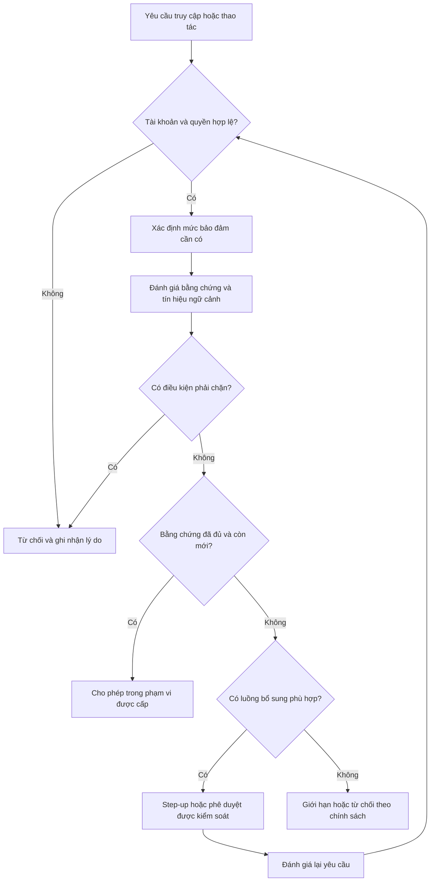

# Risk-based assurance: bảo đảm danh tính dựa trên rủi ro

## 1. Vì sao xác thực thành công chưa đủ?

Một nhân viên đăng nhập vào cổng quản trị bằng đúng thông tin tài khoản. Điều đó trả lời được một phần câu hỏi “bên đang truy cập đã chứng minh quyền sử dụng tài khoản như thế nào?”. Nó chưa trả lời đầy đủ các câu hỏi khác:

- Danh tính được gắn với tài khoản đó đã được kiểm chứng đến đâu?
- Bằng chứng xác thực hiện tại có đủ mạnh và đủ mới cho thao tác sắp thực hiện không?
- Thiết bị, phiên và ứng dụng nhận quyền có dấu hiệu bị chiếm dụng không?
- Nếu thao tác này bị thực hiện trái phép, hậu quả sẽ lớn đến mức nào?
- Tài khoản có thực sự được phép thực hiện thao tác đó không?

**Risk-based assurance** là cách xác định và yêu cầu mức bảo đảm phù hợp với rủi ro của từng lần truy cập hoặc hành động. Hệ thống kết hợp mức nhạy cảm của tài nguyên, tác động của hành động, bằng chứng danh tính và xác thực đang có, cùng tín hiệu ngữ cảnh để quyết định có cần bổ sung biện pháp kiểm soát hay không.

Ví dụ, cùng một tài khoản đã đăng nhập:

| Tình huống | Cách xử lý minh họa |
|---|---|
| Đọc tài liệu nội bộ thông thường từ thiết bị quen thuộc | Cho phép nếu quyền và bằng chứng hiện tại đáp ứng chính sách |
| Đổi tài khoản ngân hàng nhận lương | Yêu cầu xác thực bổ sung còn mới, thông báo thay đổi và biện pháp chống lạm dụng phù hợp |
| Xuất tập dữ liệu khách hàng lớn từ thiết bị chưa được quản lý | Chặn xuất hoặc chuyển sang luồng phê duyệt theo chính sách |
| Cấp đặc quyền quản trị trong phiên có dấu hiệu bị chiếm dụng | Từ chối, xử lý phiên và chuyển sự kiện cho bộ phận vận hành |

Các quyết định trên là ví dụ thiết kế, không phải bộ quy tắc bắt buộc cho mọi hệ thống. Một tổ chức phải xác định chính sách dựa trên loại tài nguyên, mối đe dọa và mức tác động thực tế của mình.

Trong IAM, cách tiếp cận này liên kết xác thực, MFA, quản lý phiên, RBAC/ABAC, SSO và quản lý đặc quyền. Nó không tạo quyền mới: người vượt qua xác thực bổ sung vẫn phải có quyền đối với tài nguyên và hành động được yêu cầu.

## 2. Phân biệt rủi ro, mức bảo đảm và quyền hạn

### 2.1. Rủi ro là mức tổn thất có thể xảy ra

Một cách tư duy hữu ích là:

> Rủi ro phụ thuộc vào khả năng xảy ra hành vi trái phép và mức tác động nếu hành vi đó thành công.

Đây là mô hình khái niệm. Trong thực tế, khả năng xảy ra thường được ước lượng bằng quy tắc, thống kê hoặc mô hình. Một điểm rủi ro 80/100 không tự động có nghĩa là xác suất bị chiếm tài khoản bằng 80%.

Hai yêu cầu từ cùng một phiên có thể có rủi ro khác nhau. Đọc một thông báo chung và thay đổi quyền của quản trị viên có tác động rất khác, dù cùng địa chỉ mạng và thiết bị.

### 2.2. Mức bảo đảm phản ánh sức mạnh của bằng chứng

Mức bảo đảm liên quan đến việc hệ thống có những bằng chứng gì và có thể dựa vào chúng đến đâu:

- **Kiểm chứng danh tính ban đầu:** tài khoản được gắn với một người hoặc tổ chức thông qua quy trình nào, với bằng chứng nào?
- **Xác thực:** bên truy cập chứng minh quyền kiểm soát yếu tố xác thực ra sao? Yếu tố đó có chống được các mối đe dọa liên quan không?
- **Liên kết danh tính:** ứng dụng nhận được kết quả xác thực từ nhà cung cấp danh tính bằng cơ chế nào, và đã kiểm tra kết quả đó ra sao?
- **Tính liên tục của phiên:** bằng chứng từ lần đăng nhập trước còn phù hợp cho yêu cầu hiện tại hay đã quá cũ hoặc bị suy yếu bởi sự kiện mới?

Khi gặp các thuật ngữ như IAL, AAL và FAL, cần hiểu chúng mô tả những khía cạnh khác nhau của bảo đảm danh tính. Không nên gộp chúng thành một điểm chung rồi suy ra rằng đăng nhập nhiều yếu tố có thể bù cho một quy trình gắn danh tính ban đầu yếu.

Một passkey hoặc khóa bảo mật có thể cung cấp bằng chứng xác thực mạnh cho một tài khoản. Riêng việc dùng nó không chứng minh người sở hữu tài khoản đã được kiểm chứng tên pháp lý hay quan hệ lao động đầy đủ.

### 2.3. Quyền hạn xác định hành động nào được phép

RBAC có thể quy định nhân viên thuộc vai trò nào. ABAC có thể xét thêm đơn vị, loại dữ liệu, thiết bị hoặc thuộc tính tài nguyên. Risk-based assurance bổ sung điều kiện về mức bảo đảm và ngữ cảnh khi thực thi quyền đó.

Có thể biểu diễn điều kiện cấp truy cập như sau:

```text
Cho phép khi đồng thời thỏa mãn:
  danh tính/tài khoản còn hợp lệ
  AND có quyền đối với hành động và tài nguyên
  AND đáp ứng mức bảo đảm tối thiểu của chính sách
  AND ngữ cảnh đáp ứng điều kiện truy cập
  AND không có điều kiện chặn bắt buộc
```

Ví dụ, kế toán viên có quyền đề nghị thanh toán nhưng không có quyền tự phê duyệt khoản do mình tạo. Hoàn thành MFA bổ sung không được phép xóa bỏ quy tắc phân tách nhiệm vụ này.

## 3. Xác định mức bảo đảm cần có từ tài nguyên và hành động

Thiết kế nên bắt đầu từ tài nguyên và hành động cần bảo vệ. Nếu chỉ bắt đầu từ “đăng nhập có đáng ngờ không?”, hệ thống dễ bỏ sót các thao tác nhạy cảm diễn ra trong một phiên vốn trông bình thường.

Với mỗi nhóm hành động, cần xác định:

1. Dữ liệu hoặc đặc quyền nào có thể bị lộ, sửa đổi hay cấp phát?
2. Hậu quả có thể đảo ngược không, và cần bao lâu để khắc phục?
3. Người hoặc workload nào được phép thực hiện?
4. Loại bằng chứng xác thực, độ mới và điều kiện thiết bị nào là tối thiểu?
5. Khi tín hiệu rủi ro tăng hoặc thiếu dữ liệu, hệ thống được phép giảm khả năng truy cập đến đâu?

Ví dụ về một ma trận chính sách nội bộ:

| Hành động | Điều kiện nền | Bảo đảm và kiểm soát bổ sung minh họa |
|---|---|---|
| Xem thông báo nội bộ | Tài khoản đang hoạt động, có quyền đọc | Phiên còn hiệu lực và không có điều kiện chặn |
| Xem dữ liệu nhân sự nhạy cảm | Đúng phạm vi dữ liệu được giao | Phương thức xác thực được chấp nhận; áp dụng điều kiện thiết bị nếu chính sách yêu cầu |
| Thay yếu tố xác thực | Người dùng hợp lệ trong luồng quản lý tài khoản | Kiểm chứng phù hợp bằng yếu tố hiện có hoặc luồng khôi phục được kiểm soát; thông báo thay đổi |
| Cấp vai trò quản trị | Được phép đề nghị hoặc phê duyệt cấp quyền | Xác thực mạnh còn mới, phê duyệt độc lập nếu cần, quyền có thời hạn |
| Xuất dữ liệu hàng loạt | Có quyền xuất đúng tập dữ liệu | Hạn mức, kiểm soát thiết bị, giám sát và phê duyệt theo mức tác động |

Các điều kiện nền là **sàn bắt buộc**. Điểm rủi ro thấp không được hạ thấp yêu cầu xác thực tối thiểu cho một chức năng đặc quyền.

Các yếu tố như độ mới của xác thực, giới hạn thời gian nâng quyền hoặc thời gian chờ thay đổi nên được cấu hình theo từng nhóm hành động. Không có một thời hạn duy nhất phù hợp cho mọi nghiệp vụ.

## 4. Tín hiệu rủi ro: dùng được nhưng phải hiểu giới hạn

### 4.1. Những nhóm tín hiệu thường gặp

| Nhóm tín hiệu | Ví dụ | Giới hạn cần nhớ |
|---|---|---|
| Tài khoản và vòng đời | Tài khoản bị khóa, vừa khôi phục, vừa nhận vai trò mới | Khóa hoặc thu hồi quyền có thể là điều kiện chặn trực tiếp; không chỉ là điểm cộng vào rủi ro |
| Bằng chứng xác thực | Phương thức đã dùng, thời điểm xác thực, kết quả step-up | “Có MFA” chưa mô tả đủ khả năng chống lừa đảo hoặc cách các yếu tố được kết hợp |
| Thiết bị | Trạng thái quản lý, chứng nhận thiết bị, tình trạng tuân thủ | Một cookie nhận diện thiết bị không tương đương bằng chứng thiết bị được quản lý |
| Mạng | Địa chỉ IP, mạng doanh nghiệp, vị trí suy ra, tín hiệu proxy | VPN, NAT, chuyển mạng di động và sai số định vị có thể làm tín hiệu kém chính xác |
| Hành vi | Tần suất tải dữ liệu, chuỗi thao tác bất thường, thay đổi thói quen | Thay đổi công việc hợp lệ có thể tạo bất thường; lịch sử cũng có thể chưa đủ |
| Tài nguyên và hành động | Mức nhạy cảm dữ liệu, cấp quyền, thao tác hàng loạt | Tác động nghiệp vụ phải được xác định bằng chính sách và ngữ cảnh tài nguyên |
| Phiên và sự kiện an ninh | Báo cáo mất thiết bị, nghi lộ token, thu hồi yếu tố xác thực | Cần biết sự kiện có ảnh hưởng tới tài khoản, phiên hay token cụ thể nào |

Một vị trí “không thể di chuyển kịp” giữa hai lần truy cập là dấu hiệu để xem xét. Nó không tự chứng minh tài khoản bị chiếm dụng, vì hai lần truy cập có thể đi qua các điểm thoát mạng khác nhau.

Tương tự, đăng nhập từ mạng nội bộ không chứng minh thiết bị an toàn. Thiết bị hợp lệ cũng không chứng minh mọi hành động từ phiên đều do đúng người chủ ý thực hiện.

### 4.2. Chất lượng tín hiệu là một phần của quyết định

Mỗi tín hiệu nên có thông tin nguồn và thời điểm quan sát, cùng trạng thái như `known`, `unknown` hoặc `stale`. Hệ thống phải phân biệt rõ:

- “Thiết bị không tuân thủ”.
- “Chưa có dữ liệu tuân thủ”.
- “Dữ liệu tuân thủ đã quá thời hạn chấp nhận”.

Ba trạng thái này có thể dẫn tới cách xử lý khác nhau. Việc dịch vụ kiểm tra thiết bị đang lỗi không được tự động biến thiết bị thành “an toàn”.

Không phải mọi nguồn đều đáng tin như nhau. Thuộc tính do client tự gửi chỉ có thể được dùng trong giới hạn tin cậy tương ứng; client không được tự khai `risk=low`, `managed=true` hoặc `mfa_passed=true` rồi quyết định quyền truy cập.

### 4.3. Tránh cộng điểm một cách máy móc

Các tín hiệu có thể tương quan. “IP mới”, “quốc gia mới” và “mạng mới” có thể cùng xuất phát từ một lần bật VPN. Cộng cả ba như các bằng chứng độc lập dễ tạo quá nhiều cảnh báo sai.

Ngược lại, tín hiệu tài khoản đã bị đình chỉ không nên bị trung hòa bằng nhiều tín hiệu thuận lợi. Những trạng thái mang tính bắt buộc cần được thực thi bằng điều kiện chính sách riêng, trước khi xét phần điều chỉnh theo rủi ro.

## 5. Từ tín hiệu đến hành động kiểm soát

Một quy trình quyết định hữu ích gồm năm bước:

1. **Xác định yêu cầu:** chủ thể, phiên, client, hành động, tài nguyên và phạm vi tổ chức.
2. **Kiểm tra điều kiện nền:** trạng thái tài khoản, quyền hiện hành, giới hạn nghiệp vụ và các lệnh chặn.
3. **Xác định bằng chứng cần có:** loại xác thực, độ mới, điều kiện thiết bị hoặc phê duyệt.
4. **Đánh giá ngữ cảnh:** tín hiệu rủi ro, chất lượng dữ liệu và tình huống bất thường.
5. **Thực thi quyết định:** cho phép, yêu cầu bổ sung, giới hạn, từ chối hoặc chuyển xử lý.



Các kết quả không chỉ có “cho qua” và “bắt MFA”:

| Kết quả | Khi nào hữu ích | Điều kiện thực thi |
|---|---|---|
| Cho phép | Quyền, bằng chứng và ngữ cảnh đều đáp ứng | Chỉ cho phép hành động và phạm vi đã được đánh giá |
| Step-up | Thiếu bằng chứng có thể bổ sung bằng một luồng phù hợp | Chỉ chấp nhận phương thức được chính sách cho phép |
| Giới hạn | Có thể cung cấp một tập chức năng ít nhạy cảm hơn | Giới hạn phải được thực thi tại máy chủ/API |
| Tạm giữ để phê duyệt | Nghiệp vụ cần người có thẩm quyền kiểm tra | Chưa thực hiện hành động trước khi phê duyệt hợp lệ |
| Từ chối hoặc thu hồi | Có điều kiện chặn hoặc dấu hiệu xâm phạm đủ nghiêm trọng | Áp dụng ở các điểm thực thi liên quan và ghi nhận sự kiện |

Phê duyệt nghiệp vụ và xác thực bổ sung giải quyết hai vấn đề khác nhau. Có người phê duyệt khoản chi không có nghĩa là bên khởi tạo đã đáp ứng yêu cầu xác thực; hoàn thành MFA cũng không thay thế người phê duyệt độc lập.

## 6. Step-up phải bổ sung đúng bằng chứng còn thiếu

**Step-up authentication** là yêu cầu thêm bằng chứng xác thực khi bằng chứng hiện có chưa đáp ứng thao tác hiện tại. Một thiết kế đúng cần trả lời được: đang thiếu điều gì, luồng bổ sung bù được điều gì, và kết quả có hiệu lực trong phạm vi nào?

### 6.1. Yêu cầu phương thức phù hợp với mối đe dọa

Yêu cầu nhập lại mật khẩu có thể làm mới một bằng chứng, nhưng không tự tạo ra xác thực nhiều yếu tố. Hai lần nhập cùng một loại bí mật cũng không mặc nhiên tạo hai yếu tố độc lập.

Khi mối đe dọa là lừa đảo lấy thông tin đăng nhập, chính sách nên xét khả năng chống lừa đảo của phương thức xác thực được triển khai. Một lời nhắc bổ sung mà người dùng có thể vô tình chấp nhận vẫn có giới hạn riêng.

Không nên cho phép người dùng chọn bất kỳ phương thức nào thuận tiện nếu một số phương thức không đạt yêu cầu cho thao tác. Nếu thiếu phương thức phù hợp, cần một luồng xử lý riêng có kiểm soát, thay vì tự hạ yêu cầu của thao tác.

### 6.2. Phân biệt xác thực gần đây với phiên mới được làm mới

Phiên vừa gia hạn hoặc token vừa được phát hành chưa chắc có nghĩa người dùng vừa xác thực lại. Chính sách cần dựa vào bằng chứng xác thực và thời điểm xác thực thực sự, theo ngữ nghĩa mà hệ thống danh tính cung cấp.

Ví dụ, quy tắc “cấp quyền quản trị cần xác thực phù hợp trong vòng 5 phút” phải được kiểm tra dựa trên lần xác thực đáp ứng quy tắc đó. Con số 5 phút ở đây chỉ là lựa chọn minh họa; phát hành lại token sau một giờ không được tự làm bằng chứng cũ trở thành mới.

### 6.3. Giới hạn kết quả và đánh giá lại sau step-up

Hoàn thành step-up không nên mở khóa mọi chức năng nhạy cảm vô thời hạn. Có thể giới hạn hiệu lực theo hành động, tài nguyên, phiên, thời gian hoặc lần sử dụng.

Sau step-up, máy chủ cần kiểm tra lại quyền và điều kiện hiện hành. Trong lúc người dùng xác thực bổ sung, vai trò có thể đã bị thu hồi hoặc tài nguyên có thể đã thay đổi.

Đối với giao dịch có tác động lớn, cần làm rõ người dùng đang xác nhận nội dung nào. Nếu số tiền, người nhận hoặc phạm vi cấp quyền thay đổi, kết quả xác nhận trước đó không nên tự áp dụng cho yêu cầu mới. Step-up xác thực và cơ chế ràng buộc xác nhận với nội dung giao dịch là hai phần cần được thiết kế phối hợp.

### 6.4. Đăng ký và khôi phục không được trở thành đường tắt

Thêm một yếu tố MFA mới, đổi email khôi phục hoặc đặt lại mật khẩu đều là hành động nhạy cảm. Kẻ đang kiểm soát một phiên yếu có thể cố dùng các hành động này để duy trì quyền truy cập.

Luồng đăng ký hoặc khôi phục cần có bằng chứng và kiểm soát phù hợp, ví dụ kiểm chứng bằng yếu tố hiện có, kiểm tra bổ sung, thông báo qua kênh đã biết hoặc thời gian hạn chế với thay đổi đặc biệt nhạy cảm. Không nên coi yếu tố vừa được thêm từ một luồng yếu là đủ để ngay lập tức vượt qua mọi yêu cầu bảo đảm cao.

## 7. Ví dụ xuyên suốt: cấp vai trò quản trị qua SSO

Giả sử công ty có cổng quản trị dùng SSO. Người dùng Lan đang có vai trò cho phép đề nghị cấp quyền, và muốn cấp vai trò quản trị cho một đồng nghiệp trong thời hạn hai giờ.

Chính sách minh họa yêu cầu:

- Người đề nghị và người phê duyệt phải khác nhau.
- Người đề nghị phải xác thực bằng phương thức được chấp nhận cho thao tác đặc quyền, trong thời hạn còn mới do chính sách quy định.
- Thiết bị phải có bằng chứng quản lý còn hiệu lực.
- Người nhận quyền phải là tài khoản đang hoạt động, thuộc đúng phạm vi quản trị.
- Việc cấp quyền phải có lý do, thời hạn và dấu vết kiểm toán.

Luồng xử lý:

1. API nhận đề nghị, xác định tài khoản Lan, đối tượng nhận quyền và vai trò cần cấp.
2. Máy chủ kiểm tra quyền đề nghị, phạm vi tổ chức và trạng thái của cả hai tài khoản.
3. Bộ quyết định thấy phiên SSO hiện tại chỉ có bằng chứng xác thực chưa đạt yêu cầu, nên trả về yêu cầu step-up.
4. Ứng dụng bắt đầu luồng xác thực bổ sung với IdP và giữ thông tin liên kết an toàn với đề nghị đang chờ.
5. Sau callback, ứng dụng kiểm tra phản hồi và bằng chứng xác thực được trả về, rồi đánh giá lại đề nghị ở máy chủ.
6. Đề nghị chỉ chuyển sang chờ phê duyệt khi mọi điều kiện cần thiết đã đáp ứng. Step-up không tự cấp vai trò.
7. Khi phê duyệt hợp lệ, dịch vụ cấp quyền kiểm tra lại điều kiện có liên quan và tạo quyền có thời hạn.
8. Khi hết hạn hoặc có lệnh thu hồi, hệ thống cập nhật quyền và thực thi hiệu lực theo cơ chế đã thiết kế.

Nếu Lan hoàn thành step-up nhưng dữ liệu thiết bị cho thấy thiết bị không đáp ứng điều kiện, đề nghị vẫn chưa được phép tiếp tục. Xác thực mạnh không tự khắc phục trạng thái thiết bị.

### Lưu ý khi truyền bằng chứng qua OAuth/OIDC

OAuth liên quan đến ủy quyền truy cập; OIDC bổ sung lớp xác thực danh tính trên cơ chế đó. Không nên suy ra người dùng đã đáp ứng một mức bảo đảm cụ thể chỉ vì ứng dụng có access token hoặc đã đăng nhập SSO.

Một số khái niệm có thể gặp trong tích hợp OIDC:

| Thành phần | Vai trò trong thiết kế | Lỗi cần tránh |
|---|---|---|
| `acr` | Biểu thị ngữ cảnh/lớp xác thực theo cách các bên đã thống nhất | Tự coi mọi chuỗi `acr` là một cấp có thứ tự giống nhau ở mọi IdP |
| `amr` | Mô tả phương thức xác thực theo ngữ nghĩa được cung cấp | Suy diễn một tổ hợp yếu tố hoặc khả năng chống lừa đảo mà IdP chưa cam kết |
| `auth_time` | Cho biết thời điểm xác thực theo ngữ nghĩa của giao thức và IdP | Dùng thời điểm phát hành token để thay thế thời điểm xác thực |
| `acr_values`, `max_age` | Có thể dùng để yêu cầu ngữ cảnh hoặc độ mới trong luồng xác thực được hỗ trợ | Cho rằng gửi yêu cầu đồng nghĩa kết quả chắc chắn đã đạt yêu cầu |
| Issuer, audience và các kiểm tra giao thức | Giúp xác nhận phản hồi đến từ đúng bên, dành cho đúng đối tượng và thuộc đúng luồng | Tin một claim tách rời khỏi việc xác minh token/phản hồi và ràng buộc phiên |

Ứng dụng phải kiểm tra kết quả thực tế theo hợp đồng tích hợp, bao gồm tính hợp lệ của phản hồi, các ràng buộc giao thức và ý nghĩa của claim. Các giá trị được gửi vào yêu cầu chỉ biểu đạt điều ứng dụng muốn nhận; chúng không thay thế việc kiểm tra điều đã nhận.

API phải xác minh token dành cho mình và thực thi quyền riêng của API. Không dùng ID token như một sự thay thế mặc định cho access token gọi API. Nếu API cần bằng chứng assurance, bằng chứng đó phải được chuyển đến qua cơ chế đáng tin đã thiết kế, chẳng hạn claim được thống nhất hoặc quyết định máy chủ có ràng buộc với yêu cầu.

## 8. Đánh giá lại trong vòng đời phiên

Đánh giá rủi ro một lần tại màn hình đăng nhập chỉ bảo vệ một thời điểm. Sau đó có thể xảy ra:

- Người dùng đổi thiết bị hoặc chuyển sang môi trường truy cập khác.
- Tài khoản bị đình chỉ hoặc rời tổ chức.
- Quyền đặc quyền được cấp thêm, hết hạn hoặc bị thu hồi.
- Yếu tố xác thực bị báo mất hay bị đặt lại.
- Hệ thống phát hiện dấu hiệu lạm dụng dữ liệu trong phiên đang hoạt động.

Vì vậy, nên đánh giá tại các điểm có ý nghĩa: đăng nhập, cấp hoặc làm mới token, bắt đầu thao tác nhạy cảm, nâng quyền, và khi nhận sự kiện an ninh liên quan. Không phải mọi yêu cầu đều cần gọi một dịch vụ rủi ro từ xa; có thể dùng dữ liệu đã xác minh và bộ nhớ đệm với thời hạn rõ ràng.

Cần thiết kế riêng hiệu lực của quyết định đối với từng loại thông tin xác thực:

- Thu hồi phiên tại IdP không tự bảo đảm mọi phiên ứng dụng đã chấm dứt ngay.
- Thu hồi refresh token không tự vô hiệu hóa mọi access token đã phát hành.
- Token tự chứa có thể còn được chấp nhận đến khi hết hạn nếu tài nguyên không có cơ chế cập nhật hoặc kiểm tra thu hồi phù hợp.

Có thể phối hợp thời hạn token, kiểm tra trạng thái, sự kiện thu hồi và việc đánh giá lại tại tài nguyên. Lựa chọn cần phù hợp với yêu cầu về độ trễ thu hồi và khả năng sẵn sàng. Hệ thống phải biết khoảng thời gian tối đa mà một quyền bị thu hồi vẫn có thể còn được sử dụng.

Quyết định rủi ro được lưu đệm cũng cần gắn với đúng tài khoản, phiên, client, hành động và phạm vi tài nguyên. Không tái sử dụng kết quả “được xem hồ sơ” để cho phép “xuất toàn bộ hồ sơ”.

## 9. Điểm thực thi và giả mã chính sách

Một kiến trúc thường có các trách nhiệm sau, dù có thể gộp chúng vào cùng dịch vụ:

- Nơi cung cấp tín hiệu: IdP, dịch vụ thiết bị, trạng thái tài khoản và sự kiện an ninh.
- Nơi ra quyết định: kết hợp quyền, mức bảo đảm cần có, tín hiệu và chính sách.
- Nơi thực thi: gateway, API hoặc dịch vụ sở hữu tài nguyên.
- Nơi ghi nhận: lưu sự kiện cần thiết để giải thích, điều tra và đo chất lượng quyết định.

Giao diện có thể hiển thị yêu cầu step-up, nhưng việc ẩn nút không phải kiểm soát truy cập. API phải từ chối nếu điều kiện chưa đáp ứng.

Giả mã dưới đây thể hiện thứ tự xử lý, không phải thuật toán chấm điểm hay mã triển khai hoàn chỉnh:

```text
evaluate(request, account, session, evidence, signals, policy):
    if account.is_disabled or session.is_revoked:
        return DENY("ACCOUNT_OR_SESSION_INVALID")

    if not authorized(account, request.action, request.resource):
        return DENY("PERMISSION_MISSING")

    required = policy.requirements_for(request.action, request.resource)

    if violates_mandatory_rule(request, account, signals, required):
        return DENY("MANDATORY_RULE_VIOLATED")

    context = assess_context(signals, request, policy)

    if context.requires_block:
        return DENY("CONTEXT_BLOCKED")

    if context.has_unusable_required_signals:
        return policy.decision_when_signals_unavailable(request)

    effective_required = policy.strengthen_requirements(required, context)

    if not evidence.satisfies(effective_required):
        if can_obtain_acceptable_evidence(account, effective_required):
            return STEP_UP(effective_required)
        return DENY("ASSURANCE_INSUFFICIENT")

    if effective_required.needs_approval:
        if not valid_approval_for_current_request(request):
            return HOLD("APPROVAL_REQUIRED")

    return ALLOW(scope=request.scope, obligations=effective_required.controls)
```

`strengthen_requirements` chỉ được điều chỉnh trong phạm vi chính sách cho phép và không được làm yếu sàn bắt buộc. `evidence.satisfies` phải dùng quy tắc rõ ràng về loại bằng chứng, nguồn tin cậy, độ mới và ràng buộc với chủ thể/phiên, thay vì so sánh hai chuỗi tùy ý.

Quyết định `ALLOW` có thể kèm nghĩa vụ như giới hạn tập dữ liệu, ghi nhật ký hoặc chỉ cho phép một lần. Điểm thực thi phải có khả năng thực hiện các nghĩa vụ đó; nếu không, không được coi quyết định là đã thực thi đầy đủ.

Khi yêu cầu phải qua step-up hoặc phê duyệt, cần đánh giá lại trước khi tạo tác động cuối cùng. Dịch vụ cũng cần tránh để cùng một kết quả xác nhận bị dùng lại cho nhiều yêu cầu khác nhau ngoài phạm vi được phép.

## 10. Danh tính workload và tài khoản đặc quyền

### 10.1. Workload không thể xử lý như người dùng tương tác

Một dịch vụ chạy nền không thể bấm xác nhận MFA như con người. Với workload, bằng chứng phù hợp có thể đến từ nền tảng chạy, chứng thư, danh tính workload, cơ chế liên kết hoặc thông tin xác thực có thời hạn ngắn.

Ví dụ, một job xuất báo cáo chạy đúng môi trường đã khai báo, dùng danh tính chỉ có quyền đọc một tập dữ liệu và nhận token đúng audience. Nếu cùng danh tính đó xuất hiện ở môi trường ngoài dự kiến hoặc xin quyền rộng hơn, hệ thống có thể từ chối cấp token, giới hạn quyền hoặc yêu cầu luồng phê duyệt triển khai.

Các điều kiện cần gắn với nguồn bằng chứng đáng tin. Một trường `environment=production` do workload tự khai không đủ để chứng minh workload đang chạy ở production.

Mục tiêu vẫn là ít quyền nhất: danh tính riêng theo workload khi phù hợp, phạm vi truy cập hẹp, thông tin xác thực được quản lý và vòng đời cấp/thu hồi rõ ràng. Không áp nguyên các mức bảo đảm của người dùng cho workload khi chưa có mô hình tương ứng.

### 10.2. Đặc quyền cần sàn bảo đảm cao và thời hạn rõ ràng

Với tài khoản hoặc hành động quản trị, có thể kết hợp xác thực mạnh, nâng quyền theo yêu cầu, phê duyệt, quyền có thời hạn và giám sát phù hợp. Rủi ro thấp không nên biến một tài khoản thường thành quản trị viên thường trực.

Tài khoản truy cập khẩn cấp cần một chính sách riêng: ai được sử dụng, dùng khi nào, giới hạn nào được áp dụng và ai xem xét sau đó. Việc kích hoạt phải được ghi nhận và cảnh báo theo thiết kế. Không dùng khái niệm “khẩn cấp” như một ngoại lệ chung để bỏ mọi điều kiện mà không có trách nhiệm giải trình.

## 11. Khi dịch vụ tín hiệu hoặc step-up gặp lỗi

Sự cố của dịch vụ rủi ro là tình huống vận hành phải được thiết kế trước. Cần phân biệt:

- Rủi ro được đánh giá là thấp.
- Không tính được rủi ro.
- Tín hiệu bắt buộc đã quá hạn.
- Phương thức step-up tạm thời không hoạt động.

Không nên ánh xạ cả bốn thành “cho phép”. Một chính sách suy giảm chức năng có thể giữ các tác vụ đọc ít nhạy cảm trong phạm vi đã định, đồng thời tạm dừng cấp quyền, xuất dữ liệu nhạy cảm hoặc thay đổi thông tin khôi phục khi thiếu bằng chứng bắt buộc.

Một số nguyên tắc vận hành:

- Đặt thời gian chờ và ngân sách độ trễ cho dịch vụ phụ thuộc.
- Chỉ dùng quyết định lưu đệm trong đúng phạm vi và thời hạn được phép.
- Không để một kết quả lưu đệm bỏ qua sự kiện thu hồi đã biết.
- Không âm thầm chuyển từ phương thức xác thực bắt buộc sang phương thức yếu hơn khi có lỗi.
- Cung cấp đường xử lý hỗ trợ hoặc khôi phục có kiểm soát cho người dùng hợp lệ.
- Có khả năng quay lại phiên bản chính sách đã biết, mà vẫn giữ các kiểm soát nền cần thiết.

Chọn từ chối khi thiếu điều kiện bắt buộc không có nghĩa phải khóa toàn bộ hệ thống vì một tín hiệu phụ gặp lỗi. Quyết định cần được xác định theo hành động và các điều kiện mà hành động đó thực sự yêu cầu.

## 12. Nhật ký, quyền riêng tư và khả năng giải thích

Một quyết định nên có đủ dấu vết để trả lời: yêu cầu gì, dùng chính sách nào, bằng chứng có đáp ứng không, và tại sao hệ thống cho phép hoặc chặn.

Ví dụ bản ghi đã tối giản:

```json
{
  "decision_id": "dec-example-014",
  "subject_ref": "user-ref-42",
  "action": "admin.role.grant.request",
  "resource_ref": "role-ref-7",
  "policy_version": "example-v3",
  "decision": "STEP_UP",
  "reason_codes": ["AUTHENTICATION_TOO_OLD"],
  "signal_state": {
    "device_management": "known",
    "network_context": "unknown"
  }
}
```

Đây là cấu trúc minh họa. Tham chiếu tài khoản, phiên hoặc tài nguyên vẫn có thể là dữ liệu nhạy cảm và cần kiểm soát truy cập. Không ghi mật khẩu, OTP, mã khôi phục, cookie phiên, access token hoặc refresh token vào nhật ký quyết định.

Thu thập tín hiệu hành vi và vị trí cần có mục đích cụ thể, giới hạn độ chi tiết, thời gian lưu và người được truy cập. Không thu thập mọi dữ liệu có thể lấy được chỉ vì một mô hình có thể dùng đến nó.

Thông báo cho người dùng nên đủ rõ để họ biết bước tiếp theo, chẳng hạn “Bạn cần xác thực lại để thay đổi quyền quản trị”. Chi tiết điều tra và quy tắc phát hiện nhạy cảm được cung cấp cho đúng vai trò vận hành. Khi có quyết định sai, cần có cơ chế xem xét mà không biến hỗ trợ khách hàng thành đường bỏ qua xác thực.

## 13. Đo hiệu quả và triển khai theo từng giai đoạn

Mục tiêu không phải tạo ra nhiều yêu cầu MFA nhất. Mục tiêu là giảm khả năng truy cập trái phép và tác động của nó, trong khi giữ luồng hợp lệ có thể sử dụng được.

Các chỉ số nên được xem cùng nhau:

| Chỉ số | Điều cần tìm hiểu |
|---|---|
| Tỷ lệ yêu cầu step-up và tỷ lệ hoàn thành | Có tạo ma sát quá mức hoặc có nhóm người dùng thường xuyên không hoàn tất không? |
| Tỷ lệ từ chối được xác nhận là sai | Quy tắc hoặc nguồn tín hiệu nào đang làm gián đoạn truy cập hợp lệ? |
| Sự cố được xác nhận đã vượt qua kiểm soát | Có thiếu tín hiệu, sai điều kiện, sai điểm thực thi hoặc khoảng trễ thu hồi không? |
| Độ trễ quyết định và tỷ lệ tín hiệu thiếu/quá hạn | Dịch vụ phụ thuộc có làm chính sách trở nên khó thực thi không? |
| Thời gian thu hồi có hiệu lực | Quyền hoặc phiên mất bao lâu để ngừng được chấp nhận tại các tài nguyên? |
| Số ngoại lệ và số lần xử lý hỗ trợ | Có tồn tại đường vòng thường xuyên hoặc nguyên nhân gốc chưa được giải quyết không? |

Tỷ lệ chặn cao không tự chứng minh kiểm soát tốt; tỷ lệ chặn thấp cũng không tự chứng minh an toàn. Cần liên hệ với sự kiện đã được xác minh và bối cảnh sử dụng. Khi chưa có nhãn sự cố đáng tin, phải nêu rõ giới hạn của việc đo phát hiện đúng hoặc bỏ sót.

Một lộ trình triển khai hợp lý:

1. Lập danh mục hành động nhạy cảm và định nghĩa sàn bảo đảm cho từng nhóm.
2. Kiểm tra nguồn bằng chứng, ý nghĩa claim và nơi thực thi chính sách.
3. Quan sát thử các quy tắc mới trên luồng được phép; vẫn thực thi các điều kiện bảo vệ đang có.
4. Áp dụng dần cho phạm vi nhỏ, theo dõi lỗi và tác động tới người dùng.
5. Mở rộng sau khi đã xác định đường khôi phục, suy giảm chức năng và quay lại chính sách.
6. Xem xét lại khi xuất hiện loại tài nguyên, phương thức xác thực hoặc mối đe dọa mới.

## 14. Những lỗi thiết kế dễ gặp

| Lỗi | Hậu quả | Cách sửa hướng thiết kế |
|---|---|---|
| Coi điểm rủi ro thấp là đủ để cấp mọi quyền | Vượt nguyên tắc ít quyền nhất và phân tách nhiệm vụ | Kiểm tra quyền và sàn bảo đảm độc lập với điểm rủi ro |
| Coi mọi MFA là tương đương | Bằng chứng không phù hợp với mối đe dọa của thao tác | Định nghĩa phương thức được chấp nhận và cách kiểm chứng kết quả |
| Chỉ xét rủi ro lúc đăng nhập | Bỏ sót thay đổi quyền, thu hồi và lạm dụng trong phiên | Đánh giá lại ở thao tác nhạy cảm và khi có sự kiện liên quan |
| Tin kết quả do trình duyệt tự khai | Client có thể ảnh hưởng điều kiện cấp truy cập | Xác minh bằng chứng tại máy chủ và nguồn tin cậy |
| Step-up thành công mở khóa toàn bộ phiên lâu dài | Phạm vi sử dụng rộng hơn mục đích xác thực bổ sung | Giới hạn thời gian, hành động và tài nguyên của kết quả |
| Thiếu dữ liệu được coi là an toàn | Sự cố dịch vụ hoặc tín hiệu quá hạn làm yếu kiểm soát | Xử lý trạng thái không biết/quá hạn bằng chính sách rõ ràng |
| Cho rằng đăng xuất SSO thu hồi ngay mọi truy cập | Phiên ứng dụng hoặc token vẫn được chấp nhận | Thiết kế và đo hiệu lực thu hồi tại từng tài nguyên |
| Bỏ qua luồng khôi phục và đăng ký yếu tố | Đường phụ làm suy yếu yêu cầu bảo đảm chính | Đưa vòng đời yếu tố vào cùng mô hình bảo đảm |

## 15. Tự kiểm tra bằng tình huống

**Tình huống 1: người dùng đang đi công tác.** Một nhân viên có quyền xem hồ sơ nhận cảnh báo vị trí mới nhưng dùng thiết bị được quản lý và phương thức xác thực đáp ứng yêu cầu. Có nên khóa tài khoản ngay không?

Không thể kết luận chỉ từ vị trí mới. Cần xét chất lượng định vị, hành động yêu cầu, bằng chứng còn hiệu lực và các tín hiệu khác. Nếu chính sách cho phép, có thể xác thực bổ sung hoặc giới hạn thao tác nhạy cảm. Một tín hiệu ngữ cảnh không nên bị coi là bằng chứng tuyệt đối về việc chiếm tài khoản.

**Tình huống 2: kế toán vượt qua MFA nhưng không có quyền phê duyệt.** Có được chấp nhận khoản thanh toán không?

Không. Bằng chứng xác thực đáp ứng chỉ giải quyết điều kiện về assurance. Quyền phê duyệt và quy tắc phân tách nhiệm vụ vẫn phải được kiểm tra.

**Tình huống 3: token vừa phát hành, lần xác thực đã cách đây nhiều giờ.** Có được coi là vừa xác thực lại cho thao tác quản trị không?

Không tự động. Cần kiểm tra bằng chứng về lần xác thực đáp ứng yêu cầu và thời điểm của nó. Thời điểm phát hành token không thay thế thời điểm xác thực.

**Tình huống 4: dịch vụ rủi ro không phản hồi khi người dùng yêu cầu xuất dữ liệu nhạy cảm.** Có thể cho qua vì phiên đang hoạt động không?

Chỉ được thực hiện nếu chính sách đã xác định rõ các bằng chứng hiện có vẫn đủ cho thao tác trong tình huống đó. Nếu đang thiếu điều kiện bắt buộc, phải tạm giữ, giới hạn hoặc từ chối theo thiết kế. Một phiên đang hoạt động không tự bù cho dữ liệu bắt buộc bị thiếu.

**Tình huống 5: workload chạy nền cần thêm quyền.** Có thể dùng cơ chế MFA của nhân viên vận hành để nâng quyền thường trực cho workload không?

Không nên gộp hai danh tính. Người vận hành có thể phê duyệt một thay đổi theo quy trình, còn workload vẫn phải được cấp quyền qua danh tính, bằng chứng môi trường và vòng đời thông tin xác thực riêng. Quyền bổ sung cần có phạm vi và thời hạn phù hợp.

Sau bài học, người học cần giải thích được một quyết định truy cập bằng bốn yếu tố cụ thể: hành động và tác động của nó, quyền hiện hành, bằng chứng bảo đảm đang có, cùng điều kiện ngữ cảnh. Từ đó có thể chọn kiểm soát phù hợp, xác định nơi thực thi và biết khi nào phải đánh giá lại.
