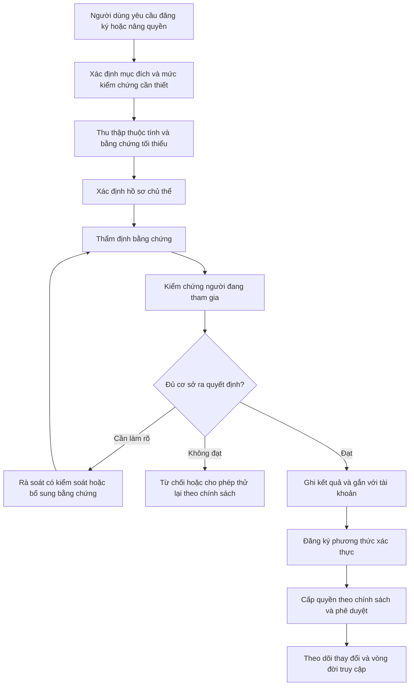

# Identity proofing là gì

## 1. Vấn đề: tài khoản đã tồn tại, nhưng người đứng sau là ai?

Một người mở trang đăng ký, nhập tên “Nguyễn Minh An”, xác minh địa chỉ email rồi đặt mật khẩu. Hệ thống có thể tạo tài khoản và cho người đó đăng nhập. Tuy nhiên, những bước này chưa đủ để kết luận người đăng ký thực sự là Nguyễn Minh An ngoài đời.

Xác minh email chủ yếu cho thấy người thực hiện có quyền truy cập hộp thư tại thời điểm xác minh. Đăng nhập bằng mật khẩu cho thấy người đăng nhập biết bí mật gắn với tài khoản. Bật MFA bổ sung bằng chứng về quyền kiểm soát các phương thức xác thực. Những điều đó không tự động chứng minh tên, tư cách nhân viên hoặc các thuộc tính đời thực mà tài khoản khai báo là đúng.

**Identity proofing là quá trình thu thập và đánh giá bằng chứng để thiết lập mức tin cậy rằng một người là đúng chủ thể mà họ tuyên bố.** Tùy dịch vụ, hệ thống cần kiểm chứng danh tính đời thực, một tập thuộc tính cụ thể, hoặc mối liên hệ giữa người đăng ký với một hồ sơ đã biết.

Ví dụ, doanh nghiệp muốn cấp tài khoản truy cập hệ thống nội bộ cho nhân viên mới. Việc người đăng ký biết mã nhân viên không đủ để cấp quyền. Doanh nghiệp cần đối chiếu với hồ sơ nhân sự có thẩm quyền và kiểm tra người đang nhận tài khoản có đúng là người trong hồ sơ hay không.

Trong nền tảng quản lý danh tính và quyền truy cập — IAM — identity proofing giúp xác định **tài khoản đang đại diện cho chủ thể nào và có thể tin các thuộc tính nào ở mức nào**. Nó là một đầu vào để cấp phát tài khoản, gán quyền và quản lý vòng đời truy cập; bản thân nó không quyết định toàn bộ quyền của chủ thể.

## 2. Những khái niệm cần phân biệt

### 2.1. Danh tính, thuộc tính và bằng chứng

Một danh tính số là cách hệ thống biểu diễn một chủ thể, thường gồm một định danh nội bộ ổn định và các thuộc tính liên quan.

- **Chủ thể:** người, tổ chức hoặc thực thể được hệ thống biểu diễn. Bài này tập trung vào người dùng; danh tính workload được đề cập ở phần giới hạn phạm vi.
- **Thuộc tính:** thông tin về chủ thể, chẳng hạn họ tên, ngày sinh, đơn vị công tác hoặc quan hệ nhân viên.
- **Tuyên bố:** thông tin người đăng ký hoặc một bên khác đưa ra, nhưng chưa chắc đã được kiểm chứng.
- **Bằng chứng danh tính:** dữ liệu hoặc tài liệu dùng để hỗ trợ việc đánh giá một tuyên bố.
- **Nguồn có thẩm quyền:** nguồn được giao trách nhiệm quản lý một loại thông tin trong phạm vi xác định, chẳng hạn hệ thống nhân sự đối với tình trạng làm việc.
- **Kết quả proofing:** kết luận và phạm vi tin cậy rút ra từ bằng chứng, phương pháp và thời điểm kiểm tra.

“Tên do người dùng nhập” và “tên đã được đối chiếu với một nguồn được chấp nhận” có thể cùng chứa một chuỗi ký tự, nhưng ý nghĩa tin cậy khác nhau. Hệ thống cần lưu nguồn gốc và trạng thái kiểm chứng của thuộc tính để tránh coi hai trường hợp này là tương đương.

Không có một nguồn nào mặc nhiên có thẩm quyền cho mọi thuộc tính. Hệ thống nhân sự có thể xác nhận một người đang làm việc tại doanh nghiệp, nhưng không vì thế mà xác nhận người đó đang là chủ sở hữu của một địa chỉ email cá nhân bất kỳ.

### 2.2. Identity proofing khác các bước IAM liên quan như thế nào?

| Khái niệm | Câu hỏi chính | Ví dụ | Không tự chứng minh điều gì? |
| --- | --- | --- | --- |
| Khai báo hoặc nhận diện ban đầu | Bạn muốn hệ thống biết đến mình bằng định danh nào? | Nhập tên, email hoặc mã nhân viên | Thông tin khai báo là đúng |
| Identity proofing | Có đủ cơ sở tin bạn là chủ thể được khai báo không? | Đối chiếu hồ sơ và kiểm tra người đang đăng ký | Mọi lần truy cập sau đều hợp lệ |
| Đăng ký phương thức xác thực | Tài khoản sẽ được gắn với phương thức xác thực nào? | Đăng ký khóa bảo mật hoặc ứng dụng xác thực | Phương thức đó đã được gắn cho đúng người nếu quy trình bàn giao sai |
| Xác thực — authentication | Bên đang truy cập có chứng minh được quyền kiểm soát phương thức xác thực gắn với tài khoản không? | Đăng nhập bằng passkey hoặc mật khẩu và MFA | Danh tính đời thực ban đầu đã được kiểm chứng chính xác |
| Phân quyền — authorization | Chủ thể đã được xác thực được phép làm gì? | Cho phép đọc dữ liệu của một dự án | Người dùng được phép truy cập mọi tài nguyên |
| Liên kết danh tính — federation | Bên cung cấp danh tính đang khẳng định điều gì về chủ thể? | Ứng dụng nhận thông tin đăng nhập qua SSO/OIDC | Các thuộc tính truyền sang đã trải qua proofing phù hợp |

Một tài khoản giả vẫn có thể đăng nhập thành công và sử dụng MFA rất tốt. Khi đó, xác thực đang hoạt động đúng đối với tài khoản, nhưng tài khoản có thể đã được gắn với một tuyên bố danh tính sai ngay từ đầu.

Ngược lại, một người đã được proofing kỹ vẫn có thể bị chiếm tài khoản nếu quy trình xác thực, quản lý phiên hoặc khôi phục tài khoản yếu. Proofing và xác thực giải quyết các rủi ro khác nhau, cần phối hợp với nhau.

## 3. Identity proofing cần kiểm chứng những gì?

Một cách tổ chức dễ hiểu là tách ba câu hỏi: hồ sơ đang nói đến ai, bằng chứng có đáng tin không, và người đang tham gia có đúng là chủ thể của bằng chứng không. Tên gọi và cách chia bước có thể khác giữa các hệ thống, nhưng ba câu hỏi này giúp tránh bỏ sót mắt xích quan trọng.

### 3.1. Xác định chủ thể cần phân biệt — identity resolution

Hệ thống thu thập đủ thuộc tính để phân biệt chủ thể với những người khác trong phạm vi dịch vụ và tìm hồ sơ liên quan nếu có.

Ví dụ, chỉ dùng họ tên sẽ khó phân biệt hai nhân viên cùng tên. Hệ thống có thể cần định danh nhân sự nội bộ và thông tin đối chiếu bổ sung. Việc xác định thuộc tính cần thu thập phải xuất phát từ mục đích sử dụng, không phải từ ý tưởng “càng nhiều dữ liệu càng an toàn”.

Các điểm cần lưu ý:

- Không dùng họ tên làm khóa tài khoản vì tên có thể trùng hoặc thay đổi.
- Một định danh chỉ có ý nghĩa trong phạm vi nguồn cấp phát nó; cùng chuỗi ký tự ở hai hệ thống có thể chỉ hai người khác nhau.
- Không tự động gộp hai hồ sơ chỉ vì chúng có cùng email hoặc tên hiển thị.
- Phân biệt một người có nhiều tài khoản hợp lệ với nhiều người bị gộp nhầm vào một tài khoản.

Kết quả mong muốn là xác định được hồ sơ cần kiểm chứng và những điểm còn chưa rõ, chưa phải kết luận rằng người đăng ký là chủ thể của hồ sơ đó.

### 3.2. Thẩm định bằng chứng — evidence validation

Bước này đánh giá bằng chứng có phù hợp, có dấu hiệu bị sửa đổi hay giả mạo, và có nhất quán với nguồn đối chiếu được chấp nhận hay không.

Ví dụ, với hồ sơ nhân sự, hệ thống có thể kiểm tra hồ sơ có tồn tại trong hệ thống nhân sự, có thuộc tổ chức đang cấp tài khoản, và có trạng thái cho phép bắt đầu quy trình tiếp nhận hay không. Với tài liệu nhận dạng, quy trình có thể cần kiểm tra các đặc tính xác thực và đối chiếu với nguồn phù hợp trong điều kiện được phép truy cập.

Các câu hỏi điển hình gồm:

- Loại bằng chứng này có đáp ứng mục đích của dịch vụ không?
- Nguồn phát hành hoặc nguồn đối chiếu có được tin cậy cho thuộc tính đang xét không?
- Có dấu hiệu làm giả, sửa đổi hoặc tái sử dụng bằng chứng ngoài ngữ cảnh không?
- Bằng chứng có còn phù hợp tại thời điểm đánh giá không?
- Các thuộc tính có nhất quán hay có mâu thuẫn cần làm rõ?

Đọc được chữ trên một ảnh bằng OCR chỉ là trích xuất dữ liệu. Nó chưa chứng minh tài liệu là thật. Tương tự, việc tên trong biểu mẫu giống tên trên ảnh không chứng minh rằng người gửi ảnh là chủ thể của tài liệu.

### 3.3. Kiểm chứng người đang tham gia — identity verification

Bước này tìm cơ sở để gắn người đang thực hiện quy trình với chủ thể của bằng chứng đã được thẩm định.

Tùy bối cảnh, cách thực hiện có thể gồm kiểm tra trực tiếp, kiểm tra từ xa có người hỗ trợ, hoặc cơ chế kiểm chứng thông qua một quan hệ và kênh đã được thiết lập đáng tin cậy. Khi dùng ảnh chân dung hay sinh trắc học, phải xem xét cả chất lượng so khớp, khả năng giả mạo và cách xử lý người dùng không thể hoàn thành phương thức đó.

Không nên xem một ảnh selfie đơn lẻ là bằng chứng chắc chắn về sự hiện diện của người thật. Một cơ chế phát hiện sự hiện diện cũng không đảm bảo tuyệt đối trước mọi hình thức tấn công; hiệu quả phụ thuộc vào cách triển khai và bối cảnh.

Trong bài này, “identity proofing” chỉ toàn bộ quy trình. “Identity verification” được dùng cho bước gắn người tham gia với bằng chứng. Một số sản phẩm dùng “verification” để gọi cả quy trình, vì vậy khi tích hợp cần kiểm tra chính xác sản phẩm đã làm những bước nào.

### 3.4. Ghi nhận kết quả và gắn với tài khoản

Sau khi có quyết định, hệ thống cần gắn kết quả proofing với đúng định danh nội bộ của tài khoản. Đây là mắt xích dễ bị bỏ quên: bằng chứng đúng và người đúng vẫn chưa đủ nếu kết quả bị ghi nhầm sang tài khoản khác.

Việc bàn giao sang bước cấp phát tài khoản và đăng ký phương thức xác thực cần giữ được tính liên tục của giao dịch. Một kết quả “đã kiểm chứng” chỉ có giá trị khi biết nó thuộc yêu cầu nào, chủ thể nào, mục đích nào và đã được sử dụng hay chưa.

## 4. Luồng xử lý điển hình trong một hệ thống IAM



Luồng thực tế có thể thay đổi thứ tự một số bước hoặc tạo sẵn tài khoản ở trạng thái hạn chế để người dùng hoàn tất quy trình. Dù dùng cách nào, cần nêu rõ trạng thái nào được phép truy cập tài nguyên nào và tại thời điểm nào quyền được kích hoạt.

Một mô hình trạng thái đơn giản:

| Trạng thái | Ý nghĩa | Cách xử lý truy cập gợi ý |
| --- | --- | --- |
| Chưa bắt đầu | Chưa có kết quả kiểm chứng | Chỉ sử dụng chức năng công khai hoặc đăng ký |
| Đang xử lý | Đã có yêu cầu nhưng chưa ra quyết định | Cho phép hoàn tất quy trình, chưa kích hoạt quyền cần proofing |
| Cần rà soát | Có điểm chưa rõ hoặc cần hỗ trợ | Chuyển đến người có trách nhiệm, giới hạn thời gian chờ |
| Đạt | Đáp ứng yêu cầu của một chính sách và phạm vi cụ thể | Chuyển sang cấp phát hoặc xét quyền tương ứng |
| Không đạt | Không đủ cơ sở chấp nhận theo chính sách | Không cấp quyền phụ thuộc vào kết quả này; cung cấp hướng xử lý phù hợp |
| Cần kiểm chứng lại | Có thay đổi hoặc sự kiện khiến kết quả cũ chưa đủ | Áp dụng giới hạn theo rủi ro và thực hiện đánh giá lại |

“Đạt” không nên chỉ là một cờ `verified=true` mà không có ngữ cảnh. Một kết quả chỉ xác nhận tư cách nhân viên không đồng nghĩa xác nhận mọi thuộc tính cá nhân; kết quả của một chính sách ít nghiêm ngặt cũng chưa chắc đáp ứng yêu cầu cho một tác vụ nhạy cảm hơn.

## 5. Ví dụ xuyên suốt: tiếp nhận nhân viên vào cổng nội bộ

Giả sử doanh nghiệp có cổng nội bộ cho nhân viên xem tài liệu dự án. Nhân viên mới tên An có hồ sơ trong hệ thống nhân sự. Doanh nghiệp cần gắn tài khoản đăng nhập với đúng An trước khi cấp quyền.

### Bước 1: xác định yêu cầu thực sự

Mục tiêu là kiểm chứng người nhận tài khoản có đúng là người trong hồ sơ nhân sự được phép tiếp nhận hay không. Doanh nghiệp không mặc nhiên cần thu thập bản sao mọi loại giấy tờ chỉ để truy cập tài liệu nội bộ.

Nếu có một quy trình tiếp nhận nhân sự đã kiểm chứng danh tính, đội IAM có thể sử dụng kết quả từ quy trình đó khi hiểu được nguồn, phạm vi, phương pháp và cách bàn giao. Việc dùng lại kết quả cần bảo đảm tài khoản mới được gắn đúng với người đã được kiểm chứng.

### Bước 2: xác định hồ sơ và thẩm định thông tin

Hệ thống tìm hồ sơ nhân sự theo định danh nội bộ ổn định, xác nhận trạng thái tiếp nhận và đối chiếu các thông tin cần thiết. Một địa chỉ email do người đăng ký tự nhập chưa thể được coi là kênh đáng tin cậy chỉ vì người đó nói nó thuộc về mình.

Nếu gửi lời mời nhận tài khoản, lời mời phải gắn với đúng hồ sơ, có thời hạn và có cơ chế chống sử dụng lại. Tuy nhiên, mã mời bị chuyển tiếp hoặc đánh cắp vẫn có thể bị lạm dụng; quyền kiểm soát lời mời cần được kết hợp với phương thức kiểm chứng phù hợp.

### Bước 3: kiểm chứng người nhận và bàn giao tài khoản

Tổ chức thực hiện kiểm chứng người nhận qua quy trình đã xác định, chẳng hạn một bước kiểm tra trực tiếp trong ngày tiếp nhận. Kết quả được gắn với hồ sơ An và yêu cầu đăng ký đang xử lý, sau đó An đăng ký phương thức xác thực cho tài khoản của mình.

Nếu không gắn giao dịch một cách an toàn, có thể xảy ra tình huống An hoàn tất kiểm chứng nhưng trình duyệt của kẻ tấn công lại nhận quyền kích hoạt tài khoản. Vì vậy, thiết kế cần kiểm soát cả việc bằng chứng có đúng hay không lẫn kết quả được chuyển cho ai.

### Bước 4: cấp quyền và quản lý vòng đời

Tài khoản của An chỉ nhận các quyền cần thiết theo nhóm dự án hoặc các thuộc tính đã được xác nhận. Quyền truy cập hệ thống quản trị vẫn cần điều kiện và phê duyệt riêng.

Khi An chuyển bộ phận hoặc nghỉ việc, hệ thống cập nhật hoặc thu hồi quyền theo nguồn nhân sự và chính sách IAM. Kết quả proofing ban đầu không phải lý do để giữ quyền vô thời hạn.

Ví dụ này cho thấy ba kết luận độc lập:

1. **Danh tính:** tài khoản này đã được gắn với đúng An theo quy trình đã chọn.
2. **Xác thực:** người đang đăng nhập chứng minh được quyền kiểm soát phương thức xác thực của tài khoản.
3. **Phân quyền:** tại thời điểm truy cập, tài khoản được phép thực hiện hành động cụ thể trên tài nguyên cụ thể.

## 6. Chọn mức kiểm chứng theo mục đích và rủi ro

Không phải dịch vụ nào cũng cần biết danh tính đời thực của người dùng. Một diễn đàn cho phép dùng biệt danh có thể chỉ cần chống lạm dụng và bảo vệ tài khoản. Một hệ thống cấp quyền quản trị hạ tầng có thể cần cơ sở tin cậy cao hơn về người nhận quyền, quan hệ của họ với tổ chức và người phê duyệt.

Khi xác định yêu cầu proofing, hãy đánh giá:

- **Hậu quả của việc nhận nhầm:** kẻ giả mạo có thể đọc dữ liệu nào, thay đổi gì hoặc gây tác động nào?
- **Thuộc tính cần biết:** cần danh tính đời thực, tư cách nhân viên, hay chỉ cần một thuộc tính cụ thể?
- **Chất lượng nguồn:** nguồn đối chiếu được quản lý và cập nhật ra sao?
- **Kênh thực hiện:** kiểm tra trực tiếp và từ xa có những rủi ro, chi phí và giới hạn nào?
- **Khả năng tiếp cận:** người dùng thiếu thiết bị, có khuyết tật hoặc có dữ liệu không khớp sẽ hoàn tất bằng cách nào?
- **Rủi ro dữ liệu:** việc thu thập và lưu bằng chứng tạo thêm hậu quả gì nếu dữ liệu bị lộ?

| Bối cảnh minh họa | Điều cần tin cậy | Hướng thiết kế |
| --- | --- | --- |
| Tài khoản theo dõi bài học công khai | Khả năng duy trì tài khoản và liên hệ với người dùng | Có thể không cần proofing danh tính đời thực |
| Cổng nội bộ cho nhân viên | Quan hệ giữa người nhận tài khoản và hồ sơ nhân sự hợp lệ | Dựa trên nguồn nhân sự và quy trình tiếp nhận có kiểm chứng |
| Quyền quản trị hệ thống | Người nhận quyền, quan hệ tổ chức và sự phê duyệt | Kết hợp proofing phù hợp, MFA, giới hạn đặc quyền và kiểm toán |
| Dịch vụ yêu cầu một thuộc tính cụ thể | Thuộc tính cần thiết cho mục đích sử dụng | Kiểm chứng thuộc tính đó, hạn chế truyền thêm dữ liệu cá nhân |

Các ví dụ trên là cách tư duy thiết kế, không phải mức yêu cầu bắt buộc cho mọi tổ chức. Nếu hệ thống sử dụng các mức bảo đảm được định nghĩa bởi một tiêu chuẩn, cần nêu rõ tiêu chuẩn, phiên bản và tiêu chí đáp ứng. Không tự gán một nhãn bảo đảm chỉ từ việc đã thu ảnh giấy tờ hoặc đã bật MFA.

## 7. Các rủi ro thường gặp và cách đối phó

### 7.1. Dùng dữ liệu của người khác

Kẻ tấn công có thể biết tên, ngày sinh, địa chỉ hoặc có ảnh tài liệu của nạn nhân. Nếu quy trình chỉ kiểm tra các dữ liệu đó có khớp hay không, nó có thể chấp nhận người đang cầm dữ liệu thay vì đúng chủ thể.

Cần tách kiểm tra độ tin cậy của bằng chứng khỏi kiểm tra người đang xuất trình bằng chứng. Những câu hỏi dựa trên thông tin dễ tìm hoặc đã bị lộ không nên được xem là bằng chứng mạnh chỉ vì có nhiều câu hỏi.

### 7.2. Tài liệu giả hoặc bị chỉnh sửa

Một tài liệu có bố cục đúng và được OCR đọc thành công vẫn có thể là giả. Quy trình cần có khả năng kiểm tra đặc tính phù hợp của bằng chứng và đối chiếu nguồn khi có cơ sở, quyền truy cập và phương tiện thực hiện.

Đồng thời, cần phân biệt “chưa kiểm tra được” với “đã xác nhận là giả”. Kết luận chính xác giúp chọn đường xử lý và tránh làm sai lệch dữ liệu kiểm toán.

### 7.3. Ảnh, video hoặc luồng nhập bị giả mạo

Trong quy trình từ xa, nội dung có thể được phát lại, tạo tổng hợp hoặc đưa vào qua một kênh giả. Nếu sử dụng so khớp khuôn mặt hoặc kiểm tra sự hiện diện, cần đánh giá cả đường thu nhận dữ liệu và khả năng chống giả mạo, không chỉ độ giống giữa hai ảnh.

Luôn cần phương án rà soát hoặc hỗ trợ thích hợp khi người dùng hợp lệ không thể hoàn tất tự động. Việc bị hệ thống từ chối chưa đủ để kết luận người dùng gian lận.

### 7.4. Gắn nhầm tài khoản hoặc dùng lại kết quả

Một phản hồi thành công từ dịch vụ proofing có thể bị phát lại hoặc gắn sang yêu cầu khác nếu hệ thống chỉ nhận một giá trị `success` rồi cập nhật tài khoản theo tham số từ trình duyệt.

Các biện pháp thiết kế thường gồm:

- Tạo và quản lý định danh giao dịch phía máy chủ.
- Gắn giao dịch với tài khoản, mục đích và phiên đăng ký phù hợp.
- Kiểm tra tính xác thực và tính toàn vẹn của phản hồi từ nhà cung cấp.
- Kiểm tra thời hạn, trạng thái giao dịch và việc kết quả đã được sử dụng hay chưa.
- Đối chiếu phía máy chủ; không để trình duyệt tự quyết định tài khoản nào được đánh dấu đạt.

### 7.5. Lạm dụng đường hỗ trợ và ngoại lệ

Kẻ tấn công có thể bỏ qua luồng tự động để thuyết phục nhân viên hỗ trợ cấp tài khoản hoặc đổi trạng thái. Một lời xác nhận không được ghi nhận, hay một thao tác quản trị tùy ý, có thể làm mất giá trị của toàn bộ quy trình trước đó.

Đường xử lý thủ công cần có phạm vi quyền rõ ràng, bằng chứng phù hợp, lý do quyết định và dấu vết kiểm toán. Với trường hợp nhạy cảm, tổ chức có thể yêu cầu kiểm tra hoặc phê duyệt độc lập.

### 7.6. Bỏ qua proofing qua chức năng khôi phục

Nếu tài khoản ban đầu được cấp cẩn thận nhưng sau đó có thể khôi phục bằng thông tin dễ đoán, kẻ tấn công vẫn có thể chiếm quyền kiểm soát. Quy trình khôi phục, thay đổi phương thức xác thực và bàn giao đặc quyền phải phù hợp với mức rủi ro của tài khoản.

Không phải mọi lần khôi phục đều cần thu lại toàn bộ bằng chứng danh tính. Điều quan trọng là xác định điều kiện sử dụng bằng chứng còn tin cậy, khi nào cần kiểm chứng lại và cách duy trì liên kết với đúng chủ thể.

## 8. Kết quả proofing cần được biểu diễn như thế nào?

Ứng dụng cần biết kết quả đủ để thực thi chính sách mà không phải nhận toàn bộ tài liệu nguồn. Ví dụ dữ liệu nội bộ dưới đây chỉ minh họa tư duy thiết kế, không phải định dạng chuẩn hay hướng dẫn triển khai đầy đủ:

```json
{
  "subjectId": "usr_demo_0042",
  "transactionId": "prf_demo_0815",
  "decision": "passed",
  "policyId": "employee-onboarding-v1",
  "verifiedAttributes": [
    "employee_record_link"
  ],
  "evidenceReference": "restricted_evidence_demo_009",
  "evaluatedAt": "2026-05-20T08:30:00Z",
  "reviewReasonCode": null
}
```

Ý nghĩa quan trọng của mô hình này:

- `subjectId` gắn kết quả với một định danh nội bộ ổn định.
- `transactionId` cho phép đối soát một lần xử lý cụ thể, nhưng bản thân nó không thay thế kiểm tra chống phát lại.
- `decision` phản ánh kết luận theo `policyId`, không phải một bảo đảm tuyệt đối về mọi thông tin của người dùng.
- `verifiedAttributes` nêu rõ điều đã được kiểm chứng; ví dụ này chỉ nói đến liên kết với hồ sơ nhân viên.
- `evidenceReference` trỏ tới nơi quản lý bằng chứng có kiểm soát truy cập; ứng dụng nghiệp vụ không nhất thiết được đọc bằng chứng đó.
- `evaluatedAt` ghi thời điểm đánh giá, không khẳng định mọi thuộc tính vẫn đúng mãi về sau.

Trong triển khai thực tế còn cần quản lý nguồn thực hiện, lịch sử thay đổi, phiên bản chính sách và các yêu cầu bảo vệ dữ liệu phù hợp. Không đưa ảnh tài liệu, mẫu sinh trắc học hoặc số định danh đầy đủ vào token đăng nhập chỉ để ứng dụng biết người dùng đã qua proofing.

Nếu dùng SSO hoặc OIDC, bên nhận cần có thỏa thuận tin cậy với bên phát hành: thuộc tính nào được kiểm chứng, theo phương pháp và chính sách nào, kết quả còn phù hợp đến đâu. Việc nhận một token hợp lệ chỉ giải quyết một phần của bài toán tin cậy; nội dung và ý nghĩa của các tuyên bố vẫn phải được hiểu đúng. OAuth cũng không tự thực hiện proofing danh tính người dùng.

## 9. Bảo vệ dữ liệu và khả năng tiếp cận

Proofing có thể tạo ra một tập dữ liệu nhạy cảm: thông tin cá nhân, ảnh tài liệu, hình ảnh khuôn mặt hoặc dấu vết tương tác. Thu thập càng nhiều không đồng nghĩa hệ thống càng đáng tin; còn làm tăng phạm vi hậu quả nếu dữ liệu bị lộ hoặc dùng sai mục đích.

Các nguyên tắc thiết kế cần xem xét gồm:

1. **Giới hạn mục đích và dữ liệu:** chỉ thu thuộc tính và bằng chứng cần thiết cho yêu cầu đã xác định.
2. **Tách kết quả khỏi bằng chứng gốc:** nhiều ứng dụng chỉ cần biết một thuộc tính đã được kiểm chứng, không cần xem tài liệu.
3. **Giới hạn truy cập:** chỉ người hoặc dịch vụ có nhiệm vụ phù hợp được đọc bằng chứng; ghi nhận việc truy cập dữ liệu nhạy cảm.
4. **Bảo vệ khi truyền và lưu:** bảo vệ các kênh tải lên, kho lưu và thông tin truy cập; tránh để dữ liệu lọt vào log hoặc hệ thống phân tích không cần thiết.
5. **Quản lý thời gian lưu:** xác định thời hạn theo mục đích và yêu cầu áp dụng, cùng cơ chế xóa bằng chứng khi không còn cần giữ.
6. **Minh bạch và hỗ trợ:** giải thích cần thông tin gì, dùng để làm gì, cách nhận hỗ trợ và cách đề nghị xem xét lại kết quả.

Không nên dùng dữ liệu nhận dạng thật trong ví dụ, môi trường thử nghiệm hoặc báo cáo lỗi nếu không cần thiết. Các mã và thời điểm trong ví dụ của bài đều phục vụ minh họa.

Khả năng tiếp cận là một phần của chất lượng quy trình. Người dùng có thể không có camera phù hợp, gặp lỗi nhận dạng ký tự, thay đổi tên hoặc không thể dùng một phương thức sinh trắc học. Đường thay thế cần duy trì mục tiêu kiểm chứng và có kiểm soát, đồng thời giúp người dùng hợp lệ hoàn tất quy trình.

## 10. Vận hành và kiểm toán

Một quy trình proofing cần được đánh giá bằng cả mức độ chống gian lận và khả năng tiếp nhận đúng người. Chỉ nhìn tỷ lệ hoàn tất có thể khuyến khích việc chấp nhận quá dễ; chỉ nhìn số trường hợp bị từ chối lại có thể che khuất việc loại nhầm người dùng hợp lệ.

Các chỉ báo hữu ích bao gồm:

- Tỷ lệ hoàn tất và tỷ lệ bỏ dở theo từng bước.
- Tỷ lệ cần rà soát thủ công và thời gian xử lý.
- Các trường hợp chấp nhận nhầm hoặc từ chối nhầm được xác nhận qua điều tra, đối soát hay khiếu nại.
- Loại mâu thuẫn hoặc lỗi thường gặp, được tổng hợp theo cách hạn chế dữ liệu cá nhân.
- Tỷ lệ phải làm lại vì hết thời gian, lỗi thiết bị hoặc lỗi nhà cung cấp.
- Kết quả kiểm tra đường hỗ trợ, đường khôi phục và việc gắn kết quả với tài khoản.

Không thể suy ra tỷ lệ chấp nhận nhầm thực tế chỉ từ số lần hệ thống tự báo thành công. Cần nguồn phản hồi và phương pháp đánh giá phù hợp để biết quyết định có đúng hay không.

Dấu vết kiểm toán nên cho phép trả lời: ai hoặc dịch vụ nào ra quyết định, vào lúc nào, cho chủ thể và giao dịch nào, theo chính sách nào, với kết luận gì. Bản ghi kiểm toán cần đủ để điều tra nhưng không nên trở thành bản sao của kho bằng chứng nhạy cảm.

Kết quả proofing cũng có thể cần xem xét lại khi phát hiện gian lận, thay đổi liên kết tài khoản hoặc chuyển sang tác vụ có yêu cầu cao hơn. Những thuộc tính thay đổi theo thời gian, như quan hệ làm việc, cần được cập nhật từ nguồn tương ứng; không dùng kết quả kiểm chứng ban đầu để thay thế quản lý vòng đời.

## 11. Liên hệ với các phần còn lại của IAM

### RBAC, ABAC và nguyên tắc ít quyền nhất

RBAC có thể gán vai trò dựa trên hồ sơ công việc đã được xác nhận. ABAC có thể sử dụng thuộc tính như đơn vị, quan hệ lao động hoặc trạng thái của một quy trình. Chất lượng quyết định phân quyền phụ thuộc một phần vào nguồn gốc và độ mới của các dữ liệu này.

Một người đã qua proofing vẫn chỉ nhận quyền cần thiết cho công việc. Với quyền đặc biệt, hệ thống còn phải kiểm soát phê duyệt, thời hạn, điều kiện sử dụng và kiểm toán. “Biết đúng người” không đồng nghĩa “cho người đó mọi quyền”.

### SSO, OAuth/OIDC và liên kết danh tính

SSO giúp tái sử dụng phiên hoặc kết quả đăng nhập giữa các ứng dụng theo kiến trúc đã thiết kế. Liên kết danh tính cho phép một bên dựa vào thông tin do bên khác phát hành. Để dựa vào kết quả proofing, các bên phải thống nhất ý nghĩa của thông tin truyền đi và cách liên kết chủ thể.

Không gộp tài khoản tự động chỉ vì email trong phản hồi đăng nhập trùng nhau. Cần xét nguồn phát hành, định danh chủ thể, phạm vi tin cậy và quy trình liên kết tài khoản. Một tài khoản mạng xã hội đăng nhập thành công chưa tự chứng minh danh tính đời thực của người dùng.

### Danh tính workload

Dịch vụ nền, container và tác vụ tự động không phải con người để áp dụng nguyên xi quy trình kiểm tra giấy tờ hoặc khuôn mặt. Với workload, mục tiêu tương ứng là thiết lập nguồn gốc, môi trường thực thi, quan hệ sở hữu và điều kiện cấp danh tính cho phần mềm bằng các cơ chế phù hợp.

Bài học có thể chuyển giao là: trước khi cấp quyền, cần biết danh tính đại diện cho thực thể nào và bằng chứng nào hỗ trợ mối liên hệ đó. Phương pháp kiểm chứng phải phù hợp với loại chủ thể.

## 12. Những ngộ nhận cần tránh

| Ngộ nhận | Cách hiểu đúng |
| --- | --- |
| Có OTP là đã xác minh danh tính đời thực | OTP có thể chứng minh quyền kiểm soát một kênh hoặc tham gia một giao dịch, tùy cách triển khai; cần thêm cơ sở để kết luận về danh tính |
| Bật MFA làm tài khoản trở thành danh tính đã được proofing | MFA tăng sức mạnh xác thực khi được thiết kế phù hợp; không sửa được mọi sai sót khi gắn tài khoản với người ban đầu |
| Có ảnh tài liệu là đủ | Còn phải đánh giá tài liệu và kiểm chứng người đang xuất trình |
| Càng thu nhiều dữ liệu càng tốt | Cần dữ liệu đủ và phù hợp, cùng kiểm soát chất lượng và bảo vệ dữ liệu |
| Có kết quả đạt thì được cấp mọi quyền | Phân quyền vẫn phụ thuộc chính sách, công việc và điều kiện truy cập |
| Đã proofing một lần thì thuộc tính luôn đúng | Một số kết luận có thể thay đổi; quan hệ tổ chức và quyền cần được quản lý theo vòng đời |
| Dùng SSO/OIDC là ứng dụng tự có proofing | Ứng dụng cần biết bên phát hành đã kiểm chứng gì và có thể tin trong phạm vi nào |
| Từ chối tự động nghĩa là người dùng gian lận | Có thể là thiếu bằng chứng, lỗi kỹ thuật hoặc hạn chế của phương thức; cần kết luận và đường xử lý phù hợp |

## 13. Tự kiểm tra mức hiểu

### Tình huống 1: email đã được xác minh

Một người xác minh email `an@example.com`, đặt mật khẩu và bật MFA. Có thể kết luận họ đúng là nhân viên An trong hồ sơ nhân sự không?

**Gợi ý trả lời:** chưa đủ cơ sở. Các bước trên cho thấy quyền kiểm soát những phương thức tương ứng, nhưng còn thiếu liên kết được kiểm chứng với hồ sơ nhân viên An.

### Tình huống 2: tài liệu hợp lệ, người gửi chưa rõ

Hệ thống xác định một tài liệu nhận dạng có các đặc điểm phù hợp và dữ liệu nhất quán với nguồn đối chiếu. Có thể bỏ bước kiểm chứng người đang thực hiện không?

**Gợi ý trả lời:** không thể chỉ dựa vào việc tài liệu hợp lệ để kết luận người gửi là chủ thể của tài liệu. Cần cơ sở phù hợp để gắn người tham gia với bằng chứng.

### Tình huống 3: kết quả đúng nhưng ghi sang tài khoản khác

Nhà cung cấp trả kết quả đạt cho yêu cầu A. Ứng dụng nhận một `accountId` từ trình duyệt rồi đánh dấu tài khoản đó đã được kiểm chứng. Thiếu sót chính nằm ở đâu?

**Gợi ý trả lời:** ứng dụng chưa bảo đảm kết quả thuộc đúng tài khoản và đúng giao dịch. Việc đối chiếu phải diễn ra phía máy chủ, kèm kiểm tra tính xác thực, thời hạn và trạng thái sử dụng kết quả.

### Tình huống 4: nhân viên đã nghỉ việc

An đã được proofing khi vào công ty, sau đó nghỉ việc nhưng tài khoản vẫn giữ vai trò truy cập dự án. Proofing ban đầu có biện minh cho quyền hiện tại không?

**Gợi ý trả lời:** không. Quy trình ban đầu thiết lập liên kết danh tính tại thời điểm đánh giá. Quan hệ làm việc và quyền truy cập hiện tại phải được cập nhật theo vòng đời IAM.

## 14. Điểm cần ghi nhớ

Identity proofing thiết lập mức tin cậy về mối liên hệ giữa một người, bằng chứng về họ và tài khoản số được cấp. Một quy trình đầy đủ cần xác định đúng hồ sơ chủ thể, thẩm định bằng chứng, kiểm chứng người đang tham gia và gắn kết quả an toàn với tài khoản.

Trong IAM, kết quả đó phải phối hợp với xác thực, MFA, quản lý phiên, cấp phát tài khoản, phân quyền và kiểm toán. Thiết kế tốt kiểm chứng đủ cho mục đích, chỉ thu dữ liệu cần thiết, hỗ trợ người dùng hợp lệ và duy trì nguyên tắc ít quyền nhất trong suốt vòng đời truy cập.
