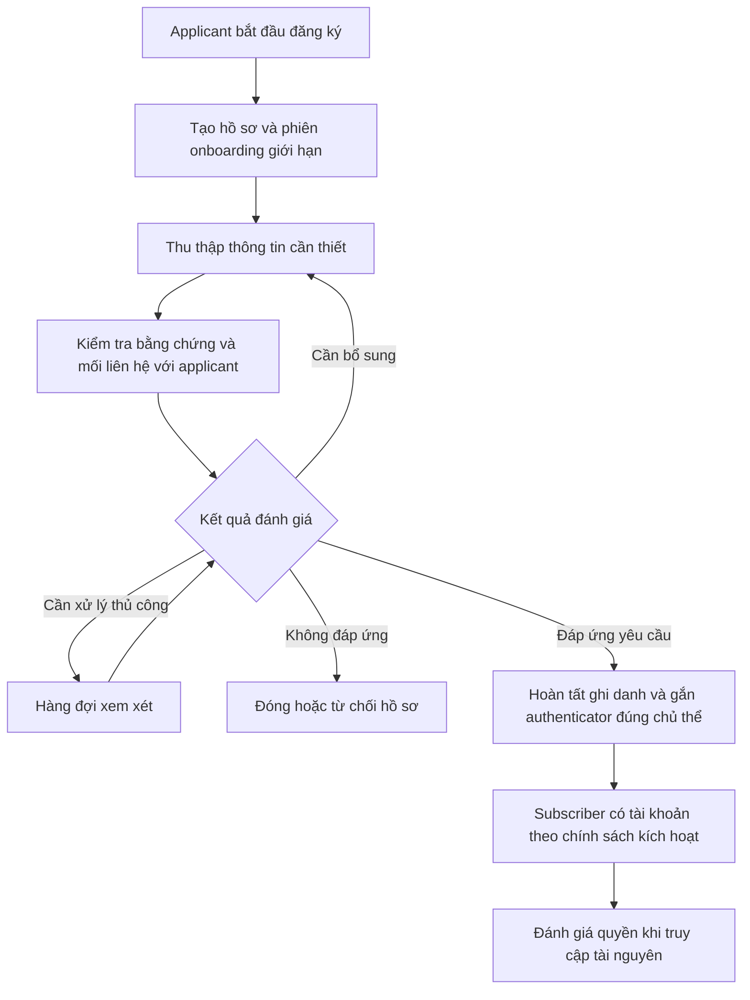

# Applicant và subscriber

## Mục tiêu bài học

Trong quản lý danh tính và quyền truy cập (IAM), một người đang đăng ký tài khoản chưa chắc đã là chủ thể được hệ thống công nhận để sử dụng dịch vụ. Phân biệt **applicant** và **subscriber** giúp thiết kế đúng quá trình xác minh danh tính, ghi danh, gắn phương tiện xác thực và quản lý tài khoản về sau.

Sau bài này, bạn có thể:

- Giải thích applicant và subscriber trong ngữ cảnh identity proofing.
- Phân biệt hồ sơ đăng ký, hồ sơ danh tính, phương tiện xác thực và quyền truy cập.
- Mô tả các điều kiện chuyển từ người đăng ký sang người đã được ghi danh.
- Xử lý hồ sơ chờ duyệt, đăng ký lại, nâng mức bảo đảm và khôi phục tài khoản.
- Nhận diện lỗi cấp quyền quá sớm hoặc gắn nhầm phương tiện xác thực trong quá trình onboarding.

## 1. Hai vai trò gắn với quan hệ giữa một người và một dịch vụ

### 1.1. Applicant là người đang xin được ghi danh

**Applicant** là người đang tham gia quá trình đăng ký và, khi dịch vụ yêu cầu, xác minh danh tính để được ghi danh tại nhà cung cấp dịch vụ danh tính. Có thể gọi ngắn gọn là **người đăng ký** hoặc **người xin ghi danh**.

Applicant có thể đã nhập tên, xác nhận địa chỉ email, tạo mật khẩu hoặc tải lên bằng chứng. Những hành động này thể hiện tiến độ của hồ sơ; chúng chưa tự chứng minh rằng quá trình ghi danh đã hoàn tất.

Ví dụ, Lan đăng ký cổng thông tin nhân viên của công ty. Lan đã mở liên kết trong email và gửi thông tin theo yêu cầu. Bộ phận tiếp nhận vẫn đang kiểm tra Lan có khớp với hồ sơ nhân sự hay không. Trong quá trình đó, Lan là applicant đối với lần đăng ký này.

Hệ thống có thể cho Lan truy cập một khu vực giới hạn để bổ sung hồ sơ. Quyền thao tác trong khu vực đăng ký không có nghĩa Lan đã được truy cập tài liệu nội bộ của nhân viên.

### 1.2. Subscriber là người đã được ghi danh

**Subscriber** là người đã thiết lập quan hệ ghi danh với nhà cung cấp dịch vụ danh tính, thường được gọi là **Credential Service Provider (CSP)**. Có thể hiểu là **người đã được ghi danh**, có hồ sơ tài khoản mà nhà cung cấp duy trì cùng những liên kết tới phương tiện xác thực của người đó.

Từ subscriber ở đây không có nghĩa là người trả tiền thuê bao. Một tài khoản nhân viên được công ty cấp miễn phí vẫn có thể thuộc về một subscriber.

Trong luồng có yêu cầu identity proofing, việc trở thành subscriber thường gắn với việc hoàn thành các bước xác minh theo chính sách, thiết lập hồ sơ và đăng ký hoặc gắn phương tiện xác thực. Chính sách cũng cần xác định khi nào tài khoản được kích hoạt để sử dụng bình thường.

Không nên suy ra rằng mọi subscriber đều đã được xác minh danh tính ngoài đời ở mức cao. Một dịch vụ có thể cho phép ghi danh dựa trên thông tin tự khai và kiểm soát phương tiện liên lạc. Khi đó, người dùng vẫn có quan hệ tài khoản với dịch vụ, nhưng mức bảo đảm về danh tính thực tế còn hạn chế.

**Kết luận cần nhớ:** subscriber mô tả quan hệ ghi danh; mức độ tin cậy vào danh tính phải được thể hiện bằng thông tin và chính sách riêng.

### 1.3. Đây không phải nhãn cố định của một con người

Vai trò cần được đọc trong phạm vi một dịch vụ hoặc một quy trình cụ thể:

- Lan đã là subscriber của dịch vụ email cá nhân nhưng vẫn là applicant của cổng nhân viên.
- Lan có thể đang sử dụng tài khoản thông thường, đồng thời có một hồ sơ bổ sung để đáp ứng yêu cầu xác minh cao hơn cho tính năng nhạy cảm.
- Một người có thể bị từ chối ở một lần đăng ký nhưng được phép nộp lại hồ sơ theo quy trình xử lý phù hợp.

Khi mô hình hóa dữ liệu, cần gắn trạng thái với hồ sơ đăng ký hoặc quan hệ tài khoản tương ứng. Đừng tạo một cờ toàn cục kiểu `person.isSubscriber` rồi dùng nó cho mọi ứng dụng, mọi tổ chức và mọi mức quyền.

## 2. Bốn khái niệm thường bị trộn lẫn

| Khái niệm | Câu hỏi cần trả lời | Ví dụ | Điều chưa thể kết luận |
|---|---|---|---|
| Hồ sơ đăng ký, application | Người này đang yêu cầu được ghi danh như thế nào? | Hồ sơ còn thiếu bằng chứng hoặc đang chờ duyệt | Đã có tài khoản sử dụng đầy đủ |
| Hồ sơ danh tính/tài khoản subscriber | Dịch vụ đang duy trì quan hệ tài khoản với chủ thể nào? | Tài khoản có mã chủ thể ổn định | Mọi thông tin tự khai đều đã được xác minh |
| Phương tiện xác thực, authenticator | Người quay lại chứng minh quyền kiểm soát tài khoản bằng gì? | Passkey, khóa bảo mật, mật khẩu kết hợp yếu tố khác | Người đó đương nhiên có quyền xem mọi dữ liệu |
| Quyền truy cập, entitlement | Chủ thể được làm gì với tài nguyên nào? | Đọc bảng lương của chính mình | Chủ thể được xem bảng lương của cả công ty |

Một địa chỉ email có thể vừa là thông tin liên hệ vừa là tên đăng nhập. Tuy nhiên, xác nhận email chủ yếu cho thấy người thực hiện đang kiểm soát hộp thư tại thời điểm kiểm tra. Nó không tự chứng minh tên thật, quan hệ lao động hay thẩm quyền đại diện cho tổ chức.

Tương tự, một passkey được đăng ký thành công cho thấy hệ thống đã thiết lập một cơ chế xác thực. Nếu passkey đó bị gắn vào sai hồ sơ, cơ chế xác thực có thể hoạt động đúng về kỹ thuật nhưng vẫn đưa kẻ khác vào tài khoản của nạn nhân.

## 3. Identity proofing làm rõ điều gì?

Identity proofing là quá trình thu thập và đánh giá thông tin để thiết lập mức tin cậy rằng applicant đúng là người mà họ khai nhận trong phạm vi dịch vụ yêu cầu.

Có thể phân tích quá trình này thành ba câu hỏi:

1. **Phân giải danh tính:** Có đủ thông tin để phân biệt chủ thể cần ghi danh trong quần thể liên quan không?
2. **Kiểm tra bằng chứng và thuộc tính:** Thông tin hoặc bằng chứng có tính hợp lệ, xác thực và đáng tin cậy đến đâu?
3. **Xác minh mối liên hệ với người đăng ký:** Applicant có phải là người mà bằng chứng đang nói đến không?

Ví dụ, một bộ thông tin trùng khớp với hồ sơ nhân sự giúp tìm đúng hồ sơ, nhưng chưa đủ chứng minh người đang thao tác là nhân viên đó. Ngược lại, việc kiểm soát một số điện thoại cũng không bảo đảm số đó thuộc về đúng người có tên trong hồ sơ nhân sự.

Không phải dịch vụ nào cũng cần thu thập giấy tờ tùy thân. Một diễn đàn và một cổng nhân sự có thể có yêu cầu rất khác nhau. Mục tiêu là thu thập và kiểm tra đủ cho mục đích sử dụng, đồng thời hạn chế dữ liệu nhạy cảm không cần thiết.

### Ba lớp quyết định độc lập

| Lớp quyết định | Câu hỏi | Ví dụ |
|---|---|---|
| Identity proofing | Có cơ sở tin chủ thể là người họ khai nhận không? | Đã kiểm tra danh tính theo quy trình phù hợp |
| Authentication | Người đang truy cập có chứng minh quyền kiểm soát phương tiện xác thực đã gắn với tài khoản không? | Đăng nhập bằng passkey đã đăng ký |
| Authorization | Với chủ thể, tài nguyên và ngữ cảnh hiện tại, hành động có được phép không? | Được xem hồ sơ cá nhân nhưng không được xuất toàn bộ dữ liệu nhân sự |

Ba lớp này hỗ trợ nhau nhưng không thay thế nhau. Một applicant có thể xác thực vào phiên onboarding giới hạn. Một subscriber có thể đăng nhập thành công nhưng không có quyền vào chức năng quản trị. Việc bật MFA cũng không tự nâng độ tin cậy vào tên thật hoặc thông tin ngoài đời của người dùng.

## 4. Từ applicant đến subscriber: một luồng mẫu

Sơ đồ dưới đây minh họa một dịch vụ yêu cầu xác minh trước khi cho phép sử dụng tài khoản bình thường. Tên trạng thái chỉ là ví dụ thiết kế, không phải bộ trạng thái bắt buộc cho mọi hệ thống.



### Bước 1: Tạo hồ sơ đăng ký và giới hạn phiên ban đầu

Hệ thống cấp một mã hồ sơ ngẫu nhiên, ghi nhận tiến độ và thiết lập cách applicant quay lại bổ sung thông tin. Phiên onboarding chỉ được thực hiện các hành động cần thiết như xem tiến độ hoặc bổ sung dữ liệu của chính hồ sơ đó.

Nếu hệ thống đã tạo trước một bản ghi tài khoản, bản ghi đó vẫn có thể ở trạng thái chờ kích hoạt. **Sự tồn tại của một dòng trong bảng `users` không đủ để xác định quá trình ghi danh đã hoàn tất.**

Không nên cho phiên này thừa hưởng sẵn nhóm `employee`, quyền tải dữ liệu hoặc quyền gọi các API nghiệp vụ chỉ vì tài khoản đã có mã định danh.

### Bước 2: Thu thập và đánh giá thông tin

Applicant được thông báo rõ cần cung cấp thông tin gì và dùng để làm gì. Hệ thống xử lý các trường hợp thiếu thông tin, sai định dạng, bằng chứng không đạt yêu cầu hoặc cần hỗ trợ tiếp cận.

Một lần kiểm tra thất bại có thể do lỗi nhập liệu, chất lượng bằng chứng hoặc quy trình chưa phù hợp. Không nên tự động diễn giải mọi thất bại thành gian lận. Việc chấp nhận, yêu cầu bổ sung, chuyển duyệt thủ công hay từ chối phải có lý do được ghi nhận.

### Bước 3: Gắn đúng applicant với hồ sơ sẽ được ghi danh

Kết quả xác minh phải gắn với đúng mã hồ sơ, đúng chủ thể và đúng phạm vi tổ chức. Nếu có dịch vụ xác minh bên ngoài, phía máy chủ cần kiểm tra nguồn kết quả, liên hệ với yêu cầu đã khởi tạo, tính toàn vẹn, thời hạn và việc kết quả đã được sử dụng hay chưa.

Không được tin một tham số từ trình duyệt như `verified=true`. Cũng không được ghép kết quả xác minh vào tài khoản chỉ vì địa chỉ email do trình duyệt gửi lên trùng với một bản ghi có sẵn.

### Bước 4: Hoàn tất ghi danh và liên kết authenticator

Trình tự cụ thể có thể khác nhau giữa các dịch vụ: có nơi đăng ký phương tiện xác thực sớm nhưng chỉ kích hoạt sau khi hồ sơ đạt yêu cầu; có nơi chờ kết quả xác minh rồi mới cho đăng ký. Dù theo trình tự nào, hệ thống phải bảo đảm:

- Authenticator thuộc đúng quy trình ghi danh và được liên kết với đúng chủ thể.
- Kết quả xác minh được chấp nhận chỉ khi đáp ứng chính sách của lần đăng ký đó.
- Các bước quan trọng không bị bỏ qua vì trình duyệt gửi yêu cầu sai thứ tự.
- Việc hoàn tất được xử lý nhất quán khi người dùng bấm lại hoặc yêu cầu bị gửi trùng.

Ở cuối luồng, cần có một định danh chủ thể nội bộ ổn định. Email, số điện thoại và tên hiển thị có thể thay đổi; chúng không nên là căn cứ duy nhất để nối mọi bằng chứng, authenticator và quyền với một con người.

### Bước 5: Áp dụng chính sách kích hoạt và cấp quyền

Subscriber mới không nhất thiết có đầy đủ quyền ngay lập tức. Cổng nhân viên có thể còn cần xác nhận quan hệ lao động đang hiệu lực; hệ thống quản trị có thể cần người có thẩm quyền phê duyệt quyền đặc biệt.

Sau khi hoàn tất ghi danh, nên kết thúc hoặc chuyển đổi phiên onboarding một cách có kiểm soát. Phiên sử dụng tài khoản phải phản ánh đúng trạng thái mới, các yêu cầu xác thực và phạm vi quyền. Không nên chỉ đổi một cờ trong trình duyệt rồi giữ nguyên mọi đặc quyền của phiên trước đó.

## 5. Thiết kế trạng thái mà không gộp mọi thứ vào `verified`

Một cờ `verified` rất dễ trở nên mơ hồ. Nó có thể bị dùng để chỉ email đã xác nhận, bằng chứng đã kiểm tra, tài khoản đã ghi danh hoặc người dùng đã bật MFA. Các ý nghĩa này khác nhau.

Một thiết kế dễ kiểm soát hơn là phân biệt ba nhóm trạng thái:

| Nhóm | Ví dụ trạng thái | Ý nghĩa |
|---|---|---|
| Hồ sơ đăng ký | `DRAFT`, `EVIDENCE_PENDING`, `UNDER_REVIEW`, `ACCEPTED`, `REJECTED`, `CANCELLED` | Tiến độ và kết quả của lần đăng ký |
| Tài khoản | `PENDING_ACTIVATION`, `ACTIVE`, `SUSPENDED`, `CLOSED` | Tình trạng sử dụng quan hệ tài khoản |
| Authenticator | `PENDING_BINDING`, `ACTIVE`, `REVOKED` | Tình trạng liên kết và sử dụng phương tiện xác thực |

Kết quả proofing nên lưu riêng phạm vi chính sách, thời điểm quyết định và mã tham chiếu của quyết định. `ACCEPTED` trong một quy trình có yêu cầu thấp không mặc nhiên đáp ứng quy trình có yêu cầu cao hơn.

Với luồng yêu cầu proofing trước khi kích hoạt, có thể diễn đạt điều kiện nghiệp vụ như sau:

```text
Có thể kích hoạt tài khoản khi:
  hồ sơ đăng ký đã được chấp nhận theo chính sách đang áp dụng
  VÀ kết quả đó thuộc đúng hồ sơ, chủ thể và phạm vi tổ chức
  VÀ các bước ghi danh bắt buộc đã hoàn tất
  VÀ đã gắn authenticator phù hợp với chính sách
  VÀ không có quyết định đình chỉ hoặc chặn kích hoạt
```

Đây là điều kiện cho một luồng cụ thể, không phải quy tắc bắt mọi dịch vụ phải xác minh danh tính ngoài đời. Với dịch vụ cho phép thông tin tự khai, chính sách ghi danh và thông tin về mức bảo đảm phải phản ánh đúng giới hạn đó.

### Ví dụ dữ liệu tối thiểu

Ví dụ sau dùng dữ liệu giả để minh họa quan hệ giữa các bản ghi. Đây không phải định dạng token hay mô hình dữ liệu bắt buộc.

```json
{
  "applicationId": "app_demo_41",
  "subjectId": "sub_demo_83",
  "organizationId": "org_demo_7",
  "applicationStatus": "ACCEPTED",
  "proofingDecision": {
    "policyId": "employee-enrollment-v1",
    "decisionReference": "decision_demo_12",
    "decidedAt": "2026-01-15T08:30:00Z"
  },
  "accountStatus": "ACTIVE",
  "authenticatorBindings": [
    {
      "bindingId": "binding_demo_9",
      "type": "passkey",
      "status": "ACTIVE"
    }
  ]
}
```

Không cần nhúng ảnh giấy tờ, bí mật xác thực hoặc toàn bộ thông tin cá nhân vào một bản ghi tổng hợp như trên. Mã tham chiếu cho phép liên kết tới nguồn dữ liệu được bảo vệ và kiểm soát riêng. Ngay cả các mã tham chiếu cũng cần được bảo vệ khi có thể dùng để nối hoặc tra cứu dữ liệu cá nhân.

Quyền nghiệp vụ được quản lý theo mô hình cấp quyền thích hợp. Việc `accountStatus` bằng `ACTIVE` chỉ là một đầu vào của quyết định truy cập; nó không thay thế kiểm tra vai trò, thuộc tính, phạm vi tài nguyên hay ngữ cảnh.

## 6. Ví dụ xuyên suốt: ghi danh nhân viên mới

Giả sử công ty có cổng thông tin để nhân viên đọc chính sách và xem hồ sơ cá nhân.

### Tình huống ban đầu

Bộ phận nhân sự có hồ sơ tuyển dụng của Lan. Hệ thống gửi lời mời ghi danh tới địa chỉ liên hệ đã đăng ký. Lời mời có phạm vi và thời hạn sử dụng theo chính sách.

Lan mở lời mời và xác nhận thông tin. Ở thời điểm này:

- Hồ sơ đăng ký tồn tại.
- Lan đang thực hiện các bước với vai trò applicant.
- Hệ thống chưa nên kết luận rằng người mở lời mời chắc chắn là đúng nhân viên chỉ dựa vào việc họ có liên kết.

### Khi đáp ứng yêu cầu xác minh

Quy trình kiểm tra làm rõ người đăng ký có liên hệ đúng với hồ sơ nhân sự cần cấp tài khoản. Hệ thống chấp nhận kết quả, hoàn tất ghi danh và gắn phương tiện xác thực với tài khoản của Lan.

Lan trở thành subscriber của dịch vụ danh tính nội bộ. Tài khoản của Lan có định danh nội bộ riêng, và quyền ban đầu được tính dựa trên chính sách dành cho nhân viên cùng quan hệ lao động đang hiệu lực.

Khi Lan xem hồ sơ cá nhân, hệ thống còn phải kiểm tra hồ sơ đích thuộc về Lan. Việc Lan đã hoàn tất proofing không cho phép Lan đọc hồ sơ của đồng nghiệp.

### Khi cần thêm quyền quản trị

Ba tháng sau, Lan được giao nhiệm vụ vận hành một ứng dụng. Việc thêm quyền quản trị là một quy trình quản lý đặc quyền riêng: xác nhận nhu cầu công việc, phê duyệt, thời hạn nếu áp dụng và yêu cầu xác thực cho thao tác nhạy cảm.

Không cần mặc định biến Lan thành applicant mới cho toàn bộ hệ thống. Nếu quyền mới yêu cầu mức bảo đảm danh tính cao hơn, hệ thống có thể mở quy trình xác minh bổ sung có phạm vi rõ ràng. Kết quả nâng mức bảo đảm và quyết định cấp quyền vẫn phải được quản lý riêng.

### Khi Lan nghỉ việc

Danh tính đã được xác minh trong quá khứ không làm quyền nhân viên tồn tại mãi. Quyền, phiên, token và liên kết tài khoản phải được xử lý theo quy trình kết thúc quan hệ lao động và phạm vi của từng hệ thống.

Điểm cốt lõi là: **tính đúng đắn của danh tính, khả năng đăng nhập và quyền hiện tại có vòng đời khác nhau**.

## 7. Các trường hợp dễ gây nhầm lẫn

### 7.1. Đăng ký lại hoặc có nhiều hồ sơ

Một applicant có thể tạo lại hồ sơ do bỏ dở, đổi thiết bị hoặc quên thông tin. Hệ thống cần nhận diện khả năng trùng lặp, nhưng không nên tự gộp chỉ vì hai người có cùng tên hoặc hai hồ sơ dùng chung thông tin liên hệ.

Việc liên kết hoặc hợp nhất cần đủ cơ sở cho cả danh tính và quyền kiểm soát tài khoản. Đồng thời, giao diện tra cứu hoặc phản hồi lỗi cần hạn chế tiết lộ một người khác có đang đăng ký hay đã có tài khoản hay không.

### 7.2. Hồ sơ chưa hoàn tất nhưng đã có tài khoản kỹ thuật

Nhiều sản phẩm tạo bản ghi `user` ngay từ màn hình đầu. Đây là lựa chọn triển khai có thể chấp nhận nếu máy chủ vẫn giới hạn đúng trạng thái và quyền.

Lỗi xuất hiện khi API nghiệp vụ chỉ kiểm tra “có user ID trong phiên” rồi cho phép truy cập. API cần đánh giá loại phiên, trạng thái tài khoản và chính sách của tài nguyên, thay vì suy ra quyền từ việc bản ghi đã tồn tại.

### 7.3. Subscriber bị mất phương tiện xác thực

Mất điện thoại hoặc khóa bảo mật không tự khiến một subscriber trở lại thành applicant của lần đăng ký ban đầu. Đây trước hết là một yêu cầu khôi phục quyền kiểm soát tài khoản.

Quy trình khôi phục có thể yêu cầu xác minh lại hoặc bổ sung bằng chứng, tùy mức rủi ro và cơ chế đã chuẩn bị. Khôi phục cần bảo vệ ít nhất tương xứng với tài khoản: nếu kẻ tấn công chỉ cần biết tên và email để gắn khóa mới, mọi kiểm tra lúc ghi danh trước đó có thể bị vô hiệu hóa trên thực tế.

Sau khôi phục, hệ thống cần xử lý authenticator cũ và các phiên hoặc token liên quan theo chính sách, đồng thời thông báo qua kênh phù hợp. Không nên gắn authenticator mới chỉ dựa vào việc người yêu cầu cung cấp đúng thông tin công khai.

### 7.4. Đăng nhập qua SSO hoặc liên kết danh tính

Một người đã là subscriber của nhà cung cấp danh tính bên ngoài không mặc nhiên có tài khoản và quyền trong mọi ứng dụng sử dụng SSO.

Ứng dụng nhận kết quả đăng nhập cần biết nhà cung cấp là ai, mã chủ thể nào được xác nhận, mức tin cậy nào có thể sử dụng và chính sách ghi danh cục bộ là gì. Việc tạo tài khoản tự động khi đăng nhập lần đầu vẫn là một quyết định ghi danh của ứng dụng.

Trong một triển khai OIDC, cặp định danh nhà phát hành và mã chủ thể, thường biểu diễn bằng `iss` và `sub`, là cơ sở liên kết danh tính quan trọng trong phạm vi tin cậy đã cấu hình. Email không nên là căn cứ duy nhất để tự động gắn một danh tính bên ngoài vào tài khoản có đặc quyền đang tồn tại. Các trường trong token chỉ có ý nghĩa sau khi token đã được kiểm tra theo giao thức và cấu hình của ứng dụng.

### 7.5. Danh tính workload

Trong bài này, applicant và subscriber được dùng chủ yếu cho quá trình ghi danh con người. Dịch vụ, máy ảo hoặc tác vụ tự động cũng cần danh tính và vòng đời quyền, nhưng thường đi qua quy trình cấp phát danh tính workload với chủ sở hữu, môi trường chạy và cơ chế phát hành thông tin xác thực phù hợp.

Không nên sao chép nguyên quy trình yêu cầu con người xuất trình bằng chứng sang workload. Nguyên tắc chung vẫn có ích: xác định đúng chủ thể trước khi gắn phương tiện xác thực và chỉ cấp quyền đủ cho nhiệm vụ.

## 8. Ranh giới tin cậy và các lỗi triển khai điển hình

### 8.1. Tin kết quả do trình duyệt tự khai

**Lỗi:** giao diện gửi `applicationStatus=ACCEPTED`, máy chủ cập nhật tài khoản thành `ACTIVE`.

**Hậu quả:** applicant có thể bỏ qua quy trình xác minh bằng cách sửa yêu cầu mạng.

**Thiết kế phù hợp:** máy chủ quyết định chuyển trạng thái từ dữ liệu đã kiểm tra và nguồn kết quả đáng tin cậy. Trình duyệt chỉ yêu cầu thực hiện bước tiếp theo, không tự quyết định kết quả của bước đó.

### 8.2. Chấp nhận kết quả của nhầm hồ sơ hoặc nhầm tổ chức

**Lỗi:** một kết quả xác minh hợp lệ của hồ sơ A được áp dụng cho hồ sơ B, hoặc kết quả của một tổ chức được dùng để kích hoạt tài khoản ở tổ chức khác.

**Hậu quả:** hệ thống xác minh đúng một người nhưng cấp tài khoản hoặc quyền cho chủ thể khác.

**Thiết kế phù hợp:** ràng buộc kết quả với yêu cầu ban đầu, mã hồ sơ, định danh chủ thể và phạm vi tổ chức. Khi cần xử lý thủ công, nhân viên hỗ trợ cũng phải đi qua kiểm soát quyền và ghi vết.

### 8.3. Xử lý lặp làm tạo nhiều tài khoản hoặc nhiều quyền

**Lỗi:** callback được gửi lại hoặc hai yêu cầu hoàn tất chạy đồng thời, dẫn tới tạo nhiều subscriber cho cùng hồ sơ hoặc gắn quyền lặp.

**Thiết kế phù hợp:** bước hoàn tất cần có tính lũy đẳng trong phạm vi hồ sơ; các ràng buộc dữ liệu và cơ chế kiểm soát đồng thời phải ngăn việc ghi danh bị nhân đôi. Chỉ kiểm tra trạng thái rồi cập nhật bằng hai thao tác rời rạc có thể chưa đủ khi có nhiều yêu cầu đồng thời.

### 8.4. Dùng kết quả cũ để đáp ứng yêu cầu mới

**Lỗi:** một lần chấp nhận trước đây luôn được xem là đủ cho mọi giao dịch và mọi thay đổi sau này.

**Thiết kế phù hợp:** lưu thông tin về chính sách, phạm vi và thời điểm quyết định. Việc cần xác minh lại hay bổ sung phải dựa trên yêu cầu hiện tại và sự kiện rủi ro, không chỉ dựa vào cờ `verified=true` tồn tại từ lâu.

### 8.5. Thu thập và lưu dữ liệu vượt nhu cầu

**Lỗi:** mọi ứng dụng đều giữ bản sao bằng chứng và ghi cả dữ liệu nhạy cảm vào log để tiện xử lý sự cố.

**Hậu quả:** tăng bề mặt lộ lọt và số người có thể truy cập dữ liệu danh tính.

**Thiết kế phù hợp:** giới hạn dữ liệu thu thập theo mục đích; tách kho bằng chứng khỏi kho tài khoản; kiểm soát truy cập, thời gian lưu và xử lý xóa theo chính sách áp dụng. Các ứng dụng nghiệp vụ thường chỉ cần kết quả hoặc thuộc tính đủ dùng thay vì toàn bộ bằng chứng gốc.

## 9. Kiểm toán quá trình chuyển vai trò

Một chuỗi sự kiện kiểm toán cần đủ để trả lời các câu hỏi:

- Hồ sơ nào được mở, được chấp nhận hoặc bị từ chối?
- Ai hoặc dịch vụ nào thực hiện quyết định đó, theo chính sách nào?
- Kết quả áp dụng cho chủ thể và tổ chức nào?
- Authenticator nào được gắn hoặc thu hồi, vào thời điểm nào?
- Khi nào tài khoản được kích hoạt, đình chỉ hoặc đóng?
- Có quyết định thủ công hay ngoại lệ nào cần truy vết không?

Ví dụ một sự kiện kiểm toán có thể lưu:

```json
{
  "eventType": "ENROLLMENT_COMPLETED",
  "applicationId": "app_demo_41",
  "subjectId": "sub_demo_83",
  "organizationId": "org_demo_7",
  "actorType": "SERVICE",
  "actorId": "enrollment-service",
  "policyId": "employee-enrollment-v1",
  "decisionReference": "decision_demo_12",
  "occurredAt": "2026-01-15T08:35:00Z",
  "correlationId": "corr_demo_58"
}
```

Sự kiện này không cần chứa mật khẩu, mã OTP, khóa bí mật, ảnh bằng chứng hoặc thông tin nhận dạng thô. Bản thân log cũng phải có kiểm soát đọc, bảo vệ tính toàn vẹn và thời gian lưu phù hợp. Chỉ ghi log không ngăn được việc cấp sai quyền; log giúp phát hiện và điều tra khi đi kèm kiểm soát thực thi đúng.

## 10. Áp dụng nguyên tắc ít quyền nhất

Nguyên tắc ít quyền nhất áp dụng cho cả applicant, subscriber và các bên vận hành quy trình:

| Chủ thể | Phạm vi quyền hợp lý | Quyền cần tránh cấp mặc định |
|---|---|---|
| Applicant | Xem tiến độ và bổ sung dữ liệu trong đúng hồ sơ của mình | API nghiệp vụ của người đã kích hoạt tài khoản |
| Subscriber mới | Chức năng cơ bản được chính sách cho phép | Quản trị, xuất dữ liệu hàng loạt hoặc quyền của tổ chức khác |
| Nhân viên xem xét hồ sơ | Những hồ sơ và dữ liệu cần cho nhiệm vụ được giao | Sửa quyền nghiệp vụ hoặc giả mạo phiên người dùng tùy ý |
| Dịch vụ ghi danh | Chuyển trạng thái và gắn liên kết theo luồng được phép | Quyền sửa mọi dữ liệu tài khoản và mọi vai trò trong hệ thống |

RBAC có thể biểu diễn quyền theo vai trò, chẳng hạn nhân viên hay người duyệt hồ sơ. ABAC có thể bổ sung điều kiện theo thuộc tính như tổ chức, trạng thái quan hệ lao động, yêu cầu về mức bảo đảm và ngữ cảnh truy cập. Dù dùng mô hình nào, trạng thái subscriber không nên trở thành “vé thông hành” cho mọi tài nguyên.

Một nguyên tắc thiết kế dễ áp dụng là: **kết quả ghi danh tạo cơ sở nhận diện chủ thể; chính sách truy cập quyết định hành động nào được phép ở thời điểm hiện tại**.

## 11. Tự kiểm tra hiểu biết

### Tình huống 1: Đã xác nhận email

Một người tạo mật khẩu và bấm liên kết xác nhận email. Dịch vụ cần kiểm tra thêm mối liên hệ với hồ sơ nhân viên trước khi kích hoạt. Người đó đang ở vai trò nào?

**Gợi ý trả lời:** đối với quy trình này, người đó vẫn là applicant. Việc kiểm soát email không tự hoàn tất yêu cầu xác minh và ghi danh của cổng nhân viên.

### Tình huống 2: Đã ghi danh nhưng chưa có quyền quản trị

Một subscriber đăng nhập bằng MFA thành công nhưng bị từ chối khi mở trang quản trị. Có mâu thuẫn không?

**Gợi ý trả lời:** không. Ghi danh và xác thực không tự cấp vai trò quản trị. Quyền truy cập cần được đánh giá độc lập theo chính sách.

### Tình huống 3: Có kết quả xác minh thành công

Dịch vụ xác minh trả về thành công, nhưng kết quả liên quan đến hồ sơ khác với hồ sơ đang yêu cầu kích hoạt. Có nên tiếp tục không?

**Gợi ý trả lời:** không. Kết quả phải được ràng buộc với đúng yêu cầu và đúng chủ thể. “Thành công” ở một hồ sơ khác không đáp ứng điều kiện của hồ sơ hiện tại.

### Tình huống 4: Subscriber mất khóa bảo mật

Người dùng đã sử dụng tài khoản nhiều tháng và nay mất khóa. Chỉ cần tạo một đăng ký mới rồi tự gộp theo email có phù hợp không?

**Gợi ý trả lời:** không. Cần đi qua quy trình khôi phục có kiểm soát để chứng minh quyền tiếp tục quản lý tài khoản và gắn phương tiện xác thực mới. Việc tự gộp theo email có thể tạo đường chiếm đoạt tài khoản.

## 12. Những điểm cần ghi nhớ

- Applicant là người đang trong quy trình xin ghi danh; subscriber là người đã có quan hệ ghi danh với nhà cung cấp dịch vụ danh tính.
- Quan hệ subscriber không tự cho biết danh tính ngoài đời đã được xác minh đến mức nào.
- Hồ sơ đăng ký, trạng thái tài khoản, authenticator và quyền truy cập cần có ý nghĩa riêng.
- Kết quả proofing phải gắn với đúng hồ sơ và chủ thể; máy chủ chịu trách nhiệm kiểm soát chuyển trạng thái.
- Hoàn tất ghi danh không đồng nghĩa được cấp mọi quyền. Quyền tiếp tục thay đổi theo vòng đời và nhu cầu sử dụng.
- Khôi phục tài khoản, liên kết danh tính và nâng yêu cầu bảo đảm đều phải bảo vệ tính liên tục giữa đúng người, đúng tài khoản và đúng phương tiện xác thực.
