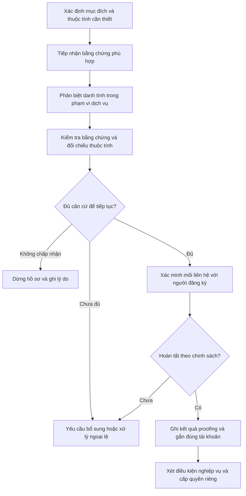

# Identity evidence

## 1. Bằng chứng danh tính giúp chứng minh điều gì?

Một nhà thầu đăng ký tài khoản để truy cập dự án nội bộ. Người này cung cấp họ tên, email công việc và ảnh chụp giấy tờ nhận dạng. Hệ thống đã có nhiều dữ liệu, nhưng vẫn chưa biết chắc ba điều: danh tính được khai có tồn tại không, bằng chứng có đáng tin không và người đăng ký có thực sự là người mà bằng chứng mô tả không.

**Identity evidence**, hay bằng chứng danh tính, là thông tin hoặc tài liệu hỗ trợ việc chứng minh danh tính được khai có tồn tại ngoài đời. Bằng chứng có thể ở dạng vật lý hoặc số. Trong identity proofing, nó là đầu vào để kiểm tra và lập luận về danh tính, không phải kết luận cuối cùng rằng đã xác minh đúng người. [NIST SP 800-63A-4: Identity Evidence and Attributes](https://pages.nist.gov/800-63-4/sp800-63a/proofing/#identity-evidence-and-attributes).

Ví dụ, một hộ chiếu thật có thể thuộc về người khác. Một tệp ảnh rõ nét có thể là bản sao bị đánh cắp. Một xác nhận điện tử có chữ ký hợp lệ có thể chỉ chứng minh một thuộc tính không liên quan đến quyền truy cập đang xin. Vì vậy, câu hỏi đúng không chỉ là “đã nhận đủ giấy tờ chưa?” mà còn là “bằng chứng này hỗ trợ kết luận nào, bằng cách nào và với giới hạn gì?”.

Trong module IAM, bằng chứng danh tính nối việc đăng ký với cấp tài khoản, gắn authenticator, liên kết danh tính qua SSO và quản lý vòng đời quyền. Nếu gắn tài khoản với sai người ngay từ đầu, MFA mạnh về sau có thể chỉ bảo vệ tốt tài khoản của người đã được nhận diện sai.

Sau bài học, người học có thể phân biệt bằng chứng với thuộc tính và authenticator; đánh giá khả năng sử dụng của các dạng bằng chứng; tách kiểm tra bằng chứng khỏi xác minh người xuất trình; thiết kế hồ sơ kiểm tra có thể truy vết mà hạn chế việc lưu dữ liệu nhạy cảm không cần thiết.

## 2. Phân biệt bằng chứng, thuộc tính, nguồn và quyền

Các đối tượng sau có liên quan nhưng không thể thay thế cho nhau:

| Khái niệm | Ý nghĩa trong bài | Ví dụ và giới hạn |
| --- | --- | --- |
| Claimed identity | Danh tính người đăng ký đang khai nhận | “Tôi là người có tên trong hồ sơ này”; đây là điều cần kiểm tra |
| Identity attribute | Một thuộc tính về chủ thể | Họ tên, ngày sinh, mã nhân sự; biết giá trị chưa chứng minh được giá trị đó đúng |
| Identity evidence | Thông tin hoặc tài liệu hỗ trợ danh tính được khai | Giấy tờ nhận dạng, bằng chứng số do nguồn phù hợp phát hành; phải kiểm tra khả năng sử dụng |
| Issuer hoặc issuing source | Bên phát hành bằng chứng | Cơ quan hoặc tổ chức phát hành; cần biết họ xác nhận điều gì và theo quy trình nào |
| Validation source | Nguồn dùng đối chiếu bằng chứng hoặc thuộc tính | Hệ thống phát hành, dịch vụ đối chiếu được chấp nhận; không phải mọi API đều có cùng độ tin cậy |
| Authenticator | Phương tiện người dùng sử dụng để chứng minh quyền kiểm soát tài khoản | Mật khẩu, khóa bảo mật, passkey; không tự chứng minh tên pháp lý |
| Entitlement | Tư cách hoặc quyền được sử dụng một chức năng | Quyền đọc dự án hoặc phê duyệt thay đổi; cần quyết định nghiệp vụ riêng |

Trong tài liệu về danh tính số, từ **credential** có thể chỉ các đối tượng khác nhau tùy chuẩn và ngữ cảnh. Khi nói “credential đã được kiểm tra”, phải xác định đó là bằng chứng chứa thuộc tính danh tính, thông tin gắn với tài khoản hay đối tượng phục vụ xác thực. Không dùng một từ chung để che lấp các bước kiểm tra khác nhau.

Một email công việc đã được xác nhận cho thấy người đăng ký kiểm soát hộp thư tại thời điểm thực hiện phép xác nhận đó. Điều này chưa tự chứng minh người đó là nhà thầu đang có hợp đồng còn hiệu lực. Tương tự, giấy tờ nhận dạng giúp kiểm tra danh tính cá nhân nhưng không tự chứng minh cá nhân được đại diện cho một doanh nghiệp.

Trong ví dụ xuyên suốt bài, cổng nhà thầu cần giải quyết hai nhóm thông tin riêng:

- Thông tin về người: người được cấp tài khoản là ai theo chính sách danh tính của dịch vụ.
- Thông tin về quan hệ công việc: người đó đang được phép tham gia dự án nào, trong thời gian nào và với vai trò gì.

Không phải mọi tài khoản đều cần xác minh danh tính ngoài đời. Trước khi yêu cầu giấy tờ, tổ chức cần làm rõ nhu cầu của dịch vụ và hậu quả của việc nhận nhầm người. Việc lưu tùy chọn giao diện hoặc đọc nội dung công khai thường không tạo ra cùng nhu cầu bằng chứng với truy cập dữ liệu dự án hạn chế.

## 3. Bằng chứng nằm ở đâu trong identity proofing?

NIST phân biệt ba phần: resolution để phân biệt danh tính trong tập người được phục vụ, validation để kiểm tra bằng chứng và thuộc tính, verification để kiểm tra mối liên hệ giữa người đăng ký với danh tính đã được kiểm tra. Bài này dùng cách phân biệt đó khi nói về proofing; thuật ngữ trong một chuẩn credential khác có thể mang nghĩa khác. [NIST SP 800-63A-4: Identity Proofing and Enrollment](https://pages.nist.gov/800-63-4/sp800-63a/proofing/#identity-proofing-and-enrollment).



Đây là sơ đồ thiết kế minh họa, không phải một quy trình chuẩn bắt buộc hoặc tuyên bố đạt mức IAL. Các bước có thể tương tác nhiều lần; khi phát hiện thông tin không khớp, hệ thống cần quay lại bước phù hợp thay vì cố đi tiếp chỉ vì đã nhận tệp.

Ba kết luận phải được giữ riêng trong hồ sơ:

1. **Bằng chứng được chấp nhận:** có thể sử dụng bằng chứng này trong quy trình đang áp dụng.
2. **Proofing hoàn tất:** danh tính và người đăng ký đã được kiểm tra theo yêu cầu của quy trình.
3. **Quyền được cấp:** chủ thể đáp ứng điều kiện để sử dụng tài nguyên cụ thể.

Một kết luận không tự kéo theo hai kết luận còn lại.

## 4. Những dạng bằng chứng thường gặp và giới hạn của chúng

| Dạng đầu vào | Điều có thể hỗ trợ | Giới hạn phải làm rõ |
| --- | --- | --- |
| Giấy tờ vật lý được xuất trình trực tiếp | Kiểm tra nội dung, đặc điểm vật lý và so sánh với người xuất trình theo phương pháp phù hợp | Có thể là giấy tờ thật bị đánh cắp; khả năng kiểm tra phụ thuộc công cụ và người thực hiện |
| Ảnh hoặc bản quét giấy tờ | Đọc thông tin và kiểm tra các đặc điểm còn thể hiện trong ảnh | Không giữ nguyên mọi đặc điểm bảo an của bản gốc; có thể bị chỉnh sửa hoặc sao chép |
| Bằng chứng số do issuer phát hành | Kiểm tra dữ liệu được bảo vệ và nguồn phát hành nếu có cơ chế phù hợp | Phải xác định issuer tin cậy, cách xác minh, trạng thái và cách ràng buộc người xuất trình |
| Kết quả đối chiếu từ hệ thống phát hành | Xác nhận một số trường thông tin hoặc trạng thái mà nguồn có khả năng kiểm tra | Kết quả “khớp” không tự chứng minh người đang thao tác là chủ thể của hồ sơ |
| Tài khoản được tổ chức khác xác minh | Có thể cung cấp bằng chứng hoặc thuộc tính thông qua quan hệ tin cậy được thiết lập | Cần hiểu quy trình ban đầu, nội dung xác nhận và bằng chứng quyền kiểm soát tài khoản |
| Hồ sơ nhân sự hoặc nhà thầu | Hỗ trợ đối chiếu quan hệ công việc và mã tham chiếu nội bộ | Có thể do chính người đăng ký tự nhập hoặc đã lỗi thời; không mặc định là bằng chứng danh tính cá nhân |
| Tài liệu bổ trợ về địa chỉ hoặc quan hệ | Hỗ trợ kiểm tra một thuộc tính được xác định trước | Không tự chứng minh mọi thuộc tính khác hoặc tư cách truy cập |

Bảng này không khẳng định mọi dịch vụ phải nhận tất cả các dạng đầu vào. Mỗi dạng cần có mục đích và tiêu chí chấp nhận rõ ràng.

### 4.1. Bản sao không giữ nguyên mọi khả năng kiểm tra

Ảnh chụp một giấy tờ không có cùng đặc tính với việc kiểm tra bản gốc. Ảnh có thể không thể hiện chi tiết đổi màu theo góc nhìn hoặc các đặc điểm cần kiểm tra trực tiếp. Nén ảnh và chụp thiếu vùng cũng có thể làm mất thông tin cần thiết.

Nếu đường tiếp nhận chỉ nhận ảnh, phải chọn phương pháp kiểm tra phù hợp với ảnh và ghi nhận giới hạn đó. Không ghi “đã kiểm tra đặc điểm vật lý” khi hệ thống chỉ nhận một tệp JPEG.

### 4.2. OCR, mã QR và kiểm tra định dạng giải quyết các việc khác nhau

OCR trích xuất chữ từ ảnh. Công cụ có thể đọc đúng toàn bộ nội dung của một tài liệu giả. Điểm tin cậy OCR cao phản ánh khả năng nhận dạng ký tự của công cụ trong ngữ cảnh đó, không phải xác suất danh tính là thật.

Tương tự, một chuỗi đúng định dạng, một số kiểm tra hợp lệ hoặc một mã QR đọc được chỉ hỗ trợ những phép kiểm tra giới hạn. Mã QR có thể chứa văn bản thường, đường dẫn hoặc dữ liệu có bảo vệ mật mã; cần biết cơ chế cụ thể trước khi suy ra ý nghĩa bảo mật.

Đọc dữ liệu từ chip cũng cần phân biệt với xác minh dữ liệu và nguồn phát hành. Không coi việc phần mềm đọc được nội dung là bằng chứng đã kiểm tra đầy đủ tính xác thực.

## 5. Đánh giá bằng chứng theo khả năng sử dụng thực tế

NIST SP 800-63A-4 dùng các nhóm sức mạnh bằng chứng FAIR, STRONG và SUPERIOR với yêu cầu cụ thể. Các nhãn này không thể được gán chỉ từ tên tài liệu hoặc số lượng bản chụp, và sức mạnh của một bằng chứng không đồng nghĩa với mức IAL của toàn bộ quy trình. [NIST: Evidence Strength Requirements](https://pages.nist.gov/800-63-4/sp800-63a/proofing/#evidence-strength-requirements).

Để thiết kế quy trình cho cổng nhà thầu, nhóm có thể lập bảng đánh giá sau. Đây là các câu hỏi thiết kế, không phải bản thay thế cho tiêu chí của một chuẩn.

| Khía cạnh | Câu hỏi cần trả lời | Dấu hiệu chưa đủ căn cứ |
| --- | --- | --- |
| Nguồn phát hành | Ai phát hành và họ chịu trách nhiệm về những thuộc tính nào? | Chỉ có tên hoặc logo mà không xác định được nguồn |
| Quy trình cấp | Trước khi phát hành, nguồn đã kiểm tra người nhận theo cách nào? | Bằng chứng được tạo hoàn toàn từ dữ liệu tự khai mà không có đối chiếu |
| Khả năng phát hiện sửa đổi | Có đặc điểm hoặc cơ chế kiểm tra nào phù hợp với dạng nhận được? | Chỉ nhìn hình thức hoặc tin phần mở rộng tệp |
| Khả năng đối chiếu | Có nguồn hoặc dữ liệu bảo vệ để kiểm tra thuộc tính cần thiết không? | Dịch vụ chỉ lặp lại thông tin người đăng ký vừa nhập |
| Liên hệ với người đăng ký | Bằng chứng hỗ trợ phương pháp nào để xác minh người xuất trình? | Bất kỳ ai giữ một bản sao cũng có thể nộp thành công |
| Hiệu lực và độ mới | Bằng chứng, kết quả kiểm tra và thuộc tính còn phù hợp tại thời điểm quyết định không? | Chỉ biết ngày tải tệp lên, không biết ngày kiểm tra hoặc nguồn dữ liệu |
| Nguồn gốc tiếp nhận | Có biết tệp hoặc thông điệp đến từ đâu và thuộc hồ sơ nào không? | Nhân viên nhận ảnh qua kênh cá nhân rồi tự ghép vào hồ sơ |
| Phù hợp mục đích | Bằng chứng có hỗ trợ đúng thuộc tính cần biết không? | Dùng giấy tờ về danh tính để kết luận có quyền đại diện dự án |

Một chính sách chấp nhận cần nêu cả **loại bằng chứng** lẫn **cách kiểm tra trong đường tiếp nhận cụ thể**. Cùng một loại tài liệu, việc kiểm tra trực tiếp với công cụ phù hợp và việc nhìn một ảnh nhỏ trong email có thể tạo ra những căn cứ rất khác nhau.

### 5.1. Nhiều tài liệu không tự tạo ra bằng chứng độc lập

Ảnh mặt trước, ảnh mặt sau và bản PDF được tạo từ cùng một giấy tờ là các biểu diễn của cùng nguồn, không phải ba nguồn độc lập. Một thư xác nhận được lập từ số định danh do người đăng ký tự nhập cũng có thể chỉ lặp lại cùng sai sót ban đầu.

Khi bổ sung bằng chứng, hãy hỏi nó làm giảm điểm chưa chắc chắn nào. Nếu tài liệu thứ hai chỉ sao chép dữ liệu từ tài liệu thứ nhất, số tệp tăng nhưng lập luận về danh tính có thể không mạnh hơn đáng kể.

### 5.2. Tách hiệu lực tài liệu khỏi độ mới của từng thuộc tính

Một thuộc tính như địa chỉ hoặc quan hệ công việc có thể thay đổi trong lúc giấy tờ nhận dạng vẫn còn hạn. Ngược lại, một tài liệu hết hạn có thể còn giá trị hỗ trợ một mục đích giới hạn nếu chính sách chấp nhận cho phép; điều đó không đồng nghĩa tài liệu được dùng cho mọi bước hoặc mọi dịch vụ.

Quy trình phải nêu cách xử lý tình huống đó từ trước. Nhân viên không tự bỏ qua ngày hết hạn, và hệ thống không tự kết luận danh tính gian lận chỉ vì một tài liệu không đáp ứng yêu cầu hiện hành.

## 6. Xây dựng chuỗi tin cậy với nguồn đối chiếu

Một phép đối chiếu chỉ có ý nghĩa khi biết nguồn được phép xác nhận nội dung nào. Trong cổng nhà thầu, hệ thống phát hành giấy tờ có thể hỗ trợ kiểm tra thông tin trên giấy tờ; hệ thống quản lý hợp đồng có thể hỗ trợ kiểm tra nhà thầu còn tham gia dự án. Hai nguồn có thẩm quyền trong hai phạm vi khác nhau.

Tổ chức có thể ghi lại một ma trận nguồn theo thuộc tính:

| Thuộc tính hoặc kết luận cần kiểm tra | Nguồn dự kiến sử dụng trong ví dụ | Điều phải làm rõ |
| --- | --- | --- |
| Thông tin trên bằng chứng nhận dạng | Nguồn phát hành hoặc dịch vụ đối chiếu được tổ chức chấp nhận | Trường nào được đối chiếu, trạng thái nào được trả về, dữ liệu cập nhật đến đâu |
| Quan hệ nhà thầu với dự án | Hệ thống quản lý hợp đồng hoặc đầu mối quản lý được chỉ định | Ai cập nhật quan hệ, ngày kết thúc, thay đổi vai trò và quy trình thu hồi |
| Quyền kiểm soát email | Phép xác nhận gửi đến địa chỉ đã chọn theo chính sách | Xác nhận được hộp thư nào, vào thời điểm nào; không suy rộng thành quyền đại diện |
| Quyền truy cập kho mã nguồn | Chính sách và phê duyệt của chủ tài nguyên | Phạm vi repository, thời hạn quyền, điều kiện sử dụng và thu hồi |

Với dịch vụ đối chiếu bên ngoài, cần hiểu kết quả trả về có nghĩa gì. `MATCH` có thể chỉ nói rằng một số trường có trong cơ sở dữ liệu; nó không nhất thiết bao gồm kiểm tra giấy tờ bị thu hồi, người xuất trình hoặc quan hệ lao động.

Kết quả `NOT_FOUND` cũng cần được diễn giải theo phạm vi nguồn. Cơ sở dữ liệu có thể không bao phủ loại bằng chứng, vùng phát hành hoặc bản ghi mới. Thiếu dữ liệu đối chiếu không đồng nghĩa đã chứng minh gian lận.

Không dùng cơ sở dữ liệu rò rỉ, thông tin tìm thấy ngẫu nhiên trên mạng hoặc ảnh chụp màn hình do người đăng ký cung cấp làm nguồn đối chiếu mặc định. Những nguồn này có thể sai, cũ, không rõ xuất xứ hoặc chỉ sao chép cùng một lời khai.

## 7. Kiểm tra bằng chứng vật lý và bằng chứng số

### 7.1. Với ảnh hoặc bản quét tài liệu

Một đường xử lý minh họa gồm:

1. **Kiểm tra đầu vào:** nhận đúng loại tài liệu được hỗ trợ, đủ vùng cần thiết và chất lượng đủ dùng cho phương pháp kiểm tra.
2. **Trích xuất:** đọc các trường cần thiết, giữ nguồn của từng trường và mức độ không chắc chắn khi đọc.
3. **Kiểm tra tài liệu:** áp dụng phương pháp phù hợp để tìm căn cứ về tính xác thực và sự toàn vẹn.
4. **Đối chiếu thuộc tính:** so sánh các trường cần thiết với nguồn được chấp nhận, phân loại trường hợp không khớp.
5. **Ghi kết quả có giới hạn:** nêu phép kiểm tra nào đã làm, phép nào không làm được và hồ sơ có đủ điều kiện sang bước xác minh người đăng ký không.

Một ảnh mờ có thể dẫn đến yêu cầu chụp lại vì thiếu chất lượng; một dấu hiệu chỉnh sửa cần cách xử lý khác. Không gom hai trường hợp này thành cùng thông báo “bạn khai sai danh tính”.

Nếu có so sánh khuôn mặt, cần tách câu hỏi ảnh khuôn mặt có tương đồng với ảnh trên bằng chứng khỏi câu hỏi mẫu đầu vào có thực sự đến từ người đang tham gia phiên hay không. Tín hiệu phát hiện trình diễn hoặc kiểm tra hiện diện có phạm vi riêng; không coi nhãn “liveness passed” là kết luận giấy tờ thật hoặc đúng danh tính.

Không phải mọi quy trình đều cần sinh trắc học. Chọn phương pháp dựa trên mục đích, yêu cầu bảo đảm và các lựa chọn khả thi cho người dùng, thay vì mặc định thu ảnh mặt cho mọi tài khoản.

### 7.2. Với credential hoặc xác nhận số

W3C phân biệt khả năng kiểm chứng một credential với việc các lời xác nhận bên trong là đúng. Verifier vẫn cần đánh giá issuer và nội dung theo chính sách của mình; holder cũng không phải lúc nào là subject được mô tả. Vì vậy, chữ ký hợp lệ không tự hoàn tất việc nhận diện người đăng ký. [W3C Verifiable Credentials Data Model v2.0](https://www.w3.org/TR/vc-data-model-2.0/#introduction).

Trong một đường tiếp nhận bằng chứng số, thiết kế có thể cần trả lời:

- Hệ thống hỗ trợ định dạng và cơ chế bảo vệ nào, với thư viện kiểm tra nào?
- Khóa hoặc trust anchor được xác định từ cấu hình tin cậy nào?
- Issuer có được chấp nhận để xác nhận đúng loại thuộc tính đang cần không?
- Nội dung được kiểm tra có thực sự nằm trong phần được bảo vệ không?
- Thời gian, trạng thái và thông tin khóa có đủ mới theo chính sách không?
- Giao thức xuất trình có chứng minh quyền kiểm soát phù hợp và ràng buộc với phiên đang xử lý không?
- Subject trong bằng chứng được ánh xạ với hồ sơ và tài khoản đích bằng cách nào?

Các câu hỏi này phải được trả lời theo định dạng và giao thức cụ thể; không phải mọi loại credential đều có cùng trường hoặc cùng cơ chế holder binding.

Nếu một thông điệp tự chứa khóa công khai của nó, việc kiểm tra chữ ký bằng khóa đó chỉ cho thấy dữ liệu phù hợp với khóa đã đưa vào. Muốn tin nguồn phát hành, còn cần căn cứ tin cậy độc lập cho khóa và phạm vi sử dụng của nó.

Một credential được sao chép nguyên vẹn vẫn có thể vượt qua kiểm tra toàn vẹn. Chống dùng lại sai phiên cần kiểm soát ở giao thức xuất trình, chẳng hạn thách thức và ràng buộc với bên nhận khi giao thức hỗ trợ. Không tự thêm một trường nonce vào dữ liệu rồi cho rằng đã có giao thức chống replay an toàn.

## 8. Xử lý thông tin không khớp mà không đoán danh tính

Trong ví dụ, người đăng ký nhập tên có dấu, hồ sơ hợp đồng dùng tên không dấu và ảnh giấy tờ ghi tên theo thứ tự khác. Hệ thống không nên tự từ chối chỉ dựa trên so sánh chuỗi tuyệt đối, nhưng cũng không được tự ghép mọi bản ghi có tên gần giống.

Một cách xử lý có kiểm soát là:

- Giữ dữ liệu gốc và nguồn của từng trường; dùng biểu diễn chuẩn hóa riêng cho đối chiếu.
- Xác định các phép chuẩn hóa được phép, như xử lý khoảng trắng hoặc quy ước biểu diễn ngày đã biết.
- Không suy đoán thứ tự ngày và tháng khi nguồn không rõ quy ước.
- Phân biệt lỗi đọc ảnh, khác biệt biểu diễn, thay đổi hợp lệ của thông tin và mâu thuẫn cần kiểm tra thêm.
- Chuyển trường hợp không đủ căn cứ sang quy trình xử lý có người chịu trách nhiệm, với lý do và bằng chứng bổ sung rõ ràng.

Họ tên không phải khóa định danh duy nhất. Một số định danh cũng cần ngữ cảnh về loại, nguồn phát hành và phạm vi duy nhất; không mặc định mọi số từ mọi nguồn đều thuộc cùng không gian định danh.

Không tự động hợp nhất hai tài khoản chỉ vì trùng email, tên hoặc một mã tham chiếu chưa được kiểm tra. Việc liên kết sai có thể cho người đăng ký mới nhận quyền và lịch sử của người khác.

Đối với đường hỗ trợ thủ công, nhân viên cần được biết mình được phép quyết định điều gì. Họ không nên tự sửa dữ liệu từ nguồn phát hành để làm hồ sơ “khớp”, hoặc bỏ qua một phép kiểm tra chỉ vì người yêu cầu nói đang cần quyền gấp.

## 9. Mô hình hóa hồ sơ để giữ nguyên ý nghĩa của kết quả

Một cột `identity_verified = true` khó giải thích nguồn căn cứ, thời điểm và phạm vi. Tốt hơn là giữ các kết quả theo từng bước và một quyết định tổng hợp có tham chiếu chính sách.

Đây là cấu trúc dữ liệu minh họa do ứng dụng tự định nghĩa, không phải schema NIST hoặc W3C. Toàn bộ mã tham chiếu trong ví dụ là giả định:

```json
{
  "proofingCaseId": "case-demo-003",
  "applicantRef": "applicant-demo-021",
  "targetAccountRef": "account-demo-021",
  "purpose": "contractor-project-onboarding",
  "policyVersion": "contractor-proofing-v2",
  "evidence": [
    {
      "evidenceRef": "evidence-demo-017",
      "evidenceVersion": 1,
      "category": "identity-document",
      "receivedForm": "image-copy",
      "protectedObjectRef": "vault-object-demo-017",
      "validationStatus": "PASSED_FOR_POLICY",
      "validationMethodRef": "document-check-path-A",
      "attributeCheckRef": "check-demo-051",
      "applicantLinkageStatus": "PENDING"
    }
  ],
  "proofingDecision": "PENDING_APPLICANT_LINKAGE",
  "businessEligibility": "PENDING_PROJECT_SPONSOR",
  "accessDecision": "NOT_GRANTED"
}
```

Trong hồ sơ thật, còn cần thời điểm kiểm tra, nguồn đối chiếu, kết quả có cấu trúc, người hoặc dịch vụ quyết định, hạn đánh giá lại và quy tắc lưu giữ. Chỉ thu và lưu các trường cần cho mục đích đã xác định.

Các trạng thái được định nghĩa theo chính sách ứng dụng, chẳng hạn:

| Trạng thái | Ý nghĩa cần giữ rõ |
| --- | --- |
| RECEIVED | Đã nhận đầu vào, chưa kết luận có thể tin |
| NEEDS_RESUBMISSION | Chất lượng hoặc tính đầy đủ chưa đủ cho đường kiểm tra |
| VALIDATION_PENDING | Đang chờ kiểm tra bằng chứng hoặc đối chiếu thuộc tính |
| REVIEW_REQUIRED | Cần xử lý theo quy trình ngoại lệ được chỉ định |
| ACCEPTED_FOR_POLICY | Bằng chứng được chấp nhận cho mục đích và phiên bản chính sách cụ thể |
| REJECTED_FOR_POLICY | Không đáp ứng tiêu chí chấp nhận của đường này |
| RECHECK_REQUIRED | Kết quả cần được kiểm tra lại trước khi tiếp tục sử dụng |

`ACCEPTED_FOR_POLICY` mô tả bằng chứng, không phải quyền truy cập. `REJECTED_FOR_POLICY` cũng không tự có nghĩa người nộp là kẻ gian lận. Muốn ghi nhận gian lận cần một kết luận và quy trình riêng có căn cứ.

### 9.1. Không gắn kết quả của bằng chứng cũ vào tệp mới

Khi người dùng nộp lại ảnh, phải tạo phiên bản bằng chứng mới hoặc đối tượng mới. Kết quả kiểm tra trước đó cần gắn với đúng phiên bản đã được kiểm tra, không chỉ với một tên tệp có thể thay đổi.

Nếu nhà cung cấp kiểm tra trả kết quả bất đồng bộ, máy chủ phải xác minh nguồn thông báo và ràng buộc kết quả với đúng hồ sơ, bằng chứng, phiên bản và tác vụ đã yêu cầu. Không nhận trường `passed` từ trình duyệt rồi cập nhật trạng thái.

Cần xử lý thông báo lặp hoặc đến trễ. Kết quả cho phiên bản 1 không được ghi đè trạng thái phiên bản 2. Một hồ sơ đã hủy hoặc đã đóng không được tự mở lại chỉ vì dịch vụ ngoài gửi lại kết quả cũ.

## 10. Tình huống áp dụng: cấp tài khoản cho nhà thầu

Giả sử dự án chứa thiết kế kỹ thuật hạn chế và chỉ cho phép nhà thầu đang có hợp đồng truy cập. Đây là bối cảnh minh họa; loại bằng chứng và mức bảo đảm cụ thể phải do tổ chức lựa chọn theo dịch vụ thực tế.

### Bước 1: Xác định những điều thực sự cần biết

Nhóm cần biết danh tính người nhận tài khoản theo chính sách nội bộ, quan hệ hợp đồng còn hiệu lực và phạm vi dự án được phê duyệt. Nhóm không mặc định cần giữ mọi trường trên giấy tờ, toàn bộ lịch sử địa chỉ hoặc bản ghi sinh trắc học.

### Bước 2: Tiếp nhận bằng chứng theo đường đã công bố

Người đăng ký sử dụng kênh tiếp nhận được bảo vệ. Hệ thống giải thích loại đầu vào được hỗ trợ, mục đích xử lý, các bước tiếp theo và cách nhận hỗ trợ khi không có loại bằng chứng thông thường.

Mọi tệp được gắn với mã hồ sơ phía máy chủ. Người khác không được đọc hoặc thay tệp chỉ bằng cách đoán mã hồ sơ.

### Bước 3: Kiểm tra bằng chứng và thuộc tính cần thiết

Ứng dụng dùng đường kiểm tra phù hợp với dạng đầu vào. Nếu ảnh không đủ rõ, yêu cầu nộp lại; nếu nguồn đối chiếu không phản hồi, ghi trạng thái chưa kết luận. Không chuyển lỗi kết nối thành kết quả chấp nhận.

Khi thuộc tính không khớp, lưu loại không khớp để xử lý. Không tự ghi đè tên trên bằng chứng bằng tên trong hợp đồng rồi báo rằng mọi thông tin trùng nhau.

### Bước 4: Xác minh người đăng ký và quan hệ công việc

Quy trình tiếp tục kiểm tra mối liên hệ giữa người đang tham gia với danh tính theo phương pháp đã chọn. Đồng thời, chủ dự án hoặc nguồn quản lý hợp đồng xác nhận quan hệ công việc và phạm vi truy cập. Hai kết quả được lưu riêng.

Ảnh giấy tờ hợp lệ nhưng chưa hoàn tất xác minh người đăng ký chưa đủ để mở quyền. Người được xác minh đúng danh tính nhưng không còn hợp đồng cũng chưa đủ điều kiện truy cập dự án.

### Bước 5: Gắn đúng tài khoản và cấp quyền tối thiểu

Sau khi hoàn tất các điều kiện, hệ thống gắn kết quả proofing với tài khoản đích một cách có kiểm soát, đăng ký authenticator theo hồ sơ xác thực và cấp vai trò cần thiết cho dự án. Quyền có ngày kết thúc hoặc điều kiện thu hồi tương ứng với quan hệ công việc.

Không đưa ảnh giấy tờ hoặc số định danh đầy đủ vào access token chỉ để ứng dụng biết người dùng đã được proofing. Các ứng dụng nhận kết quả hoặc thuộc tính tối thiểu cần thiết qua cơ chế tin cậy đã thiết kế.

### Bước 6: Xử lý thay đổi về sau

Khi hợp đồng kết thúc, thu hồi quyền và xử lý phiên, credential liên quan theo chính sách. Sự kiện này không có nghĩa danh tính cá nhân trước đây trở thành sai; điều thay đổi là tư cách được truy cập.

Khi cần khôi phục tài khoản hoặc đổi liên kết danh tính, không mặc định bản ảnh cũ trong kho đủ để chứng minh người đang yêu cầu là chủ tài khoản. Việc khôi phục cần kiểm tra quyền kiểm soát và danh tính theo đường được thiết kế riêng.

## 11. Rủi ro thường gặp khi sử dụng identity evidence

| Rủi ro | Vì sao chỉ thu bằng chứng chưa đủ | Hướng kiểm soát cần đánh giá |
| --- | --- | --- |
| Giấy tờ thật của người khác | Tính xác thực của tài liệu không chứng minh người nộp là chủ thể | Phương pháp xác minh người đăng ký phù hợp với đường proofing |
| Bản sao đã bị sửa | Nội dung có thể đọc được và trông hợp lý | Kiểm tra tài liệu, đối chiếu thuộc tính và xử lý dấu hiệu bất thường |
| Bằng chứng số bị dùng lại | Chữ ký có thể vẫn hợp lệ với dữ liệu đã sao chép | Giao thức xuất trình và ràng buộc với đúng phiên, bên nhận khi áp dụng |
| Dữ liệu được chèn vào luồng thu nhận | Phần mềm có thể nhận dữ liệu không đến từ nguồn thu nhận dự kiến | Bảo vệ đường thu nhận, đánh giá công cụ và kiểm tra theo mô hình đe dọa |
| Danh tính ghép từ nhiều nguồn không liên quan | Một số thuộc tính có thể đúng nhưng không cùng thuộc một người | Kiểm tra tính nhất quán và mối liên hệ, tránh chỉ đếm số trường khớp |
| Nguồn kiểm tra bị tin quá mức | Một kết quả hợp lệ ở nguồn không bao phủ mọi kết luận của ứng dụng | Hợp đồng ý nghĩa kết quả, giới hạn nguồn và theo dõi thay đổi |
| Nhân viên hỗ trợ bị gây áp lực | Ngoại lệ thủ công có thể bỏ qua các kiểm soát chính | Phân quyền quyết định, hướng dẫn xử lý, ghi lý do và giám sát |
| Rò rỉ kho bằng chứng | Dữ liệu thu để bảo vệ tài khoản trở thành nguồn hỗ trợ mạo danh | Giảm dữ liệu, bảo vệ kho, giới hạn truy cập và xóa đúng chính sách |

Không có một điểm “fraud score” chung nào tự giải thích tất cả các dòng trên. Nếu sử dụng điểm từ công cụ, cần biết điểm phản ánh phép kiểm tra nào, giới hạn nào và cách chuyển thành quyết định có lý do.

Đường thay thế cho người gặp khó khăn cũng phải giải quyết mục tiêu danh tính đã đặt ra. Nếu đường chính yêu cầu nhiều bước còn đường hỗ trợ chỉ hỏi vài thông tin có thể tìm thấy công khai, kẻ tấn công có thể chọn đường hỗ trợ.

## 12. Thu nhận và lưu giữ bằng chứng an toàn

### 12.1. Bảo vệ kênh tải lên

Tệp bằng chứng là đầu vào không tin cậy, dù chứa dữ liệu quan trọng. Cần giới hạn loại và kích thước tệp, kiểm tra nội dung thực thay vì chỉ tin header, dùng tên lưu trữ do ứng dụng tạo, kiểm soát quyền tải lên và giữ tệp ngoài vùng phục vụ công khai. Bộ xử lý tệp cần được cô lập và cập nhật phù hợp. [OWASP File Upload Cheat Sheet](https://cheatsheetseries.owasp.org/cheatsheets/File_Upload_Cheat_Sheet.html).

Đối với kho bằng chứng danh tính, việc gửi tệp sang một dịch vụ quét bên ngoài cũng là chuyển dữ liệu cho bên khác. Chỉ sử dụng dịch vụ đã được tổ chức chấp nhận cho mục đích và loại dữ liệu đó; không tự đưa tài liệu của người dùng lên công cụ kiểm tra công khai.

### 12.2. Tách dữ liệu gốc khỏi kết quả sử dụng hằng ngày

Một kiến trúc minh họa có thể tách:

- **Kho bằng chứng:** giữ đối tượng gốc khi thật sự cần, có mã hóa, quản lý khóa và kiểm soát truy cập riêng.
- **Hồ sơ proofing:** giữ tham chiếu đối tượng, phép kiểm tra, nguồn, thời điểm, chính sách và quyết định.
- **Hệ thống tài khoản:** giữ định danh nội bộ và kết quả cần thiết để vận hành tài khoản.
- **Hệ thống quyền:** giữ vai trò, phạm vi tài nguyên, điều kiện và thời hạn sử dụng.

Tách kho không tự đủ để bảo vệ dữ liệu; quyền truy cập và đường liên kết giữa các hệ thống vẫn phải được kiểm soát. Nhân viên hỗ trợ thông thường không cần xem toàn bộ giấy tờ chỉ để biết hồ sơ đang chờ bước nào.

Nhật ký nên dùng mã hồ sơ và mã lý do thay vì ghi số định danh đầy đủ, nội dung ảnh, token hay mẫu sinh trắc học. Liên kết tải tệp phải có kiểm tra quyền và hiệu lực phù hợp; không biến một URL dễ chuyển tiếp thành quyền đọc giấy tờ lâu dài.

### 12.3. Có chính sách lưu giữ theo từng loại dữ liệu

Xác định dữ liệu nào phải giữ để giải thích quyết định, dữ liệu nào chỉ cần trong thời gian xử lý và dữ liệu nào không nên thu. Đặt thời hạn và trách nhiệm xóa cho bản gốc, ảnh tạm, dữ liệu trích xuất, kết quả nhà cung cấp và các bản sao vận hành liên quan.

Xóa ảnh gốc nhưng bỏ lại ảnh thu nhỏ, tệp xuất hoặc bản sao trong nhật ký lỗi chưa thực hiện đầy đủ mục tiêu giảm dữ liệu. Quy trình xóa cũng cần xét vòng đời bản sao lưu và khả năng khôi phục dữ liệu đã đến hạn xóa.

Băm một số định danh không tự làm dữ liệu vô danh: nếu không gian giá trị có thể đoán được hoặc giá trị được dùng để liên kết hồ sơ, vẫn có rủi ro tra cứu và tương quan. Không coi một phép băm đơn giản là lý do để lưu dữ liệu vô thời hạn.

## 13. Bằng chứng và kết quả cần được quản lý theo thời gian

Một bản ghi kiểm tra phải trả lời được “đã kết luận điều gì, dựa trên căn cứ nào, tại thời điểm nào?”. Không ghi “verified forever” cho mọi thuộc tính.

Các sự kiện có thể buộc xem xét lại gồm bằng chứng bị thông báo thu hồi, nguồn phát hành hoặc khóa tin cậy có vấn đề, phát hiện hồ sơ bị ghép sai, thay đổi chính sách chấp nhận hoặc yêu cầu mở rộng quyền vượt phạm vi đã đánh giá trước đây.

Đánh giá lại không luôn đồng nghĩa bắt người dùng nộp lại toàn bộ giấy tờ. Có thể chỉ cần kiểm tra trạng thái, đối chiếu lại thuộc tính động hoặc xác nhận quan hệ công việc. Chọn bước giải quyết đúng phần chưa chắc chắn, với dữ liệu tối thiểu cần thiết.

Trong federation, ứng dụng cần hiểu kết quả proofing do IdP hoặc nhà cung cấp danh tính gửi sang có phạm vi gì. Một lần đăng nhập OIDC thành công không tự chứng minh có quy trình kiểm tra giấy tờ ngoài đời, và không thể suy ra loại bằng chứng chỉ từ việc đã dùng MFA.

Với danh tính workload, khái niệm bằng chứng được vận dụng theo ngữ cảnh khác: nguồn cấp workload identity, môi trường thực thi hoặc quan hệ tin cậy của pipeline. Không yêu cầu service account nộp giấy tờ của con người hoặc tự coi chứng thư máy là bằng chứng xác minh một cá nhân.

## 14. Những điểm cần ghi rõ trong chính sách chấp nhận bằng chứng

Trước khi triển khai, một chính sách sử dụng identity evidence cần xác định được:

1. Mục đích kiểm tra danh tính và các thuộc tính thực sự cần thiết.
2. Loại bằng chứng, dạng tiếp nhận và phạm vi nguồn phát hành được chấp nhận.
3. Phép kiểm tra bằng chứng, nguồn đối chiếu và giới hạn của từng kết quả.
4. Phương pháp xác minh mối liên hệ giữa người đăng ký với danh tính.
5. Cách xử lý tài liệu hết hạn, dữ liệu không khớp, nguồn chưa bao phủ hoặc dịch vụ gián đoạn.
6. Người được quyết định ngoại lệ, căn cứ phải ghi và cơ chế kiểm soát quyết định.
7. Cách gắn kết quả với đúng phiên bản bằng chứng, hồ sơ và tài khoản đích.
8. Quyền xem dữ liệu, thời hạn lưu, cách xóa và điều kiện phải kiểm tra lại.
9. Ranh giới giữa chấp nhận bằng chứng, hoàn tất proofing, xác thực tài khoản và cấp quyền.

Giá trị của identity evidence nằm ở chuỗi lập luận có thể kiểm tra: nguồn nào hỗ trợ thuộc tính nào, bằng chứng được kiểm tra ra sao, người đăng ký được liên hệ với bằng chứng bằng cách nào và kết quả được sử dụng trong phạm vi nào. Thu nhiều tài liệu hơn chỉ có ích khi chúng giải quyết được một phần chưa chắc chắn cụ thể của chuỗi đó.
