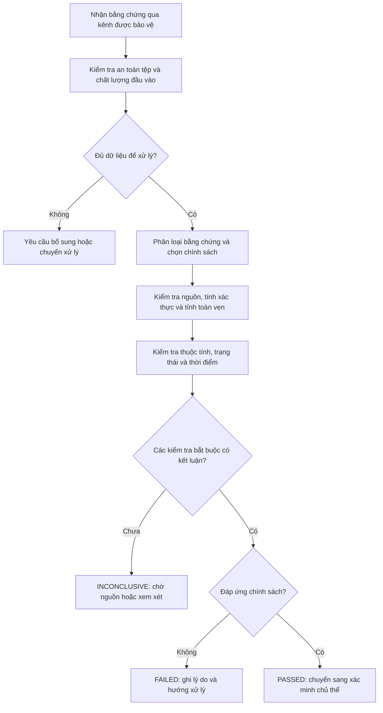

# Evidence validation: kiểm tra tính hợp lệ của bằng chứng danh tính

## 1. Bằng chứng được nộp chưa phải bằng chứng đáng tin

Trong quy trình kiểm chứng danh tính, một người có thể cung cấp ảnh giấy tờ, chứng thư điện tử, xác nhận của tổ chức hoặc dữ liệu được lấy từ một nguồn khác. Hệ thống không nên mặc nhiên tin những dữ liệu này chỉ vì chúng có đầy đủ họ tên, ảnh và số định danh.

**Evidence validation** là quá trình đánh giá xem bằng chứng danh tính có đáp ứng chính sách chấp nhận hay không: bằng chứng có nguồn phát hành đáng tin, có dấu hiệu xác thực phù hợp, không bị thay đổi ngoài quy trình được phép, còn giá trị trong bối cảnh sử dụng và chứa thông tin có thể được kiểm tra ở mức cần thiết.

Ví dụ, một ảnh giấy tờ hiển thị tên “Nguyễn An” có thể rõ nét nhưng đã bị sửa. Một giấy tờ thật có thể đã hết thời hạn mà chính sách cho phép sử dụng. Một bản ghi chính xác cũng có thể thuộc về người khác. Ba trường hợp này đòi hỏi những kiểm tra khác nhau.

Trong nền tảng IAM, validation giúp tạo đầu vào đáng tin cho việc gắn danh tính với tài khoản. Kết quả này sau đó có thể phục vụ cấp phát tài khoản, liên kết danh tính hoặc khôi phục truy cập. Nó không tự cấp quyền RBAC/ABAC, không thay thế MFA và không chứng minh người đang nộp bằng chứng chính là chủ thể của bằng chứng.

Sau bài học, người học cần có khả năng:

- Phân biệt validation với việc tìm bản ghi danh tính, xác minh người nộp và xác thực đăng nhập.
- Xác định nguồn tin cậy và phạm vi mà từng bằng chứng có thể chứng minh.
- Thiết kế luồng kiểm tra có kết quả rõ ràng, kể cả khi không đủ dữ liệu.
- Lưu dấu vết quyết định mà không phát tán giấy tờ và thông tin nhạy cảm.
- Chuyển kết quả validation sang các bước tiếp theo của IAM một cách có kiểm soát.

## 2. Validation nằm ở đâu trong identity proofing?

Một quy trình identity proofing có thể tách thành các trách nhiệm sau. Các hệ thống có thể sắp xếp hoặc kết hợp thao tác khác nhau, nhưng nên giữ ranh giới khái niệm rõ ràng.

| Trách nhiệm | Câu hỏi chính | Ví dụ |
|---|---|---|
| Thu thập bằng chứng | Đã nhận được tài liệu và thuộc tính nào? | Nhận ảnh giấy tờ qua kênh tải lên được bảo vệ |
| Identity resolution | Có thể phân biệt danh tính được khai với các danh tính khác trong phạm vi cần thiết không? | Tìm bản ghi tương ứng, kiểm tra khả năng trùng hoặc nhập nhầm danh tính |
| Evidence validation | Bằng chứng và thông tin liên quan có hợp lệ theo chính sách không? | Kiểm tra nguồn phát hành, tính toàn vẹn, trạng thái và đối chiếu thuộc tính |
| Identity verification | Người đang tham gia quy trình có gắn với danh tính đã được kiểm tra không? | Thực hiện phương pháp xác minh chủ thể phù hợp với chính sách |
| Enrollment và binding | Danh tính được chấp nhận gắn với tài khoản và phương thức xác thực nào? | Tạo liên kết được kiểm soát giữa hồ sơ danh tính, tài khoản và yếu tố xác thực |
| Authentication | Lần truy cập hiện tại có chứng minh được quyền kiểm soát phương thức xác thực không? | Xác thực bằng passkey hoặc phương thức được hệ thống chấp nhận |
| Authorization | Chủ thể được thực hiện hành động nào? | Chỉ cho phép xem hồ sơ thuộc phạm vi công việc được giao |

Hai hệ quả cần ghi nhớ:

1. **Bằng chứng hợp lệ không đồng nghĩa người nộp là chủ thể hợp lệ.** Một giấy tờ thật vẫn có thể bị người khác sử dụng.
2. **Xác thực tài khoản thành công không tự chứng minh danh tính ngoài đời đã được kiểm chứng.** Người dùng kiểm soát một tài khoản không có nghĩa mọi thông tin họ khai trong hồ sơ đều chính xác.

Do đó, trạng thái `VALIDATION_PASSED` nên có nghĩa “đủ điều kiện chuyển sang bước tiếp theo theo chính sách”, không có nghĩa “đã hoàn tất toàn bộ identity proofing”.

## 3. Kiểm tra những thuộc tính nào của bằng chứng?

### 3.1. Nguồn phát hành và thẩm quyền

Hệ thống cần biết ai phát hành bằng chứng, bằng cơ chế nào và bên đó có thẩm quyền chứng thực thuộc tính đang được yêu cầu hay không.

Ví dụ, bộ phận nhân sự có thể là nguồn được tổ chức tin cậy để xác nhận tình trạng làm việc của nhân viên. Điều đó không tự làm bộ phận này trở thành nguồn có thẩm quyền xác nhận mọi thuộc tính cá nhân ngoài phạm vi quản lý của họ.

Một nguồn có thẩm quyền cũng chỉ hữu ích khi hệ thống thực sự truy cập đúng nguồn. Logo, tên miền hiển thị trên ảnh hoặc đường dẫn do người nộp tự cung cấp chưa đủ để xác lập sự tin cậy.

### 3.2. Tính xác thực của bằng chứng

Đây là câu hỏi bằng chứng có thực sự được phát hành theo cơ chế mà nó tuyên bố hay không. Tùy loại bằng chứng, việc kiểm tra có thể dựa trên đặc điểm tài liệu, dữ liệu phát hành, chữ ký số hoặc phản hồi từ một nguồn đã được xác định là đáng tin.

Không thể áp cùng một cách kiểm tra cho mọi loại tài liệu. Một bản chụp giấy tờ không cung cấp toàn bộ khả năng kiểm tra mà việc đọc trực tiếp một bằng chứng điện tử có thể cung cấp; một tài liệu có dấu hoặc chữ ký hiển thị cũng chưa chắc có chữ ký số có thể xác minh.

### 3.3. Tính toàn vẹn

Nội dung có bị chỉnh sửa, thay thế hoặc cắt ghép theo cách làm sai thông tin không? Với bằng chứng điện tử có chữ ký, cần xác minh chữ ký trên đúng dữ liệu được sử dụng. Với ảnh tài liệu, có thể kiểm tra dấu hiệu bất thường nhưng phải nhận thức giới hạn của phương pháp.

Lưu một giá trị băm giúp phát hiện thay đổi đối với tập byte đã ghi nhận. Giá trị băm đó không chứng minh tài liệu ban đầu là thật hoặc được phát hành bởi đúng cơ quan.

### 3.4. Độ chính xác và sự nhất quán của thuộc tính

Các thông tin cần thiết phải được đối chiếu trong phạm vi nguồn cho phép: tên, ngày sinh, loại giấy tờ, ngày phát hành, hoặc thuộc tính khác mà chính sách thực sự cần.

Sự nhất quán nội bộ là tín hiệu hữu ích nhưng chưa đủ. Một tài liệu giả có thể chứa các trường khớp nhau hoàn toàn. Tương tự, việc một chuỗi định danh vượt qua kiểm tra định dạng hoặc chữ số kiểm tra chỉ chứng minh chuỗi đáp ứng quy tắc cấu trúc tương ứng.

### 3.5. Trạng thái và thời điểm áp dụng

Bằng chứng có thể đã hết hạn, bị thu hồi, bị thay thế hoặc không còn chứng minh đúng một thuộc tính có thể thay đổi. Chính sách phải xác định cách xử lý cho từng loại và mục đích sử dụng.

Ví dụ, một xác nhận quan hệ lao động từ nhiều tháng trước không đủ để tự suy ra người đó vẫn đang là nhân viên hôm nay. Một tài liệu hết hạn có thể có hoặc không có giá trị hỗ trợ tùy chính sách; không nên áp một quy tắc chung cho mọi bằng chứng và mọi mục đích.

Kết quả validation cần gắn với thời điểm kiểm tra. “Đã hợp lệ khi kiểm tra” không có nghĩa “mãi mãi hợp lệ”.

### 3.6. Sự phù hợp với yêu cầu bảo đảm

Một bằng chứng có thể xác thực nhưng vẫn không đủ cho quy trình đang thực hiện. Xác nhận đã kiểm soát một hộp thư có thể phù hợp để xác minh kênh liên lạc; nó không tự chứng minh tên pháp lý, ngày sinh hoặc quan hệ lao động.

Mức bảo đảm cao hơn có thể cần loại bằng chứng khác, nguồn kiểm tra khác hoặc kiểm soát bổ sung. Nộp nhiều tài liệu yếu không tự tạo thành một tập bằng chứng mạnh, nhất là khi chúng cùng sao chép dữ liệu từ một nguồn ban đầu.

## 4. Chính sách chấp nhận phải có trước khi nhận hồ sơ

Nếu chỉ đưa tài liệu vào một dịch vụ rồi nhận “điểm tin cậy”, tổ chức khó giải thích vì sao đã chấp nhận hoặc từ chối hồ sơ. Trước khi triển khai, cần định nghĩa chính sách cho từng loại yêu cầu.

| Nội dung chính sách | Câu hỏi cần trả lời |
|---|---|
| Mục đích | Cần chứng minh danh tính hoặc thuộc tính nào để làm gì? |
| Loại bằng chứng | Chấp nhận loại nào, từ nguồn phát hành nào, trong điều kiện nào? |
| Kiểm tra bắt buộc | Cần xác minh tính xác thực, đối chiếu nguồn, trạng thái hay chữ ký ở mức nào? |
| Độ mới | Bằng chứng và dữ liệu trạng thái được phép cũ đến đâu? |
| Đối chiếu thuộc tính | Trường nào cần khớp, trường nào có thể có biến thể, khi nào phải xét thủ công? |
| Kết quả chưa rõ | Khi ảnh kém, nguồn lỗi hoặc dữ liệu mâu thuẫn, hồ sơ được chuyển đi đâu? |
| Dữ liệu | Thu thập những trường nào, ai được xem, lưu trong bao lâu và xóa bằng cách nào? |
| Ngoại lệ | Ai được quyết định, cần căn cứ gì và phải ghi nhận những gì? |

Ví dụ về phạm vi chứng minh:

| Bằng chứng hoặc nguồn | Có thể hỗ trợ điều gì khi được kiểm tra phù hợp? | Không nên tự suy ra điều gì? |
|---|---|---|
| Giấy tờ nhận dạng thuộc loại được chấp nhận | Những thuộc tính mà loại giấy tờ và nguồn phát hành đó chứng thực | Người tải ảnh lên chắc chắn là người trên giấy tờ |
| Bằng chứng điện tử có chữ ký đã xác minh | Nội dung được bên ký đáng tin chứng thực trong phạm vi chữ ký và chính sách | Mọi dữ liệu nằm ngoài phần được ký đều đáng tin |
| Nguồn nhân sự được tổ chức quản lý | Mã nhân sự, đơn vị và trạng thái làm việc trong phạm vi nguồn quản lý | Người đang thao tác chắc chắn là nhân viên được ghi trong bản ghi |
| Kiểm tra quyền kiểm soát email hoặc số điện thoại | Khả năng nhận thử thách ở kênh đó tại thời điểm kiểm tra | Kênh đó tự chứng minh đầy đủ danh tính ngoài đời |
| Hóa đơn hoặc xác nhận địa chỉ được chấp nhận | Một quan hệ với địa chỉ theo loại bằng chứng và chính sách | Mọi người có cùng địa chỉ là cùng một danh tính |

Chính sách cần xem xét cả rủi ro gian lận và khả năng tiếp cận của người dùng hợp lệ. Người không có một loại giấy tờ hoặc không thể dùng kênh tự động cần một phương án thay thế được kiểm soát, không phải một đường bỏ qua mọi yêu cầu.

## 5. Luồng validation từ đầu vào đến quyết định



### Bước 1: tiếp nhận an toàn

Mỗi lần nộp cần được liên kết với đúng yêu cầu kiểm chứng, tài khoản đang chờ xử lý và phiên giao dịch. Liên kết này giúp tránh nhầm tài liệu giữa hai hồ sơ, nhưng bản thân nó chưa chứng minh người nộp là chủ thể của tài liệu.

Tệp tải lên phải được xem là dữ liệu không tin cậy: giới hạn loại tệp, kích thước, số lượng, độ phức tạp xử lý và quyền truy cập. Nên xử lý trong môi trường được cô lập phù hợp, không để trình phân tích tự thực thi nội dung hoặc tự truy cập tài nguyên ngoài ý muốn.

Không đưa đường dẫn tải trực tiếp vào nhật ký công khai hoặc để ảnh giấy tờ xuất hiện trong URL có thể chia sẻ tự do. Dữ liệu chuyển giữa các thành phần phải được bảo vệ, và dịch vụ chỉ có quyền cần thiết để xử lý phần việc của mình.

### Bước 2: kiểm tra chất lượng và phân loại

Ảnh mờ, mất góc, lóa hoặc bị cắt có thể không đủ để thực hiện kiểm tra. Khi đó, kết quả phù hợp thường là yêu cầu chụp lại hoặc chuyển sang kênh khác, thay vì kết luận tài liệu giả.

Phân loại sai tài liệu cũng có thể khiến bộ kiểm tra áp nhầm mẫu, nhầm quy tắc ngày hoặc nhầm trường định danh. Cần phát hiện trường hợp không xác định được loại tài liệu thay vì buộc mọi đầu vào vào một mẫu gần giống.

### Bước 3: trích xuất thuộc tính

OCR giúp chuyển ảnh thành văn bản, không xác nhận văn bản đó là thật. Kết quả trích xuất nên giữ nguồn gốc của từng trường, mức chắc chắn phù hợp và khả năng xem lại khi máy đọc sai.

Nếu hệ thống tạo ảnh đã xoay, cắt hoặc tăng độ tương phản để đọc, cần phân biệt bản gốc tiếp nhận với bản dẫn xuất. Khi có yêu cầu lưu giữ bằng chứng, phải biết quyết định được đưa ra trên phiên bản nào, theo chính sách dữ liệu đã chọn.

### Bước 4: kiểm tra bằng phương pháp phù hợp

Thực hiện các kiểm tra đã xác định cho loại bằng chứng: nguồn phát hành, dấu hiệu xác thực, chữ ký, đối chiếu nguồn đáng tin, trạng thái hoặc sự nhất quán của trường dữ liệu. Không nên coi một kiểm tra thuận lợi là đủ để bỏ qua kiểm tra bắt buộc khác.

### Bước 5: kết luận và ghi nhận

Kết quả cần chỉ rõ đã kiểm tra được gì, chưa kiểm tra được gì, bằng chính sách phiên bản nào và tại thời điểm nào. Sau đó hồ sơ mới được chuyển đến bước xác minh chủ thể hoặc xử lý ngoại lệ thích hợp.

## 6. Kiểm tra ảnh giấy tờ và bản sao

Với tài liệu vật lý được chụp hoặc quét, hệ thống có thể xem xét bố cục, định dạng trường, chất lượng ảnh và dấu hiệu thay đổi. Một số triển khai sử dụng công cụ tự động hoặc người được đào tạo để kiểm tra thêm đặc điểm phù hợp với loại tài liệu.

Cần giữ ba giới hạn rõ ràng:

- Một ảnh chụp không cho phép kiểm tra đầy đủ mọi đặc tính của bản gốc vật lý.
- Không phát hiện dấu hiệu chỉnh sửa không có nghĩa đã chứng minh tài liệu xác thực.
- Có dấu hiệu bất thường không tự chứng minh người nộp cố tình gian lận; nguyên nhân có thể là chất lượng chụp, bản sao hoặc máy trích xuất.

Ví dụ, trường ngày sinh không khớp có thể do OCR đọc sai một ký tự, do người khai nhập sai, do tài liệu thuộc về người khác hoặc do tài liệu bị sửa. Luồng xử lý phải phân biệt được nhu cầu chụp lại, yêu cầu giải trình và trường hợp cần từ chối bằng chứng.

### Mã QR, mã vạch và chip không phải dấu bảo đảm tự động

Giải mã được QR hoặc mã vạch chỉ chứng minh bộ giải mã đã đọc được nội dung theo định dạng. Nếu dữ liệu có chữ ký hoặc cần đối chiếu nguồn, vẫn phải thực hiện bước xác minh tương ứng.

Không tự mở mọi URL đọc được từ tài liệu rồi xem trang đích là nguồn có thẩm quyền. Nếu quy trình cần truy cập một dịch vụ từ nội dung tài liệu, phải xác định trước điểm tin cậy, cách xác thực dịch vụ và giới hạn mạng mà thành phần xử lý được phép truy cập.

Tương tự, đọc được dữ liệu từ chip chưa đủ để kết luận toàn bộ quy trình đã đạt yêu cầu. Cần biết cơ chế xác thực dữ liệu hoặc chip đang được sử dụng chứng minh điều gì; việc gắn người đang tham gia với danh tính đó vẫn là trách nhiệm riêng.

## 7. Kiểm tra bằng chứng điện tử và chữ ký số

Một bằng chứng điện tử có thể mang dữ liệu có cấu trúc, chữ ký số hoặc xác nhận từ một bên phát hành. Ưu điểm là có thể kiểm tra tính toàn vẹn và nguồn xác nhận bằng cơ chế kỹ thuật, nhưng chỉ khi chuỗi tin cậy được thiết kế đúng.

Các câu hỏi cần trả lời gồm:

1. **Đúng định dạng và đúng loại bằng chứng không?** Bộ xử lý chỉ nên chấp nhận các định dạng và thuật toán được cấu hình cho mục đích này.
2. **Chữ ký bao phủ dữ liệu nào?** Quyết định phải dựa trên nội dung đã được xác minh; không dùng phần hiển thị khác nhưng có thể bị thay thế.
3. **Bên ký có nằm trong tập nguồn tin cậy không?** Chữ ký kiểm tra thành công với một khóa bất kỳ chưa chứng minh bên ký có thẩm quyền.
4. **Khóa hoặc chứng thư có phù hợp với việc ký loại dữ liệu đó không?** Cần kiểm tra theo mô hình tin cậy và chính sách áp dụng.
5. **Thời điểm và trạng thái được đánh giá thế nào?** Phải phân biệt thời điểm ký, thời điểm kiểm tra, trạng thái chứng thư và trạng thái của chính bằng chứng.
6. **Bằng chứng có dành cho đúng bối cảnh không?** Khi giao thức có audience, nonce, thời hạn hoặc ràng buộc với yêu cầu, cần kiểm tra chúng để tránh chấp nhận kết quả cho sai bên hoặc sai lần giao dịch.

Với hệ thống sử dụng chứng thư, cách xử lý thời hạn, dấu thời gian và thông tin thu hồi phụ thuộc chính sách kiểm tra chữ ký. Không nên áp một phép so sánh ngày đơn giản cho mọi loại chữ ký lịch sử. Đồng thời, chữ ký hợp lệ của tài liệu không có nghĩa trạng thái nghiệp vụ trong tài liệu vẫn còn đúng hôm nay.

Ví dụ, một xác nhận số được ký hợp lệ có thể chứng minh tổ chức đã xác nhận quan hệ lao động tại thời điểm phát hành. Nếu thao tác hiện tại cần biết người đó còn đang làm việc hay không, hệ thống có thể cần một nguồn trạng thái mới hơn.

Một nhà cung cấp trung gian có thể thực hiện các kiểm tra này giúp tổ chức. Tuy vậy, tổ chức vẫn phải hiểu kết quả nào đã được nhà cung cấp kiểm tra, kết quả nào chỉ được trích xuất, và lý do từ chối hoặc chưa thể kết luận.

## 8. Đối chiếu nguồn và xử lý thuộc tính không khớp

### 8.1. Nguồn đáng tin cần có phạm vi và nguồn gốc rõ ràng

Khi đối chiếu một thuộc tính, cần xác định nguồn đang xác nhận thuộc tính đó từ đâu. Một dịch vụ tổng hợp dữ liệu không tự trở thành nguồn phát hành gốc. Hai dịch vụ có thể cùng lấy dữ liệu từ một nguồn, nên kết quả giống nhau không nhất thiết là hai xác nhận độc lập.

Không dùng dữ liệu công khai, dữ liệu mua được hoặc dữ liệu đã bị lộ như một sự thay thế mặc định cho bằng chứng được chấp nhận. Việc một người biết địa chỉ hoặc mã định danh của người khác không chứng minh họ là người đó.

Kết nối nguồn phải được xác thực và sử dụng theo phạm vi được cho phép. Hệ thống cần biết phản hồi thuộc về yêu cầu nào và được lấy lúc nào, thay vì tin một ảnh chụp phản hồi hoặc một chuỗi `verified=true` do client gửi lên.

### 8.2. Đối chiếu tên và ngày cần quy tắc cụ thể

Những sai lệch hợp lệ thường gặp gồm:

- Thứ tự họ tên khác nhau giữa các hệ thống.
- Tên có dấu và dạng chuyển tự không dấu.
- Khoảng trắng, ký tự Unicode hoặc cách viết tắt khác nhau.
- Tên đã thay đổi nhưng một nguồn chưa cập nhật.
- Ngày theo thứ tự ngày/tháng hoặc tháng/ngày khác nhau.

Có thể chuẩn hóa dữ liệu để so sánh nhưng cần giữ giá trị nguồn và quy tắc đã dùng. Loại bỏ dấu hoặc so khớp gần đúng có thể tăng số ứng viên, nhưng cũng có thể làm hai người khác nhau trông giống nhau. Không nên coi “tên gần giống” là kết luận danh tính đã khớp.

Các giá trị ngày cần được phân tích theo định dạng đã biết; trường hợp mơ hồ nên yêu cầu làm rõ. Trường bị thiếu không được tự biến thành giá trị mặc định rồi xem là khớp.

### 8.3. Không tìm thấy bản ghi không đồng nghĩa tài liệu giả

Nguồn có thể chưa cập nhật, chỉ bao phủ một nhóm đối tượng, trả về lỗi hoặc dùng quy tắc tìm kiếm khác. Cần tách các kết quả:

| Kết quả đối chiếu | Ý nghĩa có thể kết luận | Hướng xử lý minh họa |
|---|---|---|
| Khớp theo quy tắc và nguồn còn phù hợp | Kiểm tra thuộc tính tương ứng đã đạt | Tiếp tục các kiểm tra bắt buộc khác |
| Nguồn xác nhận trạng thái không được chấp nhận | Bằng chứng không đáp ứng điều kiện trạng thái đã định | Từ chối bằng chứng hoặc yêu cầu bằng chứng khác theo chính sách |
| Không tìm thấy | Chưa đối chiếu được bản ghi; cần hiểu độ bao phủ của nguồn | Làm rõ đầu vào, dùng nguồn phù hợp khác hoặc xem xét thủ công |
| Nguồn không khả dụng | Chưa thực hiện xong kiểm tra | Chờ, thử lại có giới hạn hoặc chuyển luồng được kiểm soát |
| Mâu thuẫn thuộc tính | Có khác biệt cần xác định nguyên nhân | Kiểm tra lỗi trích xuất, yêu cầu bổ sung hoặc chuyển người xem xét |

Không nên gọi lại nguồn vô hạn hoặc tạo hàng loạt yêu cầu trùng nhau. Cần giới hạn thử lại, theo dõi độ trễ và chống việc một phiên tải lại nhiều lần tạo ra nhiều quyết định không nhất quán.

## 9. Mô hình kết quả và dấu vết quyết định

Một mô hình tối thiểu có thể có ba kết quả cho validation:

- **PASSED:** mọi kiểm tra bắt buộc cho bằng chứng này đã đạt theo chính sách đã chọn.
- **FAILED:** có kết luận bằng chứng không đáp ứng ít nhất một điều kiện bắt buộc.
- **INCONCLUSIVE:** còn kiểm tra bắt buộc chưa thể kết luận, chẳng hạn nguồn không khả dụng hoặc chất lượng ảnh không đủ.

Đây là tên trạng thái minh họa. Triển khai có thể thêm trạng thái đang xử lý, chờ bổ sung hoặc chờ xem xét, nhưng không được gộp “chưa kiểm tra được” thành “đã đạt”.

Không nên biến `FAILED` của một tài liệu thành nhãn “người này gian lận” nếu chưa có căn cứ tương ứng. Hệ thống cần phân biệt từ chối bằng chứng, từ chối hồ sơ, đình chỉ tài khoản và xác nhận sự kiện gian lận.

Ví dụ kết quả đã tối giản, dùng các mã giả để minh họa:

```json
{
  "proofing_request_ref": "request-demo-004",
  "evidence_ref": "evidence-demo-A",
  "policy_version": "evidence-policy-example-v1",
  "validation": {
    "result": "INCONCLUSIVE",
    "checks": {
      "capture_quality": "PASSED",
      "issuer_source": "PASSED",
      "current_status": "UNAVAILABLE"
    },
    "reason_codes": ["REQUIRED_STATUS_CHECK_UNAVAILABLE"]
  },
  "holder_verification": "NOT_STARTED",
  "next_action": "RETRY_OR_REVIEW"
}
```

Bản ghi vận hành thực tế cần bổ sung thời điểm, nguồn kiểm tra và tham chiếu giao dịch theo yêu cầu của hệ thống. Những dữ liệu này phải gắn với đúng phiên bản bằng chứng và đúng hồ sơ. Không cần sao chép toàn bộ ảnh giấy tờ hoặc mọi thuộc tính cá nhân vào mỗi bản ghi quyết định.

Giả mã sau mô tả cách tổng hợp kết quả, không phải thuật toán phát hiện tài liệu giả:

```text
validate_evidence(request, evidence, policy):
    if not policy.accepts_type_and_issuer(evidence):
        return FAILED("EVIDENCE_OUTSIDE_POLICY")

    if not safe_to_process(evidence):
        return FAILED("UNACCEPTABLE_INPUT")

    if not sufficient_capture_quality(evidence):
        return INCONCLUSIVE("RECAPTURE_REQUIRED")

    results = perform_required_checks(request, evidence, policy)

    if results.has_confirmed_mandatory_failure:
        return FAILED(results.reason_codes)

    if results.has_missing_or_uncertain_mandatory_check:
        return INCONCLUSIVE(results.reason_codes)

    return PASSED(
        evidence_ref=evidence.reference,
        request_ref=request.reference,
        policy_version=policy.version
    )
```

Trong triển khai thật, các kiểm tra an toàn đầu vào phải diễn ra trước mọi bước phân tích có thể gây rủi ro. Việc xác định loại hoặc nguồn phát hành ban đầu cũng chỉ là phân loại từ đầu vào chưa đáng tin, cho đến khi được kiểm tra bằng phương pháp phù hợp.

Nếu sử dụng điểm từ mô hình hoặc nhà cung cấp, cần định nghĩa ý nghĩa, ngưỡng và cách xử lý vùng không chắc chắn. Điểm 0,9 không tự có nghĩa “90% chắc chắn danh tính đúng”. Một điểm tổng cao cũng không được làm mất hiệu lực của kết quả thu hồi đã được xác nhận hoặc một chữ ký không hợp lệ trong kiểm tra bắt buộc.

## 10. Ví dụ xuyên suốt: cấp tài khoản cho đối tác

Giả sử một công ty cấp tài khoản truy cập cổng dự án cho nhân sự của đối tác. Chính sách yêu cầu kiểm chứng danh tính cá nhân phù hợp và xác nhận người đó còn thuộc đối tác ở thời điểm cấp tài khoản. Quyền truy cập chỉ được cấp sau khi hoàn tất cả việc xác minh chủ thể và phê duyệt nghiệp vụ.

Người đăng ký là Nguyễn An. Mọi tên và mã trong tình huống này chỉ dùng để minh họa, không phải hồ sơ thật.

### Giai đoạn 1: nhận bằng chứng

An gửi bằng chứng nhận dạng thuộc loại được công ty chấp nhận. Hệ thống tạo yêu cầu kiểm chứng, lưu tham chiếu bằng chứng trong vùng truy cập hạn chế và kiểm tra an toàn tệp.

Ảnh đầu tiên bị lóa tại trường cần đối chiếu. Hệ thống trả về yêu cầu chụp lại, không đánh dấu An là gian lận. Ảnh thay thế được lưu như một phiên bản khác để tránh nhầm quyết định cũ với tài liệu mới.

### Giai đoạn 2: kiểm tra tính hợp lệ

Hệ thống kiểm tra loại bằng chứng, nguồn phát hành và các thuộc tính cần thiết bằng phương pháp đã quy định. Tên trích xuất từ ảnh bị OCR thiếu một dấu; bộ xử lý giữ dữ liệu nguồn, ghi nhận khác biệt và áp dụng quy tắc so sánh đã định thay vì âm thầm thay tên.

Nếu kiểm tra bắt buộc còn chưa có kết luận, hồ sơ giữ trạng thái chờ. Không được xem ảnh rõ và tên gần giống là đủ để bỏ qua bước này.

### Giai đoạn 3: xác nhận thuộc tính tổ chức

Nguồn quản lý nhân sự được đối tác và công ty thống nhất xác nhận An đang được phân công vào dự án. Đây là bằng chứng về quan hệ công việc trong phạm vi nguồn đó, không thay thế việc kiểm tra bằng chứng nhận dạng cá nhân.

Một email từ địa chỉ bất kỳ nói “An là nhân viên của chúng tôi” không được tự động coi là xác nhận hợp lệ. Nếu chính sách chấp nhận xác nhận thủ công, người xác nhận và kênh xác nhận phải được kiểm tra theo quy trình đã định.

### Giai đoạn 4: xác minh chủ thể và gắn tài khoản

Sau khi validation đạt, hệ thống thực hiện phương pháp xác minh An là chủ thể phù hợp với danh tính đã kiểm tra. Chỉ khi toàn bộ quy trình đạt và phê duyệt nghiệp vụ hoàn tất, hệ thống mới gắn danh tính với tài khoản, đăng ký phương thức xác thực và cấp quyền đúng dự án.

MFA bảo vệ các lần đăng nhập sau. RBAC/ABAC giới hạn dữ liệu theo công việc. Validation không làm tài khoản được phép xem toàn bộ dự án của công ty.

### Giai đoạn 5: theo dõi vòng đời

Khi An hết phân công, công ty cần thu hồi quyền dự án dựa trên vòng đời quan hệ công việc. Không cần giả định rằng việc bằng chứng nhận dạng cá nhân vẫn hợp lệ có nghĩa quyền dự án phải tiếp tục tồn tại.

Nếu sau này phát hiện một nguồn xác nhận đã bị xâm phạm, tổ chức cần xác định hồ sơ nào đã dựa vào nguồn đó, đánh giá lại mức tác động và xử lý liên kết tài khoản hoặc quyền theo chính sách. Dấu vết nguồn giúp giới hạn đúng phạm vi cần xem xét.

## 11. Tích hợp với SSO, khôi phục và danh tính workload

### 11.1. SSO truyền kết quả theo một quan hệ tin cậy

Đăng nhập qua SSO không tự cho biết IdP đã thực hiện identity proofing đến đâu. Ứng dụng cần có thỏa thuận rõ về thuộc tính nào được cung cấp, nguồn nào đã được kiểm tra, ý nghĩa của kết quả và thời điểm kiểm tra.

Một claim có chữ ký chỉ đáng tin trong phạm vi issuer được chấp nhận và ngữ nghĩa đã thống nhất, sau khi phản hồi được kiểm tra theo giao thức. Claim `email_verified` hoặc thông tin về phương thức xác thực không nên bị suy diễn thành “đã validation giấy tờ đầy đủ”.

Không nên đưa ảnh giấy tờ, số định danh đầy đủ hoặc toàn bộ hồ sơ vào token gửi tới nhiều ứng dụng. Nếu ứng dụng chỉ cần biết một điều kiện đã đạt, nên truyền thông tin kết quả tối thiểu phù hợp, có giới hạn về đối tượng nhận và cách sử dụng.

### 11.2. Khôi phục tài khoản phải bảo vệ liên kết đã tạo

Người đang có ảnh giấy tờ hoặc biết một số thuộc tính của chủ tài khoản chưa chắc là chủ tài khoản. Luồng khôi phục không nên dùng riêng những dữ liệu dễ bị biết hoặc sao chép để cấp lại quyền kiểm soát.

Nếu phải kiểm chứng lại danh tính, cần thực hiện cả validation và bước gắn người yêu cầu với danh tính, cùng kiểm soát rủi ro khôi phục phù hợp. Việc đổi email hoặc đăng ký yếu tố xác thực mới cũng phải được gắn với đúng hồ sơ và quyết định có thẩm quyền.

### 11.3. Workload cần mô hình bằng chứng riêng

Workload thường được chứng minh bằng danh tính nền tảng, chứng thư, thông tin xác thực triển khai hoặc xác nhận từ môi trường chạy đáng tin. Không nên dùng ảnh giấy tờ của nhân viên vận hành như bằng chứng trực tiếp rằng một tiến trình đang chạy là workload hợp lệ.

Người có thẩm quyền có thể phê duyệt việc tạo workload. Danh tính của workload sau đó vẫn phải được ràng buộc với nguồn phát hành, môi trường, phạm vi quyền và vòng đời riêng. Kiểm tra chữ ký hoặc chứng thư của workload cũng cần đúng mục đích và nguồn tin cậy tương ứng.

## 12. Xem xét thủ công, ngoại lệ và khả năng tiếp cận

Xem xét thủ công là một bước kiểm soát có quy trình. Nó không có nghĩa nhân viên hỗ trợ được tự quyết định bỏ qua yêu cầu bắt buộc chỉ vì hồ sơ có vẻ hợp lý.

Người xem xét cần có:

- Danh sách kiểm tra và tiêu chí cho loại bằng chứng đang xử lý.
- Phạm vi quyền truy cập vừa đủ; không mặc nhiên xem được mọi hồ sơ.
- Thông tin về kiểm tra đã chạy, kiểm tra thất bại và phần chưa thể kết luận.
- Cơ chế chuyển chuyên viên hoặc phê duyệt độc lập khi mức tác động yêu cầu.
- Mã lý do, căn cứ và dấu vết cho quyết định cuối cùng.

Đường thay thế cần hỗ trợ người dùng có thiết bị hạn chế, giấy tờ khác mẫu hoặc nhu cầu tiếp cận đặc biệt. Mục tiêu là đạt yêu cầu bằng một phương pháp phù hợp khác, không phải bỏ điều kiện chỉ vì công cụ tự động không xử lý được.

Nếu có khiếu nại, tổ chức cần xem xét nguyên nhân từ chối và cho phép sửa lỗi hợp lệ. Không yêu cầu người dùng gửi giấy tờ qua một kênh hỗ trợ không được thiết kế để bảo vệ dữ liệu đó.

Thông báo nên giúp người dùng biết bước tiếp theo, chẳng hạn “Ảnh chưa đủ rõ để kiểm tra trường thông tin cần thiết”. Các chi tiết phát hiện giả mạo nhạy cảm được cung cấp cho đúng vai trò vận hành, đồng thời vẫn giữ khả năng giải trình nội bộ.

## 13. Bảo vệ dữ liệu và vận hành hệ thống validation

### 13.1. Thu thập và lưu giữ tối thiểu

Giấy tờ và thuộc tính danh tính có thể gây tác động lớn nếu bị lộ. Hệ thống cần xác định rõ mục đích thu thập, trường thực sự cần dùng và thời hạn lưu phù hợp với yêu cầu áp dụng.

Các biện pháp thiết kế gồm:

- Bảo vệ dữ liệu khi truyền và khi lưu; quản lý khóa tách khỏi quyền truy cập thông thường.
- Tách vùng lưu bằng chứng khỏi nhật ký ứng dụng và kho dữ liệu phân tích phổ thông.
- Dùng tham chiếu hồ sơ trong log thay vì ảnh giấy tờ, toàn bộ số định danh hoặc phản hồi nguồn đầy đủ.
- Giới hạn quyền của người xem xét và ghi nhận truy cập bằng chứng.
- Kiểm soát liên kết tải xuống, khả năng xuất hàng loạt và dữ liệu gửi tới nhà cung cấp.
- Xác định việc xóa hoặc hạn chế dữ liệu trong bản sao, môi trường thử nghiệm và các hệ thống nhận dữ liệu liên quan.

Không mặc nhiên dùng bằng chứng đã thu thập để huấn luyện mô hình, thử tính năng hoặc phân tích mục đích khác. Các cách sử dụng bổ sung phải được xem xét theo mục đích, quyền truy cập và yêu cầu dữ liệu tương ứng.

### 13.2. Lỗi dịch vụ không được biến thành kết quả đạt

Nếu nguồn trạng thái không phản hồi, chữ ký không kiểm tra được hoặc nhà cung cấp validation gặp sự cố, cần giữ kết quả phù hợp như đang chờ hoặc `INCONCLUSIVE`. Một phương án thay thế chỉ được dùng nếu chính sách đã xác định nó đáp ứng yêu cầu.

Việc cho người dùng tiếp tục điền thông tin trong lúc chờ không có nghĩa được cấp các quyền chỉ dành cho danh tính đã hoàn tất kiểm chứng. Trạng thái hồ sơ và trạng thái quyền truy cập cần được thực thi độc lập tại máy chủ.

Với kết quả lưu đệm, cần biết nó thuộc bằng chứng nào, nguồn nào, chính sách nào và còn mới trong bao lâu. Sự kiện thu hồi đã biết phải được xử lý theo thiết kế, không để bản ghi cũ tiếp tục ghi đè trạng thái mới.

### 13.3. Đo chất lượng thay vì chỉ đo tốc độ chấp nhận

Các chỉ số hữu ích gồm tỷ lệ phải nộp lại ảnh, tỷ lệ chưa thể kết luận, thời gian xử lý, mức sẵn sàng của nguồn, tỷ lệ chuyển thủ công và số quyết định thay đổi sau khiếu nại.

Cần xem xét cả bằng chứng không hợp lệ đã bị chấp nhận và bằng chứng hợp lệ đã bị từ chối khi có dữ liệu xác minh phù hợp. Nếu chưa có nhãn đáng tin, phải thừa nhận giới hạn đo lường thay vì coi mọi quyết định tự động là đúng.

Một tỷ lệ chấp nhận cao có thể phản ánh luồng thuận tiện, hoặc quy tắc đang quá yếu. Một tỷ lệ từ chối cao có thể phản ánh gian lận, hoặc ảnh đầu vào và bộ nhận dạng đang có vấn đề. Muốn kết luận phải phân tích nguyên nhân và kết quả thực tế.

## 14. Những lỗi thường gặp và tình huống tự kiểm tra

| Lỗi thiết kế | Hậu quả | Hướng xử lý |
|---|---|---|
| Coi OCR thành công là validation thành công | Tin nội dung chưa được xác minh nguồn hoặc tính xác thực | Tách trích xuất dữ liệu khỏi kiểm tra bằng chứng |
| Coi QR đọc được hoặc chuỗi đúng định dạng là bằng chứng thật | Chấp nhận dữ liệu chỉ mới đạt kiểm tra cấu trúc | Kiểm tra chữ ký, nguồn hoặc trạng thái theo chính sách |
| Tin khóa ký do chính tài liệu tự cung cấp mà không có điểm tin cậy | Không xác định được bên phát hành có thẩm quyền | Xác lập nguồn tin cậy độc lập và kiểm tra đúng phạm vi |
| Coi validation đạt là đã xác minh người nộp | Có thể gắn giấy tờ thật của người khác vào tài khoản | Thực hiện bước xác minh chủ thể và binding phù hợp |
| Thiếu phản hồi nguồn được coi là khớp | Sự cố vận hành làm giảm bảo đảm | Giữ trạng thái chưa kết luận và dùng luồng thay thế được kiểm soát |
| Nhiều bản sao cùng dữ liệu được coi là nhiều nguồn độc lập | Đánh giá quá cao sức mạnh của tập bằng chứng | Theo dõi nguồn gốc và sự phụ thuộc giữa các nguồn |
| Kết quả validation tồn tại vô thời hạn | Tiếp tục dựa vào thuộc tính hoặc bằng chứng đã thay đổi | Gắn thời điểm, độ mới và sự kiện cập nhật với kết quả |
| Lưu giấy tờ trong log hoặc gửi rộng cho các ứng dụng | Tăng phạm vi lộ dữ liệu danh tính | Lưu tập trung có kiểm soát và truyền kết quả tối thiểu cần thiết |

**Tình huống 1: ảnh rất rõ, mọi trường đều đọc được.** Có thể kết luận tài liệu hợp lệ không?

Chưa. Chất lượng ảnh và khả năng trích xuất chỉ giúp thực hiện các kiểm tra tiếp theo. Vẫn cần kiểm tra bằng chứng theo chính sách, chẳng hạn nguồn, tính xác thực, toàn vẹn và trạng thái cần thiết.

**Tình huống 2: giấy tờ được xác nhận hợp lệ nhưng người khác đang sử dụng.** Validation có thất bại không?

Không nhất thiết. Đây cho thấy ranh giới giữa kiểm tra bằng chứng và xác minh chủ thể. Quy trình phải có bước đủ để gắn người tham gia với danh tính đã kiểm tra trước khi hoàn tất enrollment hoặc khôi phục.

**Tình huống 3: nguồn trả về “không tìm thấy”.** Có nên gắn cờ người nộp là gian lận không?

Không chỉ từ kết quả đó. Cần kiểm tra phạm vi nguồn, dữ liệu đầu vào và nguyên nhân khác. Có thể cần bằng chứng khác hoặc xem xét thủ công; việc kết luận gian lận đòi hỏi căn cứ riêng.

**Tình huống 4: nhà cung cấp trả điểm cao nhưng một kiểm tra trạng thái bắt buộc báo bằng chứng đã bị thu hồi.** Có được chấp nhận dựa trên điểm không?

Không được dùng điểm tổng để bỏ qua điều kiện trạng thái bắt buộc. Cần xử lý bằng chứng theo kết quả đã xác nhận và chính sách áp dụng, rồi hướng dẫn bước tiếp theo phù hợp.

**Tình huống 5: người dùng đã được proofing và đăng nhập MFA, nhưng yêu cầu xem dữ liệu ngoài dự án.** Có được cho phép vì danh tính đáng tin không?

Không. Evidence validation và các bước xác minh giúp xây dựng niềm tin về danh tính; quyền truy cập vẫn phải tuân theo RBAC/ABAC, phạm vi công việc và nguyên tắc ít quyền nhất.

Một thiết kế evidence validation tốt luôn chỉ ra được bằng chứng nào đã được kiểm tra, kiểm tra bằng nguồn và phương pháp nào, kết luận có hiệu lực trong phạm vi nào, và còn bước gì trước khi tài khoản được cấp quyền. Ranh giới đó giúp tránh biến một dữ liệu “trông hợp lý” thành một danh tính được tin cậy quá mức.
