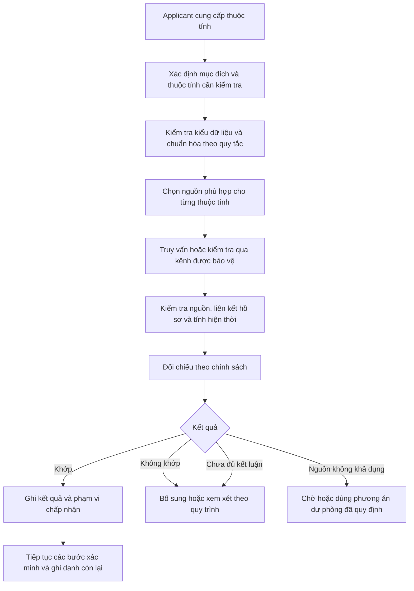

# Attribute validation

## Mục tiêu bài học

Trong identity proofing, người đăng ký cung cấp nhiều thuộc tính như họ tên, ngày sinh, địa chỉ, mã nhân viên hoặc quan hệ với một tổ chức. Dữ liệu có vẻ hợp lý chưa đủ để hệ thống tin và sử dụng cho việc ghi danh. **Attribute validation** giúp đánh giá một giá trị thuộc tính có được nguồn phù hợp xác nhận hay không, trong phạm vi và thời điểm nào.

Sau bài này, bạn có thể:

- Phân biệt kiểm tra thuộc tính với kiểm tra định dạng và xác minh người đang đăng ký.
- Chọn nguồn phù hợp cho từng loại thuộc tính thay vì tin mọi dữ liệu từ cùng một nơi.
- Xử lý kết quả khớp, không khớp, chưa đủ kết luận và lỗi truy vấn nguồn.
- Lưu nguồn gốc, thời điểm và phạm vi của quyết định mà không sao chép dữ liệu nhạy cảm không cần thiết.
- Sử dụng thuộc tính đã được kiểm tra trong IAM, đồng thời giữ riêng quyết định xác thực và cấp quyền.

## 1. Thuộc tính, giá trị và lời khai

**Thuộc tính danh tính** là đặc điểm hoặc thông tin gắn với một chủ thể trong một ngữ cảnh. Ví dụ:

- Họ tên và ngày sinh phục vụ phân biệt các hồ sơ con người.
- Địa chỉ liên hệ phục vụ một mục đích nghiệp vụ cụ thể.
- Mã nhân viên và trạng thái quan hệ lao động phục vụ hệ thống nội bộ.
- Tổ chức và đơn vị công tác phục vụ mô hình quản lý tài khoản doanh nghiệp.

Cần phân biệt ba thành phần:

| Thành phần | Ví dụ | Ý nghĩa |
|---|---|---|
| Tên thuộc tính | `employmentStatus` | Hệ thống đang cần biết điều gì |
| Giá trị được khai | `ACTIVE` | Người đăng ký hoặc một hệ thống nói thuộc tính có giá trị nào |
| Cơ sở chấp nhận | Hồ sơ nhân sự được phép cung cấp dữ liệu, kiểm tra tại một thời điểm xác định | Vì sao bên sử dụng có thể tin giá trị đó cho mục đích cụ thể |

Một trường được điền đầy đủ mới tạo ra dữ liệu đầu vào. Khi applicant tự nhập “đang là nhân viên”, đó là **lời khai về một thuộc tính**, chưa phải kết quả kiểm tra.

Attribute validation là quá trình đối chiếu hoặc kiểm tra giá trị đó bằng nguồn, bằng chứng và quy tắc phù hợp. Mục tiêu là đưa ra kết luận có căn cứ: chấp nhận được, không khớp hoặc chưa đủ thông tin để kết luận.

Không phải mọi thuộc tính đều cần kiểm tra theo cùng một cách. Một tên hiển thị có thể cho phép tự khai; trạng thái nhân viên dùng để mở quyền nội bộ cần cơ sở đáng tin cậy hơn. Mức kiểm tra phải gắn với mục đích sử dụng và hậu quả khi chấp nhận sai.

## 2. Phân biệt các loại kiểm tra

| Hoạt động | Câu hỏi chính | Ví dụ | Điều chưa chứng minh được |
|---|---|---|---|
| Kiểm tra định dạng | Giá trị có đúng kiểu và cấu trúc không? | Ngày hợp lệ theo định dạng đã quy định | Ngày sinh đó thực sự thuộc về applicant |
| Chuẩn hóa | Các biểu diễn có thể được so sánh theo quy tắc nào? | Đưa ngày về cách biểu diễn thống nhất | Hai hồ sơ chắc chắn là cùng một người |
| Attribute validation | Giá trị có được nguồn phù hợp hỗ trợ hoặc xác nhận không? | Đối chiếu trạng thái nhân viên với hệ thống nhân sự | Người đang thao tác chính là nhân viên trong hồ sơ |
| Kiểm tra bằng chứng | Bằng chứng được sử dụng có đáng tin cậy không? | Kiểm tra nguồn phát hành, tính toàn vẹn và nội dung liên quan | Người đang cầm bằng chứng là chủ thể được mô tả |
| Xác minh mối liên hệ với applicant | Applicant có phải người mà hồ sơ hoặc bằng chứng nói đến không? | Thực hiện bước xác minh phù hợp để gắn người đăng ký với danh tính được khai | Chủ thể được cấp mọi quyền trong ứng dụng |
| Authentication | Người truy cập có kiểm soát authenticator đã gắn với tài khoản không? | Đăng nhập bằng passkey đã đăng ký | Mọi thuộc tính ngoài đời của tài khoản đều đúng |
| Authorization | Chủ thể có được thực hiện hành động này không? | Cho đọc hồ sơ nhân sự của chính mình | Quyết định này đúng cho mọi tài nguyên và mọi thời điểm |

Các hoạt động có thể được kết hợp trong một luồng, nhưng cần giữ rõ ý nghĩa của kết quả. Kiểm tra bằng chứng và kiểm tra thuộc tính cũng có thể hỗ trợ nhau: bằng chứng đáng tin cung cấp dữ liệu để đối chiếu thuộc tính; đối chiếu nguồn phù hợp giúp đánh giá nội dung của bằng chứng.

### Ví dụ: email đã được xác nhận

Applicant nhập địa chỉ email và mở liên kết gửi tới hộp thư đó. Hệ thống có cơ sở cho rằng người thực hiện đang kiểm soát hộp thư tại thời điểm kiểm tra.

Kết quả này không tự xác nhận họ tên, tuổi, quan hệ lao động hay quyền đại diện tổ chức. Hộp thư có tên miền công ty cũng chưa đủ để kết luận tài khoản thuộc một nhân viên đang làm việc; tài khoản có thể dành cho cộng tác viên, được dùng chung hoặc chưa được thu hồi đúng lúc.

Vì vậy, nên ghi nhận đúng điều đã kiểm tra, chẳng hạn “đã xác nhận quyền kiểm soát email”, thay vì dùng nhãn chung “danh tính đã xác minh”.

## 3. Nguồn phù hợp phụ thuộc vào từng thuộc tính

Một nguồn có thể đáng tin cậy cho thuộc tính A nhưng không có thẩm quyền xác nhận thuộc tính B.

### 3.1. Nguồn có thẩm quyền trong phạm vi nghiệp vụ

Đây là nguồn chịu trách nhiệm phát hành hoặc duy trì thông tin liên quan trong một phạm vi xác định. Ví dụ, hệ thống nhân sự của tổ chức có thể là nguồn quyết định cho mã nhân viên, đơn vị công tác và trạng thái quan hệ lao động của tổ chức đó.

Điều này không có nghĩa hệ thống nhân sự có thẩm quyền xác nhận mọi thông tin khác. Một địa chỉ liên hệ trong hồ sơ nhân sự có thể chỉ do nhân viên tự cập nhật và chưa trải qua kiểm tra độc lập.

### 3.2. Nguồn bổ trợ đáng tin cậy

Một nguồn có thể cung cấp thông tin hữu ích nhưng không trực tiếp quản lý thuộc tính gốc. Khi dùng nguồn bổ trợ, cần biết dữ liệu đến từ đâu, được kiểm tra như thế nào, cập nhật bao lâu và có phù hợp với quần thể người dùng của dịch vụ không.

Hai nguồn bổ trợ cùng sao chép dữ liệu từ một hệ thống gốc không tạo thành hai xác nhận độc lập. Nếu dữ liệu gốc sai hoặc cũ, cả hai có thể cùng lặp lại sai sót đó.

### 3.3. Thông tin tự khai

Thông tin tự khai có ích để bắt đầu tìm hồ sơ hoặc phục vụ các chức năng không cần độ tin cậy cao. Tuy nhiên, không nên biến nó thành thuộc tính đã được xác nhận chỉ vì người dùng đã đăng nhập hoặc trường dữ liệu được lưu trong cơ sở dữ liệu nội bộ.

Ví dụ, người dùng tự nhập chức danh “quản trị viên” vào hồ sơ cá nhân không được làm phát sinh vai trò quản trị hệ thống.

### 3.4. Thuộc tính từ nhà cung cấp danh tính

Trong SSO hoặc liên kết danh tính, ứng dụng có thể nhận các thuộc tính từ nhà cung cấp danh tính. Cần kiểm tra cả hai lớp:

1. **Thông điệp có hợp lệ không?** Đến từ nhà phát hành đã được cấu hình tin cậy, dành cho bên nhận phù hợp và đáp ứng các kiểm tra của giao thức.
2. **Thuộc tính có ý nghĩa tin cậy nào?** Nhà phát hành đã xác minh nội dung đó bằng quy trình nào và có được tổ chức cho phép làm nguồn của thuộc tính đó không?

Chữ ký hợp lệ bảo vệ nguồn phát hành và tính toàn vẹn của thông điệp. Chữ ký không tự bảo đảm mọi thuộc tính bên trong đều đã được đối chiếu với nguồn ngoài đời, cũng không bảo đảm giá trị luôn còn đúng sau thời điểm phát hành.

## 4. Sáu chiều cần đánh giá khi kiểm tra thuộc tính

### 4.1. Ý nghĩa và phạm vi

Hai trường có cùng tên chưa chắc có cùng nghĩa. `address` có thể là nơi cư trú, địa chỉ nhận thư hoặc địa chỉ làm việc. `employeeStatus` có thể biểu diễn trạng thái hợp đồng, trạng thái hồ sơ hoặc khả năng đăng nhập.

Trước khi đối chiếu, cần xác định đúng ý nghĩa nghiệp vụ. Một kết quả khớp trên trường sai nghĩa không đáp ứng yêu cầu kiểm tra.

### 4.2. Nguồn gốc và thẩm quyền

Nguồn nào đang xác nhận giá trị? Nguồn đó chịu trách nhiệm cho thuộc tính trong tổ chức và phạm vi nào? Dữ liệu được lấy trực tiếp, từ bản sao được kiểm soát hay từ nội dung người dùng tự tải lên?

Không nên coi ảnh chụp một trang hiển thị kết quả là tương đương với phản hồi trực tiếp từ hệ thống nguồn. Kênh truyền và cách kiểm tra tính toàn vẹn ảnh hưởng đến mức tin cậy của kết quả.

### 4.3. Tính hiện thời

Cần phân biệt:

- Thời điểm ứng dụng nhận hoặc kiểm tra dữ liệu.
- Thời điểm nguồn cập nhật dữ liệu.
- Thời điểm giá trị có hiệu lực, nếu thuộc tính có hiệu lực theo thời gian.

Một truy vấn thành công lúc 10 giờ không chứng minh bản ghi đã được cập nhật lúc 10 giờ. Người sẽ bắt đầu làm việc vào tuần tới có thể đã có hồ sơ nhân sự nhưng chưa đáp ứng điều kiện quyền dành cho nhân viên hiện tại.

Không có một thời hạn làm mới phù hợp cho mọi thuộc tính. Ngày sinh thường ít thay đổi hơn đơn vị công tác; trạng thái tài khoản hoặc quan hệ lao động có thể cần được cập nhật gần thời điểm ra quyết định truy cập.

### 4.4. Mức độ khớp và chất lượng dữ liệu

Kết quả khớp cần dựa trên quy tắc đã xác định, không chỉ dựa vào cảm giác “trông giống nhau”. Cần xem xét khả năng thiếu trường, lỗi nhập liệu, tên có dấu, nhiều thành phần tên hoặc cách viết địa chỉ khác nhau.

Khớp chính xác cũng chưa chắc là đủ nếu thuộc tính không có khả năng phân biệt chủ thể. Nhiều người có thể có cùng họ tên và ngày sinh. Không nên mặc định tổ hợp hai trường đó là mã định danh duy nhất.

### 4.5. Liên kết với đúng hồ sơ

Phản hồi xác nhận một thuộc tính phải thuộc về đúng hồ sơ đang được xử lý. Cần ràng buộc yêu cầu và kết quả với mã hồ sơ đăng ký, chủ thể tham chiếu, tổ chức và lần kiểm tra liên quan.

Ngay cả khi đã tìm đúng bản ghi nguồn, hệ thống vẫn cần bước phù hợp để xác minh applicant là người gắn với bản ghi đó. Kiểm tra tính đúng đắn của dữ liệu và chứng minh người đang đăng ký là chủ thể của dữ liệu là hai yêu cầu liên quan nhưng khác nhau.

### 4.6. Mức cần thiết cho mục đích sử dụng

Chỉ thu thập và kiểm tra những thuộc tính cần cho quyết định. Nếu dịch vụ chỉ cần xác nhận người dùng thuộc tổ chức được phép tham gia, việc thu thập thêm địa chỉ nhà hoặc bản sao bằng chứng không liên quan có thể làm tăng rủi ro mà không cải thiện quyết định.

Một thiết kế phù hợp thường cung cấp kết quả hoặc thuộc tính tối thiểu cần thiết cho ứng dụng nghiệp vụ, đồng thời bảo vệ dữ liệu gốc ở phạm vi hạn chế hơn.

## 5. Luồng attribute validation trong identity proofing



### Bước 1: Định nghĩa chính sách trước khi so sánh

Với mỗi thuộc tính, chính sách cần làm rõ:

- Mục đích sử dụng và hậu quả nếu chấp nhận sai.
- Nguồn được phép cung cấp dữ liệu và phạm vi tin cậy.
- Cách liên kết hồ sơ đăng ký với bản ghi nguồn.
- Quy tắc so sánh, yêu cầu về tính hiện thời và cách xử lý thiếu dữ liệu.
- Điều kiện cần người xem xét hoặc cần một phương án xác minh khác.

Không nên để nhân viên hỗ trợ tự quyết từng trường hợp mà không có tiêu chí hoặc quyền xử lý được phân công.

### Bước 2: Kiểm tra đầu vào và chuẩn hóa có kiểm soát

Chuẩn hóa giúp giảm khác biệt về cách biểu diễn, nhưng không được làm mất ý nghĩa quan trọng.

| Loại dữ liệu | Cách xử lý hữu ích | Điều cần tránh |
|---|---|---|
| Ngày | Quy định định dạng đầu vào rõ ràng và kiểm tra ngày hợp lệ | Tự đoán ngày/tháng khi biểu diễn có thể hiểu theo nhiều cách |
| Họ tên | Hỗ trợ Unicode và quy tắc so sánh phù hợp với đối tượng người dùng | Xóa mọi dấu hoặc bỏ thành phần tên rồi tự kết luận hai người là một |
| Mã nhân viên | Kiểm tra theo đặc tả của hệ thống phát hành và phạm vi tổ chức | Xóa số 0 đầu hoặc đổi kiểu dữ liệu làm biến đổi mã |
| Địa chỉ | Phân biệt loại địa chỉ và chuẩn hóa theo cấu trúc dữ liệu đã chọn | Coi mọi cách viết gần giống là cùng nơi cư trú |
| Email | Kiểm tra cấu trúc và xử lý theo chính sách của hệ thống liên quan | Tự bỏ dấu chấm hoặc phần sau dấu cộng cho mọi nhà cung cấp |

Nếu cần giữ dữ liệu trước và sau chuẩn hóa để giải trình, việc lưu giữ vẫn phải theo mục đích và thời gian cần thiết. Không phải bản ghi nào cũng cần sao chép nguyên đầu vào vào log.

### Bước 3: Kiểm tra nguồn và đối chiếu

Máy chủ thực hiện hoặc kiểm soát bước lấy kết quả. Nếu tích hợp với dịch vụ ngoài, cần kiểm tra nguồn phản hồi, tính toàn vẹn và việc phản hồi thuộc đúng yêu cầu đã gửi.

Không nhận một tham số do trình duyệt tự khai như `attributeValidated=true` làm bằng chứng thành công. Cũng không cho applicant tùy ý chọn một hồ sơ nguồn khác bằng cách thay mã trong yêu cầu.

Quy tắc so sánh có thể khác nhau theo từng trường. Một mã được hệ thống nguồn phát hành thường cần so sánh theo đặc tả chính xác; họ tên có thể cần xử lý khác biệt cách biểu diễn. Nếu dùng so khớp gần đúng, phải có ngưỡng, cơ chế xử lý không chắc chắn và kiểm soát phù hợp. Điểm tương đồng không tự trở thành bằng chứng chắc chắn rằng hai hồ sơ thuộc cùng người.

### Bước 4: Ghi kết quả theo từng thuộc tính

Kết quả cần đủ chi tiết để không biến “một số trường đạt” thành “toàn bộ danh tính đạt”. Ví dụ, trạng thái quan hệ lao động có thể được nguồn nhân sự xác nhận trong khi địa chỉ liên hệ vẫn là thông tin tự khai.

Những trạng thái minh họa sau giúp giữ đúng ý nghĩa:

| Kết quả | Cách hiểu | Hướng xử lý thường gặp |
|---|---|---|
| `MATCH` | Giá trị đáp ứng quy tắc đối chiếu trong phạm vi đã định | Tiếp tục nếu những điều kiện bắt buộc khác cũng đáp ứng |
| `MISMATCH` | Có khác biệt theo quy tắc và nguồn đang sử dụng | Yêu cầu sửa, bổ sung hoặc xem xét theo chính sách |
| `INCONCLUSIVE` | Dữ liệu hoặc mức phân biệt chưa đủ để kết luận | Bổ sung cơ sở hoặc chọn phương án phù hợp khác |
| `SOURCE_UNAVAILABLE` | Không lấy được kết quả đáng tin từ nguồn | Chờ, thử lại có kiểm soát hoặc dùng phương án dự phòng đã quy định |

Đây là tên trạng thái minh họa, không phải tập trạng thái bắt buộc. Trường hợp nguồn không có bản ghi cũng cần được diễn giải theo độ bao phủ và ý nghĩa phản hồi của nguồn. “Không tìm thấy” không tự đồng nghĩa thông tin người dùng là giả.

### Bước 5: Ra quyết định cho bước kế tiếp

Kết quả đối chiếu là đầu vào của quá trình proofing. Nếu thuộc tính bắt buộc chưa đủ cơ sở, không được mặc nhiên chuyển thành đạt chỉ để hoàn tất luồng.

Hệ thống có thể giữ hồ sơ ở trạng thái chờ, yêu cầu bổ sung hoặc chuyển xử lý thủ công. Một dịch vụ cho phép chức năng giới hạn trước khi hoàn tất phải quy định rõ phạm vi đó; sự cố truy vấn nguồn không được tự mở quyền vốn yêu cầu kết quả kiểm tra thành công.

## 6. Ví dụ: kiểm tra thuộc tính trong cổng nhân viên

Giả sử cổng nội bộ cần ghi danh nhân viên mới và có hệ thống nhân sự làm nguồn cho quan hệ lao động. Người đăng ký khai tên, mã nhân viên và email liên hệ.

### 6.1. Xác định đúng dữ liệu cần sử dụng

| Thuộc tính hoặc điều kiện | Nguồn/cơ chế kiểm tra | Phạm vi kết luận |
|---|---|---|
| Mã nhân viên thuộc tổ chức | Hệ thống nhân sự trong tổ chức tương ứng | Bản ghi mã đó tồn tại và liên kết với hồ sơ nguồn cụ thể |
| Tên theo hồ sơ nhân sự | Đối chiếu với hồ sơ nguồn đã liên kết | Giá trị khai phù hợp với dữ liệu nhân sự theo quy tắc so sánh |
| Quan hệ lao động đang hiệu lực | Trạng thái và thời gian hiệu lực tại nguồn nhân sự | Hồ sơ đáp ứng điều kiện quan hệ lao động tại thời điểm đánh giá |
| Quyền kiểm soát email | Hoàn thành thử thách gửi tới hộp thư | Người thực hiện kiểm soát hộp thư trong lần kiểm tra |
| Đơn vị công tác | Nguồn nhân sự được tổ chức chỉ định | Đơn vị công tác theo dữ liệu nguồn tại thời điểm liên quan |

Việc applicant biết một mã nhân viên hợp lệ chưa chứng minh applicant là người gắn với mã đó. Nếu có lời mời ghi danh liên kết sẵn với hồ sơ nhân sự, hệ thống cần bảo vệ lời mời và kiểm tra mối liên hệ đó; không chỉ tin mã nhân viên được gõ lại trên giao diện.

### 6.2. Trường hợp khớp nhưng chưa thể hoàn tất ghi danh

Tên và mã nhân viên khớp với nguồn. Tuy nhiên, applicant chưa hoàn thành bước xác minh mối liên hệ với danh tính trong hồ sơ, hoặc chưa đăng ký authenticator theo chính sách.

Hệ thống nên ghi nhận các thuộc tính đã đạt yêu cầu đối chiếu và tiếp tục những bước còn thiếu. Không nên kích hoạt tài khoản sử dụng bình thường chỉ vì một dịch vụ đối chiếu trả về thành công.

### 6.3. Trường hợp tên khác cách biểu diễn

Nguồn nhân sự lưu tên có dấu, còn applicant nhập tên không dấu. Đây có thể là khác biệt nhập liệu, cũng có thể dẫn đến nhầm người nếu chỉ so sánh gần đúng.

Hệ thống áp dụng quy tắc đã định và sử dụng thêm cơ sở phù hợp. Nếu chưa đủ phân biệt, hồ sơ cần được bổ sung hoặc xem xét. Không tự sửa tên trong nguồn nhân sự để làm kết quả khớp.

### 6.4. Trường hợp nhân viên chưa đến ngày bắt đầu

Nguồn có hồ sơ và mã nhân viên hợp lệ, nhưng quan hệ lao động có hiệu lực từ tuần sau. Tùy chính sách, người đó có thể được dùng một số chức năng chuẩn bị onboarding, còn quyền nội bộ chính thức chỉ có hiệu lực từ ngày bắt đầu.

Điều này cho thấy “thuộc tính có bản ghi hợp lệ” và “điều kiện cấp quyền đang được đáp ứng” là hai kết luận khác nhau.

### 6.5. Trường hợp nguồn nhân sự bị gián đoạn

Không truy vấn được nguồn là lỗi vận hành, chưa phải kết luận applicant khai sai. Hồ sơ có thể chờ kiểm tra lại hoặc được chuyển sang phương án dự phòng có kiểm soát.

Nếu nguồn không khả dụng, không tự cấp vai trò `employee` dựa trên tên miền email. Phương án dự phòng phải bảo đảm mức kiểm soát phù hợp với quyết định cần thực hiện.

## 7. Mô hình hóa kết quả và nguồn gốc

Ví dụ dưới đây dùng mã và thời điểm giả để minh họa cấu trúc kết quả. Dữ liệu không phải định dạng giao thức hay tiêu chuẩn bắt buộc.

```json
{
  "applicationId": "app_demo_57",
  "organizationId": "org_demo_3",
  "validationPolicyId": "employee-attributes-v1",
  "checks": [
    {
      "attribute": "employeeId",
      "result": "MATCH",
      "sourceId": "hr-system-demo",
      "sourceRecordReference": "hr_record_demo_21",
      "sourceUpdatedAt": "2026-01-15T07:00:00Z",
      "checkedAt": "2026-01-15T08:00:00Z"
    },
    {
      "attribute": "employmentStatus",
      "result": "MATCH",
      "sourceId": "hr-system-demo",
      "sourceRecordReference": "hr_record_demo_21",
      "effectiveFrom": "2026-01-10T00:00:00Z",
      "checkedAt": "2026-01-15T08:00:00Z"
    }
  ],
  "decision": "REQUIRED_ATTRIBUTES_VALIDATED",
  "correlationId": "corr_demo_62"
}
```

Một số điểm thiết kế cần giữ rõ:

- `applicationId` gắn quyết định với đúng hồ sơ; `organizationId` giúp xác định phạm vi tổ chức.
- `validationPolicyId` cho biết kết quả được đánh giá theo bộ quy tắc nào.
- `sourceId` và mã tham chiếu hỗ trợ truy vết nguồn; bản thân những mã này vẫn cần được kiểm soát truy cập.
- `sourceUpdatedAt` khác `checkedAt`. Chỉ lưu thời điểm cập nhật nguồn nếu nguồn thực sự cung cấp và định nghĩa ý nghĩa của nó.
- `effectiveFrom` minh họa thuộc tính có thời điểm hiệu lực; nếu có thời điểm kết thúc hiệu lực, quyết định cũng phải xét đến.
- Kết luận cấp tổng thể chỉ nói những thuộc tính bắt buộc đã đáp ứng chính sách; nó không tự xác nhận mọi thuộc tính khác hoặc hoàn tất toàn bộ identity proofing.

Ứng dụng không nhất thiết phải sao chép toàn bộ giá trị nguồn vào kết quả. Có thể lưu kết luận cùng tham chiếu được bảo vệ, hoặc chỉ truyền thuộc tính tối thiểu mà bên nhận cần. Khả năng giải trình và nhu cầu lưu giữ phải được cân đối với việc giảm dữ liệu nhạy cảm.

## 8. Logic quyết định minh họa

Đoạn giả mã sau cho thấy cách giữ riêng lỗi nguồn, kết quả không khớp và tiến độ proofing. Nó không phải mã triển khai hoàn chỉnh.

```text
kiemTraThuocTinh(hoSo, chinhSach):
    xacNhanYeuCauThuocDungHoSoVaToChuc()
    danhSachKetQua = []

    voi moi thuocTinhBatBuoc trong chinhSach:
        nguon = chonNguonDuocPhep(thuocTinhBatBuoc)
        phanHoi = truyVanNguon(nguon, thamChieuDaDuocKiemSoat)

        neu khongNhanDuocPhanHoiDangTinCay(phanHoi):
            ghiKetQua(SOURCE_UNAVAILABLE)
            tiepTucThuocTinhKeTiep()

        neu khongGanDuocVoiDungHoSo(phanHoi):
            dungXuLyVaGhiNhanSuCoLienKet()

        neu duLieuKhongDuHoacKhongDapUngYeuCauHienThoi(phanHoi):
            ghiKetQua(INCONCLUSIVE)
            tiepTucThuocTinhKeTiep()

        ghiKetQua(doiChieuTheoQuyTac(hoSo, phanHoi, chinhSach))

    neu moiThuocTinhBatBuocDeuDat(danhSachKetQua):
        traVe(ATTRIBUTES_VALIDATED)

    traVe(quyetDinhXuLyTiepTheoChinhSach(danhSachKetQua))
```

Trong triển khai thực tế, cần bảo đảm việc ghi kết quả và chuyển bước không bị sai khi có yêu cầu gửi lại hoặc xử lý đồng thời. Callback cũ hoặc kết quả của một lần kiểm tra khác không được áp dụng nhầm sang hồ sơ hiện tại.

Khi có kết quả `ATTRIBUTES_VALIDATED`, luồng ghi danh vẫn phải đánh giá những điều kiện còn lại như xác minh applicant, gắn authenticator và kích hoạt tài khoản theo chính sách. Đây không phải tín hiệu trực tiếp để cấp mọi quyền nghiệp vụ.

## 9. Sử dụng thuộc tính sau khi ghi danh

### 9.1. Thuộc tính có vòng đời

Một giá trị đã được kiểm tra có thể thay đổi. Nhân viên chuyển phòng ban, thay đổi tên, đổi địa chỉ hoặc kết thúc quan hệ lao động. Hệ thống cần biết thuộc tính nào cần cập nhật theo sự kiện, thuộc tính nào cần làm mới và bên nào chịu trách nhiệm sửa nguồn gốc.

Khi có tranh chấp hoặc sai dữ liệu, người dùng cần một đường xử lý phù hợp. Sửa giá trị trong một ứng dụng con không bảo đảm các hệ thống khác nhận được giá trị đúng nếu nguồn được chỉ định vẫn giữ dữ liệu cũ.

### 9.2. RBAC và ABAC

Trong RBAC, thuộc tính đã được kiểm tra có thể là đầu vào để đề xuất hoặc gán vai trò theo chính sách. Trong ABAC, thuộc tính có thể được dùng trực tiếp làm điều kiện của quyết định truy cập.

Ví dụ, phòng ban của người dùng có thể góp phần xác định phạm vi tài liệu được đọc. Tuy nhiên, chính sách vẫn cần xác định ai được đọc loại tài liệu nào và khi nào. Thuộc tính `department=Finance` không tự có nghĩa người dùng được xem mọi dữ liệu tài chính.

Không để người dùng chỉnh sửa thuộc tính hồ sơ cá nhân rồi hệ thống tự coi giá trị đó là nguồn cấp quyền đáng tin cậy. Các thuộc tính ảnh hưởng đặc quyền cần có nguồn cập nhật và quyền thay đổi được kiểm soát.

### 9.3. SSO, token và phiên

Token hoặc phiên có thể giữ một bản chụp thuộc tính tại thời điểm phát hành. Nếu trạng thái công việc hoặc quyền thay đổi sau đó, bản chụp có thể cũ dù token vẫn hợp lệ về kỹ thuật.

Thiết kế phải xác định cách xử lý thay đổi: thời hạn phù hợp, làm mới dữ liệu, đánh giá lại từ máy chủ, thu hồi phiên hoặc cơ chế đồng bộ theo sự kiện tùy kiến trúc. Với quyết định nhạy cảm, không nên mặc định tin vô thời hạn một thuộc tính được đưa vào phiên từ lúc ghi danh.

MFA có thể tăng độ tin cậy vào việc người truy cập kiểm soát phương tiện xác thực phù hợp. MFA không tự sửa một thuộc tính sai hoặc làm mới một quan hệ lao động đã hết hiệu lực.

### 9.4. Danh tính workload

Với danh tính workload, những thuộc tính như môi trường chạy, dự án sở hữu và chủ thể vận hành cũng cần nguồn đáng tin cậy. Nhãn do workload tự gửi lên không nên tự động được dùng để cấp quyền đặc biệt.

Nguồn xác nhận thường thuộc hệ thống cấp phát, nền tảng chạy hoặc cơ chế chứng thực phù hợp, thay vì quy trình thu thập bằng chứng dành cho con người. Nguyên tắc chung vẫn giữ nguyên: biết ai xác nhận thuộc tính, xác nhận trong phạm vi nào và dữ liệu có đủ hiện thời để sử dụng không.

## 10. Những lỗi thường gặp

| Lỗi | Vì sao nguy hiểm | Hướng thiết kế phù hợp |
|---|---|---|
| Coi kiểm tra định dạng là xác nhận nội dung | Dữ liệu giả vẫn có thể đúng mẫu | Giữ riêng kết quả định dạng và kết quả đối chiếu nguồn |
| Dùng một cờ `verified` cho mọi thuộc tính | Bên nhận không biết trường nào được kiểm tra và bằng cách nào | Lưu phạm vi, nguồn và thời điểm theo thuộc tính hoặc nhóm kiểm tra rõ ràng |
| Tin mọi trường từ nhà cung cấp SSO như nhau | Một số trường có thể chỉ là thông tin tự khai | Xác định ý nghĩa và quy trình của từng thuộc tính nhận được |
| Tự gộp tài khoản theo tên hoặc email | Có thể gắn nhầm danh tính và quyền | Dùng liên kết chủ thể được kiểm soát cùng quy trình liên kết tài khoản phù hợp |
| Coi hai bản sao cùng nguồn là hai xác nhận độc lập | Không giảm được rủi ro sai từ nguồn gốc | Theo dõi nguồn gốc và mức độc lập của các nguồn |
| Coi lỗi mạng là thông tin giả | Từ chối sai người dùng do sự cố vận hành | Tách lỗi nguồn khỏi kết quả đối chiếu nghiệp vụ |
| Coi không tìm thấy bản ghi là bằng chứng gian lận | Nguồn có thể thiếu dữ liệu hoặc chưa đồng bộ | Đánh giá độ bao phủ và có đường bổ sung hoặc xem xét |
| Đọc thuộc tính từ trình duyệt để cấp vai trò | Applicant có thể tự sửa yêu cầu | Máy chủ lấy hoặc kiểm tra dữ liệu từ nguồn được phép |
| Ghi nguyên dữ liệu nhạy cảm vào log | Làm tăng bề mặt lộ lọt | Ghi kết quả, mã lý do và tham chiếu tối thiểu cần thiết |
| Dùng kết quả một lần cho mọi quyết định sau này | Thuộc tính động có thể đã thay đổi | Quản lý thời điểm hiệu lực và chính sách làm mới |

## 11. Kiểm toán, bảo vệ dữ liệu và xử lý ngoại lệ

Một quyết định kiểm tra thuộc tính cần đủ dấu vết để giải thích:

- Đã kiểm tra thuộc tính nào của hồ sơ nào và trong tổ chức nào.
- Dùng nguồn và chính sách nào.
- Kết quả là khớp, không khớp, chưa đủ kết luận hay không lấy được dữ liệu.
- Khi nào truy vấn, khi nào quyết định và ai hoặc dịch vụ nào thực hiện.
- Có xử lý thủ công hoặc ngoại lệ nào, do ai có thẩm quyền phê duyệt.

Không cần đưa mật khẩu, OTP, token truy cập, ảnh bằng chứng hoặc toàn bộ phản hồi chứa dữ liệu cá nhân vào log để đạt mục tiêu trên. Trường hợp cần giữ bằng chứng phục vụ xử lý, dữ liệu phải có kiểm soát đọc, bảo vệ tính toàn vẹn và thời gian lưu phù hợp với mục đích.

Kênh tra cứu thuộc tính cũng cần được bảo vệ. Nếu bất kỳ ai có thể gửi tên hoặc mã nhân viên rồi nhận phản hồi chi tiết, hệ thống có thể trở thành công cụ dò tìm sự tồn tại hoặc thông tin của người khác. Cần giới hạn truy vấn theo hồ sơ, phân quyền bên truy vấn, kiểm soát tần suất và mức thông tin trả về.

Đối với người xem xét thủ công, quyền truy cập bằng chứng và quyền sửa kết luận cần phù hợp với nhiệm vụ. Một ngoại lệ cần lý do và dấu vết, không nên chỉ là thao tác sửa trực tiếp cơ sở dữ liệu để làm mọi trường chuyển sang “đạt”. Quyền xử lý ngoại lệ cũng không mặc nhiên bao gồm quyền cấp đặc quyền nghiệp vụ.

## 12. Những điểm cần ghi nhớ

- Attribute validation đánh giá giá trị thuộc tính dựa trên nguồn và quy tắc phù hợp với mục đích sử dụng.
- Đúng định dạng, kiểm soát email và đăng nhập thành công không tự xác nhận toàn bộ danh tính ngoài đời.
- Độ tin cậy phụ thuộc vào ý nghĩa thuộc tính, nguồn gốc, tính hiện thời, chất lượng đối chiếu và liên kết với đúng hồ sơ.
- Kết quả không khớp, chưa đủ kết luận và nguồn không khả dụng cần được giữ riêng để xử lý đúng.
- Thuộc tính đã được kiểm tra là đầu vào cho identity proofing và các chính sách IAM; nó không thay thế xác minh applicant, authentication hoặc authorization.
- Các thuộc tính có vòng đời. Quyền hiện tại cần dựa trên dữ liệu đủ tin cậy và đủ hiện thời cho quyết định đang thực hiện.
