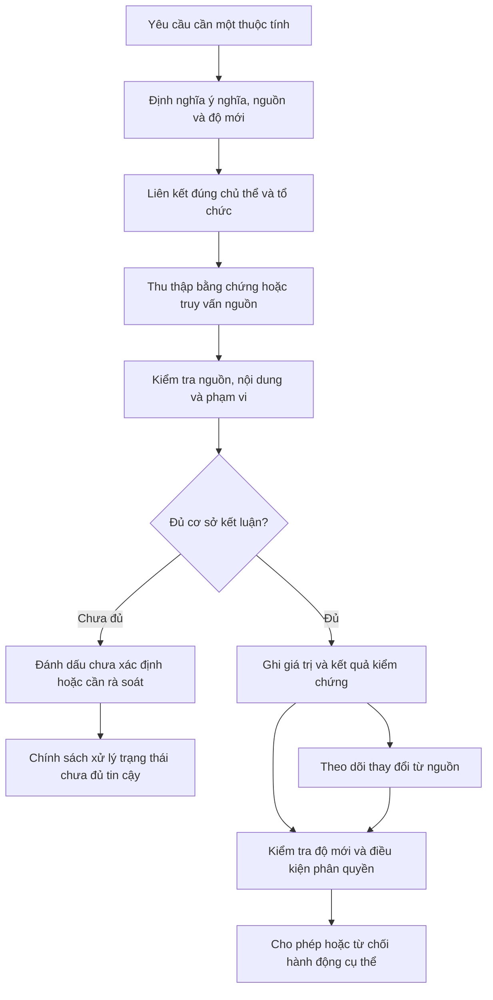

# Attribute verification — Kiểm chứng thuộc tính danh tính

## 1. Vì sao phải kiểm chứng từng thuộc tính?

Một người đăng nhập thành công vào cổng nội bộ và cập nhật hồ sơ cá nhân:

```json
{
  "displayName": "Nguyễn Minh An",
  "department": "Platform",
  "employmentStatus": "active",
  "requestedRole": "administrator"
}
```

Hệ thống biết tài khoản vừa xác thực thành công. Tuy nhiên, việc An tự nhập `department` hoặc `employmentStatus` chưa chứng minh các thông tin đó đúng. `requestedRole` chỉ là một yêu cầu, không phải quyền đã được phê duyệt. Nếu ứng dụng dùng trực tiếp những giá trị này để mở quyền quản trị, người dùng có thể tự cấp đặc quyền bằng cách sửa hồ sơ của mình.

**Attribute verification là quá trình đánh giá bằng chứng để xác định một thuộc tính cụ thể có đúng với một chủ thể cụ thể, trong một phạm vi và tại một thời điểm nhất định hay không.** Trong tiếng Việt, có thể gọi là kiểm chứng thuộc tính. Từ “kiểm chứng” giúp phân biệt hoạt động này với authentication — xác thực bên đang truy cập tài khoản.

Một thuộc tính đã được kiểm chứng luôn cần ngữ cảnh:

- **Thuộc tính nào?** Ví dụ: tình trạng làm việc, đơn vị công tác hoặc quyền kiểm soát một địa chỉ email.
- **Của ai?** Phải gắn với đúng người hoặc thực thể mà tài khoản đại diện.
- **Đúng theo nghĩa nào?** “Có email tên miền công ty” khác “đang là nhân viên của công ty”.
- **Dựa vào nguồn nào?** Nguồn phải phù hợp với loại thông tin cần kiểm chứng.
- **Đúng vào lúc nào?** Một quan hệ có thể đã thay đổi sau lần kiểm tra trước.
- **Dùng cho quyết định nào?** Thuộc tính đủ cho việc hiển thị hồ sơ chưa chắc đủ cho việc cấp đặc quyền.

Trong IAM, kết quả kiểm chứng thuộc tính là đầu vào cho identity proofing, cấp phát tài khoản, RBAC, ABAC và quản lý vòng đời quyền. Giá trị của quá trình nằm ở việc các thành phần sau hiểu được chính xác thông tin nào đáng tin và giới hạn của sự tin cậy đó.

## 2. Phân biệt với các khái niệm gần nhau

### 2.1. Đúng định dạng chưa có nghĩa là đúng sự thật

Một địa chỉ email có thể đúng cú pháp nhưng không tồn tại. Một mã nhân viên có thể đúng số ký tự nhưng thuộc về người khác. Một trường `department` có thể nằm trong danh sách giá trị cho phép nhưng không phản ánh đơn vị của người gửi.

| Hoạt động | Câu hỏi được giải quyết | Ví dụ | Giới hạn |
| --- | --- | --- | --- |
| Kiểm tra định dạng | Giá trị có tuân thủ cấu trúc yêu cầu không? | Email có cấu trúc hợp lệ | Không chứng minh quyền kiểm soát hộp thư |
| Chuẩn hóa dữ liệu | Các hệ thống có biểu diễn giá trị nhất quán không? | Ánh xạ mã phòng ban về mã chuẩn nội bộ | Không chứng minh người dùng thuộc phòng ban đó |
| Attribute verification | Thuộc tính có đúng với đúng chủ thể trong phạm vi xét không? | Đối chiếu đơn vị công tác từ nguồn nhân sự | Không tự cấp quyền truy cập |
| Identity proofing | Có đủ cơ sở gắn một người với danh tính được khai báo không? | Đánh giá bằng chứng và kiểm chứng người tham gia | Không bảo đảm mọi thuộc tính luôn đúng về sau |
| Authentication | Bên đang truy cập có chứng minh được quyền kiểm soát phương thức xác thực gắn với tài khoản không? | Đăng nhập bằng passkey hoặc mật khẩu và MFA | Không tự chứng minh quan hệ lao động hiện tại |
| Authorization | Chủ thể được làm gì với tài nguyên trong ngữ cảnh hiện tại? | Cho phép đọc tài liệu dự án | Phụ thuộc vào chính sách và chất lượng dữ liệu đầu vào |

Kiểm tra định dạng và chuẩn hóa vẫn cần thiết, nhưng chúng không thay thế kiểm chứng nguồn gốc và nội dung của thuộc tính.

### 2.2. Một thuộc tính đạt không làm toàn bộ hồ sơ đạt

Giả sử hệ thống đã kiểm tra người dùng có quyền truy cập hộp thư `an@example.com` tại thời điểm thực hiện. Kết quả đó không tự xác nhận:

- Họ tên trong hồ sơ là danh tính đời thực của người đó.
- Người đó đang làm việc cho tổ chức xuất hiện trong tên miền email.
- Người đó là thành viên của một dự án cụ thể.
- Người đó có quyền quản trị.

Tương tự, hệ thống nhân sự có thể xác nhận tình trạng làm việc nhưng không phải nguồn có thẩm quyền cho mọi quyền truy cập dự án. Một hồ sơ có thể có tên tự khai, email đã kiểm chứng quyền kiểm soát, và quan hệ nhân viên đã được đối chiếu. Ba thuộc tính cần giữ ba ý nghĩa tin cậy riêng.

Vì vậy, một cờ chung như `profileVerified=true` thường thiếu thông tin để ra quyết định truy cập. Hệ thống cần biết thuộc tính nào đã được kiểm chứng, bằng cách nào và còn phù hợp cho mục đích sử dụng hay không.

## 3. Những nhóm thuộc tính thường gặp trong IAM

Không phải mọi nhóm thuộc tính đều được kiểm chứng theo cùng một cách.

| Nhóm | Ví dụ | Cơ sở kiểm chứng thường được xem xét | Điều cần thận trọng |
| --- | --- | --- | --- |
| Thuộc tính nhận dạng | Họ tên, thông tin liên kết với hồ sơ danh tính | Bằng chứng danh tính và nguồn đối chiếu phù hợp | Trùng tên hoặc dữ liệu giống nhau chưa đủ để gộp chủ thể |
| Thuộc tính liên hệ | Địa chỉ email, số điện thoại | Kiểm tra quyền kiểm soát kênh qua quy trình thích hợp | Quyền kiểm soát hiện tại không chứng minh quyền sở hữu vĩnh viễn hay danh tính đời thực |
| Quan hệ với tổ chức | Tình trạng làm việc, đơn vị, loại hợp đồng trong hệ thống nội bộ | Nguồn quản lý quan hệ tương ứng | Quan hệ có thể hết hiệu lực hoặc thay đổi |
| Tư cách thành viên | Thành viên dự án, nhóm nghiệp vụ | Nguồn quản lý thành viên và phê duyệt của phạm vi đó | Thành viên một dự án không đồng nghĩa có quyền ở mọi dự án |
| Vai trò và đặc quyền | Vai trò quản trị, quyền triển khai | Quy trình cấp quyền và nguồn quản lý quyền có thẩm quyền | Vai trò thường là kết quả của chính sách hoặc phê duyệt, không phải thông tin tự khai để tin ngay |
| Thuộc tính ngữ cảnh | Trạng thái thiết bị, môi trường thực thi | Nguồn đo lường hoặc cơ chế chứng thực phù hợp | Độ mới quan trọng; kết quả cũ có thể không phản ánh lần truy cập hiện tại |

Danh sách này giúp xác định ai chịu trách nhiệm cho từng thông tin. Nó không có nghĩa quy trình kiểm chứng danh tính con người có thể áp dụng nguyên xi cho thiết bị hoặc workload. Với dịch vụ nền và tác vụ tự động, cần cơ chế phù hợp để kiểm tra nguồn gốc phần mềm, môi trường và quan hệ sở hữu.

## 4. Nguồn có thẩm quyền và phạm vi tin cậy

### 4.1. Xác định thẩm quyền theo từng thuộc tính

Nguồn có thẩm quyền là nguồn được tổ chức giao trách nhiệm quản lý một loại dữ liệu trong một phạm vi xác định. Thẩm quyền không chỉ phụ thuộc vào việc dữ liệu đến từ bên trong hay bên ngoài hệ thống.

Ví dụ với doanh nghiệp hư cấu Minh Sơn:

- Hệ thống nhân sự quản lý tình trạng làm việc và đơn vị của nhân viên.
- Hệ thống quản lý dự án quản lý thành viên của từng dự án.
- Hệ thống quản lý quyền ghi nhận vai trò đã được phê duyệt.
- Dịch vụ kiểm chứng email ghi nhận lần kiểm tra quyền kiểm soát một hộp thư.
- Biểu mẫu hồ sơ cá nhân ghi nhận thông tin người dùng tự khai.

Cả năm nguồn đều có thể hữu ích, nhưng không thể hoán đổi vai trò. Một bản ghi trong hệ thống chăm sóc khách hàng không tự trở thành bằng chứng người đó là nhân viên. Một người phê duyệt dự án cũng không mặc nhiên có thẩm quyền xác nhận mọi thông tin danh tính của thành viên.

### 4.2. Ba yếu tố để tin một giá trị

Để dùng một giá trị trong IAM, cần xem xét đồng thời:

1. **Thẩm quyền về nội dung:** nguồn có trách nhiệm đối với thuộc tính đó hay không?
2. **Tính xác thực và toàn vẹn của việc truyền nhận:** dữ liệu có thật sự đến từ nguồn đó và được bảo vệ khỏi sửa đổi không?
3. **Liên kết với chủ thể và phạm vi:** bản ghi của nguồn có tương ứng đúng tài khoản, tổ chức và quan hệ đang xét không?

Một phản hồi được ký hợp lệ chỉ hỗ trợ đánh giá nguồn phát hành và tính toàn vẹn theo cơ chế sử dụng. Nó không tự làm cho nguồn trở thành có thẩm quyền về mọi thuộc tính trong phản hồi. Ngược lại, một nguồn có thẩm quyền vẫn có thể bị tích hợp sai hoặc có dữ liệu lỗi cần xử lý.

### 4.3. Đừng đếm số bản sao như các bằng chứng độc lập

Giả sử ba ứng dụng cùng hiển thị An thuộc phòng Platform, nhưng cả ba đều đồng bộ từ một biểu mẫu tự khai. Đây không phải ba nguồn xác nhận độc lập; đó là ba bản sao của cùng một tuyên bố ban đầu.

Khi hợp nhất dữ liệu, cần giữ được nguồn gốc. Nếu chỉ giữ giá trị cuối cùng mà bỏ mất nguồn, ứng dụng có thể vô tình nâng thông tin tự khai thành thuộc tính được tin cậy cho phân quyền.

## 5. Quy trình kiểm chứng thuộc tính

### Bước 1: định nghĩa chính xác điều cần biết

Trước khi thu thập dữ liệu, hãy mô tả ý nghĩa nghiệp vụ của thuộc tính. Ví dụ:

> `employment.status = active` nghĩa là nguồn nhân sự của tổ chức A ghi nhận quan hệ nhân viên hiện đang có hiệu lực đối với chủ thể được liên kết.

Định nghĩa này khác “đã từng làm việc”, “có hồ sơ trong danh bạ” hoặc “có email công ty”. Cũng cần xác định loại quan hệ nào được chấp nhận nếu tổ chức có nhân viên, cộng tác viên và nhà cung cấp.

Chính sách phải chỉ ra nguồn được chấp nhận, điều kiện về độ mới và cách xử lý khi không lấy được thông tin. Những quyết định này nên được xác định trước khi thuộc tính đi vào luật cấp quyền.

### Bước 2: xác lập đúng chủ thể

Ứng dụng cần biết bản ghi đang kiểm tra thuộc về ai. Ưu tiên định danh ổn định và quan hệ ánh xạ được thiết lập có kiểm soát, thay vì ghép hồ sơ chỉ bằng tên hoặc email.

Trong kiến trúc liên kết danh tính, định danh chủ thể cần được hiểu cùng nguồn phát hành và phạm vi tương ứng. Một giá trị định danh từ nhà cung cấp A không tự có cùng ý nghĩa với giá trị giống hệt từ nhà cung cấp B. Khi có nhiều tổ chức cùng dùng hệ thống, việc ánh xạ còn phải giữ đúng ranh giới tổ chức.

Nếu người dùng phải liên kết thêm tài khoản, quy trình liên kết cần có kiểm tra phù hợp. Việc tìm thấy hai email trùng nhau chưa đủ để tự động kết luận đó là cùng một người.

### Bước 3: thu thập bằng chứng hoặc truy vấn nguồn

Hệ thống chỉ lấy dữ liệu cần thiết cho thuộc tính đang xét. Tùy bối cảnh, có thể dùng API của nguồn, một kết quả kiểm chứng từ nhà cung cấp, tài liệu được thẩm định hoặc quy trình rà soát có người thực hiện.

Không cần chuyển toàn bộ hồ sơ nhân sự sang mọi ứng dụng chỉ để ứng dụng biết người dùng còn là nhân viên hay không. Một kết quả có phạm vi rõ ràng có thể đủ, miễn hệ thống nhận hiểu nguồn gốc và ý nghĩa của nó.

### Bước 4: kiểm tra nguồn, bằng chứng và nội dung

Các kiểm tra phụ thuộc vào cơ chế tích hợp, nhưng thường cần giải quyết những câu hỏi sau:

- Phản hồi có đến từ nguồn được chấp nhận không?
- Kết quả có dành cho hệ thống hoặc giao dịch đang xử lý không?
- Bằng chứng có bị sửa đổi, hết hạn hoặc sử dụng lại sai ngữ cảnh không?
- Thuộc tính có thuộc đúng chủ thể và tổ chức đang xét không?
- Ý nghĩa và định dạng giá trị có khớp với mô hình nội bộ không?
- Có dữ liệu mâu thuẫn hoặc dấu hiệu cần rà soát không?

Kiểm tra kỹ thuật của một token hoặc callback phải phù hợp với giao thức đang dùng. Không để trình duyệt tự gửi `verified=true` rồi coi đó là kết quả từ nguồn tin cậy.

### Bước 5: kết luận theo từng thuộc tính

Kết quả không nhất thiết chỉ có “đúng” và “sai”. Có thể chưa đủ bằng chứng, nguồn đang lỗi hoặc thông tin đã quá cũ. Hệ thống cần biểu diễn được những tình huống này thay vì biến mọi trường hợp không xác nhận được thành một giá trị mặc định.

Nếu tài liệu chỉ đủ xác nhận một thuộc tính, không mở rộng kết luận sang các thuộc tính khác. Nếu nguồn nhân sự báo quan hệ đã chấm dứt, cần ghi nhận giá trị đó theo đúng ngữ nghĩa, không chỉ giữ một cờ “đã kiểm chứng” từ quá khứ.

### Bước 6: lưu nguồn gốc và bàn giao cho chính sách IAM

Kết quả được gắn với đúng chủ thể, kèm nguồn và thời điểm đánh giá. Thành phần cấp quyền sau đó quyết định liệu kết quả có đáp ứng yêu cầu của hành động đang xét hay không.



## 6. Mô hình dữ liệu: giá trị phải đi cùng trạng thái kiểm chứng

Một bản ghi thuộc tính nên tách **giá trị nghiệp vụ** khỏi **trạng thái kiểm chứng**. Ví dụ nội bộ dưới đây chỉ minh họa cách mô hình hóa, không phải định dạng chuẩn của một giao thức:

```json
{
  "subjectId": "usr_demo_0042",
  "organizationId": "org_demo_a",
  "attributeName": "employment.status",
  "value": "active",
  "verificationStatus": "verified",
  "source": {
    "systemId": "hr_demo_a",
    "recordReference": "person_demo_018"
  },
  "sourceEffectiveAt": "2026-05-20T00:00:00Z",
  "verifiedAt": "2026-05-20T08:30:00Z",
  "verificationPolicyId": "employee-status-check-v1",
  "transactionId": "attr_demo_0097"
}
```

Các trường có vai trò khác nhau:

- `subjectId` và `organizationId` xác định thuộc tính đang nói về ai, trong tổ chức nào.
- `attributeName` có ý nghĩa đã được định nghĩa, tránh các tên mơ hồ như `valid` hoặc `trusted`.
- `value` là kết luận về nội dung nghiệp vụ.
- `verificationStatus` mô tả tình trạng kiểm chứng của kết luận đó.
- `source` cho biết cơ sở đối chiếu và tham chiếu tới bản ghi phù hợp; tham chiếu này cũng cần được bảo vệ.
- `sourceEffectiveAt` biểu thị thời điểm giá trị bắt đầu có hiệu lực theo nguồn trong ví dụ này.
- `verifiedAt` là thời điểm hệ thống thực hiện thành công việc kiểm tra theo chính sách được ghi nhận.
- `verificationPolicyId` hỗ trợ hiểu điều kiện và phương pháp đã được dùng.
- `transactionId` hỗ trợ đối soát lần xử lý; nó không tự thay thế cơ chế bảo vệ giao dịch hoặc chống phát lại.

Nếu hệ thống biết thời điểm hết hiệu lực, có thể lưu thêm thông tin đó theo mô hình đã thống nhất. Nếu không biết, không tự suy ra rằng thuộc tính có hiệu lực vô hạn. Việc lưu nguồn gốc và lịch sử phải cân bằng với nhu cầu bảo vệ dữ liệu và thời gian lưu cần thiết.

### 6.1. Một mô hình trạng thái minh họa

| Trạng thái | Ý nghĩa | Điều không nên suy diễn |
| --- | --- | --- |
| `self_asserted` | Người dùng hoặc bên gửi tự khai | Giá trị đã được nguồn độc lập xác nhận |
| `pending` | Yêu cầu đang được kiểm tra | Có thể cấp ngay quyền phụ thuộc vào kết quả |
| `verified` | Đã đáp ứng chính sách kiểm chứng được ghi nhận | Mọi chính sách khác đều chấp nhận, hoặc giá trị đúng mãi mãi |
| `stale` | Kết quả trước đây không còn đủ mới cho mục đích đang xét | Giá trị chắc chắn đã sai |
| `disputed` | Có mâu thuẫn cần xử lý | Tự chọn một nguồn bất kỳ để tiếp tục |
| `unknown` | Chưa có đủ cơ sở kết luận | Giá trị mặc định là đúng hoặc sai |

Tên trạng thái có thể khác trong triển khai thực tế. Điều cần giữ là sự khác biệt về ý nghĩa và cách chính sách sử dụng chúng.

### 6.2. “Đã kiểm chứng” không đồng nghĩa “đủ điều kiện”

Hai bản ghi sau đều có thể đã được kiểm chứng thành công:

```text
employment.status = active       verificationStatus = verified
employment.status = terminated   verificationStatus = verified
```

Bản ghi thứ hai cho biết hệ thống đã kiểm tra và có cơ sở tin rằng quan hệ làm việc đã chấm dứt. Nó không phải lỗi của quá trình kiểm chứng. Khi xét truy cập dành cho nhân viên đang làm việc, chính sách phải kiểm tra cả trạng thái kiểm chứng lẫn giá trị nghiệp vụ.

Tương tự, “không truy vấn được nguồn nhân sự” khác “nguồn nhân sự xác nhận người này không còn làm việc”. Hai tình huống có thể cùng dẫn tới việc chưa cho phép một hành động nhạy cảm, nhưng lý do và hướng xử lý khác nhau.

## 7. Ví dụ xuyên suốt: truy cập tài liệu dự án

### 7.1. Yêu cầu nghiệp vụ

An muốn đọc tài liệu của dự án Phoenix trong tổ chức A. Chính sách minh họa yêu cầu:

1. Tài khoản đã được xác thực theo yêu cầu của ứng dụng.
2. Quan hệ nhân viên đang có hiệu lực theo nguồn nhân sự của tổ chức A.
3. Tư cách thành viên dự án Phoenix đang có hiệu lực theo nguồn quản lý dự án.
4. Các kết quả đáp ứng yêu cầu về độ mới và nguồn được chấp nhận của chính sách đọc tài liệu.

Việc An tự khai `department=Platform` không thay thế điều kiện thành viên Phoenix. Một người cùng đơn vị vẫn có thể không được tham gia dự án đó.

### 7.2. Truy xuất thuộc tính cho đúng tài khoản

Ứng dụng lấy định danh chủ thể từ ngữ cảnh xác thực đã được kiểm tra phía máy chủ, rồi dùng ánh xạ nội bộ để tìm hồ sơ nguồn. Không dùng một `employeeId` bất kỳ do trình duyệt gửi làm bằng chứng rằng hồ sơ đó thuộc người đang đăng nhập.

Hệ thống thu được hai kết quả có nguồn gốc riêng:

| Thuộc tính | Giá trị | Nguồn chịu trách nhiệm | Phạm vi |
| --- | --- | --- | --- |
| `employment.status` | `active` | Nguồn nhân sự tổ chức A | Quan hệ nhân viên của An với tổ chức A |
| `project.membership` | `active` | Nguồn quản lý dự án | Quan hệ giữa An và Phoenix trong tổ chức A |

Tư cách thành viên cần gắn với định danh dự án, không chỉ là một cờ `isProjectMember=true` dùng chung cho mọi dự án.

### 7.3. Đánh giá chính sách

Giả mã sau minh họa thứ tự tư duy. Các hàm kiểm tra đại diện cho chính sách phía máy chủ, không phải mã triển khai hoàn chỉnh:

```text
evaluateReadProjectDocument(request, policy):
    subject = authenticatedSubjectFromServerContext(request)
    if subject is missing:
        return REQUIRE_AUTHENTICATION

    resource = loadRequestedDocumentOnServer(request)
    if resource is missing:
        return DENY

    employment = loadEmploymentAttribute(subject, resource.organizationId)
    membership = loadMembershipAttribute(subject, resource.projectId)

    for attribute in [employment, membership]:
        if attribute is missing:
            return REQUIRE_VERIFICATION
        if not boundToExpectedSubjectAndScope(attribute, subject, resource):
            return DENY
        if not acceptedSource(attribute, policy):
            return DENY
        if attribute.verificationStatus != "verified":
            return REQUIRE_VERIFICATION
        if not freshEnough(attribute, policy):
            return REQUIRE_REFRESH

    if employment.value != "active":
        return DENY
    if membership.value != "active":
        return DENY
    if not policyPermits(subject, "read", resource):
        return DENY

    return ALLOW
```

`REQUIRE_REFRESH` không phải một nhánh tự động cho phép truy cập. Hệ thống cần lấy kết quả mới rồi đánh giá lại hoặc xử lý theo chính sách đã định. Một lần làm mới thất bại cũng không được cập nhật `verifiedAt` như thể đã kiểm chứng thành công.

### 7.4. Giới hạn của kết quả

An được đọc tài liệu Phoenix không có nghĩa An được sửa tài liệu, xóa dự án hoặc truy cập dự án khác. Quyền hành động phụ thuộc tài nguyên, vai trò, quan hệ và chính sách tương ứng.

Nếu quyền quản trị yêu cầu MFA, phê duyệt riêng hoặc quyền có thời hạn, các điều kiện đó vẫn cần được kiểm tra. Attribute verification cung cấp đầu vào đáng tin cậy, còn nguyên tắc ít quyền nhất giới hạn quyền được cấp từ đầu vào đó.

## 8. Độ mới và vòng đời thuộc tính

### 8.1. Thời điểm kiểm tra khác thời điểm có hiệu lực

Giả sử nguồn nhân sự ghi nhận An chuyển đơn vị có hiệu lực từ đầu ngày. Ứng dụng đồng bộ vào buổi chiều. Cần phân biệt thời điểm thay đổi có hiệu lực tại nguồn, thời điểm nguồn cập nhật và thời điểm ứng dụng biết thay đổi.

Một giá trị vừa được tải từ bộ nhớ đệm không nhất thiết vừa được kiểm chứng với nguồn gốc. Việc sao chép dữ liệu qua nhiều hệ thống không nên làm mất thời điểm và nguồn kiểm tra thực sự.

### 8.2. Không có một thời hạn phù hợp cho mọi thuộc tính

Tên hiển thị, tư cách thành viên dự án và trạng thái thiết bị có tốc độ thay đổi khác nhau. Mỗi mục đích sử dụng cần yêu cầu về độ mới phù hợp với hậu quả của thông tin cũ.

Có thể kết hợp:

- **Đồng bộ định kỳ:** đơn giản hơn nhưng tồn tại khoảng trễ giữa hai lần đồng bộ.
- **Sự kiện thay đổi:** nguồn thông báo cập nhật để bên dùng làm mất hiệu lực dữ liệu cũ; cần xử lý mất, trùng hoặc sai thứ tự sự kiện.
- **Truy vấn tại thời điểm cần quyết định:** giảm phụ thuộc vào bản sao cũ nhưng tăng phụ thuộc vào khả năng phục vụ của nguồn.
- **Đối soát bổ sung:** phát hiện sai lệch giữa dữ liệu nguồn và các bản sao downstream.

Các phương án này có thể phối hợp. Không tự chọn một thời hạn chung chỉ vì ứng dụng đang có một cấu hình cache mặc định.

### 8.3. Thu hồi phải đi tới nơi đang giữ quyền

Khi An rời dự án, cập nhật bản ghi thành viên chưa chắc làm quyền truy cập đang tồn tại biến mất ngay. Hệ thống có thể còn giữ vai trò đã cấp, cache quyết định, token chứa thông tin cũ hoặc phiên có quyền được tính trước.

Luồng vòng đời cần xác định thay đổi được truyền tới các thành phần này như thế nào. Tùy mô hình, có thể cần tính lại vai trò, vô hiệu hóa cache, giới hạn thời gian sử dụng thông tin trong token hoặc tác động tới phiên liên quan theo chính sách.

Với RBAC, thuộc tính từ nguồn có thể là cơ sở gán vai trò; khi thuộc tính đổi, việc gán vai trò cũng cần được xem xét lại. Với ABAC, chính sách vẫn có thể quyết định sai nếu lúc đánh giá nó nhận thuộc tính cũ.

## 9. Xử lý mâu thuẫn, thiếu dữ liệu và lỗi nguồn

### 9.1. Khi hai nguồn cho kết quả khác nhau

Nguồn nhân sự báo An thuộc Platform, còn danh bạ vẫn hiển thị Operations. Trước tiên cần xem hai trường có thật sự cùng ý nghĩa hay không. Một trường có thể là đơn vị chính thức, trường còn lại là nhóm liên hệ hoặc giá trị chưa đồng bộ.

Nếu chúng cùng mô tả một thuộc tính, chính sách cần quy định nguồn chịu trách nhiệm và đường xử lý sai lệch. “Lấy giá trị được cập nhật gần nhất” không đủ nếu nguồn mới hơn không có thẩm quyền. Việc người dùng sửa hồ sơ sau lần đồng bộ cũng không nên ghi đè một thuộc tính được quản lý từ nguồn nhân sự.

Những trường hợp chưa thể giải quyết cần trạng thái rõ ràng, người chịu trách nhiệm và dấu vết quyết định. Không tự gộp các giá trị thành kết luận thuận lợi nhất cho việc cấp quyền.

### 9.2. Khi không truy cập được nguồn

Lỗi mạng hoặc nguồn ngừng phục vụ khiến hệ thống thiếu thông tin mới. Điều này không chứng minh thuộc tính đúng, cũng không chứng minh nó sai.

Chính sách có thể phân biệt các hành động:

- Chức năng công khai có thể vẫn hoạt động vì không phụ thuộc thuộc tính đó.
- Hành động chỉ dành cho thành viên dự án cần xử lý dữ liệu cũ theo giới hạn đã quy định.
- Cấp mới đặc quyền có thể phải chờ đủ cơ sở xác nhận.

Nếu tổ chức có cơ chế truy cập khẩn cấp, cơ chế đó cần được định nghĩa riêng với người phê duyệt, phạm vi, thời hạn và kiểm toán. Không âm thầm coi lỗi nguồn là một kết quả kiểm chứng thành công.

### 9.3. Khi người dùng cần sửa thông tin

Một người có thể thay đổi tên, chuyển đơn vị hoặc phát hiện ánh xạ sai hồ sơ. Cần chỉ rõ thuộc tính nào được tự sửa và thuộc tính nào phải sửa tại nguồn có thẩm quyền.

Đối với thuộc tính ảnh hưởng quyền, thông tin đề nghị thay đổi nên được tách khỏi giá trị đã kiểm chứng cho đến khi quy trình phù hợp hoàn tất. Đường hỗ trợ phải giúp sửa dữ liệu đúng nhưng không trở thành cách bỏ qua kiểm chứng bằng một yêu cầu tùy ý.

## 10. Liên kết danh tính, SSO và OAuth/OIDC

Trong hệ thống SSO, ứng dụng có thể nhận thuộc tính từ nhà cung cấp danh tính thay vì trực tiếp truy vấn từng nguồn. Điều này chuyển một phần trách nhiệm sang bên phát hành và thỏa thuận tin cậy giữa các bên.

Ứng dụng nhận cần hiểu:

- Bên phát hành có được tin cậy cho thuộc tính này không?
- Định danh trong phản hồi ánh xạ tới chủ thể nội bộ nào?
- Thuộc tính do người dùng tự khai hay đã được kiểm chứng?
- Kiểm chứng quyền kiểm soát kênh hay kiểm chứng một sự kiện đời thực?
- Dữ liệu được cập nhật từ nguồn vào lúc nào, và thay đổi được truyền đi ra sao?
- Phạm vi tổ chức, mục đích và đối tượng nhận có phù hợp không?

Một giá trị như `email_verified` cần được hiểu theo ý nghĩa và chính sách của hệ thống phát hành. Không suy diễn nó thành “đã xác nhận là nhân viên” hoặc “đã proofing danh tính đời thực”. Các thuộc tính vai trò hay nhóm cũng cần hợp đồng ngữ nghĩa rõ ràng; một tên nhóm giống nhau ở hai tổ chức không bảo đảm cùng một quyền.

OIDC có thể mang thông tin về chủ thể và các thuộc tính theo cơ chế của nó, nhưng sự xuất hiện của một claim chưa đủ để biết chất lượng kiểm chứng thuộc tính. OAuth phục vụ các luồng ủy quyền theo thiết kế của giao thức, không tự kiểm chứng mọi thông tin người dùng. Dùng các giao thức này vẫn cần chính sách về nguồn và cách sử dụng dữ liệu.

Khi đưa thuộc tính vào token, cần cân nhắc dữ liệu tối thiểu, đối tượng được đọc và độ cũ của giá trị trong thời gian token còn được chấp nhận. Không gửi toàn bộ hồ sơ hoặc bằng chứng gốc chỉ để bên nhận biết một điều kiện đã được đáp ứng.

## 11. Những sai lầm thiết kế thường gặp

| Sai lầm | Hậu quả | Cách xử lý phù hợp |
| --- | --- | --- |
| Để người dùng sửa thuộc tính đang dùng để cấp quyền | Người dùng có thể tự nâng quyền | Tách thông tin tự khai khỏi thuộc tính được quản lý và kiểm chứng |
| Chỉ kiểm tra chuỗi có đúng định dạng | Chấp nhận dữ liệu hợp lệ về hình thức nhưng sai chủ thể hoặc sai nội dung | Kiểm tra nguồn, liên kết chủ thể và ngữ nghĩa |
| Chỉ có một cờ `verified` cho toàn bộ tài khoản | Không biết thuộc tính nào thực sự được kiểm chứng | Lưu kết quả theo thuộc tính và chính sách |
| Xem mọi nguồn nội bộ là có thẩm quyền | Dữ liệu từ nguồn không phù hợp đi vào phân quyền | Xác định trách nhiệm cho từng thuộc tính và phạm vi |
| Ghép hồ sơ bằng tên hoặc email một cách tùy ý | Gắn thuộc tính của người này sang tài khoản người khác | Dùng định danh và quy trình liên kết được kiểm soát |
| Bỏ nguồn gốc sau khi đồng bộ | Không phân biệt dữ liệu tự khai với dữ liệu có kiểm chứng | Giữ thông tin nguồn và thời điểm cần thiết |
| Cập nhật thời điểm kiểm chứng khi truy vấn thất bại | Dữ liệu cũ trông như vừa được xác nhận | Chỉ ghi nhận thành công khi thực sự đủ điều kiện |
| Xem `unknown` như `active` | Cấp quyền khi thiếu bằng chứng | Có nhánh xử lý rõ cho trạng thái chưa xác định |
| Chỉ kiểm tra `verificationStatus=verified` | Có thể chấp nhận cả giá trị xác nhận quan hệ đã chấm dứt | Kiểm tra trạng thái kiểm chứng, giá trị nghiệp vụ và phạm vi |
| Chỉ cập nhật kho thuộc tính mà không xử lý quyền đã cấp | Quyền cũ tiếp tục tồn tại | Kết nối thay đổi với vai trò, cache, token và phiên theo mô hình IAM |

Một trường hợp đáng chú ý là nhầm lẫn giữa quyền sửa thông tin và quyền xác nhận thông tin. Người dùng có thể được phép đề nghị đổi đơn vị trong hồ sơ, nhưng không nên được phép tự xác nhận đơn vị mới cho chính sách phân quyền. Người vận hành cũng chỉ nên được sửa hoặc phê duyệt trong phạm vi nhiệm vụ của mình.

## 12. Bảo vệ dữ liệu và kiểm toán

Kiểm chứng thuộc tính cần đủ bằng chứng cho mục đích, nhưng không đòi hỏi mọi ứng dụng giữ toàn bộ dữ liệu nguồn.

Ví dụ, ứng dụng đọc tài liệu có thể chỉ cần kết quả về quan hệ nhân viên và thành viên dự án. Nó không cần nhận bản sao hồ sơ nhận dạng, dữ liệu sinh trắc học hoặc toàn bộ hồ sơ nhân sự của An.

Các lựa chọn thiết kế cần xem xét:

- Chỉ thu và truyền các thuộc tính cần thiết cho quyết định.
- Tách bằng chứng gốc khỏi kết quả kiểm chứng khi kiến trúc cho phép.
- Giới hạn quyền đọc, sửa và xác nhận thuộc tính theo trách nhiệm.
- Bảo vệ dữ liệu khi truyền và lưu; không để thông tin nhạy cảm xuất hiện trong log lỗi hay công cụ phân tích không cần thiết.
- Có thời gian lưu và cơ chế xóa phù hợp với mục đích và yêu cầu áp dụng.
- Cung cấp cách xử lý thông tin sai và kiểm soát người được thực hiện việc sửa.

Kiểm toán cần giúp trả lời các câu hỏi:

1. Thuộc tính nào của chủ thể nào được sử dụng cho quyết định?
2. Giá trị đến từ nguồn và phạm vi nào?
3. Đã kiểm chứng theo chính sách nào, vào lúc nào?
4. Ai hoặc dịch vụ nào thay đổi giá trị hay trạng thái kiểm chứng?
5. Vì sao một ngoại lệ hoặc quyết định thủ công được chấp nhận?
6. Thay đổi thuộc tính đã dẫn tới cấp, đổi hoặc thu hồi quyền như thế nào?

Bản ghi kiểm toán cần đủ cho đối soát mà không trở thành nơi sao chép vô hạn dữ liệu nhạy cảm. Tham chiếu tới bằng chứng cũng có thể làm lộ thông tin nếu bị truy cập tùy ý, nên cần được bảo vệ cùng với hệ thống lưu bằng chứng.

## 13. Theo dõi chất lượng vận hành

Tỷ lệ kiểm chứng thành công cao chưa đủ để kết luận quy trình tốt. Nó có thể phản ánh nguồn dữ liệu chất lượng, nhưng cũng có thể phản ánh việc hệ thống chấp nhận quá dễ hoặc bỏ qua mâu thuẫn.

Các chỉ báo hữu ích gồm:

- Tỷ lệ thuộc tính có đủ thông tin nguồn gốc và thời điểm kiểm chứng.
- Tỷ lệ dữ liệu đã quá cũ tại thời điểm được yêu cầu sử dụng.
- Độ trễ từ khi thay đổi có hiệu lực ở nguồn tới khi quyền liên quan được cập nhật.
- Tỷ lệ mâu thuẫn, ánh xạ sai chủ thể và trường hợp cần rà soát.
- Lỗi truy vấn nguồn, số lần thử lại và thời gian khắc phục.
- Kết quả đối soát về cấp quyền sai hoặc từ chối nhầm được xác nhận.

Các số liệu nên được tổng hợp theo cách hạn chế dữ liệu cá nhân. Cần phân biệt lỗi nguồn, lỗi tích hợp, lỗi ngữ nghĩa và lỗi chính sách: một API trả thành công không chứng minh dữ liệu đã được dùng đúng cho quyết định IAM.

## 14. Tự kiểm tra mức hiểu

### Tình huống 1: email công ty đã được kiểm tra

An đã hoàn thành kiểm tra quyền truy cập email công ty. Có thể đánh dấu `employment.status=active` ngay không?

**Gợi ý trả lời:** chưa đủ cơ sở. Quyền kiểm soát email và quan hệ lao động là hai thuộc tính khác nhau. Cần nguồn có thẩm quyền cho quan hệ lao động, gắn với đúng chủ thể.

### Tình huống 2: ba ứng dụng cùng một giá trị

Ba ứng dụng đều ghi An thuộc Platform, nhưng chúng đồng bộ từ cùng một biểu mẫu tự khai. Có phải ba bằng chứng độc lập không?

**Gợi ý trả lời:** không. Chúng là ba bản sao của cùng một tuyên bố. Cần xem nguồn gốc thực sự thay vì đếm số nơi chứa giá trị.

### Tình huống 3: kết quả verified nhưng quan hệ đã hết

Nguồn đáng tin cậy xác nhận `project.membership=inactive`, với trạng thái kiểm chứng là `verified`. Chỉ kiểm tra trạng thái `verified` có đủ để cho phép đọc tài liệu dự án không?

**Gợi ý trả lời:** không. Trạng thái nói rằng kết luận đã được kiểm chứng; giá trị nghiệp vụ lại cho biết tư cách thành viên không còn hiệu lực. Cần kiểm tra cả hai cùng với chủ thể, phạm vi và độ mới.

### Tình huống 4: nguồn đang lỗi

Lần truy vấn mới nhất bị lỗi, trong khi giá trị cũ đã vượt giới hạn độ mới của chính sách cấp quyền quản trị. Có thể cập nhật `verifiedAt` thành thời điểm hiện tại rồi tiếp tục không?

**Gợi ý trả lời:** không. Chưa có kiểm chứng mới thành công. Cần giữ đúng lịch sử và xử lý thiếu dữ liệu theo chính sách, hoặc dùng quy trình ngoại lệ đã được kiểm soát nếu có.

### Tình huống 5: đã cập nhật kho thuộc tính

An đã rời Phoenix và kho thuộc tính đã nhận cập nhật, nhưng ứng dụng vẫn sử dụng vai trò hoặc token chứa thông tin cũ. Attribute verification đã giải quyết xong vấn đề truy cập chưa?

**Gợi ý trả lời:** chưa. Dữ liệu đúng phải được đưa vào vòng đời quyền. Cần cập nhật các nơi giữ quyết định hoặc quyền cũ theo kiến trúc của hệ thống.

## 15. Điểm cần ghi nhớ

Attribute verification kiểm chứng một thuộc tính có đúng với đúng chủ thể trong phạm vi và thời điểm xác định hay không. Một giá trị đáng tin cần đi cùng ngữ nghĩa rõ ràng, nguồn phù hợp, liên kết chủ thể chính xác và thông tin về độ mới.

Khi dùng thuộc tính trong IAM, phải tách khai báo khỏi kết luận đã kiểm chứng, tách giá trị nghiệp vụ khỏi trạng thái kiểm chứng và tách kiểm chứng khỏi quyết định cấp quyền. Kết quả chỉ phát huy tác dụng khi được nối với chính sách truy cập, quản lý phiên, cấp phát và thu hồi quyền trong suốt vòng đời danh tính.
