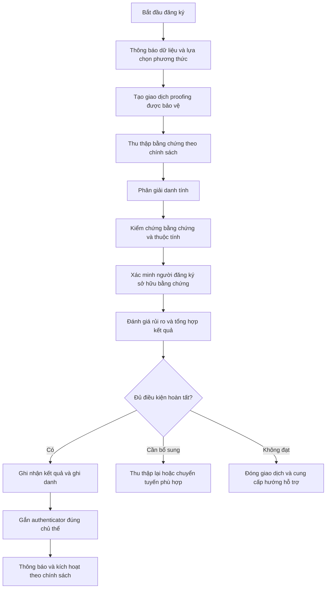

# Remote unattended proofing

## Mục tiêu và bối cảnh

**Remote unattended proofing** là phương thức chứng minh danh tính từ xa theo tuyến tự phục vụ. Người đăng ký sử dụng thiết bị của mình để cung cấp bằng chứng và hoàn thành các kiểm tra mà không cần tương tác với nhân viên định danh trong tuyến tự động.

Trong hệ thống quản lý danh tính và quyền truy cập (IAM), phương thức này thường xuất hiện khi tiếp nhận người dùng mới, nâng mức bảo đảm danh tính hoặc thực hiện một quy trình xác minh lại. Kết quả cần được gắn với đúng tài khoản trước khi hệ thống cho phép đăng ký phương tiện xác thực và sử dụng dịch vụ.

Bài học thuộc chương **Identity proofing**, giúp người học:

- Phân biệt phương thức proofing với mức bảo đảm danh tính.
- Tách rõ thu thập, phân giải, kiểm chứng và xác minh chủ thể.
- Nhận diện rủi ro từ giấy tờ bị đánh cắp, ảnh giả, chèn luồng hình ảnh và tráo giao dịch.
- Thiết kế đầu ra có thể dùng cho cấp phát tài khoản, MFA, liên kết danh tính, phân quyền và kiểm toán.

Bài sử dụng NIST SP 800-63A-4, bản chính thức tháng 7/2025, làm tài liệu tham chiếu. Những sơ đồ, trạng thái và pseudocode bên dưới là ví dụ thiết kế, không phải một triển khai được chứng nhận mức IAL. [NIST — Identity Proofing and Enrollment](https://csrc.nist.gov/pubs/sp/800/63/A/4/final).

## 1. Hiểu đúng phương thức từ xa không giám sát

### 1.1. Hai trục phân loại

NIST phân loại phương thức proofing theo nơi thực hiện và sự tham dự của nhân viên. Với remote unattended, resolution, validation và verification được tự động hóa; địa điểm và thiết bị không do nhà cung cấp dịch vụ chứng thực danh tính, gọi là CSP, kiểm soát. [NIST — Identity Proofing Types](https://pages.nist.gov/800-63-4/sp800-63a/proofing/#identity-proofing-types).

| Phương thức | Bối cảnh điển hình | Điểm cần chú ý |
| --- | --- | --- |
| Remote unattended | Người dùng tự thao tác trên điện thoại ở nhà | Thiết bị và môi trường đầu vào nằm ngoài quyền kiểm soát của CSP |
| Remote attended | Người dùng tham gia phiên video với nhân viên | Có tương tác trực tiếp để thực hiện các bước proofing |
| On-site unattended | Người dùng tự thao tác tại kiosk được quản lý | Không cần nhân viên tham dự nhưng thiết bị và địa điểm do CSP kiểm soát |
| On-site attended | Người dùng thực hiện quy trình tại địa điểm được kiểm soát, có nhân viên tham dự | Có điều kiện kiểm tra và tương tác khác với tuyến tự phục vụ tại nhà |

“Unattended” không loại bỏ nhu cầu quản trị, hỗ trợ, điều tra hay xử lý khiếu nại. Tổ chức vẫn cần người chịu trách nhiệm về quyết định của hệ thống và các trường hợp ngoại lệ.

Nếu hồ sơ được chuyển sang phiên video hoặc phương thức khác, cần ghi lại tuyến thực tế đã dùng. Không nên mô tả một hồ sơ chỉ bằng tên tuyến tự động ban đầu khi kết quả cuối cùng dựa vào một quy trình bổ sung.

### 1.2. Phương thức không phải mức bảo đảm

**IAL — Identity Assurance Level** mô tả mức tin cậy đối với danh tính đã được chứng minh. “Remote unattended” mô tả cách tổ chức quy trình.

Theo 800-63A-4, IAL1 và IAL2 có thể sử dụng phương thức từ xa không giám sát nếu đáp ứng yêu cầu tương ứng; IAL3 yêu cầu on-site attended. IAL2 có các tuyến xác minh bằng sinh trắc học, không dùng so khớp sinh trắc tự động và bằng chứng số. [NIST — Identity Assurance Level Requirements](https://pages.nist.gov/800-63-4/sp800-63a/ial/).

Vì vậy, các mô tả như “có camera”, “có AI” hoặc “đã tích hợp eKYC” chưa đủ để kết luận mức IAL.

Cần tách ba câu hỏi trong kiến trúc IAM:

| Nội dung | Câu hỏi cần trả lời |
| --- | --- |
| Proofing và IAL | Người đăng ký có thực sự là người mang danh tính đã khai không? |
| Authentication và AAL | Người đăng nhập có kiểm soát authenticator đã gắn với tài khoản không? |
| Federation và FAL | Kết quả xác thực, thuộc tính được chuyển từ IdP đến ứng dụng có được bảo vệ phù hợp không? |

Ví dụ, nhập đúng mã OTP gửi tới số điện thoại vừa khai báo cho thấy khả năng nhận mã tại thời điểm đó. Nó không tự xác nhận toàn bộ danh tính pháp lý đã khai. Tương tự, một người đã hoàn tất proofing vẫn cần cơ chế xác thực cho những lần truy cập tiếp theo.

## 2. Quy trình cần chứng minh điều gì?

### 2.1. Resolution, validation và verification

Có thể diễn giải ba bước bằng ba câu hỏi:

| Bước | Câu hỏi | Lỗi nếu bỏ qua |
| --- | --- | --- |
| Identity resolution — phân giải danh tính | Bộ thông tin này có phân biệt được một người trong quần thể phục vụ không? | Nhầm hai người trùng tên hoặc tạo nhiều hồ sơ không được nhận diện |
| Identity validation — kiểm chứng bằng chứng và thuộc tính | Bằng chứng có xác thực, hợp lệ và thuộc tính có chính xác không? | Chấp nhận giấy tờ giả hoặc dữ liệu chỉ được tự khai |
| Identity verification — xác minh liên hệ với người đăng ký | Người đang tham gia có phải chủ thể của bằng chứng đã kiểm chứng không? | Chấp nhận người dùng giấy tờ thật của người khác |

Sau khi hoàn tất các bước proofing, hệ thống có thể ghi danh người đăng ký vào tài khoản subscriber và gắn authenticator. NIST cũng tách việc chứng minh danh tính khỏi quyết định người đó có đủ điều kiện hưởng một dịch vụ hay quyền lợi hay không. [NIST — Identity Proofing and Enrollment](https://pages.nist.gov/800-63-4/sp800-63a.html#identity-proofing-and-enrollment).

Trong ví dụ cổng cộng tác viên, xác định đúng Minh không đồng nghĩa Minh đã được phê duyệt tham gia dự án. Cổng còn phải đối chiếu hợp đồng, đơn vị bảo trợ và phạm vi quyền.

### 2.2. Thu thập không đồng nghĩa kiểm chứng

Một chuỗi thao tác thường gặp là chụp giấy tờ, đọc OCR và yêu cầu người dùng xác nhận nội dung. Mỗi thao tác có giá trị khác nhau:

- Chụp ảnh tạo đầu vào cho các kiểm tra sau.
- OCR chuyển nội dung ảnh thành dữ liệu có cấu trúc.
- Người dùng xác nhận giúp sửa lỗi nhập hoặc lỗi nhận dạng.
- Kiểm chứng cần cơ sở tin cậy để đánh giá tính xác thực và độ chính xác.
- Xác minh chủ thể cần liên hệ người tham gia với bằng chứng đã kiểm chứng.

OCR đọc được số giấy tờ không chứng minh số đó được cơ quan phát hành cấp thật. Mã QR đọc được cũng không tự chứng minh dữ liệu đáng tin: cần biết mã chứa gì, có bảo vệ mật mã hay không và kiểm tra nguồn phát hành bằng cách nào.

### 2.3. Sức mạnh bằng chứng

Nhãn FAIR, STRONG và SUPERIOR trong NIST phụ thuộc vào quy trình phát hành, khả năng kiểm chứng và hỗ trợ xác minh chủ thể. Một ảnh chụp có độ phân giải cao không tự nâng sức mạnh bằng chứng. [NIST — Evidence Strength Requirements](https://pages.nist.gov/800-63-4/sp800-63a/proofing/#evidence-strength-requirements).

Ở IAL2, bộ bằng chứng được quy định theo các tổ hợp: một FAIR cùng một STRONG, hai STRONG, hoặc một SUPERIOR. Mỗi tổ hợp còn phải đi cùng các bước validation và verification phù hợp; không thể chỉ đếm số ảnh tải lên. [NIST — IAL2 Evidence Collection](https://pages.nist.gov/800-63-4/sp800-63a/ial/#evidence-collection-1).

Trong thiết kế sản phẩm, nên lập hồ sơ cho từng loại bằng chứng được chấp nhận:

| Nội dung hồ sơ | Câu hỏi thiết kế |
| --- | --- |
| Nguồn phát hành | Tổ chức nào phát hành và quy trình phát hành được đánh giá thế nào? |
| Tính xác thực | Hệ thống kiểm tra đặc điểm bảo an hoặc chữ ký bằng phương pháp nào? |
| Thuộc tính | Thuộc tính nào được lấy từ bằng chứng, thuộc tính nào cần kiểm tra bổ sung? |
| Sở hữu bằng chứng | Người đăng ký chứng minh liên hệ với bằng chứng bằng cách nào? |
| Giới hạn | Trường hợp nào không thể xử lý bằng ảnh hoặc thiết bị hiện có? |

Ví dụ, nếu nhận giấy tờ có chip nhưng chỉ đọc phần chữ trên ảnh, hệ thống không được mặc định rằng đã kiểm tra dữ liệu mật mã trong chip.

## 3. Luồng minh họa cho cổng cộng tác viên

Giả sử tổ chức cần xác minh danh tính của cộng tác viên trước khi kích hoạt truy cập nội bộ. Cổng chọn tuyến tự phục vụ có thu thập giấy tờ và so khớp khuôn mặt cho những hồ sơ phù hợp.

Số lượng bằng chứng, nguồn kiểm chứng và phương thức xác minh phải được chọn theo chính sách IAL đã phê duyệt. Sơ đồ dưới đây chỉ mô tả các giai đoạn của tuyến này.



Các giai đoạn có thể được sắp xếp hoặc thực hiện song song để giảm thời gian chờ. Tuy nhiên, quyết định thành công phải dựa trên kết quả đầy đủ, cùng thuộc một hồ sơ và một phiên bản chính sách.

### 3.1. Chuẩn bị cho người dùng

Trước khi bật camera, giao diện nên giải thích rõ:

- Những loại bằng chứng được chấp nhận và cần chuẩn bị.
- Thiết bị, trình duyệt hoặc tính năng cần dùng.
- Các bước dự kiến và khả năng phải thực hiện lại.
- Dữ liệu nào được thu thập, mục đích và cách nhận hỗ trợ.
- Phương thức thay thế nếu người dùng không có thiết bị hoặc bằng chứng phù hợp.

NIST nhấn mạnh việc hướng dẫn trước, sử dụng ngôn ngữ dễ hiểu và đánh giá quy trình với người dùng đại diện. Người dùng không cần hiểu thuật ngữ IAL để chuẩn bị đúng bằng chứng. [NIST — Customer Experience Considerations](https://pages.nist.gov/800-63-4/sp800-63a/customer/).

Ví dụ thông báo phù hợp là: “Ảnh đang bị chói ở góc trên. Hãy nghiêng giấy tờ và chụp lại.” Giao diện không cần đưa mã kiểm tra nội bộ hoặc tên mô hình cho người dùng.

### 3.2. Thu thập và phân giải

Mỗi tệp bằng chứng phải được gắn với giao dịch hiện tại, loại bằng chứng dự kiến và phiên bản của lần thu thập.

Nếu Minh thay ảnh bị mờ bằng ảnh mới, kết quả kiểm chứng ảnh cũ không được tiếp tục dùng như kết quả của ảnh mới. Cần có tham chiếu phiên bản hoặc dấu vết toàn vẹn cho từng artifact.

Đối với tên người Việt, có thể cần lưu cả dữ liệu gốc và dạng chuẩn hóa phục vụ đối chiếu. Việc bỏ dấu hoặc sắp lại tên chỉ là một bước xử lý dữ liệu; không nên tự động hợp nhất hai người chỉ vì chuỗi chuẩn hóa giống nhau.

Khi phát hiện khả năng trùng hồ sơ, hệ thống cần phân biệt tài khoản cũ, dữ liệu nhập sai và hành vi gian lận. “Tìm thấy dữ liệu giống nhau” là một tín hiệu cần xử lý, chưa phải kết luận cuối cùng.

### 3.3. Kiểm chứng bằng chứng và thuộc tính

Có thể chia kết quả thành các nhóm riêng:

```text
evidence_authenticity:
  method: phương-pháp-kiểm-tra-đã-phê-duyệt
  outcome: PASS | FAIL | INCONCLUSIVE

attribute_validation:
  source_reference: nguồn-được-phép-đối-chiếu
  validated_attributes: tập-thuộc-tính-đã-kiểm-chứng
  outcome: PASS | FAIL | INCONCLUSIVE

evidence_ownership:
  method: phương-thức-xác-minh-chủ-thể
  outcome: PASS | FAIL | INCONCLUSIVE
```

Không nên nén cả ba nhóm thành một giá trị `document_score` rồi dùng một ngưỡng cho mọi quyết định.

Ví dụ, ảnh giấy tờ có thể đọc rõ và trông đúng mẫu, nhưng nguồn đối chiếu đang ngừng hoạt động. Trạng thái phù hợp là thiếu kết quả kiểm chứng cần thiết; không phải tự động PASS vì ảnh đẹp.

### 3.4. Xác minh người đang tham gia

Với tuyến sinh trắc học minh họa, hệ thống so sánh mẫu khuôn mặt thu trong giao dịch với ảnh tham chiếu từ bằng chứng hoặc nguồn đã được kiểm chứng.

Cần đánh giá độc lập:

1. Mẫu có đủ chất lượng để so sánh không?
2. Người xuất hiện có tương ứng với ảnh tham chiếu không?
3. Có dấu hiệu giả mạo trước cảm biến không?
4. Có dấu hiệu thay thế hoặc chỉnh sửa dữ liệu trên đường thu thập không?
5. Kết quả có gắn với đúng giao dịch, bằng chứng và lần thu thập không?

So khớp khuôn mặt trả lời một câu hỏi khác với tính xác thực của giấy tờ. Kết quả khuôn mặt khớp với ảnh trên giấy tờ giả vẫn không hoàn tất proofing.

## 4. PAD, liveness và chèn dữ liệu hình ảnh

### 4.1. Hai bề mặt tấn công khác nhau

**Presentation attack** tác động tại bộ phận thu nhận sinh trắc, chẳng hạn đưa ảnh hoặc màn hình phát lại trước camera.

**Digital injection** chèn hoặc thay dữ liệu giữa điểm thu nhận và thành phần xử lý, chẳng hạn thay luồng camera hoặc gửi media giả vào một đường tiếp nhận không được bảo vệ.

**Liveness detection** là một nhóm kỹ thuật giúp đánh giá sự hiện diện sống. **PAD — Presentation Attack Detection** có phạm vi phát hiện tấn công trình diễn rộng hơn việc chỉ yêu cầu chớp mắt.

NIST yêu cầu PAD khi thu thập và so sánh sinh trắc từ xa, đồng thời có yêu cầu riêng về cảm biến, phân tích media bị chỉnh sửa và kênh truyền được bảo vệ. PAD hoặc một phép so khớp khuôn mặt đơn lẻ không giải quyết mọi hình thức chèn dữ liệu. [NIST — General Requirements, mục 3.1.11 và 3.14](https://pages.nist.gov/800-63-4/sp800-63a/ial-general/).

### 4.2. Cách phân tích theo lớp

| Lớp | Ví dụ mục tiêu kiểm soát |
| --- | --- |
| Thiết bị thu nhận | Tăng tin cậy rằng đầu vào đến từ cảm biến và môi trường được hỗ trợ |
| Phiên thu nhận | Gắn media, thử thách và kết quả với cùng lần thực hiện |
| Xử lý media | Tìm dấu hiệu chỉnh sửa, giả mạo hoặc bất thường |
| Sinh trắc học | Đánh giá chất lượng, PAD và so khớp theo mục đích riêng |
| Backend | Không chấp nhận cờ “đã đạt” do trình duyệt tự khai |
| Tổng hợp quyết định | Kết hợp kết quả bắt buộc và rủi ro theo chính sách đã định |

Các lớp hỗ trợ nhau. Ví dụ, TLS bảo vệ kết nối nhưng không chứng minh video trước khi gửi là video thật. Một SDK được tích hợp đúng cũng chưa thay thế việc backend kiểm tra kết quả và liên kết giao dịch.

Yêu cầu người dùng quay đầu hoặc đọc một chuỗi ngẫu nhiên có thể là một thành phần của phương án kiểm soát. Hiệu quả của nó phải được đánh giá trước các kiểu tấn công liên quan; không nên suy ra rằng có động tác là đã chặn deepfake.

### 4.3. Không đồng nhất sai số mô hình với tỷ lệ gian lận

| Chỉ số | Điều được đo |
| --- | --- |
| False match rate — FMR | So khớp nhầm hai mẫu của hai người khác nhau |
| False non-match rate — FNMR | Không khớp hai mẫu thực sự thuộc cùng người |
| Hiệu năng PAD | Mức nhận nhầm hoặc từ chối theo phép thử tấn công trình diễn |
| Tỷ lệ hoàn tất | Người bắt đầu có đi hết quy trình không? |
| Gian lận được xác nhận | Những hồ sơ gian lận đã được điều tra, xác nhận trong điều kiện đo |

FMR của phép so khớp không phải xác suất toàn bộ quy trình bị giả mạo. Mẫu thử, thiết bị, điều kiện ánh sáng, phân bố người dùng và số lần được thử đều ảnh hưởng cách diễn giải kết quả.

Hệ thống cũng cần kiểm tra tác động lên các nhóm người dùng và tránh xem mọi lần không khớp là cố ý gian lận. Nếu dùng tìm kiếm sinh trắc 1:N để phát hiện trùng, NIST không cho phép từ chối ghi danh chỉ dựa vào kết quả tự động mà không có rà soát thủ công để loại trừ false positive. [NIST — Requirements for the Use of Biometrics](https://pages.nist.gov/800-63-4/sp800-63a/ial-general/#requirements-for-the-use-of-biometrics).

## 5. Bảo vệ giao dịch từ lúc bắt đầu đến khi ghi danh

Một lỗi nghiêm trọng có thể xảy ra dù nhà cung cấp kiểm tra từng giấy tờ chính xác: kết quả của người A được gắn vào tài khoản hoặc phiên của người B.

Trong ví dụ, cổng cộng tác viên tạo giao dịch phía server và liên hệ giao dịch đó với ngữ cảnh đăng ký được bảo vệ. Trình duyệt không được tự chọn tài khoản đích khi trả kết quả.

### 5.1. Trạng thái phía server

```text
proofing_transaction:
  transaction_id: prf-82c1
  pending_registration_id: reg-1042
  protected_context_reference: tham-chieu-ngu-canh-dang-ky
  policy_version: contractor-proofing-v3
  target_ial: IAL2
  evidence_manifest_version: 4
  provider_job_id: job-394a
  required_checks: danh-sach-kiem-tra-theo-chinh-sach
  expires_at: thoi-diem-het-han
  state: IN_PROGRESS
```

`target_ial` là mục tiêu của quy trình, chưa phải mức đã đạt. Khi thất bại hoặc chưa đủ kiểm tra, hệ thống không được sao chép giá trị mục tiêu thành kết quả.

Một tập trạng thái minh họa:

| Trạng thái | Ý nghĩa |
| --- | --- |
| IN_PROGRESS | Đang thu thập hoặc xử lý |
| RETRY_REQUIRED | Một bước cần thực hiện lại trong phạm vi chính sách |
| REVIEW_REQUIRED | Cần xử lý ngoại lệ hoặc xem xét thêm |
| PROOFED | Đã có quyết định proofing hợp lệ, chưa đồng nghĩa được truy cập dịch vụ |
| ENROLLED | Đã ghi danh vào tài khoản và hoàn tất điều kiện tương ứng |
| REJECTED | Không đáp ứng quy trình hiện tại |
| EXPIRED | Giao dịch đã hết hạn |

Việc chuyển trạng thái cần có quy tắc rõ ràng. Một kết quả đến muộn không được tự đưa hồ sơ EXPIRED hoặc REJECTED thành ENROLLED.

### 5.2. Kết quả từ dịch vụ bên ngoài

Nếu dùng nhà cung cấp kiểm chứng giấy tờ hoặc sinh trắc, backend phải kiểm tra nguồn kết quả theo giao thức tích hợp đã thống nhất.

Các điểm cần thiết trong thiết kế ví dụ gồm:

- Kiểm tra tính xác thực và toàn vẹn của phản hồi hoặc webhook.
- Đối chiếu tenant, mã công việc, giao dịch và phiên bản bằng chứng.
- Chặn dùng lại sự kiện và xử lý lặp theo nguyên tắc idempotent.
- Lấy kết quả cuối cùng qua kênh server đã xác thực nếu giao thức yêu cầu.
- Không tin `success=true` do JavaScript trên trình duyệt gửi lên.
- Giữ chính sách ra quyết định ở backend; nhà cung cấp trả kết quả thành phần không tự được cấp quyền cho người dùng.

Nếu webhook không có tham chiếu phiên bản bằng chứng, backend có thể cần kiểm tra trạng thái công việc qua API hoặc duy trì ánh xạ công việc riêng cho mỗi lần thu thập. Mục tiêu là không sử dụng kết quả của lần chụp trước để phê duyệt lần chụp mới.

### 5.3. Pseudocode tổng hợp kết quả

Đoạn dưới đây chỉ mô tả logic; các kiểm tra chuyên môn vẫn phải được triển khai theo hồ sơ IAL và công nghệ thực tế.

```text
handle_provider_event(event):
    require(authentic_provider_event(event))
    require(event_within_allowed_time_window(event))

    begin_database_transaction()

    tx = load_and_lock_transaction(event.transaction_id)
    require(tx exists)
    require(event.provider_job_id == tx.provider_job_id)
    require(event.tenant_id == expected_tenant)
    require(event.evidence_version == tx.evidence_manifest_version)

    if provider_event_already_processed(event.event_id):
        return_previously_recorded_result()

    require(tx.state allows_this_event)
    require(now < tx.expires_at)

    store_verified_component_result(tx, event)
    mark_provider_event_processed(event.event_id)

    if mandatory_result_is_inconclusive(tx):
        move_to_retry_or_review_by_policy(tx)
    else if mandatory_result_failed(tx):
        move_to_rejected_or_review_by_policy(tx)
    else if all_required_checks_complete(tx):
        policy = load_exact_policy_version(tx.policy_version)

        require(all_evidence_has_required_validation(tx, policy))
        require(all_evidence_has_required_ownership_verification(tx, policy))
        require(identity_resolution_accepted(tx, policy))
        require(fraud_review_requirements_satisfied(tx, policy))
        require(result_set_refers_to_current_artifacts(tx))

        proofing_record = create_proofing_record_once(
            registration = tx.pending_registration_id,
            achieved_assurance = determine_achieved_assurance(tx, policy),
            methods = actual_methods_used(tx),
            policy_version = tx.policy_version
        )

        tx.state = PROOFED
        queue_post_commit_enrollment_work(proofing_record)

    commit_database_transaction()
```

Điểm đáng chú ý là việc chuyển PROOFED không xảy ra chỉ vì webhook cuối cùng có kết quả “pass”. Backend cần kiểm tra cả tập kết quả bắt buộc.

Công việc ghi danh sau commit cũng cần idempotent để không tạo nhiều tài khoản khi hàng đợi gửi lại thông điệp. Nếu việc gửi thông báo bị lỗi, hệ thống theo dõi và thử lại theo quy trình; không được giấu lỗi bằng cách xóa dấu vết giao dịch.

### 5.4. Bảo vệ điểm chuyển sang authenticator

Tưởng tượng Minh hoàn thành chụp giấy tờ và xác minh khuôn mặt trên điện thoại thật. Kẻ tấn công đã khởi tạo yêu cầu đăng ký ở thiết bị khác và tìm cách nhận kết quả để đăng ký khóa của mình.

Nếu hệ thống chỉ hỏi “proofing của Minh đã thành công chưa?” rồi cho mọi phiên đang biết mã hồ sơ gắn authenticator, quy trình có thể giao tài khoản cho sai người.

Thiết kế cần liên hệ kết quả proofing với đúng ngữ cảnh đăng ký và xác nhận việc gắn authenticator thuộc chủ thể dự kiến. Khi chuyển thiết bị hoặc hoàn tất ở phiên khác, cần cơ chế tiếp tục được bảo vệ thay vì dùng đường dẫn công khai có mã hồ sơ.

NIST quy định các phương thức gắn authenticator và cách xác nhận sự hiện diện của subscriber khi việc gắn diễn ra ngoài cùng một phiên được bảo vệ. Ở IAL2, còn có yêu cầu gửi thông báo proofing tới địa chỉ đã được kiểm chứng. [NIST — IAL2 Requirements](https://pages.nist.gov/800-63-4/sp800-63a/ial/).

## 6. Rủi ro gian lận và cách xử lý nhiều lớp

NIST liệt kê các nhóm đe dọa như mạo danh, danh tính tổng hợp, lạm dụng bằng chứng, social engineering và tấn công hạ tầng. Các kỹ thuật AI có thể hỗ trợ hoặc mở rộng những kiểu tấn công này. [NIST — Threats and Security Considerations](https://pages.nist.gov/800-63-4/sp800-63a/security/).

Trong cổng cộng tác viên, có thể xây dựng các tình huống thiết kế sau:

| Tình huống | Điều cần phát hiện hoặc ngăn chặn |
| --- | --- |
| Người lạ dùng ảnh giấy tờ thật của Minh | Bằng chứng thật chưa chứng minh người tham gia là Minh |
| Một người tạo nhiều hồ sơ bằng biến thể tên | Cần phân giải, liên hệ dữ liệu và điều tra khả năng trùng |
| Bot gửi hàng loạt yêu cầu | Cần giới hạn tốc độ theo nhiều tín hiệu và quản lý chi phí xử lý |
| Kết quả thành công cũ được gửi lại | Giao dịch, sự kiện và quyết định cần được dùng đúng vòng đời |
| Người dùng bị dụ làm proofing cho tài khoản do kẻ khác kiểm soát | Cần bảo vệ bàn giao tài khoản và giải thích rõ mục đích quy trình |
| Nhân viên hỗ trợ tự bỏ qua bước bắt buộc | Cần giới hạn quyền, quy trình ngoại lệ và dấu vết phê duyệt |

Một địa chỉ IP bất thường có thể là tín hiệu rủi ro nhưng không tự chứng minh gian lận. Người dùng có thể sử dụng mạng doanh nghiệp, mạng di động hoặc công cụ bảo vệ riêng tư.

Tương tự, retry nhiều lần có thể do thiết bị yếu hoặc khuyết tật vận động. Cần kết hợp tín hiệu và có tuyến hỗ trợ để không biến mọi khó khăn kỹ thuật thành cáo buộc gian lận.

Thông báo thất bại nên đủ để người dùng biết bước tiếp theo, đồng thời tránh biến API thành công cụ dò dữ liệu. Ví dụ, không trả chi tiết rằng một số giấy tờ cụ thể đang khớp tên và ngày sinh nào trong nguồn đối chiếu.

## 7. Ngoại lệ, khả năng tiếp cận và khiếu nại

### 7.1. Phân loại nguyên nhân trước khi chọn hành động

| Nguyên nhân | Hướng xử lý trong ví dụ |
| --- | --- |
| Ảnh mờ hoặc thiếu góc | Hướng dẫn chụp lại, giới hạn số lần hợp lý |
| Nguồn đối chiếu tạm lỗi | Cho tiếp tục sau hoặc chuyển phương thức đã phê duyệt |
| Bằng chứng chưa được hỗ trợ | Cung cấp lựa chọn bằng chứng hoặc tuyến khác |
| Tên mới chưa đồng bộ giữa các nguồn | Xử lý ngoại lệ với căn cứ bổ sung |
| Camera không dùng được | Đề xuất kênh hỗ trợ hoặc phương thức thay thế phù hợp |
| Có dấu hiệu giả mạo | Giữ quyết định theo chính sách và chuyển quy trình điều tra khi cần |

Không nên hạ ngưỡng so khớp tùy tiện chỉ để người dùng vượt qua. Nếu chuyển phương thức, hệ thống cần ghi phương thức thực tế, các bước bổ sung và mức bảo đảm cuối cùng.

NIST yêu cầu cơ chế giải quyết vấn đề và khiếu nại dễ tìm, dễ dùng; quy trình có thể sử dụng trusted referee cho các trường hợp cần xử lý ngoại lệ theo điều kiện áp dụng. [NIST — General Requirements, mục 3.6 và 3.15](https://pages.nist.gov/800-63-4/sp800-63a/ial-general/).

### 7.2. Unattended không nhất thiết tức thời

Một tuyến tự phục vụ có thể có thời gian chờ dịch vụ, kiểm chứng qua nguồn khác hoặc bước xác nhận không hoàn tất ngay. Không có cuộc gọi video không có nghĩa mọi hồ sơ phải được duyệt trong vài giây.

Giao diện nên cho biết trạng thái đang xử lý, cần làm lại hay cần hỗ trợ. Không hiển thị “thành công” khi backend mới nhận được ảnh nhưng chưa có quyết định.

Ví dụ, nếu màn hình chụp xong nói “Tài khoản đã được xác minh”, người dùng có thể hiểu sai khi kết quả kiểm chứng giấy tờ còn đang chờ. Thông báo chính xác hơn là “Đã nhận thông tin. Chúng tôi đang kiểm tra hồ sơ.”

### 7.3. Hỗ trợ không tạo đường tắt vượt kiểm soát

Nhân viên hỗ trợ cần có quyền phù hợp để xem tình trạng và hướng dẫn, nhưng không mặc nhiên có quyền chuyển mọi hồ sơ sang PROOFED.

Nếu có quyền phê duyệt ngoại lệ, cần xác định căn cứ được chấp nhận, người phê duyệt, giới hạn thẩm quyền và cách kiểm toán. Với trường hợp nhạy cảm, tổ chức có thể chọn phân tách người điều tra và người phê duyệt theo chính sách.

## 8. Quyền riêng tư và quản lý dữ liệu

Ảnh giấy tờ, ảnh khuôn mặt, mẫu sinh trắc và dữ liệu đối chiếu tạo ra tác động riêng tư ngay cả khi quyết định cuối cùng là từ chối.

NIST nhấn mạnh giảm thiểu dữ liệu, giới hạn mục đích và thông báo rõ tại thời điểm thu thập. Việc thu thập, sử dụng sinh trắc cần sự đồng ý có hiểu biết theo yêu cầu áp dụng; một liên kết tới chính sách dài không thay thế việc giải thích dễ hiểu trong quy trình. [NIST — Privacy Considerations](https://pages.nist.gov/800-63-4/sp800-63a/privacy/).

### 8.1. Tách dữ liệu theo mục đích

| Nhóm dữ liệu | Ví dụ | Cách xử lý cần thiết kế |
| --- | --- | --- |
| Media gốc | Ảnh giấy tờ, video thu nhận | Kho riêng được bảo vệ, truy cập và lưu giữ theo mục đích cụ thể |
| Kết quả thành phần | Kết quả kiểm chứng, trạng thái so khớp | Gắn phương pháp, nguồn và phiên bản |
| Hồ sơ proofing | Mức đạt, thời điểm, phương thức, chính sách | Dùng làm bằng chứng cho quyết định ghi danh |
| Hồ sơ tài khoản | Định danh nội bộ, authenticator liên kết | Phục vụ xác thực và vòng đời tài khoản |
| Audit event | Mã giao dịch, chuyển trạng thái, người thao tác | Truy vết mà không sao chép dữ liệu gốc vào log |

Không nên gửi toàn bộ ảnh giấy tờ tới mọi ứng dụng cần biết người dùng đã được proofing. Có thể cung cấp kết quả đã kiểm chứng và các thuộc tính thực sự cần theo thỏa thuận.

### 8.2. Chính sách lưu giữ phải bao quát nhà cung cấp

Trong ví dụ, hồ sơ thiết kế cần xác định riêng thời hạn và mục đích giữ ảnh gốc, mẫu sinh trắc, kết quả quyết định và log.

Nếu nhà cung cấp lưu bản sao hoặc sử dụng bên xử lý phụ, việc xóa ở cơ sở dữ liệu ứng dụng chưa hoàn tất vòng đời dữ liệu. Cần làm rõ cách yêu cầu xóa, xử lý bản sao lưu và ghi nhận kết quả theo chính sách được áp dụng.

Không nên tự chọn một thời hạn chung rồi gọi đó là “thời hạn NIST” cho mọi hệ thống. Tổ chức cần xác định theo mục đích, yêu cầu áp dụng và đánh giá rủi ro.

### 8.3. Giới hạn dữ liệu trong log

Một sự kiện minh họa:

```json
{
  "event": "proofing_state_changed",
  "transaction_id": "prf-82c1",
  "from_state": "IN_PROGRESS",
  "to_state": "RETRY_REQUIRED",
  "reason_code": "CAPTURE_QUALITY_INSUFFICIENT",
  "policy_version": "contractor-proofing-v3",
  "component_result_reference": "result-92a"
}
```

Sự kiện không cần chứa số giấy tờ, ảnh khuôn mặt, OTP, token hay đường dẫn công khai tới media. Dữ liệu tham chiếu cũng cần phân quyền vì có thể dẫn tới hồ sơ nhạy cảm.

## 9. Gắn kết quả với vòng đời IAM

### 9.1. Hồ sơ proofing cần có nguồn gốc

NIST yêu cầu tài khoản subscriber ghi nhận những thông tin như phương thức proofing, các phương pháp validation và verification, mức IAL đạt được, ngoại lệ và các authenticator liên kết. [NIST — Subscriber Accounts](https://pages.nist.gov/800-63-4/sp800-63a/accounts/).

Trong cổng cộng tác viên, bản ghi kết quả nên phân biệt:

- Mức mục tiêu và mức đã thực sự đạt.
- Chính sách, phương thức và nguồn kết quả.
- Thời điểm quyết định.
- Định danh nội bộ của người dùng sau khi hoàn tất ánh xạ.
- Trạng thái bị thu hồi, nghi ngờ hoặc cần xác minh lại nếu có.

Một cờ `verified=true` không cho ứng dụng biết người dùng được kiểm tra theo cách nào hoặc bằng chứng có còn phù hợp với hành động hiện tại không.

### 9.2. Proofing không tự cấp quyền

Sau khi Minh được xác minh, cổng còn cần kiểm tra đơn vị bảo trợ và công việc được giao:

```text
Cho phép xem tài liệu dự án khi:
    tài khoản đang hoạt động
    AND hợp đồng hoặc quan hệ cộng tác còn hiệu lực
    AND có vai trò được cấp cho dự án
    AND thỏa điều kiện truy cập của tài liệu
    AND phiên và ngữ cảnh xác thực đáp ứng chính sách
```

Ở đây, RBAC xác định vai trò; ABAC có thể dùng thuộc tính dự án, đơn vị, thời hạn hoặc độ nhạy tài liệu. Nguyên tắc ít quyền nhất yêu cầu cấp đúng phạm vi công việc, kể cả khi danh tính đã được xác minh ở mức cao.

Đối với tài khoản đặc quyền, tổ chức còn cần kiểm soát phê duyệt, xác thực mạnh, thời gian cấp quyền và kiểm toán theo chính sách riêng.

### 9.3. SSO, khôi phục và thu hồi

Nếu IdP truyền thuộc tính bảo đảm danh tính qua OIDC hoặc SAML, ứng dụng cần hiểu ý nghĩa của thuộc tính và tin nguồn phát hành theo thỏa thuận. Một claim tự khai trên frontend không thay thế hồ sơ proofing.

Khi mất authenticator, quy trình khôi phục phải xác định cách đưa tài khoản trở lại đúng chủ thể. Không nên cho rằng vài thông tin từng có trên giấy tờ là bí mật dùng được cho mọi yêu cầu khôi phục.

Nếu phát hiện ghi danh sai người, tổ chức cần phối hợp khóa tài khoản liên quan, thu hồi phiên hoặc token theo kiến trúc, điều tra thay đổi quyền và sửa thông tin bảo đảm đã chia sẻ. Chỉ đánh dấu “proofing không hợp lệ” trong một bảng chưa chắc ngăn được phiên ứng dụng đang hoạt động.

### 9.4. Ranh giới với danh tính workload

Quy trình này dành cho cá nhân. Một service account hoặc workload cần được xác lập bằng cơ chế quản lý danh tính máy, cấp credential và phân quyền phù hợp.

Không thể dùng việc một nhân viên đã chụp giấy tờ thành công để kết luận mọi workload do họ tạo đều đáng tin hoặc có quyền rộng. Quan hệ sở hữu và quyền của workload phải được quản lý riêng.

## 10. Kiểm thử thiết kế và đo hiệu quả

Các tình huống dưới đây là đề xuất cho triển khai minh họa; chúng không phải kết quả kiểm thử một hệ thống đang chạy.

| Tình huống | Hành vi mong đợi |
| --- | --- |
| OCR thành công nhưng kiểm chứng bằng chứng chưa có kết quả | Không hoàn tất proofing |
| Khuôn mặt khớp nhưng kiểm tra chống giả mạo bắt buộc thất bại | Không tự động phê duyệt |
| Kết quả của giao dịch A gửi cho hồ sơ B | Từ chối liên kết |
| Webhook hợp lệ được gửi lặp | Không tạo quyết định hoặc tài khoản trùng |
| Hai webhook cùng hoàn tất một giao dịch | Chỉ một quyết định có hiệu lực |
| Kết quả tới sau khi giao dịch hết hạn | Không tự ghi danh |
| Đổi bằng chứng rồi nhận kết quả của phiên bản cũ | Không dùng kết quả cũ cho bằng chứng mới |
| Nguồn đối chiếu bị ngắt | Giữ trạng thái phù hợp, không mặc định PASS |
| Một hồ sơ có nghi vấn trùng sinh trắc | Thực hiện xử lý theo chính sách và yêu cầu rà soát liên quan |
| Hoàn tất proofing nhưng gắn authenticator từ ngữ cảnh khác | Yêu cầu cơ chế xác nhận hợp lệ |
| Người dùng không có camera phù hợp | Có hướng hỗ trợ hoặc tuyến thay thế |
| Nhân viên thay đổi quyết định ngoại lệ | Có thẩm quyền và dấu vết kiểm toán |

Không chỉ theo dõi tỷ lệ PASS. Có thể theo dõi tỷ lệ hoàn tất từng bước, thời gian xử lý, số lần chụp lại, lỗi theo thiết bị, chuyển tuyến, kết quả khiếu nại và gian lận được xác nhận.

Ví dụ số liệu giả định:

| Mốc | Số người còn trong luồng |
| --- | ---: |
| Bắt đầu | 1.000 |
| Thu thập thành công | 900 |
| Hoàn tất validation | 800 |
| Hoàn tất verification | 760 |
| Hoàn tất enrollment | 740 |

Tỷ lệ hoàn tất toàn luồng là 740/1.000 = 74%. Nếu chỉ báo cáo 740/760 ở bước cuối, nhóm vận hành có thể bỏ qua những người đã rời quy trình trước đó.

Các số này không cho biết bao nhiêu hồ sơ là gian lận. Cần định nghĩa mẫu số, thời gian quan sát và phương pháp xác nhận gian lận trước khi so sánh các nhà cung cấp hoặc thay đổi mô hình.

## 11. Các cách hiểu dễ dẫn đến thiết kế sai

| Cách hiểu | Điều cần điều chỉnh |
| --- | --- |
| Unattended có nghĩa không cần người chịu trách nhiệm | Vẫn cần vận hành, xử lý ngoại lệ, điều tra và khiếu nại |
| Có ảnh giấy tờ là đã kiểm chứng | Thu thập và OCR chưa xác nhận tính xác thực |
| Selfie khớp là đủ | Còn bằng chứng, thuộc tính, nguồn media và liên kết giao dịch |
| Có liveness là chống được mọi deepfake | Cần xem xét cả PAD, injection và giới hạn công nghệ |
| Có hai ảnh là đủ hai bằng chứng | Sức mạnh và tính độc lập phải được đánh giá theo chính sách |
| Mọi lỗi đều là gian lận | Phải phân biệt chất lượng, khả năng tiếp cận, lỗi nguồn và nghi vấn |
| Đã proofing thì được truy cập mọi tài nguyên | Phân quyền vẫn theo phạm vi và vòng đời công việc |
| Duyệt xong là kết thúc | Còn ghi danh, gắn authenticator, thông báo, khôi phục và thu hồi |

Một thiết kế remote unattended proofing có thể giải thích rõ từng kết luận: danh tính nào được xác lập, bằng chứng nào đã được kiểm chứng, người tham gia được liên hệ với bằng chứng ra sao, và kết quả được gắn vào tài khoản bằng cơ chế nào. Từ các kết luận đó, IAM mới có cơ sở để cấp phát và quản lý truy cập đúng chủ thể.

