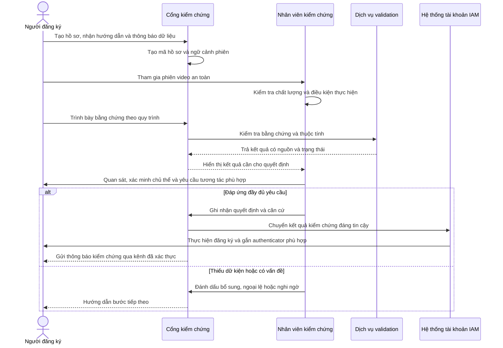

# Remote attended proofing: kiểm chứng danh tính từ xa có nhân viên tham gia trực tiếp

## 1. Bản chất và mục đích

**Remote attended proofing** là hình thức kiểm chứng danh tính trong đó người đăng ký tương tác trực tiếp với nhân viên kiểm chứng qua một phiên video an toàn. Địa điểm và thiết bị của người đăng ký không nằm dưới sự kiểm soát của nhà cung cấp dịch vụ danh tính. Nhân viên quan sát, hướng dẫn và thực hiện các quyết định kiểm chứng trong phạm vi được cho phép, kết hợp với công cụ và nguồn dữ liệu của hệ thống.

Ví dụ, một nhân viên mới làm việc từ xa cần được cấp tài khoản doanh nghiệp. Người đó dùng thiết bị cá nhân để tham gia phiên kiểm chứng, trình bày bằng chứng danh tính và tương tác với nhân viên phụ trách. Kết quả cần xác lập mối liên hệ đáng tin cậy giữa người đang tham gia và danh tính được khai báo, trước khi gắn authenticator và cấp tài khoản sử dụng.

Giá trị của hình thức này nằm ở khả năng quan sát và xử lý tình huống theo thời gian thực: nhân viên có thể yêu cầu điều chỉnh góc giấy tờ, làm rõ thông tin không nhất quán, nhận biết dấu hiệu bị ép buộc hoặc chuyển hồ sơ sang quy trình ngoại lệ. Tuy nhiên, sự hiện diện của con người không tự thay thế việc xác thực bằng chứng, đối chiếu nguồn dữ liệu hoặc bảo vệ kênh thu nhận hình ảnh. [Nguồn: NIST SP 800-63A-4, mục 2.1.2–2.1.3](https://pages.nist.gov/800-63-4/sp800-63a.html#identity-proofing-and-enrollment).

Trong nền tảng quản lý danh tính và quyền truy cập (IAM), đây là một phương án cho khâu thiết lập hoặc tái kiểm chứng danh tính. Nó liên quan đến cấp phát tài khoản, gắn authenticator, khôi phục và kiểm toán; quyền truy cập sau đó vẫn được quản lý bằng chính sách phân quyền và nguyên tắc ít quyền nhất.

Sau bài này, người học có thể:

- Phân biệt remote attended với kiểm chứng tự động, kiểm chứng tại điểm kiểm soát và rà soát video bất đồng bộ.
- Giải thích vai trò của resolution, validation, verification và enrollment trong một phiên kiểm chứng.
- Thiết kế luồng có nhân viên mà vẫn bảo vệ được bằng chứng, kết quả và bước gắn authenticator.
- Nhận biết giới hạn của việc nhìn giấy tờ qua camera và các lớp kiểm soát chống giả mạo hình ảnh.
- Xử lý gián đoạn, ngoại lệ, quyền riêng tư và quyết định chuyển tuyến mà không tự nâng mức bảo đảm.

## 2. Phạm vi tiêu chuẩn và vị trí của mức IAL

Bài này dùng thuật ngữ và yêu cầu của **NIST SP 800-63A-4**. Cần ghi rõ phiên bản khi xây dựng hồ sơ kỹ thuật vì cách mô tả các mức bảo đảm và hình thức kiểm chứng có thể khác ở tài liệu cũ.

### 2.1. Hai chiều để phân biệt hình thức kiểm chứng

| Hình thức | Địa điểm và thiết bị của người đăng ký | Sự tham gia của nhân viên |
| --- | --- | --- |
| Remote unattended | Không do CSP kiểm soát | Luồng không yêu cầu tương tác với proofing agent hoặc trusted referee; các bước được tự động hóa |
| Remote attended | Không do CSP kiểm soát | Có phiên video an toàn với proofing agent hoặc trusted referee |
| On-site unattended | Do CSP kiểm soát, chẳng hạn một kiosk | Người đăng ký làm việc với thiết bị, không yêu cầu nhân viên tham gia |
| On-site attended | Do CSP kiểm soát | Nhân viên có thể ở cùng địa điểm hoặc tương tác qua kiosk/thiết bị được kiểm soát |

**CSP — Credential Service Provider** là bên chịu trách nhiệm cung cấp dịch vụ danh tính và đáp ứng các yêu cầu kiểm chứng. Việc thuê một nhà cung cấp video hoặc công cụ kiểm tra giấy tờ không tự chuyển hết trách nhiệm đó ra ngoài CSP.

Một cuộc gọi hỗ trợ sau khi hệ thống tự động bị lỗi không nhất thiết làm toàn bộ hồ sơ trở thành remote attended. Tương tự, tải video lên để nhân viên xem vào ngày hôm sau không phải tương tác trực tiếp trong một phiên remote attended. Nếu kết hợp thu nhận tự động trước cuộc gọi và kiểm tra trực tiếp sau đó, CSP cần mô tả quy trình kết hợp và chứng minh từng phần đáp ứng các yêu cầu tương ứng. [Nguồn: NIST SP 800-63A-4, mục 2.1.3 và 4.2.1](https://pages.nist.gov/800-63-4/sp800-63a.html#identity-proofing-types).

### 2.2. Có nhân viên không đồng nghĩa IAL3

**IAL — Identity Assurance Level** phản ánh mức tin cậy rằng danh tính đã kiểm chứng gắn với đúng con người. Hình thức tiến hành và mức IAL là hai thông tin liên quan nhưng khác nhau.

- Remote attended có thể được dùng trong quy trình IAL1 hoặc IAL2 khi đáp ứng đầy đủ yêu cầu áp dụng.
- Theo bản 4, IAL3 chỉ được cung cấp dưới hình thức **on-site attended**. Nhân viên có thể ở xa qua kiosk hoặc thiết bị do CSP kiểm soát, nhưng người đăng ký không đơn giản dùng bất kỳ camera cá nhân nào ở nhà để đạt IAL3.
- Trong bản 4, IAL1 đã có các bước kiểm chứng danh tính; không được lấy mô tả IAL1 chỉ là tự khai của bản trước để giải thích yêu cầu hiện tại.

Một cuộc gọi kéo dài hơn, có nhiều câu hỏi hơn hoặc được ghi hình đầy đủ không tự nâng IAL. Mức đạt được phụ thuộc bằng chứng, cách validation, cách verification và toàn bộ các kiểm soát của quy trình. [Nguồn: NIST SP 800-63A-4, phần giới thiệu và mục 4](https://pages.nist.gov/800-63-4/sp800-63a/ial/).

### 2.3. Không đồng nhất với xác thực và phân quyền

| Hoạt động | Câu hỏi cần trả lời |
| --- | --- |
| Identity proofing | Người đang đăng ký có gắn với danh tính được khai báo không? |
| Authentication | Người đang đăng nhập có kiểm soát authenticator hợp lệ không? |
| Federation | Kết quả xác thực và thuộc tính được chuyển từ IdP sang ứng dụng như thế nào? |
| Authorization | Chủ thể được phép làm gì với tài nguyên cụ thể? |

Kiểm chứng thành công không tự cấp vai trò quản trị. Một người có danh tính hợp lệ vẫn có thể không thuộc doanh nghiệp, không có hợp đồng đang hiệu lực hoặc không được phép truy cập hệ thống sản xuất. Những quyết định đó cần nguồn thông tin nghiệp vụ và chính sách riêng.

## 3. Người tham gia và ranh giới trách nhiệm

| Vai trò | Trách nhiệm chính |
| --- | --- |
| Applicant | Người yêu cầu được kiểm chứng và đăng ký vào dịch vụ danh tính |
| Proofing agent | Nhân viên được thẩm tra, đào tạo để kiểm tra bằng chứng và ra các quyết định trong phạm vi cho phép |
| Trusted referee | Người được đào tạo thêm để xử lý trường hợp không đáp ứng được quy trình kiểm chứng thông thường |
| Process assistant | Người hỗ trợ phiên dịch, ghi chép hoặc khả năng tiếp cận; không quyết định kết quả kiểm chứng |
| CSP | Xây dựng quy trình, chọn nguồn và công cụ, bảo vệ dữ liệu, quản lý nhân viên, quyết định và hồ sơ |
| Relying Party (RP) | Ứng dụng hoặc tổ chức dựa vào kết quả danh tính để cung cấp dịch vụ |

Một người phiên dịch không phải là người bảo chứng danh tính chỉ vì họ tham gia cuộc gọi. Một proofing agent cũng không mặc nhiên có thẩm quyền xử lý mọi ngoại lệ như trusted referee. Các vai trò phải được phân biệt trong quyền của hệ thống, đào tạo và nhật ký quyết định. [Nguồn: NIST SP 800-63A-4, mục 2.1.2](https://pages.nist.gov/800-63-4/sp800-63a.html#identity-proofing-roles).

Nhân viên cần nhìn thấy đủ thông tin để làm việc, nhưng không nhất thiết được tải toàn bộ giấy tờ, sửa mọi thuộc tính hoặc tự cấp quyền ứng dụng. Quyền của nhân viên kiểm chứng là một dạng đặc quyền IAM cần được quản lý, giám sát và thu hồi khi đổi nhiệm vụ.

## 4. Bốn kết quả phải phân biệt trong một hồ sơ

### 4.1. Identity resolution: phân giải danh tính

Mục tiêu là xác định danh tính khai báo tương ứng với một cá nhân duy nhất trong phạm vi cộng đồng được phục vụ. Hệ thống thu nhận bộ thuộc tính và bằng chứng phù hợp, tìm trường hợp trùng hoặc mâu thuẫn và tránh tạo nhiều tài khoản cho cùng một danh tính do lỗi liên kết.

Chỉ thấy hai người trùng họ tên không đủ để kết luận họ là một người. Ngược lại, việc người dùng nhập một email mới không chứng minh đó là một danh tính mới. Đối chiếu cần dựa trên các thuộc tính và nguồn đã được quy định trong chính sách.

### 4.2. Evidence và attribute validation: kiểm tra bằng chứng, thuộc tính

Validation cần trả lời hai nhóm câu hỏi:

- Bằng chứng có thật, đúng cấu trúc, không bị sửa trái phép và có giá trị sử dụng theo chính sách không?
- Các thuộc tính cốt lõi có chính xác khi đối chiếu với nguồn có thẩm quyền hoặc nguồn đáng tin cậy không?

OCR chỉ giúp đọc văn bản. Quét được một mã QR hay MRZ không tự chứng minh tài liệu là thật. Nếu bằng chứng có dữ liệu được ký số, cần xác minh chữ ký và nguồn phát hành qua cơ chế tin cậy, không chỉ đọc nội dung được hiển thị.

### 4.3. Identity verification: liên kết người với bằng chứng

Verification kiểm tra người đang tham gia có phải chủ thể của bằng chứng đã được validation hay không. Trong một phiên remote attended, nhân viên có thể đối chiếu trực quan khuôn mặt với ảnh trên bằng chứng theo phương pháp và loại bằng chứng được chấp nhận. Hệ thống cũng có thể dùng những phương thức phù hợp khác đã được quy định cho IAL mục tiêu.

Một giấy tờ thật có thể bị đánh cắp. Vì vậy, validation thành công chưa đủ để kết luận verification thành công. Ngược lại, khuôn mặt trông giống ảnh trên một giấy tờ giả không làm giấy tờ đó trở nên hợp lệ.

### 4.4. Enrollment: đăng ký vào dịch vụ danh tính

Sau khi hoàn tất các bước kiểm chứng, hệ thống thiết lập tài khoản subscriber và liên kết authenticator theo quy trình thích hợp. Cần giữ mối liên hệ giữa người đã kiểm chứng, tài khoản được tạo và authenticator được gắn. Nếu liên kết này sai, kẻ tấn công có thể nhận tài khoản dù bước video đã kiểm tra đúng người.

[Nguồn: NIST SP 800-63A-4, mục 1.1, 2.1 và 2.4–2.5](https://pages.nist.gov/800-63-4/sp800-63a.html).

## 5. Yêu cầu quan trọng cho phiên remote attended

Đối với remote attended tại IAL1 và IAL2, NIST đặt ra các yêu cầu riêng bên cạnh yêu cầu chung của từng mức:

1. Trong phiên video, người đăng ký phải ở trong tầm nhìn của nhân viên tại từng bước của quá trình kiểm chứng.
2. Chất lượng video phải đủ để thực hiện các bước validation và verification cần thiết, chẳng hạn quan sát bằng chứng và đối chiếu người với ảnh.
3. Nhân viên phải được đào tạo nhận biết thao túng, ép buộc và social engineering.
4. CSP phải triển khai kiểm soát chống digital injection và nội dung hình ảnh bị sửa đổi theo yêu cầu áp dụng.
5. Nhân viên phải có cơ chế đánh dấu sự kiện nghi ngờ gian lận để được xử lý.
6. Nếu ghi hình phiên, CSP phải thông báo và có sự đồng ý trước khi bắt đầu ghi, đồng thời công bố lịch lưu giữ và quy trình xóa video.

Ghi hình là một lựa chọn có điều kiện, không phải điều kiện định nghĩa remote attended. Có thể có phiên được quan sát trực tiếp nhưng không lưu toàn bộ video. Ngược lại, một video đã lưu không chứng minh rằng quy trình kiểm chứng đã được thực hiện đầy đủ. [Nguồn: NIST SP 800-63A-4, mục 4.1.8 và 4.2.8](https://pages.nist.gov/800-63-4/sp800-63a/ial/).

Tiêu chí “đủ chất lượng” cần gắn với tác vụ, không chỉ với độ phân giải camera được quảng cáo. Một hình ảnh độ phân giải cao nhưng mất nét, bị lóa hoặc nén mạnh vẫn có thể không cho phép kiểm tra dấu hiệu bảo an. Nhân viên cần quyền tạm dừng, yêu cầu thực hiện lại bước thu nhận hoặc chuyển tuyến khi không đủ điều kiện.

## 6. Luồng triển khai từ chuẩn bị đến đăng ký

### 6.1. Chuẩn bị trước cuộc gọi

Giao diện nên giải thích trước các bằng chứng được chấp nhận, yêu cầu về thiết bị, cách bố trí ánh sáng, thời gian dự kiến, hỗ trợ ngôn ngữ và lựa chọn hỗ trợ tiếp cận. Cần thông báo việc thu thập dữ liệu, mục đích sử dụng, việc ghi hình nếu có và cách tìm hỗ trợ khi gặp lỗi.

Hệ thống tạo một hồ sơ có mã nội bộ và trạng thái rõ ràng. Liên kết tham gia phiên phải được gắn với hồ sơ phù hợp và được bảo vệ khỏi việc sử dụng sai. Một cuộc hẹn hay một URL cuộc gọi không phải bằng chứng danh tính.

Nếu bằng chứng được thu nhận và validation trước cuộc gọi, kết quả cần gắn với phiên bản bằng chứng cụ thể. Thay tài liệu sau khi validation phải làm mất hiệu lực các kết quả phụ thuộc cần thiết; không để nhân viên kiểm tra một tài liệu trong khi hệ thống phê duyệt dựa trên tài liệu khác.

### 6.2. Thiết lập phiên

Nhân viên kiểm tra người tham gia, chất lượng hình ảnh/âm thanh và sự sẵn sàng của các công cụ. Nếu chính sách có ghi hình, phần thông báo và đồng ý phải hoàn tất trước khi bắt đầu ghi.

Phiên cần có ngữ cảnh hồ sơ xác định, kênh trao đổi được bảo vệ và kiểm soát truy cập cho nhân viên. Khi có người hỗ trợ, cần xác định vai trò của họ. Sự có mặt của người hỗ trợ không tự là gian lận, nhưng người đăng ký vẫn phải là chủ thể thực hiện các hành động kiểm chứng theo quy trình.

### 6.3. Kiểm tra bằng chứng và chủ thể

Nhân viên hướng dẫn đưa bằng chứng vào vị trí phù hợp, thực hiện các quan sát cần thiết và dùng kết quả kiểm tra của hệ thống. Nếu phương thức yêu cầu so sánh trực quan, nhân viên thực hiện theo phương pháp đã được đào tạo, thay vì chỉ đưa ra nhận xét chung “trông giống”.

Hệ thống thực hiện hoặc ghi nhận việc validation thuộc tính qua nguồn được chấp nhận. Nhân viên không nên tự thay việc đối chiếu nguồn bằng câu hỏi kiến thức cá nhân. Theo NIST SP 800-63A-4, knowledge-based verification/authentication không được dùng làm phương pháp identity verification; những câu hỏi mà kẻ đánh cắp dữ liệu có thể trả lời không chứng minh quyền sở hữu bằng chứng. [Nguồn: NIST SP 800-63A-4, mục 2.5](https://pages.nist.gov/800-63-4/sp800-63a.html#identity-verification).

### 6.4. Quyết định và bàn giao

Kết quả cần phân biệt rõ: đạt yêu cầu, cần bổ sung, chờ nguồn dữ liệu, cần xử lý ngoại lệ hoặc không đạt. Nhân viên không nên bị buộc phải chọn “đạt/không đạt” cho mọi lỗi mạng hoặc dịch vụ bên ngoài.

Khi kiểm chứng thành công, CSP gửi thông báo đến địa chỉ đã được validation theo yêu cầu của mức IAL. Ở IAL2 theo bản 4, thông báo dùng địa chỉ bưu chính hoặc số điện thoại đã được validation; chỉ gửi email không đáp ứng yêu cầu thông báo này. Thông báo cần có thông tin giúp người nhận phản đối nếu họ không tham gia sự kiện kiểm chứng. [Nguồn: NIST SP 800-63A-4, mục 3.10 và 4.2.11](https://pages.nist.gov/800-63-4/sp800-63a/ial-general/#requirements-for-notifications-of-identity-proofing).



Sơ đồ là một luồng triển khai minh họa. Một phần validation có thể diễn ra trước cuộc gọi trong quy trình kết hợp, nhưng các kết quả phải liên kết được với đúng người, bằng chứng và hồ sơ.

## 7. Bằng chứng và phương thức verification ở IAL2

IAL2 là một bối cảnh thường gặp để minh họa remote attended. Theo bản 4, tổ hợp bằng chứng được chấp nhận bao gồm một bằng chứng FAIR cùng một STRONG, hai STRONG hoặc một SUPERIOR. Những nhãn này có yêu cầu cụ thể về nguồn phát hành, đặc tính bằng chứng và khả năng validation; không được gán chỉ dựa trên tên gọi giấy tờ.

Với quy trình remote attended ở IAL2, CSP phải xác minh quyền sở hữu của người đăng ký đối với **tất cả bằng chứng được trình bày** theo các phương thức được chấp nhận cho từng loại. Chỉ quan sát một giấy tờ rõ nét rồi bỏ qua bằng chứng còn lại là không đủ. [Nguồn: NIST SP 800-63A-4, mục 4.2.2 và 4.2.6](https://pages.nist.gov/800-63-4/sp800-63a/ial/).

| Nội dung | Cách hiểu khi thiết kế |
| --- | --- |
| Validation giấy tờ vật lý | Kiểm tra tính xác thực bằng công nghệ phù hợp hoặc nhân viên được đào tạo; không chỉ đọc họ tên |
| Validation thuộc tính | Đối chiếu thuộc tính cốt lõi với nguồn có thẩm quyền/đáng tin cậy hoặc dữ liệu có bảo vệ mật mã phù hợp |
| Verification bằng quan sát | Nhân viên so sánh người tham gia với ảnh trên bằng chứng hoặc trong hồ sơ liên quan, theo quy trình được chấp nhận |
| Verification bằng sinh trắc tự động | Áp dụng yêu cầu riêng về độ chính xác, PAD, thử nghiệm và dữ liệu sinh trắc |
| Bằng chứng số | Kiểm tra chữ ký, nguồn phát hành và cơ chế chứng minh kiểm soát; không coi ảnh chụp màn hình ứng dụng là bằng chứng mật mã |

Bản 4 có các pathway cho IAL2 gồm Non-Biometric, Biometric và Digital Evidence. Tên **Non-Biometric Pathway** ở đây nói đến việc không dùng so sánh mẫu sinh trắc tự động; pathway này vẫn có thể dùng ảnh khuôn mặt để nhân viên so sánh trực quan. Vì vậy, không được suy ra rằng lựa chọn này không xử lý dữ liệu sinh trắc hoặc không cần đánh giá quyền riêng tư.

Nếu có nhiều pathway, CSP phải ghi nhận pathway đã sử dụng và cung cấp thông tin đó cho RP theo cơ chế thích hợp. Các phương thức dựa vào confirmation code cũng có điều kiện riêng về loại bằng chứng và địa chỉ nhận; không thể coi mọi OTP gửi đến một số điện thoại vừa nhập là tương đương nhau. [Nguồn: NIST SP 800-63A-4, mục 4.2.6](https://pages.nist.gov/800-63-4/sp800-63a/ial/#verification-requirements-1).

## 8. Chống giả mạo: quan sát trực tiếp là một lớp kiểm soát

### 8.1. Các kiểu tấn công cần phân biệt

| Kiểu tấn công | Ví dụ | Lớp kiểm soát liên quan |
| --- | --- | --- |
| Bằng chứng giả hoặc bị sửa | Thay ảnh, sửa thông tin, trình bày bản in giả | Validation bằng chứng, kiểm tra đặc điểm bảo an và nguồn |
| Dùng bằng chứng thật của người khác | Giấy tờ bị đánh cắp hoặc mượn từ người giống mặt | Verification chủ thể, nhân viên được đào tạo và phương thức phù hợp |
| Presentation attack | Đưa ảnh, màn hình phát lại hoặc vật thể giả trước cảm biến | Kiểm tra hiện diện phù hợp và PAD khi áp dụng |
| Digital injection | Đưa video/ảnh giả vào luồng thay cho đầu ra camera thật | Bảo vệ đường thu nhận, tín hiệu thiết bị và phân tích nội dung |
| Deepfake thời gian thực | Thay khuôn mặt hoặc sửa video trực tiếp | Kiểm soát injection, phân tích media, tương tác ngẫu nhiên và xem xét của nhân viên |
| Ép buộc hoặc social engineering | Người ngoài hướng dẫn câu trả lời, thúc ép nhân viên bỏ bước | Đào tạo, cơ chế đánh dấu và chuyển xử lý an toàn |
| Thông đồng nội bộ | Nhân viên phê duyệt hồ sơ giả | Phân quyền, kiểm soát nội bộ, rà soát và truy vết quyết định |

PAD — Presentation Attack Detection — hướng đến phát hiện tấn công trình bày trong quá trình thu nhận sinh trắc. Digital injection có thể xảy ra sau cảm biến, nên một kết quả PAD tốt không tự chứng minh toàn bộ đường đi của video đáng tin cậy.

Tương tự, nêu đúng số giấy tờ không chứng minh người dùng sở hữu giấy tờ đó. Kẻ tấn công có thể đã có dữ liệu từ rò rỉ trước đó. Cần đánh giá từng loại bằng chứng và từng ranh giới tin cậy của hệ thống.

### 8.2. Các lớp bảo vệ theo bản 4

NIST yêu cầu các quy trình từ xa liên quan đến thu nhận hình ảnh, video hoặc sinh trắc phải áp dụng kiểm soát phù hợp để tăng tin cậy rằng media đến từ cảm biến thật, phân tích dấu hiệu sửa đổi và chỉ trao đổi dữ liệu qua kênh được xác thực, bảo vệ. Với remote attended, nhân viên cần được đào tạo nhận biết media bị thao túng và quy trình phải đưa vào các tín hiệu tương tác ngẫu nhiên có con người tham gia.

Ví dụ, nhân viên có thể yêu cầu một chuyển động hoặc một thao tác phù hợp với vật thể trong khung hình tại thời điểm không báo trước. Tuy nhiên, yêu cầu chớp mắt hoặc quay đầu không phải bằng chứng tuyệt đối rằng không có deepfake. Những yêu cầu này cần phối hợp với kiểm soát kỹ thuật và phù hợp khả năng thực hiện của người đăng ký. [Nguồn: NIST SP 800-63A-4, mục 3.14](https://pages.nist.gov/800-63-4/sp800-63a/ial-general/#digital-injection-prevention-and-forged-media-detection).

Khi hệ thống dùng công nghệ optical capture để validation giấy tờ, còn có yêu cầu live capture và kiểm tra sự hiện diện của tài liệu. Hình chụp sắc nét được gửi qua email không tự đáp ứng các yêu cầu này. Với bằng chứng có chữ ký số, cần phân biệt việc xác minh bằng mật mã với kiểm tra hình ảnh của giấy tờ vật lý. [Nguồn: NIST SP 800-63A-4, mục 3.13](https://pages.nist.gov/800-63-4/sp800-63a/ial-general/#requirements-for-the-validation-of-physical-evidence).

### 8.3. Dấu hiệu cảnh báo không phải kết luận tự động

Video có độ trễ, âm thanh lệch hình hoặc khuôn mặt thiếu chi tiết có thể là tín hiệu cần kiểm tra thêm, nhưng cũng có thể do thiết bị yếu, ánh sáng hoặc mạng. Quy trình nên phân biệt:

- Không đủ chất lượng để đưa ra kết luận.
- Kết quả kiểm tra cần rà soát thêm.
- Có dấu hiệu nghi ngờ gian lận.
- Đã xác nhận hành vi gian lận qua điều tra.

Gộp tất cả thành “gian lận” có thể gây khóa tài khoản sai và làm sai số liệu vận hành. Ngược lại, ghi nhận mọi vấn đề là “lỗi mạng” có thể che khuất một mẫu tấn công lặp lại.

## 9. Năng lực và môi trường làm việc của nhân viên

Proofing agent cần được đào tạo cụ thể theo những loại bằng chứng mà CSP chấp nhận: bố cục hợp lệ, dấu hiệu bảo an, dấu hiệu sửa đổi và giới hạn của từng công cụ. Việc kiểm tra khuôn mặt trực quan cũng cần phương pháp và đánh giá năng lực, bao gồm các tình huống người giống nhau, người thân hoặc sinh đôi.

NIST yêu cầu đánh giá lại định kỳ năng lực kiểm tra trực quan và có các tài nguyên phù hợp cho nhân viên làm từ xa, như nguồn hình ảnh đủ chất lượng, màn hình phù hợp và công cụ hỗ trợ. Đối với kiểm tra giấy tờ, việc đánh giá lại còn cần đáp ứng thay đổi đáng kể của mối đe dọa. [Nguồn: NIST SP 800-63A-4, mục 3.12–3.13](https://pages.nist.gov/800-63-4/sp800-63a/ial-general/).

Môi trường làm việc nên hỗ trợ quyết định có căn cứ:

- Hiển thị từng điều kiện còn thiếu và kết quả nguồn dữ liệu thay vì chỉ một điểm tổng hợp.
- Cho phép tạm dừng, đánh dấu nghi ngờ và chuyển hồ sơ trong phạm vi thẩm quyền.
- Giới hạn xuất dữ liệu, tải ảnh và quyền sửa kết quả.
- Ghi nhận ai xem, ai đánh giá, ai thay đổi và vì sao.
- Bố trí rà soát bổ sung cho các hồ sơ hoặc ngoại lệ theo mức rủi ro.

Rà soát bổ sung là một lựa chọn thiết kế theo chính sách, không có nghĩa mọi hồ sơ remote attended đều bắt buộc hai người phê duyệt. CSP vẫn cần các kiểm soát chống thông đồng nội bộ vì con người có thể bị lừa, bị mua chuộc hoặc sử dụng sai đặc quyền. [Nguồn: NIST SP 800-63A-4, mục 3.2](https://pages.nist.gov/800-63-4/sp800-63a/ial-general/#fraud-management).

## 10. Thiết kế trạng thái và xử lý gián đoạn

Một trạng thái `verified = true` đơn lẻ không đủ biểu diễn toàn bộ quy trình. Hồ sơ cần phân biệt bước đã hoàn tất, điều kiện còn thiếu và kết quả có còn giá trị sử dụng không.

```text
MỚI TẠO
    -> ĐÃ THU NHẬN BẰNG CHỨNG
    -> ĐANG VALIDATION
    -> SẴN SÀNG CHO PHIÊN TRỰC TIẾP
    -> ĐANG KIỂM CHỨNG QUA VIDEO
    -> CHỜ QUYẾT ĐỊNH
    -> KIỂM CHỨNG THÀNH CÔNG
    -> CHỜ GẮN AUTHENTICATOR
    -> HOÀN TẤT ĐĂNG KÝ

Nhánh khác tùy tình huống:
    CẦN BỔ SUNG / TẠM DỪNG / CHUYỂN NGOẠI LỆ / KHÔNG ĐẠT
```

Đây là mô hình trạng thái minh họa cho triển khai, không phải tập trạng thái chuẩn bắt buộc của NIST. Hệ thống có thể tổ chức khác, miễn bảo vệ được các ranh giới quyết định.

| Sự cố | Cách xử lý hợp lý |
| --- | --- |
| Mất video trong lúc cần quan sát | Tạm dừng bước liên quan, ghi nhận và khôi phục điều kiện trước khi tiếp tục |
| Người đăng ký rời khung hình | Không suy ra các hành động ngoài khung hình đã đáp ứng yêu cầu; thực hiện lại hoặc chuyển tuyến theo quy trình |
| Dịch vụ nguồn không khả dụng | Giữ trạng thái chờ; không biến “không kiểm tra được” thành “đã đạt” |
| Tài liệu bị lóa hoặc không đọc được | Hướng dẫn thu nhận lại hoặc dùng phương án được chấp nhận khác |
| Hồ sơ được chuyển nhân viên | Bàn giao ngữ cảnh có kiểm soát, bảo đảm bước cần tương tác trực tiếp vẫn được thực hiện |
| Người dùng quay lại ngày khác | Tái lập liên kết với hồ sơ đang dở và kiểm tra điều kiện còn hiệu lực |

Nếu dùng **continuation code** để nối các phiên chưa hoàn tất, cần coi đó là bí mật tạm thời có mục đích riêng. Theo bản 4, mã này có ít nhất 64 bit ngẫu nhiên, được lưu ở dạng băm, giới hạn thử và vô hiệu hóa sau khi dùng. Không thể thay bằng mã hồ sơ tuần tự hoặc chỉ hỏi lại ngày sinh. Thời hạn sử dụng do CSP xác định theo quy trình, không có một thời hạn chung cho mọi continuation code trong tiêu chuẩn. [Nguồn: NIST SP 800-63A-4, mục 3.9](https://pages.nist.gov/800-63-4/sp800-63a/ial-general/#requirements-for-continuation-codes).

Continuation code giúp nối hồ sơ, không tự hoàn thành những bước kiểm chứng còn thiếu. Nó cũng khác confirmation code dùng để kiểm tra quyền truy cập một địa chỉ hoặc làm một phần phương thức verification được chấp nhận.

## 11. Ngoại lệ và khả năng tiếp cận

Một người hợp lệ có thể không hoàn tất quy trình thông thường vì thiếu loại giấy tờ được hỗ trợ, mới đổi tên, thiết bị yếu, khó sử dụng camera, khuyết tật hoặc hạn chế ngôn ngữ. Thiết kế tốt cần có quy trình trợ giúp và cơ chế phản hồi, thay vì buộc nhân viên tự nghĩ ra cách bỏ bước.

CSP cần tài liệu hóa xử lý lỗi và ngoại lệ. Trusted referee có thể hỗ trợ những người không đáp ứng được quy trình thường lệ, nhưng vai trò này có yêu cầu đào tạo, căn cứ quyết định và hồ sơ riêng. Một cuộc gọi với nhân viên cấp cao không tự biến thành một quy trình trusted referee hợp lệ. [Nguồn: NIST SP 800-63A-4, mục 3.15](https://pages.nist.gov/800-63-4/sp800-63a/ial-general/#exception-and-error-handling).

Các phương án có thể gồm hẹn lại với thiết bị phù hợp, hỗ trợ phiên dịch, dùng tổ hợp bằng chứng khác đã được chấp nhận, áp dụng pathway verification khác hoặc chuyển sang địa điểm do CSP kiểm soát. Mỗi phương án phải được đánh giá để cung cấp mức bảo đảm phù hợp trong tổng thể, thay vì chỉ giúp hồ sơ đi qua màn hình tiếp theo.

Nếu kết quả thực tế không đạt mức mà RP yêu cầu, hệ thống cần thể hiện đúng kết quả và giới hạn dịch vụ. Không gắn nhãn IAL2 chỉ vì đã dùng nhiều thời gian hỗ trợ. Đồng thời, thông báo cho người dùng nên giải thích bước tiếp theo mà không để lộ những chi tiết có thể giúp kẻ tấn công suy ra chính xác dữ liệu nào trong nguồn là đúng.

## 12. Quyền riêng tư, ghi hình và bảo vệ dữ liệu

### 12.1. Thu thập tối thiểu và có mục đích

Phiên kiểm chứng có thể xử lý ảnh giấy tờ, ảnh khuôn mặt, video, giọng nói, địa chỉ và tín hiệu thiết bị. CSP cần đánh giá rủi ro quyền riêng tư, giải thích mục đích thu thập, xác định dữ liệu nào bắt buộc hoặc tùy chọn và giới hạn việc sử dụng.

Không nên yêu cầu người dùng quay toàn bộ nhà ở hoặc cung cấp dữ liệu không liên quan chỉ để tăng cảm giác chắc chắn. Biện pháp bổ sung cần có mục đích, căn cứ rủi ro và giới hạn thu thập rõ ràng.

Nếu dùng sinh trắc, các yêu cầu riêng về thông tin công khai, đồng ý có hiểu biết, bảo vệ, thời hạn lưu và xóa dữ liệu phải được xét. Việc nhân viên so sánh ảnh thủ công không làm ảnh khuôn mặt hết tính nhạy cảm. [Nguồn: NIST SP 800-63A-4, mục 3.3 và 3.11](https://pages.nist.gov/800-63-4/sp800-63a/ial-general/).

### 12.2. Ghi hình có điều kiện

Nếu CSP lựa chọn ghi hình cho mục đích chống và điều tra gian lận, cần thông báo và lấy sự đồng ý trước phiên ghi, công bố lịch lưu giữ và quy trình xóa. Sự đồng ý ghi hình không tự bao gồm đồng ý dùng video để huấn luyện mô hình hoặc chia sẻ cho mục đích khác.

Khi người dùng không đồng ý với một phương án thu thập, quy trình cần hướng dẫn lựa chọn được chính sách cho phép hoặc cách yêu cầu hỗ trợ. Không nên để phần mềm lặng lẽ ghi trước khi hiển thị lựa chọn đồng ý.

### 12.3. Phân tách hồ sơ tác nghiệp và dữ liệu thô

| Nhóm dữ liệu | Mục đích và cách giới hạn |
| --- | --- |
| Nhật ký quyết định | Lưu ai quyết định, khi nào, dựa trên chính sách và kết quả nào |
| Kết quả validation | Lưu trạng thái, nguồn và tham chiếu đủ truy vết; hạn chế sao chép toàn bộ dữ liệu nguồn |
| Ảnh/video bằng chứng | Lưu trong kho có quyền truy cập và thời hạn phù hợp; tránh đính kèm vào log ứng dụng |
| Dữ liệu sinh trắc | Quản lý theo mục đích và yêu cầu riêng, kể cả mẫu hoặc template nếu có |
| Hồ sơ đồng ý | Ghi nhận nội dung thông báo, phiên bản và lựa chọn của người dùng |

Một thiết kế tham khảo là tách kho bằng chứng khỏi cơ sở dữ liệu trạng thái hồ sơ, chỉ cấp quyền xem theo nhiệm vụ và lưu dấu truy cập. Không ghi khóa riêng, cookie hoặc mã xác thực vào hồ sơ video. Nhân viên kiểm chứng không nên yêu cầu người đăng ký tiết lộ mật khẩu hay OTP đăng nhập của một dịch vụ khác; các bước chứng minh kiểm soát tài khoản cần đi qua giao thức và giao diện được thiết kế cho mục đích đó.

## 13. Nối kết quả kiểm chứng với tài khoản và authenticator

Một lỗi nguy hiểm là kiểm chứng đúng người trong video nhưng gửi liên kết gắn authenticator đến địa chỉ tùy ý do một phiên khác thay đổi. Vì vậy, cần bảo vệ cả bước bàn giao sau cuộc gọi.

Theo bản 4, khi gắn authenticator ngoài một phiên bảo vệ duy nhất với người dùng, CSP phải xác nhận sự hiện diện của đúng subscriber bằng continuation code hoặc so sánh với sinh trắc đã thu nhận tại lúc proofing theo quy trình áp dụng. Kênh email thông thường không tự là phương pháp thay thế cho yêu cầu này. [Nguồn: NIST SP 800-63A-4, mục 4.2.12](https://pages.nist.gov/800-63-4/sp800-63a/ial/#initial-authenticator-binding-1).

Thiết kế IAM nên giữ được chuỗi liên kết:

```text
Hồ sơ kiểm chứng
    -> Bằng chứng và phiên bản đã được xử lý
    -> Danh tính đã kiểm chứng và mức IAL đạt được
    -> Tài khoản subscriber đúng
    -> Authenticator được gắn đúng người
    -> Chính sách xác thực, cấp quyền và quản lý vòng đời
```

Kết quả từ nhà cung cấp bên ngoài cần được tiếp nhận qua giao tiếp phía máy chủ có xác thực, ràng buộc với đúng hồ sơ và bảo vệ khỏi xử lý lặp. Một tham số trên trình duyệt như `proofingPassed=true` không đủ làm căn cứ kích hoạt tài khoản.

Đối với nhân viên mới, sau proofing còn cần kiểm tra nguồn nhân sự, thời điểm bắt đầu làm việc, người phê duyệt và vai trò được cấp. Đối với khôi phục tài khoản, proofing có thể là một thành phần tái xác lập danh tính; hệ thống vẫn cần xử lý authenticator bị mất, phiên còn hiệu lực và nguy cơ chiếm đoạt. Cuộc gọi thành công không tự thu hồi khóa cũ hoặc các phiên của kẻ tấn công.

Remote attended trong bài này kiểm chứng **con người**. Việc cấp danh tính cho workload, dịch vụ hoặc ứng dụng cần quy trình chủ thể và nguồn tin cậy riêng; không thể thay bằng một cuộc gọi video rồi coi mọi khóa dịch vụ của người đó đã được bảo đảm.

## 14. Ví dụ: cấp tài khoản cho kỹ sư làm việc từ xa

Doanh nghiệp muốn mở tài khoản cho Mai trước ngày bắt đầu làm việc. Chính sách lựa chọn một quy trình remote attended đáp ứng IAL2 và dùng nguồn nhân sự để quyết định quan hệ lao động. Đây là giả định của ví dụ, không phải mức bắt buộc cho mọi nhân viên.

1. Mai nhận hướng dẫn trên cổng chính thức, biết những bằng chứng được chấp nhận và các lựa chọn hỗ trợ. Hồ sơ kiểm chứng được liên kết với yêu cầu onboarding của Mai.
2. Hệ thống thu nhận tổ hợp bằng chứng phù hợp. Bộ phận kiểm chứng thực hiện validation bằng công cụ và nguồn đã được phê duyệt.
3. Trong phiên video, nhân viên bảo đảm điều kiện quan sát, kiểm tra những phần thuộc trách nhiệm và verification quyền sở hữu các bằng chứng theo pathway đã chọn.
4. Khi nguồn hình ảnh bị lóa, nhân viên yêu cầu thực hiện lại bước cần thiết. Nếu vẫn không đủ chất lượng, hồ sơ được hẹn lại hoặc chuyển phương án khác, thay vì chấp nhận cho kịp ngày vào làm.
5. Sau khi đáp ứng đầy đủ điều kiện, kết quả được ghi nhận cùng người quyết định, pathway, mức IAL và tham chiếu bằng chứng. CSP gửi thông báo kiểm chứng phù hợp.
6. Mai gắn authenticator trong luồng được bảo vệ. IAM xác nhận trạng thái nhân sự và chỉ cấp nhóm quyền khởi đầu phù hợp với nhiệm vụ.
7. Quyền truy cập sản xuất, nếu cần, đi qua quy trình phê duyệt riêng và chính sách xác thực mạnh. Dữ liệu bằng chứng được giữ hoặc xóa theo chính sách đã công bố.

Nếu người quản lý gọi cho proofing agent và yêu cầu “cứ đánh dấu đạt, tôi biết người này”, hệ thống phải chuyển yêu cầu qua quy trình có thẩm quyền. Sự quen biết có thể là một thông tin nghiệp vụ, nhưng không tự thay thế các bước và mức bảo đảm đang được yêu cầu.

## 15. Đo chất lượng và đọc đúng kết quả vận hành

| Chỉ số | Ý nghĩa cần theo dõi |
| --- | --- |
| Tỷ lệ hoàn tất | Người dùng có thể đi hết quy trình hay bị bỏ lại giữa chừng |
| Tỷ lệ thu nhận lại | Điều kiện camera, hướng dẫn hoặc công cụ có gây lỗi lặp không |
| Thời gian chờ và thời gian xử lý | Năng lực vận hành và trải nghiệm của người dùng |
| Tỷ lệ chuyển ngoại lệ | Quy trình thông thường có phù hợp với cộng đồng phục vụ không |
| Kết quả rà soát quyết định | Nhân viên và công cụ có đưa ra quyết định nhất quán không |
| Gian lận được xác nhận sau đăng ký | Những hồ sơ đã qua có xuất hiện vấn đề mà quy trình bỏ sót không |
| Khiếu nại và thời gian giải quyết | Người hợp lệ có khả năng sửa lỗi và khôi phục quyền tiếp cận không |

Cần ghi rõ mẫu số và khoảng thời gian của mỗi chỉ số. Tỷ lệ gian lận quan sát thấp không đủ chứng minh hệ thống phát hiện tốt nếu chưa có khả năng điều tra các trường hợp bỏ lọt. Tỷ lệ hoàn tất cao cũng không có giá trị nếu nhân viên thường xuyên bỏ qua điều kiện để đạt chỉ tiêu.

Khi dùng thuật toán sinh trắc hoặc phân tích hình ảnh, cần đánh giá trong điều kiện vận hành, với thiết bị và nhóm người dùng thực tế, thay vì chỉ dựa vào một điểm chính xác chung do nhà cung cấp công bố. NIST đặt ra yêu cầu thử nghiệm và theo dõi phù hợp cho những công nghệ này, đồng thời yêu cầu cơ chế xử lý khiếu nại và vấn đề của người đăng ký. [Nguồn: NIST SP 800-63A-4, mục 3.2, 3.6, 3.11–3.14](https://pages.nist.gov/800-63-4/sp800-63a/ial-general/).

## 16. Các hiểu lầm thường gặp

| Nhận định | Cách hiểu đúng |
| --- | --- |
| “Có video call là đã kiểm chứng danh tính.” | Video là kênh tương tác; vẫn cần resolution, validation, verification và quy trình đăng ký phù hợp. |
| “Có nhân viên nên luôn đạt IAL3.” | Remote attended bằng thiết bị không do CSP kiểm soát không phải mô hình on-site attended cần cho IAL3 ở bản 4. |
| “Ghi hình toàn bộ là yêu cầu bắt buộc.” | Việc ghi hình là tùy chọn có điều kiện; quan sát trực tiếp và lưu bản ghi là hai việc khác nhau. |
| “OCR đọc đúng nghĩa là giấy tờ thật.” | Đọc dữ liệu không thay thế kiểm tra tính xác thực của bằng chứng. |
| “Nhân viên nhìn mặt nên không cần chống deepfake.” | So sánh trực quan vẫn có thể bị media giả hoặc injection đánh lừa. |
| “Đã yêu cầu chớp mắt thì không thể bị giả mạo.” | Tương tác chỉ là một lớp kiểm soát, không loại trừ mọi tấn công. |
| “Non-Biometric Pathway không xử lý dữ liệu khuôn mặt.” | Pathway có thể dùng đối chiếu ảnh thủ công; quyền riêng tư vẫn phải được xem xét. |
| “Mạng kém chứng minh người dùng gian lận.” | Cần phân biệt thiếu chất lượng, tín hiệu nghi ngờ và kết luận điều tra. |
| “Proofing đạt thì có quyền quản trị.” | Quyền truy cập vẫn phụ thuộc chính sách, tài khoản và phê duyệt nghiệp vụ. |
| “Có người quản lý xác nhận là được bỏ bước.” | Ngoại lệ cần quy trình, thẩm quyền và hồ sơ riêng. |

Remote attended proofing chỉ tạo ra giá trị khi sự tham gia của nhân viên được đặt trong một quy trình có bằng chứng đáng tin cậy, kênh an toàn, quyết định có căn cứ và bước bàn giao tài khoản được bảo vệ. Phạm vi của kết quả phải được thể hiện đúng để các thành phần IAM tiếp theo sử dụng mà không tự suy ra mức bảo đảm hoặc quyền hạn cao hơn.

## Tài liệu tham khảo

- [NIST SP 800-63A-4 — Toàn văn: thuật ngữ, vai trò, hình thức kiểm chứng và quy trình](https://pages.nist.gov/800-63-4/sp800-63a.html).
- [NIST SP 800-63A-4 — Identity Assurance Level Requirements: bằng chứng, pathway, remote attended và authenticator binding](https://pages.nist.gov/800-63-4/sp800-63a/ial/).
- [NIST SP 800-63A-4 — Identity Proofing Requirements: quyền riêng tư, kiểm soát media, đào tạo, mã và ngoại lệ](https://pages.nist.gov/800-63-4/sp800-63a/ial-general/).
- [NIST — Trang công bố chính thức SP 800-63A-4](https://csrc.nist.gov/pubs/sp/800/63/A/4/final).
