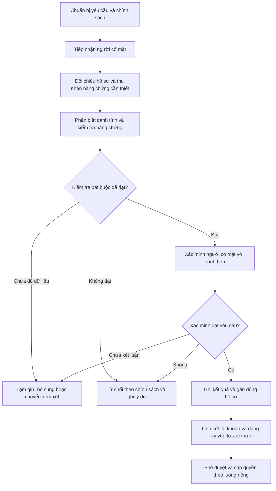

# In-person proofing: kiểm chứng danh tính trực tiếp

## 1. Có mặt trực tiếp giúp kiểm tra điều gì?

**In-person proofing** là quy trình kiểm chứng danh tính có sự hiện diện trực tiếp của người cần được kiểm chứng và nhân sự được tổ chức giao trách nhiệm thực hiện. Trong bài này, hai bên gặp nhau tại cùng địa điểm; quy trình qua video từ xa cần được thiết kế và đánh giá riêng.

Người kiểm chứng có thể xem bằng chứng theo phương thức được chấp nhận, quan sát người đang có mặt, thực hiện các kiểm tra cần thiết và ghi nhận kết quả. Quy trình này có ích khi cần giải quyết hồ sơ khó xử lý tự động, kiểm tra bằng chứng trực tiếp hoặc hỗ trợ một tình huống có mức tác động lớn.

Tuy nhiên, có mặt tại quầy không tự chứng minh danh tính. Một người có thể mang tài liệu không hợp lệ, dùng giấy tờ thật của người khác hoặc khiến nhân viên liên kết kết quả với sai tài khoản. Nhân viên cũng có thể sai sót, bị tác động hoặc lạm dụng quyền.

Vì vậy, mục tiêu của in-person proofing là tạo ra một chuỗi bằng chứng có kiểm soát:

```text
Người đang có mặt
  → bằng chứng được kiểm tra theo chính sách
  → danh tính đã được phân biệt và xác minh phù hợp
  → kết quả gắn với đúng hồ sơ
  → tài khoản và yếu tố xác thực được liên kết có kiểm soát
```

Trong nền tảng IAM, chuỗi này là nền móng cho cấp phát tài khoản, đăng ký MFA, khôi phục truy cập và quản lý đặc quyền. Nó phải kết nối với vòng đời tài khoản và nguyên tắc ít quyền nhất; một kết quả kiểm chứng tốt không có nghĩa người đó được cấp mọi quyền truy cập.

## 2. Phân biệt các kết luận trong một buổi kiểm chứng

Một buổi gặp trực tiếp thường chứa nhiều bước. Không nên gộp chúng thành một nút “đã xác minh” mà không biết nhân viên thực sự đã kiểm tra gì.

| Bước hoặc khái niệm | Câu hỏi cần trả lời | Điều không được tự suy ra |
|---|---|---|
| Tiếp nhận hồ sơ | Người đến đang thực hiện yêu cầu nào? | Có lịch hẹn hoặc mã hồ sơ là chủ thể đã được chứng minh |
| Identity resolution | Có thể phân biệt danh tính được khai trong phạm vi cần thiết không? | Hai người cùng tên hoặc cùng địa chỉ là cùng một danh tính |
| Evidence validation | Bằng chứng có đáp ứng yêu cầu về nguồn, tính xác thực, toàn vẹn và trạng thái không? | Người đang cầm bằng chứng chính là chủ thể của nó |
| Identity verification | Người đang có mặt có gắn với danh tính đã kiểm tra bằng phương pháp được chấp nhận không? | Đã có mặt và trò chuyện thì tự động đạt yêu cầu |
| Enrollment và binding | Kết quả được gắn với tài khoản và phương thức xác thực nào? | Có thể gắn với tài khoản bất kỳ do người dùng vừa đọc tên |
| Authentication | Lần đăng nhập sau có chứng minh quyền kiểm soát yếu tố xác thực không? | Mọi thuộc tính danh tính đều được kiểm tra lại ở mỗi lần đăng nhập |
| Authorization | Người dùng được thực hiện hành động gì? | Đã proofing thành công thì có quyền quản trị |

Ví dụ, nhân viên kiểm chứng có thể xác nhận một giấy tờ thuộc loại được chấp nhận và vượt qua các kiểm tra bắt buộc. Nếu chưa xác minh người có mặt là chủ thể phù hợp, hồ sơ vẫn chưa hoàn tất. Nếu đã xác minh nhưng kết quả bị gắn vào sai tài khoản, toàn bộ chuỗi IAM vẫn có thể bị phá vỡ.

Mức bảo đảm đạt được phụ thuộc toàn bộ chính sách, bằng chứng, phương pháp, nhân sự và kiểm soát hệ thống. Không nên tự gán một mức bảo đảm chỉ từ nhãn “trực tiếp”.

## 3. Xác định khi nào cần quy trình trực tiếp

Các tình huống có thể sử dụng in-person proofing gồm:

- Tiếp nhận nhân sự tại địa điểm làm việc khi tổ chức có chính sách kiểm chứng trực tiếp.
- Xử lý một hồ sơ có bằng chứng không phù hợp với kênh tự động nhưng có phương pháp kiểm tra trực tiếp được chấp nhận.
- Khôi phục một tài khoản có tác động lớn khi các yếu tố xác thực đã mất và chính sách yêu cầu kiểm chứng lại.
- Thiết lập danh tính ban đầu cho người cần tiếp cận hệ thống hoặc đặc quyền nhạy cảm.
- Hỗ trợ người dùng gặp rào cản khi sử dụng quy trình từ xa.

Quyết định sử dụng cần cân nhắc cả khả năng kiểm tra bằng chứng, rủi ro, chi phí vận hành và khả năng tiếp cận. Một buổi gặp trực tiếp có thể tốn thời gian và tạo thêm rủi ro dữ liệu tại quầy nếu tổ chức không chuẩn bị tốt.

Trước khi mở dịch vụ, chính sách cần xác định:

1. Mục đích kiểm chứng và danh tính hoặc thuộc tính nào cần được chứng minh.
2. Loại bằng chứng, nguồn phát hành và phương pháp kiểm tra được chấp nhận.
3. Cách xác minh người có mặt với danh tính đã kiểm tra.
4. Điều kiện chuyển xem xét, tạm dừng hoặc từ chối.
5. Ai được hoàn tất hồ sơ, ai được phê duyệt ngoại lệ và ai được cấp quyền sau đó.
6. Cách gắn kết quả với tài khoản, đăng ký yếu tố xác thực và xử lý vòng đời.
7. Phạm vi dữ liệu cần lưu, thời hạn lưu và người được xem.

Không có một danh sách giấy tờ hoặc một số lượng bằng chứng phù hợp cho mọi tổ chức. Phải xác định yêu cầu theo mục đích và mô hình bảo đảm; không dùng nhiều bản sao từ cùng một nguồn để mặc nhiên thay thế bằng chứng mạnh hơn.

## 4. Vai trò, nhân sự và môi trường kiểm chứng

### 4.1. Phân công trách nhiệm rõ ràng

Một mô hình có thể tách các trách nhiệm như sau:

| Vai trò | Trách nhiệm chính | Giới hạn quyền |
|---|---|---|
| Nhân viên tiếp nhận | Hướng dẫn, xác định hồ sơ và điều phối lịch | Không tự kết luận mọi kiểm tra chuyên môn đã đạt |
| Nhân viên kiểm chứng | Thực hiện các bước được phân công, ghi căn cứ và kết quả | Không tự cấp quyền ngoài phạm vi nghiệp vụ |
| Người xem xét hoặc giám sát | Giải quyết hồ sơ được chuyển, phê duyệt theo chính sách | Không xóa dấu vết hoặc bỏ điều kiện bắt buộc tùy ý |
| Dịch vụ IAM | Gắn kết quả, quản lý tài khoản và đăng ký yếu tố theo luồng | Không tin một cờ do client tự khai thay cho kết quả hợp lệ |
| Chủ sở hữu nghiệp vụ | Phê duyệt quyền hoặc quan hệ công việc | Không dùng phê duyệt nghiệp vụ để thay thế bước kiểm chứng còn thiếu |
| Kiểm toán hoặc vận hành an ninh | Xem xét sự kiện và phát hiện bất thường | Chỉ tiếp cận dữ liệu phù hợp với nhiệm vụ |

Một tổ chức nhỏ có thể để một người thực hiện nhiều nhiệm vụ. Khi đó vẫn cần xác định giới hạn, xung đột lợi ích và các trường hợp phải có người thứ hai. Nhân viên không nên tự hoàn tất hồ sơ của mình hoặc tự phê duyệt một ngoại lệ có lợi trực tiếp cho mình.

Nhân viên cần được hướng dẫn về loại bằng chứng được phép xử lý, giới hạn phương pháp kiểm tra, các dấu hiệu cần chuyển chuyên viên và cách hỗ trợ người dùng. Khả năng giao tiếp tự tin hoặc cảm giác “người này trông đáng tin” không thay thế tiêu chí chuyên môn.

### 4.2. Bảo vệ quầy và thiết bị

Địa điểm kiểm chứng cần hạn chế người khác nhìn thấy màn hình, nghe thông tin nhạy cảm hoặc lấy tài liệu. Hồ sơ giấy tạm thời, bản in và bản quét cũng cần có cách bàn giao hoặc hủy theo quy trình.

Máy trạm dùng cho kiểm chứng nên được quản lý, có tài khoản nhân viên riêng, xác thực phù hợp và giới hạn phần mềm hoặc thiết bị ngoại vi theo chính sách. Không dùng tài khoản chung khiến mọi kết luận đều mang tên “quầy tiếp nhận”.

Các biện pháp cần quan tâm gồm:

- Khóa phiên khi nhân viên rời chỗ và kết thúc hồ sơ trước khi tiếp người tiếp theo.
- Bảo vệ kết nối đến nguồn kiểm tra và dịch vụ IAM.
- Không chụp giấy tờ bằng điện thoại cá nhân hoặc gửi qua ứng dụng nhắn tin không thuộc quy trình.
- Giới hạn dữ liệu lưu tạm trên máy quét, máy in và trình duyệt.
- Không để người dùng tự thao tác trên phiên nhân viên có quyền xử lý hồ sơ.
- Ghi nhận việc truy cập, thay đổi kết quả và sử dụng ngoại lệ.

Một khu vực làm việc có camera không tự thay thế các kiểm soát này. Nếu có ghi hình hoặc thu thập dữ liệu bổ sung, tổ chức phải xác định mục đích, phạm vi, cách bảo vệ và thời hạn lưu phù hợp; không mặc nhiên ghi mọi giấy tờ hoặc cuộc trao đổi.

## 5. Luồng kiểm chứng trực tiếp từ đầu đến cuối



Đây là mô hình khái niệm. Một quy trình có thể thay đổi thứ tự một số thao tác, nhưng không được bỏ bước bắt buộc hoặc coi việc đến bước sau là bằng chứng rằng bước trước đã đạt.

### Bước 1: chuẩn bị trước buổi gặp

Người dùng được hướng dẫn về mục đích, bằng chứng được chấp nhận, cách đặt lịch và phương án hỗ trợ. Chỉ thu thập trước dữ liệu cần thiết. Mã lịch hẹn giúp tìm hồ sơ; nó không phải bằng chứng danh tính và không nên tự cấp quyền cho người biết mã.

Nếu hồ sơ đã được tạo từ một kênh khác, nhân viên cần biết trạng thái, phiên bản chính sách và bằng chứng nào đang chờ kiểm tra. Dữ liệu người dùng khai trước vẫn cần được đối chiếu khi chính sách yêu cầu.

### Bước 2: tiếp nhận và liên kết đúng hồ sơ

Tại quầy, nhân viên xác định yêu cầu đang xử lý bằng quy trình phù hợp. Cần tránh nhầm hai hồ sơ có tên gần giống hoặc sử dụng hồ sơ của người vừa rời quầy.

Trước khi xem hoặc thu nhận thông tin nhạy cảm, nhân viên giải thích các bước cần làm và dữ liệu cần dùng theo quy trình. Người đi cùng có thể hỗ trợ giao tiếp, nhưng sự có mặt hoặc lời khẳng định của họ không tự thay thế bằng chứng về người cần kiểm chứng.

### Bước 3: kiểm tra bằng chứng

Nhân viên và hệ thống thực hiện các kiểm tra dành cho loại bằng chứng đó: nguồn phát hành, tính xác thực, tính toàn vẹn, trường dữ liệu và trạng thái khi cần. Không đánh dấu đạt chỉ vì đã nhìn thấy giấy tờ.

### Bước 4: xác minh người có mặt

Sử dụng phương pháp đã được chính sách chấp nhận để đánh giá liên kết giữa người đang có mặt và danh tính đã kiểm tra. Kết quả phải có căn cứ trong phạm vi phương pháp, đồng thời có đường xử lý trường hợp chưa thể kết luận.

### Bước 5: kết luận có thể truy vết

Ghi lại những kiểm tra đã thực hiện, kết quả, nhân viên phụ trách, thời điểm và chính sách áp dụng. Nếu còn kiểm tra bắt buộc chưa xong, hồ sơ phải giữ trạng thái tương ứng.

### Bước 6: gắn tài khoản và yếu tố xác thực

Kết quả được chuyển qua cơ chế đáng tin tới luồng enrollment hoặc khôi phục. Tài khoản đích, yếu tố xác thực và người nhận phải được liên kết đúng; không hoàn tất bằng cách sao chép một mã thành công vào hồ sơ bất kỳ.

### Bước 7: cấp quyền và thông báo

Quyền được cấp theo phê duyệt nghiệp vụ, vai trò, thuộc tính và giới hạn thời gian thích hợp. Thông báo kết quả hoặc thay đổi tài khoản qua kênh đã xác định trong quy trình; thông báo không được tiết lộ toàn bộ bằng chứng nhạy cảm.

## 6. Kiểm tra bằng chứng trong buổi gặp trực tiếp

### 6.1. Bản gốc, bản sao và bằng chứng điện tử

Nhân viên cần biết chính sách chấp nhận loại nào. Một bản photo không cung cấp cùng khả năng kiểm tra với tài liệu gốc; ảnh chụp trên điện thoại cũng không mặc nhiên tương đương bằng chứng điện tử có thể xác minh.

Với bằng chứng điện tử, việc kiểm tra có thể dựa trên chữ ký, nguồn phát hành hoặc cơ chế cung cấp dữ liệu đáng tin. Nhân viên không nên chỉ nhìn dấu tích “đã xác minh” trong một ảnh màn hình rồi coi đó là kết quả của hệ thống mình.

Tương tự, đọc được QR hoặc mã vạch không tự chứng minh tài liệu thật. Nếu nội dung cần được xác minh chữ ký hoặc đối chiếu nguồn, phải thực hiện bước đó. Không tự tin mọi đường dẫn được in trên tài liệu là nguồn có thẩm quyền.

### 6.2. Đối chiếu thuộc tính và giải quyết khác biệt

Tên có dấu, thứ tự họ tên, cách viết tắt hoặc tên đã thay đổi có thể khác giữa các nguồn. Ngày và ký tự trên tài liệu cũng có thể bị đọc nhầm. Cần giữ giá trị nguồn và áp dụng quy tắc so sánh đã định.

Không tự ghép hai tài khoản chỉ vì tên giống nhau. Email, số điện thoại hoặc địa chỉ có thể thay đổi, dùng chung hoặc đã được cấp lại. Nếu cần tìm hồ sơ cũ, phải dùng quy trình resolution và liên kết tài khoản phù hợp.

Khi nguồn không tìm thấy bản ghi, cần xét độ bao phủ và chất lượng dữ liệu. Khi nguồn không phản hồi, đó là trạng thái chưa thực hiện xong kiểm tra, không phải bằng chứng rằng hồ sơ hợp lệ hay người dùng gian lận.

### 6.3. Tính độc lập của nguồn

Một thẻ, một bản in và một email có thể đều sao chép cùng dữ liệu do người dùng tự khai. Số lượng tài liệu không tự làm chúng trở thành các xác nhận độc lập.

Nguồn có thẩm quyền cần được xác định cho đúng thuộc tính. Xác nhận của đơn vị có thể chứng minh quan hệ công việc trong phạm vi quản lý của họ; nó không tự chứng thực mọi thông tin cá nhân ngoài phạm vi đó.

## 7. Xác minh người có mặt và giới hạn của quan sát

Khi bằng chứng có ảnh và chính sách cho phép, nhân viên có thể thực hiện đối chiếu người đang có mặt với ảnh theo quy trình được đào tạo. Đây là một phương pháp cần kiểm soát sai sót, không phải phép chứng minh tuyệt đối.

Ánh sáng, chất lượng ảnh, thời gian từ lúc chụp, thay đổi ngoại hình và khả năng của người kiểm tra đều có thể ảnh hưởng kết quả. Không nên dùng các suy đoán về giọng nói, trang phục, mức tự tin hoặc nhóm dân cư làm căn cứ thay thế cho kiểm tra danh tính.

Khi chưa thể kết luận, cần chuyển sang phương pháp hoặc người xem xét được phép, thay vì gây áp lực để nhân viên chọn “đạt” hoặc gắn nhãn gian lận ngay.

### Trao đổi trực tiếp không thay thế bằng chứng

Phỏng vấn có thể giúp làm rõ thông tin mâu thuẫn hoặc mục đích hồ sơ. Tuy nhiên, trả lời đúng họ tên, ngày sinh, địa chỉ hoặc câu hỏi về lịch sử cá nhân không tự chứng minh danh tính; những thông tin đó có thể đã được biết bởi người khác.

Nhân viên không được yêu cầu người dùng đọc mật khẩu, PIN của yếu tố xác thực, OTP hoặc mã khôi phục để “chứng minh mình là chủ tài khoản”. Nếu luồng đăng ký có thao tác bí mật, người dùng phải thực hiện trong kênh và giao diện phù hợp mà nhân viên không cần biết bí mật đó.

### Nếu sử dụng sinh trắc học

Việc có mặt trực tiếp không đồng nghĩa bắt buộc phải lưu mẫu sinh trắc. Nếu tổ chức sử dụng công nghệ so khớp, cần xác định mục đích, chất lượng thu nhận, ngưỡng, cách xử lý không chắc chắn, phương án thay thế và biện pháp bảo vệ dữ liệu.

Không nên coi một điểm so khớp cao là đủ để bỏ qua việc validation bằng chứng hoặc ràng buộc tài khoản. Dữ liệu sinh trắc cũng không nên tự trở thành bí mật đăng nhập có thể sao chép vào nhiều hệ thống.

## 8. Binding: điểm dễ mất toàn bộ giá trị của buổi kiểm chứng

Giả sử người có mặt đã được kiểm chứng đúng nhưng nhân viên chọn nhầm tài khoản trên màn hình. Kết quả là một tài khoản khác được hưởng trạng thái danh tính đáng tin. Sai sót này xảy ra sau các kiểm tra chuyên môn, nhưng tác động vẫn nghiêm trọng.

Một cơ chế binding cần bảo vệ ít nhất các liên kết:

- Kết quả thuộc về đúng yêu cầu kiểm chứng và đúng chủ thể đã được xác định.
- Tài khoản đích được chọn theo quy trình đáng tin, không chỉ dựa vào tên hiển thị hoặc địa chỉ do người dùng vừa đọc.
- Kết quả có nguồn phát hành, thời hạn và phạm vi sử dụng rõ ràng.
- Việc sử dụng lại, sửa kết quả hoặc dùng đồng thời cho sai hồ sơ bị ngăn chặn.
- Yếu tố xác thực được đăng ký cho đúng tài khoản và bàn giao theo đúng chuỗi kiểm soát.

Một kết quả điện tử có thể gắn với mã yêu cầu, định danh nội bộ, phiên bản chính sách, thời điểm và dịch vụ nhận dự kiến. Dịch vụ IAM phải xác minh nguồn và ràng buộc phù hợp trước khi cập nhật tài khoản. Một chuỗi `proofing_passed=true` từ trình duyệt không đủ cho quyết định này.

Giả mã dưới đây minh họa điều kiện kết thúc enrollment, không phải mã tích hợp hoàn chỉnh:

```text
complete_enrollment(request, result, target_account, authenticator):
    require trusted_result_source(result)
    require result.request_ref == request.reference
    require result.subject_ref == request.resolved_subject_ref
    require result.outcome == "PASSED"
    require result.is_within_accepted_validity
    require result.policy_satisfies(request.required_policy)
    require request.target_account_ref == target_account.reference
    require target_account.is_eligible_for_enrollment
    require authenticator.registration_belongs_to(request, target_account)

    atomically:
        require result.is_unused_for_this_binding
        bind_proofing_result(target_account, result)
        finalize_authenticator_registration(target_account, authenticator)
        mark_binding_completed(request, result)

    record_audit_event(request, result, target_account)
```

Triển khai cần xử lý việc thử lại có kiểm soát: nếu hệ thống đã hoàn tất nhưng phản hồi bị mất, lần thử lại không được gắn thêm một tài khoản khác hoặc tạo thêm quyền. Tính nguyên tử, chống dùng sai lại kết quả và khả năng khôi phục trạng thái phải được thiết kế ở máy chủ.

### Bàn giao yếu tố xác thực

Nếu phát khóa bảo mật hoặc thiết bị xác thực, cần ghi nhận đúng thiết bị, người nhận và trạng thái đăng ký theo chính sách. Việc phát thiết bị vật lý chưa chứng minh nó đã được đăng ký đúng tài khoản hoặc người dùng đã hoàn tất thao tác cần thiết.

Nếu người dùng đăng ký yếu tố trên thiết bị cá nhân, quá trình phải gắn với đúng yêu cầu đã được kiểm chứng và kênh hợp lệ. Không để nhân viên vô tình đăng ký yếu tố thuộc quyền kiểm soát của mình cho tài khoản người dùng.

Máy dùng chung tại quầy không nên trở thành nơi lưu yếu tố xác thực cá nhân của nhiều người trong cùng một hồ sơ hệ điều hành. Người dùng cần được hướng dẫn cách kiểm tra trạng thái đăng ký và cách báo mất hoặc thu hồi yếu tố sau đó.

## 9. Ví dụ xuyên suốt: tiếp nhận nhân viên mới

Một công ty tiếp nhận nhân viên mới tên Minh tại văn phòng. Công ty có hệ thống nhân sự, dịch vụ kiểm chứng và IAM. Chính sách yêu cầu kiểm chứng phù hợp trước khi kích hoạt tài khoản làm việc; quyền quản trị phải đi qua phê duyệt riêng.

### Trước buổi gặp

Hệ thống nhân sự tạo hồ sơ chờ tiếp nhận với mã nội bộ và quan hệ công việc dự kiến. Minh nhận hướng dẫn và lịch hẹn. Thư mời xác định việc cần làm, chưa được coi là bằng chứng đầy đủ rằng người mang thư là Minh.

### Tại quầy

Nhân viên dùng tài khoản riêng để mở đúng yêu cầu. Họ kiểm tra bằng chứng được chính sách chấp nhận và đối chiếu những thuộc tính cần thiết với nguồn phù hợp.

Hệ thống phát hiện có một hồ sơ cũ cùng tên. Nhân viên không ghép tài khoản theo tên mà chuyển qua kiểm tra resolution cần thiết. Hồ sơ cũ có thể thuộc người khác hoặc là một quan hệ làm việc trước đây; cả hai trường hợp đều cần xử lý theo quy trình.

Sau khi bằng chứng đạt, nhân viên xác minh người đang có mặt bằng phương pháp được phép. Nếu một kiểm tra chưa thể kết luận, Minh được hướng dẫn bước tiếp theo; không kích hoạt quyền làm việc chỉ để kết thúc hàng chờ.

### Gắn danh tính với tài khoản

Kết quả được gửi tới IAM, ràng buộc với đúng yêu cầu và định danh nội bộ. IAM kiểm tra tài khoản đích còn đủ điều kiện, rồi cho phép đăng ký phương thức xác thực theo luồng được kiểm soát.

Minh thực hiện phần thao tác bí mật của mình. Nhân viên không ghi mật khẩu hoặc PIN vào biên bản và không giữ mã khôi phục của Minh trong hồ sơ kiểm chứng.

### Cấp quyền

Tài khoản được kích hoạt theo thời điểm và trạng thái quan hệ công việc. Vai trò cơ bản được cấp từ quy trình phê duyệt và dữ liệu nhân sự đáng tin; quyền quản trị chỉ xuất hiện khi đủ điều kiện riêng.

Nếu người quản lý đề nghị quyền quản trị ngay tại quầy, nhân viên kiểm chứng không được dùng việc Minh vừa proofing thành công để bỏ qua luồng quản lý đặc quyền. Có thể cần xác thực mạnh, phê duyệt và quyền có thời hạn khi thực hiện thao tác nhạy cảm sau này.

### Sau buổi gặp

Minh nhận thông báo về tài khoản và yếu tố xác thực đã đăng ký qua kênh phù hợp. Khi Minh chuyển nhóm hoặc nghỉ việc, quyền được cập nhật hoặc thu hồi theo vòng đời quan hệ công việc. Kết quả đã gặp trực tiếp không giữ quyền truy cập tồn tại vô thời hạn.

## 10. Xử lý ngoại lệ và tình huống chưa thể kết luận

Các tình huống tại quầy không phải lúc nào cũng có kết quả ngay. Cần phân biệt thiếu dữ liệu, không đáp ứng chính sách và dấu hiệu gian lận đã có căn cứ.

| Tình huống | Cách xử lý phù hợp về thiết kế | Điều cần tránh |
|---|---|---|
| Bằng chứng không thuộc loại được chấp nhận | Giải thích yêu cầu và đưa phương án thay thế đã được duyệt | Tự chấp nhận vì người dùng đã đi xa đến quầy |
| Thông tin giữa các nguồn khác nhau | Kiểm tra lỗi đọc, thay đổi hợp lệ và chuyển xem xét khi cần | Tự sửa nguồn gốc dữ liệu cho khớp |
| Nguồn bắt buộc không khả dụng | Giữ hồ sơ chờ hoặc dùng phương pháp thay thế đáp ứng chính sách | Đánh dấu đạt để giải phóng hàng chờ |
| Không thể đối chiếu người với bằng chứng đủ chắc chắn | Chuyển phương pháp hoặc người xem xét được phép | Gắn nhãn gian lận chỉ từ cảm giác hoặc ngoại hình |
| Người dùng cần phiên dịch hoặc hỗ trợ tiếp cận | Cung cấp hỗ trợ phù hợp, giữ trách nhiệm kiểm chứng với đúng chủ thể | Để người hỗ trợ trở thành chủ tài khoản hoặc nhận yếu tố thay không đúng quy trình |
| Người dùng mất mọi yếu tố xác thực | Thực hiện luồng khôi phục có kiểm chứng và kiểm soát riêng | Chỉ dựa vào việc có mặt hoặc biết thuộc tính tài khoản để đặt lại |
| Có nghi vấn bị ép buộc hoặc rủi ro tại quầy | Tạm dừng và chuyển theo quy trình an toàn, vận hành của tổ chức | Tiếp tục máy móc vì các trường dữ liệu đã khớp |

Một ngoại lệ được duyệt cần có căn cứ, người quyết định và phạm vi áp dụng. Nếu phương án thay thế không đạt yêu cầu bắt buộc, cần xử lý như thay đổi chính sách hoặc không hoàn tất, thay vì âm thầm coi đó là cùng một mức bảo đảm.

Không nên để hỗ trợ khẩn cấp trở thành một mật khẩu vạn năng cho quy trình. Nếu có cơ chế truy cập khẩn cấp, nó phải có phạm vi, thời hạn, giám sát và xem xét riêng; trạng thái proofing vẫn cần phản ánh đúng điều đã thực hiện.

## 11. Rủi ro gian lận, sai sót và lạm dụng nội bộ

| Rủi ro | Tác động | Kiểm soát thiết kế |
|---|---|---|
| Dùng bằng chứng không hợp lệ | Tạo nền tảng danh tính sai | Kiểm tra theo loại bằng chứng, nguồn đáng tin và trạng thái cần thiết |
| Dùng giấy tờ thật của người khác | Gắn tài khoản cho sai người | Xác minh người có mặt riêng với bước validation |
| Chọn nhầm hoặc cố ý đổi tài khoản đích | Kết quả tốt được áp vào tài khoản khác | Ràng buộc yêu cầu, chủ thể và tài khoản; xác nhận máy chủ |
| Nhân viên bỏ bước do áp lực hàng chờ | Giảm mức bảo đảm thực tế | Giao diện yêu cầu kết quả từng kiểm tra, đào tạo và giám sát phù hợp |
| Tài khoản nhân viên bị chiếm dụng | Tạo hoặc sửa kết quả không hợp lệ | Xác thực mạnh, ít quyền, bảo vệ máy trạm và giám sát sự kiện |
| Nhân viên thông đồng hoặc lạm quyền | Chấp nhận hồ sơ ngoài chính sách | Phân tách nhiệm vụ, kiểm tra độc lập theo rủi ro và dấu vết khó sửa trái phép |
| Kết quả bị dùng lại sai phạm vi | Một hồ sơ mở khóa nhiều tài khoản hoặc hành động | Giới hạn đối tượng nhận, thời hạn, phạm vi và trạng thái sử dụng |
| Lộ dữ liệu tại quầy | Giấy tờ hoặc thuộc tính bị sao chép | Bảo vệ không gian, thiết bị, lưu trữ và kênh trao đổi |

Các kiểm soát cần được kết hợp. Ví dụ, đào tạo nhân viên không thay thế việc máy chủ kiểm tra ràng buộc tài khoản; bảo vệ chữ ký kết quả cũng không giúp nếu nhân viên nhập sai chủ thể mà không có cơ chế phát hiện.

Khi phát hiện một nhân viên hoặc máy trạm bị xâm phạm, hệ thống cần tìm được các hồ sơ liên quan để đánh giá lại. Không nên tự kết luận mọi người dùng trong phạm vi đó đều gian lận, nhưng cũng không bỏ qua khả năng các kết quả kiểm chứng đã bị ảnh hưởng.

## 12. Nhật ký, bằng chứng vận hành và quyền riêng tư

Một bản ghi đủ dùng cần giải thích được hồ sơ nào được xử lý, ai thực hiện, theo chính sách nào, kiểm tra nào đã đạt và bước tiếp theo là gì. Mục tiêu không phải lưu càng nhiều dữ liệu cá nhân càng tốt.

Ví dụ dưới đây chỉ dùng tham chiếu giả:

```json
{
  "proofing_request_ref": "request-example-009",
  "subject_ref": "subject-example-A",
  "channel": "IN_PERSON",
  "site_ref": "site-example-1",
  "agent_ref": "agent-example-7",
  "policy_version": "proofing-policy-example-v1",
  "outcome": "PASSED",
  "checks": {
    "identity_resolution": "PASSED",
    "evidence_validation": "PASSED",
    "holder_verification": "PASSED"
  },
  "evidence_ref": "evidence-example-3",
  "binding_state": "PENDING"
}
```

Trong triển khai thực, cần có thời điểm, tham chiếu giao dịch và chi tiết kiểm tra phù hợp với yêu cầu kiểm toán. `PASSED` ở đây chỉ nói phần kiểm chứng đã đạt; `binding_state` vẫn là `PENDING`, nên không được tự suy ra tài khoản đã sẵn sàng sử dụng.

Các nguyên tắc quản lý dữ liệu gồm:

- Chỉ thu thập thuộc tính và bản sao thực sự cần cho mục đích đã định.
- Không ghi mật khẩu, OTP, PIN, mã khôi phục hoặc token truy cập vào biên bản.
- Tách bằng chứng nhạy cảm khỏi log ứng dụng thông thường; sử dụng tham chiếu khi có thể.
- Giới hạn ai được xem ảnh, ai được sửa kết quả và ai được phê duyệt ngoại lệ.
- Ghi nhận truy cập và thay đổi hồ sơ, bao gồm sửa kết luận sau khiếu nại.
- Có thời hạn lưu và cách xử lý dữ liệu ở máy trạm, bản sao và các hệ thống liên quan.
- Không tự dùng giấy tờ hoặc ảnh thu nhận cho mục đích huấn luyện, thử nghiệm hay chia sẻ ngoài phạm vi đã xác định.

Nhật ký cần được bảo vệ khỏi sửa hoặc xóa trái phép bằng cơ chế phù hợp. Khi có sửa sai hợp lệ, nên giữ dấu vết kết luận trước và căn cứ thay đổi, thay vì làm như quyết định cũ chưa từng tồn tại.

## 13. Tích hợp với phiên, SSO và vòng đời IAM

### Kết quả proofing và bằng chứng đăng nhập là hai lớp khác nhau

Sau khi được kiểm chứng trực tiếp, người dùng vẫn cần phương thức xác thực phù hợp cho mỗi lần truy cập. Một lần proofing trước đây không thay thế MFA cho thao tác nhạy cảm hôm nay và không chứng minh phiên hiện tại chưa bị chiếm dụng.

Trong SSO hoặc liên kết danh tính, ứng dụng có thể nhận kết quả hoặc thuộc tính liên quan đến proofing qua cơ chế đã được thống nhất. Ứng dụng phải biết issuer nào được tin, claim có ý nghĩa gì và kết quả được kiểm tra khi nào.

Không nên suy ra “đã kiểm chứng trực tiếp” từ một claim về email đã xác minh hoặc phương thức xác thực đăng nhập. Cũng không nên đưa ảnh giấy tờ hoặc toàn bộ hồ sơ kiểm chứng vào token phân phối tới nhiều ứng dụng.

### Thay đổi và thu hồi vẫn phải có hiệu lực

Danh tính đã được kiểm chứng có thể gắn với một tài khoản về sau bị đình chỉ, một yếu tố bị mất hoặc một quan hệ công việc đã kết thúc. Hệ thống cần xử lý những trạng thái này ở vòng đời tài khoản, phiên, token và quyền.

Nếu khôi phục tại quầy, cần xem xét yếu tố cũ và các phiên liên quan theo chính sách. Đặt lại một phương thức xác thực không tự bảo đảm mọi access token hoặc phiên ứng dụng cũ đã bị vô hiệu hóa ngay; hiệu lực thu hồi phải được thiết kế tại các tài nguyên liên quan.

### Không chuyển nguyên mô hình con người sang workload

Nhân viên có thể xuất hiện trực tiếp để chứng minh danh tính và được giao quyền phê duyệt một workload. Điều đó không chứng minh một tiến trình cụ thể là workload hợp lệ.

Workload vẫn cần danh tính riêng, nguồn cấp thông tin xác thực đáng tin, ràng buộc với môi trường và phạm vi quyền thích hợp. Tài khoản người phê duyệt và danh tính của dịch vụ phải có vòng đời và trách nhiệm riêng.

## 14. Vận hành và tự kiểm tra thiết kế

### Khi hệ thống gặp sự cố

Nếu mất kết nối tới nguồn kiểm tra hoặc IAM, cần có quy trình giữ hồ sơ chờ, xác định bước đã làm và tránh nhầm kết quả khi hoạt động trở lại. Không dùng ghi chú giấy không được kiểm soát như một kết quả thành công có thể áp vào bất kỳ tài khoản nào.

Nếu chính sách cho phép quy trình ngoại tuyến, phải định nghĩa trước bằng chứng nào có thể kiểm tra, ai được quyết định, cách bảo vệ dữ liệu và cách đồng bộ kết quả. Một bước bắt buộc chưa làm được không được ghi thành đã đạt chỉ vì nhân viên đang có mặt cùng người dùng.

Khi có quá nhiều hồ sơ chờ, giải pháp là điều phối nguồn lực, hẹn lại hoặc dùng kênh thay thế được chấp nhận. Áp lực thời gian không làm thay đổi tự động yêu cầu bảo đảm.

### Đo chất lượng

Nên xem xét thời gian xử lý, tỷ lệ chuyển xem xét, nguyên nhân chưa thể kết luận, lỗi binding, số ngoại lệ và số quyết định thay đổi sau khiếu nại. Khi có dữ liệu xác minh phù hợp, cần đánh giá cả người hợp lệ bị từ chối và hồ sơ không hợp lệ đã được chấp nhận.

Không dùng riêng số hồ sơ hoàn tất mỗi giờ để đánh giá nhân viên. Chỉ số đó có thể tạo động lực bỏ qua bước kiểm tra. Cũng không coi một quầy có nhiều hồ sơ chuyển chuyên viên là làm việc kém nếu họ đang xử lý các trường hợp phức tạp hơn.

### Tình huống tự kiểm tra

**1. Người dùng có lịch hẹn, thẻ ra vào và email công ty. Có thể bỏ qua proofing không?**

Không tự động. Những thông tin đó chỉ có giá trị trong phạm vi chính sách và nguồn đã kiểm tra. Cần hiểu chúng đã được cấp từ quy trình nào, có phụ thuộc vào cùng một thông tin tự khai không và có đáp ứng yêu cầu của hồ sơ hiện tại không.

**2. Nhân viên thấy giấy tờ hợp lệ nhưng chưa chắc người có mặt là chủ thể. Có được hoàn tất không?**

Không được ghi nhận toàn bộ quy trình đạt nếu bước xác minh chủ thể bắt buộc còn chưa có kết luận. Cần dùng phương pháp thay thế hoặc chuyển người xem xét được phép.

**3. Buổi kiểm chứng đúng, nhưng người dùng yêu cầu gắn kết quả sang một tài khoản khác. Có thể sửa trực tiếp theo yêu cầu miệng không?**

Không. Phải kiểm tra yêu cầu đổi tài khoản đích bằng quy trình liên kết phù hợp. Binding là một phần của chuỗi bảo đảm, không phải thao tác nhập liệu tùy ý sau khi đã gặp trực tiếp.

**4. Nguồn kiểm tra bị lỗi nhưng quản lý yêu cầu kích hoạt tài khoản để kịp giờ làm. Có thể ghi kiểm tra là đạt không?**

Không. Trạng thái phải phản ánh việc chưa kiểm tra được. Nếu có phương án truy cập hạn chế hoặc ngoại lệ được chính sách cho phép, cần thực hiện đúng phạm vi và ghi nhận riêng, không làm sai kết quả proofing.

**5. Người dùng đã proofing trực tiếp từ trước và vừa được đăng ký lại MFA tại quầy. Có thể bỏ qua kiểm tra quyền khi họ truy cập dữ liệu nhạy cảm không?**

Không. Danh tính, xác thực và quyền truy cập giải quyết các câu hỏi khác nhau. API vẫn phải thực thi RBAC/ABAC, điều kiện phiên, mức bảo đảm cần thiết và nguyên tắc ít quyền nhất.

Một quy trình in-person proofing được thiết kế đầy đủ phải giải thích được ai đã có mặt, bằng chứng nào đã được kiểm tra, phương pháp nào gắn người đó với danh tính, và kết quả đã được ràng buộc với tài khoản ra sao. Chất lượng của chuỗi này đến từ các kiểm soát có thể kiểm chứng và truy vết, không chỉ từ việc hai người đã gặp nhau.
