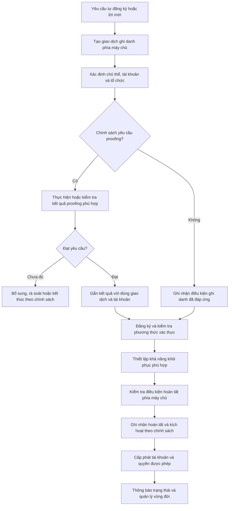

# Enrollment — Ghi danh và thiết lập tài khoản trong IAM

## 1. Enrollment giải quyết vấn đề gì?

Một tổ chức đã có hồ sơ nhân sự của An và đã kiểm chứng An là người trong hồ sơ. Tuy nhiên, hệ thống IAM vẫn cần giải quyết các câu hỏi tiếp theo:

- Tài khoản nào sẽ đại diện cho An trong hệ thống?
- Làm sao biết phương thức xác thực được đăng ký thuộc quá trình tiếp nhận của đúng An?
- Khi nào tài khoản được phép hoạt động?
- Những quyền nào có thể được cấp, và quyền nào cần phê duyệt riêng?
- Nếu quy trình bị gián đoạn, kết quả nào được giữ lại và phần nào phải làm lại?

**Enrollment là quy trình ghi danh một chủ thể vào miền danh tính của dịch vụ, thiết lập hồ sơ hoặc tài khoản và các liên kết cần thiết để chủ thể sử dụng dịch vụ theo chính sách.** Trong bối cảnh identity proofing, trọng tâm là chuyển kết quả kiểm chứng danh tính thành một tài khoản được gắn đúng với người đã được kiểm chứng, đồng thời thiết lập phương thức xác thực cho các lần truy cập tiếp theo.

Một dịch vụ có thể gộp nhiều bước dưới tên “đăng ký”, trong khi dịch vụ khác tách proofing, ghi danh, đăng ký phương thức xác thực và kích hoạt thành các luồng riêng. Điều quan trọng là làm rõ trách nhiệm và điều kiện chuyển bước, thay vì chỉ dựa vào tên của màn hình hoặc API.

Enrollment không có nghĩa mọi dịch vụ đều phải thu giấy tờ hoặc biết danh tính đời thực. Một diễn đàn dùng biệt danh có thể ghi danh tài khoản mà không yêu cầu identity proofing đời thực. Ngược lại, cổng nội bộ hoặc hệ thống cấp đặc quyền có thể yêu cầu bằng chứng về danh tính và quan hệ với tổ chức trước khi kích hoạt quyền tương ứng.

## 2. Vị trí của enrollment trong vòng đời IAM

### 2.1. Phân biệt các hoạt động liên quan

| Hoạt động | Mục tiêu chính | Kết quả điển hình |
| --- | --- | --- |
| Registration — đăng ký ban đầu | Tiếp nhận yêu cầu tham gia và dữ liệu khởi đầu | Một yêu cầu đăng ký hoặc tài khoản ở trạng thái chờ |
| Identity proofing | Thiết lập mức tin cậy về người được khai báo và bằng chứng danh tính | Kết quả kiểm chứng có phạm vi, nguồn và thời điểm |
| Attribute verification | Kiểm chứng thuộc tính cụ thể của đúng chủ thể | Ví dụ: liên kết với hồ sơ nhân viên đã được xác nhận |
| Enrollment | Thiết lập tài khoản và các liên kết cần để sử dụng dịch vụ theo chính sách | Tài khoản gắn đúng chủ thể, đáp ứng điều kiện ghi danh |
| Authenticator binding — gắn phương thức xác thực | Liên kết phương thức xác thực với đúng tài khoản | Khóa bảo mật, passkey hoặc phương thức khác được đăng ký hợp lệ |
| Activation — kích hoạt | Chuyển tài khoản hoặc khả năng sử dụng từ chờ sang được phép hoạt động | Tài khoản được phép đăng nhập hoặc sử dụng chức năng đã xác định |
| Provisioning — cấp phát | Tạo hoặc cập nhật tài khoản, nhóm, quyền ở hệ thống đích | Ứng dụng đích nhận tài khoản và quyền cần thiết |
| Authentication — xác thực | Kiểm tra bằng chứng trong một lần truy cập | Một lần xác thực thành công theo yêu cầu |
| Authorization — phân quyền | Quyết định hành động nào được phép trên tài nguyên | Cho phép hoặc từ chối một yêu cầu cụ thể |

Các bước có thể được tổ chức khác nhau tùy kiến trúc. Chẳng hạn, doanh nghiệp tạo sẵn tài khoản chờ trước ngày đi làm, rồi mới hoàn tất proofing và đăng ký phương thức xác thực. Tài khoản tồn tại trong cơ sở dữ liệu chưa đồng nghĩa quá trình ghi danh đã hoàn tất hoặc tài khoản đã có quyền truy cập nghiệp vụ.

### 2.2. Những điều enrollment không tự bảo đảm

Hoàn tất enrollment không bảo đảm rằng tài khoản luôn an toàn, người dùng luôn còn làm việc hoặc mọi quyền cấp ban đầu đều tiếp tục phù hợp. Sau ghi danh vẫn cần xác thực, MFA khi chính sách yêu cầu, bảo vệ phiên, quản lý vòng đời quyền và kiểm toán.

Tương tự, đăng ký một phương thức xác thực mạnh không sửa được liên kết sai giữa tài khoản và người. Nếu kẻ tấn công được phép gắn khóa của mình vào tài khoản đáng lẽ thuộc An, những lần đăng nhập sau có thể diễn ra rất chắc chắn với chính khóa của kẻ tấn công.

Vì vậy, mục tiêu cốt lõi là giữ đúng chuỗi liên kết:

```text
Người hoặc chủ thể đã được kiểm chứng
    → hồ sơ danh tính phù hợp
    → đúng tài khoản trong đúng tổ chức
    → đúng phương thức xác thực được đăng ký
    → khả năng truy cập theo chính sách
```

## 3. Những đối tượng cần quản lý riêng

Một thiết kế rõ ràng nên phân biệt ít nhất các đối tượng sau:

| Đối tượng | Vai trò | Ví dụ định danh minh họa |
| --- | --- | --- |
| Chủ thể nội bộ | Biểu diễn người hoặc thực thể trong miền IAM | `usr_demo_0042` |
| Tài khoản | Hồ sơ dùng để tham gia và truy cập một hệ thống | `acct_demo_018` |
| Yêu cầu enrollment | Theo dõi một lần ghi danh cụ thể | `enr_demo_0097` |
| Giao dịch proofing | Theo dõi lần kiểm chứng và kết quả liên quan | `prf_demo_027` |
| Phương thức xác thực | Phương tiện hoặc bí mật được gắn với tài khoản | `authn_demo_011` |
| Yêu cầu cấp phát | Theo dõi việc đưa tài khoản và quyền sang hệ thống đích | `prov_demo_063` |

Các mã trên là dữ liệu giả phục vụ giải thích. Không cần dùng đúng cấu trúc mã này trong triển khai thực tế.

Một chủ thể có thể có nhiều tài khoản hợp lệ ở các phạm vi khác nhau. Một tài khoản cũng có thể trải qua nhiều yêu cầu enrollment hoặc đăng ký bổ sung phương thức xác thực theo thời gian. Không nên dùng một trường trạng thái duy nhất để biểu diễn toàn bộ vòng đời của tất cả các đối tượng đó.

Ví dụ, yêu cầu ghi danh đầu tiên đã hết hạn không nhất thiết có nghĩa hồ sơ nhân sự bị vô hiệu. Tương tự, enrollment tại IAM hoàn tất trong khi một ứng dụng đích đang chờ cấp phát là tình huống cần theo dõi riêng, không nên che giấu dưới một thông báo “mọi thứ đã sẵn sàng”.

## 4. Điều kiện đầu vào và cách bắt đầu quy trình

### 4.1. Ba cách bắt đầu thường gặp

**Người dùng tự đăng ký:** dịch vụ nhận yêu cầu từ một người chưa có tài khoản hoạt động. Tùy mục đích, hệ thống xác minh kênh liên hệ, kiểm chứng các thuộc tính cần thiết hoặc yêu cầu proofing trước khi mở chức năng tương ứng.

**Tổ chức mời tham gia:** hệ thống tạo yêu cầu gắn với hồ sơ nhân sự, đối tác hoặc thành viên đã biết. Lời mời là phương tiện đưa người nhận vào luồng phù hợp; bản thân việc cầm được một đường dẫn không mặc nhiên chứng minh người đó là chủ thể dự kiến.

**Cấp phát từ một nguồn quản lý:** nguồn nhân sự hoặc hệ thống quản trị gửi sự kiện tạo tài khoản chờ. Nguồn này có thể xác định quan hệ tổ chức, nhưng vẫn phải giải quyết cách bàn giao và gắn phương thức xác thực cho đúng người.

### 4.2. Xác định chính sách trước khi thu dữ liệu

Mỗi luồng cần trả lời:

1. Ai đủ điều kiện tham gia miền danh tính này?
2. Có cần identity proofing hay kiểm chứng những thuộc tính nào?
3. Có thể sử dụng lại kết quả từ nguồn nào và với giới hạn gì?
4. Phương thức xác thực nào được chấp nhận cho khả năng truy cập dự kiến?
5. Khi nào được kích hoạt tài khoản, khi nào được cấp quyền?
6. Ai xử lý ngoại lệ, thất bại và yêu cầu sửa thông tin?

Nếu yêu cầu chưa rõ, triển khai rất dễ thu nhiều dữ liệu không cần thiết hoặc cấp quyền quá sớm. Chính sách nên xuất phát từ mục đích sử dụng và hậu quả của việc ghi danh nhầm người.

## 5. Luồng enrollment điển hình



Đây là mô hình giải thích, không phải thứ tự bắt buộc của mọi sản phẩm. Có thể đăng ký một phương thức xác thực ở trạng thái chờ trước khi proofing hoàn tất, nhưng hệ thống phải giữ được liên kết an toàn và không tự cho phép sử dụng quyền cần proofing khi điều kiện chưa đạt.

### 5.1. Tạo yêu cầu ghi danh phía máy chủ

Hệ thống tạo định danh giao dịch và lưu trạng thái phía máy chủ. Ngữ cảnh cần xác định tài khoản hoặc hồ sơ dự kiến, tổ chức, chính sách áp dụng và điều kiện hết hiệu lực.

Không để trình duyệt tự quyết định `subjectId`, `proofingPassed` hoặc trạng thái hoàn tất. Dữ liệu do trình duyệt gửi chỉ là đầu vào cần kiểm tra. Nếu có tài khoản chờ, quyền của tài khoản đó cần đủ để hoàn thành quy trình và bị giới hạn theo mục đích.

### 5.2. Xác định đúng chủ thể và hồ sơ

Hệ thống liên kết yêu cầu với hồ sơ phù hợp bằng định danh và nguồn gốc rõ ràng. Không tự gộp hai người chỉ vì họ trùng tên hoặc email.

Trong môi trường nhiều tổ chức, mọi liên kết phải giữ đúng phạm vi tổ chức. Cùng một địa chỉ email hoặc cùng một mã hồ sơ ở hai nguồn không tự chứng minh đó là cùng một danh tính hoặc cùng một quan hệ truy cập.

Nếu phát hiện tài khoản có thể đã tồn tại, cần đường xử lý đăng nhập, khôi phục hoặc liên kết tài khoản được kiểm soát. Việc tạo tài khoản trùng rồi tự gộp về sau có thể làm sai liên kết danh tính và quyền.

### 5.3. Tiếp nhận kết quả identity proofing

Kết quả proofing phải được lấy từ một nguồn đã được chấp nhận và đối chiếu phía máy chủ. Cần kiểm tra kết quả thuộc đúng giao dịch, đúng chủ thể, đúng phạm vi và đáp ứng chính sách đang áp dụng.

Một phản hồi “thành công” từ nhà cung cấp chưa đủ nếu ứng dụng không biết thành công cho ai. Tương tự, một kết quả trước đây có thể không đáp ứng yêu cầu mới nếu phạm vi kiểm chứng khác hoặc các điều kiện liên quan đã thay đổi.

Khi kết quả cần rà soát, tài khoản vẫn giữ trạng thái và giới hạn phù hợp. Người vận hành không nên bỏ qua điều kiện bằng một thao tác sửa cờ không có lý do hoặc dấu vết kiểm toán.

### 5.4. Đăng ký phương thức xác thực

Hệ thống thực hiện luồng đăng ký phương thức xác thực phù hợp và gắn kết quả với đúng tài khoản của đúng giao dịch. Việc người tham gia đi qua bước kiểm chứng danh tính không tự bảo đảm phương thức xác thực kế tiếp cũng do họ kiểm soát.

Ví dụ, một thiết bị dùng chung, một phiên bị tráo hoặc quá trình bàn giao nhầm có thể khiến khóa của người khác được gắn vào tài khoản của An. Thiết kế cần bảo vệ sự liên tục giữa bước proofing, tài khoản chờ và giao dịch đăng ký phương thức xác thực.

Không coi một màn hình hiển thị “đã thêm MFA” là bằng chứng đầy đủ. Máy chủ cần có trạng thái và kết quả kiểm tra tương ứng của luồng đăng ký. Với tài khoản đã hoạt động, việc thêm hoặc thay phương thức xác thực là một thay đổi nhạy cảm, cần điều kiện xác thực hoặc kiểm chứng thích hợp theo chính sách.

### 5.5. Hoàn tất và chuyển sang sử dụng

Trước khi ghi nhận hoàn tất, hệ thống kiểm tra lại các điều kiện cần thiết, gồm trạng thái giao dịch, kết quả proofing khi được yêu cầu, liên kết tài khoản và phương thức xác thực.

Phiên tạm dùng cho đăng ký không nên tự trở thành một phiên có đầy đủ quyền chỉ vì trình duyệt chuyển sang trang cuối. Nếu tiếp tục sang phiên sử dụng, cần tạo hoặc nâng phiên qua bước kiểm tra phía máy chủ, đồng thời xử lý định danh phiên phù hợp để tránh giữ nguyên một phiên đã bị cố định hoặc dùng sai mục đích.

Hoàn tất enrollment và cấp quyền là những quyết định liên quan nhưng có thể tách biệt. Một tài khoản đủ điều kiện đăng nhập vẫn có thể chưa được phê duyệt để xem dự án hoặc thực hiện thao tác quản trị.

## 6. Bảo vệ bước khởi tạo phương thức xác thực

### 6.1. Bài toán niềm tin ban đầu

Ở lần ghi danh đầu tiên, người dùng có thể chưa có phương thức xác thực được tin cậy. Hệ thống phải xây dựng liên kết ban đầu từ lời mời, bằng chứng, tương tác trực tiếp hoặc một quan hệ tin cậy đã được thiết lập.

Điều này tạo ra một ranh giới quan trọng: không thể dùng một yếu tố vừa được người chưa kiểm chứng khai báo để tự chứng minh mọi điều kiện của chính quá trình ghi danh đó.

Chẳng hạn, một người tự nhập email, nhận mã qua email rồi đăng ký MFA. Kết quả có thể đủ cho một tài khoản chỉ cần kiểm soát hộp thư, nhưng chưa đủ để kết luận người đó là nhân viên An hoặc đủ điều kiện nhận quyền quản trị.

### 6.2. Mỗi phương thức có cách lưu và kiểm tra khác nhau

| Phương thức minh họa | Nội dung cần làm rõ khi enrollment | Dữ liệu phía hệ thống cần bảo vệ |
| --- | --- | --- |
| Mật khẩu | Cách đặt, kiểm tra chính sách và gắn với đúng tài khoản | Giá trị băm mật khẩu theo cơ chế phù hợp; không lưu mật khẩu gốc |
| Passkey hoặc khóa bảo mật | Kết quả đăng ký được kiểm tra đúng ngữ cảnh và gắn với tài khoản dự kiến | Bản ghi credential và khóa công khai liên quan; khóa riêng không được gửi cho máy chủ trong luồng đăng ký tương ứng |
| Ứng dụng sinh mã dựa trên bí mật dùng chung | Bí mật được cấp cho đúng người và người đó có thể sử dụng nó | Bí mật dùng chung cần được bảo vệ khi lưu và khi truy cập |
| Mã khôi phục | Cách cấp, bàn giao, lưu giữ và sử dụng theo chính sách | Dữ liệu kiểm tra mã và trạng thái đã sử dụng; tránh ghi mã rõ vào log |

Bảng này chỉ nêu điểm thiết kế, không thay thế đặc tả triển khai từng phương thức. Không áp dụng một kiểu lưu trữ cho mọi loại credential: khóa công khai, giá trị băm mật khẩu và bí mật dùng chung có bản chất khác nhau.

### 6.3. MFA phải được thiết lập đúng người

Nếu chính sách yêu cầu MFA, cần xác định các yếu tố và cách sử dụng thực sự đáp ứng yêu cầu, thay vì chỉ đếm số màn hình hoặc số mã người dùng nhập. Hai bước dựa hoàn toàn vào cùng một bí mật không mặc nhiên trở thành hai yếu tố độc lập.

MFA được đăng ký cho tài khoản sai vẫn bảo vệ quyền truy cập vào tài khoản sai. Chất lượng enrollment và chất lượng xác thực phải được xem xét cùng nhau.

## 7. Trạng thái, thời hạn và các điều kiện không được phá vỡ

### 7.1. Mô hình trạng thái minh họa

| Trạng thái yêu cầu | Ý nghĩa | Hành vi phù hợp |
| --- | --- | --- |
| `initiated` | Đã tạo giao dịch ghi danh | Chỉ cho phép các bước khởi đầu phù hợp |
| `proofing_pending` | Chưa có kết quả proofing đủ yêu cầu | Chưa mở khả năng truy cập phụ thuộc proofing |
| `binding_pending` | Chưa có phương thức xác thực đáp ứng chính sách | Tiếp tục đăng ký bằng ngữ cảnh được bảo vệ |
| `ready` | Các điều kiện cần thiết đã có, chờ hoàn tất | Máy chủ kiểm tra lại và ghi nhận chuyển trạng thái |
| `completed` | Đã hoàn tất ghi danh theo chính sách | Kích hoạt và cấp phát theo phạm vi được phép |
| `expired` | Giao dịch không còn hợp lệ để tiếp tục | Bắt đầu hoặc khôi phục luồng theo chính sách, kiểm tra lại dữ liệu liên quan |
| `rejected` | Không đáp ứng điều kiện và đã kết thúc yêu cầu | Không cấp quyền phụ thuộc vào kết quả này |
| `cancelled` | Yêu cầu đã bị hủy | Không chấp nhận kết quả đến muộn để kích hoạt |

Không phải hệ thống nào cũng cần đủ các trạng thái trên. Nếu chính sách không yêu cầu proofing, luồng có thể bỏ qua trạng thái chờ proofing theo quyết định phía máy chủ, không phải theo tham số do người dùng tự đặt.

### 7.2. Các điều kiện quan trọng

Một enrollment hoàn tất cần giữ được những điều kiện mà chính sách đặt ra:

1. Tài khoản thuộc đúng chủ thể và đúng tổ chức.
2. Kết quả proofing được yêu cầu phải có nguồn, phạm vi và mức phù hợp.
3. Phương thức xác thực được gắn thuộc đúng giao dịch và tài khoản dự kiến.
4. Giao dịch chưa hết hạn, chưa bị hủy và không được sử dụng sai mục đích.
5. Việc hoàn tất không tự cấp thêm quyền ngoài chính sách hoặc phê duyệt.
6. Kết quả có thể được đối soát qua dấu vết kiểm toán cần thiết.

Một người dùng mở lại trang cũ hoặc gửi lại yêu cầu không được làm mất các điều kiện này. Việc kiểm tra chỉ trên giao diện là không đủ vì máy chủ có thể nhận yêu cầu trực tiếp hoặc theo thứ tự khác.

### 7.3. Gửi lại yêu cầu và xử lý đồng thời

Người dùng có thể bấm hoàn tất hai lần, mạng có thể gửi lại yêu cầu, và dịch vụ proofing có thể gửi thông báo trùng. Hệ thống cần cho phép thử lại an toàn mà không tạo thêm tài khoản, gắn thêm phương thức hoặc cấp quyền nhiều lần ngoài ý muốn.

Trong một kho dữ liệu cục bộ, có thể bảo vệ bước chuyển trạng thái bằng cập nhật có điều kiện hoặc giao dịch thích hợp. Nếu phải cấp phát sang hệ thống khác, không giả định một giao dịch cơ sở dữ liệu cục bộ sẽ bao phủ được cả hệ thống đích.

Một cách tổ chức là ghi trạng thái hoàn tất và một sự kiện cần phát trong cùng giao dịch cục bộ. Thành phần gửi sự kiện và bên nhận xử lý việc gửi lại theo định danh ổn định. Cách tổ chức này hỗ trợ tính nhất quán nhưng vẫn cần theo dõi thất bại, thử lại và đối soát ở hệ thống đích.

Giả mã sau chỉ minh họa các điểm kiểm soát của bước hoàn tất:

```text
completeEnrollment(request):
    context = resolveAuthorizedEnrollmentContextOnServer(request)
    if context is missing:
        return REJECT

    begin local database transaction
    enrollment = loadAndProtectEnrollmentState(context.enrollmentId)

    if enrollment.status == "completed":
        return existingResultForThisAuthorizedContext

    require enrollment is not expired, cancelled or rejected
    require enrollment matches context.subject and context.organization
    require proofingRequirementsSatisfied(enrollment)
    require authenticatorBindingRequirementsSatisfied(enrollment)
    require activationConditionsSatisfied(enrollment)

    set enrollment.status = "completed"
    update local account activation state according to policy
    save completion event in local outbox
    commit local database transaction

    return completionResult
```

Nhánh trả kết quả cũ vẫn phải nằm trong ngữ cảnh đã được cho phép truy cập giao dịch đó. Mã giả lược bỏ chi tiết xử lý lỗi, khóa và giao thức; không nên sao chép nó như một triển khai hoàn chỉnh.

## 8. Lời mời và bàn giao giữa các bước

### 8.1. Lời mời là một phần của chuỗi kiểm soát

Một lời mời nên được quản lý theo mục đích và phạm vi xác định. Các yếu tố thường cần có gồm:

- Định danh yêu cầu tương ứng và tài khoản hoặc hồ sơ dự kiến.
- Phạm vi tổ chức và mục đích sử dụng.
- Thời hạn, trạng thái sử dụng và cơ chế vô hiệu hóa khi cần.
- Cách bảo vệ mã mời khỏi đoán, lộ qua log hoặc xuất hiện ở nơi không cần thiết.
- Giới hạn thử lại và cách xử lý khi người dùng nhận nhiều lời mời.

Một lời mời được phát hành đúng vẫn có thể bị chuyển tiếp hoặc bị người khác đọc. Nếu hậu quả của việc nhận nhầm cao, cần thêm cơ sở kiểm chứng phù hợp thay vì coi quyền cầm mã mời là toàn bộ bằng chứng danh tính.

### 8.2. Kết quả proofing phải trở về đúng nơi

Giả sử An hoàn thành proofing ở một dịch vụ riêng. Khi quay về IAM, ứng dụng không nên nhận một cặp `passed=true` và `accountId` từ trình duyệt rồi kích hoạt tài khoản đó.

Máy chủ cần đối chiếu giao dịch đã khởi tạo và kiểm tra phản hồi theo cơ chế tích hợp. Kết quả phải thuộc đúng yêu cầu, chưa bị dùng sai hoặc phát lại, và đáp ứng chính sách hiện tại. Một thông báo thành công đến sau khi yêu cầu bị hủy không được tự khôi phục yêu cầu đó.

### 8.3. Mã QR hoặc liên kết tiếp tục không thay thế liên kết chủ thể

Một số luồng chuyển giữa máy tính và điện thoại bằng mã QR hoặc liên kết. Kênh này có thể hỗ trợ trải nghiệm nhưng vẫn cần giữ liên kết với đúng giao dịch và kiểm soát ai được phép tiếp tục.

Không nên suy ra người cầm điện thoại chắc chắn là người đã bắt đầu trên máy tính, hoặc người hoàn thành một bước bất kỳ chắc chắn sở hữu toàn bộ tài khoản. Những giả định này cần được thay bằng kiểm tra rõ ràng theo thiết kế của luồng.

## 9. Ví dụ xuyên suốt: ghi danh nhân viên mới

### 9.1. Bối cảnh và yêu cầu

Doanh nghiệp Minh Sơn tiếp nhận An để làm việc tại dự án Phoenix. Nguồn nhân sự đã có hồ sơ với định danh ổn định. Chính sách minh họa yêu cầu hoàn tất kiểm chứng người nhận tài khoản, đăng ký phương thức xác thực đáp ứng yêu cầu của tổ chức và phê duyệt tư cách thành viên dự án trước khi mở tài liệu Phoenix.

### 9.2. Tạo tài khoản chờ

Sự kiện từ nguồn nhân sự tạo một tài khoản ở trạng thái chờ và một yêu cầu enrollment gắn với hồ sơ của An. Tài khoản này chưa có quyền đọc tài liệu dự án. Nếu gửi lời mời, hệ thống gắn lời mời với chính yêu cầu đó.

Việc hồ sơ nhân sự tồn tại cho biết có một quan hệ được ghi nhận, nhưng chưa giải quyết xong việc người đang nhận tài khoản có đúng là An hay không.

### 9.3. Kiểm chứng và gắn phương thức xác thực

An hoàn thành bước kiểm chứng theo quy trình tiếp nhận của tổ chức. IAM tiếp nhận kết quả từ nguồn được chấp nhận, đối chiếu với tài khoản và yêu cầu đang xử lý. Sau đó An đăng ký phương thức xác thực trên thiết bị của mình qua luồng được bảo vệ.

Máy chủ ghi nhận kết quả đăng ký và chỉ cho phép chuyển sang bước hoàn tất khi điều kiện đáp ứng chính sách. Nếu An tạm dừng giữa chừng, hệ thống giữ trạng thái phù hợp, không mở quyền vì đã đi qua một phần quy trình.

### 9.4. Kích hoạt và cấp phát theo quyền tối thiểu

Enrollment hoàn tất, tài khoản được kích hoạt theo chính sách. Hệ thống phát yêu cầu cấp phát sang cổng nội bộ. Quyền xem Phoenix chỉ được cấp sau khi có tư cách thành viên hoặc phê duyệt tương ứng.

Tài khoản của An không tự trở thành quản trị viên vì đã qua proofing hoặc đã đăng ký MFA. Các quyền đặc biệt cần luồng phê duyệt và điều kiện riêng.

### 9.5. Xử lý một lần cấp phát thất bại

Giả sử IAM đã hoàn tất enrollment nhưng cổng nội bộ tạm thời không nhận được yêu cầu cấp phát. Hệ thống nên thể hiện tài khoản đã được ghi danh và ứng dụng đích còn đang xử lý, đồng thời thử lại có kiểm soát.

Không yêu cầu An lặp toàn bộ proofing chỉ vì lỗi truyền một yêu cầu cấp phát. Cũng không báo quyền đã sẵn sàng khi hệ thống đích chưa tạo hoặc cập nhật tài khoản thành công. Việc tách trạng thái giúp xử lý đúng nguyên nhân.

### 9.6. Sau ngày đầu tiên

Khi An chuyển dự án, quyền được cập nhật từ quan hệ và chính sách mới. Khi An nghỉ việc, hệ thống thu hồi khả năng truy cập theo vòng đời tài khoản và các hệ thống đích.

Kết quả enrollment là một mốc trong lịch sử, không phải lý do giữ nguyên quyền mãi về sau. Nếu cần đăng ký thêm phương thức xác thực hoặc khôi phục tài khoản, các luồng đó phải duy trì liên kết với đúng An.

## 10. SSO, liên kết danh tính và cấp phát đúng lúc

Một ứng dụng có thể tạo tài khoản nội bộ ngay lần đầu người dùng đăng nhập qua SSO. Cách này thường được gọi là cấp phát đúng lúc — just-in-time provisioning. Nó có thể là một phần của luồng ghi danh, nhưng chỉ an toàn khi điều kiện tiếp nhận được xác định rõ.

Ứng dụng cần kiểm tra bên phát hành có được chấp nhận, chủ thể bên ngoài được ánh xạ ra sao, tổ chức nào đang được tham gia và thuộc tính nào có thể dùng để cấp quyền. Không coi mọi người đăng nhập thành công từ mọi nguồn là đều đủ điều kiện trở thành thành viên của tổ chức.

Trong OIDC, thông tin định danh chủ thể cần được hiểu trong ngữ cảnh nguồn phát hành. Không liên kết một tài khoản cũ với tài khoản mới chỉ vì email trùng nhau. Việc liên kết phải có quy trình thích hợp để tránh trao quyền của tài khoản cũ cho sai người.

Token được kiểm tra hợp lệ hỗ trợ việc tin vào phản hồi theo giao thức, nhưng không tự cho biết người dùng đã trải qua proofing đời thực ở mức nào. OAuth/OIDC và SSO không thay thế chính sách enrollment, kiểm chứng thuộc tính hoặc phê duyệt quyền của ứng dụng.

Nếu phía IAM và ứng dụng có trạng thái khác nhau, cần phân định bên chịu trách nhiệm kích hoạt, vô hiệu hóa và cập nhật quan hệ. Việc đăng nhập lần đầu tạo được tài khoản không đủ để bảo đảm tài khoản đó sẽ bị thu hồi đúng lúc sau này.

## 11. Khôi phục, hủy bỏ và các đường ngoại lệ

### 11.1. Khôi phục không được làm mất liên kết đã thiết lập

Enrollment có thể tạo một tài khoản được gắn đúng người, nhưng đường khôi phục yếu vẫn có thể cho người khác chiếm tài khoản. Cần xác định cách bàn giao và bảo vệ thông tin khôi phục ngay từ thiết kế ban đầu.

Không phải mọi lần khôi phục đều phải làm lại toàn bộ proofing. Hệ thống cần biết bằng chứng hoặc phương thức nào còn đáng tin, khi nào cần kiểm chứng lại và ai có thẩm quyền xử lý. Việc đổi phương thức xác thực qua hỗ trợ không nên chỉ dựa vào thông tin dễ tìm hoặc một lời yêu cầu thiếu kiểm tra.

### 11.2. Hủy yêu cầu chưa hoàn tất

Người dùng có thể bỏ dở, tổ chức có thể hủy tiếp nhận, hoặc phát hiện hồ sơ gắn nhầm. Khi hủy, cần xử lý lời mời, giao dịch đang chờ, phương thức xác thực tạm và quyền giới hạn liên quan theo chính sách.

Một kết quả đến muộn không được tự kích hoạt lại yêu cầu đã hủy. Dữ liệu thu thập trong yêu cầu chưa hoàn tất cũng cần được quản lý thời gian lưu và xóa theo mục đích, không giữ vô hạn vì người dùng chưa đi tới bước cuối.

### 11.3. Hỗ trợ người dùng hợp lệ

Người dùng có thể không có thiết bị phù hợp, gặp lỗi xử lý tài liệu hoặc không thể dùng một phương thức đăng ký nhất định. Đường hỗ trợ cần giúp họ hoàn thành bằng phương án được chấp nhận và có kiểm soát.

Ngoại lệ cần ghi nhận người quyết định, lý do, phạm vi và điều kiện áp dụng. Với trường hợp nhạy cảm, có thể cần phê duyệt độc lập. Không biến giao diện hỗ trợ thành nơi sửa tùy ý các cờ “đã proofing” hoặc “đã đăng ký MFA”.

## 12. Rủi ro thường gặp và điểm kiểm soát

| Rủi ro hoặc sai lầm | Hậu quả | Điểm kiểm soát |
| --- | --- | --- |
| Dùng lời mời như bằng chứng danh tính duy nhất cho mọi trường hợp | Người cầm lời mời có thể nhận nhầm tài khoản | Xác định bằng chứng và kiểm tra bổ sung theo rủi ro |
| Nhận trạng thái hoàn tất trực tiếp từ trình duyệt | Bỏ qua bước hoặc sửa kết quả | Quản lý trạng thái và kiểm tra điều kiện phía máy chủ |
| Gắn kết quả proofing theo `accountId` do người gửi tự chọn | Kết quả của một người bị dùng cho tài khoản khác | Đối chiếu giao dịch, chủ thể và phạm vi đã lưu |
| Chỉ chú trọng proofing mà bỏ qua đăng ký phương thức xác thực | Khóa hoặc bí mật của người khác được gắn vào tài khoản | Bảo vệ tính liên tục và kết quả của luồng binding |
| Không kiểm tra tổ chức trong hệ thống nhiều bên thuê | Tài khoản hoặc quyền bị gắn sang sai tổ chức | Giữ ranh giới tổ chức trong mọi bước liên kết |
| Kích hoạt quyền nghiệp vụ quá sớm | Tài khoản chờ truy cập được dữ liệu chưa được phép | Giới hạn quyền của trạng thái chờ và kiểm tra tại điểm truy cập |
| Không xử lý yêu cầu trùng hoặc đồng thời | Tạo tài khoản, liên kết hoặc cấp quyền ngoài ý muốn | Chuyển trạng thái có kiểm soát và thử lại an toàn |
| Giữ nguyên phiên tạm mà không xử lý khi nâng quyền | Phiên không phù hợp trở thành phiên sử dụng có quyền | Kiểm tra chuyển phiên và bảo vệ định danh phiên |
| Không theo dõi thất bại ở hệ thống đích | Báo hoàn tất nhưng tài khoản hoặc quyền chưa sẵn sàng | Tách trạng thái enrollment và provisioning, đối soát kết quả |
| Đường hỗ trợ yếu hơn các điều kiện cần thiết | Kẻ giả mạo bỏ qua toàn bộ luồng chính | Kiểm soát ngoại lệ và kiểm toán quyết định |

Các điểm kiểm soát cần phối hợp. Chỉ rút ngắn thời hạn lời mời không sửa được lỗi gắn sai tài khoản; chỉ bật MFA không sửa được lỗi cấp quyền trước khi đủ điều kiện.

## 13. Dữ liệu, kiểm toán và chất lượng vận hành

### 13.1. Chỉ giữ dữ liệu cần thiết

Enrollment cần lưu đủ thông tin để vận hành và đối soát, nhưng không cần sao chép toàn bộ bằng chứng vào mọi hệ thống. Ứng dụng đích có thể chỉ cần định danh chủ thể, trạng thái được phép sử dụng và các thuộc tính cần thiết cho chính sách.

Không ghi mật khẩu, mã mời, mã OTP, mã khôi phục hay bí mật đăng ký phương thức xác thực vào log. Với tài liệu nhận dạng và dữ liệu nhạy cảm, cần tách quyền truy cập bằng chứng khỏi quyền xem trạng thái quy trình.

Người dùng nên hiểu thông tin nào cần cung cấp, mục đích của từng bước và cách nhận hỗ trợ. Khi lỗi xảy ra, thông báo cần đủ để tiếp tục xử lý nhưng tránh tiết lộ hồ sơ hoặc trạng thái tài khoản của người khác.

### 13.2. Những gì cần đối soát

Dấu vết kiểm toán nên cho phép xác định:

- Yêu cầu ghi danh nào thuộc chủ thể, tài khoản và tổ chức nào.
- Chính sách và kết quả kiểm chứng nào được dùng.
- Phương thức xác thực nào được đăng ký, thay đổi hoặc hủy và vào lúc nào.
- Ai hoặc dịch vụ nào chuyển trạng thái, phê duyệt ngoại lệ hoặc kích hoạt.
- Quyền và yêu cầu cấp phát nào phát sinh từ việc hoàn tất.
- Hệ thống đích đã áp dụng thay đổi thành công hay còn thất bại.

Tham chiếu và mã giao dịch hỗ trợ điều tra, nhưng bản ghi kiểm toán không nên chứa bí mật hay trở thành bản sao đầy đủ của hồ sơ cá nhân.

### 13.3. Chỉ báo vận hành

Các chỉ báo hữu ích gồm tỷ lệ hoàn tất theo bước, tỷ lệ bỏ dở, thời gian chờ rà soát, số yêu cầu hết hạn, lỗi gắn phương thức xác thực, trường hợp gắn nhầm được xác nhận và độ trễ cấp phát sang ứng dụng đích.

Tỷ lệ hoàn tất cao chưa đủ chứng minh luồng an toàn. Nó có thể phản ánh trải nghiệm tốt hoặc điều kiện quá dễ bị bỏ qua. Ngược lại, nhiều người dùng hợp lệ bị kẹt cũng cho thấy cần xem xét khả năng tiếp cận, chất lượng tích hợp và quy trình hỗ trợ.

## 14. Câu hỏi kiểm tra thiết kế

Khi đọc hoặc xây dựng một luồng enrollment, hãy thử trả lời các câu hỏi sau:

1. Tài khoản được tạo lúc nào và quyền của trạng thái chờ là gì?
2. Kết quả proofing được liên kết với tài khoản và tổ chức bằng cơ chế nào?
3. Điều gì ngăn phương thức xác thực của người khác được gắn vào tài khoản đã kiểm chứng?
4. Máy chủ dựa vào điều kiện nào để đánh dấu hoàn tất?
5. Yêu cầu trùng, kết quả đến muộn hoặc giao dịch đã hết hạn được xử lý ra sao?
6. Kích hoạt tài khoản có tách khỏi phê duyệt quyền và cấp phát ứng dụng đích không?
7. Khi một bước thất bại, người dùng biết trạng thái nào và có thể tiếp tục bằng cách nào?
8. Ai có thể xử lý ngoại lệ, và bằng chứng quyết định được ghi nhận ở đâu?
9. Những dữ liệu và bí mật nào được giữ lại, ai được đọc, khi nào được xóa?
10. Thay đổi quan hệ tổ chức và khôi phục tài khoản có duy trì liên kết danh tính ban đầu không?

Các câu hỏi này tập trung vào những liên kết và điều kiện mà một màn hình “đăng ký thành công” không thể tự chứng minh.

## 15. Điểm cần ghi nhớ

Enrollment đưa một chủ thể vào miền danh tính của dịch vụ bằng cách thiết lập tài khoản và các liên kết cần thiết để sử dụng theo chính sách. Trong bối cảnh identity proofing, điều quan trọng nhất là giữ đúng mối liên hệ giữa người đã được kiểm chứng, tài khoản và phương thức xác thực được đăng ký.

Một luồng đáng tin cần trạng thái phía máy chủ, kiểm soát bàn giao, xử lý thử lại và thất bại rõ ràng, cùng việc kích hoạt và cấp phát theo quyền tối thiểu. Sau enrollment, hệ thống vẫn phải quản lý xác thực, MFA, phiên, khôi phục, thay đổi thuộc tính, thu hồi quyền và kiểm toán trong suốt vòng đời danh tính.
