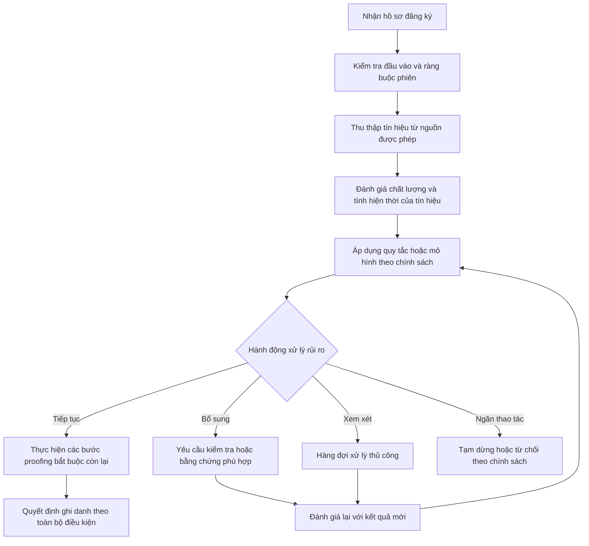

# Fraud detection

## Mục tiêu bài học

Trong identity proofing, hệ thống cần đánh giá người đăng ký có đúng là chủ thể mà họ khai nhận hay không. Kẻ gian có thể cung cấp dữ liệu của người khác, bằng chứng bị chỉnh sửa hoặc nhiều hồ sơ được tạo có tổ chức. **Fraud detection**, hay phát hiện gian lận, giúp nhận diện những dấu hiệu đó để quy trình ghi danh có biện pháp xử lý phù hợp.

Phát hiện gian lận không chỉ là tìm một thông tin sai. Một hồ sơ có dữ liệu đúng vẫn có thể do người mạo danh tạo ra; một hồ sơ có dữ liệu khác biệt cũng có thể thuộc về người dùng hợp lệ đang gặp lỗi nhập liệu hoặc thiếu bằng chứng.

Sau bài này, bạn có thể:

- Giải thích vai trò của fraud detection trong identity proofing và IAM.
- Phân biệt tín hiệu rủi ro, nghi vấn gian lận và kết luận đã được xác nhận.
- Kết hợp nhiều nguồn tín hiệu mà không xem một dấu hiệu đơn lẻ là bằng chứng chắc chắn.
- Thiết kế quyết định tiếp tục, yêu cầu bổ sung, chờ xem xét hoặc ngăn thao tác theo chính sách.
- Đánh giá sai số, bảo vệ dữ liệu và quản lý việc xem xét thủ công.

## 1. Fraud detection giải quyết vấn đề nào?

**Fraud detection trong identity proofing** là quá trình thu thập và phân tích những dấu hiệu cho thấy hồ sơ đăng ký, bằng chứng hoặc hành vi có thể liên quan đến việc gian dối về danh tính hay lạm dụng quy trình ghi danh.

Quá trình này hỗ trợ trả lời các câu hỏi:

- Có dấu hiệu người đăng ký đang sử dụng danh tính của người khác không?
- Bằng chứng có dấu hiệu bị thay đổi, tái sử dụng hoặc không gắn với lần đăng ký hiện tại không?
- Nhiều hồ sơ có thể đang thuộc một chiến dịch đăng ký gian lận không?
- Có hoạt động bất thường cần xác minh bổ sung hoặc xem xét thủ công không?

Kết quả thường là một **đánh giá rủi ro có phạm vi**, không phải sự thật tuyệt đối về người đăng ký. Mức chắc chắn phụ thuộc chất lượng tín hiệu, độ bao phủ của nguồn và khả năng điều tra.

### Ba khái niệm cần giữ riêng

| Khái niệm | Ý nghĩa | Ví dụ |
|---|---|---|
| Tín hiệu rủi ro | Một quan sát có thể liên quan đến gian lận nhưng còn cách giải thích khác | Nhiều hồ sơ được gửi từ cùng một mạng trong thời gian ngắn |
| Nghi vấn gian lận | Tổng hợp tín hiệu đủ để cần hành động theo chính sách | Bằng chứng có dấu hiệu bất thường cùng nhiều hồ sơ liên quan |
| Kết luận gian lận đã được xác nhận | Có cơ sở xác nhận theo quy trình và thẩm quyền của tổ chức | Điều tra xác định hồ sơ sử dụng bằng chứng bị chiếm dụng để mạo danh |

Không nên lưu một tín hiệu chưa được xác minh thành nhãn vĩnh viễn kiểu `isFraudster=true` trên hồ sơ con người. Nhãn phải thể hiện trạng thái kết luận, căn cứ, phạm vi và khả năng xem xét lại.

## 2. Vị trí trong chuỗi kiểm soát IAM

Fraud detection hỗ trợ identity proofing nhưng không thay thế các hoạt động khác.

| Hoạt động | Câu hỏi chính | Giới hạn cần nhớ |
|---|---|---|
| Attribute validation | Thuộc tính có được nguồn phù hợp xác nhận không? | Dữ liệu đúng có thể đã bị người khác lấy và sử dụng |
| Kiểm tra bằng chứng | Bằng chứng có đáng tin và hợp lệ cho mục đích này không? | Bằng chứng thật chưa chứng minh người nộp là chủ thể của nó |
| Xác minh applicant | Người đang đăng ký có phải người mà bằng chứng hoặc hồ sơ nói đến không? | Một kiểm tra đơn lẻ có thể không bao phủ mọi kiểu giả mạo |
| Fraud detection | Có mẫu dữ liệu hoặc hành vi gợi ý gian lận cần xử lý không? | Không có cảnh báo không đồng nghĩa chắc chắn không có gian lận |
| Authentication | Người truy cập có kiểm soát authenticator đã gắn với tài khoản không? | MFA không sửa được việc ghi danh nhầm chủ thể từ đầu |
| Authorization | Chủ thể được thực hiện hành động nào trong ngữ cảnh hiện tại? | Hoàn tất proofing không tự cấp mọi quyền |

Ví dụ, kẻ mạo danh có thể đăng ký tài khoản bằng dữ liệu bị lấy từ người thật rồi bật MFA bằng thiết bị của mình. Những lần đăng nhập sau có thể xác thực đúng thiết bị đã đăng ký, trong khi quan hệ giữa tài khoản và con người ngoài đời vẫn sai.

Ngược lại, một người hợp lệ có thể dùng thiết bị mới, mạng dùng chung hoặc nộp lại hồ sơ nhiều lần. Những dấu hiệu này cần được đánh giá trong ngữ cảnh thay vì tự động coi là hành vi gian lận.

## 3. Các nhóm gian lận cần nhận diện

### 3.1. Mạo danh bằng thông tin của người thật

Người đăng ký sử dụng dữ liệu hoặc bằng chứng thuộc về người khác. Các thuộc tính có thể khớp với nguồn đáng tin, nên chỉ kiểm tra sự tồn tại của tên hoặc mã định danh là chưa đủ.

Biện pháp bảo vệ cần bao gồm việc gắn applicant với đúng danh tính, kiểm tra nguồn và tính toàn vẹn của kết quả, đồng thời bảo vệ bước liên kết authenticator sau đó.

### 3.2. Danh tính tổng hợp

Một hồ sơ có thể kết hợp thông tin thật và thông tin bịa đặt, hoặc các thành phần từ nhiều danh tính khác nhau. Một số trường riêng lẻ có vẻ hợp lệ nhưng quan hệ giữa chúng không được nguồn phù hợp hỗ trợ.

Vì vậy, đối chiếu từng trường cần đi cùng kiểm tra tính nhất quán và liên kết với đúng bản ghi nguồn. Tuy nhiên, sự thiếu nhất quán chỉ là đầu vào đánh giá; lỗi nguồn hoặc dữ liệu chậm cập nhật cũng có thể tạo ra khác biệt.

### 3.3. Bằng chứng bị chỉnh sửa hoặc tái sử dụng

Bằng chứng có thể bị thay đổi nội dung, dùng lại trong hồ sơ khác hoặc được gửi qua kênh không bảo đảm nguồn gốc. Hệ thống cần kiểm tra những yếu tố phù hợp với loại bằng chứng và quy trình thu nhận.

Một tài liệu có hình thức đẹp hoặc ảnh có độ phân giải cao không tự chứng minh tính xác thực. Ngược lại, ảnh chất lượng thấp có thể do thiết bị hoặc điều kiện chụp, không đủ để kết luận gian lận.

### 3.4. Giả mạo trong xác minh từ xa

Trong quy trình có hình ảnh, âm thanh hoặc video, cần xem xét cả giả mạo được trình trước thiết bị thu nhận và dữ liệu bị thay thế trên đường đi vào hệ thống. Một phép kiểm tra tính sống không tự bảo đảm toàn bộ kênh thu nhận hoặc mọi kiểu giả mạo đều được bảo vệ.

Giải pháp cần được đánh giá theo phạm vi thực sự hỗ trợ, kết hợp bảo vệ luồng thu nhận và cách ràng buộc kết quả với đúng phiên. Lỗi kiểm tra có thể cần một phương án hỗ trợ khác cho người dùng hợp lệ.

### 3.5. Đăng ký hàng loạt và lạm dụng quy trình

Nhiều hồ sơ được tạo tự động hoặc có tổ chức có thể nhằm khai thác lợi ích, chiếm tài nguyên hoặc tìm điểm yếu trong bước duyệt. Các dấu hiệu về tần suất và mối liên hệ giữa hồ sơ giúp phát hiện kiểu lạm dụng này.

Cần phân biệt đăng ký gian lận với những đợt onboarding hợp lệ, chẳng hạn hàng trăm nhân viên cùng đăng ký tại văn phòng trong một ngày. Tần suất cao là lý do đánh giá thêm, không phải kết luận tự động.

### 3.6. Lạm dụng hỗ trợ, khôi phục hoặc liên kết tài khoản

Sau khi một tài khoản được ghi danh, kẻ gian có thể chuyển sang yêu cầu hỗ trợ, thay thông tin liên hệ, gắn authenticator mới hoặc liên kết một danh tính bên ngoài.

Những quy trình này cần mức kiểm soát phù hợp với hậu quả của thao tác. Nếu kênh hỗ trợ cho phép bỏ qua mọi kiểm tra trước đó, chất lượng proofing lúc ban đầu không đủ bảo vệ tài khoản lâu dài.

## 4. Các nhóm tín hiệu và cách diễn giải

### 4.1. Tín hiệu từ dữ liệu và bằng chứng

Ví dụ gồm kết quả đối chiếu thuộc tính, sự nhất quán giữa các phần của hồ sơ, phản hồi từ nguồn phát hành hoặc dấu hiệu bất thường của bằng chứng.

Giới hạn quan trọng là nguồn cũng có thể sai, thiếu dữ liệu hoặc chậm cập nhật. Kết quả “không tìm thấy” hoặc “không khớp” cần được đọc theo ý nghĩa và độ bao phủ của nguồn, thay vì mặc định quy thành gian lận.

### 4.2. Tín hiệu từ phiên và luồng thao tác

Ví dụ gồm tốc độ gửi hồ sơ bất thường, thay đổi liên tục thông tin quan trọng, yêu cầu gửi lại nhiều lần hoặc kết quả kiểm tra không gắn với đúng phiên hiện tại.

Một số tín hiệu phản ánh lỗi vận hành hoặc trải nghiệm khó sử dụng. Người dùng có thể bấm lại vì mạng chậm; trình duyệt có thể gửi lại yêu cầu sau khi mất kết nối. Luồng cần xử lý yêu cầu lặp một cách nhất quán, đồng thời giữ riêng hành vi chưa giải thích được để đánh giá.

### 4.3. Tín hiệu từ thiết bị và mạng

Thông tin về thiết bị, địa chỉ mạng hoặc môi trường kết nối có thể hỗ trợ đánh giá tần suất và ngữ cảnh. Những tín hiệu này không phải định danh chắc chắn của một con người.

Các tình huống hợp lệ như mạng doanh nghiệp, ký túc xá, hộ gia đình, VPN hoặc thay đổi thiết bị có thể làm nhiều người trông giống nhau ở lớp mạng. Vì vậy, không nên tự gộp hồ sơ hoặc kết luận mạo danh chỉ dựa trên một địa chỉ IP.

### 4.4. Tín hiệu liên kết giữa nhiều hồ sơ

Hệ thống có thể phát hiện cùng một thông tin liên hệ, bằng chứng hoặc thiết bị xuất hiện ở nhiều hồ sơ. Phân tích quan hệ giúp nhận diện cụm hoạt động mà xem từng hồ sơ riêng lẻ khó phát hiện.

Nhưng liên kết kỹ thuật không tự chứng minh có cùng một chủ thể gian lận. Một thiết bị hỗ trợ dùng chung hoặc một địa chỉ liên hệ gia đình có thể tạo ra quan hệ hợp lệ. Kết quả liên kết cần có ngữ cảnh và quyền xem dữ liệu phù hợp.

### 4.5. Tín hiệu từ lịch sử và phản hồi điều tra

Những trường hợp đã xác nhận trước đó có thể giúp nhận diện mẫu mới. Tuy nhiên, cần biết nhãn đến từ đâu, đã được xác nhận đến mức nào và có còn phù hợp không.

Nếu mọi hồ sơ từng bị hệ thống cảnh báo đều được gán nhãn “gian lận”, dữ liệu sẽ lặp lại chính suy đoán của hệ thống. Đây là vòng phản hồi khiến những sai sót ban đầu trở thành cơ sở cho các quyết định sau.

### Không cộng dồn mù quáng các tín hiệu

Ba tín hiệu có cùng nguồn gốc không nhất thiết cung cấp ba bằng chứng độc lập. Ví dụ, vị trí mạng bất thường, nhà mạng bất thường và địa chỉ IP mới có thể cùng phát sinh từ một lần đổi kết nối.

Chính sách cần xem xét độ tin cậy, mức độc lập và phạm vi của tín hiệu. Không nên biến tổng số cảnh báo thành mức chắc chắn nếu chưa hiểu chúng đang phản ánh điều gì.

## 5. Thiết kế luồng đánh giá và xử lý



### 5.1. Xác định sự kiện và tài sản cần bảo vệ

Mỗi đánh giá cần gắn với một sự kiện rõ ràng: gửi hồ sơ mới, đổi thông tin quan trọng, hoàn tất ghi danh hoặc khôi phục tài khoản. Rủi ro và hành động xử lý có thể khác nhau giữa các sự kiện.

Đối tượng cần bảo vệ cũng phải rõ: tài khoản của chủ thể, dữ liệu cá nhân, quyền truy cập hay năng lực xử lý của hệ thống. Một giới hạn chống gửi yêu cầu hàng loạt có thể bảo vệ năng lực vận hành mà chưa đủ để xác minh danh tính.

### 5.2. Chỉ sử dụng tín hiệu có nguồn gốc rõ

Phía máy chủ cần kiểm tra dữ liệu từ nguồn được phép, ràng buộc với đúng hồ sơ và lần đánh giá. Không nhận các cờ do trình duyệt tự khai như `fraudCheckPassed=true` hoặc `risk=LOW` làm kết quả đáng tin.

Khi gọi dịch vụ đánh giá ngoài, cần kiểm tra nguồn phản hồi, tính toàn vẹn, thời điểm và liên hệ với yêu cầu đã khởi tạo. Kết quả hợp lệ của hồ sơ A không được áp dụng sang hồ sơ B hoặc tổ chức khác.

### 5.3. Kết hợp quy tắc và mô hình có kiểm soát

Quy tắc có thể phù hợp với điều kiện nghiệp vụ rõ ràng; mô hình thống kê có thể hỗ trợ nhận diện các mẫu phức tạp. Cả hai đều phụ thuộc chất lượng dữ liệu và cần được theo dõi khi môi trường thay đổi.

Một điểm rủi ro không tự là xác suất gian lận. Chỉ được diễn giải thành xác suất khi phương pháp và việc đánh giá thực tế hỗ trợ cách hiểu đó. Không nên hiển thị “chắc chắn 90% gian lận” chỉ vì một mô hình trả về điểm 90 trên thang nội bộ.

Không có một ngưỡng phù hợp cho mọi dịch vụ. Việc chọn hành động cần cân nhắc hậu quả chấp nhận sai, từ chối sai, khả năng xem xét và yêu cầu của bước nghiệp vụ.

### 5.4. Giữ riêng đánh giá rủi ro và kết luận proofing

Một thiết kế nên tách ít nhất ba thông tin:

| Thông tin | Ví dụ | Ý nghĩa |
|---|---|---|
| Đánh giá rủi ro | `REVIEW_REQUIRED` | Cần người có thẩm quyền xem xét dấu hiệu |
| Tiến độ proofing | `EVIDENCE_PENDING` | Vẫn thiếu điều kiện của quy trình xác minh |
| Trạng thái tài khoản | `PENDING_ACTIVATION` | Chưa được sử dụng tài khoản bình thường |

`NO_ALERT` chỉ có nghĩa không có cảnh báo trong phạm vi đánh giá hiện tại. Nó không thay thế kiểm tra thuộc tính, bằng chứng, xác minh applicant hoặc liên kết authenticator đúng chủ thể.

Tương tự, `REVIEW_REQUIRED` chưa phải nhãn “đã xác nhận gian lận”. Các trạng thái minh họa phải được diễn giải rõ để ứng dụng khác không dùng sai.

### 5.5. Xử lý thiếu dữ liệu và sự cố nguồn

Nếu dịch vụ đánh giá bị gián đoạn, hệ thống đang thiếu một kết quả; chưa có cơ sở kết luận applicant gian lận hoặc an toàn.

Phương án có thể là giữ hồ sơ chờ, thử lại có kiểm soát hoặc chuyển sang phương án dự phòng được quy định. Nếu cho phép một khu vực onboarding giới hạn, phạm vi đó phải tách khỏi quyền vốn yêu cầu hoàn tất proofing.

Không được biến việc nguồn không phản hồi thành đường tự động bỏ qua kiểm tra bắt buộc.

## 6. Ví dụ dữ liệu đánh giá

Ví dụ dùng mã và thời điểm giả để minh họa cách lưu một đánh giá đang cần xem xét. Đây không phải định dạng giao thức hoặc tập tín hiệu bắt buộc.

```json
{
  "assessmentId": "assessment_demo_31",
  "applicationId": "app_demo_84",
  "organizationId": "org_demo_6",
  "eventType": "ENROLLMENT_SUBMITTED",
  "policyVersion": "proofing-fraud-v1",
  "assessmentStatus": "COMPLETE",
  "riskAction": "REVIEW_REQUIRED",
  "fraudConclusion": "UNCONFIRMED",
  "reasonCodes": [
    "EVIDENCE_CONSISTENCY_REVIEW",
    "RELATED_APPLICATIONS_REVIEW"
  ],
  "evidenceReferences": [
    "evidence_ref_demo_18"
  ],
  "assessedAt": "2026-01-15T08:00:00Z",
  "correlationId": "corr_demo_73"
}
```

Những điểm cần giữ rõ:

- `assessmentStatus=COMPLETE` nói lần đánh giá đã hoàn tất xử lý, không phải proofing đã thành công.
- `riskAction` là hành động xử lý rủi ro; `fraudConclusion` thể hiện mức kết luận hiện tại.
- `policyVersion` giúp giải trình vì sao cùng một dữ liệu có thể dẫn tới hành động khác khi chính sách thay đổi.
- `applicationId`, `organizationId` và `eventType` giữ phạm vi của kết quả.
- Mã lý do phục vụ xử lý và kiểm toán, không cần chứa toàn bộ dữ liệu nhạy cảm.
- Mã tham chiếu bằng chứng cũng có thể liên kết tới dữ liệu cá nhân và phải được bảo vệ.

Quyết định kích hoạt tài khoản cần được thực hiện bởi luồng ghi danh dựa trên toàn bộ điều kiện. Không để một ứng dụng con nhìn thấy `assessmentStatus=COMPLETE` rồi tự cấp quyền.

## 7. Ví dụ xuyên suốt: cổng ghi danh nhân viên

Giả sử doanh nghiệp có cổng để nhân viên mới đăng ký tài khoản nội bộ. Nguồn nhân sự xác nhận quan hệ lao động, còn luồng proofing cần gắn người đăng ký với đúng hồ sơ.

### Trường hợp A: nhiều hồ sơ cùng mạng nhưng hợp lệ

Công ty tổ chức một buổi onboarding tại văn phòng. Nhiều người gửi hồ sơ từ cùng mạng trong một khoảng thời gian ngắn.

Đánh giá chỉ dựa vào IP có thể cảnh báo hàng loạt. Khi kết hợp bối cảnh buổi onboarding, lời mời riêng, hồ sơ nhân sự và kết quả xác minh từng người, hệ thống có thể xử lý phù hợp hơn.

Không nên dùng “cùng IP” để hợp nhất các tài khoản. Mỗi người vẫn cần định danh chủ thể và authenticator riêng.

### Trường hợp B: dữ liệu khớp nhưng người đăng ký chưa được xác minh

Tên và mã nhân viên khớp nguồn nhân sự. Tuy nhiên, có dấu hiệu cần xem xét mối liên hệ giữa applicant và bằng chứng được nộp.

Hệ thống giữ riêng kết quả “thuộc tính khớp” và “cần xem xét nghi vấn”. Tài khoản chưa được kích hoạt bình thường cho đến khi các điều kiện cần thiết được giải quyết.

Trường hợp này cho thấy dữ liệu đúng không đủ để loại trừ mạo danh. Bật MFA bằng thiết bị của người đang thao tác cũng không thay thế bước xác minh còn thiếu.

### Trường hợp C: bằng chứng khó đọc

Applicant dùng thiết bị cũ và ảnh bị mờ. Công cụ không thể đánh giá đủ chất lượng bằng chứng.

Kết quả phù hợp có thể là yêu cầu thu nhận lại hoặc cung cấp một phương án hỗ trợ khác. “Không đủ dữ liệu để kiểm tra” không nên tự biến thành “đã phát hiện giả mạo”.

Nếu vấn đề chất lượng xảy ra với nhiều người dùng cùng loại thiết bị, nhóm vận hành cần xem xét khả năng tương thích của luồng thay vì chỉ tăng mức chặn.

### Trường hợp D: có ngoại lệ qua hỗ trợ

Một hồ sơ bị đưa vào hàng đợi xem xét. Người yêu cầu liên hệ bộ phận hỗ trợ để được kích hoạt ngay và gắn một authenticator mới.

Nhân viên hỗ trợ cần xử lý theo thẩm quyền, kiểm tra căn cứ và lưu dấu vết. Việc người gọi biết tên, email hoặc mã nhân viên không tự chứng minh quyền kiểm soát tài khoản.

Nếu có ngoại lệ, cần nêu rõ điều kiện nào được đáp ứng bằng phương án thay thế và ai được phép quyết định. Không chỉ sửa trực tiếp tài khoản thành `ACTIVE` rồi coi nghi vấn đã được giải quyết.

## 8. Xem xét thủ công và xử lý lại quyết định

Hàng đợi xem xét cần có thông tin đủ dùng nhưng không cung cấp quyền vượt nhiệm vụ. Người duyệt cần biết dấu hiệu nào cần kiểm tra, nguồn dữ liệu nào được phép sử dụng và loại kết luận nào có thể đưa ra.

Một quy trình có thể bao gồm:

1. Xác nhận hồ sơ và phạm vi tổ chức cần xem xét.
2. Kiểm tra căn cứ của cảnh báo và các cách giải thích hợp lệ.
3. Yêu cầu dữ liệu hoặc bước xác minh bổ sung nếu thật sự cần.
4. Ghi quyết định, lý do, người thực hiện và bằng chứng tham chiếu.
5. Chuyển hồ sơ về bước phù hợp hoặc kết thúc theo chính sách.

Quyền xem bằng chứng, sửa kết luận và kích hoạt tài khoản nên được giới hạn theo nhiệm vụ. Những ngoại lệ có hậu quả lớn có thể cần thêm người phê duyệt tùy chính sách quản lý đặc quyền.

Người dùng hợp lệ cần có đường sửa lỗi, bổ sung hoặc yêu cầu xem xét lại phù hợp. Thông báo nên nói rõ hành động tiếp theo mà không tiết lộ dữ liệu của người khác hoặc các chi tiết nội bộ không cần thiết về cơ chế phát hiện.

Quyết định thủ công cũng có thể sai. Cần theo dõi việc đảo quyết định, sự khác biệt giữa người duyệt và kết quả điều tra về sau. Không nên coi mọi quyết định ban đầu là dữ liệu sự thật không thể thay đổi.

## 9. Đo hiệu quả và hiểu sai số

### 9.1. Bốn kết quả cơ bản

Giả sử “dương tính” nghĩa là hệ thống gắn cờ nghi vấn. Để đánh giá chất lượng, cần đối chiếu với kết luận thực tế có cơ sở, dù kết luận đó có thể đến muộn.

| Thực tế sau xác minh | Hệ thống gắn cờ | Hệ thống không gắn cờ |
|---|---|---|
| Có gian lận | True positive, TP | False negative, FN |
| Hợp lệ | False positive, FP | True negative, TN |

- **Precision** = `TP / (TP + FP)`: trong các hồ sơ bị gắn cờ, bao nhiêu thực sự gian lận.
- **Recall** = `TP / (TP + FN)`: trong các hồ sơ thực sự gian lận, bao nhiêu bị phát hiện.
- **False positive rate** = `FP / (FP + TN)`: trong các hồ sơ hợp lệ, bao nhiêu bị gắn cờ nhầm.

Mỗi tỷ lệ có mẫu số khác nhau. “Tỷ lệ hồ sơ gắn cờ là gian lận” không phải “tỷ lệ người dùng hợp lệ bị gắn cờ nhầm”.

### 9.2. Ví dụ khi gian lận chiếm tỷ lệ nhỏ

Giả sử có 10.000 hồ sơ, và hậu kiểm đủ căn cứ xác định 100 hồ sơ gian lận, 9.900 hồ sơ hợp lệ. Hệ thống gắn cờ đúng 80 hồ sơ gian lận và gắn cờ nhầm 198 hồ sơ hợp lệ.

| Đại lượng | Giá trị |
|---|---|
| TP | 80 |
| FN | 20 |
| FP | 198 |
| TN | 9.702 |
| Recall | `80 / 100 = 80%` |
| False positive rate | `198 / 9.900 = 2%` |
| Precision | `80 / 278 ≈ 28,8%` |

Dù tỷ lệ gắn cờ nhầm trong nhóm hợp lệ chỉ là 2%, phần lớn hồ sơ bị gắn cờ trong ví dụ vẫn là người dùng hợp lệ. Đây là lý do một cảnh báo thường cần dẫn tới hành động phù hợp như xem xét hoặc bổ sung, thay vì tự động gán kết luận gian lận.

Các con số chỉ minh họa cách tính, không phải mục tiêu chất lượng hay ngưỡng dùng cho hệ thống thực tế.

### 9.3. Theo dõi cả tác động vận hành

Ngoài precision và recall, cần quan sát:

- Tỷ lệ hồ sơ phải xem xét và thời gian chờ xử lý.
- Số người dùng hợp lệ bỏ dở do gặp trở ngại.
- Số quyết định được sửa sau bổ sung hoặc yêu cầu xem xét lại.
- Gian lận được phát hiện muộn sau khi tài khoản đã kích hoạt.
- Tỷ lệ lỗi nguồn, thiếu dữ liệu và khác biệt theo kênh hoặc loại thiết bị.

Dữ liệu nhãn có thể chưa đầy đủ. Chỉ điều tra các hồ sơ đã gắn cờ sẽ khó biết có bao nhiêu gian lận bị bỏ sót trong nhóm không gắn cờ. Việc đánh giá cần ghi rõ giới hạn này và sử dụng phương pháp hậu kiểm phù hợp.

Một đợt tăng cảnh báo có thể do chiến dịch gian lận mới, nhưng cũng có thể do nguồn lỗi, thay đổi giao diện, dữ liệu chậm đồng bộ hoặc một đợt onboarding tập trung. Cần điều tra nguyên nhân trước khi kết luận.

## 10. Bảo vệ dữ liệu và ranh giới tin cậy

### 10.1. Chỉ thu thập dữ liệu cần thiết

Fraud detection không nên trở thành lý do thu thập mọi dữ liệu có thể lấy được. Cần xác định mục đích của từng tín hiệu, người được truy cập, thời gian lưu và cách xử lý khi không còn cần thiết.

Dữ liệu thiết bị, quan hệ giữa hồ sơ, ảnh bằng chứng hoặc thông tin liên hệ có thể nhạy cảm khi kết hợp với nhau. Việc thay bằng mã hoặc băm không tự làm dữ liệu trở thành vô danh; dữ liệu vẫn có thể dùng để liên kết hoặc suy luận về một người.

### 10.2. Bảo vệ các API tra cứu và đánh giá

Chỉ các thành phần có thẩm quyền mới được truy vấn dữ liệu hoặc thay đổi kết luận. Không để API trở thành công cụ giúp bên ngoài dò xem một người đã đăng ký, bị cảnh báo hoặc liên quan tới hồ sơ nào khác.

Kết quả từ nhà cung cấp ngoài cũng cần kiểm soát truy cập và sử dụng đúng phạm vi. Không mặc định một danh sách cảnh báo bên ngoài là kết luận chính xác, đầy đủ và luôn còn hiệu lực.

### 10.3. Giữ dấu vết nhưng hạn chế dữ liệu thô

Sự kiện kiểm toán nên ghi mã đánh giá, hồ sơ, tổ chức, hành động, phiên bản chính sách, mã lý do, thời điểm và chủ thể thực hiện. Dữ liệu bằng chứng chi tiết có thể được giữ trong kho riêng nếu cần, với quyền đọc hạn chế.

Không ghi mật khẩu, OTP, khóa bí mật hoặc token truy cập vào log. Log và mã tham chiếu bằng chứng cần được bảo vệ tính toàn vẹn và kiểm soát thời gian lưu như những dữ liệu có thể ảnh hưởng đến người dùng.

### 10.4. Kiểm soát việc áp dụng kết quả

Các yêu cầu gửi lại hoặc phản hồi đến sai thứ tự không được làm kết quả cũ ghi đè quyết định mới. Bước chuyển trạng thái cần kiểm tra hồ sơ, lần đánh giá và điều kiện hiện tại.

Quyết định cấm thao tác, đình chỉ tài khoản hoặc gỡ hạn chế phải được thực thi ở phía máy chủ. Việc giao diện ẩn hoặc hiện nút chỉ hỗ trợ trải nghiệm, không phải cơ chế bảo vệ quyền.

## 11. Kết nối với vòng đời danh tính và quyền

### Sau khi ghi danh

Một tài khoản đã hoàn tất proofing vẫn có thể bị chiếm quyền hoặc được sử dụng sai mục đích. Những sự kiện như thay thông tin liên hệ, khôi phục tài khoản hoặc đăng ký authenticator mới cần đánh giá phù hợp với rủi ro riêng.

Không nhất thiết yêu cầu toàn bộ proofing lại cho mọi thay đổi. Cần chọn kiểm soát đúng với điều cần chứng minh, đồng thời không cho luồng khôi phục yếu hơn trở thành đường vòng tới tài khoản có đặc quyền.

### Trong SSO và liên kết danh tính

Ứng dụng cần hiểu ý nghĩa của thông tin bảo đảm do nhà cung cấp danh tính chuyển đến. Đăng nhập liên kết thành công không tự bảo đảm mọi yêu cầu ghi danh cục bộ hoặc chống gian lận của ứng dụng đã được đáp ứng.

Liên kết danh tính bên ngoài với tài khoản đang có quyền cần được kiểm soát. Chỉ khớp email hoặc tên hiển thị không đủ để mặc định hợp nhất tài khoản và chuyển quyền.

### Trong quản lý đặc quyền

Một cảnh báo rủi ro có thể là đầu vào của chính sách bảo vệ thao tác nhạy cảm. Tuy nhiên, điểm rủi ro không thay thế mô hình RBAC, ABAC hoặc phê duyệt đặc quyền. Tài khoản ít cảnh báo vẫn chỉ được quyền đủ cho nhiệm vụ.

Khi đình chỉ hoặc hạn chế một tài khoản, cần xác định ảnh hưởng tới phiên, token và các hệ thống liên quan theo kiến trúc. Chỉ đổi một cờ trong hồ sơ mà các điểm thực thi quyền không đọc hoặc không cập nhật có thể không ngăn được truy cập.

### Với danh tính workload

Workload cũng có thể bị đăng ký hoặc gắn quyền dưới thông tin chủ sở hữu sai. Nguồn xác nhận thường đến từ hệ thống cấp phát và nền tảng chạy, thay vì bằng chứng dành cho con người. Nguyên tắc vẫn là kiểm tra nguồn, chủ thể, phạm vi và quyền cần thiết trước khi phát hành hoặc gắn thông tin xác thực.

## 12. Những lỗi thiết kế thường gặp

| Lỗi | Hậu quả | Hướng xử lý |
|---|---|---|
| Coi không có cảnh báo là proofing thành công | Bỏ qua các bước xác minh bắt buộc | Giữ riêng đánh giá gian lận và điều kiện ghi danh |
| Coi một địa chỉ IP là một con người | Chặn nhầm hoặc gộp nhầm người dùng | Kết hợp ngữ cảnh và cơ sở liên kết phù hợp |
| Tự gán mọi lỗi bằng chứng thành gian lận | Gây thiệt hại cho người dùng gặp lỗi kỹ thuật | Phân biệt thiếu chất lượng, chưa đủ kết luận và nghi vấn |
| Tin điểm rủi ro do trình duyệt gửi | Có thể bỏ qua kiểm soát bằng cách sửa yêu cầu | Máy chủ lấy và kiểm tra kết quả từ nguồn được phép |
| Bỏ qua kiểm tra khi nguồn bị lỗi | Tạo đường vòng tới tài khoản hoặc quyền | Có trạng thái chờ và phương án dự phòng được quy định |
| Cho hỗ trợ kích hoạt tài khoản tùy ý | Vô hiệu hóa các kiểm soát trước đó | Giới hạn thẩm quyền, ghi lý do và kiểm soát ngoại lệ |
| Chỉ đánh giá số gian lận bị chặn | Không thấy người dùng bị ảnh hưởng hoặc gian lận bỏ sót | Theo dõi sai số, thời gian chờ và kết quả hậu kiểm |
| Dùng chính cảnh báo làm nhãn gian lận xác nhận | Tạo vòng lặp củng cố sai sót | Theo dõi nguồn nhãn và cập nhật sau điều tra |
| Lưu mọi dữ liệu để tiện điều tra | Tăng nguy cơ lộ lọt và sử dụng quá mục đích | Giảm dữ liệu, tách kho bằng chứng và phân quyền |

## 13. Những điểm cần ghi nhớ

- Fraud detection nhận diện dấu hiệu và mẫu gian lận; kết quả thường có mức không chắc chắn cần được thể hiện rõ.
- Tín hiệu rủi ro, nghi vấn và kết luận đã xác nhận là ba mức thông tin khác nhau.
- Dữ liệu khớp nguồn không tự chứng minh applicant là chủ thể; không có cảnh báo cũng không thay thế các bước proofing.
- Quyết định cần dựa trên chất lượng, ngữ cảnh, tính hiện thời và mức độc lập của các tín hiệu.
- Sai số phát hiện ảnh hưởng trực tiếp đến người dùng và vận hành; precision, recall và tỷ lệ cảnh báo nhầm cần được đọc đúng mẫu số.
- Kiểm soát dữ liệu, xử lý thủ công, ngoại lệ và khôi phục tài khoản là những phần thiết yếu của cơ chế chống gian lận.
- Sau ghi danh, quyền truy cập vẫn phải tuân theo chính sách hiện tại và nguyên tắc ít quyền nhất.
