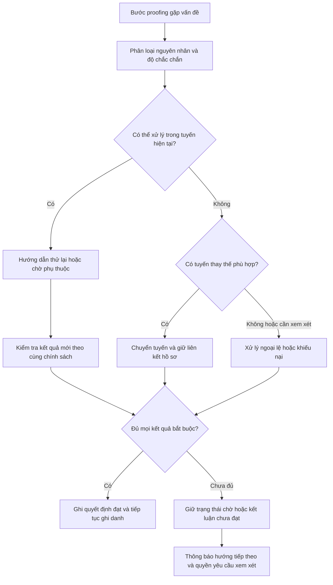

# Proofing failure

## Mục tiêu và bối cảnh

**Proofing failure** là tình huống quy trình chứng minh danh tính không thiết lập được mức tin cậy cần thiết đối với danh tính đã khai, hoặc không thể hoàn tất các bước cần thiết để đưa ra kết luận đó. Cần xác định rõ lần thử nào thất bại, bước nào gặp vấn đề và kết luận hiện có đủ chắc chắn đến đâu.

Một ảnh giấy tờ bị chói, nguồn đối chiếu tạm ngừng hoạt động và một bằng chứng được xác nhận là giả là ba tình huống khác nhau. Cùng hiển thị “xác minh thất bại” có thể khiến người dùng không biết cách tiếp tục, đồng thời làm hệ thống vận hành nhầm lỗi kỹ thuật với gian lận.

Trong chương **Identity proofing** của nền tảng quản lý danh tính và quyền truy cập (IAM), bài này giúp người học:

- Phân loại thất bại theo giai đoạn, nguyên nhân và khả năng xử lý.
- Thiết kế thử lại, chuyển phương thức, xử lý ngoại lệ và khiếu nại.
- Giữ tính đúng đắn của quyết định khi có kết quả bất đồng bộ hoặc nhiều lần thử.
- Liên hệ kết quả proofing với cấp phát tài khoản, authenticator, phiên và quyền truy cập.

Tài liệu tham chiếu là NIST SP 800-63A-4, bản chính thức tháng 7/2025. Các mã lỗi, mô hình dữ liệu và pseudocode trong bài là ví dụ thiết kế, không phải bộ mã hoặc workflow bắt buộc của NIST. [NIST — Identity Proofing and Enrollment](https://csrc.nist.gov/pubs/sp/800/63/A/4/final).

## 1. Thất bại ở bước nào?

### 1.1. Nhắc lại ba bước của identity proofing

| Bước | Mục đích | Ví dụ chưa đạt hoặc chưa thể kết luận |
| --- | --- | --- |
| Resolution — phân giải danh tính | Phân biệt một người trong quần thể mà dịch vụ phục vụ | Hai hồ sơ trùng thông tin nhưng chưa xác định có cùng người không |
| Validation — kiểm chứng bằng chứng và thuộc tính | Kiểm tra tính xác thực, hợp lệ và chính xác | Bằng chứng không được hỗ trợ hoặc thuộc tính chưa đối chiếu được |
| Verification — xác minh chủ thể | Liên hệ người đang tham gia với bằng chứng đã kiểm chứng | Chưa xác nhận được người tham gia là chủ thể của bằng chứng |

Hoàn tất proofing thường dẫn tới ghi danh vào dịch vụ danh tính và gắn phương tiện xác thực, gọi là authenticator. Quyết định đủ điều kiện hưởng dịch vụ hoặc được cấp quyền là vấn đề riêng. [NIST — Identity Proofing Overview](https://pages.nist.gov/800-63-4/sp800-63a/proofing/).

Ví dụ, Hương đăng ký cổng cộng tác viên. Cổng kiểm chứng giấy tờ hợp lệ nhưng chưa xác minh được người đang tham gia là Hương. Hệ thống chưa có căn cứ đánh dấu toàn bộ proofing thành công, dù đã thu thập được nhiều dữ liệu đúng.

### 1.2. Phân biệt với lỗi xác thực và lỗi phân quyền

| Tình huống | Loại vấn đề |
| --- | --- |
| Chưa liên hệ được người đăng ký với danh tính đã khai | Proofing |
| Người đã có tài khoản nhập sai mã xác thực | Authentication |
| Người đăng nhập đúng nhưng không có quyền mở dự án | Authorization |
| Kết quả proofing đã đầy đủ nhưng hàng đợi tạo tài khoản bị lỗi | Lỗi vận hành ở bước ghi danh hoặc cấp phát |

Việc hàng đợi lỗi không tự làm bằng chứng đã kiểm chứng trở thành giả. Ngược lại, tạo được một bản ghi tài khoản cũng không chứng minh quá trình proofing đã đạt.

Trong kiến trúc IAM, cần lưu trạng thái proofing riêng với trạng thái tài khoản, đăng ký authenticator và quyền truy cập. Một trường chung như `status=ERROR` khó cho biết hệ thống đã làm được gì và người dùng cần làm gì tiếp theo.

### 1.3. Chưa đạt mục tiêu không có nghĩa đã đạt một mức khác

Nếu dịch vụ yêu cầu IAL2, thất bại trong một bước của quy trình không tự chứng minh đã đạt IAL1. Muốn ghi nhận mức thấp hơn, tổ chức phải đánh giá kết quả thực tế theo chính sách tương ứng.

Tương tự, việc thêm MFA không sửa được một bằng chứng chưa được kiểm chứng. MFA bảo vệ quá trình xác thực; mức bảo đảm danh tính phải dựa vào quy trình proofing đã thực hiện.

## 2. Phân loại nguyên nhân để chọn cách xử lý

NIST nêu các dạng ngoại lệ như thiếu bằng chứng, dịch vụ tích hợp không khả dụng và khó khăn khi chụp ảnh rõ; CSP cần có quy trình xử lý lỗi và ngoại lệ được lập thành tài liệu. CSP là đơn vị cung cấp dịch vụ chứng thực danh tính. [NIST — Exception and Error Handling](https://pages.nist.gov/800-63-4/sp800-63a/ial-general/).

Bảng dưới là cách phân loại triển khai cho cổng cộng tác viên:

| Nhóm nguyên nhân | Ví dụ | Hành động phù hợp |
| --- | --- | --- |
| Chất lượng đầu vào | Ảnh bị chói hoặc cắt mất góc | Hướng dẫn thu thập lại bước bị lỗi |
| Thiếu hoặc không hỗ trợ bằng chứng | Người đăng ký chưa có loại bằng chứng được chấp nhận trong tuyến hiện tại | Cung cấp lựa chọn hoặc tuyến ngoại lệ đã phê duyệt |
| Mâu thuẫn thuộc tính | Tên trên nguồn đối chiếu chưa cập nhật | Xem xét căn cứ bổ sung theo quy trình |
| Không xác minh được chủ thể | So khớp không đạt hoặc kết quả chưa chắc chắn | Thử lại có giới hạn hoặc chuyển phương thức phù hợp |
| Lỗi phụ thuộc kỹ thuật | API nguồn dữ liệu timeout | Giữ trạng thái chờ hoặc cho tiếp tục sau |
| Hết hạn hoặc mất tính liên tục | Phiên thu thập hết hạn trước khi hoàn tất | Tạo lần thử hoặc ngữ cảnh tiếp tục hợp lệ |
| Tín hiệu rủi ro | Nhiều hồ sơ có dấu hiệu liên quan bất thường | Đánh giá thêm hoặc chuyển xử lý nghi vấn |
| Gian lận được xác nhận | Điều tra xác nhận mạo danh | Thực hiện biện pháp xử lý theo chính sách và phạm vi ảnh hưởng |
| Người dùng rút khỏi quy trình | Không tiếp tục cung cấp dữ liệu | Ghi nhận rút lui, xử lý dữ liệu theo chính sách |

### 2.1. Dữ liệu không khớp chưa đủ để kết luận gian lận

Tên khác nhau có thể do đổi tên, thứ tự họ tên, lỗi nguồn hoặc lỗi trích xuất. Một địa chỉ không còn hiện tại có thể do người dùng vừa chuyển nơi ở.

Hệ thống cần kiểm tra nguyên nhân và nguồn dữ liệu trước khi chọn hướng xử lý. Việc tự sửa thuộc tính để “khớp bằng được” có thể che mất mâu thuẫn cần giải quyết; việc đánh dấu gian lận ngay lập tức có thể gây hại cho người dùng hợp lệ.

Một nguồn không tìm thấy hồ sơ cũng chỉ cho thấy không có kết quả phù hợp trong nguồn đó và với truy vấn đó. Cần xét độ bao phủ, độ mới, quyền truy cập và khả năng lỗi của nguồn.

### 2.2. Không đủ kết quả khác với kết quả không đạt

Nên phân biệt kết quả của từng phép kiểm tra:

| Kết quả thành phần | Ý nghĩa trong ví dụ |
| --- | --- |
| NOT_EVALUATED | Chưa thực hiện kiểm tra |
| INCONCLUSIVE | Đã thực hiện nhưng chưa đủ căn cứ kết luận |
| PASS | Đạt điều kiện của phép kiểm tra |
| FAIL | Không đạt điều kiện của phép kiểm tra |

Timeout thường thuộc lỗi thực hiện hoặc INCONCLUSIVE, thay vì một kết quả chứng minh người dùng sai danh tính. Tuy nhiên, thiếu kết quả bắt buộc vẫn không cho phép hoàn tất proofing.

Đây là nguyên tắc cần giữ đồng thời: không cấp mức bảo đảm khi chưa đủ căn cứ, và không biến mọi sự thiếu căn cứ thành cáo buộc người dùng.

### 2.3. Một phép so khớp có thể sai

Trong so khớp sinh trắc, **false non-match** là trường hợp hai mẫu thuộc cùng người nhưng bị coi là không khớp. Tìm kiếm sinh trắc 1:N còn có thể đưa ra kết quả trùng nhầm với người khác.

NIST yêu cầu rà soát thủ công trước khi từ chối ghi danh dựa trên kết quả tìm kiếm sinh trắc 1:N dùng cho phân giải, chống trùng hoặc phát hiện gian lận, để loại trừ khả năng false positive. [NIST — Requirements for the Use of Biometrics](https://pages.nist.gov/800-63-4/sp800-63a/ial-general/).

Không nên dùng nhãn “biometric failure” như một kết luận rằng người dùng cố ý giả mạo. Cần xác định đó là chất lượng mẫu, không khớp, tín hiệu tấn công hay lỗi kỹ thuật.

## 3. Luồng xử lý thất bại

Một luồng minh họa:



Sơ đồ không quy định mọi trường hợp đều phải được thử lại. Hồ sơ có dấu hiệu rủi ro đáng kể có thể cần điều tra trước; hồ sơ bị lỗi cảm biến có thể cần phương thức khác thay vì lặp cùng thao tác.

Các điều kiện quan trọng của thiết kế:

1. Mỗi kết luận chỉ áp dụng cho hồ sơ và lần thử tương ứng.
2. Mọi kết quả bắt buộc phải đủ, còn hiệu lực và thuộc đúng bộ bằng chứng.
3. Chuyển phương thức không làm mất yêu cầu về mức bảo đảm.
4. Quyết định thủ công phải có thẩm quyền và căn cứ.
5. Người dùng có cách biết trạng thái và yêu cầu hỗ trợ phù hợp.

## 4. Thử lại mà không làm yếu quy trình

### 4.1. Chỉ định rõ bước cần làm lại

Nếu ảnh giấy tờ bị chói, hệ thống có thể yêu cầu chụp lại giấy tờ. Không nên bắt người dùng lặp cả quy trình khi các bước khác vẫn còn hợp lệ và có thể tái sử dụng theo chính sách.

Ngược lại, khi người dùng đổi sang bằng chứng của lần thu thập mới, cần xác định những kết quả phụ thuộc nào đã mất hiệu lực:

```text
Đổi ảnh giấy tờ:
    kiểm tra chất lượng ảnh phải thực hiện lại
    kiểm chứng tính xác thực của ảnh phải thực hiện lại
    dữ liệu trích xuất từ ảnh phải được cập nhật
    so khớp với ảnh chân dung trên ảnh cũ có thể không còn sử dụng được
    quyết định tổng hợp phải được tính lại
```

Không nên lấy kết quả validation của ảnh cũ kết hợp với verification của ảnh mới mà không kiểm tra quan hệ giữa chúng.

### 4.2. Giới hạn và điều tiết thử lại

Một chính sách retry cần xác định:

- Số lần và thời gian được phép thực hiện lại cho từng loại lỗi.
- Những điều kiện cần chờ, chuyển phương thức hoặc xem xét thêm.
- Cách liên hệ nhiều lần thử trong cùng hồ sơ.
- Cách hạn chế bot và chi phí dịch vụ bên ngoài.
- Điều kiện hết hạn của bằng chứng, phiên và kết quả đã có.

Các giới hạn phải dựa trên hệ thống thực tế và yêu cầu áp dụng. Không có một số lần thử chung được suy ra chỉ từ thuật ngữ “proofing failure”.

Thử lại không giới hạn có thể cho phép thử nhiều lần cho tới khi thuật toán nhận nhầm. Giới hạn quá cứng lại có thể loại người dùng hợp lệ đang dùng thiết bị yếu. Vì vậy, khi hết retry tự động cần có hướng tiếp theo rõ ràng.

### 4.3. Lỗi hệ thống không nên tiêu hao lượt như lỗi người dùng

Giả sử nhà cung cấp đối chiếu gián đoạn trong mười phút. Nếu mỗi timeout làm mất một lượt của Hương, cô có thể bị khóa dù không cung cấp thông tin sai.

Trong ví dụ, backend tách retry kỹ thuật với retry thu thập bằng chứng. Công việc kỹ thuật có thể được chạy lại theo lịch với backoff và cùng khóa idempotency; người dùng được thông báo rằng hồ sơ đang chờ.

Nếu không thể hoàn tất trong thời hạn, hệ thống đóng hoặc chuyển giao dịch theo chính sách. Nó không tự đổi kết quả bắt buộc thành PASS để tránh làm người dùng chờ.

### 4.4. Không tạo cơ chế khóa nhầm người khác

Kẻ tấn công có thể gửi nhiều yêu cầu thất bại với thông tin của nạn nhân nhằm ngăn người đó đăng ký.

Cần tránh chính sách như “bất kỳ ai nhập số giấy tờ này thất bại nhiều lần thì khóa vĩnh viễn mọi tài khoản có liên quan”. Giới hạn nên gắn với ngữ cảnh, nguồn yêu cầu và tín hiệu phù hợp; biện pháp ảnh hưởng tài khoản đã tồn tại cần đánh giá riêng.

## 5. Chuyển phương thức, xử lý ngoại lệ và khiếu nại

### 5.1. Chuyển phương thức khác với bỏ kiểm tra

Các lựa chọn có thể gồm sử dụng bằng chứng khác được chấp nhận, chuyển từ tự phục vụ sang phiên có nhân viên hoặc sử dụng quy trình ngoại lệ đã được phê duyệt.

Ví dụ, Hương không thể hoàn tất chụp bằng camera hiện có. Nếu tổ chức cung cấp phương thức attended đáp ứng yêu cầu, hồ sơ có thể chuyển sang phương thức đó. Cần ghi lại những bước đã thực hiện và bước còn thiếu.

Không nên thay một bước verification bắt buộc bằng câu hỏi về dữ liệu công khai chỉ vì người dùng đang gặp khó khăn. Phương thức mới phải có căn cứ và điều kiện áp dụng riêng.

### 5.2. Vai trò của trusted referee

Trusted referee là người được đào tạo để xử lý các trường hợp mà tuyến chuẩn chưa giải quyết được. Người này cần xem xét bằng chứng, hoàn cảnh và quy trình được phép áp dụng; không chỉ bấm nút bỏ qua lỗi.

Trong ví dụ Hương đã đổi tên, hồ sơ có thể cần bằng chứng bổ sung về thay đổi thuộc tính. Việc người dùng giải thích hợp lý là đầu vào để xem xét, chưa thay cho việc đánh giá căn cứ theo chính sách.

Hồ sơ xử lý nên ghi:

| Nội dung | Mục đích |
| --- | --- |
| Lý do chuyển tuyến | Biết vì sao quy trình chuẩn chưa hoàn tất |
| Bước và kết quả đã có | Tránh kiểm tra lặp không cần thiết và tránh bỏ sót |
| Căn cứ bổ sung | Giải thích quyết định sau xem xét |
| Người xử lý và thẩm quyền | Xác định trách nhiệm |
| Quyết định và lý do | Cho phép kiểm toán, theo dõi và giải quyết khiếu nại |

### 5.3. Khiếu nại và redress

**Redress** là cơ chế giúp người dùng giải quyết sai sót, khó khăn hoặc thiệt hại liên quan đến quy trình. Đây không chỉ là một hộp thư tiếp nhận phản hồi.

Trong cổng cộng tác viên, một quy trình hữu ích có thể gồm:

1. Tiếp nhận yêu cầu và cấp mã tham chiếu.
2. Bảo vệ kênh trao đổi, xác định phạm vi thông tin được phép cung cấp.
3. Thu thập nội dung cần làm rõ và chuyển đúng người có thẩm quyền.
4. Xem xét dữ liệu nguồn, quyết định cũ và bằng chứng bổ sung.
5. Thông báo kết quả, hướng tiếp theo và sửa dữ liệu liên quan khi cần.
6. Theo dõi xem vấn đề đã được giải quyết hay vẫn còn.

NIST yêu cầu cơ chế redress dễ tìm, dễ sử dụng và được đánh giá hiệu quả, bao gồm các thất bại và chậm trễ khi proofing. [NIST — Redress Requirements](https://pages.nist.gov/800-63-4/sp800-63a/ial-general/).

Kênh khiếu nại cũng có thể bị lợi dụng để lấy dữ liệu hoặc chiếm tài khoản. Vì vậy, việc cung cấp thông tin nhạy cảm và thay đổi chủ thể tài khoản vẫn cần kiểm soát riêng.

## 6. Thông báo cho người dùng rõ ràng và có giới hạn

### 6.1. Mỗi thông báo cần có hành động tiếp theo

| Tình huống | Thông báo minh họa |
| --- | --- |
| Ảnh thiếu chất lượng | “Ảnh bị chói ở phần thông tin. Hãy chụp lại ở nơi có ánh sáng đều.” |
| Dịch vụ đối chiếu đang gián đoạn | “Hồ sơ chưa được kiểm tra xong do dịch vụ tạm thời không khả dụng. Bạn có thể quay lại sau.” |
| Cần bằng chứng bổ sung | “Chúng tôi cần thêm thông tin để hoàn tất kiểm tra. Vui lòng xem các lựa chọn được chấp nhận.” |
| Cần xem xét | “Hồ sơ cần được xem xét thêm. Bạn có thể theo dõi bằng mã yêu cầu này.” |
| Chưa đạt quy trình hiện tại | “Chúng tôi chưa thể hoàn tất xác minh theo thông tin đã cung cấp. Bạn có thể yêu cầu xem xét hoặc chọn phương thức khác nếu có.” |
| Giao dịch đã hết hạn | “Lần xác minh này đã hết hạn. Hãy bắt đầu lần mới theo hướng dẫn.” |

Hệ thống nên giữ thông báo nhất quán với trạng thái thực tế. “Đã nhận ảnh” không phải “đã xác minh xong”; “đang chờ” không phải “đã bị từ chối”.

NIST đề cao ngôn ngữ dễ hiểu, hỗ trợ dễ tiếp cận và đánh giá trải nghiệm với người dùng đại diện. [NIST — Customer Experience Considerations](https://pages.nist.gov/800-63-4/sp800-63a/customer/).

### 6.2. Không biến thông báo lỗi thành công cụ dò danh tính

Một API công khai không nên trả lời kiểu:

```text
Số giấy tờ có tồn tại.
Tên bạn nhập sai hai ký tự.
Ngày sinh đúng.
Tài khoản hiện tại thuộc email: huong...
```

Chuỗi phản hồi đó giúp người khác thử dữ liệu bị đánh cắp và khám phá tài khoản.

Thiết kế nên tách thông tin giúp người dùng sửa thao tác với dữ liệu đối chiếu nhạy cảm. Có thể hướng dẫn chụp lại ảnh mà không tiết lộ nguồn nào đang lưu hồ sơ hoặc trường nào khớp với dữ liệu của người khác.

Thông tin gửi qua email hoặc tin nhắn cũng cần xét mức tin cậy của địa chỉ nhận. Địa chỉ vừa được người đăng ký nhập không tự trở thành nơi an toàn để gửi chi tiết hồ sơ hoặc thông tin tài khoản đã có.

### 6.3. Giữ mã nội bộ tách khỏi nội dung hiển thị

Backend có thể lưu mã `ATTRIBUTE_SOURCE_UNAVAILABLE`, trong khi giao diện hiển thị hướng dẫn dễ hiểu. Không nên hiển thị stack trace, tên cơ sở dữ liệu hoặc chi tiết luật chống gian lận cho người dùng.

Mã yêu cầu hỗ trợ giúp tra cứu nhưng không phải bằng chứng xác thực. Biết mã hồ sơ không đồng nghĩa có quyền xem ảnh giấy tờ hoặc thay đổi tài khoản liên quan.

## 7. Mô hình trạng thái và lưu quyết định

### 7.1. Tách trạng thái workflow khỏi kết luận rủi ro

Một mô hình minh họa:

```json
{
  "case_id": "case-1042",
  "attempt_id": "attempt-03",
  "policy_version": "contractor-proofing-v4",
  "evidence_revision": 2,
  "target_ial": "IAL2",
  "attempt_state": "REVIEW_REQUIRED",
  "achieved_ial": null,
  "affected_stage": "VERIFICATION",
  "reason_code": "BIOMETRIC_RESULT_INCONCLUSIVE",
  "fraud_disposition": "NOT_DETERMINED",
  "next_action": "OFFER_APPROVED_REVIEW_PATH"
}
```

Trong ví dụ, `target_ial` cho biết mục tiêu. `achieved_ial=null` nghĩa là lần thử chưa xác lập mức đạt; nó không mô tả mọi bằng chứng hoặc lần proofing lịch sử của người dùng.

`fraud_disposition` là trường riêng. Người dùng cần xem xét thêm không tự bị ghi nhận là gian lận.

### 7.2. Trạng thái của lần thử

| Trạng thái minh họa | Ý nghĩa | Có đủ điều kiện hoàn tất proofing không? |
| --- | --- | --- |
| IN_PROGRESS | Còn bước đang xử lý | Chưa |
| RETRY_REQUIRED | Cần làm lại bước xác định | Chưa |
| DEPENDENCY_PENDING | Chờ dịch vụ hoặc kết quả bắt buộc | Chưa |
| REVIEW_REQUIRED | Cần tuyến xem xét được phê duyệt | Chưa |
| NOT_MET | Lần thử kết thúc mà chưa đáp ứng mục tiêu | Không cho mục tiêu đó |
| EXPIRED | Lần thử hết hạn | Không |
| WITHDRAWN | Người dùng rút khỏi lần thử | Không |
| PROOFED | Đã đủ điều kiện và có quyết định đạt | Có thể chuyển sang ghi danh theo chính sách |

Đây là mô hình của bài, không phải danh sách enum chuẩn cho mọi sản phẩm.

Một lần thử đã kết thúc không nên bị callback đến muộn tự mở lại. Nếu người dùng được phép khiếu nại hoặc thử lại, hệ thống tạo lần thử hoặc phiên bản quyết định mới có liên hệ với lịch sử.

### 7.3. Giữ lịch sử khi quyết định thay đổi

Ví dụ, lần thử đầu không hoàn tất vì nguồn đối chiếu chưa cập nhật tên. Sau xem xét, Hương cung cấp căn cứ hợp lệ và quy trình bổ sung hoàn tất.

Hồ sơ nên cho thấy:

```text
attempt-01:
    quyết định: NOT_MET
    lý do: chưa giải quyết mâu thuẫn thuộc tính

review-01:
    liên quan: attempt-01
    căn cứ bổ sung: tham chiếu được bảo vệ
    người xử lý: định danh nhân viên có thẩm quyền

attempt-02:
    kế thừa kết quả còn hợp lệ theo chính sách
    thực hiện các kiểm tra bổ sung
    quyết định mới: PROOFED
```

Không nên xóa lý do thất bại cũ hoặc sửa trực tiếp mọi bản ghi thành thành công. Lịch sử giúp giải thích sự thay đổi và xác định các ứng dụng đã nhận kết quả nào.

Quyết định thay đổi sau bổ sung bằng chứng cũng chưa chắc có nghĩa thuật toán ban đầu sai. Cần phân biệt dữ liệu mới với sửa một quyết định nhầm trên cùng dữ liệu.

## 8. Xử lý kết quả bất đồng bộ an toàn

### 8.1. Những lỗi tích hợp cần dự liệu

Trong một hệ thống có nhiều nhà cung cấp, các tình huống sau có thể xuất hiện:

- Webhook được gửi lặp.
- Kết quả của lần thử cũ đến sau kết quả mới.
- Người dùng thay ảnh nhưng nhà cung cấp vẫn trả kết quả cho ảnh trước.
- Hai tiến trình cùng tổng hợp quyết định.
- Giao dịch đã hết hạn trong khi công việc bên ngoài vẫn chạy.
- Bộ kiểm tra mới được triển khai nhưng callback thuộc phiên bản chính sách cũ.

Backend cần kiểm tra đầy đủ quan hệ giữa sự kiện, công việc nhà cung cấp, lần thử và bộ bằng chứng. ID hồ sơ của người dùng là chưa đủ.

### 8.2. Pseudocode minh họa

```text
on_component_result(event):
    require(authentic_event_from_expected_provider(event))
    require(valid_event_format_and_time_window(event))

    begin_database_transaction()

    attempt = load_attempt_for_update(event.attempt_id)
    require(attempt exists)
    require(provider_job_belongs_to_attempt(event.job_id, attempt))
    require(event.evidence_revision == attempt.evidence_revision)

    if already_processed(event.event_id):
        return_previous_acknowledgement()

    if attempt.is_terminal():
        record_ignored_late_event_reference(event, attempt)
        commit_database_transaction()
        return_acknowledgement()

    if now >= attempt.expires_at:
        move_to_expired(attempt)
        record_processed_event_reference(event)
        commit_database_transaction()
        return_acknowledgement()

    policy = load_exact_policy_version(attempt.policy_version)
    result = interpret_component_result(event, policy)

    store_component_result(attempt, result)
    record_processed_event_reference(event)

    if result.is_technical_failure():
        set_state_by_retry_policy(attempt, DEPENDENCY_PENDING)
    else if result.is_inconclusive():
        set_retry_or_review_state(attempt, policy)
    else if result.fails_required_check():
        set_not_met_or_review_state(attempt, policy)
    else:
        decision = evaluate_all_current_requirements(attempt, policy)

        if decision.all_requirements_satisfied:
            require(no_unresolved_blocking_issue(attempt))
            create_immutable_proofing_decision_once(attempt, decision)
            set_state(attempt, PROOFED)
        else:
            set_state_from_full_evaluation(attempt, decision)

    append_audit_event(attempt)
    commit_database_transaction()
```

Phần `evaluate_all_current_requirements` cần xét cả tập kết quả hiện hành. Một kết quả PASS mới không tự xóa một lỗi bắt buộc ở bước khác.

Các thao tác kiểm tra trạng thái, ghi kết quả và chuyển quyết định được bảo vệ khỏi xử lý đồng thời. Khi có nhiều instance, việc chỉ dùng một biến trong bộ nhớ không đủ để bảo đảm quyết định chỉ được tạo một lần.

### 8.3. Bảo vệ các hành động của người dùng

Yêu cầu thử lại, gửi bổ sung hoặc yêu cầu xem xét cũng cần kiểm tra ngữ cảnh và quyền thao tác. Frontend không được tự quyết định `attempt_id` của người khác hoặc gửi `achieved_ial` để backend tin dùng.

Nếu người dùng làm lại bước thu thập, backend tăng phiên bản bằng chứng và đánh dấu những kết quả phụ thuộc cần tính lại. Kết quả cũ có thể được giữ để kiểm toán, nhưng không được âm thầm gắn sang ảnh mới.

Các bước tiếp theo như gắn authenticator phải dựa vào quyết định hợp lệ và đúng chủ thể, không chỉ dựa vào việc trình duyệt đã mở trang “hoàn tất”.

## 9. Tác động tới tài khoản, phiên và phân quyền

### 9.1. Đăng ký mới

Nếu dịch vụ yêu cầu proofing đạt mức xác định trước khi kích hoạt, hồ sơ chưa đạt không được nhận quyền của người đã hoàn tất.

Tổ chức có thể cung cấp một vùng chức năng hạn chế theo chính sách, chẳng hạn theo dõi yêu cầu hoặc liên hệ hỗ trợ. Điều này cần được thiết kế rõ; nó không có nghĩa hệ thống đã chứng minh được danh tính ở mức mục tiêu.

Đăng ký một authenticator cho tài khoản chưa proofing cũng không tự làm tài khoản đó trở thành tài khoản đã được xác minh danh tính. Trạng thái và mức bảo đảm thực tế phải được ghi đúng.

### 9.2. Nâng mức bảo đảm cho tài khoản đang tồn tại

Giả sử Hương đã có tài khoản hợp lệ nhưng được yêu cầu proofing bổ sung trước khi truy cập dữ liệu nhạy cảm. Lần nâng cấp thất bại không tự xác nhận mọi hoạt động trước đó là gian lận.

Có thể giữ quyền cũ trong phạm vi được phép và chặn hành động cần mức cao hơn, nếu đánh giá rủi ro và chính sách của tổ chức cho phép. Nếu có dấu hiệu chiếm tài khoản, cần xử lý an ninh với căn cứ và phạm vi tương ứng.

Cần tránh cho một yêu cầu proofing mới do kẻ khác khởi tạo trở thành cơ chế vô hiệu hóa ngay tài khoản thật của nạn nhân.

### 9.3. Proofing lại khi khôi phục tài khoản

Trong khôi phục, mục tiêu quan trọng là trao lại quyền kiểm soát đúng người. Việc biết tên, số giấy tờ hoặc email từng xuất hiện trong hồ sơ không tự đủ để gắn khóa mới.

Nếu lần proofing cần thiết chưa đạt, hệ thống chưa có căn cứ hoàn tất khôi phục theo tuyến đó. Cần chuyển quy trình đã phê duyệt, đồng thời bảo vệ các phiên và authenticator đang có theo chính sách.

Không nên để bộ phận hỗ trợ bỏ qua các bước bắt buộc chỉ vì người yêu cầu cung cấp được mã khiếu nại.

### 9.4. Thông tin bảo đảm truyền qua SSO

Khi CSP hoặc IdP cung cấp thông tin bảo đảm cho ứng dụng, dữ liệu phải mô tả kết quả đã đạt. Không phát hành thuộc tính cho rằng một mức mục tiêu đã được đáp ứng chỉ vì người dùng đã bắt đầu quy trình.

Nếu phát hiện kết quả proofing trước đây bị sai, cần xác định những relying party đã nhận thông tin, tài khoản và phiên bị ảnh hưởng để thực hiện xử lý tương ứng.

NIST yêu cầu hồ sơ subscriber ghi nhận mức IAL đạt được, phương pháp proofing, ngoại lệ và các authenticator liên kết. Đây là cơ sở để tách lịch sử kiểm tra khỏi một cờ `verified=true` thiếu ngữ cảnh. [NIST — Subscriber Accounts](https://pages.nist.gov/800-63-4/sp800-63a/accounts/).

### 9.5. Giữ ranh giới với quyền truy cập

Một danh tính được xác minh vẫn cần quyền phù hợp để truy cập tài nguyên. Với RBAC, ABAC và nguyên tắc ít quyền nhất, ứng dụng cần kiểm tra vai trò, quan hệ công việc, tài nguyên và hành động.

Một lần proofing thất bại cũng không tự cho phép kết luận về danh tính của mọi workload hoặc service account do người dùng từng tạo. Các danh tính máy và quan hệ quản trị của chúng cần được quản lý theo phạm vi riêng.

## 10. Dữ liệu, kiểm toán và xử lý sự cố

### 10.1. Ghi đủ để giải thích quyết định

Một audit event có thể gồm:

```json
{
  "event": "proofing_attempt_concluded",
  "case_id": "case-1042",
  "attempt_id": "attempt-03",
  "outcome": "NOT_MET",
  "affected_stage": "VALIDATION",
  "reason_code": "REQUIRED_ATTRIBUTE_UNRESOLVED",
  "policy_version": "contractor-proofing-v4",
  "decision_revision": 1,
  "result_set_reference": "result-set-82a"
}
```

Nếu quyết định do người xem xét đưa ra, cần có tham chiếu người xử lý và căn cứ trong hồ sơ được bảo vệ. Nhật ký không cần sao chép ảnh giấy tờ, mẫu khuôn mặt, mã OTP, token hay nội dung hồ sơ của người khác.

Đối với trường hợp có nghi vấn, nên lưu rõ trạng thái nghi vấn thay vì gắn nhãn gian lận xác nhận trước khi điều tra xong.

### 10.2. Hồ sơ thất bại vẫn chứa dữ liệu nhạy cảm

Việc không tạo được tài khoản không có nghĩa dữ liệu đã thu thập không còn trách nhiệm bảo vệ.

Cần xác định mục đích và thời hạn giữ từng nhóm: media gốc, kết quả kiểm tra, hồ sơ xem xét, log và tài liệu khiếu nại. Các bản sao tại nhà cung cấp hoặc bên xử lý phụ cũng thuộc phạm vi quản lý.

NIST nhấn mạnh giảm thiểu dữ liệu, giới hạn mục đích và cơ chế giải quyết vấn đề liên quan đến thông tin cá nhân. Thu thập thêm thật nhiều dữ liệu sau mỗi lỗi có thể tăng rủi ro mà chưa chắc giúp giải quyết nguyên nhân. [NIST — Privacy Considerations](https://pages.nist.gov/800-63-4/sp800-63a/privacy/).

### 10.3. Khi nhiều người cùng thất bại

Một đợt tăng lỗi đột ngột có thể đến từ:

- Nhà cung cấp hoặc nguồn đối chiếu gián đoạn.
- Một bản cập nhật SDK không tương thích.
- Thay đổi cấu hình hoặc ngưỡng.
- Loại giấy tờ mới chưa được hỗ trợ.
- Thay đổi phân bố thiết bị, điều kiện thu thập.
- Một chiến dịch tấn công.

Nhóm vận hành cần đối chiếu thời điểm, phiên bản và loại lỗi trước khi chọn biện pháp. Nếu nguyên nhân là triển khai sai, có thể cần tạm dừng tuyến lỗi hoặc quay về phiên bản đã đánh giá, đồng thời hỗ trợ hồ sơ bị ảnh hưởng.

Việc giảm ngưỡng để mọi hồ sơ đi qua không phải một biện pháp sửa lỗi kỹ thuật phù hợp.

## 11. Đo thất bại mà không hiểu sai số liệu

### 11.1. Chọn đúng đơn vị đo

| Chỉ số | Cần xác định rõ |
| --- | --- |
| Tỷ lệ hoàn tất | Tính theo người, hồ sơ hay lần thử? |
| Lỗi theo giai đoạn | Thu thập, resolution, validation, verification hay enrollment? |
| Lỗi kỹ thuật | Bao nhiêu hồ sơ bị ảnh hưởng, không chỉ số request lỗi |
| Thử lại thành công | Thành công sau bao nhiêu lần và trong bao lâu? |
| Chuyển xem xét | Bao nhiêu hồ sơ, thời gian chờ và kết quả? |
| Khiếu nại | Có giải quyết được vấn đề và sửa dữ liệu liên quan không? |
| Từ chối nhầm | Có căn cứ xác nhận người hợp lệ bị từ chối không? |
| Gian lận xác nhận | Có kết quả điều tra và thời gian quan sát phù hợp không? |

Không thể coi mọi hồ sơ không hoàn tất là false rejection. Một số người rút lui, một số giao dịch hết hạn, một số vẫn đang chờ và một số thực sự không đáp ứng yêu cầu.

Tương tự, tỷ lệ quyết định thay đổi sau xem xét không tự là tỷ lệ thuật toán sai: kết quả có thể thay đổi vì người dùng cung cấp bằng chứng mới.

### 11.2. Ví dụ một nhóm hồ sơ

Số liệu dưới đây là giả định, tính cho 1.000 hồ sơ trong cùng khoảng quan sát:

| Trạng thái cuối kỳ | Số hồ sơ |
| --- | ---: |
| Đã proofing thành công | 720 |
| Đang chờ xem xét | 120 |
| Kết luận chưa đạt | 60 |
| Hết hạn | 70 |
| Người dùng rút lui | 30 |
| Tổng | 1.000 |

Tỷ lệ đã hoàn tất thành công tại thời điểm đo là 720/1.000 = 72%.

Nếu chỉ tính 720/(720 + 60), kết quả khoảng 92,3% phản ánh tỷ lệ thành công trong tập hai trạng thái được chọn. Nó không phản ánh trải nghiệm của toàn bộ người bắt đầu.

Muốn so sánh trước và sau thay đổi, cần giữ cách tính nhất quán, xem các hồ sơ đang chờ có đủ thời gian hoàn tất chưa và phân tích theo phương thức, thiết bị, loại bằng chứng hoặc nhóm người dùng khi có cơ sở và điều kiện xử lý dữ liệu phù hợp.

NIST xem xét cả rủi ro mạo danh lẫn rủi ro người dùng hợp lệ không thể hoàn tất quy trình, đồng thời yêu cầu đánh giá và cải tiến cách quản lý rủi ro danh tính. [NIST — Digital Identity Risk Management](https://pages.nist.gov/800-63-4/sp800-63/dirm/).

## 12. Tình huống kiểm thử thiết kế

Các tình huống sau là đề xuất cho hệ thống minh họa, chưa phải kết quả kiểm thử một triển khai thực tế.

| Tình huống | Kết quả mong đợi |
| --- | --- |
| Nguồn đối chiếu timeout nhưng các bước khác PASS | Giữ trạng thái phù hợp, chưa hoàn tất |
| Người dùng chụp lại ảnh và callback ảnh cũ tới muộn | Không dùng kết quả cũ cho ảnh mới |
| Một webhook PASS gửi lặp nhiều lần | Không tạo quyết định hoặc tài khoản trùng |
| Kết quả PASS đến sau khi lần thử đã NOT_MET | Không tự mở lại quyết định đã kết thúc |
| Một người gửi kết quả cho attempt của người khác | Từ chối liên kết hoặc truy cập |
| Hai tiến trình đồng thời tổng hợp kết quả | Chỉ tạo một quyết định có hiệu lực |
| Tìm kiếm sinh trắc báo có hồ sơ trùng | Thực hiện rà soát cần thiết trước quyết định từ chối |
| Hết lượt thử vì ảnh chất lượng kém | Có hướng tiếp theo phù hợp thay vì vòng lặp vô hạn |
| Nhân viên không có quyền sửa quyết định | Không cho phép thao tác |
| Người dùng khiếu nại bằng chứng mới | Ghi lịch sử xem xét và quyết định mới, giữ quyết định cũ |
| Nâng mức thất bại trên tài khoản có sẵn | Áp dụng đúng chính sách cho tài khoản và hành động liên quan |
| API lỗi bị thử để dò dữ liệu | Không tiết lộ thông tin nguồn hoặc hồ sơ người khác |

Khi xử lý một proofing failure, thiết kế cần trả lời được bốn câu hỏi: bước nào chưa hoàn tất, nguyên nhân đã chắc chắn đến đâu, người dùng có thể làm gì tiếp theo và hệ thống đang được phép khẳng định điều gì về danh tính. Bốn câu trả lời đó giúp IAM duy trì quyền truy cập đúng chủ thể mà vẫn có đường giải quyết cho người dùng hợp lệ.

