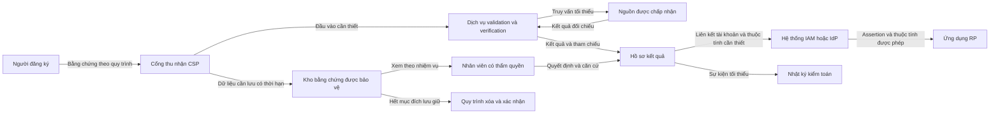

# Privacy trong identity proofing: kiểm chứng đủ, xử lý dữ liệu đúng mục đích

## 1. Vì sao kiểm chứng danh tính cần một thiết kế quyền riêng tư?

Identity proofing thiết lập mối liên hệ giữa người đang đăng ký và danh tính được khai báo với một mức tin cậy xác định. Để làm được điều đó, hệ thống có thể phải xử lý giấy tờ, thông tin cá nhân, ảnh khuôn mặt, video, địa chỉ liên lạc và tín hiệu chống gian lận. Đây cũng là tập dữ liệu có thể gây hậu quả lớn nếu bị sử dụng sai.

**Privacy trong identity proofing** là việc xác định dữ liệu nào cần được xử lý, cho mục đích gì, bởi ai, trong thời gian nào và với khả năng kiểm soát nào dành cho người có dữ liệu. Nó cần hiện diện trong quá trình thiết kế luồng kiểm chứng, lựa chọn nhà cung cấp, vận hành và kết thúc vòng đời hồ sơ.

Ví dụ, một cổng nhà thầu chỉ cần biết người đăng ký đã được kiểm chứng theo chính sách và được liên kết với đúng tài khoản. Nếu cổng này nhận luôn ảnh giấy tờ, ảnh selfie và toàn bộ kết quả tra cứu, dữ liệu bị phát tán rộng hơn mà chưa chắc cải thiện quyết định truy cập. Một thiết kế phù hợp giữ bằng chứng ở nơi có trách nhiệm kiểm chứng và chỉ chuyển những kết quả, thuộc tính cần thiết đến ứng dụng.

Quyền riêng tư cũng không chỉ là chống rò rỉ. Một hệ thống được mã hóa tốt vẫn có thể gây hại nếu hợp nhất hồ sơ từ nhiều dịch vụ, dùng ảnh kiểm chứng để huấn luyện mô hình mà người dùng không dự kiến, hoặc giữ video vô thời hạn mà không có mục đích phù hợp. [Nguồn: NIST SP 800-63A-4, mục 3.3 và 7](https://pages.nist.gov/800-63-4/sp800-63a/privacy/).

Trong nền tảng quản lý danh tính và quyền truy cập (IAM), thiết kế này phải đi cùng xác thực, MFA, cấp phát tài khoản, khôi phục, SSO, phân quyền và kiểm toán. **Ít quyền nhất** giới hạn quyền của người và dịch vụ; **tối thiểu hóa dữ liệu** giới hạn lượng thông tin mà chúng có thể thu thập, sử dụng và giữ lại.

Sau bài này, người học có thể:

- Phân biệt quyền riêng tư với bảo mật và mức bảo đảm danh tính.
- Lập bản đồ dữ liệu từ lúc thu nhận bằng chứng đến lúc xóa hoặc kết thúc tài khoản.
- Áp dụng tối thiểu hóa dữ liệu, giới hạn mục đích và tiết lộ có chọn lọc.
- Phân biệt thông báo, sự đồng ý và các điều kiện xử lý dữ liệu áp dụng.
- Thiết kế lưu giữ, phân quyền, nhật ký và xử lý yêu cầu của người dùng mà không làm sai kết quả kiểm chứng.

## 2. Phạm vi: yêu cầu NIST và lựa chọn triển khai

Bài dùng **NIST SP 800-63A-4** làm cơ sở kỹ thuật cho identity proofing và enrollment; những điểm về chia sẻ qua federation được nối với SP 800-63C-4. Khi một nội dung được trình bày là yêu cầu NIST, cần hiểu trong phạm vi áp dụng của tài liệu và mức bảo đảm tương ứng. Các ví dụ kiến trúc, tên field hoặc trạng thái trong bài là lựa chọn minh họa.

NIST SP 800-63A-4 phân biệt phần yêu cầu ở mục 3.3 với phần hướng dẫn bổ sung về privacy ở mục 7. Tài liệu cũng có yêu cầu riêng cho cơ quan liên bang Hoa Kỳ. Không nên biến một yêu cầu riêng cho nhóm tổ chức đó thành quy tắc pháp luật chung cho mọi doanh nghiệp hoặc mọi quốc gia.

Thời hạn lưu, điều kiện sử dụng dữ liệu, phạm vi quyền của cá nhân và nghĩa vụ thông báo còn phụ thuộc lĩnh vực, khu vực và chính sách áp dụng. Hồ sơ thiết kế cần ghi nhận những điều kiện thực sự áp dụng cho dịch vụ, thay vì gán một thời hạn hoặc một mẫu đồng ý cho tất cả trường hợp. [Nguồn: NIST SP 800-63A-4, mục 3.3 và 3.7](https://pages.nist.gov/800-63-4/sp800-63a/ial-general/).

### 2.1. Ba câu hỏi phải tách biệt

| Khía cạnh | Câu hỏi chính | Ví dụ |
| --- | --- | --- |
| Bảo đảm danh tính | Có đủ căn cứ liên kết người đăng ký với danh tính khai báo không? | Bằng chứng được validation và quyền sở hữu được verification theo IAL mục tiêu |
| Bảo mật | Ai có thể truy cập, sửa hoặc đánh cắp dữ liệu và kết quả? | Mã hóa, xác thực dịch vụ, RBAC/ABAC, kiểm soát đặc quyền |
| Quyền riêng tư | Việc xử lý dữ liệu có cần thiết, đúng mục đích và phù hợp kỳ vọng được giải thích không? | Không chuyển video cho ứng dụng chỉ cần kết quả kiểm chứng |

**IAL — Identity Assurance Level** không phải số lượng giấy tờ được lưu. Thu thập nhiều dữ liệu hơn không tự nâng IAL; xóa dữ liệu quá sớm đến mức phá yêu cầu của quy trình cũng không tạo ra một thiết kế phù hợp. Cần vừa đáp ứng mức bảo đảm được chọn, vừa giảm phần xử lý vượt nhu cầu.

## 3. Nhận diện dữ liệu và trách nhiệm trước khi chọn công cụ

### 3.1. Những thành phần thường tham gia

- **Applicant:** người đang yêu cầu kiểm chứng.
- **CSP — Credential Service Provider:** bên chịu trách nhiệm cung cấp dịch vụ kiểm chứng và đăng ký danh tính.
- **Proofing agent hoặc trusted referee:** người tham gia kiểm tra trực tiếp hoặc xử lý ngoại lệ theo thẩm quyền.
- **Nguồn validation:** bên phát hành hoặc nguồn được chấp nhận để xác nhận thuộc tính, bằng chứng.
- **Nhà cung cấp công nghệ:** dịch vụ đọc giấy tờ, kiểm tra sinh trắc, video hoặc chống gian lận.
- **IdP và RP:** bên cung cấp danh tính liên kết và ứng dụng sử dụng kết quả, khi triển khai federation.

Một tổ chức có thể đảm nhiệm nhiều vai trò. Cần mô tả trách nhiệm theo chức năng và luồng dữ liệu thực tế; nhãn sản phẩm “dịch vụ xác minh” không đủ để biết bên nào đang nhận, lưu hay tái sử dụng dữ liệu.

### 3.2. Lập danh mục dữ liệu theo mục đích

| Nhóm dữ liệu | Mục đích có thể có | Rủi ro cần xem xét |
| --- | --- | --- |
| Thuộc tính định danh | Phân giải và đối chiếu danh tính | Đánh cắp danh tính, nối hồ sơ ngoài dự kiến |
| Ảnh hoặc dữ liệu giấy tờ | Kiểm tra tính xác thực và thuộc tính | Lộ thêm dữ liệu không cần thiết, sao chép sang ticket hoặc log |
| Ảnh khuôn mặt, video, mẫu sinh trắc | Liên kết người với bằng chứng hoặc hỗ trợ quy trình được chọn | Nhận diện lại, theo dõi, sai khớp, tái sử dụng |
| Địa chỉ liên lạc | Xác nhận, thông báo và hỗ trợ | Lộ thông tin liên hệ, gửi nhầm người |
| Tín hiệu thiết bị và mạng | Phát hiện dấu hiệu tấn công | Theo dõi quá mức, suy luận ngoài mục đích chống gian lận |
| Kết quả, lý do và lịch sử xử lý | Quyết định, kiểm toán, giải quyết tranh chấp | Gắn nhãn sai, lộ chi tiết nguồn hoặc quyết định nhạy cảm |
| Hồ sơ thông báo và đồng ý | Chứng minh nội dung đã được trình bày và lựa chọn của người dùng | Lưu quá nhiều dấu vết hoặc dùng sự đồng ý sai phạm vi |

Danh mục nên ghi thêm nguồn, bên nhận, nơi lưu, quyền đọc, điều kiện chia sẻ và điều kiện xóa. Theo NIST, privacy risk assessment phải bao gồm ảnh, video, sinh trắc, bản sao bằng chứng, dữ liệu do bên thứ ba xử lý và dữ liệu có thể nhận diện người sau khi được kết hợp hoặc phân tích. [Nguồn: NIST SP 800-63A-4, mục 3.3.1](https://pages.nist.gov/800-63-4/sp800-63a/ial-general/#privacy-risk-assessment).

## 4. Tối thiểu hóa dữ liệu ở từng bước

Tối thiểu hóa không chỉ là bỏ vài field khỏi biểu mẫu. Cần giới hạn ở bốn điểm: **thu nhận, xử lý, lưu giữ và chia sẻ**.

### 4.1. Chọn nhu cầu kiểm chứng trước khi thu bằng chứng

Trước khi yêu cầu giấy tờ, dịch vụ cần xác định vì sao phải liên kết tài khoản với một con người ngoài đời và mức IAL nào phù hợp. Một chức năng chỉ cần tài khoản có thể đăng nhập không tự nhiên cần cùng lượng bằng chứng với một quy trình đòi hỏi danh tính đã được kiểm chứng.

Nếu quy trình đã chọn yêu cầu các thuộc tính cốt lõi hoặc tổ hợp bằng chứng nhất định, phải đáp ứng chúng. Chẳng hạn, SP 800-63A-4 yêu cầu bộ core attributes có government identifier trong quy trình IAL tương ứng. Điều này không có nghĩa mọi màn hình ứng dụng, mọi RP hay mọi log đều được nhận số định danh đó. [Nguồn: NIST SP 800-63A-4, mục 2.2](https://pages.nist.gov/800-63-4/sp800-63a.html#core-attributes).

### 4.2. Tách nhu cầu xử lý tạm thời khỏi nhu cầu lưu lâu dài

Một trường thông tin có thể cần để gửi truy vấn validation nhưng không cần tồn tại trong cơ sở dữ liệu ứng dụng sau đó. Một ảnh có thể cần để thực hiện so sánh, trong khi hồ sơ kiểm toán chỉ cần tham chiếu bằng chứng, phương thức, phiên bản chính sách và kết quả.

Tuy nhiên, không tự xóa trước khi hoàn thành những nghĩa vụ của quy trình được chọn. Cần phân biệt dữ liệu phục vụ thực hiện kiểm chứng, dữ liệu phục vụ tài khoản subscriber, hồ sơ xử lý tranh chấp và dữ liệu phải giữ theo điều kiện áp dụng. Mỗi nhóm có mục đích và vòng đời riêng.

### 4.3. Giảm dữ liệu gửi đến từng bên

Nhà cung cấp kiểm tra tài liệu chỉ nên nhận phần đầu vào cần cho chức năng được giao. Ứng dụng sử dụng kết quả không mặc nhiên cần dữ liệu đầu vào của nhà cung cấp đó. Một công cụ hỗ trợ khách hàng cũng không nên nhận ảnh giấy tờ chỉ vì nhân viên muốn dễ tìm hồ sơ.

Che hoặc cắt dữ liệu có thể hữu ích ở bản hiển thị và bản chia sẻ, nhưng không được làm mất dấu hiệu mà quá trình validation cần kiểm tra. Nếu cần xử lý bản đầy đủ ở một bước, có thể giới hạn nơi xử lý, thời gian giữ và người được xem, rồi tạo bản đã giảm dữ liệu cho tác vụ khác.

NIST yêu cầu giới hạn xử lý ở lượng thông tin tối thiểu cần cho kiểm chứng, chống gian lận và cung cấp thuộc tính phục vụ quyết định của RP. “Có thể dùng trong tương lai” không phải một mục đích đủ cụ thể để thiết kế lưu mọi dữ liệu. [Nguồn: NIST SP 800-63A-4, mục 3.3.2 và 7.1](https://pages.nist.gov/800-63-4/sp800-63a/privacy/#collection-and-data-minimization).

## 5. Bản đồ dữ liệu và kiến trúc tham khảo



Đây là một kiến trúc minh họa. Nó làm rõ rằng kho bằng chứng, hồ sơ kết quả, kho tài khoản và log có thể cần các quyền và thời hạn khác nhau. Không phải mọi hệ thống đều phải có đúng số thành phần trên sơ đồ.

Các câu hỏi quan trọng khi đọc luồng:

1. Dữ liệu nào rời thiết bị người dùng và đi tới miền của ai?
2. SDK thu nhận có gửi thêm dữ liệu đo lường hoặc định danh thiết bị không?
3. Phản hồi của nhà cung cấp có chứa dữ liệu thừa mà hệ thống vô tình ghi lại không?
4. Ảnh hoặc token có xuất hiện trong URL, trace, công cụ phân tích phiên hay báo lỗi không?
5. Khi xóa hồ sơ, những bản sao ở kho tạm, hàng đợi, log và nhà cung cấp được xử lý thế nào?

Một màn hình chỉ có hai trường vẫn có thể tạo nhiều luồng dữ liệu ngầm. Vì vậy, cần kiểm kê cả tích hợp phía trình duyệt, backend và vận hành hỗ trợ.

## 6. Thông báo và sự đồng ý phải có nghĩa cụ thể

### 6.1. Thông báo tại lúc thu thập

NIST yêu cầu CSP thông báo rõ ở thời điểm thu thập: mục đích của dữ liệu, thông tin nào bắt buộc hoặc tự nguyện, hậu quả nếu không cung cấp, dữ liệu nào sẽ lưu trong tài khoản và thông tin lưu giữ hoặc cơ chế yêu cầu hỗ trợ liên quan.

Chỉ đặt một liên kết đến điều khoản dài không bảo đảm người đăng ký hiểu luồng. Giao diện nên trình bày phần cốt lõi bằng ngôn ngữ dễ hiểu tại nơi người dùng đưa ra hành động, rồi cho phép đọc chi tiết. [Nguồn: NIST SP 800-63A-4, mục 3.3.2 và 7.2](https://pages.nist.gov/800-63-4/sp800-63a/privacy/#notice-and-consent).

Ví dụ nội dung thông báo cần có, được điền bằng thông tin thật của dịch vụ:

```text
Mục đích: đối chiếu bằng chứng danh tính và xác nhận bạn là chủ thể của bằng chứng.
Dữ liệu cần thiết: những thuộc tính và bằng chứng đã liệt kê cho quy trình này.
Bên xử lý: tổ chức cung cấp dịch vụ và các đối tác thực hiện tác vụ được nêu.
Lưu giữ: loại dữ liệu, điều kiện bắt đầu tính thời hạn và cách xử lý khi hết hạn.
Lựa chọn: phương án kiểm chứng khác hoặc kênh hỗ trợ, nếu được cung cấp.
Liên hệ: cách yêu cầu sửa dữ liệu, xem xét lại hoặc xử lý vấn đề riêng tư.
```

Đây là khung nội dung để soạn giao diện, không phải mẫu chính sách đã sẵn sàng áp dụng. Sản phẩm phải nêu thông tin cụ thể thay cho các mô tả còn chung.

### 6.2. Đồng ý cho một mục đích không phải đồng ý cho mọi mục đích

Theo SP 800-63A-4, CSP phải có sự đồng ý rõ ràng, có hiểu biết trước khi thu thập và sử dụng sinh trắc theo yêu cầu áp dụng. Nếu ghi hình phiên proofing, CSP phải thông báo và lấy sự đồng ý trước khi bắt đầu ghi, cùng yêu cầu công bố lịch lưu và quy trình xóa bản ghi.

Các lựa chọn sau không nên được gộp làm một:

- Thực hiện bước so sánh khuôn mặt để kiểm chứng danh tính.
- Ghi và giữ toàn bộ phiên video.
- Dùng dữ liệu để huấn luyện hoặc cải tiến mô hình.
- Dùng thuộc tính để tiếp thị hoặc cung cấp dịch vụ khác.

Nội dung đồng ý phải gắn với mục đích, dữ liệu và phiên bản thông báo thực tế. Một checkbox có tên “Tôi đồng ý” không giải quyết được việc không xác định bên nhận hoặc không giới hạn mục đích. Sự đồng ý cũng không thay thế việc đánh giá rủi ro và các điều kiện xử lý khác áp dụng cho tổ chức. [Nguồn: NIST SP 800-63A-4, mục 3.11](https://pages.nist.gov/800-63-4/sp800-63a/ial-general/#requirements-for-the-use-of-biometrics), [mục 4 về ghi hình](https://pages.nist.gov/800-63-4/sp800-63a/ial/).

### 6.3. Dữ liệu tùy chọn cần có lựa chọn thực chất

Đối với mục đích bổ sung ngoài dịch vụ danh tính, cần đánh giá lại rủi ro, thông báo và biện pháp kiểm soát phù hợp. Khi dùng cơ chế đồng ý cho những mục đích bổ sung đó, không được biến chấp nhận mục đích bổ sung thành điều kiện để dùng dịch vụ danh tính theo hướng dẫn NIST.

Nếu người dùng không muốn một phương án thu thập, hệ thống nên chỉ rõ phương án khác hoặc cách yêu cầu hỗ trợ nếu có. Không hứa rằng mọi dịch vụ đều cung cấp mọi lựa chọn; cũng không được gắn nhãn “tùy chọn” cho một trường mà bỏ trống sẽ bị chặn không giải thích. [Nguồn: NIST SP 800-63A-4, mục 7.3](https://pages.nist.gov/800-63-4/sp800-63a/privacy/#use-limitation).

## 7. Sinh trắc, video và dữ liệu chống gian lận

### 7.1. Phân biệt mẫu, template và kết quả

Ảnh selfie, mẫu video, biểu diễn đặc trưng hoặc template và kết quả khớp có vai trò khác nhau. Không nên coi template mặc nhiên vô hại chỉ vì con người không xem được như một ảnh. Khả năng liên kết, nhận diện lại hoặc sử dụng sai còn phụ thuộc cách xây dựng hệ thống và dữ liệu bổ sung.

Một kết quả “khớp/không khớp” cũng có thể gây tác động lớn nếu được liên kết với tên người và dùng để từ chối dịch vụ. Vì vậy, tối thiểu hóa dữ liệu không chỉ là thay ảnh bằng một điểm số rồi bỏ qua phần còn lại của quy trình.

### 7.2. So sánh 1:1 và tìm kiếm 1:N có phạm vi khác nhau

| Cách sử dụng | Câu hỏi | Hệ quả quyền riêng tư |
| --- | --- | --- |
| So sánh 1:1 | Mẫu người đăng ký có khớp với mẫu tham chiếu của danh tính khai báo không? | Cần bảo vệ mẫu và kiểm soát sai khớp trong trường hợp đó |
| Tìm kiếm 1:N | Mẫu có xuất hiện trong một tập hồ sơ khác không? | Mở rộng phạm vi đối chiếu, có khả năng liên kết nhiều hồ sơ và tạo kết quả dương tính giả |

Không tự chuyển từ 1:1 sang 1:N chỉ vì nhà cung cấp có sẵn tính năng chống trùng. Theo NIST, sử dụng 1:N cho resolution, deduplication hoặc phát hiện gian lận phải dựa trên privacy risk assessment và đáp ứng yêu cầu tương ứng. Không được từ chối đăng ký chỉ dựa vào kết quả tìm kiếm 1:N mà thiếu rà soát thủ công để xác nhận kết quả không phải dương tính giả. [Nguồn: NIST SP 800-63A-4, mục 3.11](https://pages.nist.gov/800-63-4/sp800-63a/ial-general/#requirements-for-the-use-of-biometrics).

### 7.3. Không phải mọi quy trình đều bắt buộc cùng một sinh trắc

IAL2 có những pathway không dùng so sánh sinh trắc tự động. Trong thuật ngữ NIST, Non-Biometric Pathway vẫn có thể bao gồm nhân viên đối chiếu ảnh khuôn mặt thủ công; tên pathway không có nghĩa không xử lý dữ liệu khuôn mặt.

Ở IAL3, bản 4 có yêu cầu thu và giữ mẫu sinh trắc cho các mục đích nêu trong tiêu chuẩn. Vì vậy, không thể khẳng định một quy tắc chung “mọi mẫu phải bị xóa ngay sau so sánh” cho tất cả mức IAL. Cần chọn quy trình đáp ứng nhu cầu bảo đảm, rồi xác định phần xử lý và lưu giữ thực sự cần. [Nguồn: NIST SP 800-63A-4, mục 4.2.6 và 4.3.3](https://pages.nist.gov/800-63-4/sp800-63a/ial/).

### 7.4. Chống gian lận vẫn cần giới hạn mục đích

Device fingerprint, địa chỉ IP, lịch sử lỗi và tín hiệu mạng có thể giúp phát hiện tấn công, nhưng khi gom lại cũng có thể tạo hồ sơ hành vi. Cần ghi rõ tín hiệu nào cần cho loại gian lận nào, ai được dùng và giữ trong bao lâu.

Kết quả “cần điều tra” không đồng nghĩa “đã xác nhận gian lận”. Nếu dữ liệu được chia sẻ giữa các hệ thống, nhãn sai có thể ảnh hưởng lâu dài đến người hợp lệ. Cần có cơ chế cập nhật, sửa hoặc rút lại kết luận sau khi xử lý khiếu nại. NIST yêu cầu đánh giá rủi ro quyền riêng tư của công nghệ kiểm tra gian lận trước khi triển khai. [Nguồn: NIST SP 800-63A-4, mục 3.2](https://pages.nist.gov/800-63-4/sp800-63a/ial-general/#fraud-management).

## 8. Lưu giữ và xóa theo loại dữ liệu

### 8.1. Retention policy cần nhiều hơn một con số

Một chính sách lưu giữ có thể cần nêu:

1. Loại dữ liệu và nơi lưu, kể cả bản sao ở nhà cung cấp.
2. Mục đích lưu sau khi kiểm chứng kết thúc.
3. Sự kiện bắt đầu tính thời gian: tải lên, quyết định, kết thúc tranh chấp hoặc đóng tài khoản.
4. Thời hạn hoặc điều kiện xóa cụ thể.
5. Ngoại lệ được phép, ai phê duyệt và khi nào rà soát lại.
6. Cách kiểm tra dữ liệu đã được xóa hoặc không còn được sử dụng cho mục đích thông thường.

Không có một thời hạn duy nhất trong bài này dành cho tất cả ảnh giấy tờ, video, mẫu sinh trắc và log. NIST yêu cầu chính sách về lưu giữ, bảo vệ và xóa được tài liệu hóa; với sinh trắc còn có yêu cầu công bố thời hạn mặc định và quy trình xóa phù hợp điều kiện áp dụng. [Nguồn: NIST SP 800-63A-4, mục 3.1 và 3.11](https://pages.nist.gov/800-63-4/sp800-63a/ial-general/).

| Nhóm hồ sơ | Căn cứ thiết kế vòng đời |
| --- | --- |
| Hồ sơ dở dang | Nhu cầu tiếp tục quy trình và xử lý lỗi; không tự động giữ vô hạn |
| Bằng chứng thô của hồ sơ đã xử lý | Nhu cầu kiểm chứng, giải quyết tranh chấp hoặc điều kiện lưu giữ áp dụng |
| Kết quả proofing trong tài khoản | Nhu cầu chứng minh mức đã đạt và quản lý vòng đời danh tính |
| Dữ liệu chống gian lận | Mục đích điều tra, chất lượng dữ liệu và điều kiện cập nhật kết luận |
| Nhật ký kiểm toán | Truy vết quyết định và truy cập; giảm thông tin trực tiếp không cần thiết |
| Hồ sơ thông báo và đồng ý | Khả năng xác định mục đích, lựa chọn và phiên bản đã áp dụng |

### 8.2. Xóa cần theo luồng dữ liệu thực tế

Xóa một hàng trong cơ sở dữ liệu chính có thể vẫn để lại ảnh ở object storage, thumbnail, file tạm, cache, bản export, hàng đợi lỗi, log hoặc kho của nhà cung cấp. Quy trình cần theo dõi các bản sao được tạo ra trong kiến trúc thực tế.

Một luồng triển khai minh họa:

```text
Nhận yêu cầu hoặc sự kiện hết hạn lưu giữ
    -> Xác định hồ sơ và phạm vi dữ liệu liên quan
    -> Kiểm tra điều kiện cho phép xóa và ngoại lệ đang có hiệu lực
    -> Ngừng chia sẻ hoặc truy cập không còn phù hợp
    -> Xóa dữ liệu ở các kho vận hành và gửi yêu cầu đến bên xử lý
    -> Xử lý bản sao lưu theo chính sách và khả năng khôi phục
    -> Xác nhận kết quả, ghi dấu tối thiểu về việc thực hiện
    -> Thông báo kết quả và phần chưa thể xóa nếu có
```

Không nên ghi “đã xóa hoàn toàn” khi mới tạo một yêu cầu chờ xử lý. Nếu có nghĩa vụ giữ một phần dữ liệu, cần giới hạn mục đích sử dụng và giải thích phần được giữ theo quy trình áp dụng.

### 8.3. Bản sao lưu và khôi phục là một phần của thiết kế

Chính sách phải xác định bản sao lưu được giữ bao lâu, ai có thể khôi phục và cách ngăn dữ liệu đã xóa quay lại kho sử dụng thông thường sau một lần restore. Có thể cần tái áp dụng những yêu cầu xóa phát sinh sau thời điểm tạo bản sao lưu.

Mã hóa hỗ trợ bảo vệ bản sao, nhưng việc xóa khóa chỉ có tác dụng như mong muốn khi thiết kế bao phủ đúng khóa, bản sao và phạm vi dữ liệu liên quan. Không nên coi bật mã hóa là đã thực hiện xóa dữ liệu.

## 9. Phân quyền cho người và workload xử lý proofing

### 9.1. RBAC xác định vai trò, ABAC giới hạn ngữ cảnh

| Chủ thể | Quyền có thể cần | Phần nên giới hạn |
| --- | --- | --- |
| Proofing agent | Xem hồ sơ được phân công và ghi nhận kiểm tra | Không tự tải toàn bộ kho bằng chứng hoặc truy cập mọi tenant |
| Trusted referee | Xem dữ kiện cần cho hồ sơ ngoại lệ | Không mặc nhiên sửa chính sách hoặc xóa dấu kiểm toán |
| Nhân viên hỗ trợ | Xem trạng thái và hướng dẫn xử lý | Không nhận ảnh, template hoặc thông tin nguồn nếu không cần |
| Dịch vụ validation | Đọc đầu vào và ghi kết quả cho tác vụ được giao | Không liệt kê toàn bộ bằng chứng hoặc dùng dữ liệu cho mục đích khác |
| Dịch vụ enrollment | Nhận kết quả và liên kết tài khoản đúng | Không mặc nhiên cần ảnh giấy tờ hay video |
| Người xử lý yêu cầu privacy | Thực hiện yêu cầu theo thẩm quyền | Không được tự duyệt mọi ngoại lệ hoặc xuất dữ liệu không truy vết |

RBAC có thể cấp nhóm quyền theo công việc. ABAC có thể bổ sung tenant, hồ sơ được giao, mục đích truy cập, trạng thái quy trình hoặc thời gian cấp quyền. Những điều kiện này cần kiểm tra phía máy chủ, kể cả khi giao diện đã ẩn nút.

### 9.2. Đặc quyền và danh tính dịch vụ cũng cần vòng đời

Tài khoản workload dùng để đọc bằng chứng phải có danh tính riêng, quyền tối thiểu và khả năng thu hồi. Không dùng một khóa API chung cho môi trường thử nghiệm, sản xuất và mọi nhà cung cấp. Quyền của nhân viên phải được thu hồi khi rời nhiệm vụ hoặc hết nhu cầu xử lý hồ sơ.

Truy cập khẩn cấp có thể cần trong một số tổ chức, nhưng nên có lý do, phạm vi, thời gian và rà soát theo chính sách. Việc là quản trị viên hạ tầng không có nghĩa tự động có nhu cầu xem mọi ảnh giấy tờ.

### 9.3. Log cần hỗ trợ điều tra mà không sao chép bằng chứng

Nhật ký có thể ghi mã hồ sơ nội bộ, actor, tác vụ, thời gian, phiên bản chính sách và kết quả. Tránh ghi toàn bộ request/response của nhà cung cấp, vì chúng có thể chứa số định danh, ảnh hoặc token.

Ví dụ một sự kiện nội bộ đã giảm dữ liệu; đây không phải schema do NIST quy định:

```json
{
  "event": "proofing.decision.recorded",
  "case_ref": "case_demo_013",
  "actor_ref": "agent_demo_07",
  "decision": "approved",
  "policy_version": "proofing-policy-v3",
  "evidence_refs": ["evidence_demo_a"],
  "raw_document_included": false
}
```

Mã tham chiếu vẫn có thể là dữ liệu liên quan đến cá nhân khi tra ngược được vào hồ sơ. Log đã giảm dữ liệu vẫn cần phân quyền và thời hạn lưu phù hợp.

## 10. Nhà cung cấp bên ngoài và mục đích sử dụng bổ sung

Khi tích hợp dịch vụ OCR, sinh trắc hoặc video, cần kiểm tra thực tế dữ liệu được nhận ở đâu, dùng cho chức năng nào, có được gửi tiếp không và có cơ chế xóa nào. Một phản hồi API chỉ chứa kết quả không chứng minh nhà cung cấp không lưu đầu vào.

Những nội dung cần làm rõ trong thiết kế và thỏa thuận gồm:

- Vai trò và trách nhiệm của các bên đối với từng tác vụ.
- Dữ liệu đầu vào, đầu ra và dữ liệu đo lường được thu nhận thêm.
- Mục đích xử lý, khả năng sử dụng để huấn luyện hoặc đánh giá mô hình.
- Bên xử lý tiếp theo, nơi xử lý và phạm vi hỗ trợ vận hành.
- Chính sách lưu, xóa, bản sao lưu và cách xác nhận thực hiện.
- Cơ chế thông báo sự cố, hỗ trợ khiếu nại và chấm dứt tích hợp.

Nếu muốn dùng ảnh thực để thử nghiệm hoặc cải tiến, cần xem đó là hoạt động xử lý phải được đánh giá riêng. Việc người dùng đã cung cấp ảnh cho proofing không tự bao gồm mọi hoạt động nghiên cứu. NIST có yêu cầu về tính tự nguyện và thông báo, đồng ý trong các tình huống thử nghiệm công nghệ sử dụng dữ liệu người dùng tương ứng. [Nguồn: NIST SP 800-63A-4, mục 3.3, 3.5, 3.11 và 3.13](https://pages.nist.gov/800-63-4/sp800-63a/ial-general/).

Môi trường phát triển nên dùng dữ liệu tổng hợp hoặc bộ dữ liệu có phạm vi sử dụng phù hợp. Việc xóa tên khỏi ảnh giấy tờ thật không đủ để coi ảnh đã ẩn danh, vì khuôn mặt, số tài liệu hoặc chi tiết khác vẫn có thể nhận diện người.

## 11. Chia sẻ kết quả qua IAM và federation

### 11.1. RP thường cần kết quả và thuộc tính có giới hạn

Một RP có thể cần định danh tài khoản trong phạm vi của nó, mức IAL được xác lập, thời điểm hoặc ngữ cảnh kiểm chứng phù hợp và những thuộc tính cần cho chức năng. Điều đó không mặc nhiên cho RP quyền nhận toàn bộ hồ sơ evidence.

Trong một ví dụ khác, nếu chức năng chỉ cần biết người dùng đạt ngưỡng tuổi, giá trị dẫn xuất như `age_over_threshold` có thể giảm lượng dữ liệu so với ngày sinh đầy đủ. Tuy nhiên, nguồn phải thực sự đủ tin cậy để xác lập thuộc tính, và kết quả cần được ràng buộc với đúng người hoặc tài khoản; một boolean tự khai không có cùng giá trị.

NIST SP 800-63C-4 khuyến khích dùng thuộc tính dẫn xuất khi đáp ứng nhu cầu và giảm việc RP thu nhận dữ liệu không cần thiết. Chỉ thay tên field cũng không bảo vệ được dữ liệu nếu token khác vẫn mang ngày sinh hoặc giấy tờ đầy đủ. [Nguồn: NIST SP 800-63C-4, mục 7.3](https://pages.nist.gov/800-63-4/sp800-63c/privacy/#data-minimization).

### 11.2. Định danh theo từng RP giúp giảm liên kết ngoài nhu cầu

Một định danh chung dùng cho tất cả ứng dụng làm việc nối hoạt động của người dùng giữa các bên dễ hơn. Pairwise pseudonymous identifier có thể giúp giảm một số khả năng liên kết bằng cách dùng định danh theo quan hệ với RP.

Pseudonymization không đồng nghĩa ẩn danh hoàn toàn. Nếu mọi RP vẫn nhận cùng email, số giấy tờ hoặc chứng thư nhận diện được, chúng có thể liên kết qua những thuộc tính đó. IdP cũng có thể quan sát hoạt động đăng nhập trong một mô hình federation dùng IdP trung tâm. [Nguồn: NIST SP 800-63C-4, mục 7.1](https://pages.nist.gov/800-63-4/sp800-63c/privacy/#minimizing-tracking-and-profiling).

### 11.3. Token và biểu diễn mã hóa vẫn cần chính sách chia sẻ

JWT được ký không làm nội dung tự trở nên bí mật. Mã hóa token có thể bảo vệ người không có khóa đọc nội dung, nhưng bên nhận hợp lệ vẫn đọc được dữ liệu đã gửi. Vì vậy, cần quyết định dữ liệu được phép chia sẻ trước khi chọn cách đóng gói và bảo vệ thông điệp.

Tương tự, thay số định danh bằng một giá trị băm không tự bảo đảm ẩn danh. Nếu giá trị dễ đoán hoặc được dùng nhất quán ở nhiều nơi, vẫn có rủi ro suy đoán và liên kết. Cần đánh giá biểu diễn, quyền truy cập và nhu cầu liên kết thay vì chỉ kiểm tra dữ liệu có còn ở dạng rõ hay không.

## 12. Yêu cầu xem, sửa, xóa và giải quyết sai sót

Người dùng cần một kênh dễ tìm để báo dữ liệu sai, bị giả mạo, bị từ chối nhầm hoặc muốn biết cách xử lý hồ sơ của mình. NIST yêu cầu cơ chế redress cho những vấn đề của identity proofing, đồng thời yêu cầu đánh giá tính hiệu quả của cơ chế đó. [Nguồn: NIST SP 800-63A-4, mục 3.6 và 7.4](https://pages.nist.gov/800-63-4/sp800-63a/privacy/#redress).

Một luồng xử lý yêu cầu nên cân bằng hai nhu cầu:

- Xác nhận đủ rằng người yêu cầu có thẩm quyền đối với hồ sơ, tránh gửi bằng chứng cho kẻ mạo danh.
- Không buộc người dùng cung cấp thêm dữ liệu quá mức hoặc lặp lại toàn bộ quy trình nặng hơn nhu cầu xử lý.

Sửa một địa chỉ liên lạc không đồng nghĩa tự sửa bằng chứng gốc. Nếu thay đổi tác động đến danh tính đã được kiểm chứng, hệ thống có thể cần validation hoặc verification bổ sung theo chính sách. Cần giữ lịch sử quyết định đủ để giải thích thay đổi mà không tiếp tục dùng dữ liệu sai như dữ liệu hiện tại.

Thông báo lỗi cũng cần hạn chế việc tiết lộ thông tin. Có thể hướng dẫn người dùng bổ sung hoặc yêu cầu rà soát mà không xác nhận chính xác từng giá trị trong nguồn nội bộ. Nếu trả lời một hồ sơ vô danh rằng “số giấy tờ đúng, chỉ sai ngày sinh”, hệ thống có thể trở thành công cụ giúp suy đoán dữ liệu cá nhân.

Với yêu cầu xóa, cần giải thích phạm vi đã thực hiện, dữ liệu phải giữ lại nếu có và cách khiếu nại hoặc theo dõi kết quả. Không đồng nhất việc rút đồng ý cho một mục đích tùy chọn với việc mọi hồ sơ liên quan phải lập tức biến mất, bất kể điều kiện lưu giữ đang áp dụng.

## 13. Đánh giá rủi ro quyền riêng tư theo tác động đến người

NIST yêu cầu CSP thực hiện và tài liệu hóa privacy risk assessment, rà soát định kỳ và cập nhật khi thay đổi dịch vụ làm thay đổi cách xử lý thông tin cá nhân. Bản tóm tắt cần được cung cấp cho các RP sử dụng dịch vụ để họ đánh giá được phần rủi ro liên quan. [Nguồn: NIST SP 800-63A-4, mục 3.3.1](https://pages.nist.gov/800-63-4/sp800-63a/ial-general/#privacy-risk-assessment).

Đánh giá có thể lần lượt xem hoạt động xử lý, vấn đề có thể xảy ra, tác động đến cá nhân và biện pháp giảm thiểu:

| Hoạt động | Vấn đề có thể xảy ra | Tác động | Hướng giảm thiểu minh họa |
| --- | --- | --- | --- |
| Giữ ảnh giấy tờ sau khi hoàn tất | Dữ liệu tồn tại vượt nhu cầu | Tăng hậu quả của lạm dụng hoặc sự cố | Phân loại retention, giới hạn truy cập, xóa phần hết mục đích |
| Chia sẻ kết quả chống gian lận | Nhãn sai truyền sang nhiều dịch vụ | Bị từ chối hoặc bị nghi ngờ không đúng | Phân biệt mức độ kết luận, có quy trình sửa và cập nhật |
| Theo dõi thiết bị rộng | Nối hành vi ngoài proofing | Mất kiểm soát hoặc bị theo dõi ngoài kỳ vọng | Giới hạn tín hiệu, mục đích và thời hạn |
| Dùng dữ liệu thật cho thử nghiệm | Tái sử dụng ngoài mục đích ban đầu | Lộ hoặc nhận diện lại người dùng | Ưu tiên dữ liệu tổng hợp, đánh giá và kiểm soát hoạt động riêng |
| Từ chối tự động do sai khớp | Công cụ hoạt động không phù hợp với nhóm người dùng | Mất khả năng tiếp cận dịch vụ | Kiểm tra hiệu năng, xem xét thủ công và pathway phù hợp |

Ba mục tiêu hữu ích để đọc thiết kế là:

- **Predictability:** người dùng và bên vận hành có thể hiểu, dự đoán hợp lý dữ liệu sẽ được xử lý thế nào.
- **Manageability:** có khả năng quản trị dữ liệu ở mức chi tiết, chẳng hạn sửa, xóa và tiết lộ có chọn lọc.
- **Disassociability:** có thể xử lý dữ liệu hoặc sự kiện mà không gắn với cá nhân hoặc thiết bị vượt nhu cầu vận hành.

Chúng bổ sung cho confidentiality, integrity và availability. Một kho dữ liệu được mã hóa nhưng dùng cho mục đích bất ngờ có thể bảo vệ bí mật trước bên ngoài mà vẫn thiếu predictability. [Nguồn: NIST SP 800-63A-4, mục 3.3.1](https://pages.nist.gov/800-63-4/sp800-63a/ial-general/), [SP 800-63C-4, mục 7.1](https://pages.nist.gov/800-63-4/sp800-63c/privacy/).

Những thay đổi như thêm SDK, bật 1:N, đổi nhà cung cấp, chia sẻ thêm thuộc tính hoặc tăng thời gian giữ video đều có thể làm thay đổi rủi ro. Privacy risk assessment cần bám vào thay đổi đó, không chỉ là tài liệu được ký một lần lúc khởi động dự án.

## 14. Ví dụ: giảm dữ liệu cho cổng nhà thầu

Một doanh nghiệp dùng CSP để kiểm chứng nhà thầu trước khi mở tài khoản. Thiết kế ban đầu gửi toàn bộ gói kết quả của CSP cho cổng truy cập, lưu ảnh giấy tờ trong ticket hỗ trợ và cho nhóm quản lý dự án xem hồ sơ để “tiện đối chiếu”.

Phân tích nhu cầu cho thấy nhóm quản lý chỉ cần xác nhận tài khoản thuộc đúng người và quan hệ nhà thầu còn hiệu lực. Họ không cần ảnh giấy tờ để quyết định người đó được tham gia dự án nào.

Thiết kế được điều chỉnh như sau:

1. CSP xử lý bằng chứng theo quy trình và IAL được doanh nghiệp lựa chọn. Hệ thống ghi nhận mục đích, thông báo và các lựa chọn đồng ý cần thiết.
2. Kho bằng chứng chỉ cho những vai trò xử lý proofing hoặc hồ sơ liên quan được truy cập theo nhiệm vụ.
3. IAM nhận kết quả, định danh cần cho liên kết tài khoản và thuộc tính phục vụ chức năng; không sao chép ảnh vào tài khoản thông thường.
4. Cổng dự án dùng trạng thái hợp đồng và phê duyệt để cấp quyền RBAC/ABAC. Kết quả proofing không tự cấp quyền quản trị.
5. Ticket hỗ trợ dùng mã hồ sơ và trạng thái. Nếu cần xem bằng chứng, người có thẩm quyền đi qua kho được kiểm soát thay vì đính kèm bản sao.
6. Chính sách retention phân biệt bằng chứng, kết quả và log. Quy trình xóa theo dõi cả CSP và các kho nội bộ.
7. Khi có khiếu nại về sai danh tính, bộ phận được phân công có đủ tham chiếu để điều tra mà không cần mở quyền kho bằng chứng cho toàn bộ nhóm dự án.

Điểm thay đổi là giảm dữ liệu đến từng bên và làm rõ trách nhiệm. Quy trình vẫn phải kiểm chứng đủ theo mức đã chọn; quyền riêng tư không được dùng làm lý do đánh dấu đạt khi chưa hoàn tất điều kiện cần thiết.

## 15. Những hiểu lầm thường gặp

| Nhận định | Cách hiểu đúng |
| --- | --- |
| “Đã mã hóa thì đã giải quyết privacy.” | Mã hóa bảo vệ một phần truy cập; vẫn cần giới hạn mục đích, lượng dữ liệu và thời gian lưu. |
| “Người dùng đã đồng ý mọi điều khoản.” | Cần biết họ được thông báo và đồng ý cho mục đích nào; đồng ý không thay mọi kiểm soát khác. |
| “Thu càng nhiều giấy tờ thì IAL càng cao.” | Mức bảo đảm phụ thuộc toàn bộ yêu cầu và phương thức kiểm chứng. |
| “Proofing dùng ảnh nên phải giữ ảnh suốt đời tài khoản.” | Nhu cầu xử lý và nhu cầu lưu giữ cần được xác định riêng theo quy trình. |
| “Mọi dữ liệu phải xóa ngay khi so sánh xong.” | Một số mức và mục đích có yêu cầu lưu; phải lập chính sách theo dữ liệu và điều kiện áp dụng. |
| “Template hoặc hash là dữ liệu ẩn danh.” | Khả năng liên kết và nhận diện lại phải được đánh giá trong ngữ cảnh thực tế. |
| “RP dùng kết quả nên cần toàn bộ bằng chứng.” | RP cần dữ liệu phù hợp chức năng và thỏa thuận, không mặc nhiên cần bản sao hồ sơ. |
| “Dữ liệu chống gian lận được giữ vô hạn.” | Hoạt động chống gian lận cũng cần đánh giá quyền riêng tư, chất lượng và vòng đời dữ liệu. |
| “Xóa khỏi database là đã xóa hết.” | Còn có bản sao vận hành, log, export, backup và nhà cung cấp. |
| “Nhân viên quản trị luôn được xem mọi bằng chứng.” | Đặc quyền phải gắn với nhiệm vụ, phạm vi và truy vết phù hợp. |

Thiết kế privacy tốt giúp hệ thống kiểm chứng đủ danh tính trong khi giảm lượng dữ liệu và khả năng sử dụng ngoài nhu cầu. Kết quả cần được duy trì qua cả vòng đời: từ biểu mẫu thu nhận, công cụ kiểm chứng và người vận hành đến tài khoản IAM, ứng dụng nhận thuộc tính và quy trình kết thúc lưu giữ.

## Tài liệu tham khảo

- [NIST SP 800-63A-4 — Identity Proofing Requirements: privacy risk assessment, thông báo, bảo vệ dữ liệu, sinh trắc và redress](https://pages.nist.gov/800-63-4/sp800-63a/ial-general/).
- [NIST SP 800-63A-4 — Privacy Considerations: tối thiểu hóa dữ liệu, đồng ý và giới hạn sử dụng](https://pages.nist.gov/800-63-4/sp800-63a/privacy/).
- [NIST SP 800-63A-4 — Identity Assurance Level Requirements: pathway và yêu cầu theo từng IAL](https://pages.nist.gov/800-63-4/sp800-63a/ial/).
- [NIST SP 800-63A-4 — Toàn văn: khái niệm, core attributes và vòng đời danh tính](https://pages.nist.gov/800-63-4/sp800-63a.html).
- [NIST SP 800-63C-4 — Privacy Considerations: giảm theo dõi, định danh theo RP và thuộc tính dẫn xuất](https://pages.nist.gov/800-63-4/sp800-63c/privacy/).
