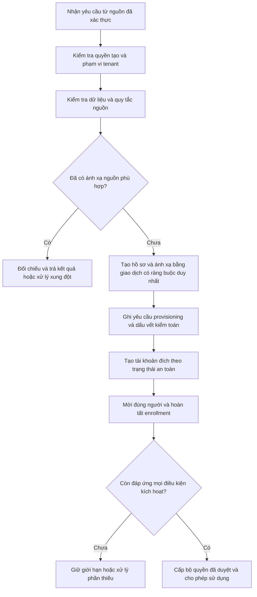

# Identity creation

## 1. Tạo danh tính là thiết lập một quan hệ tin cậy ban đầu

Ngày mai, một nhân viên mới bắt đầu làm việc. Hệ thống nhân sự gửi sự kiện tiếp nhận nhân viên, quản lý gửi thêm một yêu cầu cấp tài khoản và người dùng thử đăng nhập SSO lần đầu. Nếu mỗi đường đều tự tạo người dùng, tổ chức có thể có ba hồ sơ cho cùng một người, nhiều bộ quyền khác nhau và không biết tài khoản nào phải thu hồi khi quan hệ công việc kết thúc.

**Identity creation** là quá trình thiết lập bản ghi danh tính trong một phạm vi quản lý, gắn nó với chủ thể và nguồn có căn cứ, rồi chuẩn bị các tài khoản hoặc quan hệ truy cập cần thiết. Đây là điểm bắt đầu của vòng đời danh tính trong IAM. Kết quả cần có một định danh ổn định, nguồn gốc rõ ràng, trạng thái được kiểm soát và người chịu trách nhiệm về quan hệ danh tính đó.

Quá trình này thường gồm nhiều quyết định: ai được yêu cầu tạo, nguồn nào được tin, đã có hồ sơ phù hợp chưa, thuộc tính nào được chấp nhận, có cần identity proofing không, tài khoản được tạo ở đâu và khi nào được phép hoạt động. Một lệnh thêm bản ghi vào bảng `users` chỉ thực hiện một phần nhỏ của công việc.

Trong bài, ví dụ chính là cổng dự án của doanh nghiệp có nhân viên, nhà thầu và khách được mời. Các cấu trúc dữ liệu, tên trạng thái và quy trình là thiết kế minh họa, không phải mô hình bắt buộc của một sản phẩm hoặc tuyên bố đạt chuẩn.

Sau bài học, người học có thể:

1. Phân biệt việc tạo hồ sơ danh tính, tài khoản, liên kết đăng nhập và quyền.
2. Chọn nguồn khởi tạo và định danh ổn định theo đúng phạm vi tin cậy.
3. Thiết kế quy trình không tạo trùng khi có yêu cầu đồng thời hoặc sự kiện lặp.
4. Kiểm soát việc kích hoạt, gắn authenticator và cấp quyền ban đầu.
5. Giải thích vai trò của SCIM, SSO và JIT trong luồng tạo danh tính.

## 2. Phân biệt các đối tượng được tạo

Trong hệ thống nhỏ, nhiều đối tượng có thể nằm trong cùng một bảng. Tuy nhiên, cần phân biệt ý nghĩa của chúng để tránh một thay đổi làm ảnh hưởng sai phạm vi.

| Đối tượng | Vai trò | Ví dụ |
| --- | --- | --- |
| Chủ thể | Người hoặc workload mà hệ thống quản lý | Một nhân viên, một nhà thầu, một pipeline triển khai |
| Hồ sơ danh tính | Bản ghi biểu diễn chủ thể trong phạm vi quản lý | `identity-demo-042` trong tenant doanh nghiệp A |
| Tài khoản | Bản ghi tại một hệ thống để chủ thể sử dụng dịch vụ | Tài khoản directory, tài khoản cổng dự án, tài khoản quản trị riêng |
| Liên kết danh tính ngoài | Ánh xạ kết quả từ nguồn hoặc IdP sang hồ sơ nội bộ | Tham chiếu hồ sơ HR hoặc cặp issuer và subject của IdP |
| Authenticator | Phương tiện chứng minh quyền kiểm soát tài khoản | Passkey, khóa bảo mật hoặc mật khẩu theo chính sách |
| Membership | Quan hệ tham gia tenant, nhóm hoặc dự án | Thành viên dự án Alpha từ ngày bắt đầu đến ngày kết thúc |
| Entitlement | Quyền được thực hiện hành động trên tài nguyên | Đọc repository Alpha, phê duyệt một loại yêu cầu |

Một người có thể có tài khoản làm việc thường ngày và tài khoản quản trị riêng. Một người cũng có thể tham gia nhiều tenant. Điều này không đồng nghĩa phải tự động hợp nhất mọi tài khoản của họ thành một danh tính toàn cục có cùng quyền.

Phạm vi phải được chọn từ trước: duy nhất trong một directory, một tenant hay một miền quản trị. Các liên kết giữa các phạm vi cần cơ sở tin cậy và kiểm soát riêng, đặc biệt khi việc ghép có thể làm lộ dữ liệu hoặc chuyển quyền.

NIST SP 800-63A-4 mô tả subscriber account với định danh duy nhất và hồ sơ liên quan đến proofing, thuộc tính và authenticator. Tài khoản cũng có thể được tạo khi chưa identity-proofed nếu dịch vụ hỗ trợ trường hợp đó và ghi nhận đúng trạng thái. Vì vậy, “đã có tài khoản” không tự có nghĩa “đã xác minh danh tính ngoài đời”. [NIST: Subscriber Accounts](https://pages.nist.gov/800-63-4/sp800-63a/accounts/).

Tương tự, email đã được xác nhận chỉ cung cấp căn cứ về quyền kiểm soát địa chỉ trong ngữ cảnh xác nhận. Nó không tự chứng minh quan hệ lao động, quyền đại diện doanh nghiệp hoặc quyền quản trị.

## 3. Xác định nguồn được phép khởi tạo danh tính

Mỗi đường tạo cần xác định ai có quyền khởi tạo và những thuộc tính nào được tin từ đường đó. Cùng một API có thể phục vụ nhiều nhóm chủ thể, nhưng không nên dùng cùng một bộ mặc định cho tất cả.

| Nhóm và đường khởi tạo | Nguồn có thể sử dụng trong ví dụ | Điều kiện phải xác định |
| --- | --- | --- |
| Nhân viên | Hệ thống nhân sự được tích hợp | Mã hồ sơ nguồn, ngày bắt đầu, tình trạng tiếp nhận, quan hệ quản lý |
| Nhà thầu | Hệ thống quản lý hợp đồng hoặc đầu mối được phân quyền | Người bảo trợ, phạm vi dự án, thời hạn quan hệ và trách nhiệm thu hồi |
| Khách được mời | Người mời có quyền trên tenant hoặc dự án | Giới hạn quyền mời, đối tượng nhận, thời hạn lời mời và phạm vi được cấp |
| Người dùng tự đăng ký | Chính người đăng ký | Dữ liệu tự khai được đánh dấu đúng; chỉ có quyền nền phù hợp với dịch vụ |
| Người dùng qua JIT | IdP tin cậy trong cấu hình của tenant | Kết quả đăng nhập hợp lệ, quy tắc tạo mới và điều kiện membership |
| Workload | Control plane hoặc quy trình triển khai được chấp nhận | Chủ sở hữu, môi trường, mục đích, nguồn cấp credential và thời hạn |

Một tên miền email công ty không thay thế cho hồ sơ quan hệ công việc. Một giá trị `department` do client gửi không tự chứng minh người dùng thuộc phòng đó. API tạo danh tính cũng không được cho người tự đăng ký lựa chọn `role = admin` hoặc tự khai đã đạt MFA.

Cần ghi nguồn theo từng nhóm thuộc tính. Ví dụ, người dùng có thể sửa tên hiển thị, trong khi trạng thái nhân viên do HR quản lý và vai trò dự án do chủ dự án phê duyệt. Nếu cho mọi nguồn ghi đè mọi trường, một bản cập nhật hồ sơ có thể trở thành đường tự nâng quyền.

Nguồn khởi tạo cũng có thể bị lỗi hoặc bị xâm phạm. Tài khoản tích hợp cần quyền trong đúng tenant, đúng loại đối tượng và đúng thao tác. Nguồn cấp nhân viên thông thường không nên mặc nhiên có khả năng tạo quản trị viên của toàn nền tảng.

## 4. Thiết kế định danh ổn định và phạm vi duy nhất

### 4.1. Dùng định danh nội bộ tách khỏi thông tin có thể thay đổi

Hồ sơ danh tính nên có một định danh nội bộ ổn định, được hệ thống cấp theo cơ chế phù hợp và được bảo đảm duy nhất ở tầng lưu trữ. Mã ngẫu nhiên không mang thông tin cá nhân thường giúp tránh ràng buộc kỹ thuật với email hoặc tên người dùng.

Email có thể đổi, tên có thể trùng và username có thể được cấp lại theo chính sách. Vì vậy, chúng không nên là căn cứ duy nhất để quyết định hai bản ghi là cùng một chủ thể. Không lấy số giấy tờ cá nhân làm khóa kỹ thuật chỉ để tiện liên kết các bảng khi một mã nội bộ đáp ứng được nhu cầu.

Định danh khó đoán cũng không thay thế authorization. API vẫn phải kiểm tra chủ thể có quyền đọc hoặc thay đổi bản ghi được tham chiếu hay không.

### 4.2. Định danh nguồn phải có namespace

`worker-042` trong HR của doanh nghiệp A không nhất thiết là cùng người với `worker-042` ở một nguồn khác. Một khóa ánh xạ minh họa có thể là:

```text
SourceBinding:
  tenant_id
  source_system
  source_subject_id
  identity_id

Ràng buộc duy nhất trong thiết kế ví dụ:
  (tenant_id, source_system, source_subject_id)
```

Nguồn phải định nghĩa tham chiếu nào ổn định và có được tái sử dụng hay không. Nếu mã hợp đồng thay đổi qua mỗi lần ký, nó có thể đại diện một quan hệ công việc thay vì một con người. Không dùng mã quan hệ như mã người mà không làm rõ sự khác biệt đó.

Khi có nhân viên quay lại làm việc, hệ thống cần quy tắc quyết định tạo quan hệ công việc mới, dùng lại hồ sơ danh tính đã được xác nhận hoặc chuyển sang xử lý đối chiếu. Không chỉ tìm email cũ rồi tự khôi phục toàn bộ quyền trước đây.

### 4.3. Với OIDC, không dùng email làm khóa liên kết

OIDC xác định cặp `iss` và `sub` là định danh ổn định mà RP có thể dựa vào trong ngữ cảnh của giao thức; email không có cùng bảo đảm về tính duy nhất và ổn định. Chỉ dùng các giá trị sau khi đã kiểm tra kết quả đăng nhập và IdP tin cậy. [OpenID Connect Core: Claim Stability and Uniqueness](https://openid.net/specs/openid-connect-core-1_0.html#ClaimStability).

Ví dụ ánh xạ của một ứng dụng trong tenant:

```text
LoginBinding:
  tenant_id
  trusted_connection_id
  issuer
  subject
  identity_id
```

`trusted_connection_id` tham chiếu cấu hình IdP và ứng dụng đã được quản lý ở máy chủ. Tenant không được suy ra chỉ từ tham số tùy ý do trình duyệt gửi. Với pairwise subject, cùng một người có thể có giá trị `sub` khác nhau ở các ngữ cảnh client; không tự liên kết xuyên ứng dụng bằng suy đoán.

## 5. Thuộc tính tối thiểu và nguồn gốc dữ liệu

Một bản ghi tạo danh tính cần đủ thông tin để vận hành và quản lý vòng đời, nhưng không nên trở thành bản sao toàn bộ hồ sơ nhân sự.

| Nhóm thông tin | Ví dụ trường nội bộ | Mục đích |
| --- | --- | --- |
| Định danh và phạm vi | `identity_id`, `tenant_id`, loại chủ thể | Xác định đối tượng và ranh giới quản lý |
| Nguồn | Nguồn khởi tạo, tham chiếu nguồn, phiên bản dữ liệu | Đối chiếu, xử lý sự kiện lặp và truy vết |
| Trạng thái | Trạng thái hồ sơ, điều kiện còn thiếu | Ngăn sử dụng trước khi đủ điều kiện |
| Quan hệ | Người bảo trợ, loại quan hệ, ngày bắt đầu và kết thúc | Xác định trách nhiệm và điều kiện duy trì quyền |
| Kênh liên hệ | Địa chỉ cần thiết và trạng thái xác nhận | Thông báo, lời mời và xử lý tài khoản |
| Assurance | Trạng thái proofing và căn cứ liên quan khi có yêu cầu | Không nhầm dữ liệu tự khai với dữ liệu đã kiểm tra |
| Quản trị | Thời điểm tạo, người hoặc dịch vụ tạo, phiên bản chính sách | Điều tra và giải thích quyết định |

Tên trường là gợi ý của ứng dụng, không phải danh sách bắt buộc. Nếu không cần danh tính ngoài đời cho dịch vụ, không tự yêu cầu ảnh giấy tờ hoặc sinh trắc học chỉ vì đang tạo tài khoản.

Mỗi thuộc tính cần có quy tắc về nguồn ghi và thay đổi. Một hệ thống có thể giữ cả giá trị tự khai và giá trị được đối chiếu, nhưng phải tránh để giá trị tự khai âm thầm thay thế căn cứ dùng cho quyết định truy cập.

Trạng thái như `email_verified`, `proofing_completed` hoặc `mfa_enrolled` phải do quy trình có thẩm quyền xác lập. Endpoint tạo tài khoản công khai không được nhận các trường này từ client rồi tin nguyên trạng.

## 6. Tách việc tạo trước khỏi quyền sử dụng

Một doanh nghiệp có thể chuẩn bị directory và ứng dụng trước ngày bắt đầu để giảm thời gian chờ. Điều đó không có nghĩa người dùng được truy cập dữ liệu nghiệp vụ ngay khi bản ghi được tạo.

Có thể tách trạng thái của hồ sơ khỏi các điều kiện sử dụng:

| Phần trạng thái | Ví dụ | Câu hỏi được trả lời |
| --- | --- | --- |
| Hồ sơ khởi tạo | REQUESTED, APPROVED, CANCELLED | Yêu cầu tạo có còn hợp lệ không? |
| Provisioning | NOT_STARTED, IN_PROGRESS, PARTIAL, COMPLETE | Các tài khoản đích đã được tạo đến đâu? |
| Kích hoạt | NOT_READY, INVITED, ENROLLMENT_PENDING, READY | Người nhận đã hoàn tất bước thiết lập cần thiết chưa? |
| Quan hệ công việc | NOT_STARTED, CURRENT, ENDED | Quan hệ cho phép truy cập có hiệu lực không? |
| Truy cập | DISABLED, ENABLED, SUSPENDED | Hệ thống có cho phép sử dụng theo chính sách không? |

Không nên nhồi mọi ý nghĩa vào một trường `active`. Một tài khoản có thể đã tạo xong ở directory nhưng provisioning ứng dụng chưa hoàn tất; hoặc đã nhận lời mời nhưng ngày bắt đầu chưa tới.

Một điều kiện kích hoạt minh họa là:

```text
Có thể mở truy cập nghiệp vụ khi:
  yêu cầu vẫn được phê duyệt
  và quan hệ công việc đang có hiệu lực
  và đã hoàn tất proofing nếu chính sách yêu cầu
  và liên kết tài khoản cùng enrollment đã được kiểm tra
  và các tài khoản đích bắt buộc đã sẵn sàng
  và bộ quyền ban đầu đã được xác định
  và không có trạng thái hủy hoặc chặn hiện hành
```

Đây là điều kiện thiết kế, không phải một kiểm tra chỉ thực hiện ở giao diện. Các API và ứng dụng bảo vệ dữ liệu cần kiểm tra trạng thái hoặc điều kiện truy cập tương ứng.

Nếu có luồng onboarding trước ngày bắt đầu, có thể cấp phạm vi riêng để hoàn tất thủ tục. Quyền onboarding cần được mô tả rõ và không tự mở quyền vào kho dữ liệu dự án.

## 7. Luồng tạo danh tính có kiểm soát



### 7.1. Kiểm tra quyền tạo ở phía máy chủ

Nguồn gọi phải được xác thực, được phép tạo loại danh tính tương ứng và được giới hạn vào phạm vi tài nguyên. Nếu người quản lý chỉ được mời khách vào một dự án, họ không được tạo thành viên có quyền toàn tenant bằng cách đổi body của request.

Cần giới hạn trường có thể ghi. Máy chủ cấp định danh nội bộ, chọn nguồn chính sách và xác lập trạng thái bảo mật. Client chỉ gửi các trường mà vai trò của họ được phép đề xuất.

Với API tự đăng ký, cần kiểm soát lạm dụng như tạo hàng loạt và gửi lời mời hàng loạt. Phản hồi cho người chưa được xác thực cũng cần tránh tiết lộ hồ sơ nội bộ không thuộc phạm vi họ được biết.

### 7.2. Kiểm tra trùng bằng khóa có căn cứ

Trước hết, tìm ánh xạ từ nguồn ổn định đã được chấp nhận. Nếu tìm thấy, đây có thể là yêu cầu lặp hoặc một cập nhật quan hệ, không phải lý do tạo người mới.

Nếu chỉ phát hiện tên hoặc email giống nhau, cần xử lý theo chính sách đối chiếu. Không tự ghép hồ sơ vì có cùng tên; không tự trả quyền của tài khoản cũ cho người mới chỉ vì hộp thư đã được cấp lại.

Kiểm tra “chưa tồn tại” trong mã ứng dụng chưa ngăn được hai request đồng thời. Cần ràng buộc duy nhất ở cơ sở dữ liệu hoặc cơ chế lưu trữ tương đương và xử lý xung đột một cách xác định.

### 7.3. Dùng idempotency cho yêu cầu lặp

Idempotency trong luồng này nghĩa là xử lý lại cùng một yêu cầu hợp lệ không sinh thêm danh tính hoặc tác dụng phụ ngoài dự kiến.

Một bản ghi idempotency nên gắn với phạm vi như tenant, bên gọi, loại thao tác và mã yêu cầu. Cùng khóa với nội dung khác cần báo xung đột; không được trả thành công cho một dữ liệu mới chưa xử lý. Mọi lần gọi vẫn phải kiểm tra quyền truy cập kết quả.

Idempotency key của một request và khóa tương quan danh tính nguồn giải quyết hai việc khác nhau. Một nguồn có thể gửi cùng nhân viên trong hai request có mã khác nhau; ánh xạ nguồn và ràng buộc duy nhất vẫn phải ngăn tạo trùng.

Mã giả sau minh họa một thao tác tạo nội bộ, không phải triển khai đầy đủ cho hệ thống production:

```text
createIdentity(caller, tenant, request):
    authenticateAndAuthorize(caller, tenant, "identity:create")
    input = validateAllowedFieldsAndTrustedSource(request, caller)
    requestKey = scopeRequestKey(tenant, caller, input.requestId)

    begin transaction:
        lockOrCreateRequestRecord(requestKey)
        ensureSamePayloadOrReject(requestKey, input)

        if completedResultExists(requestKey):
            return authorizedStoredResult(requestKey)

        binding = findSourceBinding(tenant, input.source,
                                    input.sourceSubject)
        if binding exists:
            result = reconcileOrReportExisting(binding, input)
        else:
            identity = insertIdentityWithServerGeneratedId(input)
            insertUniqueSourceBinding(identity, input)
            insertProvisioningIntent(identity, input.policyVersion)
            insertAuditEvent(identity, caller, input.requestId)
            result = pendingResult(identity)

        storeRequestResult(requestKey, result)
    commit transaction

    return result
```

Các hàm trừu tượng phải được triển khai với quy tắc cụ thể, đặc biệt việc khóa, dữ liệu được so sánh và cách xử lý vi phạm ràng buộc duy nhất. Không giữ một giao dịch cơ sở dữ liệu lâu chỉ để chờ hàng loạt API bên ngoài.

## 8. Provisioning phân tán và xử lý thất bại từng phần

Tạo danh tính thường kéo theo tạo directory, tài khoản ứng dụng và membership. Các hệ thống này không cùng một giao dịch cơ sở dữ liệu. Directory có thể đã tạo xong trong khi ứng dụng dự án tạm ngừng hoạt động.

Một cách thiết kế là ghi hồ sơ cùng **ý định provisioning** trong giao dịch nội bộ, rồi xử lý các ý định sau khi commit. Mô hình transactional outbox là một lựa chọn để tránh mất yêu cầu giữa lúc lưu dữ liệu và phát thông điệp. Nó không tự tạo khả năng xử lý đúng một lần ở mọi hệ thống đích; consumer vẫn cần xử lý lặp và đối chiếu trạng thái.

Với từng hệ thống đích, cần lưu ít nhất tham chiếu tài khoản đích, trạng thái mong muốn, trạng thái quan sát được, lần thử và lỗi có cấu trúc. Khi retry, đối chiếu bằng ánh xạ được chấp nhận trước khi gọi tạo mới.

Không gộp mọi lỗi thành “người dùng đã sẵn sàng”. Có thể giữ tài khoản ở trạng thái giới hạn cho đến khi đủ các thành phần bắt buộc. Nếu một ứng dụng tùy chọn chưa sẵn sàng, chính sách có thể cho phép các chức năng khác; đây phải là quyết định có chủ đích.

### 8.1. Trạng thái mới phải thắng tác vụ tạo cũ

Giả sử HR hủy việc tiếp nhận sau khi yêu cầu provisioning đã vào hàng đợi. Worker xử lý chậm không được dựa hoàn toàn vào payload cũ rồi tạo và kích hoạt tài khoản.

Cần kiểm tra phiên bản hoặc trạng thái mong muốn hiện hành trước các bước quan trọng. Nếu lệnh cũ vẫn tạo ra tài khoản ở hệ thống ngoài do một race condition, quá trình đối soát phải phát hiện và đưa tài khoản về trạng thái an toàn theo quyết định hiện tại.

Thứ tự đến của thông điệp không luôn là thứ tự nghiệp vụ. Nếu dùng phiên bản nguồn, phải hiểu phạm vi và ý nghĩa của nó; không so sánh tùy tiện timestamp của các hệ thống có đồng hồ khác nhau rồi coi dữ liệu đến sau là đúng hơn.

### 8.2. SCIM là giao thức provisioning, cần mapping riêng

SCIM cung cấp schema và giao thức trao đổi tài nguyên người dùng, nhóm. Trong RFC 7643, `id` do service provider cấp và là định danh ổn định không được tái gán; `externalId` do provisioning client cung cấp, có phạm vi miền provisioning và không được server mặc định bảo đảm duy nhất. [RFC 7643, mục 3.1](https://www.rfc-editor.org/rfc/rfc7643.html#section-3.1).

Ví dụ tạo người dùng dưới đây là dữ liệu giả định; đây chỉ là một phần của luồng provisioning:

```http
POST /scim/v2/Users HTTP/1.1
Host: directory.example
Content-Type: application/scim+json
Accept: application/scim+json

{
  "schemas": ["urn:ietf:params:scim:schemas:core:2.0:User"],
  "externalId": "hr-demo:person-042",
  "userName": "new.member@example.invalid",
  "displayName": "Thành viên minh họa",
  "active": false
}
```

Ví dụ lược bỏ thông tin xác thực; tích hợp thật phải xác thực và phân quyền provisioning client. Không gửi credential thật trong tài liệu hoặc nhật ký.

RFC 7644 quy định phản hồi `201 Created` khi tạo thành công và `409 Conflict` với lỗi `uniqueness` cho xung đột tính duy nhất. Lỗi xung đột không phải bằng chứng hai hồ sơ thuộc cùng một người; connector cần đối chiếu có căn cứ. [RFC 7644, mục 3.3](https://www.rfc-editor.org/rfc/rfc7644.html#section-3.3).

Không coi `externalId` là idempotency key được SCIM tự động thực thi. Cũng cần kiểm chứng cách hệ thống đích diễn giải `active: false`, nhất là tác động lên đăng nhập, đường tài khoản cục bộ và token đã tồn tại. Việc lưu một cờ không tự chứng minh mọi đường truy cập đã bị chặn.

SCIM không thay thế xác thực người dùng. SSO xử lý luồng đăng nhập và truyền kết quả danh tính; provisioning chuẩn bị và duy trì tài nguyên ở hệ thống đích. Một ứng dụng có thể cần cả hai.

## 9. Kích hoạt và enrollment an toàn

Khi tài khoản đã được chuẩn bị, cần đảm bảo đúng người hoàn tất thiết lập. Một thông điệp “tài khoản đã tạo” không nên chứa mật khẩu dùng lâu dài hoặc một bí mật quản trị được dùng chung.

### 9.1. Lời mời phải có mục đích và phạm vi

Một thiết kế lời mời có thể dùng token ngẫu nhiên đủ mạnh, lưu dạng kiểm tra an toàn ở máy chủ, có thời hạn và chỉ dùng một lần. Bản ghi lời mời gắn với tenant, tài khoản dự kiến, mục đích, người mời và các điều kiện nhận lời.

Token được gửi đến kênh nào thì chỉ cung cấp căn cứ tương ứng với kênh đó. Nếu cần xác minh danh tính hoặc quan hệ công việc mạnh hơn, phải hoàn tất thêm các bước của chính sách; không tự nâng ý nghĩa của lời mời email.

Không kích hoạt tài khoản hoặc tiêu thụ lời mời chỉ vì có HTTP GET vào liên kết. Phần mềm quét email có thể tự mở URL. Thay đổi trạng thái cần bước xác nhận có chủ đích và các kiểm tra phía máy chủ.

Khi người nhận hoàn tất, máy chủ kiểm tra lại lời mời còn hiệu lực, đúng tenant, chưa dùng, người mời vẫn có thẩm quyền và yêu cầu tạo chưa bị hủy. Các điều kiện nhận lời phải phù hợp với hồ sơ người nhận; không cho một người đã đăng nhập bất kỳ tự chiếm tài khoản chỉ nhờ nhấp liên kết.

Việc tiêu thụ token và cập nhật trạng thái liên quan cần được xử lý nhất quán để hai request đồng thời không nhận thành công hai lần. Nếu phải tạo tác dụng phụ bên ngoài, ghi ý định có thể xử lý lặp thay vì giả định mọi bước cùng một giao dịch.

### 9.2. Gắn authenticator phải do đúng quy trình quyết định

Luồng đăng ký passkey hoặc MFA phải gắn với đúng tài khoản và phiên enrollment, có kiểm tra kết quả ở máy chủ theo giao thức áp dụng. Không nhận `mfa_enrolled = true` do frontend tự gửi.

Nếu dùng xác thực mật khẩu, việc lưu và thiết lập mật khẩu phải tuân theo chính sách xác thực phù hợp. Tránh yêu cầu quản trị viên biết mật khẩu dài hạn của người dùng hoặc gửi cùng bí mật cho nhiều tài khoản.

Trong mô hình chỉ dùng SSO, ứng dụng có thể không cần tạo mật khẩu cục bộ. Nếu vẫn tồn tại đường đăng nhập cục bộ, phải quản lý nó như một đường xác thực riêng; không vô tình để đường này bỏ qua các yêu cầu của SSO.

### 9.3. Hoàn tất enrollment chưa đồng nghĩa được cấp mọi quyền

Người dùng có thể đã đăng ký authenticator nhưng chưa đến ngày bắt đầu, chưa có phê duyệt dự án hoặc hợp đồng đã bị hủy. Trước khi cho phép truy cập nghiệp vụ, đánh giá lại điều kiện hiện hành và chỉ cấp phạm vi đã được duyệt.

## 10. JIT và nguy cơ liên kết sai tài khoản

**Just-in-time provisioning**, hay JIT, tạo bản ghi ứng dụng khi người dùng đăng nhập hợp lệ lần đầu theo chính sách. JIT có ích khi không cần tạo trước tài khoản ở mọi ứng dụng, nhưng một lần đăng nhập thành công không tự tạo quyền tham gia tenant.

Ứng dụng cần xác định IdP nào được tin trong tenant, ai đủ điều kiện tạo mới và các claim nào được phép ảnh hưởng membership hoặc vai trò. Các claim và cấu hình phải được kiểm tra ở máy chủ bằng thư viện giao thức phù hợp; không chỉ giải mã token rồi tin nội dung.

Một luồng JIT minh họa:

1. Kiểm tra kết quả xác thực và quan hệ tin cậy với IdP theo cấu hình đã chọn.
2. Tìm liên kết đăng nhập theo issuer, subject và ngữ cảnh ứng dụng phù hợp.
3. Nếu đã có liên kết, kiểm tra trạng thái và membership hiện hành trước khi sử dụng.
4. Nếu chưa có, kiểm tra chính sách cho phép tạo mới và các điều kiện tenant.
5. Tạo hồ sơ hoặc đưa vào trạng thái chờ theo chính sách; chỉ cấp bộ quyền nền đã xác định.
6. Nếu có dấu hiệu trùng với tài khoản hiện có, dùng luồng liên kết có căn cứ thay vì tự ghép theo email.

### 10.1. Không tự ghép tài khoản chỉ vì email trùng

Giả sử một tài khoản được tạo trước bằng email tự khai chưa xác nhận. Về sau, chủ hộp thư thật đăng nhập SSO. Nếu ứng dụng tự ghép vào bản ghi cũ và giữ nguyên authenticator hoặc liên kết mà người tạo trước đã đăng ký, có thể để lại đường truy cập cho người không phải chủ tài khoản hợp lệ.

Một tình huống khác là doanh nghiệp cấp lại địa chỉ email của nhân viên đã nghỉ cho người mới. Ghép theo email có thể chuyển nhầm dữ liệu và quyền lịch sử.

Luồng liên kết cần bằng chứng kiểm soát phù hợp đối với các tài khoản liên quan, kiểm tra trạng thái và xử lý các phương thức đăng nhập cũ. Với trường hợp không đủ căn cứ, chuyển sang quy trình khôi phục hoặc hỗ trợ được phân quyền; không tự hợp nhất vì muốn người dùng đăng nhập nhanh hơn.

Khi chuyển IdP, cũng không giả định `sub` mới trùng hoặc có thể suy ra từ email cũ. Việc chuyển liên kết phải là một thao tác được quản lý và có thể kiểm toán.

## 11. Cấp quyền ban đầu và những danh tính có đặc quyền

Bộ quyền mặc định là một phần của thiết kế tạo danh tính. Nhân viên mới có thể cần xem cổng onboarding; điều đó không có nghĩa được đọc mọi dự án hoặc quản trị ứng dụng.

Có thể dùng RBAC để ánh xạ một vai trò đã được xác nhận sang nhóm quyền, và ABAC để bổ sung điều kiện như tenant, dự án hoặc quan hệ còn hiệu lực. Cả hai đều cần nguồn thuộc tính có căn cứ. Nếu client tự sửa `department` rồi nhận vai trò tương ứng, mô hình phân quyền đã tin sai nguồn dữ liệu.

Quyền nhạy cảm cần phê duyệt hoặc quy trình riêng, với phạm vi và thời hạn phù hợp. Không tạo bản sao toàn bộ quyền của một đồng nghiệp chỉ vì hai người cùng chức danh. Người cũ có thể đã tích lũy nhiều ngoại lệ không cần cho người mới.

Tài khoản quản trị nên có mục đích rõ, liên hệ được với chủ thể chịu trách nhiệm và được tạo qua đường có thẩm quyền. Nếu một người cần tài khoản quản trị riêng, tài khoản đó không nên được sinh tự động từ mọi sự kiện tiếp nhận nhân viên.

Việc tạo quản trị viên đầu tiên của tenant là một tình huống bootstrap cần được thiết kế trước. Không mở một API công khai theo quy tắc “ai đăng ký đầu tiên thì thành chủ tenant” nếu chưa kiểm tra quyền sở hữu hoặc thẩm quyền đối với tenant đó.

### 11.1. Với workload, xác định chủ sở hữu và môi trường ngay khi tạo

Workload không có vòng đời giống một nhân viên. Hồ sơ tạo cần xác định dịch vụ hoặc pipeline nào, môi trường nào, người hoặc nhóm chịu trách nhiệm, tài nguyên cần dùng và điều kiện kết thúc.

Ưu tiên cơ chế cấp credential phù hợp với nền tảng và thời hạn sử dụng, chẳng hạn danh tính workload được cấp qua môi trường thực thi đáng tin cậy. Không tự tạo một mật khẩu dùng chung vô thời hạn rồi đưa vào nhiều repository.

Nếu người tạo workload rời tổ chức, quyền sở hữu workload phải chuyển được và credential liên quan phải được quản lý. Không để một service account quan trọng tồn tại mà không ai có trách nhiệm xác định nó còn cần thiết hay không.

## 12. Ví dụ xuyên suốt: một nhân viên và nhiều yêu cầu tạo

Giả sử doanh nghiệp A tạo quyền dự án cho một nhân viên có tham chiếu nguồn `hr-demo:person-042`. Đây là dữ liệu giả định; các thời điểm chỉ mô tả trình tự nghiệp vụ.

| Sự kiện | Hành vi mong muốn | Căn cứ kiểm soát |
| --- | --- | --- |
| HR gửi bản ghi tiếp nhận trước ngày bắt đầu | Tạo một hồ sơ trong tenant và chuẩn bị tài khoản ở trạng thái chưa mở truy cập nghiệp vụ | Nguồn HR đã được phân quyền; tham chiếu nguồn ổn định; ngày bắt đầu được giữ riêng |
| Quản lý gửi yêu cầu thêm cùng người vào dự án Alpha | Gắn yêu cầu quyền với hồ sơ có căn cứ; không tạo người mới chỉ vì request khác | Ánh xạ nguồn và quy trình đối chiếu được kiểm soát |
| Sự kiện HR được gửi lại | Giữ một hồ sơ và không gửi lặp tác dụng phụ ngoài chính sách | Ràng buộc duy nhất, idempotency và theo dõi ý định provisioning |
| Directory đã tạo xong, ứng dụng dự án timeout | Lưu trạng thái chưa hoàn tất; đối chiếu trước khi thử lại | Mapping tài khoản đích và phân biệt trạng thái thực tế với trạng thái mong muốn |
| Người dùng đăng nhập SSO lần đầu | Tìm liên kết phù hợp hoặc xử lý tạo JIT theo chính sách; không tự ghép bằng email | Kết quả OIDC đã kiểm tra, cấu hình IdP tin cậy và quy tắc liên kết |
| Người dùng hoàn tất enrollment trước ngày bắt đầu | Chỉ cho phạm vi onboarding nếu được thiết kế; quyền dự án vẫn chờ điều kiện | Tách enrollment khỏi hiệu lực quan hệ và authorization |
| HR hủy tiếp nhận trong khi còn tác vụ chờ | Chặn kích hoạt, xử lý tài khoản đã tạo và không cho tác vụ cũ mở lại | Trạng thái hiện hành, phiên bản nguồn và đối soát hệ thống đích |

Nếu hệ thống chỉ có một trường `created = true`, khó biết tài khoản đang chờ bước nào và ai cần xử lý. Hồ sơ trạng thái có ý nghĩa giúp người vận hành giải quyết sự cố mà không phải cấp quyền tạm quá rộng.

## 13. Kiểm toán, dữ liệu và trách nhiệm từ lúc tạo

Một sự kiện kiểm toán tạo danh tính nên cho biết ai hoặc dịch vụ nào yêu cầu, tenant và danh tính đích, nguồn tham chiếu, kết quả, mã lý do, phiên bản chính sách và mã tương quan của tác vụ. Ghi riêng thời điểm nhận yêu cầu, tạo bản ghi, tạo tài khoản đích và mở quyền khi các mốc này khác nhau.

Không ghi mật khẩu, token lời mời, credential tích hợp hoặc toàn bộ bằng chứng danh tính vào nhật ký. Tham chiếu nội bộ thường đủ để truy vết; dữ liệu gốc chỉ được giữ ở nơi có mục đích và quyền truy cập phù hợp.

Các trách nhiệm cần rõ ngay khi tạo:

- Chủ nguồn chịu trách nhiệm về dữ liệu và sự kiện thuộc phạm vi của nguồn.
- Chủ quan hệ hoặc người bảo trợ chịu trách nhiệm xác nhận nhu cầu sử dụng.
- Nhóm IAM chịu trách nhiệm về ánh xạ danh tính, enrollment và cơ chế quản lý vòng đời trong phạm vi triển khai.
- Chủ ứng dụng chịu trách nhiệm về mapping tài khoản, bộ quyền và việc thực thi điều kiện truy cập ở ứng dụng.
- Người vận hành được phân quyền xử lý hồ sơ lỗi, với căn cứ và dấu vết thay đổi.

Các chỉ báo vận hành có ích gồm tỷ lệ tạo trùng được phát hiện, số hồ sơ chờ không có chủ sở hữu, provisioning lỗi kéo dài, tài khoản được tạo nhưng chưa kích hoạt và tài khoản đã hủy yêu cầu nhưng còn tồn tại ở hệ thống đích.

Đo thời gian đến khi có thể sử dụng đúng phạm vi, không chỉ thời gian ghi một dòng trong cơ sở dữ liệu. Một luồng trả HTTP thành công rất nhanh nhưng bỏ lại tài khoản không có MFA hoặc quyền chưa được kiểm soát chưa hoàn tất mục tiêu tạo danh tính.

## 14. Những điều kiện cần có của một thiết kế tạo danh tính

Một thiết kế đầy đủ cần trả lời được các câu hỏi sau:

1. Ai có quyền khởi tạo, cho loại chủ thể nào và trong tenant nào?
2. Đâu là định danh nội bộ, tham chiếu nguồn và khóa liên kết đăng nhập?
3. Nguồn nào có quyền ghi từng thuộc tính, trạng thái và quan hệ?
4. Khi hai request chạy đồng thời hoặc một sự kiện được gửi lại, hệ thống giữ một kết quả hợp lệ bằng cách nào?
5. Điều gì xảy ra khi một hệ thống đích đã tạo tài khoản còn hệ thống khác thất bại?
6. Khi yêu cầu bị hủy, tác vụ cũ và lời mời cũ có còn khả năng kích hoạt không?
7. Người hoàn tất enrollment được gắn với đúng tài khoản bằng căn cứ nào?
8. Bộ quyền ban đầu, quyền nhạy cảm và thời hạn quan hệ được quyết định riêng ra sao?
9. Hồ sơ được kiểm toán, đối soát, thu hồi và xử lý dữ liệu theo trách nhiệm nào?

Identity creation tạo nền cho toàn bộ vòng đời danh tính. Khi định danh, nguồn gốc, trạng thái và quyền ban đầu được tách rõ, các bước tiếp theo như thay đổi vai trò, liên kết SSO, khôi phục và thu hồi có một cơ sở nhất quán để thực hiện.
