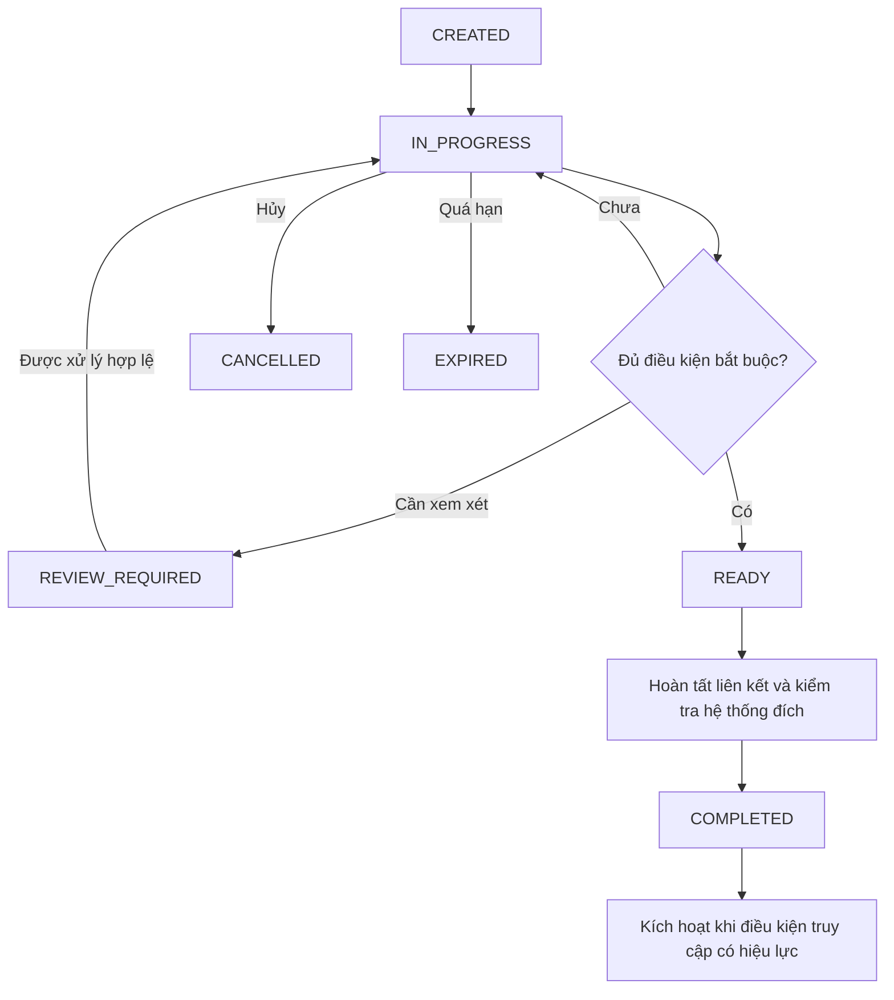

# Identity enrollment: ghi danh danh tính vào hệ thống IAM

## 1. Enrollment giải quyết vấn đề gì?

**Identity enrollment** là quy trình đưa một chủ thể vào phạm vi quản lý của hệ thống danh tính, thiết lập hồ sơ và những liên kết cần thiết để chủ thể có thể sử dụng dịch vụ theo chính sách. Chủ thể có thể là người dùng hoặc workload, nhưng hai loại này cần cách ghi danh và bằng chứng phù hợp riêng.

Với người dùng, enrollment có thể bao gồm tiếp nhận yêu cầu, xác định danh tính, kiểm chứng khi cần, tạo hoặc liên kết tài khoản, đăng ký phương thức xác thực và chuẩn bị quyền ban đầu. Quy trình chỉ được hoàn tất khi các điều kiện bắt buộc của trường hợp đó đã đáp ứng.

Ví dụ, một nhân viên mới đã có bản ghi trong hệ thống nhân sự nhưng chưa đến ngày làm việc. IAM có thể chuẩn bị tài khoản ở trạng thái chờ, còn quyền đăng nhập và quyền ứng dụng chỉ có hiệu lực khi thỏa điều kiện kích hoạt. Việc tạo được một dòng trong bảng người dùng chưa có nghĩa enrollment đã hoàn tất hoặc tài khoản được phép truy cập.

Trong nền tảng IAM, enrollment nằm ở đầu chuỗi quản lý vòng đời:

```text
Nguồn yêu cầu hoặc quan hệ công việc
  → ghi danh và thiết lập liên kết
  → kích hoạt theo điều kiện
  → thay đổi thuộc tính, yếu tố và quyền
  → đình chỉ hoặc kết thúc quan hệ
  → thu hồi và xử lý dữ liệu theo chính sách
```

Một quy trình tốt tạo được câu trả lời rõ ràng cho bốn câu hỏi: ai hoặc workload nào đang được ghi danh, dựa vào nguồn nào, được gắn với tài khoản và thông tin xác thực nào, và được phép làm gì khi bắt đầu sử dụng.

## 2. Phân biệt enrollment với các quy trình liên quan

| Khái niệm | Mục đích chính | Ví dụ |
|---|---|---|
| Registration | Tiếp nhận thông tin đăng ký hoặc yêu cầu tham gia | Người dùng nhập email và gửi biểu mẫu |
| Identity proofing | Xây dựng mức tin cậy về danh tính được khai | Kiểm tra bằng chứng và xác minh người tham gia khi chính sách yêu cầu |
| Enrollment | Hoàn thành điều kiện ghi danh và thiết lập liên kết danh tính | Gắn hồ sơ, tài khoản, phương thức xác thực và trạng thái sẵn sàng |
| Account provisioning | Tạo hoặc cập nhật tài khoản ở hệ thống đích | Tạo tài khoản trong ứng dụng quản lý dự án |
| Authenticator binding | Gắn phương thức xác thực với đúng tài khoản | Đăng ký khóa bảo mật hoặc phương thức được chấp nhận |
| Activation | Cho phép tài khoản hoặc quan hệ truy cập bắt đầu có hiệu lực | Mở đăng nhập khi nhân sự đã bắt đầu làm việc và hoàn tất điều kiện |
| Authentication | Chứng minh quyền kiểm soát phương thức xác thực trong lần truy cập | Đăng nhập bằng passkey |
| Authorization | Xác định hành động và tài nguyên được phép truy cập | Chỉ xem dự án thuộc nhóm được giao |

Tên gọi có thể được các sản phẩm sử dụng khác nhau. Vì vậy, khi thiết kế cần mô tả chính xác điều kiện và tác động của từng bước thay vì chỉ dựa vào tên chức năng.

Không phải mọi enrollment đều cần kiểm chứng danh tính ngoài đời bằng giấy tờ. Một dịch vụ cộng đồng có thể chấp nhận tài khoản dùng tên hiển thị và chỉ kiểm tra kênh liên lạc. Một quy trình cấp tài khoản đặc quyền có thể đòi hỏi nguồn tổ chức đáng tin, kiểm chứng phù hợp và xác thực mạnh. Kết quả phải thể hiện đúng chính sách đã áp dụng, không gán cùng mức bảo đảm cho cả hai.

Ngược lại, proofing thành công cũng chưa đủ để hoàn tất enrollment nếu chưa gắn đúng tài khoản hoặc chưa thiết lập phương thức truy cập được yêu cầu. Một danh tính được kiểm tra đúng nhưng liên kết sai tài khoản vẫn tạo ra rủi ro nghiêm trọng.

## 3. Các đối tượng dữ liệu cần phân biệt

Enrollment thường liên quan đến nhiều đối tượng, không nên dồn tất cả vào một bản ghi có trường `verified=true`.

| Đối tượng | Vai trò | Điều cần chú ý |
|---|---|---|
| Chủ thể hoặc hồ sơ danh tính | Đại diện chủ thể trong phạm vi hệ thống | Có định danh nội bộ ổn định; không dùng tên hoặc email làm toàn bộ căn cứ nhận diện |
| Quan hệ với tổ chức hoặc dịch vụ | Ghi lý do và phạm vi tham gia | Một người có thể có nhiều quan hệ với thời hạn, vai trò khác nhau |
| Yêu cầu enrollment | Theo dõi một lần ghi danh | Có trạng thái, nguồn khởi tạo, điều kiện và thời hạn riêng |
| Tài khoản | Đối tượng được dùng để truy cập một hệ thống | Có thể tồn tại ở trạng thái chờ trước khi được phép đăng nhập |
| Liên kết danh tính ngoài | Gắn với chủ thể tại một IdP hoặc miền khác | Phải xác định đúng issuer và định danh chủ thể theo giao thức |
| Phương thức xác thực | Bằng chứng dùng trong đăng nhập | Có nguồn đăng ký, trạng thái và vòng đời thu hồi riêng |
| Quyền hoặc entitlement | Phạm vi hành động được cấp | Có căn cứ, chủ sở hữu, điều kiện và thời hạn thích hợp |
| Kết quả kiểm chứng | Ghi điều đã kiểm tra theo chính sách | Phải gắn với đúng chủ thể, yêu cầu, nguồn và thời điểm |

Một định danh nội bộ nên ổn định, không bị tái sử dụng tùy tiện cho chủ thể khác và không chứa những thông tin cá nhân không cần thiết. Tuy nhiên, biết định danh không phải là bằng chứng được phép truy cập; máy chủ vẫn phải kiểm tra quyền cho mọi thao tác.

Email có thể thay đổi, được cấp lại hoặc dùng làm bí danh. Họ tên có thể trùng. Số điện thoại cũng có thể đổi chủ. Những thuộc tính này hữu ích trong quy trình phù hợp nhưng không nên là lý do duy nhất để tự ghép hai hồ sơ.

Phạm vi tenant hoặc tổ chức cũng cần rõ ràng. Việc cùng một người tham gia hai tổ chức không có nghĩa các tổ chức được chia sẻ hồ sơ hoặc quyền của nhau. Quy tắc liên kết phải tôn trọng ranh giới dữ liệu và quan hệ truy cập.

## 4. Nguồn khởi tạo và mô hình enrollment

### 4.1. Tự đăng ký

Người dùng chủ động gửi yêu cầu. Hệ thống cần bảo vệ biểu mẫu, giới hạn lạm dụng, kiểm tra các trường được phép khai và thực hiện xác minh phù hợp trước khi mở chức năng tương ứng.

Người dùng có thể tự sửa tên hiển thị hoặc tùy chọn cá nhân theo chính sách. Họ không được tự khai một trường như `isAdmin`, `employmentStatus` hay `proofingPassed` rồi khiến máy chủ cấp quyền hoặc bỏ kiểm tra.

### 4.2. Ghi danh theo lời mời

Một người có thẩm quyền mời chủ thể tham gia một phạm vi cụ thể. Lời mời cần gắn với tổ chức, mục đích, quyền người mời được phép đề nghị và thời hạn chấp nhận.

Biết hoặc nhận được lời mời không tự chứng minh đầy đủ danh tính ngoài đời. Nếu lời mời bị gửi nhầm hoặc chuyển tiếp, quy trình vẫn phải có kiểm soát để tránh gắn vào sai tài khoản.

### 4.3. Khởi tạo từ nguồn tổ chức

Nguồn nhân sự, hệ thống quản lý đối tác hoặc nguồn có thẩm quyền khác tạo sự kiện tham gia. IAM cần xác thực nguồn và hiểu nguồn đó được phép xác nhận thuộc tính nào.

Ví dụ, nguồn nhân sự có thể quyết định mã nhân sự, thời điểm bắt đầu và trạng thái quan hệ làm việc. Một ứng dụng tự phục vụ không được ghi đè trạng thái nghỉ việc bằng một biểu mẫu người dùng vừa gửi.

### 4.4. Ghi danh khi đăng nhập liên kết lần đầu

Ứng dụng có thể tạo tài khoản nội bộ sau lần đăng nhập đầu tiên từ IdP được tin cậy. Cách này thường được gọi là cấp phát đúng lúc, nhưng vẫn cần điều kiện rõ: issuer nào được chấp nhận, chủ thể nào được tham gia, thuộc tính nào đủ tin cậy và quyền tối đa được tạo tự động.

Phản hồi xác thực hợp lệ không tự chứng minh người dùng được tham gia mọi tenant hoặc được nhận quyền quản trị. Enrollment và cấp quyền vẫn phải kiểm tra chính sách tổ chức.

### 4.5. Ghi danh workload

Workload được đăng ký từ một quy trình triển khai, một nền tảng hoặc một chủ sở hữu có trách nhiệm. Bằng chứng có thể liên quan đến môi trường chạy, danh tính nền tảng hoặc cơ chế cấp thông tin xác thực đáng tin.

Không dùng nguyên luồng email và MFA tương tác của con người để tạo một tài khoản dịch vụ chia sẻ lâu dài. Workload cần nguồn, phạm vi quyền, cơ chế xác thực và vòng đời riêng.

## 5. Định nghĩa trạng thái và điều kiện hoàn tất

Trạng thái enrollment và trạng thái tài khoản là hai trục khác nhau. Một thiết kế minh họa có thể dùng:

| Trạng thái enrollment | Ý nghĩa |
|---|---|
| `CREATED` | Yêu cầu đã được tiếp nhận nhưng chưa hoàn tất điều kiện |
| `IN_PROGRESS` | Đang xác minh kênh, kiểm chứng hoặc đăng ký yếu tố |
| `REVIEW_REQUIRED` | Cần người có thẩm quyền xem xét khác biệt hoặc ngoại lệ |
| `READY` | Đã đủ điều kiện để thực hiện bước hoàn tất theo chính sách |
| `COMPLETED` | Các liên kết và tác động bắt buộc của enrollment đã được xác nhận |
| `CANCELLED` | Yêu cầu đã bị hủy; không được tiếp tục bằng kết quả cũ |
| `EXPIRED` | Yêu cầu quá thời hạn và cần xử lý lại theo quy trình |

Tài khoản đích có thể ở trạng thái chờ, hoạt động, đình chỉ hoặc vô hiệu hóa. Enrollment hoàn tất hôm nay không nhất thiết cho phép đăng nhập hôm nay nếu quan hệ công việc bắt đầu vào tuần sau.



Các tên trên là minh họa, không phải bộ trạng thái bắt buộc. Điều quan trọng là mỗi chuyển trạng thái có điều kiện máy chủ kiểm tra, người hoặc dịch vụ có quyền thực hiện, và dấu vết tương ứng.

Những bất biến hữu ích gồm:

- Không kích hoạt truy cập khi còn điều kiện bắt buộc chưa đáp ứng.
- Không gắn kết quả kiểm chứng của yêu cầu này cho một chủ thể khác.
- Không gắn yếu tố xác thực ngoài phạm vi tài khoản và phiên đăng ký đã xác định.
- Không cấp quyền vượt phạm vi người hoặc nguồn khởi tạo được phép đề nghị.
- Không để sự kiện enrollment cũ làm sống lại một quan hệ đã bị chấm dứt.

## 6. Quy trình enrollment cho người dùng

### Bước 1: tiếp nhận và xác thực nguồn yêu cầu

Máy chủ xác định yêu cầu đến từ tự đăng ký, lời mời, nguồn nhân sự hay IdP. Với nguồn máy-máy, cần kiểm tra cơ chế xác thực, phạm vi quyền và dữ liệu mà nguồn được phép gửi.

Mỗi yêu cầu có mã riêng để theo dõi và hỗ trợ xử lý lặp. Không tin các trường quan trọng chỉ vì chúng có mặt trong JSON; quyền gán thuộc tính phải được kiểm tra theo nguồn.

### Bước 2: tìm hoặc tạo hồ sơ phù hợp

Hệ thống xác định đây là chủ thể mới, một quan hệ mới của chủ thể đã biết hay một yêu cầu khôi phục. Những trường hợp mơ hồ cần được xem xét trước khi ghép dữ liệu.

Không nên giải quyết mọi bản ghi gần giống bằng cách tự động hợp nhất. Ghép sai có thể cho một người quyền của người khác; tạo trùng không kiểm soát lại có thể để lại quyền hoặc tài khoản ngoài vòng đời dự kiến.

### Bước 3: xác minh kênh và kiểm chứng theo chính sách

Xác minh email hoặc số điện thoại chỉ chứng minh phạm vi mà thử thách đó thực sự hỗ trợ, thường là khả năng kiểm soát kênh tại thời điểm kiểm tra. Nếu cần danh tính ngoài đời hoặc quan hệ công việc, phải có nguồn và phương pháp tương ứng.

Khi chính sách yêu cầu proofing, kết quả phải gắn với đúng yêu cầu, đúng chủ thể và còn phù hợp về thời điểm. Nếu proofing không được yêu cầu, hệ thống nên ghi rõ điều đó theo chính sách, thay vì giả vờ bước kiểm chứng đã đạt.

### Bước 4: tạo hoặc liên kết tài khoản ở trạng thái phù hợp

Tài khoản có thể được chuẩn bị trước để phục vụ đăng ký phương thức xác thực, nhưng chỉ được thực hiện những thao tác mà trạng thái chờ cho phép. API phải thực thi giới hạn này; ẩn chức năng trên giao diện là chưa đủ.

Nếu liên kết tài khoản có sẵn, cần xác thực quyền kiểm soát và ý định liên kết bằng một luồng được bảo vệ. Không gắn tài khoản chỉ từ sự trùng khớp email hoặc một yêu cầu chưa được xác thực đầy đủ.

### Bước 5: đăng ký yếu tố xác thực

Người dùng thiết lập phương thức được chính sách chấp nhận. Luồng đăng ký cần bảo vệ ràng buộc giữa yêu cầu, phiên, tài khoản và thông tin xác thực được tạo.

Đăng ký một yếu tố mạnh lên tài khoản đã bị ghi danh sai không tự sửa được danh tính sai ban đầu. Độ mạnh của xác thực sau này chỉ có ích khi chuỗi enrollment và binding đáng tin.

### Bước 6: xác định quyền và điều kiện kích hoạt

Các quyền ban đầu được tính từ nguồn và phê duyệt đáng tin, theo nguyên tắc ít quyền nhất. Quyền đặc biệt hoặc xung đột nhiệm vụ phải qua kiểm tra riêng.

Một tài khoản có thể chỉ được quyền hoàn tất hồ sơ, hoặc chưa được sử dụng ứng dụng nghiệp vụ cho đến ngày bắt đầu. Tài nguyên đích cần biết điều kiện nào đã có hiệu lực.

### Bước 7: kiểm tra kết quả, hoàn tất và thông báo

Máy chủ đánh giá lại các điều kiện ngay trước khi hoàn tất. Trong lúc người dùng đăng ký, lời mời có thể bị hủy, quan hệ công việc có thể thay đổi hoặc kết quả kiểm chứng có thể không còn được chấp nhận.

Sau khi hoàn tất, ghi nhận kết quả và thông báo qua kênh phù hợp. Nếu chỉ một phần provisioning thành công, trạng thái phải phản ánh phần chưa xong và quyền được phép sử dụng, thay vì báo thành công toàn bộ.

## 7. Bảo vệ lời mời và giai đoạn khởi tạo tin cậy

Giai đoạn trước khi người dùng có phương thức xác thực hoàn chỉnh thường sử dụng một cơ chế tạm thời như liên kết mời hoặc mã đăng ký. Cơ chế này nhạy cảm vì có thể quyết định ai được gắn yếu tố đầu tiên với tài khoản.

Các kiểm soát cần xem xét:

- Mã có độ khó đoán phù hợp, thời hạn và phạm vi sử dụng rõ ràng.
- Máy chủ lưu dữ liệu kiểm chứng mã theo cách hạn chế giá trị khi kho lưu bị lộ, chẳng hạn dùng giá trị băm phù hợp với loại mã.
- Mã được gắn với đúng yêu cầu và phạm vi tổ chức; không trở thành vé tham gia mọi tenant.
- Có giới hạn thử, giới hạn gửi lại và giám sát lạm dụng mà không tạo cách dễ dàng khóa người dùng hợp lệ.
- Không đưa mã vào log, công cụ phân tích hoặc các kênh chia sẻ ngoài quy trình.
- Khi phát hành lại hoặc hủy lời mời, các mã cũ được xử lý nhất quán theo chính sách.

Một hệ thống email có thể tự mở liên kết để kiểm tra. Vì vậy, việc tải trang bằng một yêu cầu đọc không nên tự hoàn tất enrollment hoặc tạo tác động nhạy cảm. Cần bước xác nhận phù hợp, có bảo vệ phiên và chống yêu cầu giả mạo khi áp dụng.

Lời mời cũng cần ràng buộc ý định. Người dùng nên biết họ đang tham gia tổ chức nào và bằng tài khoản nào trước khi chấp nhận. Một tài khoản đã đăng nhập trên máy dùng chung không được âm thầm nhận lời mời dành cho người khác.

Đối với chức năng công khai, phản hồi và thời gian xử lý cần được xem xét để hạn chế tiết lộ không cần thiết rằng một email đã có tài khoản. Điều này không thay thế kiểm tra quyền hoặc chống tự động hóa; nó là một phần của thiết kế tiếp nhận an toàn.

## 8. Đăng ký và gắn phương thức xác thực

### 8.1. Ràng buộc phiên đăng ký

Máy chủ cần biết yếu tố đang được thêm cho tài khoản nào, do yêu cầu enrollment nào cho phép và bằng chứng khởi tạo nào đã được kiểm tra. Không để client gửi tùy ý một `account_id` rồi gắn thông tin xác thực vào tài khoản đó.

Các thử thách đăng ký phải có thời hạn, phạm vi và cơ chế chống dùng sai lại phù hợp. Kết quả chỉ được chấp nhận trong đúng phiên và ngữ cảnh mà giao thức hoặc phương pháp yêu cầu.

Với passkey hoặc khóa bảo mật, cần sử dụng quy trình đăng ký xác minh đúng các ràng buộc liên quan đến bên nhận, nguồn gốc và thử thách. Không chỉ nhận một khóa công khai bất kỳ rồi kết luận người dùng đã hoàn tất một phương thức xác thực đáp ứng chính sách.

Nếu sử dụng mật khẩu, phải xử lý và lưu thông tin kiểm chứng mật khẩu bằng cơ chế băm dành cho mật khẩu với tham số được quản lý phù hợp. Mật khẩu không được ghi vào log hoặc gửi cho nhân viên hỗ trợ để xác nhận.

### 8.2. MFA và phương án khôi phục

Chính sách cần mô tả phương thức hoặc tổ hợp nào được chấp nhận, thay vì chỉ yêu cầu “có hai bước”. Hai lần hỏi cùng một loại bí mật không tự tạo ra hai yếu tố độc lập.

Phương án khôi phục cũng phải được thiết kế ngay trong enrollment. Nếu phương thức chính mạnh nhưng luồng khôi phục chỉ cần một thông tin dễ biết, khả năng bảo vệ thực tế có thể bị suy yếu.

Mã khôi phục, nếu được sử dụng, cần được tạo, hiển thị, lưu và vô hiệu hóa theo cách phù hợp với bản chất bí mật của chúng. Nhân viên không cần giữ một bản sao mã của người dùng trong hồ sơ enrollment. Việc thêm một kênh khôi phục mới cũng cần có kiểm tra phù hợp.

### 8.3. Quyền đăng ký ban đầu khác quyền thêm yếu tố về sau

Trong enrollment, hệ thống có một căn cứ riêng để cho phép đăng ký yếu tố đầu tiên. Sau khi tài khoản đã hoạt động, thêm, thay hoặc xóa yếu tố là thao tác nhạy cảm cần xác thực và chính sách tương ứng.

Không nên giữ vô thời hạn quyền sử dụng mã enrollment để thêm yếu tố mới. Nếu người dùng bỏ dở, cần hết hạn hoặc thu hồi cơ chế tạm thời, đồng thời quản lý những thông tin xác thực mới tạo nhưng chưa được hoàn tất.

## 9. Liên kết danh tính qua SSO và federation

### 9.1. Chọn đúng khóa liên kết

Trong tích hợp OIDC, cặp issuer và subject đã được xác minh thường là căn cứ liên kết trong phạm vi quan hệ tích hợp. Cần hiểu cách IdP cấp subject, bao gồm việc định danh có thể khác theo client hoặc nhóm client.

Không dùng email làm khóa liên kết duy nhất chỉ vì IdP trả về email. Cùng một chuỗi email có thể được cấp lại, xuất hiện ở nguồn có mức tin cậy khác hoặc có ý nghĩa khác nhau giữa các hệ thống.

Với các cơ chế liên kết khác, cũng cần chọn định danh có tính ổn định và phạm vi phù hợp. Không mặc nhiên coi một định danh chỉ có giá trị tạm thời là khóa dài hạn cho hồ sơ người dùng.

### 9.2. Đăng nhập lần đầu không phải phê duyệt mọi quyền

Ứng dụng phải xác minh phản hồi theo giao thức và cấu hình tin cậy, sau đó kiểm tra chủ thể có đủ điều kiện ghi danh vào tổ chức hoặc dịch vụ hay không. Thuộc tính nhận được chỉ được sử dụng trong phạm vi nguồn được phép xác nhận.

Ví dụ, một IdP được tin cho đăng nhập không nhất thiết được quyền tự gán vai trò quản trị của ứng dụng. Ánh xạ nhóm hoặc vai trò phải có chính sách và giới hạn rõ ràng.

### 9.3. Liên kết vào tài khoản đã tồn tại

Khi người dùng muốn thêm một danh tính ngoài vào tài khoản hiện có, cần xác minh quyền kiểm soát tài khoản hiện tại bằng mức xác thực phù hợp và kiểm tra danh tính ngoài qua luồng hợp lệ. Phiên, thử thách và ý định liên kết phải được ràng buộc để tránh gắn nhầm danh tính.

Nếu xảy ra xung đột như danh tính ngoài đã liên kết với tài khoản khác, cần từ chối hoặc chuyển xem xét theo quy trình. Không tự di chuyển liên kết để làm cho đăng nhập thành công.

## 10. Provisioning nhiều hệ thống và xử lý thành công một phần

Enrollment thường phải phối hợp IdP, kho danh tính và nhiều ứng dụng. Một lệnh tạo tài khoản gửi qua API hoặc giao thức provisioning như SCIM không tự chứng minh tài khoản đích đã sẵn sàng và mọi quyền đều đúng.

Cần phân biệt trạng thái mong muốn với trạng thái quan sát được:

```text
Mong muốn:
  tài khoản ứng dụng A tồn tại ở trạng thái phù hợp
  nhóm cơ bản đã được gán
  quyền đặc quyền chưa được cấp

Quan sát:
  tài khoản A đã tạo thành công
  thao tác gán nhóm đang chờ thử lại
  chưa có quyền đặc quyền
```

Chính sách phải xác định hệ thống đích nào là bắt buộc trước khi hoàn tất hoặc kích hoạt. Lỗi ở một tích hợp tùy chọn không nhất thiết chặn mọi hoạt động; lỗi ở điều kiện bắt buộc không được bị che dưới một trạng thái thành công chung.

Những đặc tính cần thiết gồm:

- **Xử lý lặp an toàn:** cùng yêu cầu được gửi lại không tạo nhiều tài khoản hoặc cấp quyền nhiều lần.
- **Ràng buộc duy nhất phù hợp:** ngăn cùng một liên kết danh tính bị gắn trái phép vào nhiều tài khoản trong phạm vi quy định.
- **Theo dõi thứ tự và phiên bản:** sự kiện cũ không ghi đè trạng thái nguồn mới hơn.
- **Thử lại có giới hạn và cảnh báo:** phân biệt lỗi tạm thời với lỗi cần người xử lý.
- **Đối soát:** định kỳ so sánh trạng thái IAM mong muốn với hệ thống đích.
- **Xử lý bù có chủ đích:** dọn hoặc vô hiệu hóa tài khoản tạm mà không xóa nhầm danh tính đã được dùng ở nơi khác.

Một mẫu triển khai có thể ghi thay đổi trạng thái và sự kiện cần phát trong cùng giao dịch cục bộ, rồi chuyển sự kiện qua hàng đợi từ bản ghi đó. Cách này hỗ trợ tránh mất sự kiện, nhưng không biến mọi ứng dụng từ xa thành một giao dịch nguyên tử. Vẫn cần xác nhận, xử lý lặp và đối soát ở từng tích hợp.

Nếu một yêu cầu bị hủy sau khi tài khoản tạm đã được tạo, cần xác định tài khoản nào chỉ phục vụ yêu cầu đó và tài khoản nào còn được quan hệ khác sử dụng. Không xóa toàn bộ chủ thể chỉ để dọn một lần enrollment thất bại.

## 11. Giả mã hoàn tất enrollment

Giả mã dưới đây thể hiện các điều kiện bảo vệ, không phải một bản triển khai hoàn chỉnh hay một luồng bắt buộc cho mọi loại chủ thể:

```text
complete_enrollment(request_ref):
    request = load_current_request(request_ref)
    policy = resolve_applicable_policy(request)

    require request.is_open_and_not_expired
    require request.source_is_authorized
    require request.subject_resolution_is_acceptable
    require policy.contact_requirements_satisfied(request)
    require policy.proofing_requirements_satisfied(request)
    require policy.authenticator_requirements_satisfied(request)
    require policy.approvals_satisfied(request)
    require policy.required_provisioning_confirmed(request)
    require request.target_account_is_correct_and_eligible

    latest_relationship = load_current_authoritative_relationship(request)
    require policy.relationship_allows_completion(latest_relationship)

    atomically:
        require request.version_has_not_changed
        bind_approved_identity_links(request)
        finalize_approved_authenticator_bindings(request)
        mark_enrollment_completed(request)
        record_audit_and_pending_events(request)

    evaluate_activation_when_effective(request)
```

`proofing_requirements_satisfied` có thể chấp nhận kết quả “không yêu cầu theo chính sách” nếu đúng loại enrollment. Nó không được tin một cờ miễn kiểm chứng do người dùng tự gửi. Tương tự, yêu cầu xác thực của workload cần được kiểm tra bằng cơ chế phù hợp với workload, không buộc phải có yếu tố tương tác của con người.

Các điều kiện phải được bảo vệ trước thay đổi đồng thời bằng cơ chế thích hợp, chẳng hạn phiên bản hoặc khóa cho phần dữ liệu liên quan. Dữ liệu nguồn bên ngoài cũng cần cơ chế phiên bản, sự kiện cập nhật và xử lý thu hồi; một kiểm tra tại một thời điểm không bảo đảm nguồn không đổi ngay sau đó.

Việc kích hoạt phải kiểm tra điều kiện hiện hành. Một sự kiện `enrollment_completed` đến trễ không được mở lại tài khoản đã bị đình chỉ hoặc quan hệ đã kết thúc.

## 12. Ví dụ xuyên suốt: nhân viên bắt đầu làm việc vào tuần sau

Một công ty nhận sự kiện nhân sự cho Linh, bắt đầu làm việc vào thứ Hai tuần sau. Linh cần tài khoản doanh nghiệp và quyền cơ bản vào cổng nhân viên. Quyền vận hành production phải đi qua quy trình quản lý đặc quyền riêng.

### Giai đoạn chuẩn bị

Nguồn nhân sự gửi mã nhân sự, quan hệ công việc và ngày bắt đầu qua tích hợp được phép. IAM tạo yêu cầu enrollment và tài khoản ở trạng thái chờ. Người quản lý không gửi mật khẩu dùng chung qua email để Linh đăng nhập trước.

Linh nhận lời mời có thời hạn qua kênh đã định. Liên kết mở trang giải thích việc tham gia; chỉ tải trang chưa làm lời mời trở thành một tài khoản đã kích hoạt.

### Hoàn tất điều kiện

Linh xác minh kênh cần thiết, thực hiện kiểm chứng theo chính sách và đăng ký phương thức xác thực được chấp nhận. Mọi kết quả gắn với cùng yêu cầu và tài khoản đích.

Hệ thống phát hiện một tài khoản nhà thầu cũ có tên gần giống. Nó không tự ghép chỉ dựa vào tên hoặc email; quy trình liên kết và quan hệ cũ được xem xét bằng căn cứ phù hợp.

### Chuẩn bị hệ thống đích

Tài khoản cổng nhân viên được tạo. Một ứng dụng đào tạo tùy chọn đang lỗi nên việc cấp phát được giữ lại để thử sau. Chính sách cho phép hoàn tất enrollment khi ứng dụng tùy chọn đó chưa xong, nhưng vẫn giữ điều kiện ngày bắt đầu trước khi mở quyền làm việc.

Nếu thay vào đó điều kiện bắt buộc ở IdP chưa hoàn tất, hệ thống không được báo toàn bộ quy trình đã sẵn sàng chỉ vì cổng nhân viên đã có tài khoản.

### Kích hoạt

Đến ngày bắt đầu, dịch vụ kích hoạt kiểm tra lại trạng thái từ nguồn nhân sự. Nếu Linh vẫn đủ điều kiện, tài khoản được mở và nhận quyền cơ bản theo chính sách.

Nếu hợp đồng đã bị hủy trước đó, một sự kiện enrollment cũ hoặc tác vụ thử lại không được kích hoạt tài khoản. Việc đăng ký được một khóa bảo mật không làm quan hệ công việc đã hủy trở thành hợp lệ.

### Sau khi tham gia

Linh xin quyền production qua luồng riêng, có phê duyệt và điều kiện xác thực phù hợp. Khi chuyển nhóm hoặc nghỉ việc, quyền và tài khoản thay đổi theo vòng đời tương ứng; enrollment là điểm khởi đầu, không phải giấy phép truy cập vĩnh viễn.

## 13. Enrollment cho workload

Với workload, cần xác định chủ sở hữu chịu trách nhiệm, môi trường được phép chạy, mục đích và quyền tối thiểu trước khi cấp thông tin xác thực.

Một luồng minh họa:

1. Nguồn triển khai hoặc người có thẩm quyền đề nghị đăng ký một dịch vụ.
2. Hệ thống kiểm tra nguồn, dự án, môi trường và chủ sở hữu.
3. Tạo định danh workload trong phạm vi rõ ràng, tránh chia sẻ cùng tài khoản cho nhiều dịch vụ không liên quan.
4. Ràng buộc danh tính với bằng chứng nền tảng hoặc cơ chế xác thực đã chọn.
5. Cấp quyền theo tài nguyên, hành động và môi trường; giới hạn thời hạn khi phù hợp.
6. Ghi nhận cơ chế gia hạn, thay đổi, thu hồi và điều kiện kết thúc dịch vụ.

Một trường `environment=production` do workload tự khai không đủ để chứng minh môi trường. Tương tự, việc người vận hành đã đăng nhập MFA không tự chứng minh tiến trình đang xin token là workload hợp lệ.

Thông tin xác thực workload cần được quản lý qua cơ chế phù hợp, có khả năng luân chuyển và thu hồi. Không đưa bí mật dài hạn vào mã nguồn hoặc coi một lần enrollment thành công là lý do giữ bí mật dùng chung không thời hạn.

Khi chủ sở hữu chuyển công việc, cần chuyển trách nhiệm hoặc đánh giá lại workload. Khi dịch vụ bị ngừng, phải thu hồi quyền và thông tin xác thực liên quan; không chỉ xóa tên workload khỏi giao diện quản trị.

## 14. Dữ liệu, nhật ký và xử lý yêu cầu bỏ dở

### 14.1. Ghi đủ căn cứ, hạn chế dữ liệu nhạy cảm

Một bản ghi quyết định nên chỉ rõ yêu cầu, chủ thể nội bộ, nguồn, chính sách, các điều kiện đã đạt và trạng thái. Ví dụ dùng dữ liệu giả:

```json
{
  "enrollment_ref": "enrollment-example-002",
  "subject_ref": "subject-example-L",
  "relationship_ref": "relationship-example-1",
  "source": "HR_CONNECTOR",
  "policy_version": "enrollment-policy-example-v1",
  "state": "COMPLETED",
  "account_state": "STAGED",
  "checks": {
    "contact": "SATISFIED",
    "proofing": "SATISFIED",
    "authenticator_binding": "SATISFIED",
    "required_provisioning": "SATISFIED"
  },
  "activation_condition": "EMPLOYMENT_EFFECTIVE"
}
```

Trong triển khai thực, cần thêm thời điểm, tham chiếu giao dịch và kết quả chi tiết phù hợp. Các trạng thái trong ví dụ không khẳng định tài khoản đã có quyền đăng nhập; điều kiện kích hoạt còn phải có hiệu lực.

Không ghi mật khẩu, mã mời, OTP, mã khôi phục, access token hoặc refresh token vào log. Bằng chứng danh tính nhạy cảm cần vùng lưu riêng và quyền truy cập phù hợp; không sao chép toàn bộ sang mỗi ứng dụng được provisioning.

Không thu thập giấy tờ chỉ vì biểu mẫu có thể thêm một ô tải tệp. Dữ liệu phải phục vụ mục đích và mức bảo đảm thực sự cần. Cần xác định thời hạn lưu cho cả hồ sơ thành công lẫn hồ sơ bỏ dở.

### 14.2. Hết hạn và hủy có tác động cụ thể

Khi yêu cầu hết hạn hoặc bị hủy, cần vô hiệu hóa cơ chế tạm thời và xử lý những liên kết chưa hoàn tất. Nếu đã tạo tài khoản chờ, phải xác định nó còn lý do tồn tại hay cần vô hiệu hóa hoặc dọn theo chính sách.

Hủy một lần enrollment không nhất thiết phải xóa danh tính đã có quan hệ hợp lệ khác. Ngược lại, chỉ đổi nhãn trạng thái mà vẫn để mã mời hoặc tài khoản tạm truy cập được là chưa hoàn tất việc hủy.

Người dùng được thông báo cách tiếp tục phù hợp khi cần mở yêu cầu mới. Không nên giữ một đường đăng ký dở dang có thể được tiếp quản vô thời hạn.

## 15. Những lỗi thường gặp và tự kiểm tra

| Lỗi thiết kế | Hậu quả | Hướng xử lý |
|---|---|---|
| Tạo tài khoản là mở đăng nhập ngay | Truy cập trước khi đủ điều kiện | Tách trạng thái chuẩn bị, hoàn tất và kích hoạt |
| Dùng email làm căn cứ duy nhất để ghép hồ sơ | Gắn sai danh tính hoặc quyền | Dùng định danh và quy trình liên kết phù hợp với nguồn, phạm vi |
| Tin vai trò hoặc trạng thái do biểu mẫu gửi lên | Tự nâng quyền hoặc bỏ kiểm tra | Phân quyền gán thuộc tính tại máy chủ |
| Đăng ký yếu tố mà không ràng buộc phiên và tài khoản | Gắn thông tin xác thực cho sai chủ thể | Xác minh thử thách và liên kết theo luồng đăng ký |
| Cho rằng MFA mạnh bù được enrollment sai | Bảo vệ chắc hơn cho một tài khoản đã bị gắn sai | Bảo vệ cả nguồn danh tính và binding ban đầu |
| Báo thành công khi provisioning bắt buộc còn lỗi | Trạng thái IAM và hệ thống đích không khớp | Theo dõi kết quả từng đích, xử lý lặp và đối soát |
| Sự kiện cũ làm sống lại tài khoản bị chấm dứt | Mở quyền sau khi quan hệ đã kết thúc | Kiểm tra phiên bản và điều kiện hiện hành trước khi kích hoạt |
| Không dọn yêu cầu bỏ dở | Tồn tại mã, yếu tố hoặc tài khoản tạm ngoài kiểm soát | Định nghĩa hết hạn, hủy và dọn liên kết theo phạm vi |

**Tình huống 1: người dùng đã xác minh email. Có thể ghi nhận danh tính ngoài đời đã được kiểm chứng không?**

Không. Kết quả chỉ có ý nghĩa trong phạm vi kiểm tra kênh đã thực hiện. Nếu nghiệp vụ cần danh tính ngoài đời hoặc quan hệ tổ chức, phải có bằng chứng và nguồn tương ứng.

**Tình huống 2: người dùng đăng nhập từ IdP có email trùng tài khoản cũ. Có thể liên kết tự động không?**

Không nên chỉ dựa vào sự trùng email. Cần kiểm tra issuer, định danh chủ thể trong phạm vi tích hợp và quyền kiểm soát tài khoản hiện có bằng luồng liên kết thích hợp.

**Tình huống 3: connector tạo tài khoản bị gọi lại vì lần trước hết thời gian chờ. Có nên tạo tài khoản mới không?**

Không tự động. Có thể thao tác trước đã thành công nhưng phản hồi bị mất. Cần cơ chế xử lý lặp, định danh yêu cầu và đối soát để xác định trạng thái thật trước khi tạo thêm.

**Tình huống 4: enrollment hoàn tất nhưng nhân sự hủy ngày bắt đầu. Có được kích hoạt theo lịch cũ không?**

Không. Kích hoạt phải dựa trên quan hệ và điều kiện hiện hành. Kết quả enrollment cũ không được ghi đè trạng thái chấm dứt hoặc hủy mới hơn.

**Tình huống 5: người dùng đã hoàn tất mọi bước ghi danh. Có được tự nhận quyền quản trị không?**

Không. Enrollment thiết lập tư cách và phương thức tham gia theo chính sách. Quyền quản trị cần được cấp qua quy trình authorization và quản lý đặc quyền tương ứng, với phạm vi và thời hạn phù hợp.

Khi đánh giá một thiết kế enrollment, cần lần theo cả chuỗi từ nguồn khởi tạo đến tài khoản thực sự dùng được: nguồn có thẩm quyền, chủ thể được phân biệt đúng, bằng chứng đáp ứng chính sách, yếu tố được gắn đúng, quyền được phê duyệt và trạng thái được đối soát. Chỉ khi các liên kết đó rõ ràng, vòng đời danh tính mới có một điểm khởi đầu đáng tin.
