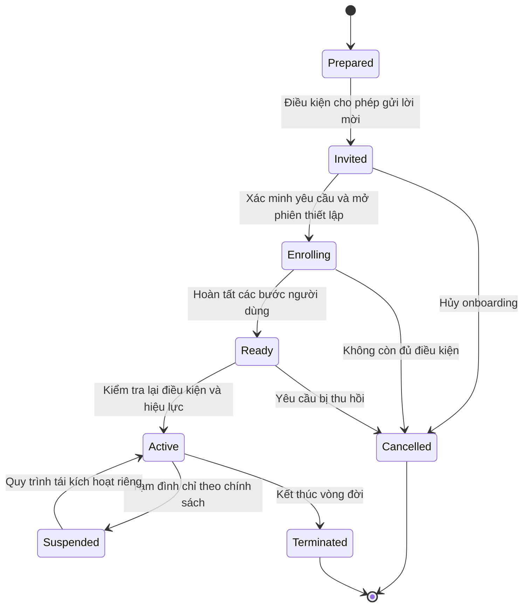
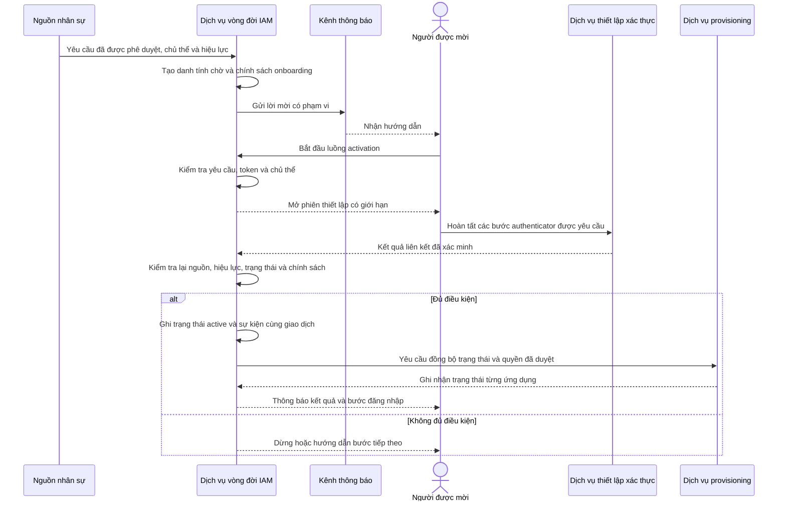

# Identity activation: kích hoạt danh tính đúng người, đúng điều kiện và đúng thời điểm

## 1. Identity activation là gì?

**Identity activation** là bước chuyển một danh tính hoặc tài khoản từ trạng thái đã được chuẩn bị nhưng chưa được phép sử dụng đầy đủ sang trạng thái được phép tham gia những hoạt động đã xác định trong hệ thống. Bước này phải dựa trên các điều kiện được chính sách yêu cầu, không chỉ dựa vào việc một bản ghi tài khoản đã tồn tại.

Ví dụ, hệ thống nhân sự tạo hồ sơ cho Linh trước ngày bắt đầu làm việc. IAM có thể chuẩn bị tài khoản và gửi hướng dẫn thiết lập, nhưng chưa cho Linh truy cập ứng dụng nghiệp vụ. Khi đến thời điểm có hiệu lực, quan hệ nhân sự được xác nhận, người nhận đã được liên kết đúng với tài khoản và các bước thiết lập xác thực hoàn tất, hệ thống mới cho phép sử dụng tài khoản theo chính sách.

Trong bài này, activation được dùng theo nghĩa **kích hoạt trong vòng đời danh tính**. Tên trạng thái, trình tự và điều kiện cụ thể là lựa chọn thiết kế của từng tổ chức; không có một state machine duy nhất được mọi sản phẩm IAM dùng giống nhau.

Trong nền tảng quản lý danh tính và quyền truy cập (IAM), activation nối các việc tạo danh tính, kiểm chứng, gắn authenticator, quản lý quyền, cấp phát ứng dụng và thiết lập phiên. Thiết kế tốt giúp người hợp lệ bắt đầu công việc đúng lúc, đồng thời hạn chế mở quyền quá sớm, kích hoạt nhầm người hoặc bỏ qua MFA.

Sau bài này, người học có thể:

- Phân biệt kích hoạt tài khoản với xác minh email, identity proofing và kích hoạt authenticator.
- Xác định các điều kiện cần kiểm tra trước khi cho phép sử dụng tài khoản.
- Thiết kế luồng lời mời và phiên thiết lập có giới hạn.
- Xử lý lời mời hết hạn, thay đổi nhân sự, yêu cầu lặp và đồng bộ sang nhiều ứng dụng.
- Giải thích vì sao tài khoản active chưa đồng nghĩa được phép truy cập mọi tài nguyên.

## 2. Những khái niệm không nên gộp làm một

| Hoạt động | Kết quả trực tiếp | Điều chưa thể tự suy ra |
| --- | --- | --- |
| Identity creation | Có bản ghi và định danh nội bộ | Chủ thể đã nhận tài khoản hoặc được phép dùng |
| Identity proofing | Có căn cứ liên kết người đăng ký với danh tính theo mức bảo đảm | Đã có quan hệ lao động, quyền nghiệp vụ hoặc authenticator phù hợp |
| Email verification | Có bằng chứng kiểm soát địa chỉ nhận tại thời điểm thực hiện | Danh tính ngoài đời đã được kiểm chứng đầy đủ |
| Authenticator binding | Một authenticator được gắn với đúng tài khoản | Mọi điều kiện kích hoạt và phân quyền đã hoàn tất |
| Identity/account activation | Chính sách cho phép chuyển sang sử dụng tài khoản trong phạm vi xác định | Có mọi quyền hoặc mọi ứng dụng đích đã sẵn sàng |
| Provisioning | Tài khoản, thuộc tính hoặc quyền được tạo/cập nhật ở hệ thống đích | Người dùng đã nhận và hoàn tất luồng activation |
| Authentication | Chủ thể chứng minh kiểm soát authenticator hợp lệ | Được phép làm mọi thao tác sau khi đăng nhập |
| Authorization | Quyết định cho phép hành động trên tài nguyên | Các quyết định cho tài nguyên khác cũng được cho phép |

### 2.1. “Activation” trong NIST SP 800-63B có nghĩa riêng

Trong thuật ngữ của NIST SP 800-63B-4, **activation** là việc cung cấp activation factor để cho phép sử dụng một multi-factor authenticator. Ví dụ, PIN cục bộ mở quyền sử dụng khóa trong thiết bị là activation secret; đó không phải thao tác chuyển trạng thái tài khoản doanh nghiệp từ pending sang active.

Vì vậy, tài liệu kiến trúc nên ghi rõ đang nói đến account activation hay authenticator activation. Một lần nhập PIN đúng không thể thay thế quyết định tài khoản có còn được phép hoạt động hay không. [Nguồn: NIST SP 800-63B-4, Glossary](https://pages.nist.gov/800-63-4/sp800-63b/glossary/).

### 2.2. Email hợp lệ không phải toàn bộ danh tính

Một địa chỉ đúng cú pháp chưa chứng minh nhận được thư. Một lần hoàn tất liên kết xác minh có thể chứng minh khả năng truy cập hộp thư nhưng không tự chứng minh quan hệ nhân sự hoặc danh tính ngoài đời. Với tài khoản rủi ro cao, chính sách phải xác định bằng chứng và xác thực bổ sung cần thiết.

OWASP khuyến nghị kiểm tra quyền kiểm soát email trước khi cho phép sử dụng tài khoản trong luồng dựa vào email, cùng token ngẫu nhiên, dùng một lần và có giới hạn thời gian. Đây là kiểm soát cho quan hệ với email; không nên tự gán nó thành một mức IAL hoặc AAL cao hơn. [Nguồn: OWASP Email Validation and Verification Cheat Sheet](https://cheatsheetseries.owasp.org/cheatsheets/Email_Validation_and_Verification_Cheat_Sheet.html#email-ownership-verification).

## 3. Kích hoạt một tài khoản là cho phép điều gì?

Trước khi thiết kế nút “Kích hoạt”, cần xác định phạm vi của quyết định:

- Cho phép bắt đầu thiết lập authenticator hay cho phép đăng nhập vào ứng dụng?
- Cho phép vào cổng nhân viên hay cả hệ thống sản xuất?
- Kích hoạt tài khoản gốc tại IdP hay tài khoản cục bộ ở một RP?
- Có hiệu lực ngay hay tại một thời điểm nghiệp vụ đã được phê duyệt?
- Quyền nào được cấp mặc định và quyền nào cần yêu cầu riêng?

Không làm rõ phạm vi dễ dẫn đến một cờ `active` phải đại diện cho quá nhiều việc. Ví dụ, Linh đã đủ điều kiện dùng IdP nhưng tài khoản trong một SaaS vẫn đang chờ tạo. Nếu hệ thống chỉ lưu một boolean chung, màn hình có thể báo thành công trong khi ứng dụng vẫn từ chối hoặc chưa được kiểm soát đúng.

Một cách biểu diễn rõ hơn là tách các chiều trạng thái. Đây là mô hình minh họa, không phải schema tiêu chuẩn:

| Chiều trạng thái | Ví dụ dữ liệu cần biết |
| --- | --- |
| Điều kiện nghiệp vụ | Hợp đồng hoặc hồ sơ nguồn còn hiệu lực, đúng ngày bắt đầu |
| Độ tin cậy của liên kết chủ thể | Đã hoàn tất các bước proofing, xác minh hoặc liên kết danh tính cần thiết |
| Khả năng xác thực | Có authenticator phù hợp, các yêu cầu MFA đã được thực hiện |
| Trạng thái vòng đời | Pending, active, suspended hoặc terminated theo mô hình nội bộ |
| Trạng thái ứng dụng đích | Chưa tạo, đang đồng bộ, sẵn sàng hoặc lỗi |
| Quyền và phạm vi | Vai trò, nhóm, tenant, thời hạn và tài nguyên được phép |

Khi đăng nhập hoặc truy cập tài nguyên, các chiều này phối hợp với nhau. Không nên xem thành công ở một chiều là bằng chứng các chiều còn lại đã đạt.

## 4. Nguồn có thẩm quyền và liên kết đúng chủ thể

### 4.1. Điều kiện nghiệp vụ đến từ đâu?

Đối với nhân viên, dữ liệu có thể đến từ hệ thống nhân sự. Với nhà thầu, có thể là hồ sơ hợp đồng và người bảo trợ. Với khách hàng tự đăng ký, có thể là yêu cầu đăng ký đã được kiểm tra theo chính sách của dịch vụ.

Mỗi trường điều kiện cần xác định nguồn chịu trách nhiệm. Ví dụ, frontend không được tự quyết định `employmentStatus = active` chỉ vì người dùng chọn một checkbox. Dịch vụ gửi email thành công cũng không có thẩm quyền xác nhận người đó đã đủ điều kiện truy cập doanh nghiệp.

### 4.2. Dùng định danh ổn định để ràng buộc yêu cầu

Lời mời cần gắn với đúng tài khoản nội bộ, tenant và mục đích. Địa chỉ email là kênh liên hệ hoặc một thuộc tính; nó có thể thay đổi, bị nhập sai hoặc được cấp lại. Không nên chỉ tìm tài khoản theo email rồi kích hoạt bất kỳ bản ghi nào khớp ở thời điểm nhấp liên kết.

Trong mô hình subscriber account của NIST, CSP duy trì định danh duy nhất và hồ sơ các authenticator gắn với tài khoản. Đây là cơ sở hữu ích để tránh dùng thuộc tính liên hệ làm toàn bộ định danh của chủ thể. [Nguồn: NIST SP 800-63A-4, mục 5](https://pages.nist.gov/800-63-4/sp800-63a/accounts/).

Nếu người dùng đã có danh tính ở một IdP bên ngoài, cần xử lý liên kết theo issuer và subject đã được kiểm tra, cùng quy tắc của tổ chức. Không tự gộp tài khoản chỉ vì assertion có email giống lời mời. Việc kích hoạt nhầm liên kết có thể trao quyền của người được mời cho một danh tính khác.

### 4.3. Thời điểm có hiệu lực phải được diễn đạt chính xác

“Ngày bắt đầu làm việc” cần được chuyển thành điều kiện thời gian rõ ràng: nguồn nào cung cấp, dùng múi giờ nào và thời điểm nào bắt đầu cho phép truy cập. Nếu người dùng đổi múi giờ trình duyệt, điều kiện nghiệp vụ không được thay đổi theo.

Lời mời có thể được gửi trước ngày bắt đầu để chuẩn bị, nhưng chính sách phải quy định trước ngày đó người dùng chỉ được làm gì. Thời hạn token và thời điểm được phép hoạt động là hai điều kiện khác nhau: token chưa hết hạn không có nghĩa quan hệ nghiệp vụ vẫn hợp lệ.

## 5. Điều kiện hoàn tất activation

Một chính sách mẫu có thể yêu cầu những nhóm điều kiện sau. Tổ hợp thực tế phải phù hợp loại chủ thể và rủi ro của dịch vụ.

| Nhóm điều kiện | Ví dụ kiểm tra |
| --- | --- |
| Nguồn và thẩm quyền | Yêu cầu từ nguồn được tin cậy; người phê duyệt có quyền trong tenant tương ứng |
| Liên kết tài khoản | Đúng subject, đúng tenant, không bị trùng hoặc gắn nhầm |
| Trạng thái hiện tại | Chưa bị hủy onboarding, đình chỉ hoặc chấm dứt |
| Hiệu lực nghiệp vụ | Đã đến thời điểm được phép và chưa hết thời hạn liên quan |
| Bảo đảm danh tính | Hoàn tất proofing hoặc các bước liên kết được yêu cầu; ghi đúng mức đã đạt |
| Xác thực | Authenticator đã gắn đúng, phù hợp chính sách AAL/MFA |
| Thiết lập phục hồi | Có phương án phục hồi phù hợp nếu chính sách yêu cầu |
| Quyền ban đầu | Bộ quyền tối thiểu đã được xác định và phê duyệt theo quy trình |
| Điều kiện ứng dụng | Các phụ thuộc bắt buộc đã sẵn sàng hoặc được giới hạn truy cập đúng cách |

MFA không nhất thiết có nghĩa hai thiết bị hoặc một mật khẩu cộng mọi loại mã. Cần đánh giá đặc tính authenticator theo chính sách. Nếu ứng dụng yêu cầu xác thực mạnh, không được cho sử dụng chức năng đó chỉ vì đã gửi được một email activation.

Theo NIST, authenticator binding thiết lập liên kết giữa authenticator và subscriber account; hệ thống cần biết đặc tính authenticator để xác định khả năng đáp ứng AAL. Chỉ lưu một nhãn `mfaEnabled = true` do giao diện gửi lên không chứng minh liên kết đó đã hoàn tất. [Nguồn: NIST SP 800-63B-4, mục 4.1](https://pages.nist.gov/800-63-4/sp800-63b/events/#authenticator-binding).

## 6. Trạng thái và phiên thiết lập có giới hạn

### 6.1. State machine tham khảo



Tên trạng thái trên chỉ để minh họa. Hết hạn lời mời có thể là trạng thái của lời mời, trong khi bản ghi danh tính vẫn ở trạng thái chờ. Không nên tự kết thúc danh tính hoặc mở tài khoản chỉ vì token chuyển sang trạng thái khác.

### 6.2. Giải quyết vòng lặp “chưa active thì không thể thiết lập MFA”

Một luồng activation có thể cần cho người dùng đăng ký authenticator trước khi được phép dùng ứng dụng. Cách giải quyết là cấp **phiên onboarding có giới hạn**, được ràng buộc với yêu cầu đã kiểm tra và chỉ có quyền thực hiện các bước thiết lập.

Phiên này có thể cho phép xem hướng dẫn, cung cấp thông tin được phép hoặc thực hiện giao thức đăng ký authenticator. Nó không được dùng như phiên truy cập đầy đủ, không tự mang role quản trị và không trở thành access token dùng cho các API nghiệp vụ.

Phạm vi của phiên và bằng chứng ban đầu phải đủ cho quy trình gắn authenticator được chọn. Với tài khoản cần bảo đảm cao, một liên kết email đơn lẻ không phải lời giải chung cho việc chứng minh đúng chủ thể.

### 6.3. Phân biệt hoàn tất cấu hình với chứng minh sử dụng

Hiển thị mã QR TOTP hoặc một màn hình đăng ký không đồng nghĩa người dùng đã hoàn tất. Nếu dùng TOTP, cần bước xác nhận đầu ra hợp lệ theo quy trình trước khi coi liên kết đã sẵn sàng. Nếu dùng WebAuthn, cần xác minh đầy đủ kết quả đăng ký và các ràng buộc của giao thức, không chỉ lưu public key do client tự gửi.

Theo chính sách và loại authenticator, hệ thống cũng có thể yêu cầu một lần xác thực phù hợp để xác nhận người dùng sử dụng được phương tiện vừa gắn. Bài không giả định mọi tài khoản đều phải có mật khẩu; luồng passwordless vẫn cần liên kết và kiểm tra authenticator đúng cách.

## 7. Lời mời và token activation

### 7.1. Token phải có mục đích và phạm vi

Một token activation nên được ràng buộc phía máy chủ với tài khoản, tenant, mục đích, thời hạn và trạng thái sử dụng. Không dùng lại cùng loại token cho reset mật khẩu, thay email và nhận quyền quản trị mà không phân biệt mục đích.

OWASP hướng dẫn bảo vệ token cho luồng reset bằng giá trị ngẫu nhiên an toàn mật mã, đủ khó đoán, dùng một lần, có hạn và lưu an toàn. Những nguyên tắc này hữu ích khi thiết kế token onboarding, nhưng không làm activation trở thành cùng một nghiệp vụ với reset mật khẩu. [Nguồn: OWASP Forgot Password Cheat Sheet](https://cheatsheetseries.owasp.org/cheatsheets/Forgot_Password_Cheat_Sheet.html#general-security-practices).

Một phương án triển khai minh họa là dùng token opaque gồm 32 byte ngẫu nhiên từ CSPRNG, biểu diễn bằng base64url và chỉ lưu giá trị băm phù hợp để đối chiếu. Đây là lựa chọn thiết kế cho token entropy cao, không phải quy định độ dài chung của NIST cho mọi mã xác nhận hoặc mọi activation flow.

Độ dài token không thay thế giới hạn thử, kiểm tra thời hạn hoặc bảo vệ nơi nhận. Nếu dùng mã ngắn để nhập tay, cần thiết kế cơ chế giới hạn và mức bảo đảm tương ứng, không áp dụng nguyên xi cách xử lý của token dài.

### 7.2. Token không phải access token ứng dụng

Lời mời cấp quyền thực hiện một hành động onboarding cụ thể, không tự trao quyền đăng nhập vào toàn bộ hệ thống. Backend phải kiểm tra phạm vi của phiên hoặc token tại từng endpoint; không chỉ dựa vào việc frontend điều hướng đến đúng màn hình.

Không đưa role, subject hoặc tenant do trình duyệt khai báo thành căn cứ quyết định. Nếu lời mời dành cho tài khoản A, người dùng không được đổi một tham số thành tài khoản B rồi dùng cùng token để kích hoạt B.

### 7.3. Bảo vệ đường đi của liên kết

Khi áp dụng liên kết mang token, dùng URL HTTPS từ miền được cấu hình tin cậy; tránh tạo miền đích trực tiếp từ header không được kiểm tra. Trang xử lý cần hạn chế lộ token qua referrer, log và tích hợp bên thứ ba. [Nguồn: OWASP Forgot Password Cheat Sheet, phần URL Tokens](https://cheatsheetseries.owasp.org/cheatsheets/Forgot_Password_Cheat_Sheet.html#url-tokens).

Hệ thống gửi thư, proxy, công cụ báo lỗi và hệ thống theo dõi phiên đều cần được xem xét khi quyết định nơi token có thể xuất hiện. Chỉ che token trong log của controller chưa đủ nếu access log ở lớp trước vẫn ghi toàn bộ URL.

### 7.4. Mở trang không nên tự chuyển tài khoản sang active

HTTP GET có ngữ nghĩa an toàn, chủ yếu để truy xuất. Thay đổi quan trọng như hoàn tất kích hoạt cần có bước hành động phù hợp và được xác minh; không thực hiện chỉ vì một URL bị mở. Điều này phù hợp với ngữ nghĩa phương thức trong RFC 9110. [Nguồn: RFC 9110, mục 9.2.1](https://www.rfc-editor.org/rfc/rfc9110.html#section-9.2.1).

Trong một tình huống triển khai, công cụ kiểm tra liên kết có thể mở URL trước người dùng. Nếu GET tự tiêu thụ token và cấp quyền, một thao tác tự động có thể làm sai luồng. Thiết kế có thể hiển thị trang xác nhận rồi yêu cầu hành động rõ ràng, đồng thời giữ đầy đủ các bước xác minh cần thiết.

Chuyển sang POST không tự giải quyết xác thực hoặc CSRF. Cần kiểm tra token, ngữ cảnh phiên, điều kiện nghiệp vụ và kiểm soát CSRF phù hợp với kiểu phiên được sử dụng.

## 8. Luồng activation từ đầu đến cuối

Sơ đồ sau minh họa onboarding của nhân viên. Các bước proofing và xác minh cụ thể phụ thuộc chính sách; chúng không được mặc nhiên bỏ qua vì có email lời mời.



Nếu một ứng dụng bắt buộc phải sẵn sàng trước khi activation có hiệu lực, trạng thái ready nên chờ xác nhận phụ thuộc đó. Nếu hệ thống cho phép activation trung tâm trước và provisioning sau, phải giới hạn truy cập ở ứng dụng chưa sẵn sàng và hiển thị đúng trạng thái. Không có một thứ tự duy nhất phù hợp mọi kiến trúc.

## 9. Ghi trạng thái an toàn khi có yêu cầu lặp và cạnh tranh

### 9.1. Kiểm tra lại ngay trước bước có hiệu lực

Các điều kiện có thể đúng khi gửi thư nhưng không còn đúng khi người nhận hoàn tất. Ví dụ, lời mời được gửi hôm thứ Hai, yêu cầu onboarding bị hủy hôm thứ Ba và token vẫn còn thời hạn vào thứ Tư.

Vì vậy, thao tác hoàn tất cần kiểm tra trạng thái hiện tại và phiên bản của dữ liệu điều kiện. Nếu hệ thống đọc bản sao bất đồng bộ, cần xác định độ mới được chấp nhận và cách xử lý khi không xác nhận được điều kiện. Không nên tuyên bố kiểm tra “nguồn mới nhất” nếu thực tế chỉ đọc một cache không biết độ trễ.

### 9.2. Tiêu thụ token và kích hoạt phải nhất quán

Một lỗi thường gặp là kiểm tra token chưa dùng, đổi tài khoản thành active, rồi mới đánh dấu token đã dùng bằng một giao dịch khác. Hai request đồng thời có thể cùng vượt qua kiểm tra đầu tiên.

Giả mã sau mô tả một cách tổ chức logic; đây không phải code chạy trực tiếp hoặc giao thức chuẩn:

```text
Khi hoàn tất activation:
    xác minh request và phiên onboarding
    lấy các kết quả xác minh từ nguồn phía máy chủ
    đọc điều kiện nghiệp vụ hiện tại theo cơ chế tin cậy đã thiết kế

    bắt đầu giao dịch cập nhật trạng thái:
        khóa hoặc kiểm tra phiên bản bản ghi danh tính và yêu cầu activation
        xác nhận token đúng tài khoản, tenant, mục đích và còn hiệu lực
        xác nhận yêu cầu chưa bị dùng, thu hồi hoặc thay thế
        xác nhận trạng thái cho phép chuyển và điều kiện nghiệp vụ còn hợp lệ
        xác nhận authenticator và các bước bắt buộc đã hoàn tất
        nếu dữ liệu điều kiện đã đổi: dừng và đánh giá lại
        tiêu thụ token và hoàn tất phiên onboarding
        ghi trạng thái active, thời điểm và phiên bản chính sách
        ghi sự kiện cần đồng bộ vào outbox
        commit

    bộ xử lý nền chuyển sự kiện tới các hệ thống đích
    trả kết quả phù hợp, không dùng lại token để mở thêm phiên
```

Giao dịch cục bộ không thể tự khóa một hệ thống nhân sự nằm ở nơi khác. Nếu có thay đổi đồng thời bên ngoài, kiến trúc cần cơ chế phiên bản, thứ tự sự kiện, đối soát và thu hồi để thu hẹp hoặc xử lý khoảng trễ. Cần nêu rõ giới hạn nhất quán đó.

### 9.3. Idempotency khác với chấp nhận replay token

Người dùng có thể gửi lại request vì mất mạng sau khi máy chủ đã hoàn tất. Hệ thống nên nhận biết cùng một thao tác để không tạo thêm tài khoản, lời mời hoặc quyền. Nhưng điều đó không có nghĩa token đã dùng được phép tiếp tục thiết lập authenticator hoặc tạo các phiên đăng nhập mới.

Một kết quả lặp an toàn có thể báo trạng thái đã hoàn tất và hướng dẫn đăng nhập bình thường. Bất kỳ việc cấp phiên sử dụng nào vẫn cần đi qua quy trình xác thực tương ứng.

### 9.4. Thay lời mời cần quy tắc rõ

Có thể chọn chính sách phát hành lại làm vô hiệu token cũ, hoặc quản lý một số lời mời còn hiệu lực theo nhu cầu cụ thể. Dù chọn cách nào, phải quy định rõ token nào còn dùng được và việc hoàn tất một yêu cầu tác động thế nào đến các yêu cầu khác.

Không giữ vô hạn các lời mời pending. Yêu cầu đã hủy, thay địa chỉ nhận hoặc kết thúc onboarding cần được xử lý để tránh một đường kích hoạt tồn tại lâu hơn nhu cầu.

## 10. Đồng bộ sang ứng dụng và ý nghĩa của SCIM active

SCIM định nghĩa `active` là trạng thái quản trị của User. Ý nghĩa cuối cùng do service provider xác định; ví dụ điển hình là `true` cho phép đăng nhập và `false` thể hiện đình chỉ. Đây không phải bằng chứng đã hoàn tất MFA, proofing hoặc mọi bước onboarding. [Nguồn: RFC 7643, mục 4.1.1](https://www.rfc-editor.org/rfc/rfc7643.html#section-4.1.1).

Khi ánh xạ sang SCIM, cần xác nhận ứng dụng đích thực thi trạng thái ra sao. Hệ thống IAM cũng cần biết ứng dụng đã áp dụng thay đổi hay mới nhận yêu cầu. Những ứng dụng có tài khoản hoặc phiên cục bộ cần được kiểm soát theo hành vi thực tế của chúng.

### 10.1. Desired state và observed state

Một mô hình nội bộ có thể tách:

- **Desired state:** IAM muốn tài khoản đích ở trạng thái nào theo chính sách hiện tại.
- **Observed state:** trạng thái đã đọc lại hoặc được xác nhận đáng tin cậy từ hệ thống đích.
- **Sync state:** yêu cầu đang chờ, đã hoàn tất hoặc bị lỗi.

Ví dụ, activation trung tâm đã hoàn tất nhưng SaaS A trả lỗi tạm thời khi tạo tài khoản. Hệ thống cần retry và thông báo trạng thái phù hợp, không tự cấp quyền rộng hơn để “đăng nhập tạm”.

### 10.2. Sự kiện cũ không được mở lại tài khoản đã chấm dứt

Nếu sự kiện activation cũ đến sau sự kiện chấm dứt, một consumer chỉ nhìn tên sự kiện có thể đặt `active = true` sai. Cách triển khai có thể dùng phiên bản tăng theo danh tính, trạng thái mong muốn hiện tại và cơ chế đối soát để không áp dụng yêu cầu đã lỗi thời.

Transactional outbox giúp giảm tình huống trạng thái đã commit nhưng sự kiện không được phát. Nó không tự bảo đảm đúng thứ tự ở mọi hệ thống, không tự tạo xử lý đúng một lần và không thay thế deduplication của bên nhận. Đây là những lựa chọn kỹ thuật cần cụ thể hóa theo nền tảng triển khai.

## 11. Activation không thay thế đăng nhập và phân quyền

Một tài khoản có thể active nhưng lần xác thực hiện tại chưa đáp ứng yêu cầu của tài nguyên. Người dùng cũng có thể đăng nhập thành công nhưng không có quyền vào một dự án cụ thể.

Một mô hình quyết định minh họa:

```text
Cho phép hành động khi:
    danh tính/tài khoản vẫn đủ điều kiện sử dụng
    VÀ phiên hoặc thông tin xác thực đáp ứng chính sách
    VÀ tài khoản đích ở trạng thái được phép
    VÀ quyền RBAC/ABAC cho phép hành động trên tài nguyên
    VÀ các điều kiện bổ sung của tài nguyên được đáp ứng
```

Đánh dấu active không nên tự thêm mọi nhóm có sẵn vào tài khoản. Quyền khởi đầu cần dựa trên vai trò và phạm vi đã duyệt. Quyền đặc quyền, quyền sản xuất hoặc quyền tạm thời có thể cần quy trình riêng.

Sau khi hoàn tất onboarding, hệ thống có thể yêu cầu đăng nhập bằng authenticator đã gắn. Nếu thiết kế tiếp tục một phiên sẵn có, cần bảo đảm phiên mới có ngữ cảnh xác thực thực sự đáp ứng chính sách, thay đổi định danh phiên khi phù hợp và không nâng một phiên lời mời có bảo đảm thấp thành phiên đặc quyền bằng cách đổi cờ.

Trong SSO/OIDC/SAML, một assertion hợp lệ cũng không tự thay quyết định vòng đời của tài khoản cục bộ. RP phải áp dụng trạng thái và chính sách của mình; đặc biệt không để một luồng just-in-time provisioning bỏ qua tài khoản đã bị hủy hoặc liên kết nhầm người.

## 12. Lỗi, ngoại lệ và các tình huống vận hành

| Tình huống | Hướng xử lý |
| --- | --- |
| Người dùng không nhận được thư | Kiểm tra kênh giao nhận và quy trình gửi lại có giới hạn; không tự đổi sang địa chỉ bất kỳ |
| Lời mời hết hạn | Đánh giá lại điều kiện rồi mới phát hành yêu cầu mới theo chính sách |
| Email được nhập sai | Sửa qua nguồn hoặc người có thẩm quyền, xử lý yêu cầu cũ và xác minh liên kết mới |
| Hai request hoàn tất đồng thời | Bảo đảm một lần chuyển trạng thái có hiệu lực, không gắn thêm authenticator hoặc cấp quyền lặp |
| Hủy hợp đồng khi người dùng đang thiết lập | Kiểm tra lại điều kiện ở bước cuối và ngăn sử dụng; xử lý dữ liệu thiết lập theo vòng đời phù hợp |
| Authenticator đã gắn nhưng chưa tới ngày bắt đầu | Giữ phạm vi hạn chế nếu chính sách cho phép chuẩn bị trước; chưa mở ứng dụng nghiệp vụ |
| Một ứng dụng chưa provision xong | Ghi lỗi theo ứng dụng, retry/đối soát và giới hạn truy cập theo trạng thái thực tế |
| Người dùng báo không hề yêu cầu kích hoạt | Thu hồi yêu cầu nghi ngờ, điều tra liên kết và xử lý authenticator hoặc phiên phát sinh nếu có |
| Tài khoản từng bị đình chỉ | Thực hiện quy trình tái kích hoạt với điều kiện hiện tại; không dùng lời mời cũ để bỏ qua đình chỉ |

### 12.1. Tái kích hoạt cần đánh giá mới

Suspension có thể vì nghi ngờ xâm phạm, thiếu điều kiện hoặc yêu cầu nghiệp vụ. Bỏ suspension cần biết nguyên nhân đã được xử lý chưa, authenticator nào còn tin cậy và quyền nào còn phù hợp. Không nên khôi phục tất cả quyền cũ chỉ vì người dùng quay lại.

Với tài khoản đã terminated, tổ chức cần quyết định tạo mới hay nối lại hồ sơ theo quy trình được phép. Việc tái tuyển dụng không tự hợp thức hóa phiên cũ, khóa cũ hoặc quyền đặc quyền của lần làm việc trước.

### 12.2. Recovery và activation là hai nghiệp vụ khác nhau

Recovery giúp lấy lại quyền kiểm soát một tài khoản đã tồn tại. Activation thiết lập khả năng sử dụng theo điều kiện vòng đời. Dùng đường activation để reset MFA của tài khoản active có thể tạo một lối bỏ qua cơ chế phục hồi đã được thiết kế.

NIST phân biệt account recovery và authenticator binding trong quản lý vòng đời authenticator. Khi triển khai, cần định tuyến đến đúng quy trình và ghi đúng loại sự kiện thay vì dùng một token “đa năng”. [Nguồn: NIST SP 800-63B-4, mục 4](https://pages.nist.gov/800-63-4/sp800-63b/events/).

## 13. Activation cho workload và tài khoản đặc quyền

### 13.1. Workload không cần một email nhận lời mời như con người

Một service account hoặc workload identity cần được cho phép hoạt động dựa trên nguồn khai báo triển khai, chủ sở hữu, môi trường và chính sách cấp danh tính tương ứng. Bằng chứng có thể gắn với hệ thống triển khai hoặc nền tảng chạy workload, không phải thao tác một nhân viên nhấp email thay cho dịch vụ.

Những câu hỏi vẫn tương tự ở cấp vòng đời:

- Workload nào được phép nhận danh tính, trong môi trường nào?
- Ai chịu trách nhiệm và đã phê duyệt phạm vi quyền nào?
- Credential hoặc liên kết federation được cấp cho đúng workload chưa?
- Khi bị hủy triển khai hoặc chuyển môi trường, quyền có bị thu hồi không?

Không nên chuyển một lời mời người dùng thành khóa API dùng chung để tự động hóa. Người vận hành kích hoạt cấu hình không đồng nghĩa họ là chủ thể nên được sử dụng trong mọi lần gọi API của workload.

### 13.2. Kích hoạt danh tính khác kích hoạt đặc quyền tạm thời

Một tài khoản thông thường có thể active trong suốt thời gian làm việc, còn quyền quản trị chỉ được cấp trong một khoảng thời gian ngắn theo yêu cầu. Đây là hai quyết định độc lập: vòng đời tài khoản và vòng đời đặc quyền.

Nếu dùng cơ chế cấp quyền đúng lúc, cần xác định tài nguyên, thời hạn, phê duyệt và mức xác thực. Không dùng trạng thái “đã kích hoạt đặc quyền” để bỏ qua việc tài khoản gốc đã bị đình chỉ.

## 14. Kiểm toán, quyền riêng tư và quan sát vận hành

### 14.1. Dấu vết cần giải thích được quyết định

Một sự kiện activation hữu ích có thể ghi mã danh tính nội bộ, yêu cầu nguồn, actor, tenant, thời điểm, chính sách, phiên bản trạng thái, kết quả và tham chiếu authenticator hoặc phê duyệt cần thiết. Nó cần trả lời được: ai hoặc dịch vụ nào đã cho phép chuyển trạng thái, dựa trên điều kiện nào và ứng dụng nào đã áp dụng kết quả.

Không ghi token lời mời, password, secret TOTP, khóa riêng, recovery code hoặc toàn bộ URL mang token. Dữ liệu proofing thô không nên được sao chép vào log activation khi tham chiếu và kết quả đã đủ cho tác vụ.

Ví dụ sự kiện nội bộ, không phải schema chuẩn:

```json
{
  "event": "identity.activation.completed",
  "subject_ref": "subject_demo_003",
  "tenant_ref": "tenant_demo_a",
  "request_ref": "onboarding_demo_91",
  "policy_version": "activation-policy-v2",
  "lifecycle_version": 7,
  "result": "active",
  "provisioning_state": "pending"
}
```

Sự kiện có `provisioning_state = pending` cho biết hệ thống này cho phép hoàn tất activation trung tâm trước đồng bộ ứng dụng. Không được dùng cùng ý nghĩa đó trong một kiến trúc yêu cầu ứng dụng bắt buộc phải sẵn sàng trước khi activation hoàn tất mà không sửa mô hình.

### 14.2. Chỉ số nên phân biệt các bước

| Chỉ số | Vấn đề có thể làm rõ |
| --- | --- |
| Thời gian từ phê duyệt đến sẵn sàng mời | Độ trễ chuẩn bị danh tính |
| Tỷ lệ lời mời hết hạn | Vấn đề giao nhận, hướng dẫn hoặc thời điểm mời |
| Tỷ lệ dở dang ở bước authenticator | Khả năng sử dụng và hỗ trợ thiết lập |
| Thời gian từ đủ điều kiện đến active | Hiệu quả quy trình activation |
| Độ trễ provisioning theo ứng dụng | Khoảng cách giữa trạng thái trung tâm và hệ thống đích |
| Số yêu cầu bị hủy trước khi active | Chất lượng và thay đổi của dữ liệu đầu vào |
| Activation bất thường hoặc bị phản đối | Nguy cơ nhầm chủ thể, lạm dụng lời mời hoặc đặc quyền |

Tỷ lệ activation cao không đủ chứng minh quy trình tốt nếu đạt được bằng cách bỏ kiểm tra hoặc cấp quyền sớm. Cần nhìn cùng số liệu về sai liên kết, yêu cầu bị thu hồi, lỗi đồng bộ và thời gian xử lý ngoại lệ.

## 15. Ví dụ hoàn chỉnh: nhân viên mới bắt đầu vào thứ Hai

Doanh nghiệp cho phép Linh thiết lập xác thực trước ngày bắt đầu, nhưng chỉ cho dùng ứng dụng nghiệp vụ từ thời điểm hiệu lực do nguồn nhân sự quy định. Quyền cơ bản gồm cổng nhân viên và kho tài liệu của nhóm; quyền sản xuất cần một phê duyệt khác.

1. Nguồn nhân sự tạo yêu cầu đã được phê duyệt. IAM tạo một subject nội bộ ổn định, ghi ngày giờ hiệu lực và trạng thái chuẩn bị.
2. Lời mời được gửi đến kênh đã xác định cho đúng người. Yêu cầu gắn với subject, tenant, mục đích và thời hạn; không chứa quyền quản trị tự chọn từ client.
3. Linh mở liên kết và bắt đầu luồng thiết lập có giới hạn. Những bước xác minh cần thiết được hoàn tất trước khi hệ thống chấp nhận liên kết authenticator.
4. Linh đăng ký phương tiện xác thực phù hợp và hoàn thành kiểm tra sử dụng theo chính sách. Tài khoản vẫn chưa được phép truy cập nghiệp vụ trước thời điểm hiệu lực.
5. Đến thời điểm hiệu lực, IAM kiểm tra lại trạng thái nhân sự và các điều kiện. Nếu vẫn hợp lệ, một lần chuyển trạng thái được ghi nhận cùng sự kiện đồng bộ.
6. Các ứng dụng đích nhận thay đổi và được theo dõi riêng. Linh đăng nhập bằng phương tiện đã gắn; ứng dụng kiểm tra cả trạng thái tài khoản và quyền cụ thể.
7. Khi Linh yêu cầu quyền sản xuất, quy trình phân quyền và tăng mức xác thực được áp dụng riêng. Trạng thái active không tự cấp quyền đó.

Nếu yêu cầu onboarding bị hủy giữa bước 3 và bước 5, tài khoản không được mở theo lịch cũ. Nếu ứng dụng xử lý chậm nhận một sự kiện activation đã lỗi thời sau khi nhận sự kiện hủy, nó phải dùng trạng thái hoặc phiên bản hiện tại để tránh mở lại truy cập.

Ví dụ cho thấy activation vừa là quyết định nghiệp vụ, vừa là một chuyển trạng thái cần được bảo vệ kỹ thuật. Email chỉ là một kênh trong luồng, còn điều kiện có hiệu lực và quyền sử dụng phải do hệ thống có thẩm quyền kiểm soát.

## 16. Những hiểu lầm thường gặp

| Nhận định | Cách hiểu đúng |
| --- | --- |
| “Tạo user xong là user đã được kích hoạt.” | Tồn tại bản ghi và được phép sử dụng là hai điều khác nhau. |
| “Nhấp email chứng minh đủ danh tính.” | Chỉ có giá trị trong phạm vi bằng chứng của kênh và luồng; không tự thay proofing hoặc quan hệ nghiệp vụ. |
| “Đặt active là đủ cho mọi ứng dụng.” | Còn trạng thái đồng bộ, tài khoản cục bộ, phiên và chính sách ở từng nơi. |
| “Đã hiển thị QR MFA là xong.” | Cần hoàn tất và xác minh giao thức gắn authenticator phù hợp. |
| “Token chưa hết hạn thì vẫn được mở tài khoản.” | Điều kiện nghiệp vụ hoặc yêu cầu có thể đã bị thu hồi. |
| “Một token có thể dùng cho activation và recovery.” | Mỗi mục đích có điều kiện và phạm vi riêng, cần được ràng buộc rõ. |
| “Retry an toàn nghĩa là chấp nhận dùng lại token.” | Có thể trả kết quả lặp ổn định mà không cho phép token tạo hành động bảo mật mới. |
| “SCIM active chứng minh người dùng đã hoàn tất onboarding.” | Đây là trạng thái quản trị với ngữ nghĩa do service provider xác định. |
| “SSO thành công là bỏ qua trạng thái tài khoản.” | RP vẫn phải thực thi điều kiện vòng đời và phân quyền của mình. |
| “Người quay lại làm việc được nhận lại mọi quyền cũ.” | Tái kích hoạt cần điều kiện hiện tại và bộ quyền được đánh giá lại. |

Identity activation cần xác lập một ranh giới rõ: trước ranh giới đó, danh tính chỉ được thực hiện những bước chuẩn bị được phép; sau ranh giới đó, tài khoản được sử dụng trong phạm vi chính sách. Quyết định phải gắn với đúng chủ thể, bằng chứng xác thực phù hợp, thời điểm hiệu lực và trạng thái hiện tại của toàn bộ luồng.

## Tài liệu tham khảo

- [NIST SP 800-63A-4 — Subscriber Accounts: định danh duy nhất, hồ sơ authenticator và vòng đời tài khoản](https://pages.nist.gov/800-63-4/sp800-63a/accounts/).
- [NIST SP 800-63B-4 — Authenticator Event Management: binding, recovery và các sự kiện authenticator](https://pages.nist.gov/800-63-4/sp800-63b/events/).
- [NIST SP 800-63B-4 — Glossary: activation, activation factor và activation secret](https://pages.nist.gov/800-63-4/sp800-63b/glossary/).
- [RFC 7643 — SCIM Core Schema, mục 4.1.1: thuộc tính active](https://www.rfc-editor.org/rfc/rfc7643.html#section-4.1.1).
- [RFC 9110 — HTTP Semantics, mục 9.2.1: safe methods](https://www.rfc-editor.org/rfc/rfc9110.html#section-9.2.1).
- [OWASP Email Validation and Verification Cheat Sheet](https://cheatsheetseries.owasp.org/cheatsheets/Email_Validation_and_Verification_Cheat_Sheet.html).
- [OWASP Forgot Password Cheat Sheet — nguyên tắc bảo vệ token cho luồng đặc quyền có giới hạn](https://cheatsheetseries.owasp.org/cheatsheets/Forgot_Password_Cheat_Sheet.html).
